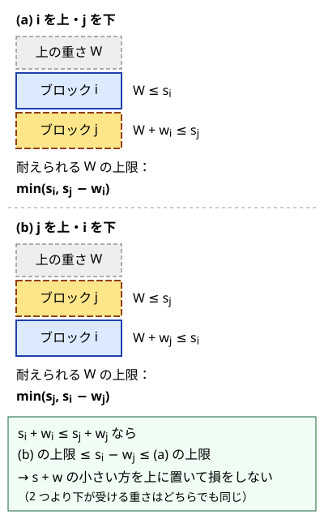

!!! abstract "要点"
    - **何ができるか**：「いくつか選び、好きな順に処理する」問題で、選び方と順序を同時に探さずに済ませる。選ぶ集合が決まれば最適な順序が 1 つの基準のソートで決まる場合、全体を先にその順で並べ、「選ぶ・選ばない」のナップサック型の DP をする。基準は、隣り合う 2 つを入れ替えたときの損得の式から作る。
    - **いつ使うか**：
        - 好きな順番で、いくつか選んで順に処理する。
        - 締切・積み重ね（上に載せられる重さ）がある。
        - 一次関数を好きな順に合成する。
        - 最後の 1 つだけ制限を超えてよい。
    - **計算量**：ソートに $O(N \log N)$、DP に $O(N \times \text{状態の幅})$。状態の幅は、重さや日数の上限 $D$ なら $O(ND)$、選ぶ個数 $K$ なら $O(NK)$ になる。
    - **前提**：[交換論法と比較関数の設計](../basics/exchange-argument.md)、[ナップサック DP](../dp/knapsack-01.md)

<!-- textlint-disable -->
別名：交換論法＋DP・ソートしてから DP・座布団 DP・締切つきナップサック
<!-- textlint-enable -->

並べ替えてから DP するとは、[交換論法](../basics/exchange-argument.md#then-dp)で決めた順に要素を並べておき、その順に「選ぶ・選ばない」を決める DP のことである。順序の自由を先にソートで消すので、残るのは[ナップサック DP](../dp/knapsack-01.md) と同じ形の問題になる。要になるのは、並べる基準を入れ替えの式から導くことと、その基準が選ぶ集合によらないことの確認である。

## 選ぶ集合と順序を分けて考える {#set-and-order}

$N$ 個から何個かを選び、選んだものを好きな順に処理する問題を考える。例として、重さ $w_i$・丈夫さ $s_i$・価値 $v_i$ のブロックを選んで縦に積み、どのブロックも「上に載る重さの合計 $\le s_i$」を満たすようにして、価値の和を最大にする問題を使う（[EDPC X](#dp_x)）。

素朴には、選ぶ集合と積む順序の両方を探すことになる。集合だけで $2^N$ 通り、順序まで含めると $N!$ 通りに近く、$N = 1000$ では到底間に合わない。集合を状態にする [bitDP](../dp/bit-dp.md) でも $N \le 20$ 程度が限界である。

そこで、答えの形を「どの集合を選ぶか」と「その集合をどの順に並べるか」の 2 段に分けて考える。

1. **集合を固定して順序を決める**：選んだ集合の中で、隣り合う 2 つを入れ替えたときの損得を調べる。「$g(i) < g(j)$ なら $i$ を先にしても悪くならない」という基準 $g$ が見つかれば、どの集合でも $g$ の小さい順に並べるのが最適（または、条件を満たす並べ方があるなら $g$ の順でも満たす）と言える
2. **全体を先に並べる**：$g$ は要素 1 つだけで決まる量なので、全体を $g$ の順に並べておけば、どの集合もその部分列として最適な順序に並ぶ
3. **並べた順に DP する**：最適解は「並べた列から何個かを選んだ部分列」の形になる。列の前から 1 つずつ「選ぶ・選ばない」を決める DP で探せる

DP の[状態](../guide/glossary.md#state)には、次の要素を足すときに必要な、これまでの選び方の要約だけを持つ。積み上げなら「ここまでに積んだ重さの合計」である。並べた順で後ろのブロックは前のブロックの下に入るので、新しいブロックが受ける重さは、それまでに積んだ重さの合計そのものになる。合計が同じなら、中身がどのブロックでも先の選び方は変わらない。だから状態は重さの合計だけで足りる。

- 状態：$\mathrm{dp}[t]$ ＝ ここまでのブロックから選んで積んだ塔のうち、重さの合計がちょうど $t$ のものの価値の最大（作れなければ $-\infty$）
- 初期値：$\mathrm{dp}[0] = 0$（何も積まない）
- 遷移：ブロック $i$ を一番下に足す。$t \le s_i$ のときだけ $\mathrm{dp}[t + w_i] \leftarrow \max(\mathrm{dp}[t + w_i], \mathrm{dp}[t] + v_i)$。0-1 なので 1 本の配列なら $t$ の大きい方から回す
- 答え：$\max_t \mathrm{dp}[t]$

```cpp
--8<-- "exchange-argument-dp/tower.cpp:core"
```

完全なプログラム：[`tower.cpp`](https://github.com/yuukougun/kyopro-atlas/blob/main/snippets/exchange-argument-dp/tower.cpp)（GitHub）
{ .kp-code-src }

重さの合計は「下に置いたブロックの $s$」以下の重さに、そのブロックの重さを足したものなので、$\max s + \max w$ を超えない。表の幅はそこで打ち切れる。計算量はソートの $O(N \log N)$ と DP の $O(N \max s)$ である。DP の手間を決めるのは、遷移で回す $t$ の範囲（$0$ 〜 $s_i$）である。表の幅 $\max s + \max w$ はメモリの量にかかわる。

この手順が正しいためには、基準 $g$ が**選ぶ集合によらない**ことが要る。入れ替えの損得が、まわりに何を選んだか（上に載る重さ、開始の時刻など）で向きを変えるなら、全体を 1 つの順に並べることはできない。次の節で、その確かめ方を書く。

## 比較の基準の作り方（入れ替えの差を i だけの量と j だけの量に分ける） {#comparison-key}

比較の基準は、隣り合う 2 つ $i$・$j$ を入れ替えたときの差を式にして作る。まわりから受ける影響（上に載る重さ $W$、開始の時刻 $T$、入ってくる値 $x$）は文字のまま残す。入れ替えで変わるのはその 2 つにかかわる項だけで、外の要素には影響しないことが多い。差の符号が「$i$ だけで決まる量」と「$j$ だけで決まる量」の大小に分かれ、しかも $W$ や $T$ によらなければ、その量が基準になる。

**積み上げ（EDPC X）**。2 つのブロックの上に重さ $W$ が載っているとする。$i$ を上・$j$ を下にすると、条件は $W \le s_i$ と $W + w_i \le s_j$ である。2 つより下のブロックが受ける重さは、どちらの順でも $W + w_i + w_j$ で変わらない。



$s_i + w_i \le s_j + w_j$ と仮定する。$j$ を上にしたときの上限 $\min(s_j, s_i - w_j)$ は $s_i - w_j$ 以下である。一方、$s_i - w_j \le s_i$ は $w_j \ge 0$ から、$s_i - w_j \le s_j - w_i$ は仮定から成り立つ。よって $s_i - w_j \le \min(s_i, s_j - w_i)$ で、$i$ を上にした方が耐えられる $W$ の上限が小さくならない。基準は $g(i) = s_i + w_i$ で、小さい方を上に置く。$W$ は式から消えているので、どの集合を選んでもこの基準でよい。

**締切つきの仕事（典型90 011）**。仕事 $i$ は $C_i$ 日かかり、締切 $D_i$ 日目までに終える必要がある。$i$ の次に $j$ を行い、2 つの開始が $T$ 日目とする。$D_i > D_j$ なのに $i$ を先にしている並べ方が条件を満たすなら、入れ替えても満たす。入れ替えると $j$ は前より早く終わり、$i$ は前に $j$ が終わっていた日 $T + C_i + C_j$ に終わる。その日は $D_j$ 以下で、$D_j < D_i$ だからである。基準は締切 $g(i) = D_i$ で、早い順に並べる。

- 状態：$\mathrm{dp}[t]$ ＝ ここまでの仕事から選び、締切の順に行って $t$ 日目までに終えたときの報酬の最大（途中に空きの日があってもよい）
- 遷移：$t + C_i \le D_i$ なら $\mathrm{dp}[t + C_i] \leftarrow \max(\mathrm{dp}[t + C_i], \mathrm{dp}[t] + S_i)$（$S_i$ は報酬）

**最後の 1 つだけ制限を超えてよい**。「最後に始める 1 つだけは制限時間を過ぎて終わってもよい」形では、最後の 1 つより前のものが制限より前に終わればよく、最後の 1 つの所要時間は制限に数えない。ABC145 E のように時間が整数で、最後の注文が $T - 0.5$ 分までなら、前のものの合計は $T - 1$ 以下である。最後に回すのは、選んだ中で所要時間の最も長いものがよい。それより短いものを最後にしていたなら、最も長いものと入れ替えると、数える時間の合計は 2 つの所要時間の差だけ減る（増えない）からである。そこで所要時間の昇順に並べ、各 $i$ を「最後の 1 つ」と決め打ちする。答えは「$i$ より前の要素だけで、制限（ABC145 E なら $T - 1$）以下に収めたナップサックの最大」＋ $i$ の価値の最大である。DP の表を前から育てながら各 $i$ で答えを更新すれば $O(N \times \text{制限})$ で済む（[練習問題](#practice)の ABC145 E）。

??? question "確認問題：丈夫さだけで並べてはいけない理由"
    積み上げで「丈夫なブロックほど下」、つまり $s$ の大きい順に下から積むと誤る例を作れ。

    ??? success "答え"
        $A$：$w = 1, s = 3$、$B$：$w = 10, s = 2$ とする。$s$ の大きい $A$ を下にすると、$A$ の上に重さ 10 が載り $3$ を超えるので 2 つは積めない。$s + w$ は $A$ が 4、$B$ が 12 なので、基準どおり $A$ を上、$B$ を下にすると、$B$ が受ける重さは 1 で $2$ 以下に収まり、2 つとも積める。重い $B$ は、丈夫さが小さくても下に置く方がよい。

## 比は割らずに掛け算で比べる {#compare-ratios}

入れ替えの差を整理すると、基準が比 $p_i / q_i$ の形になることが多い。このとき比を `double` で計算して並べず、分母を払った掛け算 $p_i q_j < p_j q_i$ で比べる。

例として、一次関数 $f_i(x) = A_i x + B_i$（$A_i, B_i \ge 1$）からいくつか選んで好きな順に合成し、1 に適用した値を最大にする問題を考える（[ABC366 F](#abc366_f)）。$j$ を先に適用し、続けて $i$ を適用した値と、その逆の差を計算する。

$$
f_i(f_j(x)) - f_j(f_i(x)) = (A_i A_j x + A_i B_j + B_i) - (A_j A_i x + A_j B_i + B_j) = B_j (A_i - 1) - B_i (A_j - 1)
$$

$x$ が消えるので、この差は入ってくる値によらない。さらに $f$ はどれも増加関数なので、合成の途中の 2 つを入れ替えて中の値が増えれば、外側の関数を通した最後の値も減らない。よって $B_j (A_i - 1) \ge B_i (A_j - 1)$ なら $i$ を外側（後）に置いてよい。両辺を $B_i B_j > 0$ で割ると、基準は $g(i) = (A_i - 1) / B_i$ で、小さい順に内側から適用する。

DP の状態は「ここまでの関数から $c$ 個を選び、並べた順に 1 へ適用した値の最大」である。最大だけ持てば足りるのは、$f$ が増加関数で、今の値が大きいほど後の値も大きくなるからである。

```cpp
--8<-- "exchange-argument-dp/composition.cpp:core"
```

完全なプログラム：[`composition.cpp`](https://github.com/yuukougun/kyopro-atlas/blob/main/snippets/exchange-argument-dp/composition.cpp)（GitHub）
{ .kp-code-src }

比較関数は割り算をしない。`double` で $(A_i - 1) / B_i$ を求めると、値が大きいときに違う 2 つの比が同じ値に丸められ、順を取り違えて誤答になる（例は[ソートで考える](../basics/sorting-techniques.md#ratio-and-ties)）。掛け算なら整数のままで誤差がない。掛け算で比べるときの注意は 3 つある。

- **分母の符号**：$q_i, q_j > 0$ のときだけ $p_i / q_i < p_j / q_j \iff p_i q_j < p_j q_i$ である。負の分母がありうるなら、先に分子と分母の符号をそろえる
- **分母が 0**：$q = 0$ の要素は比が定義できない。その要素だけ先頭か末尾に回すなど、入れ替えの式に戻って扱いを決める
- **積の大きさ**：$p, q$ が $10^9$ までなら積は $10^{18}$ ほどで `long long` に収まる。それを超えるなら `__int128` で比べる

計算量はソートに $O(N \log N)$、DP に $O(NK)$ である。$A_i, B_i \le 50$・$K \le 10$ でも、値は約 $2 \times 10^{17}$（$A = B = 50$ を 10 回で $50^{10} \cdot 99/49$ ほど）まで大きくなるので `long long` で持つ。

??? question "確認問題：A がすべて 1 のとき"
    すべての $i$ で $A_i = 1$ のとき、基準 $(A_i - 1) / B_i$ はどうなるか。合成の順序は答えに影響するか。

    ??? success "答え"
        基準はすべて 0 で、比較はどの 2 つも「等しい」になる。$f_i(x) = x + B_i$ は足し算だけなので、どの順に合成しても $x + \sum B_i$ で同じ値になる。基準が等しい 2 つは、入れ替えの差が 0 なのでどちらを先にしてもよい。

## 大きい順に左右の端へ置く {#place-at-ends}

この節は[区間 DP](../dp/interval-dp.md) を前提にする。基準の順に並べたあと、各要素を「選ぶか」ではなく「どこに置くか」を決める型もある。

例として、位置 $x_i$（0-indexed）にいる $N$ 人を並べ替え、新しい位置 $y_i$ に対して $\sum A_i \lvert x_i - y_i \rvert$ を最大にする問題を考える（[力試し](#challenge)の ABC163 E）。$A_i$ の大きい人ほど遠くへ動かしたい。最も遠くへ動かせる候補は、残っている位置の両端のどちらかである。そこで $A$ の大きい順に、残った位置の左端か右端へ置くと決めてよい。最大の人が端以外の位置 $p$ に置かれていたら、元の位置から遠い側の端まで寄せ、間の $p$ 人（または $N - 1 - p$ 人）を 1 つずつずらす。最大の人の距離はずらした人数だけ増え、ずらした人の距離はそれぞれ高々 1 しか減らないので、和は減らない（考え方は参考の drken 氏の記事にある）。

$A$ の大きい順に $k$ 人を置いたとき、左に $l$ 人・右に $r$ 人（$l + r = k$）を置いたなら、埋まった位置は $[0, l)$ と $[N - r, N)$ で、残りは区間 $[l, N - r)$ になる。

- 状態：$\mathrm{dp}[l][r]$ ＝ $A$ の大きい順に $l + r$ 人を、左端から $l$ 人・右端から $r$ 人置いたときの和の最大
- 遷移：次の人（元の位置 $x$、活発度 $a$）を左に置けば $\mathrm{dp}[l + 1][r]$ に $a \lvert x - l \rvert$ を足し、右に置けば $\mathrm{dp}[l][r + 1]$ に $a \lvert x - (N - 1 - r) \rvert$ を足す
- 答え：$l + r = N$ となる $\mathrm{dp}[l][r]$ の最大

状態は $O(N^2)$、遷移は $O(1)$ なので全体で $O(N^2)$ である。$N = 2000$ なら約 $4 \times 10^6$ で間に合う。和として「活発度 × 距離（$N$ 未満）」を $N$ 人ぶん足すので、活発度が大きいと `int` を超える。`long long` で持つ。

「残った位置の区間」が状態になる点で、選ぶ・選ばないのナップサックではなく区間 DP の形になる。基準の順に並べてから DP するという骨組みは同じである。

## 落とし穴 {#pitfalls}

**基準が選ぶ集合や途中の値によっている**。入れ替えの差を計算して $W$ や $x$ が残ったら、その基準で全体を並べてはいけない。差の符号が途中の値で変わるなら、集合ごとに最適な順序が違う。小さい $N$ で、集合と順序をすべて試す素朴な解と比べれば見つけやすい（[反例の探し方](../basics/greedy-basics.md#counterexamples)）。

**入れ替えの式から基準を作っていない**。積み上げで $s$ だけや $w$ だけで並べるのは、どちらも $W$ によらない基準だが、入れ替えの式から導いていないので誤る。$s$ だけ（丈夫なほど下）は[確認問題](#comparison-key)の例で失敗する。$w$ だけ（重いほど下）は、$A$：$w = 5, s = 0$、$B$：$w = 1, s = 100$ で失敗する。重い $A$ を下にすると $A$ が重さ 1 を受けて $0$ を超えるが、$s + w$ の順で $A$ を上にすれば 2 つとも積める。

**並べた順と DP で足す位置が合っていない**。積み上げでは、$s + w$ の小さい順が「上から下」なので、新しいブロックは塔の一番下に入り、受ける重さは今の合計 $t$ である。逆に $s + w$ の大きい順に処理して新しいブロックを一番上に置くと、条件は下にあるすべてのブロックにかかわり、重さの合計だけでは判定できない。並べた順のどちらの端に足すかを先に決め、そこで判定に要る量を状態にする。

**表の幅が足りない**。積み上げで重さの合計は $\max s$ を超えうる（一番下のブロックの重さが加わる）。表の幅を $\max s + 1$ にすると範囲外に書き込む。上限は $\max s + \max w$ である。

**比較関数に `<=` や `double` の比を使う**。`<=` は[狭義の弱順序](../cpp/cpp-comparators.md#strict-weak-ordering)を崩し、`sort` の動作が未定義になって範囲外を読んで落ちることがある（[比較関数に「以下」を書くと sort が壊れる](../cpp/cpp-comparators.md#less-equal-pitfall)）。`double` の比は、違う比が同じ値に丸められて順を取り違え、誤答になる。比は[掛け算で比べる](#compare-ratios)。

**最大だけ持つ理由を確かめない**。一次関数の合成で値の最大だけを状態に持てるのは、$A_i \ge 1$ で $f$ が増加関数だからである。$A_i$ に負の値がありうると、入れ替えの議論（外側の関数を通しても大小が保たれる）も、最大だけ持つ DP も成り立たない。小さい値の方が後で大きくなりうるからである。

## 確認問題 {#quiz}

??? question "確認問題：締切の順で足りる理由"
    締切つきの仕事で、選んだ仕事をすべて締切までに終えられる並べ方があるなら、締切の早い順に並べても終えられるのはなぜか。

    ??? success "答え"
        締切の早い順になっていない隣り合う組（$i$ が先で $D_i > D_j$）があれば入れ替える。入れ替えると $j$ は前より早く終わり、$i$ は前に $j$ が終わった日に終わる。その日は $D_j$ 以下で、$D_j < D_i$ なので $i$ も間に合う。ほかの仕事の開始と終了の日は変わらない。入れ替えのたびに逆順の組が 1 つ減るので、有限回で締切の順になり、その間ずっと条件を満たす。

??? question "確認問題：最後の 1 つを決め打ちする意味"
    「最後に始める 1 つだけは制限を過ぎて終わってよい」問題で、所要時間の昇順に並べてから各 $i$ を最後の 1 つと決め打ちする。このとき、$i$ より後ろの要素を DP に入れなくてよいのはなぜか。

    ??? success "答え"
        最後の 1 つは、選んだ中で所要時間の最も長いものにしてよい。所要時間の昇順に並べたので、$i$ を最後にする選び方では、ほかの要素を $i$ より前から選んでも一般性を失わない。$i$ より後ろの要素 $k$ を選ぶなら、$i$ と $k$ の役割を入れ替えて $k$ を最後にした選び方が、$k$ を決め打ちしたときに数えられている。

## 使い分け {#comparison}

- 全部を使い、選ぶ自由がないなら、DP は要らない。基準の順に並べるだけの貪欲で済む（[交換論法と比較関数の設計](../basics/exchange-argument.md)）
- 選ぶ自由はあるが順序が答えに影響しないなら、並べずにそのまま[ナップサック DP](../dp/knapsack-01.md) を使う
- 入れ替えの損得が集合や途中の値によって向きを変え、1 つの基準に分けられないなら、集合を状態にする [bitDP](../dp/bit-dp.md)（$N \le 20$ 程度）を考える
- 「選んだ集合の最大値」を固定するために並べるのは、この手法の最も簡単な場合である（[部分和 DP の節](../dp/subset-sum.md#sort-then-count)）

## 例題 {#examples}

### EDPC X. Tower {#dp_x}

<div class="kp-problems" data-role="example" markdown>

- [EDPC X. Tower](https://atcoder.jp/contests/dp/tasks/dp_x)（diff —）：重さ・丈夫さ・価値が決まったブロックを積み、各ブロックの上に載る重さの合計が丈夫さ以下になるようにするときの、価値の和の最大を求める。

</div>

[比較の基準の節](#comparison-key)の入れ替えの式から、$s + w$ の小さいブロックを上に置けばよい。その順で並べ、新しいブロックを一番下に足すナップサックにする。

??? note "解法の詳細"
    - $s + w$ の昇順に並べる。$s + w$ が等しい 2 つは、どちらを上にしても耐えられる重さの上限が同じなので、順は任意でよい。
    - 状態は $\mathrm{dp}[t]$ ＝ 重さの合計がちょうど $t$ の塔の価値の最大で、$\mathrm{dp}[0] = 0$、ほかは $-\infty$ で始める。
    - ブロック $i$ について、$t = s_i, s_i - 1, \dots, 0$ の順に更新する。
    - 更新の式は $\mathrm{dp}[t + w_i] \leftarrow \max(\mathrm{dp}[t + w_i], \mathrm{dp}[t] + v_i)$ である。
    - 表の幅は $\max s + \max w + 1$ で、答えは表全体の最大である。価値の和は `int` を超えうるので `long long` で持つ。
    - コードは[選ぶ集合と順序の節](#set-and-order)のものと同じである。

### 典型90 011. Gravy Jobs（★6） {#typical90_k}

<div class="kp-problems" data-role="example" markdown>

- [典型90 011. Gravy Jobs（★6）](https://atcoder.jp/contests/typical90/tasks/typical90_k)（diff —）：締切・かかる日数・報酬が決まった仕事を選んで締切までに終えるときの、報酬の和の最大を求める。

</div>

選んだ仕事は締切の早い順に行えばよい（[確認問題](#quiz)）。締切の昇順で並べ、使った日数の合計を状態にしたナップサックにする。

??? note "解法の詳細"
    - 締切 $D_i$ の昇順に並べる。
    - 状態は $\mathrm{dp}[i][t]$ ＝ 先頭 $i$ 個の仕事から選び、$t$ 日目までに終えたときの報酬の最大とする（途中に空きの日があってもよい）。空きの日を許すので、初期値はすべて 0 でよい。
    - 仕事 $i$ を選ばないときは $\mathrm{dp}[i + 1][t] \leftarrow \mathrm{dp}[i][t]$ とする。
    - 選ぶときは、$t + C_i \le D_i$ の場合だけ $\mathrm{dp}[i + 1][t + C_i] \leftarrow \mathrm{dp}[i][t] + S_i$ とする。どちらも max で更新する。
    - 答えは $\max_t \mathrm{dp}[N][t]$ で、$t$ は締切の最大まで見ればよい。計算量は $O(N \max D)$ である。

### ABC366 F. Maximum Composition {#abc366_f}

<div class="kp-problems" data-role="example" markdown>

- [ABC366 F. Maximum Composition](https://atcoder.jp/contests/abc366/tasks/abc366_f)（diff 1819）：N 個の一次関数 f_i(x) = A_i x + B_i から異なる K 個を選んで好きな順に合成し、1 に適用した値の最大を求める。

</div>

2 つの関数の適用順の差は $B_j (A_i - 1) - B_i (A_j - 1)$ で、入ってくる値によらない。比 $(A_i - 1) / B_i$ の小さい順に内側から適用すればよいので、その順に並べてから「$c$ 個選んだときの値の最大」の DP をする。

??? note "解法の詳細"
    - 比較関数は `(a[i] - 1) * b[j] < (a[j] - 1) * b[i]` とし、割り算をしない（[比は掛け算で比べる](#compare-ratios)）。
    - 状態は $\mathrm{dp}[c]$ ＝ $c$ 個選んで並べた順に 1 へ適用した値の最大で、$\mathrm{dp}[0] = 1$ とする。
    - 関数 $i$ ごとに $c = K - 1, \dots, 0$ の順に $\mathrm{dp}[c + 1] \leftarrow \max(\mathrm{dp}[c + 1], A_i \mathrm{dp}[c] + B_i)$ とする。
    - 答えは $\mathrm{dp}[K]$ で、計算量は $O(N \log N + NK)$ である。コードは比の節のものと同じである。

## 練習問題 {#practice}

<div class="kp-problems" data-role="practice" markdown>

- [ABC145 E. All-you-can-eat](https://atcoder.jp/contests/abc145/tasks/abc145_e)（diff 1528）：食べ終えるのにかかる時間とおいしさが決まった料理を、最後の注文を T − 0.5 分までにする条件で頼むときの、おいしさの和の最大を求める。
- [ABC216 F. Max Sum Counting](https://atcoder.jp/contests/abc216/tasks/abc216_f)（diff 1541）：添字の集合 S のうち、S での A の最大値が S での B の和以上になるものの個数を求める。

</div>

??? note "方針"
    - **ABC145 E**：最後に頼む料理だけは食べ終える時間を制限に数えなくてよい。食べる時間の昇順に並べ、各料理を最後の 1 つと決め打ちして、それより前の料理で時間 $T - 1$ 以下のナップサックの最大に足す（[比較の基準の節](#comparison-key)）。
    - **ABC216 F**：$A$ の昇順に並べると、今の要素を選ぶときその要素が $A$ の最大になる。$B$ の和の数え上げ DP にできる（[部分和 DP の節](../dp/subset-sum.md#sort-then-count)）。

## 力試し {#challenge}

<div class="kp-problems" data-role="challenge" markdown>

- [ABC163 E. Active Infants](https://atcoder.jp/contests/abc163/tasks/abc163_e)（diff 2037）：幼児を並べ替えて、活発度 × 移動距離の和を最大化する。

</div>

??? note "方針"
    活発度の大きい順に、残った位置の左端か右端へ置くと決めてよい。左右に何人置いたかを状態にした $O(N^2)$ の DP で解く（[大きい順に左右の端へ置く](#place-at-ends)）。

## 参考 {#references}

- [kyopro_friends「EDPC解説 U～Z」](https://kyopro-friends.hatenablog.com/entry/2019/01/12/231106)：EDPC X の並べる順と DP の方針
- [Series_205「Educational DP Contest (EDPC) X ~ Z 問題 解説」](https://qiita.com/Series_205/items/05bd22a4e78527cb29dc)：EDPC X の s + w の順の理由
- [E869120「競プロ典型 90 問 011 の解答コード」](https://github.com/E869120/kyopro_educational_90/blob/main/sol/011-03.cpp)：締切の順に並べてから日数を状態にする DP
- [Sen「ABC145-E All-you-can-eat」](https://sen-comp.hatenablog.com/entry/2019/11/17/003150)：所要時間の昇順に並べて最後の 1 つを決め打ちする方針
- [drken「AtCoder ABC 163 E - Active Infants (2D, 黄色, 500 点)」](https://drken1215.hatenablog.com/entry/2020/04/21/153400)：大きい順に端へ置いてよい理由と区間の DP
