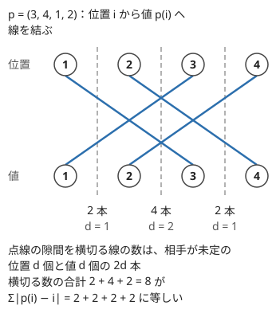

!!! abstract "要点"
    - **何ができるか**：順列を、値そのものではなく、決めた部分の相対順位や「相手が未定の要素の数」だけを状態にして数える。隣り合う大小関係が指定された順列は、最後の要素の相対順位を状態にし、累積和で $O(N^2)$ で数えられる。
    - **いつ使うか**：
        - 順列で隣り合う大小関係（$<$ と $>$）が指定される。
        - $\lvert p_i - i \rvert$ の和がちょうど $K$ の順列の数を問われる。
        - 値の小さい順に、列の好きな位置へ挿入していくと条件の変化が追える。
        - $N \le 3000$ 程度の順列の数え上げ。
    - **計算量**：相対順位の DP と値の順に挿入する DP は $O(N^2)$（相対順位の DP は累積和を使って）。箱根駅伝 DP は和の上限を $K$ として $O(N^2 K)$。
    - **前提**：[DP の状態の設計](../dp/dp-state-design.md)、[累積和・いもす法による DP の高速化](../dp/dp-prefix-sum.md)

<!-- textlint-disable -->
別名：相対順位の DP・順列の DP・箱根 DP・Insertion DP・連結成分 DP・Connected Component DP
<!-- textlint-enable -->

挿入 DP は、順列を 1 つずつ組み立てながら、どの値を使ったかを覚える代わりに「決めた部分の中での相対的な大小」だけを[状態](../guide/glossary.md#state)にする DP である。使った値の集合を持つと状態が $2^N$ 個になるが、条件が大小関係だけで決まるなら、相対順位で足りる。箱根駅伝 DP は同じ考え方を位置と値の対応に広げ、「まだ相手が決まっていない位置と値の数」を状態にする。

## 相対順位を状態にする（最後の要素が何番目か） {#relative-rank}

この節では、長さ $N - 1$ の不等号の列 $s$ を考える。すべての $i$ で $p_i$ と $p_{i+1}$ の大小が $s_i$ のとおりになる $1$〜$N$ の順列 $p$ を数える問題を例にする（添字は 1-indexed）。

素直に左から値を決めていくと、次に置ける値は「これまでに使った値の集合」で決まる。集合を状態にすると $2^N$ 通りあり、$N = 3000$ では到底持てない。ところが条件は「直前の要素より大きいか小さいか」だけである。そこで、値そのものを決める代わりに、先頭 $i$ 個の中での順位だけを決めていく。

- **状態**：$\mathrm{dp}[i][j]$ ＝ 先頭 $i$ 個を決め、最後の要素 $p_i$ がその $i$ 個の中で $j$ 番目に小さい（$j$ は 0 から数えて $0 \le j < i$）並べ方の数。
- **遷移**：$i + 1$ 個目の相対順位を $k$（$0 \le k \le i$）に決める。前の $i$ 個のうち順位 $k$ 以上だったものは 1 つずつ上にずれるので、前の最後の要素の新しい順位は、$j < k$ なら $j$ のまま、$j \ge k$ なら $j + 1$ になる。したがって「$p_i < p_{i+1}$」は $j < k$ と同じで、「$p_i > p_{i+1}$」は $j \ge k$ と同じである。
- **初期値と答え**：$\mathrm{dp}[1][0] = 1$。答えは $\sum_j \mathrm{dp}[N][j]$。

![上がる・下がる・上がるの条件（N = 4）で dp の表を左の列から埋めると、各列は [1]・[0, 1]・[1, 1, 0]・[0, 1, 2, 2] になる。dp[4][2] は前の列の j < 2 の和 1 + 1 = 2。右端の列の和 5 が答え](../img/insertion-dp/relative-rank-table.svg)

この状態で足りるのは、相対順位の列と順列が 1 対 1 に対応するからである（[全単射](../guide/glossary.md#bijection)）。順列から各 $i$ での相対順位 $r_i$（$0 \le r_i < i$）は 1 通りに決まる。逆に $r_1, \dots, r_N$ が与えられると、$p_N$ は $1$〜$N$ の中で $r_N$ 番目に小さい値と決まる。それを取り除けば、残りの $N - 1$ 個で同じことを繰り返せる。そして条件の判定に要るのは、上で見たとおり隣り合う 2 つの相対順位 $j$ と $k$ の大小だけである。だから相対順位の列を数えれば、条件を満たす順列の数になる。

図の例で確かめる。順列 $(1, 3, 2, 4)$ の相対順位は、$1$ が 1 個の中で 0 番目、$3$ が $\{1, 3\}$ の中で 1 番目、$2$ が $\{1, 3, 2\}$ の中で 1 番目、$4$ が 4 個の中で 3 番目なので $(0, 1, 1, 3)$ である。隣り合う組は $0 < 1$、$1 \ge 1$、$1 < 3$ で、「上がる・下がる・上がる」の条件と合う。

## 遷移は区間になるので累積和でまとめる {#prefix-sum}

相対順位の DP の遷移は、遷移先 $k$ ごとに前の段の連続した範囲の和になる。

$$
\mathrm{dp}[i+1][k] =
\begin{cases}
\displaystyle\sum_{j=0}^{k-1} \mathrm{dp}[i][j] & (p_i < p_{i+1} \text{ のとき}) \\
\displaystyle\sum_{j=k}^{i-1} \mathrm{dp}[i][j] & (p_i > p_{i+1} \text{ のとき})
\end{cases}
$$

そのまま足すと 1 マスに $O(N)$、全体で $O(N^3)$ かかる。前の段の累積和 $\mathrm{pre}[j] = \mathrm{dp}[i][0] + \dots + \mathrm{dp}[i][j-1]$ を先に作っておく。すると$p_i < p_{i+1}$ は $\mathrm{pre}[k]$、$p_i > p_{i+1}$ は $\mathrm{pre}[i] - \mathrm{pre}[k]$ で $O(1)$ になる。

状態が $O(N^2)$ 個で遷移が $O(1)$ なので、全体は $O(N^2)$ である。$N = 3000$ なら約 $10^7$ 回で間に合う。累積和の作り方と半開区間の添字の合わせ方は、[累積和・いもす法による DP の高速化](../dp/dp-prefix-sum.md)と同じである。

次のコードは、条件の列 $s$ に「条件なし」の `?` も許した形である。`?` の遷移は前の段の総和になる。

```cpp
--8<-- "insertion-dp/relative-rank.cpp:core"
```

- **範囲の取り違えに注意する**：$j$ と $k$ の不等号に等号が付くのは「$>$」の側（$j \ge k$）である。「$<$」の側は $j < k$ で、$k = 0$ のときは和が空で 0 になる。等号の位置は「順位 $k$ 以上が 1 つ上にずれる」から導く
- **段ごとに長さが変わる**：$i$ 段目の表の長さは $i$ である。全体を $N \times N$ の表にしてもよいが、使わないマスは 0 のままにしておく

**応用の型**：条件が大小関係ではなく「どちらを先にするか」の制約に見える問題も、この形に直せることが多い。[ABC209 F](#abc209_f) は、隣り合う 2 本の木のどちらを先に切るかの制約に言い換えると、条件つきの順列（切る時刻の列）を数える問題になる。2 つの順列の相対順位を同時に持てば、2 つの順列の組も数えられる（[力試し](#challenge)の ABC282 G）。そのときの遷移は長方形の範囲の和になるので、[2 次元の累積](../dp/dp-prefix-sum.md#two-dimensional)を使う。

## 値の大きい（小さい）順に挿入していく見方 {#insert-by-value}

相対順位の DP は位置を左から決めていった。もう 1 つの見方として、値を小さい順に、今ある列の好きな隙間へ挿入していくこともできる。長さ $i$ の列には隙間（先頭・間・末尾）が $i + 1$ か所あり、値 $i + 1$ をどこに入れるかで $1$〜$i + 1$ の順列が 1 つずつ決まる。

この見方が効くのは、条件が「列全体での個数」で、新しい値が入ったときの変化が隙間の種類だけで決まる場合である。新しい値は今ある値のどれよりも大きいので、両隣との大小は必ず「新しい値の方が大きい」になる。

例として、$p_i < p_{i+1}$ となる $i$（増える所）がちょうど $K$ 個ある $1$〜$N$ の順列を数える。

- **状態**：$\mathrm{dp}[i][j]$ ＝ $1$〜$i$ の並べ方のうち、増える所がちょうど $j$ 個あるものの数。
- **遷移**：値 $i + 1$ を入れる隙間で場合分けする。
    - 先頭に入れると、$i + 1 > (\text{次})$ が増えないので $j$ は変わらない。
    - 増える所 $a < b$ の間に入れると、$a < i + 1$ は増えるが $i + 1 > b$ は増えない。増える所は 1 つ消えて 1 つできるので $j$ は変わらない。
    - 末尾に入れると、$(\text{前}) < i + 1$ が 1 つ増える。
    - 減る所 $a > b$ の間に入れると、$a < i + 1$ が新しく増える所になるので $j$ は 1 増える。

  $j$ が変わらない隙間は $j + 1$ か所、1 増える隙間は残りの $i - j$ か所なので、$\mathrm{dp}[i+1][j] \mathrel{+}= (j + 1)\,\mathrm{dp}[i][j]$、$\mathrm{dp}[i+1][j+1] \mathrel{+}= (i - j)\,\mathrm{dp}[i][j]$ となる。
- **初期値と答え**：$\mathrm{dp}[1][0] = 1$、答えは $\mathrm{dp}[N][K]$。状態が $O(N^2)$ 個で遷移が $O(1)$ なので $O(N^2)$。

```cpp
--8<-- "insertion-dp/ascents.cpp:core"
```

$N = 3$ なら $(1, 4, 1)$ で、増える所が 0 個の順列は $(3, 2, 1)$ だけ、2 個は $(1, 2, 3)$ だけ、1 個は残りの 4 通りである。

**どちらの見方を使うか**：条件が「隣り合う位置の大小」を 1 つずつ指定するなら、位置の順に決める相対順位の DP が合う。条件が「増える所の数」「同じものが隣り合う所の数」のように列全体の個数なら、値の順に挿入する DP が合う。挿入の DP では、新しい値の両隣との関係が「新しい値が最大」で決まるので、隙間の種類ごとの個数だけを数えればよい。

**応用の型**：

- **同じ値を含む列**：同じ値の直後に入れても増える所は増えない。遷移の係数は「自分より真に小さい要素の数」で決まる（[力試し](#challenge)の ABC267 G）
- **文字の種類ごとにまとめて入れる**：同じ文字が隣り合う所の数を状態にし、次の種類の文字をいくつかの塊に分けて、どの隙間に入れるかを二項係数で数える。隣り合う同じ文字の間に入れると、その組が 1 つ消える（[練習](#practice)の TDPC O）

## 箱根駅伝 DP（相手が未定の位置と値の数を持つ） {#hakone-ekiden-dp}

順列 $p$ を、位置 $1$〜$N$ と値 $1$〜$N$ を結ぶ対応（完全マッチング）とみる。位置と値を同時に左から見ていき、「相手が未定の位置と値の数」を状態にするのが箱根駅伝 DP である（名前は、この形の DP を使う AOJ 2439 に由来する）。$\sum_i \lvert p_i - i \rvert$ のように、位置と値の離れ方で決まる量を数えるときに使う。

$\lvert p_i - i \rvert$ の和は、次のように隙間ごとの寄与に分けられる。位置を上の列、値を下の列に並べて、位置 $i$ から値 $p_i$ へ線を引く。線 $i \to p_i$ は、$t$ と $t + 1$ の間の隙間を $\min(i, p_i) \le t < \max(i, p_i)$ の範囲で横切るので、ちょうど $\lvert p_i - i \rvert$ 個の隙間を横切る。だから和は「各隙間を横切る線の数」の合計に等しい。



位置 $1$〜$t$ と値 $1$〜$t$ まで見たとき、相手が $t + 1$ 以降にある位置の数を $d$ とする。値 $1$〜$t$ のうち相手がまだない値も、同じ $d$ 個である（どちらも、$t$ 個のうち中で結ばれていない数なので）。隙間 $t$ を横切る線は、この $d$ 本と $d$ 本の合計 $2d$ 本になる。つまり、各段の後の $d$ が分かれば和が分かる。

- **状態**：$\mathrm{dp}[t][d][s]$ ＝ 位置と値を $1$〜$t$ まで見て、相手が未定の位置（＝未定の値）が $d$ 個、ここまでの隙間の寄与の和が $s$ である決め方の数。
- **遷移**：位置 $t + 1$ と値 $t + 1$ を加え、それぞれを「未定の相手と結ぶ」か「未定のまま残す」かを決める。

| 位置 $t+1$ | 値 $t+1$ | 次の $d$ | 係数 |
| --- | --- | --- | --- |
| 残す | 残す | $d + 1$ | 1 |
| 値 $t+1$ と結ぶ | （位置と結ぶ） | $d$ | 1 |
| 未定の値と結ぶ | 残す | $d$ | $d$ |
| 残す | 未定の位置と結ぶ | $d$ | $d$ |
| 未定の値と結ぶ | 未定の位置と結ぶ | $d - 1$ | $d^2$ |

- **寄与の足し方**：遷移の後の $d'$ を使い、$s$ に $2d'$ を足す（隙間 $t + 1$ を横切る本数）。
- **初期値と答え**：$\mathrm{dp}[0][0][0] = 1$、答えは $\mathrm{dp}[N][0][K]$。

未定の値と結ぶときは、未定の $d$ 個のどれと結ぶかを選ぶ。選び方ごとに別の順列になるので、係数が $d$ になる。状態は $N \times N \times K$ 個で遷移は $O(1)$ なので、$O(N^2 K)$ である。和は $\lfloor N^2 / 2 \rfloor$ を超えないので、$K$ はそこで打ち切ってよい。コードでは段 $t$ の添字を捨て、$\mathrm{dp}[d][s]$ を 1 段ずつ作り直す。

```cpp
--8<-- "insertion-dp/hakone.cpp:core"
```

- **奇数の和はない**：毎回 $2d'$ を足すので、$\sum \lvert p_i - i \rvert$ は必ず偶数である。$K$ が奇数なら答えは 0 になる
- **応用の型**：「すべての $i$ で $\lvert p_i - i \rvert \ge X$」のような禁止の条件は、条件を破る位置を選ぶ[包除原理の DP](../comb/inclusion-exclusion-dp.md)と組み合わせる（[練習](#practice)の ABC309 G）

## 連結成分 DP（ブロックを作る・端に付ける・つなぐ） {#connected-component-dp}

この節は発展の内容で、[値の順に挿入する見方](#insert-by-value)を前提にする。値を小さい順に置くが、隙間に挿入するのではなく、最終的な列の中で「今まで置いた値が作る、連続した塊（ブロック）」の数を状態にする。ブロックの間には、後で置く大きい値が入る。

- **状態**：$\mathrm{dp}[i][c]$ ＝ 値 $1$〜$i$ を置き、ブロックが $c$ 個ある決め方の数。ブロックの左右の並び順は決まっているとする。
- **遷移**：値 $i + 1$ を置く方法は 3 通りある。
    - 新しいブロックを作る。ブロックの間と両端の $c + 1$ か所から選び、$c$ は 1 増える。
    - どれかのブロックの左端か右端に付ける。$2c$ 通りで、$c$ は変わらない。
    - 隣り合う 2 つのブロックの間に入れてつなぐ。$c - 1$ 通りで、$c$ は 1 減る。
- **答え**：$\mathrm{dp}[N][1]$。条件を付けなければ $N!$ になる。

この見方の利点は、置いた時点で新しい値の両隣の大小が決まることである。新しいブロックを作った値は、両隣に後から大きい値が来るので極小になる。2 つのブロックをつないだ値は、両隣が小さい値なので極大になる。端に付けた値は、片方が小さく片方が大きい。だから「各要素が極大か極小か」の条件や、隣との差 $\lvert p_i - p_{i+1} \rvert$ の和のように両隣で決まる量を、置いた時点で確定できる。列の両端が固定される問題では、端に付けられないブロックを区別するために「両端が埋まったか」を状態に足す。

AtCoder の ABC での出題は確かめられなかった。USACO Guide の DP の追加の手法の章で、この型の問題が扱われている。

## 落とし穴 {#pitfalls}

**値を状態に持とうとする**。「最後に置いた値」を状態にすると、次に置ける値は使った値の集合で変わるので、状態が足りない。使った集合を持てば $2^N$ になる。大小だけが条件なら相対順位で足りることを先に疑う。

**相対順位の範囲の等号を誤る**。前の最後の順位 $j$ と新しい順位 $k$ について、「$<$」は $j < k$、「$>$」は $j \ge k$ である。$j \le k$ と書くと、$j = k$ の並べ方が両方の条件に数えられる。小さい $N$ で全探索の答えと突き合わせるのが確実である。

**累積和の段を混ぜる**。$\mathrm{pre}$ は前の段だけから作り切ってから、次の段を埋める。1 本の配列で上書きしながら累積和を取ると、同じ段で書き換えた値を読んでしまう。

**箱根駅伝 DP の係数**。片方だけを未定の相手と結ぶ遷移は、位置の側と値の側で 2 つあり、係数は合わせて $2d$ である。両方を結ぶ遷移の係数は $d$ ではなく $d^2$ である。なお、寄与は遷移の前の $d$（隙間 $t$）で足しても、後の $d'$（隙間 $t + 1$）で足しても答えは同じである。両端の隙間（$0$ と $N$）は寄与が 0 だからだ。どちらかに決めて、混ぜない。

**和の配列の大きさ**。$\sum \lvert p_i - i \rvert$ は $N = 50$ で最大 $1250$ である。入力の $K$ がそれより大きいこともあるので、配列の外を読まないよう先に 0 を返す。

## 例題 {#examples}

### EDPC T. Permutation {#dp_t}

<div class="kp-problems" data-role="example" markdown>

- [EDPC T. Permutation](https://atcoder.jp/contests/dp/tasks/dp_t)（diff —）：隣り合う要素の大小関係（< と >）が文字列で指定されたとき、それを満たす 1〜N の順列の個数を求める。

</div>

[相対順位を状態にする節](#relative-rank)の問題そのものである。$\mathrm{dp}[i][j]$ を「先頭 $i$ 個で最後の要素が $j$ 番目に小さい並べ方の数」とし、$<$ なら前の段の接頭辞の和、$>$ なら接尾辞の和を取る。

??? note "解法の詳細"
    - 初期値は $\mathrm{dp}[1][0] = 1$。各段で前の段の累積和を作り、$<$ なら $\mathrm{dp}[i+1][k] = \mathrm{pre}[k]$、$>$ なら $\mathrm{pre}[i] - \mathrm{pre}[k]$ とする。
    - 答えは最後の段の総和で、$O(N^2)$。コードは[遷移は区間になるので累積和でまとめる](#prefix-sum)の節のもので、`?` を使わない場合にあたる。
    - 参考にした解説は「まだ使っていない値のうち、直前の値より大きいものの数」を状態にしている。こちらも遷移は接頭辞か接尾辞の和になり、同じ $O(N^2)$ で解ける。

### ABC209 F. Deforestation {#abc209_f}

<div class="kp-problems" data-role="example" markdown>

- [ABC209 F. Deforestation](https://atcoder.jp/contests/abc209/tasks/abc209_f)（diff 2307）：N 本の木を 1 本ずつ切り、切る木とその両隣の現在の高さの和がコストになるとき、コストの合計が最小になる切る順番の数を求める。

</div>

コストを隣り合う 2 本の組ごとに分ける。組 $(i, i + 1)$ は、先に切る方のコストに後の方の高さを足し、後に切る方のコストには何も足さない（先の方はもう高さ 0）。だから組ごとに「高い方を先に切る」と寄与が小さい方になり、各組の向きは独立に選べる。最小になる順番は、すべての組で高い方が先（同じ高さならどちらでも）のものに限る。切る時刻の列を順列とみると、隣り合う時刻の大小が指定された順列の数になり、EDPC T と同じ DP で解ける。

??? note "解法の詳細"
    - 合計のコストは、各木の自分の高さの和と、各組の「後に切る木の高さ」の和である。後者を組ごとに最小にするには、高い方を先に切る。
    - 組ごとの向きを決めても、時刻の大小関係は一直線に並ぶので矛盾しない。だから全体の最小は、各組の最小の和になる。
    - 木 $i$ を切る時刻を $t_i$ とすると、$H_i > H_{i+1}$ なら $t_i < t_{i+1}$、$H_i < H_{i+1}$ なら $t_i > t_{i+1}$、等しければ条件なしになる。条件なしの遷移は前の段の総和で、[累積和でまとめる節](#prefix-sum)のコードの `?` にあたる。
    - 全体で $O(N^2)$。

### ABC134 F. Permutation Oddness {#abc134_f}

<div class="kp-problems" data-role="example" markdown>

- [ABC134 F. Permutation Oddness](https://atcoder.jp/contests/abc134/tasks/abc134_f)（diff 2532）：1〜N の順列 p のうち、Σ |p_i − i| がちょうど K になるものの個数を求める。

</div>

[箱根駅伝 DP の節](#hakone-ekiden-dp)の問題そのものである。$\lvert p_i - i \rvert$ の和を隙間ごとの寄与に分けると、隙間 $t$ の寄与は「相手が未定の位置の数 $d$」の 2 倍になる。$t$・$d$・和を状態にする。

??? note "解法の詳細"
    - 状態は $\mathrm{dp}[t][d][s]$。位置 $t + 1$ と値 $t + 1$ の扱いで 5 通りに分け、係数は $1$・$1$・$d$・$d$・$d^2$ である。
    - 遷移の後の $d'$ について $s$ に $2d'$ を足す。答えは $\mathrm{dp}[N][0][K]$。
    - 和は $\lfloor N^2 / 2 \rfloor$ 以下なので、$s$ の範囲は $N^2$ 程度で足りる。$N = 50$ なら状態は $50 \times 26 \times 1250$ 程度で十分に速い。

## 練習問題 {#practice}

<div class="kp-problems" data-role="practice" markdown>

- [ABC468 G. Restricted Permutation](https://atcoder.jp/contests/abc468/tasks/abc468_g)（diff 1975）：o と x からなる長さ N の文字列 S について、各 k で「1〜k が連続して並ぶ」かどうかが S_k と一致する、1〜N の順列の数を求める。
- [ABC309 G. Ban Permutation](https://atcoder.jp/contests/abc309/tasks/abc309_g)（diff 2372）：すべての i で |P_i − i| ≥ X となる 1〜N の順列 P の数を求める。
- [TDPC O. 文字列](https://atcoder.jp/contests/tdpc/tasks/tdpc_string)（diff —）：各文字の個数が決まった文字を並べる方法のうち、同じ文字が隣り合わないものの個数を求める。
- [EXAWIZARDS2019 D. Modulo Operations](https://atcoder.jp/contests/exawizards2019/tasks/exawizards2019_d)（diff 2075）：N 個の数を好きな順に使って x を x mod y で置き換えるとき、N! 通りの順番すべてについての最終的な値の和を求める。

</div>

??? note "練習の方針"
    - **ABC468 G**：値を小さい順に置いていき、値 $1$〜$a$ を含む最短の区間の長さを状態にする。区間の中の空きに置くか、区間の外の左右どちらかに置いて区間を伸ばすか（伸びた後の長さは今より長いどれでもよい。間の空きは後の値で埋まる）で遷移し、伸ばす遷移は累積和でまとめる。区切りの途中では、区間が値でちょうど埋まった状態を使わない。「1〜$k$ が連続する」$k$ の位置で問題を区切り、区切りごとの数を掛ける。
    - **ABC309 G**：条件を破る位置（$\lvert P_i - i \rvert < X$）を選ぶ包除にする。選んだ位置の値は $i$ の近くに限られるので、近くの値を使ったかを bit で持ち、位置を左から見る DP で「破る位置を $m$ 個選ぶ方法」を数える。残りの $N - m$ 個は自由に並べて $(N - m)!$ を掛ける。
    - **TDPC O**：文字の種類ごとに挿入し、同じ文字が隣り合う所の数 $j$ を状態にする。次の種類の $c$ 個を $g$ 個の塊に分け（$\binom{c-1}{g-1}$ 通り）、そのうち $k$ 個を隣り合う同じ文字の間に入れる（$\binom{j}{k}$ 通り）。残りは同じ文字が隣り合っていない隙間に入れる。遷移の後の $j$ は $j - k + (c - g)$ である。
    - **EXAWIZARDS2019 D**：数を小さい順に並びへ挿入していく。新しく加えた数 $s$ はそれまでのどれより大きい。並びの先頭に置いたときだけ $x$ を $x \bmod s$ に変える。ほかの $i$ 通りの位置では、値が $s$ 未満になってから使われるので効かない。「$f_i(x)$ ＝ 小さい $i$ 個の並べ方すべてについて、$x$ から始めた結果の和」とすると $f_{i+1}(x) = f_i(x \bmod s) + i \, f_i(x)$ で、$O(NX)$ になる

## 力試し {#challenge}

<div class="kp-problems" data-role="challenge" markdown>

- [ABC282 G. Similar Permutation](https://atcoder.jp/contests/abc282/tasks/abc282_g)（diff 2412）：1〜N の順列の組 (P, Q) のうち、隣り合う要素の大小関係が P と Q で一致する位置の数がちょうど K になるものの個数を求める。
- [ABC267 G. Increasing K Times](https://atcoder.jp/contests/abc267/tasks/abc267_g)（diff 2561）：数列の並べ替えのうち、A_i < A_{i+1} となる i がちょうど K 個あるものの個数を求める。

</div>

??? note "力試しの方針"
    - **ABC282 G**：$P$ と $Q$ の最後の要素の相対順位 $a$・$b$ と、一致した位置の数を状態にする。新しい順位 $(a', b')$ への遷移は、一致するかどうかで長方形の範囲に分かれるので、一致の数ごとに $(a, b)$ の 2 次元累積和を作って $O(1)$ で足す。全体で $O(N^4)$。
    - **ABC267 G**：値の小さい順に挿入し、増える所の数を状態にする。今の値より真に小さい要素の数を $m$、並べた数を $i$ とすると、増える所を変えない隙間は $i + j + 1 - m$ か所、1 つ増やす隙間は $m - j$ か所になる。同じ値の直後に入れても増える所は増えないことが、$m$ を「真に小さい数」にする理由である。

## 確認問題 {#quiz}

??? question "確認問題：下がるだけの条件"
    相対順位の DP で、条件がすべて「$>$」（列が下がり続ける）のとき、各段の $\mathrm{dp}[i][j]$ はどうなるか。

    ??? success "答え"
        $\mathrm{dp}[i][0] = 1$ で、ほかは 0 になる。最後の要素は常にそれまでの最小なので、相対順位は 0 しかない。$\mathrm{dp}[i+1][0] = \mathrm{pre}[i] - \mathrm{pre}[0] = 1$、$k \ge 1$ では $\mathrm{pre}[i] - \mathrm{pre}[k] = 0$ になり、答えは 1 通り（$N, N - 1, \dots, 1$）である。

??? question "確認問題：値の順に挿入するときの隙間の数"
    増える所の数を数える DP で、$1$〜$i$ の列に増える所が $j$ 個あるとき、値 $i + 1$ を入れても増える所の数が変わらない隙間はなぜ $j + 1$ か所か。

    ??? success "答え"
        変わらないのは、先頭と、増える所 $a < b$ の間である。増える所の間に入れると $a < i + 1$ が増える所になり、$i + 1 > b$ で元の $a < b$ が消えるので差し引き 0 になる。先頭は $i + 1 >$（次）で増えない。増える所は $j$ か所なので、合わせて $j + 1$ か所である。

??? question "確認問題：和が奇数の順列"
    $\sum_i \lvert p_i - i \rvert$ が奇数になる順列はあるか。

    ??? success "答え"
        ない。各隙間を横切る線は、相手が未定の位置 $d$ 本と値 $d$ 本の $2d$ 本なので、和は偶数である。直接には、$\sum (p_i - i) = 0$ で、$\lvert x \rvert$ と $x$ の偶奇は同じなので、$\sum \lvert p_i - i \rvert$ は偶数になる。

## 使い分け {#comparison}

- **何番目に来るかを固定するだけ**（「A は B より前」の個数を数える）なら、DP を使わず $n!/k!$ のような式で済む（[相対順序を固定する](../comb/counting-fix-order.md#relative-order)）。
- **隣り合う位置の大小が 1 つずつ指定される**なら、位置の順に相対順位を持つ（[相対順位の節](#relative-rank)）。
- **列全体での個数（増える所・同じものが隣り合う所）**なら、値の順に挿入する（[挿入の節](#insert-by-value)）。
- **位置と値の離れ方**（$\lvert p_i - i \rvert$ の和や、近すぎる位置の禁止）なら、箱根駅伝 DP（[箱根駅伝 DP の節](#hakone-ekiden-dp)）。禁止の条件は包除と組み合わせる。
- **両隣との関係で決まる量**（極大・極小、隣との差の和）なら、連結成分 DP（[連結成分 DP の節](#connected-component-dp)）。
- **$N \le 20$ 程度**なら、使った値の集合を持つ [bitDP](../dp/bit-dp.md) でもよい。条件が大小だけでないときはこちらしかない。

## 参考 {#references}

- [Series_205「Educational DP Contest (EDPC) T ~ W 問題 解説」](https://qiita.com/Series_205/items/7d2c57b45179006d0bc6)：例題 EDPC T の状態と遷移の範囲、累積和で $O(N^2)$ にすること
- [kmjp「AtCoder ABC #209 : F - Deforestation」](https://kmjp.hatenablog.jp/entry/2021/07/10/0900)：例題 ABC209 F の、高い方を先に切る言い換えと相対順位の DP
- [drken「AtCoder ABC 134 F - Permutation Oddness (橙色, 600 点)」](https://drken1215.hatenablog.com/entry/2020/12/25/220600)：例題 ABC134 F の、隙間ごとの寄与と箱根駅伝 DP の遷移の係数
- [kanpurin「競技プログラミング 典型問題メモ」](https://kanpurin.hatenablog.com/entry/2020/04/07/182948)：挿入 DP・箱根駅伝 DP の問題の分類と、箱根駅伝 DP の名前の由来（AOJ 2439）
- [kmjp「AtCoder Beginner Contest 468 : G - Restricted Permutation」](https://kmjp.hatenablog.jp/entry/2026/07/25/0930)：練習 ABC468 G の方針（値の順に置き、区間の長さを状態にする）
- [kmjp「AtCoder ABC #282 (HHKBプログラミングコンテスト2022 Winter) : G - Similar Permutation」](https://kmjp.hatenablog.jp/entry/2022/12/18/0900)：力試し ABC282 G の方針（2 つの相対順位と 2 次元累積和）
- [drken「AtCoder ABC 267 G - Increasing K Times (橙色, 600 点)」](https://drken1215.hatenablog.com/entry/2023/05/04/215500)：力試し ABC267 G の、値の順の挿入と同じ値の扱い
- [sigma425「Typical DP Contest (TDPC)」](https://sigma425.hatenablog.com/entry/2016/08/02/214547)：練習 TDPC O の、文字の種類ごとに挿入する方針
