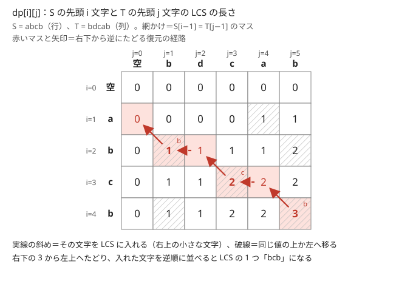
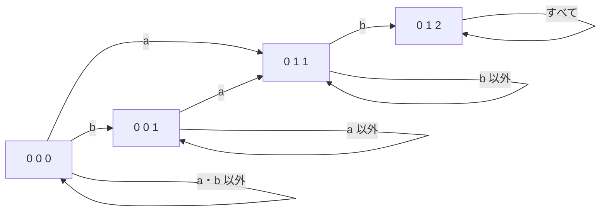

!!! abstract "要点"
    - **何ができるか**：2 つの文字列の最長共通部分列の長さを、末尾どうしが一致するかで分ける 2 次元の DP で $O(NM)$ で求める。同じ表で挿入・削除・置換のコストを取れば編集距離になり、表を右下から逆にたどれば部分列そのものも復元できる。
    - **いつ使うか**：
        - 2 つの列・文字列で $N, M \le 3000$〜$5000$
        - 共通の部分列の最長・共通部分列の組の数
        - 挿入・削除・置換で一致させる最小回数
        - ある値（2 つの文字列の最長共通部分列の長さなど）がちょうど $k$ になる文字列の数
    - **計算量**：時間 $O(NM)$、メモリ $O(NM)$。長さだけなら 2 行を使い回して $O(M)$ で済む（復元するなら表全体が要る）。DP の DP は $O(\sigma M 2^N)$（$N$ は短い方の長さ、$\sigma$ は文字の種類数）
    - **前提**：[DP の基本](../dp/dp-basics.md)

<!-- textlint-disable -->
別名：LCS・Longest Common Subsequence・レーベンシュタイン距離・Edit Distance・Levenshtein Distance・最長共通部分文字列・DP の DP
<!-- textlint-enable -->

最長共通部分列（LCS）は、2 つの文字列 $S$・$T$ の両方に[部分列](../string/string-basics.md#substring-vs-subsequence)として現れる列のうち最も長いものである。$S$ の先頭 $i$ 文字と $T$ の先頭 $j$ 文字の組を状態にした $(N+1) \times (M+1)$ の表を、左上から埋めて求める。編集距離・最長共通部分文字列・最長回文部分列・共通部分列の組の数は、どれもこの表の遷移を少し変えたものである。

## 表の意味と遷移（一致する末尾を使って損をしない理由） {#recurrence}

LCS が必要になるのは、2 つの列の「飛び飛びに選んだ共通部分」の最長を問われたときである。部分列は $2^N$ 通りあるので、片方の部分列を全部試す方法は $N = 20$ 程度までしか使えない。一方、共通部分列の作り方は「$S$ の先頭何文字と $T$ の先頭何文字をもう見たか」だけで先の選び方が決まるので、この 2 つを状態にすれば $(N+1)(M+1)$ 個の状態で済む。

添字は 0-indexed で、$S = S[0] S[1] \cdots S[N-1]$ と書く。表は先頭からの文字数で引き、$i$ 文字目の文字は $S[i-1]$ である。

- **状態**：$\mathrm{dp}[i][j]$ ＝ $S$ の先頭 $i$ 文字と $T$ の先頭 $j$ 文字の LCS の長さ（$0 \le i \le N$、$0 \le j \le M$）
- **初期値**：$\mathrm{dp}[0][j] = \mathrm{dp}[i][0] = 0$（空の列との共通部分列は空だけ）
- **遷移**：末尾の文字 $S[i-1]$ と $T[j-1]$ が一致するかで分ける

$$
\mathrm{dp}[i][j] =
\begin{cases}
\mathrm{dp}[i-1][j-1] + 1 & (S[i-1] = T[j-1]) \\
\max(\mathrm{dp}[i-1][j],\ \mathrm{dp}[i][j-1]) & (S[i-1] \ne T[j-1])
\end{cases}
$$

- **計算順序**：$\mathrm{dp}[i][j]$ は左上・上・左のマスだけを使うので、$i$ の昇順の外側のループと $j$ の昇順の内側のループで埋めればよい
- **答え**：$\mathrm{dp}[N][M]$

末尾が違うときの式は、「LCS は $S[i-1]$ と $T[j-1]$ の少なくとも一方を使わない」ことから来る。両方を使うなら、2 つは LCS の最後の文字どうしとして組になるはずである。しかし文字が違うので組にできない。使わない側の末尾を捨てた表の値の大きい方が答えになる。

末尾が一致するときに $\mathrm{dp}[i-1][j]$ や $\mathrm{dp}[i][j-1]$ と比べなくてよいのは、一致する末尾どうしを組にして損をしないからである。理由は次の 2 つである。

1. **組にした LCS が必ずある**：最長の共通部分列 $U$ を 1 つ取る。$U$ が $S[i-1]$ も $T[j-1]$ も使わないなら、末尾に $S[i-1]$ を足せてさらに長くなり、最長に反する。$U$ が $S[i-1]$ だけを使い、$T$ の側では手前の $T[k]$（$k < j - 1$）と組にしているなら、$U$ の最後の文字は $S[i-1] = T[j-1]$ に等しい。組の相手を $T[j-1]$ に付け替えても共通部分列のままである。$T[j-1]$ だけを使う場合も同じである
2. **1 文字足しても LCS は高々 1 しか増えない**：$\mathrm{dp}[i-1][j] \le \mathrm{dp}[i-1][j-1] + 1$ が成り立つ。$T$ の末尾 1 文字を除けば共通部分列は高々 1 文字しか短くならないからである。$\mathrm{dp}[i][j-1]$ も同じなので、一致するときは斜めの $+1$ が最大になる

次の図は $S = \texttt{abcb}$、$T = \texttt{bdcab}$ の表である。網かけのマスは末尾が一致するマスで、そこでは左上の値に 1 を足している。それ以外のマスは上と左の大きい方を写している。



計算量は、状態が $(N+1)(M+1)$ 個で遷移が $O(1)$ なので、時間 $O(NM)$ である。$N = M = 5000$ なら $2.5 \times 10^7$ 回で間に合う。メモリは表全体を `int` で持つと 100 MB ほどになるので、長さだけが欲しいなら直前の 1 行と今の行の 2 行だけを持つ。復元が要るときは表全体を残す。値は $\min(N, M)$ 以下なので、5000 程度なら `short`（2 バイト）でも収まり 50 MB に減らせる。

## 復元（右下から逆にたどる） {#restore}

LCS そのものを出力するには、表を埋めた後に $(N, M)$ から出発し、そのマスの値を作った遷移を逆にたどる。考え方は [DP の復元](../dp/dp-reconstruction.md#trace-back)と同じで、表を残しておけば遷移元を別に記録しなくてよい。

1. $\mathrm{dp}[i][j] = \mathrm{dp}[i-1][j]$ なら、$S$ の末尾を捨てても同じ値なので $i$ を 1 減らす
2. そうでなく $\mathrm{dp}[i][j] = \mathrm{dp}[i][j-1]$ なら、$j$ を 1 減らす
3. どちらでもなければ斜めから来たので、$S[i-1]$（$= T[j-1]$）を答えに入れて $i$・$j$ を 1 ずつ減らす
4. $i = 0$ か $j = 0$ になったら止める。集めた文字は後ろからなので、最後に反転する

3 のとき文字が一致しているのは、上とも左とも違う値は斜めの $+1$ からしか作れないからである。図の赤い経路は、この手順で右下の 3 から「b・c・b」を後ろから集めている。

```cpp
--8<-- "lcs/lcs.cpp:core"
```

完全なプログラム：[`lcs.cpp`](https://github.com/yuukougun/kyopro-atlas/blob/main/snippets/lcs/lcs.cpp)（GitHub）
{ .kp-code-src }

最適な LCS は複数あることが多く、上を先に見るか左を先に見るかで出力が変わる。どれを出してもよい問題ならどちらでもよい。辞書順最小などの指定があるときの決め方は [DP の復元](../dp/dp-reconstruction.md#ties)にまとめてある。

??? question "確認問題：文字を先頭に足していくと何が起きるか"
    復元で集めた文字を `lcs = s[i - 1] + lcs;` のように先頭へ足していくと、正しい答えは出るが遅くなることがある。なぜか。

    ??? success "答え"
        文字列の先頭への追加は、毎回それまでの文字をすべて写すので 1 回 $O(L)$ かかる（$L$ はその時点の長さ）。全体で $O(L^2)$ になり、$L = 3000$ ならまだ間に合うが、無駄が大きい。末尾に `push_back` で足して最後に 1 回 `reverse` すれば、全体で $O(L)$ で済む。

## 編集距離（挿入・削除・置換の 3 方向のコスト） {#edit-distance}

編集距離（レーベンシュタイン距離）は、1 文字の挿入・削除・置換をそれぞれ 1 回と数えて、$S$ を $T$ に変える最小の操作回数である。LCS と同じく先頭 $i$ 文字と $j$ 文字の組を状態にし、最大の代わりに最小を取る。

- **状態**：$\mathrm{dp}[i][j]$ ＝ $S$ の先頭 $i$ 文字を $T$ の先頭 $j$ 文字に変える最小の操作回数
- **初期値**：$\mathrm{dp}[i][0] = i$（全部削除）、$\mathrm{dp}[0][j] = j$（全部挿入）。LCS と違って 0 ではない
- **遷移**：最後の操作で 3 方向に分ける

$$
\mathrm{dp}[i][j] = \min
\begin{cases}
\mathrm{dp}[i-1][j] + 1 & (S[i-1] \text{ を削除}) \\
\mathrm{dp}[i][j-1] + 1 & (T[j-1] \text{ を挿入}) \\
\mathrm{dp}[i-1][j-1] + [S[i-1] \ne T[j-1]] & (\text{そのまま残す・置換})
\end{cases}
$$

$[\cdot]$ は中が真なら 1、偽なら 0 である。3 方向で足りる理由は、$S$ と $T$ の最後の文字の扱いが「$S[i-1]$ が消える」「$T[j-1]$ が新しく入る」「$S[i-1]$ が $T[j-1]$ の位置に残る（違えば置き換える）」のどれかに分かれるからである。

```cpp
--8<-- "lcs/edit-distance.cpp:core"
```

完全なプログラム：[`edit-distance.cpp`](https://github.com/yuukougun/kyopro-atlas/blob/main/snippets/lcs/edit-distance.cpp)（GitHub）
{ .kp-code-src }

コストの付け方を変えると、ほかの問題も同じ表で解ける。

- **操作ごとにコストが違う**：削除 $a$・挿入 $b$・置換 $c$ なら、3 方向の $+1$ をそれぞれのコストに変えるだけでよい
- **置換が使えない（挿入と削除だけ）**：最小回数は $N + M - 2 \cdot \mathrm{LCS}(S, T)$ になる。LCS に入らない文字を $S$ から削除し、$T$ にだけある文字を挿入すればよく、それより少なくはできない
- **距離が $K$ 以下かだけを問われる**：$\mathrm{dp}[i][j] \ge \lvert i - j \rvert$（長さの差の分は必ず挿入か削除が要る）なので、$\lvert i - j \rvert \le K$ の帯の中だけを埋め、帯の外は $K + 1$ とみなせばよい。$O(K (N + M))$ になり、$N, M$ が $10^5$ を超えても扱える
- **2 つの列から削除して長さをそろえ、残りの不一致を数える**：$S$ からの削除を削除、$T$ からの削除を挿入、残った位置の不一致を置換と見れば、編集距離そのものである（[ABC185 E](#abc185_e)）

## 部分列と部分文字列の違い（最長共通部分文字列） {#substring}

部分列は飛び飛びに選んでよく、部分文字列は連続していなければならない（[部分文字列と部分列の違い](../string/string-basics.md#substring-vs-subsequence)）。問題文の「部分列」「連続する部分」を読み違えると、全く違う DP を書くことになる。最長共通部分文字列は、表の意味を「末尾をそろえた一致の長さ」に変えて求める。

- **状態**：$\mathrm{dp}[i][j]$ ＝ $S$ の先頭 $i$ 文字と $T$ の先頭 $j$ 文字の、共通の接尾辞の最長（$S[i-1]$ と $T[j-1]$ で終わる共通部分文字列の最長）
- **遷移**：$S[i-1] = T[j-1]$ なら $\mathrm{dp}[i-1][j-1] + 1$、違えば $0$
- **答え**：表全体の最大値（右下ではない）

末尾が違うと連続の一致はそこで切れるので、0 に戻す。LCS の表のように上や左の値を写してはいけない。どちらの表も $O(NM)$ だが、答えを右下から読むか全体の最大から読むかが違う。

1 つの文字列の中で、重ならずに 2 回現れる最長の部分文字列も同じ表で求まる。$S$ 自身と比べた表で $i < j$ のマスだけを見る。$S[i-L, i)$ と $S[j-L, j)$ が重ならないのは $L \le j - i$ のときなので、各マスの値を $\min(\mathrm{dp}[i][j],\ j - i)$ で抑えてから最大を取る（[ABC141 E](#practice)）。この型は [Z-algorithm](../string/z-algorithm.md) や[ローリングハッシュ](../string/rolling-hash.md)でも解ける。

## 共通部分列の組の数（包除で重複を引く・2 次元の累積和） {#count-pairs}

この節は[重複の除き方](../comb/counting-dedup.md)と [2 次元累積和](../basics/prefix-sum-2d.md)を前提にする。ここで数えるのは、$S$ から取り出す位置の集合 $I$ と $T$ から取り出す位置の集合 $J$ の組のうち、取り出した列が等しいものの数である。内容が同じでも取り出す位置が違えば別に数え、空の列どうしの組も 1 つと数える。

- **状態**：$\mathrm{dp}[i][j]$ ＝ $S$ の先頭 $i$ 文字と $T$ の先頭 $j$ 文字から作る組の数
- **初期値**：$\mathrm{dp}[0][j] = \mathrm{dp}[i][0] = 1$（空の組だけ）
- **遷移**：$S[i-1]$ を使わない組と $T[j-1]$ を使わない組を足し、両方を使わない組が 2 回数えられたので引く。末尾が一致するなら、両方を使う組（$S[i-1]$ と $T[j-1]$ を最後の文字どうしとして組にする）を足す

$$
\mathrm{dp}[i][j] = \mathrm{dp}[i-1][j] + \mathrm{dp}[i][j-1] - \mathrm{dp}[i-1][j-1] + [S[i-1] = T[j-1]] \cdot \mathrm{dp}[i-1][j-1]
$$

LCS の遷移をまねて「一致すれば斜め、違えば上と左」を足すと、$\mathrm{dp}[i-1][j-1]$ の組が上と左の両方に含まれて 2 回数えられる。包除で 1 回引くのが要である。末尾が一致するときは $-\mathrm{dp}[i-1][j-1]$ と $+\mathrm{dp}[i-1][j-1]$ が打ち消し合い、上と左の和だけになる。

別の数え方として、「最後に組にした位置が $(i, j)$ である組の数」を状態にする方法もある。このとき $\mathrm{dp}[i][j]$ は $S[i-1] = T[j-1]$ のマスでだけ値を持ち、左上の長方形 $[0, i) \times [0, j)$ の和に等しい。空の組を $(0, 0)$ に置いて $\mathrm{dp}[0][0] = 1$ とし（ほかの 0 行目・0 列目は 0）、答えは表全体の和である。表は行ごとに左上から埋め、使うのは確定した左上の部分だけなので、2 次元累積和も埋めながら作れる。長方形の和を 2 次元累積和で $O(1)$ で取れば、全体で $O(NM)$ になる。

mod で数えるときは、引き算で負にならないよう $\bmod$ を取る前に法を足す。ACL の modint なら気にしなくてよい。内容が同じ列を 1 回だけ数える（異なる共通部分列の種類数を数える）なら、取り出し方を最も左を取るなどの 1 通りに決める必要があり、[部分列 DP](../dp/subsequence-dp.md#leftmost) の考え方が要る。

## 最長回文部分列（S と反転の LCS） {#palindromic-subsequence}

最長回文部分列（部分列のうち回文であるものの最長）は、$S$ と、$S$ を反転した $S^R$ の LCS の長さに等しい。回文の部分列は反転しても同じなので、$S$ と $S^R$ の共通部分列である。逆向きの不等式も成り立つので、2 つの長さは一致する。

??? note "証明（LCS の長さ以下の回文がある）"
    $S$ と $S^R$ の共通部分列の長さを $L$ とする。$S^R$ の位置を $S$ の位置に読み替えると、$S$ の位置の組 $(a_1, b_1), \dots, (a_L, b_L)$ で、$a_1 < \dots < a_L$、$b_1 > \dots > b_L$、$S[a_t] = S[b_t]$ を満たすものがある。$a_t - b_t$ は $t$ について狭義に増えるので、$a_t < b_t$ となる $t$ が前半に $p$ 個、$a_t > b_t$ となる $t$ が後半に $q$ 個並び、間に $a_t = b_t$ の $t$ が高々 1 つ（$e \in \{0, 1\}$ 個）ある。$p + q + e = L$ である。

    前半の $p$ 組からは $a_1 < \dots < a_p < b_p < \dots < b_1$ が取れ、左右対称に同じ文字が並ぶので長さ $2p$ の回文になる。$a_t = b_t$ の位置があれば、それは $a_p$ と $b_p$ の間にあるので真ん中に足せる。後半の $q$ 組も同じで、$b_L < \dots < b_{p+e+1} < a_{p+e+1} < \dots < a_L$ から長さ $2q$（真ん中を足して $2q + e$）の回文が取れる。$\max(2p, 2q) + e \ge p + q + e = L$ なので、長さ $L$ 以上の回文部分列がある。

ただし、LCS の表を[復元](#restore)の手順でたどって出てくる列は、回文とは限らない。たとえば $S = \texttt{aabcaba}$ では、$S^R = \texttt{abacbaa}$ との LCS の長さは 5 だが、上を先に見る手順で復元すると $\texttt{aacba}$ が出てくる。回文そのものを出力するなら、上の証明のように前半を取って折り返すか、区間を状態にした DP で直接求める。

区間 DP で書くなら、$\mathrm{dp}[l][r]$ ＝ 閉区間 $[l, r]$ の最長回文部分列として、両端が等しければ $\mathrm{dp}[l+1][r-1] + 2$、そうでなければ $\max(\mathrm{dp}[l+1][r],\ \mathrm{dp}[l][r-1])$ である（[区間 DP](../dp/interval-dp.md)）。LCS の表と区間 DP のどちらでも $O(N^2)$ である。文字を書き換えてよい回数などの条件を状態に足しやすいのは、区間 DP の方である（[AGC021 D](#challenge)）。回文の見方の全体は[回文の扱い](../string/palindrome.md)にある。

## LCS の値ごとに数える：DP の DP（内側の DP の 1 行を外側の状態にする） {#dp-of-dp}

この節は [bitDP](../dp/bit-dp.md) と [DP の状態の設計](../dp/dp-state-design.md)を前提にする。「長さ $M$ の文字列 $T$ のうち、短い文字列 $S$ との LCS の長さがちょうど $k$ になるものの数」のように、ある DP の値ごとに入力を数える問題を考える。$T$ を全部試すと $26^M$ 通りで、まったく間に合わない。

鍵は、$T$ を 1 文字ずつ読みながら LCS の表を 1 行ずつ作る見方である。ここでは $T$ を 1 文字ずつ読むので、[前の節の表](#recurrence)とは行と列を入れ替えて、$T$ の先頭 $i$ 文字を行にした表を考える。$T$ の先頭 $i$ 文字に対する表の行 $\mathrm{row}_i = (\mathrm{dp}[0], \dots, \mathrm{dp}[N])$（$\mathrm{dp}[j]$ は $S$ の先頭 $j$ 文字との LCS）が分かれば、次の文字 $c$ を読んだ後の行は $\mathrm{row}_i$ と $c$ だけで決まる。$T$ の先頭がどうだったかは要らない。そこで、内側の DP（LCS）の行そのものを外側の DP の状態にする。これを DP の DP と呼ぶ。

要は状態数の小ささである。行は左から右へ広義単調に増え、隣どうしの差は 0 か 1 である。$S$ の末尾に 1 文字足すと、LCS は減らず、高々 1 しか増えないからである（[表の意味と遷移](#recurrence)の理由 2）。$\mathrm{dp}[0] = 0$ なので、行は差の列、すなわち $N$ ビットの整数 $\mathrm{mask}$ で表せる。状態は $2^N$ 通りで、行の右端 $\mathrm{dp}[N]$ は $\mathrm{mask}$ の立っているビットの数（[popcount](../guide/glossary.md#popcount)）である。コードの `std::popcount` は C++20 の [`<bit>` の関数](../cpp/cpp-math-functions.md#bit-functions)で、符号なしの型しか受け取らないので `unsigned` に変換して渡す。

次の図は $S = \texttt{ab}$ のときの行と遷移である。行 $(0, 0, 0)$ から始め、文字を読むたびに矢印に沿って移る。



$S = \texttt{ab}$ では行は 4 通りで、右端が 2 になる行 $(0, 1, 2)$ に着いた $T$ が「LCS が 2」の文字列である。外側の DP は、各行に着く $T$ の個数を数える。

- **状態**：$f[\mathrm{mask}]$ ＝ これまでに作った $T$ のうち、内側の行が $\mathrm{mask}$ になるものの数
- **前計算**：各 $\mathrm{mask}$ と文字 $c$ について、行を復元して LCS の遷移を 1 行分行い、次の $\mathrm{mask}$ を表 $\mathrm{nxt}[\mathrm{mask}][c]$ にしておく。$O(\sigma N 2^N)$（$\sigma$ は文字の種類数）
- **遷移**：$M$ 回くり返し、各 $\mathrm{mask}$ の個数を $\sigma$ 個の行き先へ配る。全体で $O(\sigma M 2^N)$
- **答え**：最後に、各 $\mathrm{mask}$ の個数を popcount ごとに足す

```cpp
--8<-- "lcs/lcs-row-dp.cpp:core"
```

完全なプログラム：[`lcs-row-dp.cpp`](https://github.com/yuukougun/kyopro-atlas/blob/main/snippets/lcs/lcs-row-dp.cpp)（GitHub）。`mint` は ACL の `modint998244353`（[modint](../math/modint.md)）。
{ .kp-code-src }

$N = 10$、$M = 100$、$\sigma = 26$ なら、遷移は $26 \cdot 100 \cdot 2^{10} \approx 2.7 \times 10^6$ 回である。前計算をせずに毎回行を作り直すと $N$ 倍の手間になるので、遷移は表にしておく。$S$ に現れない文字はどれも同じ遷移なので、1 つにまとめて個数を掛けてもよい。

この型が使えるのは、「ある DP で求まる値が $k$ になる入力の数」を問われたときである。ただし、内側の DP の 1 行（または状態全体）の取りうる形が少ない必要がある。行の形は、単調性や差が 0 か 1 であることなどから見積もる。値をそのまま持つと $(N+1)^{N+1}$ 通りに見えるが、差で持てば $2^N$ 通りに減る。

## 落とし穴 {#pitfalls}

**表の添字のずれ**。表は先頭からの文字数で引くので大きさは $(N+1) \times (M+1)$ で、マス $(i, j)$ で比べる文字は $S[i-1]$ と $T[j-1]$ である。表の大きさを $N \times M$ にしたり $S[i]$ と比べたりすると、端の 1 文字を見落とすか範囲外を読む。0 行目と 0 列目は「空の列」の番兵として残しておく。

**部分列と部分文字列の取り違え**。「連続する」と書いてあれば部分文字列で、一致しないマスは 0 に戻す（[最長共通部分文字列](#substring)）。LCS の表のまま上と左を写すと、連続でない一致まで数えてしまう。

**編集距離の初期値を 0 にする**。LCS をまねて 0 行目と 0 列目を 0 にすると、片方が空のときの距離が 0 になり、全体が小さく出る。$\mathrm{dp}[i][0] = i$、$\mathrm{dp}[0][j] = j$ である。

**組の数の二重数え**。共通部分列の組の数を、LCS の遷移のまま「一致すれば斜め、違えば上と左」で足すと、左上の組を 2 回数える（[共通部分列の組の数](#count-pairs)）。mod の引き算で負になることにも気を付ける。

**メモリの見積もり**。$N = M = 5000$ で `vector<vector<long long>>` の表を作ると 200 MB になり、制限を超えることがある。値は $\min(N, M)$ 以下なので `int` で足り、長さだけなら 2 行で済む。

**反転との LCS の復元が回文にならない**。長さは最長回文部分列に等しいが、表をたどった列は回文とは限らない（[最長回文部分列](#palindromic-subsequence)）。

## 例題 {#examples}

### EDPC F. LCS {#dp_f}

<div class="kp-problems" data-role="example" markdown>

- [EDPC F. LCS](https://atcoder.jp/contests/dp/tasks/dp_f)（diff —）：2 つの文字列の最長共通部分列を 1 つ出力する。

</div>

長さは 3000 以下なので、$O(NM)$ の表で LCS の長さを求め、右下から逆にたどって 1 つ復元する。最も素直な形の例題で、[表の意味と遷移](#recurrence)と[復元](#restore)の節のコードがそのまま使える。

??? note "解法の詳細"
    - $\mathrm{dp}[i][j]$ ＝ $s$ の先頭 $i$ 文字と $t$ の先頭 $j$ 文字の LCS の長さ。0 行目と 0 列目は 0 にする。
    - 末尾が一致すれば $\mathrm{dp}[i-1][j-1] + 1$、違えば $\max(\mathrm{dp}[i-1][j], \mathrm{dp}[i][j-1])$。
    - $(N, M)$ から、上と同じ値なら上へ、左と同じ値なら左へ、どちらでもなければ文字を集めて斜めへ移る。集めた文字を反転して出力する。
    - 表は $3001 \times 3001$ の `int` で約 36 MB に収まる。全体で $O(NM)$ である。

### ABC185 E. Sequence Matching {#abc185_e}

<div class="kp-problems" data-role="example" markdown>

- [ABC185 E. Sequence Matching](https://atcoder.jp/contests/abc185/tasks/abc185_e)（diff 1468）：2 つの数列からいくつか要素を削除して長さをそろえるとき、削除した個数と、残った列で値が異なる位置の数との和の最小を求める。

</div>

削除して長さをそろえた後の 2 つの列は、先頭から順に組になる。$A$ の要素の削除・$B$ の要素の削除・組にした 2 つの不一致は、編集距離の削除・挿入・置換に 1 対 1 で対応し、どれもコスト 1 である。したがって答えは $A$ と $B$ の編集距離そのものになる（[編集距離](#edit-distance)）。

??? note "解法の詳細"
    - $\mathrm{dp}[i][j]$ ＝ $A$ の先頭 $i$ 個と $B$ の先頭 $j$ 個だけを見たときのコストの最小。
    - 初期値は $\mathrm{dp}[i][0] = i$、$\mathrm{dp}[0][j] = j$（片方が空なら、もう片方を全部削除する）。
    - 遷移は $A$ の末尾を削除（$+1$）、$B$ の末尾を削除（$+1$）、末尾どうしを組にする（値が違えば $+1$）の 3 つの最小。
    - 答えは $\mathrm{dp}[N][M]$。$N, M \le 1000$ なので $O(NM)$ で十分間に合う。

## 練習問題 {#practice}

<div class="kp-problems" data-role="practice" markdown>

- [ABC141 E. Who Says a Pun?](https://atcoder.jp/contests/abc141/tasks/abc141_e)（diff 1459）：重ならずに 2 回以上現れる部分文字列の最大の長さを求める（N ≤ 5000）。
- [ABC130 E. Common Subsequence](https://atcoder.jp/contests/abc130/tasks/abc130_e)（diff 1676）：2 つの数列から、同じ値の列になる部分列の組（取り出す位置の組）の数を求める。

</div>

??? note "方針（ABC141 E）"
    連続する部分なので最長共通部分文字列の表を、$S$ 自身と比べて作る。$\mathrm{dp}[i][j]$ を $S[i-1]$ と $S[j-1]$ で終わる共通の接尾辞の長さとし、$i < j$ のマスで $\min(\mathrm{dp}[i][j],\ j - i)$ の最大を取る（[部分列と部分文字列の違い](#substring)）。$N = 5000$ でも $O(N^2)$ で間に合う。

??? note "方針（ABC130 E）"
    取り出す位置が違えば別に数えるので、[共通部分列の組の数](#count-pairs)の式そのものである。空の列どうしの組も数える形（初期値 1）で、引き算の後に mod を取り直す。

## 力試し {#challenge}

<div class="kp-problems" data-role="challenge" markdown>

- [ABC391 G. Many LCS](https://atcoder.jp/contests/abc391/tasks/abc391_g)（diff 2247）：長さ M の英小文字列のうち、与えられた短い文字列 S との最長共通部分列の長さが各 k になるものの個数を求める。
- [AGC021 D. Reversed LCS](https://atcoder.jp/contests/agc021/tasks/agc021_d)（diff 2287）：文字列の文字を K 個まで書き換えたとき、文字列とその反転の最長共通部分列の長さの最大を求める。

</div>

??? note "方針（ABC391 G）"
    $\lvert S \rvert \le 10$、$M \le 100$ である。内側の LCS の行を差の bit 列にして外側の状態にし、1 文字ずつ配る（[DP の DP](#dp-of-dp)）。節のコードがそのまま使える。

??? note "方針（AGC021 D）"
    反転との LCS は最長回文部分列に等しい（[最長回文部分列](#palindromic-subsequence)）。書き換えは「両端の文字を組にするときに違っていれば 1 回使う」と考えれば、区間 DP に残りの回数を足した $\mathrm{dp}[l][r][k]$ で求まる。$\lvert S \rvert \le 300$ なので $O(N^2 K)$ で間に合う。左右から文字を組にしていく形の DP で解く方法もある。

## 確認問題 {#quiz}

??? question "確認問題：挿入と削除だけの編集距離"
    置換が使えず、1 文字の挿入と削除だけで $S$ を $T$ に変えるときの最小回数を、LCS の長さで表せ。

    ??? success "答え"
        $\lvert S \rvert + \lvert T \rvert - 2 \cdot \mathrm{LCS}(S, T)$ である。最後まで残る $S$ の文字は $T$ の部分列でもあるので、残せるのは高々 LCS の長さ分で、残りの $\lvert S \rvert - \mathrm{LCS}$ 文字は削除、$T$ の側の $\lvert T \rvert - \mathrm{LCS}$ 文字は挿入が要る。LCS を残せばこの回数で達成できる。

??? question "確認問題：一致したのに上や左を見るべきか"
    $S[i-1] = T[j-1]$ のとき、$\mathrm{dp}[i][j] = \max(\mathrm{dp}[i-1][j-1] + 1,\ \mathrm{dp}[i-1][j],\ \mathrm{dp}[i][j-1])$ と書いても答えは変わるか。

    ??? success "答え"
        変わらない。1 文字足しても LCS は高々 1 しか増えないので、$\mathrm{dp}[i-1][j]$ と $\mathrm{dp}[i][j-1]$ は $\mathrm{dp}[i-1][j-1] + 1$ 以下である。3 つの最大を取っても斜めの値になる。式を短くしたいなら斜めだけでよい。

??? question "確認問題：S と反転の LCS は何を表すか"
    $S = \texttt{abca}$ と、その反転 $\texttt{acba}$ の LCS の長さはいくつか。それは $S$ について何を表すか。

    ??? success "答え"
        3 である（たとえば $\texttt{aba}$ や $\texttt{aca}$）。$S$ の最長回文部分列の長さに等しい。

## 使い分け {#comparison}

- 1 つの列の中で「増加する」部分列の最長なら[最長増加部分列](../dp/lis.md)で、$O(N \log N)$ で求まる。2 つの列の共通部分が問われたら LCS の表を考える
- 2 つの列の片方が順列（値がすべて違う）なら、LCS は位置を読み替えた列の LIS になり、$N$ が $10^5$ でも解ける
- 連続する共通部分の最長を 1 回だけ求めるなら、この表の $O(NM)$ のほか、[ローリングハッシュ](../string/rolling-hash.md)と二分探索、[Suffix Array](../string/suffix-array.md) でも求まる
- 異なる部分列の種類数や、ある文字列を部分列に含むかの判定は[部分列 DP](../dp/subsequence-dp.md#next-table-dp)を使う

## 参考 {#references}

- [drken「Educational DP Contest の F ～ J 問題の解説と類題集」](https://qiita.com/drken/items/03c7db44ccd27820ea0d)：LCS の表の定義と、表を見て右下から逆にたどる復元
- [drken「AtCoder ABC 185 E - Sequence Matching (1Q, 水色, 500 点)」](https://drken1215.hatenablog.com/entry/2020/12/14/000300)：例題の DP の定義・初期値・3 方向の遷移
- [drken「AtCoder ABC 141 E - Who Says a Pun? (1D, 水色, 500 点)」](https://drken1215.hatenablog.com/entry/2019/09/16/014600)：練習の方針（一致長の表と、重ならない条件の min）
- [drken「AtCoder ABC 130 E - Common Subsequence (1D, 青色, 500 点)」](https://drken1215.hatenablog.com/entry/2019/06/21/230200)：組の数の包除による遷移と、最後に組にした位置で数えて 2 次元累積和を使う方法
- [drken「AtCoder AGC 021 D - Reversed LCS (黄色, 900 点)」](https://drken1215.hatenablog.com/entry/2019/04/26/183309)：力試しの方針（左右から文字を組にし、書き換えた回数を状態に持つ DP）
- [kmjp「AtCoder ABC #391 : G - Many LCS」](https://kmjp.hatenablog.jp/entry/2025/02/01/0900)：DP の DP の考え方（LCS の行の隣の差が 0 か 1 で、行が $2^N$ 通り以下）
- [wanggk「Atcoder 记录」](https://www.cnblogs.com/wanggk/p/-/atcoder)：ABC391 G の制約と、遷移を前計算したときの計算量
