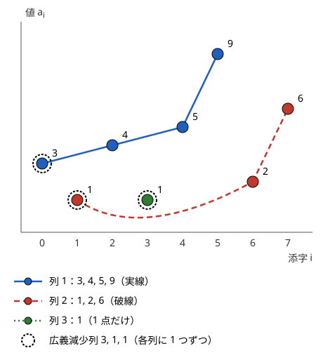

!!! abstract "要点"
    - **何ができるか**：列から順序を保って選ぶ増加列の最長を、長さごとの末尾の最小値の配列を二分探索で更新して $O(N \log N)$ で求める。値を添字にしたセグメント木を使えば、重み付きや数え上げにも広げられる。
    - **いつ使うか**：
        - $N \le 2 \times 10^5$ で「部分列」「単調増加」
        - 最小で何本の増加（減少）列に分けられるか・何色で塗れるか
        - 抜いて差し込む操作の最小回数
        - 箱・円を入れ子にできる最大個数
    - **計算量**：二分探索版・セグメント木版とも $O(N \log N)$（セグメント木版は座標圧縮を含む）。素朴な DP は $O(N^2)$
    - **前提**：[DP の基本](../dp/dp-basics.md)、[二分探索](../basics/binary-search.md)

<!-- textlint-disable -->
別名：LIS・Longest Increasing Subsequence・最長減少部分列・Dilworth の定理・増加列への最小分割
<!-- textlint-enable -->

最長増加部分列（LIS）は、列から順序を保っていくつかの要素を選び、選んだ値が左から増加するようにしたときの、選べる個数の最大である。素朴な DP では $O(N^2)$ かかるが、「同じ長さなら末尾が小さい列だけを覚えれば足りる」と気づくと、二分探索で $O(N \log N)$ になる。減少列・入れ子・列への分割の問題も、言い換えると LIS に帰着することが多い。

この節以降、列は 0-indexed で $a_0, \dots, a_{N-1}$ と書く。「増加」は特に断らなければ狭義（$a_i < a_j$）で、広義（$a_i \le a_j$）のときは明記する。

## 二分探索版（L が単調になる理由・狭義は lower_bound、広義は upper_bound） {#binary-search}

素朴な DP から始める。$\mathrm{dp}[i]$ ＝「$a_i$ で終わる増加部分列の長さの最大」とすると、$a_i$ の直前に置く要素 $a_j$（$j < i$、$a_j < a_i$）で場合分けして次の式になる。

$$
\mathrm{dp}[i] = 1 + \max\bigl(\{0\} \cup \{\mathrm{dp}[j] \mid j < i,\ a_j < a_i\}\bigr)
$$

答えは $\max_i \mathrm{dp}[i]$ である。各 $i$ で $j$ をすべて見るので $O(N^2)$ かかり、$N = 2 \times 10^5$ では間に合わない。

**同じ長さなら末尾が小さい方がよい**。同じ長さの 2 つの増加部分列があり、末尾を $p < q$ とする。後ろの要素 $x$ が $q$ の列を延ばせるなら（$q < x$）、$p < x$ なので $p$ の列も延ばせる。だから長さごとに、末尾として取りうる最小値だけを覚えれば足りる。そこで[状態](../guide/glossary.md#state)を値と添字で入れ替えて、次の配列を持つ。

> $L[k]$ ＝「ここまでに見た要素から作れる長さ $k + 1$ の増加部分列の、末尾として取りうる最小値」

LIS の長さは、最後に $L$ の要素数になる。

**L は狭義の昇順に並ぶ**。長さ $k + 2$ の増加部分列で末尾が $L[k + 1]$ のものを考える。その最後の要素を除くと長さ $k + 1$ の増加部分列ができ、その末尾は $L[k + 1]$ より小さい。$L[k]$ はその中の最小値なので $L[k] < L[k + 1]$ である。広義のときは同じ議論で $L[k] \le L[k + 1]$（広義の昇順）になるので、`upper_bound` が使える。

**新しい要素 $x$ で変わるのは 1 か所だけ**。$x$ は「末尾が $x$ 未満の列」の後ろにつなげる。$L$ が昇順なので、末尾が $x$ 未満の長さは $L[0], \dots, L[k - 1]$ の範囲の $k$ 個で、$k$ は $x$ 以上の最初の位置である。$x$ をつなぐと長さ $k + 1$ の列ができ、$L[k] \ge x$ なので $L[k]$ を $x$ に置き換える（$k$ が末尾なら追加する）。ほかの長さの最小値は変わらない。$k$ は [`lower_bound`](../basics/binary-search.md#lower-bound) で求まるので、1 要素あたり $O(\log N)$、全体で $O(N \log N)$ になる。

列 $(3, 1, 4, 1, 5, 9, 2, 6)$ で $L$ が変わる様子は次のとおりである。図の上段が列で、下段が $L$ である。各要素について「位置 $k$ を探す」「置き換える（または追加する）」の 2 ステップで進む。中段には素朴な DP で求めた $\mathrm{dp}[i]$ を並べ、$k + 1$ と同じ値になることを示す。2 つ目のステップでは、比べる相手（$a_j < a_i$ となる左の $j$）の $\mathrm{dp}[j]$ の下に小さな丸を付ける。

<div class="kp-viz" data-viz="lis" data-config='{"array": [3, 1, 4, 1, 5, 9, 2, 6], "strict": true}'></div>

| 入れる値 | 位置 $k$ | 入れた後の $L$ | $a_i$ で終わる最長 |
| --- | --- | --- | --- |
| 3 | 0（追加） | 3 | 1 |
| 1 | 0（3 を置換） | 1 | 1 |
| 4 | 1（追加） | 1, 4 | 2 |
| 1 | 0（1 を置換。値は同じ） | 1, 4 | 1 |
| 5 | 2（追加） | 1, 4, 5 | 3 |
| 9 | 3（追加） | 1, 4, 5, 9 | 4 |
| 2 | 1（4 を置換） | 1, 2, 5, 9 | 2 |
| 6 | 3（9 を置換） | 1, 2, 5, 6 | 4 |

LIS の長さは最後の $L$ の要素数の 4 である。表の右の列のとおり、置いた位置 $k$ に 1 を足すと、$a_i$ で終わる増加部分列の最長 $\mathrm{dp}[i]$ になる。素朴な DP と同じ値が $O(\log N)$ ずつで手に入るので、各要素ごとの値が要る応用（[各要素が LIS に含まれうるか](#contained)）にもそのまま使える。

**狭義と広義の違いは二分探索の 1 か所だけ**。狭義では、$x$ と等しい末尾の後ろには $x$ をつなげない。だから「$x$ 以上の最初の位置」を `lower_bound` で求める。広義では等しい値の後ろにもつなげるので、「$x$ より大きい最初の位置」を `upper_bound` で求める。

```cpp
--8<-- "lis/lis.cpp:core"
```

- **減少列**：最長減少部分列は、各要素の符号を反転した列（$-a_i$）の LIS である。列を逆順にして LIS を求めても、元の列の右から左への増加列なので同じ長さになる
- **$L$ は LIS そのものではない**：最後の $L = (1, 2, 5, 6)$ では、2 が 5 より右にあるので、元の列の部分列になっていない。列そのものが要るときは[復元](#restore)の方法を使う

??? question "確認問題：1 1 1 の LIS"
    列 $(1, 1, 1)$ の LIS を、狭義と広義のそれぞれについて二分探索版で求めると、$L$ はどう変わるか。

    ??? success "答え"
        狭義（`lower_bound`）では、2 つ目と 3 つ目の 1 は「1 以上の最初の位置」の 0 に入り、1 を 1 で置き換えるだけである。$L = (1)$ のままで、長さは 1 になる。広義（`upper_bound`）では「1 より大きい最初の位置」が末尾なので毎回追加され、$L = (1, 1, 1)$ で長さは 3 になる。

## セグメント木版（重み付き・各要素で終わる最長・数え上げ） {#segment-tree}

二分探索版は長さを求めるのには速いが、「長さ」以外の値（重みの和・個数）を持たせにくい。$L$ は「長さ → 末尾の最小値」の表で、比べるのが長さだからである。重みや個数が要るときは、素朴な DP の式に戻り、「$a_j < a_i$ を満たす $j$ の中の最大」を[セグメント木](../ds/segment-tree.md)で速く取る。この節はセグメント木と[座標圧縮](../basics/coordinate-compression.md)を前提にする。

値を座標圧縮して $0, \dots, M - 1$ に直し、値を添字にした配列を持つ。

> $\mathrm{best}[v]$ ＝「ここまでに見た要素で作れる、末尾の値が $v$ の増加部分列の最大（長さ・重みの和など）」

左から $a_i$（圧縮後の値 $v$）を見るたびに、次の 2 つを行う。

1. $\mathrm{best}$ の区間 $[0, v)$ の最大を取る。これが $a_i$ の直前に置ける列の最大で、それに $a_i$ の分を足すと $\mathrm{dp}[i]$ になる
2. $\mathrm{best}[v]$ を $\mathrm{dp}[i]$ との大きい方に更新する

左から順に見るので、$\mathrm{best}$ に入っているのは $i$ より左の要素だけである。添字の条件 $j < i$ は処理の順序で、値の条件 $a_j < a_i$ は区間 $[0, v)$ で満たされる。広義なら区間を $[0, v + 1)$ にする。区間の最大の取得と一点の更新はどちらも $O(\log M)$ なので、全体で $O(N \log N)$ になる。

次のコードは、高さ $h_i$ が狭義増加になるように選ぶとき、重み $w_i$ の和の最大を求める（重みは 0 以上とする）。

```cpp
--8<-- "lis/weighted.cpp:core"
```

!!! info "ACL では"
    `segtree<S, op, e> seg(n);`。`seg.prod(l, r)` で $[l, r)$ の集約値、`seg.set(p, x)` で一点の代入、`seg.get(p)` で一点の値を返す。`prod`・`set` は $O(\log N)$、`get`・`all_prod()` は $O(1)$。要件は `op` が結合法則を満たし、`e()` がその単位元であること。最大なら `op` を `max`、`e()` を値の下限にする。

**数え上げ**。LIS の個数を数えるときは、各値に「（長さ, その長さを達成する列の個数）」の組を持たせる。2 つの組の演算は「長さが違えば長い方、同じなら個数を足す」で、単位元は（0, 0）である。$a_i$ では $[0, v)$ の組 $(\ell, c)$ を取り、$\ell = 0$ なら $c = 1$ として、$(\ell + 1, c)$ を位置 $v$ に演算で合わせる。全体の集約値の個数が答えである。この演算は結合法則を満たすので、そのままセグメント木に載る。

同じ値が 2 回以上現れるとき、二分探索版と同じく「狭義なら等しい値の後ろにつながない」を区間の右端で表す。数え上げでは、同じ部分列を 2 回数えないよう、数えるのが「添字の組」か「値の列」かを問題文で確かめる。

## 復元（直前の要素を記録する） {#restore}

LIS の列そのものを 1 つ出力するには、各要素について「その要素で終わる最長の列で、直前に置いた要素」を記録し、最後に末尾から逆にたどる（[DP の復元](../dp/dp-reconstruction.md#trace-back)の考え方）。二分探索版では、$L$ に値ではなく添字を入れる。

- $L[k]$ には「長さ $k + 1$ の列の末尾として最小の値を持つ要素の添字」を入れ、比べるときは $a_{L[k]}$ を使う
- $a_i$ を位置 $k$ に置くとき、$k \ge 1$ なら $\mathrm{prev}[i] = L[k - 1]$ とする。その時点の $L[k - 1]$ は $i$ より左にあり、値は $a_i$ より小さいので、つないだ列は正しい増加部分列である
- 最後に $L$ の末尾の添字から $\mathrm{prev}$ を $-1$ までたどると、LIS が逆順に得られる

```cpp
--8<-- "lis/restore.cpp:core"
```

$L$ の中身は後から上書きされるが、$\mathrm{prev}$ は置いた時点の値で固定されるので、たどった列は崩れない。列 $(3, 1, 4, 1, 5, 9, 2, 6)$ では、6 の直前は置いた時点の $L[2]$ の 5、5 の直前は 4、4 の直前は 1 で、$(1, 4, 5, 6)$ が出る。セグメント木版でも、最大を与えた $j$ を値と一緒に持てば同じように復元できる。グリッドを右か下に進んでコインを集める経路を出す問題などは、この形になる。

## 各要素が LIS に含まれうるか（前後から 2 回求める） {#contained}

この節は[二分探索版](#binary-search)の $\mathrm{dp}[i]$ の求め方を前提にする。各要素 $a_i$ について、$a_i$ を含む LIS があるかを判定するには、次の 2 つを求める。

- $f[i]$ ＝「$a_i$ で終わる増加部分列の最長」：左から二分探索版を回し、置いた位置に 1 を足す
- $g[i]$ ＝「$a_i$ から始まる増加部分列の最長」：右から左へ、符号を反転した値（$-a_i$）で二分探索版を回すと、同じように求まる

$a_i$ を含む増加部分列は、「$a_i$ で終わる左側」と「$a_i$ から始まる右側」をつないだものである。左側と右側は $a_i$ をはさんで独立に選べるので、$a_i$ を含む最長は $f[i] + g[i] - 1$ になる。全体の LIS の長さを $\ell$ として、$f[i] + g[i] - 1 = \ell$ なら $a_i$ は LIS に含まれうる。全体は $O(N \log N)$ である。

同じ考え方で、山型（狭義増加のあと狭義減少）の最長は $\max_i \bigl(f[i] + h[i] - 1\bigr)$ になる。$h[i]$ は「$a_i$ から始まる狭義減少列の最長」で、右から左へそのまま二分探索版を回せば求まる。

「すべての LIS に必ず含まれるか」も判定できる。含まれうる要素を $f[i]$ の値で分けると、$a_i$ を含む LIS では $a_i$ が $f[i]$ 番目にくるので、どの LIS も各値から 1 つずつ要素を使う。だから含まれうる要素の中で、$f[i]$ と等しい値を持つ要素がほかにないときだけ、$a_i$ はすべての LIS に含まれる。

## 2 次元の入れ子（一方は昇順・もう一方は降順に並べる） {#nesting}

この節は[二分探索版](#binary-search)を前提にする。幅 $w_i$・高さ $h_i$ の箱を、幅と高さの両方が狭義に大きい箱の中に入れていくとき、何重の入れ子にできるかを考える。2 つの値がどちらも狭義増加になる列の最長なので、一方でソートすればもう一方の LIS になる。

1. 幅の昇順にソートする。幅が同じ箱どうしは、高さの**降順**に並べる
2. 並べた順の高さの列で、狭義の LIS を求める

幅が同じ箱どうしは入れ子にできない。高さを降順に並べておけば、同じ幅の箱から高さの狭義増加列に 2 つ以上は入らないので、この組が自然に除かれる。高さを昇順に並べると、幅が同じで高さの違う箱が増加列に入り、入れ子にできない組を数えてしまう。

条件が広義（同じ大きさでも入れてよい）なら、同じ幅の箱は高さの昇順に並べ、広義の LIS を求める。どちらの場合も、同じ幅の箱の並べ方と、二分探索の `lower_bound`・`upper_bound` を条件に合わせてそろえる。

**円と区間**。数直線上に中心 $x_i$ を持つ半径 $r_i$ の円は、区間 $[x_i - r_i, x_i + r_i]$ で表せる。ある円が別の円の内側に入るのは、区間の左端が大きく右端が小さいときである。左端の昇順（同じ左端なら右端の昇順）に並べ、右端の列で減少列の最長を求めれば、入れ子の最長になる。接する場合を内側に含めるかで不等号が狭義か広義かが変わるので、問題文で確かめる。

## 1 か所だけ変更できる LIS・木の上の LIS {#variants}

この節は[二分探索版](#binary-search)と[各要素が LIS に含まれうるか](#contained)の $f$・$g$ を前提にする。どちらも、二分探索版で $L$ が 1 か所しか変わらないことと、$f$・$g$ を組み合わせることがかぎになる。

**1 か所だけ好きな整数に変えてよい LIS**。変えた要素 $a_m$ を LIS に使うとして、その左隣に使う要素を $a_j$、右隣を $a_k$（$j < m < k$）とする。$a_m$ は $a_j$ と $a_k$ の間の整数にできればよいので、条件は $k - j \ge 2$ と $a_k - a_j \ge 2$ だけで、長さは $f[j] + 1 + g[k]$ である。$k$ を左から動かしながら、$j = k - 2$ をセグメント木（値 $a_j$ を添字に $f[j]$ の最大を持つ）に入れていけば、$a_j \le a_k - 2$ の範囲の最大を $O(\log N)$ で取れる。変えた要素が LIS の左端か右端にくる場合（$f[j] + 1$ で $j \le N - 2$、$1 + g[k]$ で $k \ge 1$）と、変えた要素を使わない場合（元の LIS の長さ）も候補にする。全体で $O(N \log N)$ である。

**木の上の LIS**。根から各頂点へのパス上の値の列について LIS を求めるときは、深さ優先探索をしながら $L$ を 1 本だけ持つ。頂点に入ると $L$ の 1 か所を書き換え（または末尾に追加し）、そのときの $L$ の要素数がその頂点までの答えになる。頂点を出るときは、末尾に追加した場合は末尾を取り除き、書き換えた場合は記録しておいた位置を元の値に戻す。$L$ の変更は 1 頂点につき 1 か所なので、戻すのも $O(1)$ で済み、全体は $O(N \log N)$ になる。根からのパスを保ったまま戻す一般の方法は[根からのパスを持つ DFS](../tree/root-path-dfs.md#undo-log)にある。

## Dilworth の定理（増加列への最小分割数＝最長減少部分列の長さ） {#dilworth}

この節は[二分探索版](#binary-search)を前提にする。列の要素をいくつかの組に分け、どの組も左から見て狭義増加とするとき、組の数の最小を考える。「同じ色の要素が狭義増加となるよう塗る最小の色数」も同じ問いである。

> 列を狭義増加の部分列に分けるときの最小の個数は、最長の広義減少部分列（$a_{i_1} \ge a_{i_2} \ge \dots$）の長さに等しい。広義増加と狭義減少を入れ替えても同じことが成り立つ。

次の図は、列 $(3, 1, 4, 1, 5, 9, 2, 6)$ を 3 つの狭義増加列に分けた例である。広義減少列 $3, 1, 1$ の 3 点は、どの 2 点も同じ狭義増加列に入れない。



**下限**：広義減少列の 2 つの要素は、左のものが右のもの以上なので、同じ狭義増加列には入れない。だから組は最長の広義減少列の長さ以上要る。

**上限**：左から順に、各要素 $x$ を「末尾が $x$ 未満の組のうち、末尾が最大の組」の後ろに置き、そのような組がなければ新しい組を作る。この貪欲では、組を作った順に末尾を並べると常に広義の降順になる。$x$ が $j$ 番目（$j \ge 2$）の組に入るとき、$j - 1$ 番目の組の末尾は $x$ 以上で、$x$ より左にある。そこで $x$ からその末尾へ印を付けておくと、最後の組の要素から印をたどった列は、各組から 1 つずつ要素を取った広義減少列になる。よって組の数は最長の広義減少列の長さ以下である。

??? note "貪欲と二分探索版の関係"
    貪欲の組の末尾を作った順に並べたもの（広義の降順）の符号を反転すると、$-a_i$ の列の広義 LIS の $L$ と同じ動きをする。「末尾が $x$ 未満で最大の組」は $L$ での `upper_bound` の位置にあたり、新しい組を作るのは $L$ の末尾への追加にあたる。だから組の数を数えるだけなら、符号を反転した列（$-a_i$）で広義の LIS を求めればよい。

使うときは、問題を「どの 2 つが同じ組に入れるか」の形に直すのが要である。

- **何色で塗れるか**：同じ色が狭義増加なら、答えは広義減少列の最長で、$-a_i$ の列に `upper_bound` 版を回せば求まる
- **2 次元の点を何本の鎖で覆えるか**：時刻と位置のように 2 つの座標がどちらも増える向きにしか進めない移動なら、一方でソートしてもう一方の列に直すと、必要な本数は減少列の最長になる。同じ $x$ の点は $y$ の昇順に並べる（[入れ子](#nesting)と同じく、同じ座標の並べ方を鎖の条件に合わせる）。斜めにしか動けない移動は、[45 度回転](../geometry/manhattan-chebyshev.md#rotate-45)で「上か右にしか動けない」形に直してから使う
- **一般の半順序**：列でなく一般の DAG のパスで覆う問題は、[Dilworth の定理とパス被覆](../graph/dilworth-path-cover.md)の二部マッチングを使う

## 落とし穴 {#pitfalls}

**狭義と広義の取り違え**。`lower_bound` は狭義、`upper_bound` は広義である。等しい値を含む小さな例（$(1, 1, 1)$ で狭義なら 1、広義なら 3）で確かめてから書く。Dilworth の定理で言い換えるときは、狭義と広義が入れ替わる（狭義増加の組の数は、広義減少の最長）ことに注意する。

**$L$ を LIS として出力する**。$L$ は長さごとの末尾の最小値の集まりで、元の列の部分列とは限らない。列が要るときは[復元](#restore)のように直前の添字を記録する。

**最長減少部分列を逆順で求めて向きを誤る**。列を逆順にして LIS を求めると「元の列の右から左への増加」、つまり元の列の減少列になる。各要素の $g[i]$ を作るときは、逆順に回した結果を元の添字に戻して入れる。

**重み付きに二分探索版を使う**。二分探索版の「末尾が小さい方がよい」は、長さだけを比べるときの議論である。重みの和や個数を持つと、末尾が大きくても重みの大きい列を捨てられないので、[セグメント木版](#segment-tree)にする。

**座標圧縮を忘れて値を添字にする**。値が $10^9$ までなら、そのまま添字にすると配列が作れない。セグメント木版では先に座標圧縮し、圧縮後の値で区間を取る。

**入れ子で同じ幅の並べ方を誤る**。狭義の入れ子では、同じ幅の箱を高さの降順に並べる。昇順に並べると、入れ子にできない組を鎖に数えてしまう（[2 次元の入れ子](#nesting)）。

## 例題 {#examples}

### ABC134 E. Sequence Decomposing {#abc134_e}

<div class="kp-problems" data-role="example" markdown>

- [ABC134 E. Sequence Decomposing](https://atcoder.jp/contests/abc134/tasks/abc134_e)（diff 1320）：数列の各要素に色を塗り、同じ色の要素が左から見て狭義増加になるようにするときの、色の数の最小を求める。

</div>

同じ色が狭義増加なので、[Dilworth の定理](#dilworth)により、答えは最長の広義減少部分列の長さである。$-a_i$ の列で広義の LIS（`upper_bound` 版）を求めればよい。

??? note "解法の詳細"
    - 色を組と見ると、「列を狭義増加の部分列に分ける最小の個数」を求める問題である。
    - 下限：広義減少列の要素は、どの 2 つも同じ色にできない。上限：左から、末尾が $a_i$ 未満で最大の組に置く貪欲で、組の数が広義減少列の最長に一致する。
    - 実装は $b_i = -a_i$ とし、$b$ の広義の LIS を `upper_bound` で求める。$O(N \log N)$。
    - `lower_bound` を使うと狭義減少列の長さになり、等しい値が続く列（すべて同じ値なら答えは $N$）で答えが小さくなる。

### 典型90 060. Chimera（★5） {#typical90_bh}

<div class="kp-problems" data-role="example" markdown>

- [典型90 060. Chimera（★5）](https://atcoder.jp/contests/typical90/tasks/typical90_bh)（diff —）：数列から部分列を選び、ある位置までは狭義増加・そこからは狭義減少になる山型の部分列の長さの最大を求める。

</div>

山の頂上を $a_i$ と決めると、左側は「$a_i$ で終わる狭義増加列」、右側は「$a_i$ から始まる狭義減少列」で、2 つは独立に選べる。左から求めた $f[i]$ と右から求めた $h[i]$ を各位置で合わせる（[各要素が LIS に含まれうるか](#contained)と同じ形）。

??? note "解法の詳細"
    - $f[i]$：左から二分探索版（`lower_bound`）を回し、$a_i$ を置いた位置に 1 を足す。
    - $h[i]$：右から左へ同じ二分探索版を回す。右から見て狭義増加は、元の向きでは狭義減少なので、$h[i]$ は「$a_i$ から始まる狭義減少列の最長」になる。
    - 答えは $\max_i \bigl(f[i] + h[i] - 1\bigr)$。$a_i$ を両方に数えているので 1 を引く。全体で $O(N \log N)$。

## 練習問題 {#practice}

<div class="kp-problems" data-role="practice" markdown>

- [EDPC Q. Flowers](https://atcoder.jp/contests/dp/tasks/dp_q)（diff —）：高さが相異なる花の列から、高さが左から単調増加になるように選ぶときの美しさの和の最大を求める。
- [ABC354 F. Useless for LIS](https://atcoder.jp/contests/abc354/tasks/abc354_f)（diff 1639）：数列の各要素について、その要素を含む最長増加部分列が存在するかを判定する。
- [ABC006 D. トランプ挿入ソート](https://atcoder.jp/contests/abc006/tasks/abc006_4)（diff 1696）：トランプの列で「1 枚抜いて好きな位置に差し込む」操作を繰り返して昇順に並べるときの、操作回数の最小を求める。
- [ABC165 F. LIS on Tree](https://atcoder.jp/contests/abc165/tasks/abc165_f)（diff 1843）：木の各頂点 k について、根から k へのパス上の値の列の最長増加部分列の長さを求める。
- [ABC457 G. Catch All Apples](https://atcoder.jp/contests/abc457/tasks/abc457_g)（diff 1928）：数直線上の決まった時刻・位置に落ちるリンゴを、速さが 1 以下のロボットですべて受け取るとき、ロボットの台数の最小を求める。
- [ABC360 G. Suitable Edit for LIS](https://atcoder.jp/contests/abc360/tasks/abc360_g)（diff 1982）：数列の要素を 1 つだけ好きな整数に変えてよいとき、最長増加部分列の長さの最大を求める。

</div>

??? note "練習の方針"
    - **EDPC Q**：重み付きなので[セグメント木版](#segment-tree)を使う。高さは 1 から $N$ の相異なる値なので、そのまま添字にでき座標圧縮は要らない。高さを添字に「末尾の高さが $v$ の列の美しさの和の最大」を持つ
    - **ABC354 F**：[各要素が LIS に含まれうるか](#contained)のとおり、前後から求めた $f[i] + g[i] - 1$ が全体の LIS の長さに等しい要素を数える
    - **ABC006 D**：動かさないカードは元の順序のまま残る。だから昇順の部分列でなければならず、その個数は LIS 以下である。逆に LIS 以外のカードを 1 回ずつ差し込めば並ぶ。答えは $N$ から LIS の長さを引いたもの
    - **ABC165 F**：[木の上の LIS](#variants) のとおり、DFS で $L$ の 1 か所の変更を記録し、頂点を出るときに戻す
    - **ABC457 G**：時刻と位置を 45 度回転すると、ロボットは「上か右にしか動けない」点の鎖になる。一方でソートしてもう一方の列に直すと、台数は広義増加列への最小分割になる。[Dilworth の定理](#dilworth)により、これは狭義減少列の最長である
    - **ABC360 G**：[1 か所だけ変更できる LIS](#variants) のとおり、左右からの $f$・$g$ を求め、$a_k - a_j \ge 2$ と $k - j \ge 2$ を満たす組の最大をセグメント木で取る。端の要素を変える場合も忘れない

## 力試し {#challenge}

<div class="kp-problems" data-role="challenge" markdown>

- [TDPC K. ターゲット](https://atcoder.jp/contests/tdpc/tasks/tdpc_target)（diff —）：数直線上に中心を持つ円の集合から、入れ子（次の円の内側にある）の鎖になるように選べる円の個数の最大を求める。
- [ABC476 G. Increasing Popcount](https://atcoder.jp/contests/abc476/tasks/abc476_g)（diff 2477）：L 以上 R 以下の各整数に正の整数を割り当て、同じ値を割り当てた 2 つの整数では小さい方の popcount が大きい方より小さくなるようにするとき、割り当てる値の最大の最小を求める。

</div>

??? note "力試しの方針"
    - **TDPC K**：[2 次元の入れ子](#nesting)の円の形である。円を区間に直して左端でソートし、右端の列の減少列の最長を二分探索版で求める。同じ左端の並べ方と狭義・広義は、問題の「内側」の定義に合わせてそろえる
    - **ABC476 G**：同じ値を割り当てた整数は popcount が狭義増加の列をなすので、L から R までの popcount を順に並べた列を、狭義増加の部分列に分ける個数の最小を問う形に直せる。[Dilworth の定理](#dilworth)で、答えはその列の最長の広義減少部分列の長さになる。$R$ が大きく列を作れないので、区間を末尾の 0 の個数で決まる長さ $2^k$ のブロックに分け、各ブロックの popcount の個数が二項係数で表せることを使って DP する

## 使い分け {#comparison}

- 長さだけが要るなら二分探索版が短く速い。重み・個数・条件付きの最大が要るならセグメント木版にする
- $N$ が数千までなら、素朴な $O(N^2)$ の DP で足りる。値の範囲が小さければ、座標圧縮なしでセグメント木版が使える
- 2 つの列に共通する部分列なら[最長共通部分列](../dp/lcs.md)を使う。一方が順列なら、位置に置き換えると LIS に帰着できる
- 増加列を 1 本ずつ取り除くのではなく、列全体を何本に分けるかを問われたら、[Dilworth の定理](#dilworth)で減少列の最長に言い換える

## 参考 {#references}

- [drken「AtCoder ABC 134 E - Sequence Decomposing (1Q, 水色, 500 点)」](https://drken1215.hatenablog.com/entry/2020/12/25/184700)：例題の貪欲と二分探索、LIS との狭義・広義の対応
- [E869120「kyopro_educational_90 の 060 の解答例（sol/060.cpp）」](https://github.com/E869120/kyopro_educational_90/blob/main/sol/060.cpp)：例題の左右からの LIS の組み合わせ方
- [drken「AtCoder ABC 354 F - Useless for LIS (2D, 青色, 525 点)」](https://drken1215.hatenablog.com/entry/2024/05/19/005916)：前後からの LIS の長さの和で含まれうるかを判定する方法
- [drken「AtCoder ABC 006 D - トランプ挿入ソート (1Q, 試験管青色)」](https://drken1215.hatenablog.com/entry/2019/04/17/231900)：練習の方針（N − LIS の上限と下限）
- [kmjp「AtCoder ABC #165 : F - LIS on Tree」](https://kmjp.hatenablog.jp/entry/2020/05/02/0930)：木の上の LIS で L の変更を記録して戻す方法
- [drken「AtCoder ABC 360 G - Suitable Edit for LIS (3D, 青色, 625 点)」](https://drken1215.hatenablog.com/entry/2024/07/07/203100)：1 か所を変える LIS の左右からの組み合わせ
- [Series_205「Educational DP Contest (EDPC) P ~ S 問題 解説」](https://qiita.com/Series_205/items/6bad5c32a1fce8dc2914)：重み付きの LIS をセグメント木で求める方法
- [ikatakos「Polaris.AI プログラミングコンテスト 2026（AtCoder Beginner Contest 457）E,F問題メモ」](https://ikatakos.com/pot/programming_algorithm/contest_history/atcoder/2026/0509_abc457)：練習の方針（45 度回転と減少列の最長。解法の部分だけを参照）
- [ikatakos「JIJプログラミングコンテスト 2026（AtCoder Beginner Contest 476）F,G問題メモ」](https://ikatakos.com/pot/programming_algorithm/contest_history/atcoder/2026/0919_abc476)：力試しの方針（Dilworth の定理と popcount のブロック分け。解法の部分だけを参照）
- [sigma425「Typical DP Contest (TDPC)」](https://sigma425.hatenablog.com/entry/2016/08/02/214547)：TDPC K が LIS に帰着すること
- [AtCoder Library「Segment Tree」](https://github.com/atcoder/ac-library/blob/master/document_ja/segtree.md)：ACL の segtree の使い方と計算量
