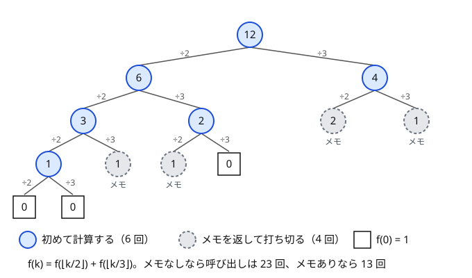

!!! abstract "要点"
    - **何ができるか**：漸化式を再帰関数のまま書き、計算済みの値を覚えて使い回す。計算順序を考えなくてよく、$\lfloor N/2 \rfloor$ のようにまばらにしか現れない状態だけを計算できる。
    - **いつ使うか**：
        - $N \le 10^{18}$ で、$\lfloor N/2 \rfloor$・$\lfloor N/3 \rfloor$ のような値しか現れない。
        - $f(n)$ が $f(\lfloor n/k \rfloor)$ などで再帰的に定義されている。
        - $\mathrm{dp}[x]$ が $x$ より小さい値の dp で決まるが、どの値が現れるかを前もって列挙しにくい。
    - **計算量**：（現れる状態の数）×（1 状態の遷移数）。各状態は 1 回だけ計算される。`map` に覚えるなら、参照ごとに状態の数 $S$ について $O(\log S)$ が掛かる。
    - **前提**：[DP の基本](../dp/dp-basics.md)

<!-- textlint-disable -->
別名：メモ化・Memoization・再帰 DP・トップダウン DP・map でメモ化・疎な DP
<!-- textlint-enable -->

メモ化再帰は、[DP の基本](../dp/dp-basics.md)で立てた漸化式を、for 文で表を埋める代わりに再帰関数として書き、一度求めた値を表（メモ）に残して二度目からは表を引く方法である。再帰が「先に要る値」から順に呼ぶので、計算順序は自動で決まる。初めの状態から届く状態だけを計算するので、状態の範囲が広くても、実際に現れる値が少なければ間に合う。

## 再帰とメモの書き方（未計算の印と答えの値の衝突を避ける） {#write-memo}

メモ化再帰の関数は、どの問題でも次の 4 段でできている。

1. 終わりの状態なら、決まった値を返す（初期値にあたる）
2. 計算済みなら、メモの値をそのまま返す
3. 漸化式で、自分より先に要る状態を再帰で呼んで値を求める
4. 求めた値をメモに書いてから返す

2 段目があるので、各状態の 3 段目は 1 回しか実行されない。全体の計算量は（状態の数）×（1 状態の遷移数）で、for 文の DP と同じ見積もりになる。

次の図は $f(0) = 1$、$f(k) = f(\lfloor k/2 \rfloor) + f(\lfloor k/3 \rfloor)$ で $f(12)$ を求めるときの呼び出しの木である。メモがなければ $f(2)$ や $f(1)$ を何度も計算し直して呼び出しは 23 回になるが、メモがあると 2 回目以降は灰色の点線の頂点で打ち切られ、13 回で済む。



メモなしの呼び出しの回数は、$N$ が大きいと急に増える。この漸化式なら $N = 10^{18}$ で約 $4.5 \times 10^{14}$ 回だが、メモありなら現れる値は 1012 個しかない（数え方は[到達する状態だけを持つ](#dp-map-sparse)の節）。

C++ では、ラムダ式で書くと入力や表を引数で渡さずに済む。ただし、ラムダ式はそのままでは自分を呼べない。そこで自分自身を引数 `self` で受け取る形にする（[自分を引数で渡す再帰](../cpp/cpp-lambda.md#self-argument)）。次のコードは $f(0) = 0$、$f(n) = \max(n, f(\lfloor n/2 \rfloor) + f(\lfloor n/3 \rfloor) + f(\lfloor n/4 \rfloor))$ を $n \le 10^{17}$ で、`map` に覚えながら求める。

```cpp
--8<-- "memoized-recursion/floor-memo.cpp:core"
```

完全なプログラム：[`floor-memo.cpp`](https://github.com/yuukougun/kyopro-atlas/blob/main/snippets/memoized-recursion/floor-memo.cpp)（GitHub）
{ .kp-code-src }

**未計算の印**は、答えになりうる値と重ならないように選ぶ。よくある書き方は、表を $-1$ で初期化して「$-1$ なら未計算」とするものだが、次の場合は印と答えが衝突する。

- **答えが負にもなる**：ゲームの得点差や、負の重みのある最長路では $-1$ が正しい答えになりうる。答えが $-1$ の状態は毎回計算し直され、メモが効かなくなる
- **答えが 0 になりうるのに 0 で初期化した**：数え上げで「0 通り」の状態が多いと、ほとんどの状態が毎回計算し直される。答えは合うので TLE になるまで気づきにくい
- **`map` の `memo[x]` で有無を調べた**：`operator[]` は鍵がなければ値 0 の要素を作って入れる。「0 なら未計算」と同じ問題が起き、無駄な要素も増える。`find` か `contains`（C++20）で鍵の有無を見る

確実なのは、計算済みかどうかを値と別に持つことである。配列なら `vector<char> done(n)` を並べ、`map` なら鍵があることを計算済みの印にする。「到達できない」という意味の値（最大化での $-\infty$ など）を持つ問題では、それとも別にしておく。答えが mod の値（0 以上）なら $-1$ を印にしてよい。

??? question "確認問題：印を 0 にしたら"
    $\mathrm{dp}[v]$ ＝ 頂点 $v$ から出発してゴールへ着く経路の数（mod 998244353）をメモ化再帰で求める。表を 0 で初期化し「0 なら未計算」とした。ゴールへ着けない頂点が多いグラフで何が起きるか。

    ??? success "答え"
        ゴールへ着けない頂点の答えは 0 なので、印と区別できない。そうした頂点は呼ばれるたびに計算し直され、その先の頂点も同じなので、呼び出しの回数が経路の数ほどに増えて TLE になりうる。答えは正しいので、小さな例では気づけない。$-1$ で初期化するか、計算済みの印を別に持つ。

入力の異なるテストケースが複数あるときは、メモがその入力に依存するなら、ケースごとにメモを空にする。逆に、漸化式が入力によらない（$f$ が $n$ だけで決まる）なら、メモを全ケースで共有すると速い。

## ボトムアップとの使い分け（速さ・スタック・高速化の載せやすさ） {#vs-bottom-up}

for 文で表を埋める書き方をボトムアップ、メモ化再帰をトップダウンと呼ぶ。同じ漸化式なら、どちらも各状態を 1 回ずつ計算するので計算量は同じである。違いは次のとおりである。

| 観点 | ボトムアップ（for 文） | メモ化再帰 |
| --- | --- | --- |
| 計算順序 | 自分で決める | 再帰が決める |
| 計算する状態 | 表のすべて | 初めの状態から届くものだけ |
| 定数倍 | 小さい | 関数呼び出しの分だけ大きい |
| スタック | 使わない | 深さの分だけ使う |
| 高速化 | 累積和・セグ木・配列の使い回しを載せやすい | 載せにくい |

メモ化再帰を選ぶのは、次の 3 つの場面である。

- **計算順序が分かりにくい**：グラフの辺の向きが番号順でない、添字のどれかが増える遷移がある、ゲームの局面のように「何が先か」を整数の順に並べにくい。再帰が値の返る順に計算するので、その順は自動的に依存の向き（トポロジカル順）になる（[計算順序](../dp/dp-order.md)・[DAG 上の DP](../dp/dp-dag.md)）
- **届く状態がまばら**：状態の範囲は $10^{18}$ 通りあっても、初めの状態から届くのは千個ほど、という場合（次の節）
- **途中で打ち切れる**：ゲームで勝てる手が 1 つ見つかれば、残りの手を調べなくてよい。調べなかった手の先の局面は、ほかから届かなければ一度も計算されずに済む（ボトムアップでは表のすべての局面を計算する）（[勝敗の DP とメモ化再帰](../comb/game-basics.md#game-dp)）

逆に、ボトムアップでなければ載せにくい高速化がある。遷移元が区間になる DP を累積和でまとめるには、区間の値がすべて計算済みの順で表を埋める必要がある。$\mathrm{dp}[i]$ が $\mathrm{dp}[i-1]$ だけで決まるときに配列を 2 行だけ持つ使い回しも、埋める順が決まっていないとできない。状態がすべて届き、順序も添字の順で済むなら、ボトムアップで書く方が速く安全である。

メモ化再帰で書いた DP をボトムアップに直したいときは、再帰で値が確定する順（帰りがけの順）に状態を並べ、その順に for 文を回せばよい。

## 到達する状態だけを持つ（map でメモ化・現れる値の個数の見積もり） {#dp-map-sparse}

$N \le 10^{18}$ のように状態の範囲が広いと、大きさ $N$ の配列は作れない。それでも、$N$ から始めて実際に届く状態が少なければ、届いた状態だけを `map` に覚えれば間に合う。使う前に、届く状態の数を見積もる。

**$\lfloor N/2 \rfloor$・$\lfloor N/3 \rfloor$ への遷移**：$\lfloor \lfloor N/a \rfloor / b \rfloor = \lfloor N/(ab) \rfloor$ が成り立つので、何回割っても現れる値は $\lfloor N/(2^a 3^b) \rfloor$ の形に限られる。$2^a 3^b \le N$ となる組 $(a, b)$ は、$a \le 59$、$b \le 37$ の範囲の約 1200 通り（$N = 10^{18}$ で 1178 通り）である。値どうしが一致するものを除いて実際に数えると、1012 個になる。割る数が $2, 3, 4$ でも、$4 = 2^2$ なので同じ形に収まる。

**$\lfloor x/2 \rfloor$ と $\lceil x/2 \rceil$ への遷移**：2 で割る回数が $k$ 回の値は、$\lfloor N/2^k \rfloor$ と $\lceil N/2^k \rceil$ の 2 つ（差は高々 1）しかない。1 段に高々 2 個で、段は約 $\log_2 N$ 段しかない。$N = 10^{17}$ でも 95 個である（例題の [ABC340 C](#abc340_c)）。

**掛け算で $N$ に近づく遷移**：1 から始めて $2$〜$6$ を掛けていき $N$ を目指すなら、$N$ を割り切らない値からは $N$ に届かないので、状態は $N$ の約数のうち $2^a 3^b 5^c$ の形のものだけでよい。$10^{18}$ 以下の数でも、その個数は高々 2700 個である。

**すべての $k$ について $\lfloor N/k \rfloor$ へ遷移する**：現れる値は $\lfloor N/k \rfloor$ の形で、その種類は $O(\sqrt{N})$ 個である（[商の列挙](../math/floor-quotient-enum.md#why-sqrt)）。ただし、状態 $x$ からの遷移先も $O(\sqrt{x})$ 種類あるので、遷移の総数は $O(N^{3/4})$ になる。$N = 10^{12}$ では状態は約 $2 \times 10^6$ 個でも遷移は約 $5 \times 10^9$ 回で、`map` の $\log$ も掛かって間に合わない。$N \le 10^{9}$〜$10^{10}$ 程度が目安で、それより大きいときは遷移も商が同じ $k$ ごとにまとめる（[同じ商になる区間の右端](../math/floor-quotient-enum.md#block-end)）。

見積もりが立たないときは、小さい $N$ から順に `memo.size()` を出力して、増え方を手元で確かめるとよい。`map` は参照ごとに $O(\log S)$ が掛かるが、状態が数千個なら気にしなくてよい。状態が $10^6$ 個を超えて遅いときは `unordered_map` に変えるか、状態に番号を振って配列に移す。

??? question "確認問題：現れる値の個数"
    $f(n) = f(\lfloor n/2 \rfloor) + f(\lfloor n/3 \rfloor) + f(\lfloor n/5 \rfloor)$ を $N = 10^{18}$ でメモ化再帰する。現れる値はおよそ何個か。

    ??? success "答え"
        現れる値は $\lfloor N/(2^a 3^b 5^c) \rfloor$ の形だけである。$a \le 59$、$b \le 37$、$c \le 25$ の範囲で $2^a 3^b 5^c \le 10^{18}$ を満たす組は、およそ $59 \times 37 \times 25 / 6 \approx 10^4$ 通りある（三角錐の体積の見積もり）。値どうしが一致することもあるので実際はそれ以下で、`map` で十分に間に合う。実際に数えると、組は 10917 通り、現れる値は 7254 個である。

## 落とし穴 {#pitfalls}

**再帰が深いとスタックが溢れる**。再帰の深さは、初めの状態から終わりの状態までの遷移の回数である。$\lfloor N/2 \rfloor$ への遷移なら深さは $\log N$ で心配ないが、頂点が一直線に並んだ $10^5$ 頂点のグラフをたどると深さも $10^5$ になる。手元の Linux の既定のスタック（8 MiB が多い）では、1 回の呼び出しが使う量によってはこの深さで落ちる（[再帰の深さとスタック](../basics/recursion-structure.md#stack)）。手元で試すときは `ulimit -s unlimited` でスタックを広げる。提出先の上限が分からないときや、深さが $10^6$ を超えるときは、トポロジカル順を求めてボトムアップに書き直す（[AtCoder と手元の C++ 環境](../cpp/cpp-environment.md#stack-depth)）。

**閉路があると止まらない**。状態 $u$ の計算が $v$ を呼び、$v$ の計算が $u$ を呼ぶと、どちらも「未計算」のまま呼び合い続け、スタックが溢れるまで止まらない。メモ化再帰が使えるのは、遷移の依存が閉路のない形（DAG）のときだけである。閉路がないか分からないときは、状態を「未計算・計算中・計算済み」の 3 値で持つ。計算中の状態をもう一度呼んだら閉路がある。

```cpp
--8<-- "memoized-recursion/dag-memo.cpp:core"
```

完全なプログラム：[`dag-memo.cpp`](https://github.com/yuukougun/kyopro-atlas/blob/main/snippets/memoized-recursion/dag-memo.cpp)（GitHub）
{ .kp-code-src }

閉路がある問題は、閉路の部分を先に別の方法で処理する。各頂点から出る辺が 1 本のグラフなら、先に閉路を見つけてその上の値を決め、残りの木の部分をメモ化再帰で求める（[Functional graph](../graph/functional-graph.md)）。期待値で一般の閉路があるなら、未知数を置いて方程式を解く（[期待値の方程式を解く](../comb/expectation-linear-equations.md#unknown)）。

**自己ループは移項してから書く**。サイコロで 1 の目が出ると状態が変わらない問題では、漸化式の右辺に自分自身が現れる。

$$
f(x) = c + p\, f(x) + \sum_{t \ne x} q_t\, f(t)
$$

これをそのまま再帰で書くと、$f(x)$ の計算の中で $f(x)$ を呼んで止まらなくなる。先に左辺へ移項して $p < 1$ で割り、右辺から自分を消してから書く（[自己ループの移項](../comb/expected-value-dp.md#self-loop)）。

$$
f(x) = \frac{c + \sum_{t \ne x} q_t\, f(t)}{1 - p}
$$

**大きな配列を関数の中に置く**。再帰する関数の中で `vector` 以外の大きな配列（`long long a[100000]` など）を宣言すると、呼び出しのたびにスタックを使い、深さが小さくても溢れる。表は関数の外に置く。

## 上位の手法へのつながり {#next-steps}

メモ化再帰は、計算順序の分かりにくい DP の実装の型として、多くの型のページで使われる。

- **ゲームの勝敗**：局面を状態にし、「負けの局面へ動ければ勝ち」を再帰で調べる。局面の数が $3^N$ のように多くても、届く局面だけを計算できる（[勝敗の DP とメモ化再帰](../comb/game-basics.md#game-dp)）
- **期待値・確率**：終わりの状態から逆向きに決まる値を、初めの状態から再帰で求める。自己ループの移項と、届く値だけを `map` に持つ工夫を組み合わせることが多い（[期待値 DP](../comb/expected-value-dp.md#order)・[確率 DP](../comb/probability-dp.md)）
- **区間 DP**：区間 $[l, r)$ の値は内側の短い区間で決まる。長さの順に回す代わりに、メモ化再帰でも書ける（[区間 DP](../dp/interval-dp.md#by-length)）
- **桁 DP**：上の桁から決め、「$N$ と一致しているか」を状態に持つ再帰で書くと、状態がまばらな応用（桁の積など）に広げやすい（[桁 DP の応用](../dp/digit-dp-advanced.md#sparse-states)）

## 例題 {#examples}

### ABC340 C. Divide and Divide {#abc340_c}

<div class="kp-problems" data-role="example" markdown>

- [ABC340 C. Divide and Divide](https://atcoder.jp/contests/abc340/tasks/abc340_c)（diff 528）：黒板の整数 x（≥ 2）を ⌊x/2⌋ と ⌈x/2⌉ に書き換えるたびに x 円払う操作を、2 以上の数がなくなるまで続けたときの支払いの総額を求める。

</div>

整数 $x$ から始めたときの支払いの総額を $f(x)$ とすると、$x$ を書き換えた後の 2 つの数は互いに影響しないので、$f(x) = x + f(\lfloor x/2 \rfloor) + f(\lceil x/2 \rceil)$、$f(0) = f(1) = 0$ と書ける。$N$ は $10^{17}$ までと大きいが、現れる値は各段に高々 2 個しかないので、`map` でメモ化すれば一瞬で終わる。

??? note "解法の詳細"
    - 状態：$f(x)$ ＝ 黒板に $x$ が 1 つだけあるときの支払いの総額。書き換えの順序は総額に影響しない（各数は 1 回ずつ書き換えられる）ので、$x$ だけで決まる。
    - 終わり：$x \le 1$ なら 0。
    - 遷移：$f(x) = x + f(\lfloor x/2 \rfloor) + f(\lceil x/2 \rceil)$。$\lceil x/2 \rceil$ は `(x + 1) / 2` で計算する。
    - 現れる値：$\lfloor N/2^k \rfloor$ と $\lceil N/2^k \rceil$ だけで、$N = 10^{17}$ でも 95 個である。`map<long long, long long>` に覚える。
    - 答えは $f(N)$。各段で払う額の合計はほぼ $N$ で、段は約 $\log_2 N$ 段なので、答えは $N \log_2 N$ 程度になる。$N = 10^{17}$ で約 $5.7 \times 10^{18}$ と `long long` の上限（約 $9.2 \times 10^{18}$）に近いので、途中で 2 倍するような計算はしない。

## 練習問題 {#practice}

<div class="kp-problems" data-role="practice" markdown>

- [ABC275 D. Yet Another Recursive Function](https://atcoder.jp/contests/abc275/tasks/abc275_d)（diff 606）：f(0) = 1、f(k) = f(⌊k/2⌋) + f(⌊k/3⌋) で定まる f(N) を求める（N ≤ 10^18）。
- [EDPC G. Longest Path](https://atcoder.jp/contests/dp/tasks/dp_g)（diff なし）：閉路のない有向グラフで、最長の有向路の長さを求める。
- [ABC357 E. Reachability in Functional Graph](https://atcoder.jp/contests/abc357/tasks/abc357_e)（diff 1295）：各頂点から出る辺がちょうど 1 本の有向グラフで、u から v へ到達できる組 (u, v) の個数を求める。
- [ABC300 E. Dice Product 3](https://atcoder.jp/contests/abc300/tasks/abc300_e)（diff 1354）：1〜6 の目のサイコロを振って出た目を掛けていくとき、積がちょうど N になる確率を求める（mod 998244353）。

</div>

??? note "練習の方針"
    - **ABC275 D**：本文の図の漸化式そのもので、本文の書き方で解ける。手で書いて確かめる問題である。漸化式をそのまま再帰で書き、`map` でメモ化する。現れる値は 1012 個ほどで、メモなしでは呼び出しが $10^{14}$ 回を超える
    - **EDPC G**：$\mathrm{dp}[v]$ ＝ $v$ から出発する有向路の長さの最大として、出る辺の先の値に 1 を足した最大を取る。頂点の番号順は依存の順と限らないが、メモ化再帰なら順序を考えずに済む。全体で $O(N + M)$。一直線のグラフでは深さが $10^5$ になるので、手元ではスタックを広げて試す
    - **ABC357 E**：閉路の上の頂点は閉路の長さだけの頂点へ届く。閉路を先に見つけて値を決めると、残りの頂点は「行き先の値 + 1」で、閉路のない部分をメモ化再帰で求められる。答えは全頂点の値の和
    - **ABC300 E**：$\mathrm{dp}[x]$ ＝ 今の値が $x$ のとき最後に $N$ になる確率。1 の目は $x$ を変えない自己ループなので移項し、$2$〜$6$ の目の 5 通りの平均にする。$N$ を割り切らない値は確率 0 なので、状態は $N$ の約数だけで、`map` でメモ化する

## 力試し {#challenge}

<div class="kp-problems" data-role="challenge" markdown>

- [ABC380 F. Exchange Game](https://atcoder.jp/contests/abc380/tasks/abc380_f)（diff 1769）：2 人の手札と場のカードを使う 2 人ゲームで、両者が最適に行動したときの勝者を求める。

</div>

??? note "力試しの方針"
    - **ABC380 F**：カードは合わせて 12 枚以下で、各カードは先手の手札・後手の手札・場のどこか 1 か所にある。所在の組と手番を状態にすると $3^{12} \times 2$ 通りに収まる。1 手で出したカードより小さいカードしか手札に戻らないので、2 人の手札に書かれた数の合計は 1 手ごとに必ず減り、局面は閉路を作らない。「負けの局面へ動ける手があれば勝ち」をメモ化再帰で調べ、手札がない局面を負けとする

## 参考 {#references}

- [drken「Educational DP Contest の F ～ J 問題の解説と類題集」](https://qiita.com/drken/items/03c7db44ccd27820ea0d)：メモ化再帰が暗にトポロジカル順で計算するという見方と、練習の EDPC G の方針
- [drken「動的計画法超入門！ Educational DP Contest の A ～ E 問題の解説と類題集」](https://qiita.com/drken/items/dc53c683d6de8aeacf5a)：配る DP・貰う DP・メモ化再帰の関係
- [プログラミング広場「ABC340 C問題（Divide and Divide）を解く」](https://programming-hiroba.com/abc340-c/)：例題の漸化式と、現れる値が各段に 2 個であること
- [プログラミング広場「ABC275 D問題（Yet Another Recursive Function）を解く」](https://programming-hiroba.com/abc275-d/)：練習の方針（map によるメモ化）
- [drken「AtCoder ABC 357 E - Reachability in Functional Graph (1D, 水色, 450 点)」](https://drken1215.hatenablog.com/entry/2024/06/09/231700)：練習の方針（閉路を先に処理してから残りを再帰で求める）
- [drken「AtCoder ABC 300 E - Dice Product 3 (1D, 水色, 500 点)」](https://drken1215.hatenablog.com/entry/2023/05/03/212600)：練習の方針（自己ループの移項と約数だけのメモ化）
- [torus711「AtCoder Beginner Contest 380, F : Exchange Game」](https://torus711.hatenablog.com/entry/2024/11/17/144754)：力試しの方針（カードの所在を状態にしたメモ化再帰）
