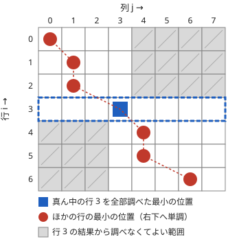

!!! abstract "要点"
    - **何ができるか**：コスト $c(i, j)$ が Monge なら各行の最小値を取る位置が単調になり、分割統治（monotone minima）で区間分割 DP を、Knuth-Yao で区間 DP を速くできる。凸な列と別の列の (min,+) 畳み込みも速く計算できる。
    - **いつ使うか**：
        - 区間分割 DP のコストが $a \le b \le c \le d$ について $c(a, c) + c(b, d) \le c(a, d) + c(b, c)$ を満たす（区間を広げるほど増え方が大きい）
        - 最適な区切り位置 $\mathrm{opt}(i)$ が $i$ について単調に動く
        - 区間から $k$ 個選ぶときの最大値を、すべての $k$ について求める
        - $N \le 10^5$ の列を $K$（数十）個の区間に分ける
    - **計算量**：$N$ 行 $M$ 列の行ごとの最小値は monotone minima で $O(N + M \log N)$、SMAWK で $O(N + M)$。$K$ 個の区間に分ける DP は $O(KN \log N)$。Knuth-Yao の区間 DP は $O(N^2)$。凸な列と任意の列の (min,+) 畳み込みは $O((N + M) \log (N + M))$、凸な列どうしなら $O(N + M)$
    - **前提**：[区間分割 DP](../dp/dp-sequence-partition.md)、[分割統治](../basics/divide-and-conquer.md)

<!-- textlint-disable -->
別名：Monge・四角不等式・四辺形不等式・Quadrangle Inequality・monotone minima・分割統治 DP・Divide and Conquer DP・SMAWK・LARSCH・Knuth-Yao・Knuth's optimization・(max,+) 畳み込み・min-plus 畳み込み・DP の凸性
<!-- textlint-enable -->

Monge 性は、DP の遷移 $\min_j (\cdots + c(j, i))$ を行列の「各行の最小値」とみたときに、最小値の位置が行とともに右へずれていくことを保証する性質である。位置が単調なら、すべての列を調べなくても探索の範囲を絞れる。区間分割 DP・区間 DP・凸な列の畳み込みが、この 1 つの性質から速くなる。

ABC では difficulty 2500 以上の G で現れ、多くは「$k$ 個選ぶときの最適値をすべての $k$ について」の形である。証明と実装の細部は[学ぶための資料](#resources)に任せ、ここでは確かめ方・何が速くなるか・自作するときの要点をまとめる。

## Monge 性の定義と確かめ方 {#definition}

行列 $A$ が **Monge** であるとは、行 $i_1 < i_2$ と列 $j_1 < j_2$ のどの組でも次が成り立つことである。

$$
A[i_1][j_1] + A[i_2][j_2] \le A[i_1][j_2] + A[i_2][j_1]
$$

区間 $[l, r)$ のコスト $c(l, r)$ で言い直すと、$l_1 \le l_2 \le r_1 \le r_2$ について $c(l_1, r_1) + c(l_2, r_2) \le c(l_1, r_2) + c(l_2, r_1)$ になる（要点の $c(a, c) + c(b, d) \le c(a, d) + c(b, c)$ と同じ式で、$a, b, c, d$ をこう書き替えた）。「交差する 2 つの区間のコストの和」が「外側と内側の区間のコストの和」以下、ということである。

確かめるときは、次の規則を使う。

- **隣どうしで足りる**：すべての $i, j$ で $A[i][j] + A[i+1][j+1] \le A[i][j+1] + A[i+1][j]$ なら Monge である。離れた行・列の不等式は、隣どうしの不等式を足し合わせると得られる。
- **凸関数の差**：[凸関数](../guide/glossary.md#convex-function) $f$ と広義単調増加の列 $S$ について、$c(l, r) = f(S_r - S_l)$ は Monge である。区間の和の 2 乗 $(S_r - S_l)^2$（要素が非負のとき）や、長さの関数 $f(r - l)$ がこの形になる。
- **足し算で保たれる**：Monge どうしの和、非負の数倍は Monge である。行だけ・列だけで決まる値 $g(i)$・$h(j)$ を足しても Monge のままである。DP の値 $\mathrm{dp}[j]$ を足した $\mathrm{dp}[j] + c(j, i)$ が Monge なのはこのためである。

迷ったら、小さな乱数の入力で隣どうしの不等式を全部調べるのが確実である。

Monge なら、各行で最小値を取る列（同じ値なら最も左）は、行が下がるにつれて広義単調に右へ動く。

??? note "証明"
    行 $i_1 < i_2$ の最小の位置をそれぞれ $j_1, j_2$ とし、$j_2 < j_1$ と仮定する。Monge の不等式を行 $i_1, i_2$・列 $j_2, j_1$ に使うと $A[i_1][j_2] + A[i_2][j_1] \le A[i_1][j_1] + A[i_2][j_2]$ である。$j_1$ は行 $i_1$ で最も左の最小なので $A[i_1][j_2] > A[i_1][j_1]$。よって $A[i_2][j_1] < A[i_2][j_2]$ となり、$j_2$ が行 $i_2$ の最小であることに反する。

    最も左と決めなくても、値は正しい。$j_2 < j_1$ のとき、上の不等式と最小性から $A[i_1][j_2] + A[i_2][j_1] = A[i_1][j_1] + A[i_2][j_2]$ となり、$j_2$ も行 $i_1$ の最小、$j_1$ も行 $i_2$ の最小である。よって、ある行で同じ値の最小の位置のどれを選んでも、上の行・下の行の最小値は絞った範囲の中に残る。

## monotone minima（分割統治で O(N log N)） {#monotone-minima}

最小の位置が単調な行列で、すべての行の最小値を求める方法である。真ん中の行の最小の位置 $j^*$ を全列を見て求めると、それより上の行の答えは $j^*$ 以下、下の行の答えは $j^*$ 以上に限られる。上下を再帰で解く。



再帰の各段で、調べる列の範囲は端だけが重なるように分かれる。1 段で調べる列の数は $M$ にその段の行の数を足した程度で、段数は $O(\log N)$ である。各行が真ん中になるのは 1 回だけなので、全体で $O(N + M \log N)$ になる（$N$ 行 $M$ 列）。値は必要なときに計算すればよく、行列を持つ必要はない。

**区間分割 DP への使い方（分割統治 DP）**。$K$ 個の区間に分ける DP

$$
\mathrm{dp}_k[i] = \min_{j < i} \left( \mathrm{dp}_{k-1}[j] + c(j, i) \right)
$$

で、行 $i$・列 $j$ の値 $\mathrm{dp}_{k-1}[j] + c(j, i)$ は $c$ が Monge なら Monge である。1 段ぶんを monotone minima で $O(N \log N)$ で求め、$K$ 段で $O(KN \log N)$ になる。素朴な $O(KN^2)$ からの改善で、サインの「$N \le 10^5$ を $K$（数十）個に分ける」はこの計算量に合う。

自作するときの要点は次のとおりである。

- 行 $i$ で使える列が $j < i$ のように行ごとに違うときは、再帰で受け取った範囲と使える範囲の共通部分だけを調べる。使える範囲の両端が行について単調なら、共通部分は空にならない。
- Monge なら、同じ値のときにどの位置を選んでも各行の最小値は正しく求まる（[証明](#definition)の後半）。Monge かどうか分からず、最小の位置の単調性だけが分かっている行列では、最も左（または最も右）を残すと決めて全体でそろえる。
- $c(j, i)$ を $O(1)$ で求められないとき（区間の中の同じ値の組の個数など）は、区間の端を少しずつ動かして差分で更新する。monotone minima の再帰では端の移動の合計が $O(N \log N)$ に収まる。

区間の個数 $K$ が大きく $K$ 段を回せないときは、個数の制約を罰金で外す [Alien DP](../dp/alien-dp.md#with-monge) と組み合わせる。

## SMAWK・LARSCH（O(N)・オンラインに決まる DP） {#smawk-larsch}

**SMAWK** は、すべての値を最初から計算できる行列で、行ごとの最小値を $O(N + M)$ で求める。前提は Monge より弱い「全単調」（どの 2 行 2 列の部分行列でも最小の位置が単調）で、Monge なら満たす。monotone minima の $\log$ を消したいときに使うが、定数倍が重く、ABC の制約では monotone minima で足りることが多い。

段のない DP

$$
\mathrm{dp}[i] = \min_{j < i} \left( \mathrm{dp}[j] + c(j, i) \right)
$$

では、行 $i$ の値を出すのに $\mathrm{dp}[j]$（$j < i$）がすべて決まっている必要がある。行列が最初から分からない（オンラインに決まる）ので、monotone minima も SMAWK もそのままでは使えない。この形を $O(N)$ で解くのが **LARSCH** で、実装を軽くした $O(N \log N)$ の簡易版が知られている（[学ぶための資料](#resources)の noshi91 氏の記事）。ほかに、左半分の $\mathrm{dp}$ を先に確定させ、左から右への遷移を monotone minima でまとめる分割統治がある。こちらは $O(N \log^2 N)$ である。

## Knuth-Yao（区間 DP の分割点の範囲を絞って O(N^2)） {#knuth-yao}

[区間 DP の分割点型](../dp/interval-dp.md#split-point)

$$
\mathrm{dp}[l][r] = \min_{l < m < r} \left( \mathrm{dp}[l][m] + \mathrm{dp}[m][r] \right) + w(l, r)
$$

は素朴には $O(N^3)$ かかる。$w$ が次の 2 つを満たすとき、最適な分割点 $\mathrm{opt}[l][r]$ について $\mathrm{opt}[l][r-1] \le \mathrm{opt}[l][r] \le \mathrm{opt}[l+1][r]$ が成り立つ。

- $w$ が Monge である（$l_1 \le l_2 \le r_1 \le r_2$ で $w(l_1, r_1) + w(l_2, r_2) \le w(l_1, r_2) + w(l_2, r_1)$）。
- 区間を広げても減らない（$[l_2, r_1) \subseteq [l_1, r_2)$ なら $w(l_2, r_1) \le w(l_1, r_2)$）。

区間の長さの順に埋め、$m$ を $\mathrm{opt}[l][r-1]$ から $\mathrm{opt}[l+1][r]$ までだけ調べる。長さを固定して $l$ について足すと、調べる個数の和が $\mathrm{opt}[l+1][r] - \mathrm{opt}[l][r-1]$ の差の打ち消し合いで $O(N)$ になり、全体で $O(N^2)$ である。長さ 2 の区間では $\mathrm{opt}[l][l+2] = l + 1$ から始める。

スライムの合体（隣を合体させるたびに大きさの和を払う）の $w(l, r)$ ＝ 区間の和は、Monge の等号と単調性を満たす。ABC では $O(N^3)$ のまま通る制約がほとんどで、Knuth-Yao が必須の問題は見つかっていない。Monge だけで単調性がないと、分割点が単調にならないことがある。

## DP の値の凸性（個数について凸な答え） {#dp-convexity}

「ちょうど $k$ 個選ぶときの最適値 $f(k)$」が $k$ について凸（最大化なら上に凸）であることを使う高速化は多い。上に凸とは、1 個増やすときの増分 $f(k+1) - f(k)$ が $k$ とともに広義単調に減ることである。

凸になる典型は次のとおりである。

- 好きな $k$ 個を選ぶ：大きい順に取る貪欲で決まり、増分は値の降順の列になる。
- Monge なコストで $k$ 個の区間に分ける：最小コストは $k$ について凸になる。[Alien DP](../dp/alien-dp.md#penalty) が使える根拠である。
- 上に凸な列どうしの (max,+) 畳み込み：結果も上に凸である（[次の節](#convex-max-plus-convolution)）。

凸だと分かれば、罰金で個数の制約を外す（Alien DP）、増分の列で関数を持つ（[Slope Trick](../dp/slope-trick.md#breakpoints)）、列どうしを差分のマージで合成する、といった道具が使える。ただし「$k$ 個選ぶ」問題がいつも凸とは限らない。小さな入力で $f$ を全探索し、増分が単調かを確かめてから使う。[三分探索の凸性の確かめ方](../basics/ternary-search.md#convexity)の規則も参考になる。

## 凸な列どうしの (max,+) 畳み込み（差分のマージ） {#convex-max-plus-convolution}

長さ $N$ の列 $a$ と長さ $M$ の列 $b$ の (min,+) 畳み込みは $c_k = \min_{i + j = k} (a_i + b_j)$ で、ふつうの畳み込みの積を和に、和を最小に置き換えたものである。一般には $O(NM)$ かかるが、片方が凸なら速い。(max,+) 畳み込みは符号を反転して (min,+) にすれば同じで、そのとき「凸」は「上に凸」に読み替える。

- **凸な列どうし**：$a$ と $b$ の差分をそれぞれ小さい順に並べてマージし、$c_0 = a_0 + b_0$ から差分を順に足せばよい。$O(N + M)$ で、結果も凸である。$k$ 個を 2 つの組から合わせて選ぶとき、次の 1 個は増分の小さい方（最大化なら大きい方）から取る、という貪欲と同じである。
- **凸な列と任意の列**：行 $k$・列 $j$ の値 $a_{k-j} + b_j$ は、$a$ が凸なら Monge になる（範囲外の値を $+\infty$ とみなしても崩れない）。monotone minima で $O((N + M) \log (N + M))$、SMAWK なら $O(N + M)$ である。

次のコード片は、凸な列と任意の列の (min,+) 畳み込みである。行 $k$ で使える列 $[\max(0, k - N + 1), \min(M - 1, k)]$ と、再帰で受け取った範囲の共通部分だけを調べる。完全なプログラムは `snippets/monge/convolution.cpp` で、凸な列どうしのマージも同じファイルにある。

```cpp
--8<-- "monge/convolution.cpp:core"
```

分割統治の各ノードで「左半分の上に凸な列」と「右半分の任意の列」を合成する問題は、各段がこの畳み込みになり、全体で $O(N \log^2 N)$ になる（[例題](#abc348_g)）。

## ライブラリでの検証 {#library}

ACL には Monge に関する機能がない。自作したら Library Checker の次の問題で確かめる。

- [Min Plus Convolution (Convex and Arbitrary)](https://judge.yosupo.jp/problem/min_plus_convolution_convex_arbitrary)：凸な列と任意の列の (min,+) 畳み込み。monotone minima（または SMAWK）の確認になる。
- [Min Plus Convolution (Convex and Convex)](https://judge.yosupo.jp/problem/min_plus_convolution_convex_convex)：凸な列どうしの差分のマージの確認になる。

区間分割 DP の monotone minima や LARSCH には専用の問題がないので、小さな入力で素朴な $O(N^2)$ の DP と比べて確かめる。比べるときは、コストが Monge になる入力（非負の列の区間の和の 2 乗など）を乱数で作る。コード片も、乱数の列で愚直な畳み込みと比べている。

## 学ぶための資料 {#resources}

- [tatyam「Monge の手引書」](https://speakerdeck.com/tatyam_prime/monge-noshou-yin-shu)：Monge・全単調の定義と関係、Monge になる行列の作り方、monotone minima・SMAWK・LARSCH、Knuth-Yao、Alien DP までを 1 つにまとめた日本語のスライド。このページの節のほとんどについて、証明と図はここで読める。
- [noshi91「簡易版 LARSCH Algorithm」](https://noshi91.hatenablog.com/entry/2023/02/18/005856)：段のない DP $\mathrm{dp}[i] = \min_{j < i} (\mathrm{dp}[j] + c(j, i))$ を $O(N \log N)$ で解く分割統治の記事。区間の端を少しずつ動かしてコストを求める場合にも使える。

## 例題 {#examples}

### ABC348 G. Max (Sum - Max) {#abc348_g}

<div class="kp-problems" data-role="example" markdown>

- [ABC348 G. Max (Sum - Max)](https://atcoder.jp/contests/abc348/tasks/abc348_g)（diff 2559）：N 個の組 (A_i, B_i) からちょうど k 個を選ぶときの「A の和 − B の最大」の最大を、k = 1〜N のすべてについて求める。

</div>

方針：$B$ の昇順に並べると、選んだ中で最も右の要素の $B$ が引かれる。添字の区間で分割統治し、「区間から $k$ 個選ぶときの $A$ の和の最大」（上に凸）と「区間から $k$ 個選ぶときの $A$ の和 − 最も右の $B$ の最大」（凸とは限らない）の 2 つの列を、左右から合成する。

??? note "解法の詳細"
    - 区間 $[l, r)$ について、$f_{[l, r)}(k)$ ＝ $k$ 個選ぶときの $A$ の和の最大、$g_{[l, r)}(k)$ ＝ $k$ 個選ぶときの「$A$ の和 − 選んだ最も右の $B$」の最大とする。
    - $f$ は大きい順に取る貪欲で決まるので上に凸である。左右の $f$ は、差分（$A$ の値）の降順のマージで合成できる。
    - $g_{[l, r)}$ は 3 つの場合の最大である。左半分からだけ選ぶ $g_{[l, m)}$、右半分からだけ選ぶ $g_{[m, r)}$、両方から選ぶ場合である。両方から選ぶと最も右の要素は右半分にあるので、$f_{[l, m)}$ と $g_{[m, r)}$ の (max,+) 畳み込みになる。
    - $f_{[l, m)}$ は上に凸である。よって[凸な列と任意の列の畳み込み](#convex-max-plus-convolution)として、monotone minima で求められる。
    - 1 段の合計が $O(N \log N)$ で段数が $O(\log N)$ なので、全体で $O(N \log^2 N)$ になる。答えは $g_{[0, N)}(k)$ である。

## 練習問題 {#practice}

<div class="kp-problems" data-role="practice" markdown>

- [ABC383 G. Bar Cover](https://atcoder.jp/contests/abc383/tasks/abc383_g)（diff 3026）：長さ K の区間を重ならないように i 個選ぶときの和の最大を、すべての i について求める。
- [ABC458 G. Children Yearn for the Evil Kindergarten](https://atcoder.jp/contests/abc458/tasks/abc458_g)（diff 2831）：毎日、集めたメダルにその日の分 $A_i$ を足して園児に配り直し、$B_i$ 枚に満たない園児は脱落、残りは $B_i$ 枚を失い、$C_i$ 枚以上を持つ園児は脱出できる。$N$ 日で脱出できる人数の最大を求める。

</div>

??? note "練習の方針"
    - ABC383 G：長さ $K$ の区間の和を始点ごとの値の列にすると、始点どうしを $K$ 以上離して選ぶ問題になる。列を分割統治で半分に分け、$K$ は小さいので、各区間について「左端と右端で使えない位置がいくつあるか」の組ごとに、選ぶ個数についての最大値の列を持てる。この列は上に凸なので、左右の合成は差分のマージ（凸な列どうしの (max,+) 畳み込み）で行える。境目をまたいで使えない $K - 1$ 個を左右にどう分けるかごとにマージし、要素ごとの最大を取る。
    - ABC458 G：答えの人数で二分探索し、日ごとに「脱出した人数」についての残りの量の最大値を DP で持つ。この値は人数について上に凸な折れ線で、脱出の遷移は 1 次の列との (max,+) 畳み込みになる。凸性を保つので、折れ線を傾きの列で持って更新すれば 1 回の判定がならし $O(N)$ で済む（[Slope Trick の力試し](slope-trick.md#challenge)）。

## 使い分け {#comparison}

- コストを展開したとき、$i$ と $j$ の両方を含む項が積の項 1 つだけなら、[CHT](../dp/cht.md#lines) の方が軽い。区間の和の 2 乗 $(S_i - S_j)^2 = S_i^2 - 2 S_i S_j + S_j^2$（$S$ は累積和）は、要素が非負なら Monge であり、この形にも当てはまる。このとき直線の傾きとクエリはどちらも単調に並ぶので、deque の CHT で遷移 1 回がならし $O(1)$ になる。monotone minima の 1 段 $O(N \log N)$ より速く、実装も短い。
- Monge でも積の項 1 つにまとまらないコスト（区間の中の同じ値の組の個数など）は CHT では扱えず、このページの方法を使う。逆に積の項がなく、$i$ だけの項と $j$ だけの項の和なら、範囲の最小を取るだけで済む（[セグメント木・累積和・スライド最小値の使い分け](../dp/dp-segment-tree.md#which-tool)）。
- 区間の個数 $K$ が大きく $K$ 段を回せないなら、[Alien DP](../dp/alien-dp.md#with-monge) で個数の制約を外す。
- 式の形から道具を選ぶ全体は [DP の高速化の選び方](../dp/dp-speedup-overview.md#shape-to-tool)の早見表に、CHT・Monge・Alien DP・Slope Trick の確かめ方は[凸性を使う高速化の使いどころ](../dp/dp-speedup-overview.md#convexity)にまとめる。

## 参考 {#references}

- [tatyam「Monge の手引書」](https://speakerdeck.com/tatyam_prime/monge-noshou-yin-shu)：学ぶための資料。Monge の定義と確かめ方の規則、monotone minima・SMAWK・LARSCH の計算量、Knuth-Yao と Alien DP との関係
- [noshi91「簡易版 LARSCH Algorithm」](https://noshi91.hatenablog.com/entry/2023/02/18/005856)：学ぶための資料。段のない DP を $O(N \log N)$ で解く方法
- [yosupo06「library-checker-problems/convolution」](https://github.com/yosupo06/library-checker-problems/tree/master/convolution)：検証に使う問題（min_plus_convolution_convex_arbitrary ほか）の内容（凸の定義と入出力の形）
- [kmjp「AtCoder ABC #348 (トヨタ自動車プログラミングコンテスト2024#4) : G - Max (Sum - Max)」](https://kmjp.hatenablog.jp/entry/2024/04/08/0930)：例題 ABC348 G の方針（凸な列のマージと monotone minima による畳み込み）
- [kmjp「AtCoder ABC #383 (大和証券プログラミングコンテスト2024) : G - Bar Cover」](https://kmjp.hatenablog.jp/entry/2024/12/13/0930)：練習 ABC383 G の方針
- [ikatakos「SMBCプログラミングコンテスト #1（AtCoder Beginner Contest 458）F,G問題メモ」](https://ikatakos.com/pot/programming_algorithm/contest_history/atcoder/2026/0516_abc458)：練習 ABC458 G の方針（解法の節だけを読んだ）
- [kmjp「AtCoder ABC #355 (東京海上日動プログラミングコンテスト2024) : G - Baseball」](https://kmjp.hatenablog.jp/entry/2024/06/05/0900)：monotone minima と Alien DP を組み合わせる例の確認
