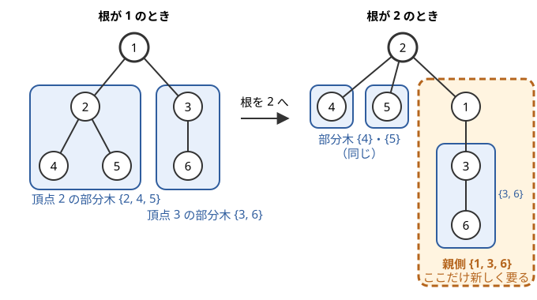

!!! abstract "要点"
    - **何ができるか**：すべての頂点を根としたときの木 DP の値を、まとめて $O(N)$ で求める。1 回目の走査で下向きの部分木の値を、2 回目の走査で親側の部分木の値を求める。兄弟を除いた合成は左右からの累積で作るので、逆元が要らない。
    - **いつ使うか**：
        - すべての頂点について、その頂点を根（起点）としたときの値
        - 各頂点から最も遠い頂点までの距離（頂点や辺の重みつき）
        - 根を $v$ としたときの木 DP の値を、すべての $v$ について求めたい（$N$ 回の木 DP は $O(N^2)$）
    - **計算量**：子の側の値の合成と「根を付ける」操作が $O(1)$ なら、全体で $O(N)$。どちらの操作も次数の和 $2(N - 1)$ に比例する回数だけ呼ぶ
    - **前提**：[木 DP](../dp/tree-dp.md)、[累積和](../basics/prefix-sum.md)

<!-- textlint-disable -->
別名：Rerooting・ReRooting DP・換根 DP・全方位
<!-- textlint-enable -->

全方位木 DP は、[木 DP](../dp/tree-dp.md) の根を各頂点に変えたときの値を、根ごとのやり直しなしで求める方法である。根を 1 つ決めて木 DP をすると、根以外の頂点の値は「その頂点の下側」しか見ていない。そこで 2 回目の走査で「親側の部分木の値」を上から配り、下側の値と合わせて各頂点の答えを作る。頂点数は $N$ で、問題文の頂点番号は 1-indexed、実装は 0-indexed で書く。

## 根を隣へ移すと変わるのは親側の部分木だけ {#what-changes}

全方位木 DP が速い理由は、根を隣の頂点へ 1 歩移しても、ほとんどの部分木が変わらないことにある。根付き木の部分木は「辺を 1 本切ったときに、根と反対の側に残る頂点の集合」である。根を $p$ から隣の $c$ へ移すと、向きが変わる辺は $p$ と $c$ を結ぶ 1 本だけである。

次の図は、6 頂点の木で根を頂点 1 から頂点 2 へ移したときの部分木である。



根が 1 のとき、頂点 4・5・3 の部分木はそれぞれ $\{4\}$・$\{5\}$・$\{3, 6\}$ である。根を 2 にしても、この 3 つは同じ集合のままなので、木 DP の値も同じである。新しく現れる部分木は、頂点 2 の子になった頂点 1 の部分木 $\{1, 3, 6\}$ だけである。この集合は、根が 1 のときに頂点 2 から見た「親側」の頂点の集合にあたる。

一般に、根 $r$ で木 DP をした後、頂点 $v$ を根にした値を作るのに要るのは次の 2 種類である。

- **下向きの値**：$v$ の各子 $c$ の部分木の値。根 $r$ での木 DP で求まっている
- **親側の値**：$v$ と親を結ぶ辺を切ったときの、親の側の頂点の集合を、親を根にした部分木とみた値

下向きの値は $N - 1$ 個、親側の値も $N - 1$ 個ある。辺の向きは $2(N - 1)$ 通りしかないので、どの頂点を根にしても、根以外の頂点の部分木はこの $2(N - 1)$ 個のどれかで、根の値はそれらを合成すれば出る。だから全部を 1 度ずつ求めれば、すべての根の値がそろう。

素朴に根ごとに木 DP をやり直すと、$N$ 回 × $O(N)$ で $O(N^2)$ になり、$N = 2 \times 10^5$ では間に合わない。全方位木 DP は、親側の値を親のまわりの値から次数あたり $O(1)$ で作り、全体を $O(N)$ にする。

## 一般の枠組み（子の値の合成と「根を付ける」操作を分ける） {#framework}

全方位木 DP を問題ごとにその場で書くと、どの値に何が含まれているかが分からなくなりやすい。木 DP の遷移を次の 3 つの部品に分けておくと、2 回の走査は問題によらず同じ形で書ける。

- **単位元 $e$ と合成 $\oplus$**：子の側の値をまとめる演算。[結合法則](../guide/glossary.md#associativity)を満たし、子の順番によって結果が変わらないものにする（和・積・最大値など）。$e$ は子がないときの値（[単位元](../guide/glossary.md#identity-element)）
- **根を付ける操作 $\mathrm{add\_root}(x, c, v)$**：頂点 $c$ の子の側の値をまとめたものが $x$ のとき、$c$ 自身を付けて $c$ の部分木の値にし、さらに辺 $(c, v)$ を通して隣の $v$ から見た値にする

この部品で、根 $r$ での木 DP は次のように書ける。$\mathrm{dp}[v]$ ＝ $v$ の子の側の値をすべて合成したもの、である。

$$
\mathrm{dp}[v] = \bigoplus_{c \text{ は } v \text{ の子}} \mathrm{add\_root}(\mathrm{dp}[c], c, v)
$$

葉では子がないので $\mathrm{dp}[v] = e$ である。たとえば「$v$ を含み、$v$ の部分木の中で連結な頂点集合の数」なら、$\oplus$ は積、$e = 1$、$\mathrm{add\_root}(x, c, v) = x + 1$ である。子 $c$ の側は「何も使わない（1 通り）」か「$c$ を含む連結な集合を 1 つ使う（$x$ 通り）」かを選べるからである。

親側の値も同じ形で書く。$\mathrm{up}[c]$ ＝ 根を $c$ に移したとき、親 $p$ の子の側（$c$ 以外の $p$ の隣）の値をすべて合成したもの、と定める。根を $c$ にすると、$p$ の子は「$c$ 以外の $p$ の子」と「$p$ の元の親」になるので、次の式になる。

$$
\mathrm{up}[c] = \Bigl(\bigoplus_{u \text{ は } c \text{ 以外の } p \text{ の子}} \mathrm{add\_root}(\mathrm{dp}[u], u, p)\Bigr) \oplus \mathrm{add\_root}(\mathrm{up}[p], \mathrm{par}[p], p)
$$

$c$ から見た親側の値は $\mathrm{add\_root}(\mathrm{up}[c], p, c)$ で、図の例なら頂点 2 から見た $\{1, 3, 6\}$ の値がこれにあたる。頂点 $v$ を根にしたときの答えは、$v$ のすべての隣の側の値の合成である。

$$
\mathrm{ans}[v] = \Bigl(\bigoplus_{c \text{ は } v \text{ の子}} \mathrm{add\_root}(\mathrm{dp}[c], c, v)\Bigr) \oplus \mathrm{add\_root}(\mathrm{up}[v], \mathrm{par}[v], v)
$$

$\mathrm{up}[c]$ の式の最後の項は $p$ が根 $r$ のときはなく、$\mathrm{ans}[v]$ の式の最後の項も $v$ が根 $r$ のときはない（根には親がない）。

答えが $v$ 自身の分（頂点の重みなど）も含む問題では、最後にその分を $\mathrm{ans}[v]$ へ足す。

計算順序は、$\mathrm{dp}$ が帰りがけ順（子が先）、$\mathrm{up}$ が行きがけ順（親が先）である。$\mathrm{up}[c]$ の式は親 $p$ の $\mathrm{up}[p]$ と兄弟の $\mathrm{dp}$ しか使わないので、根から下へ順に決まる。処理の流れは次のとおりである。

1. 根 $0$ から BFS して、親 $\mathrm{par}$ と順 `order`（親が子より前）を作る
2. `order` を逆からたどり、各頂点 $v$ の値 $\mathrm{add\_root}(\mathrm{dp}[v], v, \mathrm{par}[v])$ を親の $\mathrm{dp}$ に合成する
3. `order` の順に頂点 $v$ を取り、隣ごとの値（子なら $\mathrm{dp}$ から、親なら $\mathrm{up}[v]$ から作る）を並べる。全部の合成が $\mathrm{ans}[v]$、子 $c$ の分だけを除いた合成が $\mathrm{up}[c]$ である（除き方は[次の節](#exclude-self)）

次のコードは、この流れを関数にしたものである。木は隣接リスト `g` で受け取り、BFS 順で回すので、木が一直線でも再帰が深くならない。

```cpp
--8<-- "rerooting/subtree-count.cpp:core"
```

完全なプログラム：[`subtree-count.cpp`](https://github.com/yuukougun/kyopro-atlas/blob/main/snippets/rerooting/subtree-count.cpp)（GitHub）
{ .kp-code-src }

上の連結な頂点集合の数え上げなら、部品を次のように渡す。$\mathrm{ans}[v]$ は「$v$ を含む連結な頂点集合の数」になる。

```cpp
--8<-- "rerooting/subtree-count.cpp:usage"
```

完全なプログラム：[`subtree-count.cpp`](https://github.com/yuukougun/kyopro-atlas/blob/main/snippets/rerooting/subtree-count.cpp)（GitHub）
{ .kp-code-src }

**計算量**：頂点 $v$ では、隣の数 $k_v$ に比例する回数だけ $\oplus$ と $\mathrm{add\_root}$ を呼ぶ。$\sum_v k_v = 2(N - 1)$ なので、どちらの呼び出しも全体で $O(N)$ 回である。それぞれが $O(1)$ なら全体で $O(N)$、合成が $O(T)$ かかるなら $O(NT)$ になる。作業用の配列は頂点ごとに作り直すので、メモリは $O(N)$ で済む。

??? question "確認問題：各頂点から最も遠い頂点までの距離（辺の重みはすべて 1）を、この枠組みで求めるには、$e$・$\oplus$・$\mathrm{add\_root}$ をどう決めるか"
    $\mathrm{dp}[v]$ を「$v$ から部分木の中で最も遠い頂点までの距離」とみる。$\oplus$ は $\max$、$e = 0$（子がなければ自分自身までの距離 0）、$\mathrm{add\_root}(x, c, v) = x + 1$（$c$ から $x$ 離れた頂点は、$v$ からは 1 遠い）。$\mathrm{ans}[v]$ が $v$ から最も遠い頂点までの距離になる。辺に重みがあれば $+1$ を辺の重みに変える。

## 自分以外の兄弟の合成（左右からの累積） {#exclude-self}

$\mathrm{up}[c]$ を求めるには、親 $p$ のすべての隣の値から、$c$ の分だけを除いた合成が要る。$p$ の隣が $k$ 個あるとき、子ごとに残りの $k - 1$ 個を合成し直すと $O(k^2)$ かかり、星形の木（1 頂点に $N - 1$ 本の辺）では $O(N^2)$ になる。

和なら全体から引けば済み、積なら逆元を掛ければ済むように見える。しかし $\max$ には「除く」操作がない。積でも、法 $M$ が素数でないときや、値が $M$ の倍数（余りが 0）になるときは割り算ができない。そこで割り算を使わず、[累積和](../basics/prefix-sum.md)と同じ考え方で左右から累積を取る。

$p$ の隣の値を並べて $a_0, a_1, \dots, a_{k-1}$ とし、次のように定める。

$$
L_0 = e,\quad L_{i+1} = L_i \oplus a_i, \qquad R_k = e,\quad R_i = a_i \oplus R_{i+1}
$$

$L_i$ は $a_0, \dots, a_{i-1}$ の合成、$R_{i+1}$ は $a_{i+1}, \dots, a_{k-1}$ の合成なので、$a_i$ だけを除いた合成は $L_i \oplus R_{i+1}$ である。左右の累積を作るのに $O(k)$、各 $i$ の答えは $O(1)$ で出る。

| $i$ | 0 | 1 | 2 | 3 |
| --- | --- | --- | --- | --- |
| $a_i$ | 3 | 1 | 4 | 1 |
| $L_i$（左の $\max$） | 0 | 3 | 3 | 4 |
| $R_{i+1}$（右の $\max$） | 4 | 4 | 1 | 0 |
| $a_i$ を除いた $\max$ | 4 | 4 | 3 | 4 |

上の表は $\oplus = \max$、$e = 0$ の例である。$a_2 = 4$ を除くと、残りの最大は $\max(L_2, R_3) = \max(3, 1) = 3$ になる。全体の最大 4 から「4 を引く」ことはできないが、左右の累積なら除いた結果が直接作れる。

左右の累積そのものが使うのは結合法則と単位元だけで、逆元は使わない（交換法則は、枠組み全体で子の順を問わないために要る）。だから結合法則と交換法則を満たす合成なら、$\max$・$\min$・合成数を法とする積・[GCD](../math/gcd-lcm.md)・組（サイズと場合の数）などでも使える。

$\oplus$ が $\max$ や $\min$ なら、左右の累積の代わりに「上位 2 つ」を持つ方法もある。除く値が最大なら 2 番目を、そうでなければ最大を使えばよい。ただし同じ値が 2 つあるときに取り違えやすいので、値ではなく添字で比べる。

??? question "確認問題：和を合成する問題で、左右からの累積を使わずに済ませるには"
    和は引き算で戻せるので、$p$ の隣の値の総和 $S$ を 1 度求め、$c$ の分を除いた合成を $S - a_c$ とすればよい。XOR も、総和 $S$ の代わりに全体の XOR を取り、それと $a_c$ の XOR を取れば除ける。法が素数で、値が 0 にならないと保証された積なら、逆元を掛けて除ける。どれも逆の操作があるときだけ使える方法で、$\max$ や合成数を法とする積では使えない。

## 合成と根を付ける操作の作り方の型 {#patterns}

全方位木 DP の問題は、部品の $e$・$\oplus$・$\mathrm{add\_root}$ を決めれば、残りは[枠組み](#framework)のコードのままでよい。よく出る型を並べる。

| 求める値 | 子の側の値 $x$ | $\oplus$・$e$ | $\mathrm{add\_root}(x, c, v)$ |
| --- | --- | --- | --- |
| 最も遠い頂点までの距離 | 部分木で最も遠い距離 | $\max$・0 | $x + w(c, v)$ |
| 行き先の頂点に費用 $D$ がつく最遠 | 距離と行き先の費用の和の最大 | $\max$・0 | $\max(x, D_c) + w(c, v)$ |
| 連結な頂点集合の数 | $c$ を含む連結な集合の数 | 積・1 | $x + 1$ |
| 根から隣へ順に番号を書く方法の数 | 組（頂点数 $s$、方法の数 $t$） | 下の式・$(0, 1)$ | $(s + 1, t)$ |

表の $w(c, v)$ は辺の重みである。$\mathrm{add\_root}$ に辺の重みが要るときは、隣接リストに重みを一緒に持たせ、$\mathrm{add\_root}$ に辺の番号か重みを渡す形に変える。

- **行き先の頂点に費用がつく最遠**：各頂点 $i$ について $\max_{j \ne i} \bigl(d(i, j) + D_j\bigr)$ を求める型（例題の [ABC222 F](#abc222_f)）。$c$ 自身も行き先になりうるので、$c$ の部分木の値は「$c$ の子の側の最大 $x$」と「$c$ 自身の $D_c$」の大きい方である。$i$ 自身は行き先にしないので、$\mathrm{ans}[i]$ には $D_i$ を入れない
- **番号を書く方法の数**：根に 1 を書き、書いた頂点の隣に順に番号を書いていく方法の数は、子の部分木ごとの書き方を、全体の順番の中でどう混ぜるかの数え上げになる。サイズ $s_1, s_2$ の 2 つを混ぜる方法は $\binom{s_1 + s_2}{s_1}$ 通りなので、$(s_1, t_1) \oplus (s_2, t_2) = \bigl(s_1 + s_2,\ t_1 t_2 \binom{s_1 + s_2}{s_1}\bigr)$ とする。この演算は結合法則を満たす（3 つを混ぜる方法は多項係数で、まとめる順によらない）。根 $c$ は最初に書くので、$\mathrm{add\_root}$ はサイズに 1 を足すだけである（練習の ABC160 F）。二項係数は[前計算](../comb/binomial-precompute.md)しておく

全方位木 DP の途中では、すべての有向辺 $(c \to v)$ について「$v$ から見た $c$ 側の部分木の値」が求まる。子から親への向きは $\mathrm{add\_root}(\mathrm{dp}[c], c, \mathrm{par}[c])$、親から子への向きは $\mathrm{add\_root}(\mathrm{up}[c], \mathrm{par}[c], c)$ である。だから「辺を 1 本切ったときの、両側の成分の値」を全部の辺について問われたときにも使える（[辺の寄与](../tree/tree-edge-contribution.md#edge-pairs)の型で、両側の頂点数より複雑な値が要るとき）。

## 使い分け（最遠点は直径の性質で、距離の総和は根の移動の差分で済む） {#when-to-use}

「すべての頂点について」と問われても、全方位木 DP の枠組みまで要らないことが多い。先に次の 3 つを確かめる。

- **最も遠い頂点までの距離（辺の重みが非負）**：各頂点から最も遠い頂点は、直径の端点のどちらかである。直径の両端から 1 回ずつ最短距離を求め、各頂点で大きい方を取れば済む（[直径](../tree/tree-diameter.md#eccentricity)）。行き先に費用がつく、負の重みがあるなど直径の性質が崩れるときは全方位木 DP を使う
- **距離の総和**：根を親 $p$ から子 $c$ へ移すと、和は $N - 2\,\mathrm{sz}[c]$ だけ変わる。部分木のサイズだけで差分が書けるので、根から差分を配る木 DP で済む（[根を動かした差分](../dp/tree-dp.md#reroot-difference)）
- **合成に逆の操作がある**：和・XOR や、0 にならない値の素数を法とする積なら、全体から引いて（割って）自分を除ける。左右の累積は要らないが、親側の値を配る 2 回の走査はそのまま要る

逆に、親側の値が「部分木のサイズ」のような簡単な量で書けず、合成に逆の操作もない（$\max$、合成数を法とする積、組の合成など）ときは、全方位木 DP の枠組みを使う。

全頂点の答えではなく「頂点の組すべてについての和」（距離が $K$ の組の数など）を問われたら、根ごとの値に分けにくい。そのときは[重心分解](../tree/centroid-decomposition.md#count-through)を考える。

## 落とし穴 {#pitfalls}

**親の値をそのまま子に渡す**。$\mathrm{up}[c]$ に親の $\mathrm{ans}[p]$ を使うと、$p$ の隣の値の中に $c$ 自身の部分木の値が入ったままになる。$c$ を根にした答えを作るとき、$c$ の部分木を 2 回数えることになり、数え上げなら値が大きすぎ、最遠点なら $c$ から子へ行って戻る距離を数えてしまう。$\mathrm{up}[c]$ は必ず「$c$ の分を除いた合成」$L_i \oplus R_{i+1}$ から作る。

**親側を $\mathrm{dp}[p]$ だけで作る**。逆に、$\mathrm{dp}[p]$ から $c$ の分を除いても、それは「$p$ の子の側」だけで、$p$ のさらに上（$\mathrm{up}[p]$ の分）が抜けている。左右の累積を作る列には、子の値と一緒に親側の値 $\mathrm{add\_root}(\mathrm{up}[p], \mathrm{par}[p], p)$ も入れる。根だけは親側がないので入れない。

**根を付けるときの頂点を取り違える**。親側の値を子 $c$ へ渡すとき、付ける根は $c$ ではなく親 $p$ である（$\mathrm{add\_root}(\mathrm{up}[c], p, c)$）。行き先の費用 $D$ のように頂点ごとの値を使う問題では、$D_c$ と $D_p$ を取り違えても小さい例では気づきにくい。木を 3 頂点のパスにして、端と中央の両方を手で確かめるとよい。

**割り算で除く**。積の合成で「全体 ÷ 自分の分」とすると、法が素数でないときは逆元がなく、素数でも自分の分の余りが 0 なら割れない。後者は入力によって起きたり起きなかったりするので、サンプルが通っても落ちる。合成数の法と 0 を含みうる積では、左右の累積を使う。

**単位元の選び方**。$\max$ の単位元を 0 にしてよいのは、値がすべて 0 以上のときだけである。負の値がありうるなら $-\infty$（十分小さい数）にし、$\mathrm{add\_root}$ で $-\infty$ に重みを足してあふれないようにする。積の単位元は $1 \bmod M$ と書いておくと、$M = 1$ のような極端な入力でも崩れない。

**再帰が深くなる**。2 回の DFS を再帰で書くと、木が一直線のとき再帰が $N$ 段になる。BFS 順の配列を作って、逆順と順方向にたどれば再帰を使わずに済む（[木 DP の落とし穴](../dp/tree-dp.md#pitfalls)）。

## 例題 {#examples}

### EDPC V. Subtree {#dp_v}

<div class="kp-problems" data-role="example" markdown>

- [EDPC V. Subtree](https://atcoder.jp/contests/dp/tasks/dp_v)（diff なし）：木の各頂点 v について、v を含み黒の頂点が連結になる塗り方の数を M で割った余りを求める（M は素数とは限らない）。

</div>

「$v$ を黒にして、黒の頂点が連結になる塗り方」は「$v$ を含む連結な頂点集合」と同じなので、[枠組み](#framework)の数え上げそのものである。$\oplus$ は $M$ を法とする積、$e = 1$、$\mathrm{add\_root}(x, c, v) = x + 1$ にする。法 $M$ が素数とは限らず、積の途中が $M$ の倍数になることもあるので、兄弟を除いた積は割り算ではなく左右の累積で作る。

??? note "解法の詳細"
    - $\mathrm{dp}[v]$ ＝ 根を固定したときの、$v$ を含み $v$ の部分木の中で連結な黒の集合の数。$\mathrm{dp}[v] = \prod_c (\mathrm{dp}[c] + 1)$ で、葉は 1。
    - 2 回目の走査で、頂点 $v$ の隣の値（子 $c$ の分が $\mathrm{dp}[c] + 1$、親の分が $\mathrm{up}[v] + 1$）を並べ、左右の累積積を作る。全体の積が $v$ の答え、子 $c$ の分を除いた積が $\mathrm{up}[c]$ である。
    - 全体で $O(N)$。[枠組み](#framework)のコードがそのまま答えになる（入力の形は問題に合わせる）。

### ABC222 F. Expensive Expense {#abc222_f}

<div class="kp-problems" data-role="example" markdown>

- [ABC222 F. Expensive Expense](https://atcoder.jp/contests/abc222/tasks/abc222_f)（diff 1934）：辺と頂点に費用がある木で、各頂点から出発してほかの頂点へ観光に行くときの費用の最大を、すべての出発点について求める。

</div>

出発点 $i$、行き先 $j$ の費用は、辺の重みでの距離 $d(i, j)$ と行き先の費用 $D_j$ の和である。この最大をすべての $i$ について求めるので、「行き先に費用がつく最遠」の型になる。行き先の費用のせいで直径の両端だけを見る方法がそのまま使えないので、全方位木 DP を使う。$\oplus = \max$、$e = 0$、$\mathrm{add\_root}(x, c, v) = \max(x, D_c) + w(c, v)$ とする。

??? note "解法の詳細"
    - $\mathrm{dp}[v]$ ＝ 根を固定したときの、$v$ の部分木の中の $v$ 以外の頂点 $j$ についての $d(v, j) + D_j$ の最大（子がなければ 0）。子 $c$ からの値は「$c$ 自身へ行く $D_c$」と「$c$ より下へ行く $\mathrm{dp}[c]$」の大きい方に、辺 $(c, v)$ の重みを足したものである。
    - 費用はすべて正なので、$\max$ の単位元は 0 でよい。$\mathrm{ans}[i]$ には $D_i$ を入れない（行き先は $i$ 以外）。
    - 親側の値を子 $c$ に渡すときは $\max(\mathrm{up}[c], D_p) + w(p, c)$ で、使う頂点の費用は親 $p$ のものである。
    - 値は最大で約 $2 \times 10^{14}$（$N \times 10^9$）になり `int` に収まらないので、`long long` で持つ。全体で $O(N)$。

## 練習問題 {#practice}

<div class="kp-problems" data-role="practice" markdown>

- [ABC160 F. Distributing Integers](https://atcoder.jp/contests/abc160/tasks/abc160_f)（diff 2048）：木の各頂点 k について、k に 1 を書き、書いた頂点に隣接する頂点へ 2, 3, … と順に書いていく方法の数を求める。
- [TDPC N. 木](https://atcoder.jp/contests/tdpc/tasks/tdpc_tree)（diff なし）：木の辺を、描いた辺がつねに連結になるように 1 本ずつ描く順番の数を求める。

</div>

??? note "練習の方針"
    - **ABC160 F**：子の部分木を（頂点数、書き方の数）の組で持ち、2 つの組を二項係数で混ぜる合成にする（[作り方の型](#patterns)の表）。根を付ける操作は頂点数に 1 を足すだけである。全方位木 DP で全頂点の値を出す
    - **TDPC N**：最初に描く辺 $(a, b)$ を決めると、以降は辺を描くたびに新しい頂点が 1 つ増える。だから辺の描き方は「$a$ を根にして頂点を順に書く方法のうち 2 番目が $b$ のもの」と「$b$ を根にして 2 番目が $a$ のもの」の両方に 1 回ずつ対応する。すべての根について頂点の書き方の数（ABC160 F と同じ量）を足して 2 で割ればよい。根ごとに木 DP をやり直せば $O(N^2)$、全方位木 DP にすれば $O(N)$ である

## 力試し {#challenge}

<div class="kp-problems" data-role="challenge" markdown>

- [ABC223 G. Vertex Deletion](https://atcoder.jp/contests/abc223/tasks/abc223_g)（diff 2351）：木の各頂点 v について、v とそれに接する辺を取り除いたときの最大マッチングの大きさが元の木と同じになる v の個数を求める。

</div>

??? note "力試しの方針"
    - **ABC223 G**：$v$ を除くと、残りは $v$ の隣の頂点 $u$ ごとの成分に分かれ、最大マッチングはその和になる。$v$ から見た $u$ 側の成分の最大マッチングを、「$u$ を使わない場合」と「$u$ を使ってもよい場合」の 2 値で持てば、子の値から親の値を合成できる。全方位木 DP で各頂点から見た全方向の値を求め、和が元の木の最大マッチングと等しい $v$ を数える。全体 $O(N)$

## 確認問題 {#quiz}

??? question "確認問題：根を $p$ から子 $c$ へ移したとき、木 DP の値が変わる部分木はどれか"
    $p$ を根とする部分木（全体）が $c$ を根とする全体に変わるのを除けば、新しく現れるのは「$c$ から見た $p$ 側」の部分木 1 つだけである。ほかの頂点の部分木は、辺を切ったときの反対側の集合が変わらないので、同じ値のまま使える。

??? question "確認問題：星形の木（中心 1 つと葉 $N - 1$ 個）で、兄弟を除いた合成を毎回やり直すと計算量はどうなるか"
    中心の隣は $N - 1$ 個あり、葉ごとに残り $N - 2$ 個を合成し直すので $O(N^2)$ になる。左右の累積を使えば中心での計算は $O(N)$ で済み、全体も $O(N)$ である。

## 参考 {#references}

- [keymoon「【全方位木DP】明日使える便利な木構造のアルゴリズム」](https://qiita.com/keymoon/items/2a52f1b0fb7ef67fb89e)：合成と頂点を付ける操作に分ける枠組み、左右からの累積、計算量の根拠
- [drken「EDPC (Educational DP Contest) V - Subtree (2D)」](https://drken1215.hatenablog.com/entry/2024/04/15/135700)：例題の問いと、逆元を使わずに左右の累積で除く理由
- [Series_205「Educational DP Contest (EDPC) T ~ W 問題 解説」](https://qiita.com/Series_205/items/7d2c57b45179006d0bc6)：例題の dp の定義と 2 回の走査
- [Kazun「AtCoder Beginner Contest 222 F 問題 Expensive Expense」](https://kazun-kyopro.hatenablog.com/entry/ABC/222/F)：例題の問いと、行き先の費用を根を付ける操作に入れる方針
- [kmjp「AtCoder ABC #160 : F - Distributing Integers」](https://kmjp.hatenablog.jp/entry/2020/03/28/1030)：練習の方針（頂点数と書き方の数の組の合成）
- [sigma425「Typical DP Contest (TDPC)」](https://sigma425.hatenablog.com/entry/2016/08/02/214547)：練習の方針（すべての根について木 DP する）
- [ei1333「Luzhiled’s Library：graph/tree/rerooting.hpp」](https://ei1333.github.io/library/graph/tree/rerooting.hpp)：枠組みの部品の分け方（合成・辺を通す操作・単位元）
