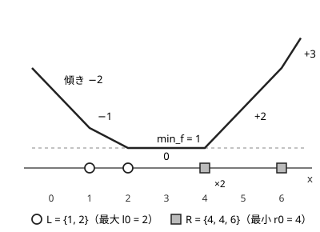

!!! abstract "要点"
    - **何ができるか**：$\mathrm{dp}[x]$ が $x$ について[区分線形](../guide/glossary.md#piecewise-linear)で凸なとき、傾きが変わる点を 2 つの優先度付きキューで持ち、「$\lvert x - a \rvert$ を足す」「累積 min を取る」「平行移動」を 1 回 $O(\log N)$ 以下で行う。$x$ の範囲が $10^9$ と広くても、DP の表を関数ごと更新できる。
    - **いつ使うか**：
        - 数列を単調（広義増加）にするための、値の変更量の和の最小
        - 時刻ごとに位置を少しずつ動かせるときの最小コスト
        - $\mathrm{dp}[i][x] = \min_{y \le x} \mathrm{dp}[i-1][y] + \lvert x - a_i \rvert$ のように、$x$ について区分線形で凸
    - **計算量**：$\max(0, x - a)$・$\max(0, a - x)$・$\lvert x - a \rvert$ の加算は $O(\log N)$、累積 min・平行移動・幅のある区間の min・最小値の取得は $O(1)$（$N$ は傾きが変わる点の数で、加算 1 回で高々 2 増える）
    - **前提**：[DP の状態の設計](../dp/dp-state-design.md)、[上位 K 個の和と中央値の管理](../ds/top-k-multiset.md)

<!-- textlint-disable -->
別名：スロープトリック・区分線形凸関数・区分線形凸関数の管理
<!-- textlint-enable -->

Slope Trick は、DP の表 $\mathrm{dp}[i][\cdot]$ を「$x$ の関数」とみて、その関数を傾きが変わる点の集まりで持つ方法である。遷移が「凸な折れ線を足す」「左右の累積 min を取る」「ずらす」だけでできていれば、表の全体を書き換えずに、点の集まりへの数回の操作で次の段へ進める。この教材で集めた問題では、ABC で必須になったのは ABC217 H（2021 年）と、その変形で解く ABC458 G（2026 年。[力試し](#challenge)に載せた）の 2 問が見つかる程度の発展の手法である。ただし、入口の[2 つのヒープで中央値を管理する](#two-heaps)形は黄の帯の問題にも出る。

## 凸関数を傾きの変わる点の集まりで表す {#breakpoints}

扱う関数 $f$ は、次の 3 つを満たす折れ線である。

- 区分線形：いくつかの点で折れる直線のつながり
- [凸関数](../guide/glossary.md#convex-function)：傾きが左から右へ広義単調に増える
- 傾きが整数で、折れる点で傾きがちょうど 1 ずつ増える（2 増えるなら同じ点を 2 回数える）

このような $f$ は、最小値 $\mathrm{min}_f$ と 2 つの多重集合 $L$・$R$ で書ける。$L$ は傾きが 0 以下の側の折れる点（最小になる区間の左端を含む）、$R$ は傾きが 0 以上の側の折れる点（右端を含む）で、$\max L \le \min R$ を保つ。

$$
f(x) = \mathrm{min}_f + \sum_{l \in L} \max(0, l - x) + \sum_{r \in R} \max(0, x - r)
$$

$l_0 = \max L$、$r_0 = \min R$ と書くと、$f$ は閉区間 $[l_0, r_0]$ で最小値 $\mathrm{min}_f$ を取る（$L$ が空なら $l_0 = -\infty$、$R$ が空なら $r_0 = \infty$）。$L$ を最大が先頭のヒープ、$R$ を最小が先頭のヒープで持てば、$l_0$・$r_0$ は $O(1)$ で分かる。



図の折れ線は $\mathrm{min}_f = 1$、$L = \{1, 2\}$、$R = \{4, 4, 6\}$ である。$x = 4$ で傾きが 0 から +2 に増えるので、$R$ に 4 が 2 つ入る。右端の傾き $+3$ は $\lvert R \rvert$、左端の傾き $-2$ は $-\lvert L \rvert$ に等しい。

この表し方の利点は、$x$ の範囲がどれだけ広くても、持つものが「折れる点」だけで済むことである。DP の表を $x$ ごとに持つと $x$ の幅ぶんの時間がかかるが、折れる点の数は足した関数の数で抑えられる。

## 2 つのヒープで中央値を管理する（入口） {#two-heaps}

この節は[上位 K 個の和と中央値の管理](../ds/top-k-multiset.md#absolute-sum-function)の「$\lvert x - a \rvert + b$ を足していく関数の最小値」を前提にする。

$f(x) = \sum_i \lvert x - a_i \rvert$ は、各 $a_i$ で傾きが 2 増える折れ線である。[絶対値の和の最小化と中央値](../basics/median-absolute.md#why-median)のとおり、最小になるのは $a_i$ たちの中央値である。Slope Trick の言葉では、$\lvert x - a_i \rvert$ を足すたびに、傾きが 2 増えるので $a_i$ が 2 つ加わり、$L$・$R$ の大きさがそれぞれ 1 増える。各 $a_i$ を 2 つずつ並べた $2n$ 個のうち、小さい方の $n$ 個が $L$、大きい方の $n$ 個が $R$ になる。$l_0$ と $r_0$ がちょうど真ん中の 2 つ（個数が奇数なら同じ値）を指すので、中央値を 2 つのヒープで保つ方法そのものになる。

2 つのヒープで中央値を保つ方法との違いは、足す関数が $\lvert x - a \rvert$ に限られないことである。片側だけの $\max(0, x - a)$ を足すと $L$ と $R$ の個数の釣り合いが崩れ、もはや中央値ではなくなる。それでも「$l_0$ と $r_0$ が最小になる区間の両端」という見方は保たれる。次の節の操作は、この見方で一般化したものである。

## |x − a| を足す・累積 min・平行移動 {#operations}

関数 $f$ への操作と、$L$・$R$・$\mathrm{min}_f$ の更新は次のとおりである（maspy 氏の「slope trick (1) 解説編」の整理による）。

| 操作 | 更新 | 計算量 |
| --- | --- | --- |
| 定数 $c$ を足す | $\mathrm{min}_f$ に $c$ を足す | $O(1)$ |
| $\max(0, x - a)$ を足す | $\mathrm{min}_f$ に $\max(0, l_0 - a)$ を足し、$a$ を $L$ に入れ、$L$ の最大を取り出して $R$ に移す | $O(\log N)$ |
| $\max(0, a - x)$ を足す | $\mathrm{min}_f$ に $\max(0, a - r_0)$ を足し、$a$ を $R$ に入れ、$R$ の最小を取り出して $L$ に移す | $O(\log N)$ |
| $\lvert x - a \rvert$ を足す | 上の 2 つを続けて行う | $O(\log N)$ |
| 累積 min $\min_{y \le x} f(y)$ | $R$ を空にする | $O(1)$ |
| 累積 min $\min_{y \ge x} f(y)$ | $L$ を空にする | $O(1)$ |
| 区間の min $\min_{x - b \le y \le x - a} f(y)$（$a \le b$） | $L$ の全要素に $a$、$R$ の全要素に $b$ を足す | $O(1)$ |
| 平行移動 $f(x - a)$ | 区間の min で $a = b$ とする | $O(1)$ |

**片側の折れ線を足すときの $\mathrm{min}_f$**。$\max(0, x - a)$ を足しても、$l_0$ は最小点のままである。$l_0$ の左では傾きが $-1$ 以下だったので、1 増えても 0 以下に留まる。$l_0$ の右では傾きが 0 以上だったので、足した後も 0 以上である。よって新しい最小値は $f(l_0) + \max(0, l_0 - a)$ になる。点の移し替えは、$a$ を入れた後の $L$ で最大のものが新しく「傾きが 0 から 1 に変わる点」になるので、それを $R$ へ移すという意味である。$\max(0, a - x)$ は左右を入れ替えた同じ議論で、$r_0$ が最小点のまま残る。

**累積 min と区間の min**。$\min_{y \le x} f(y)$ は、$f$ の右側の上り坂を平らにしたものである。$R$ の点を捨てれば上り坂が消える。区間の min は、最小になる区間 $[l_0, r_0]$ を $[l_0 + a, r_0 + b]$ に広げ、その左の下り坂を $a$、右の上り坂を $b$ だけずらしたものになる。全要素への加算は、$L$・$R$ ごとに「全要素に足す値」を 1 つ持てば $O(1)$ で済む（[全体に足す値を別に持つ](../ds/priority-queue.md#with-offset)のと同じ書き方）。

DP の式の形と操作の組の対応は次のとおりである。

- **数列 $A$ を広義単調増加の列 $B$ に変えるときの $\sum \lvert A_i - B_i \rvert$ の最小**：$\mathrm{dp}[i][x]$ を「$B_i = x$ としたときの、$i$ 番目までの変更量の和の最小」とすると、$\mathrm{dp}[i][x] = \min_{y \le x} \mathrm{dp}[i-1][y] + \lvert x - A_i \rvert$ である。各 $i$ で「$R$ を空にする → $\lvert x - A_i \rvert$ を足す」を行い、最後の $\mathrm{min}_f$ が答えになる。
- **毎時刻、位置を 1 まで動かせるときのコストの最小**：時刻が $\Delta$ 進むと $\mathrm{dp}[t + \Delta][x] = \min_{\lvert y - x \rvert \le \Delta} \mathrm{dp}[t][y]$ になる。これは区間の min で $a = -\Delta$、$b = \Delta$ としたものである。その時刻のコストが片側の折れ線や絶対値なら、続けて足す。

!!! example "小さな例：A = (3, 1, 2) を広義単調増加にする"
    最初は $f = 0$（$L$・$R$ は空、$\mathrm{min}_f = 0$）。

    - $A_1 = 3$：$R$ を空にし（空のまま）、$\lvert x - 3 \rvert$ を足す。$L = \{3\}$、$R = \{3\}$、$\mathrm{min}_f = 0$。
    - $A_2 = 1$：$R$ を空にして $L = \{3\}$。$\max(0, x - 1)$ を足すと $l_0 = 3$ から $\mathrm{min}_f$ に $3 - 1 = 2$ が加わり、$L = \{1, 3\}$ の最大 3 が $R$ へ移る。$\max(0, 1 - x)$ を足すと $r_0 = 3$ なので $\mathrm{min}_f$ は変わらず、$R = \{1, 3\}$ の最小 1 が $L$ へ移る。$L = \{1, 1\}$、$R = \{3\}$、$\mathrm{min}_f = 2$。
    - $A_3 = 2$：$R$ を空にして $L = \{1, 1\}$。$\max(0, x - 2)$ では $l_0 = 1 < 2$ なので $\mathrm{min}_f$ は変わらず、2 が $R$ へ移る。$\max(0, 2 - x)$ では $r_0 = 2$ なので変わらず、2 が $L$ へ移る。$\mathrm{min}_f = 2$。

    答えは 2 で、たとえば $B = (1, 1, 2)$ や $B = (2, 2, 2)$ が最小を達成する。

??? question "確認問題：最初の位置が 0 に決まっている（f(0) = 0、ほかの x では ∞）とき、どう表すか"
    $L$・$R$ に 0 を十分たくさん入れておく。傾きが $K$ の壁が両側にでき、$x = 0$ から $d$ 離れると $Kd$ のコストがかかる。後から足す関数の傾きの合計を $K$ より小さくしておけば（足す関数が $M$ 個で、どれも傾きの大きさが 1 以下なら $K = M + 1$ 個）、壁を越えるより内側に留まる方が必ず得になり、∞ の代わりになる。区間の min で壁も一緒に動くので、「動ける範囲が広がる」ことも正しく表される。

## 木の上で凸関数をマージする（マージテクと組む） {#on-trees}

この節は[マージテク](../tree/small-to-large.md#subtree-merge)の部分木ごとの集合の併合を前提にする。

木の各頂点に値を付け直し、「親から子へ向かって値が単調になる」ようにする最小コストを求める型では、$f_v(x)$ を「頂点 $v$ の値を $x$ にしたときの、部分木 $v$ の中の最小コスト」とおく。子 $w$ の値は親以下という制約なら、次の形になる。

$$
f_v(x) = \lvert x - a_v \rvert + \sum_{w \text{ は } v \text{ の子}} \min_{y \le x} f_w(y)
$$

$\min_{y \le x} f_w(y)$ は $R$ を空にすれば得られる。残りは「2 つの凸関数の和」で、これは一方の点をすべて他方へ足し込めばよい。$g = \mathrm{min}_g + \sum_{l \in L_g} \max(0, l - x) + \sum_{r \in R_g} \max(0, x - r)$ を $f$ に足すには、$\mathrm{min}_g$ を定数として足し、$L_g$ の各点を $\max(0, l - x)$、$R_g$ の各点を $\max(0, x - r)$ として 1 つずつ足す。

$N$ を木の頂点数とする（加える点は全部で $2N$ 個）。点の少ない方を多い方へ足し込めば、各点が移る回数は $O(\log N)$ 回で、全体は $O(N \log^2 N)$ になる（maspy 氏の「slope trick (2) 問題編」）。多い方を残すために入れ替えるときは、ヒープだけでなく $\mathrm{min}_f$ と「全要素に足す値」も一緒に入れ替える。$R$ が常に空になる上の形なら、足し込みはヒープどうしの併合そのものなので、併合できるヒープ（meldable heap）を使えば $O(N \log N)$ に下がる。

## 自作ライブラリでの扱い {#library}

ACL に Slope Trick はない。自作するときは、次の 4 つを守ればよい。

- **保つ性質**：$\max L \le \min R$。片側の折れ線を足す操作は、$a$ をいったん同じ側のヒープに入れ、その中で最も内側（$L$ なら最大、$R$ なら最小）の点を反対側へ移す。移す点は残る点のどれ以上（$R$ なら以下）なので、この性質が崩れない。$a$ を直接反対側に入れると、$a$ が反対側を越えていない限り崩れることがある
- **遅延の加算**：$L$・$R$ ごとに全要素に足す値 $\mathrm{add}_L$・$\mathrm{add}_R$ を持ち、入れるときに引き、取り出すときに足す。$L$ から取り出した点を $R$ に入れるときは、$L$ の実際の値に直してから $\mathrm{add}_R$ を引く
- **空のヒープ**：$l_0 = -\infty$・$r_0 = \infty$ を返す。∞ を表す大きな値に遅延の値を足さない（オーバーフローする）
- **値の型**：$\mathrm{min}_f$ は足した関数の値の和になるので `long long` で持つ

次のコード片は、上の表の操作をそのまま書いたものである。完全なプログラム（[`snippets/slope-trick/usage.cpp`](https://github.com/yuukougun/kyopro-atlas/blob/main/snippets/slope-trick/usage.cpp)）では、乱数の操作の列を、$x$ ごとに値を持つ配列で計算した結果と比べて確かめている。

```cpp
--8<-- "slope-trick/usage.cpp:core"
```

完全なプログラム：[`usage.cpp`](https://github.com/yuukougun/kyopro-atlas/blob/main/snippets/slope-trick/usage.cpp)（GitHub）
{ .kp-code-src }

$f(x)$ の値そのものが要るときは、ヒープの中身を順に取り出して定義の式で足す（$O(N \log N)$。取り出すとヒープが壊れるので、写してから行う）。傾きが 1 より大きく変わる関数（$k \max(0, x - a)$ など）を足すなら、同じ点を $k$ 回入れる。$k$ が大きいなら、ヒープの要素を（点, 個数）の組にした版か、平衡二分探索木を使う版が要る。

Library Checker には Slope Trick を直接試す問題はない（2026-10-22 に問題の一覧を確かめた）。自作したら、コード片のように $x$ の範囲が狭い場合の愚直な DP と乱数で比べ、[ABC127 F](#practice) で提出して確かめる。

## 学ぶための資料 {#resources}

- [maspy「slope trick (1) 解説編」](https://maspypy.com/slope-trick-1-%e8%a7%a3%e8%aa%ac%e7%b7%a8)：表し方と各操作の更新の式、遅延の加算の持ち方がまとまっている。最初に読む資料
- [maspy「slope trick (2) 問題編」](https://maspypy.com/slope-trick-2-%e5%95%8f%e9%a1%8c%e7%b7%a8)：数列を単調にする問題、区間の min を使う問題、木の上でマージする問題など、操作の組み合わせ方の実例
- [ei1333「Luzhiled's Library: Slope Trick」](https://ei1333.github.io/library/structure/others/slope-trick.hpp.html)と [hitonanode「Slope trick（区分線形凸関数に関する特定の更新を高速に扱う手法）」](https://hitonanode.github.io/cplib-cpp/other_algorithms/slope_trick.hpp.html)：どちらも公開ライブラリの Slope Trick で、関数の切り分け（区間の min・マージ・値の取得）の参考になる

## 例題 {#examples}

### ABC217 H. Snuketoon {#abc217_h}

<div class="kp-problems" data-role="example" markdown>

- [ABC217 H. Snuketoon](https://atcoder.jp/contests/abc217/tasks/abc217_h)（diff 3112）：時刻ごとに左右へ 1 ずつ動けるとき、決まった時刻と位置で受けるダメージの和の最小を求める。

</div>

方針：$\mathrm{dp}[t][x]$ を「時刻 $t$ で位置 $x$ にいるときの、それまでのダメージの和の最小」とする。時刻が進む遷移は[区間の min](#operations) で、各時刻のダメージは指定の位置 $X$ の片側にはみ出た距離なので $\max(0, X - x)$ か $\max(0, x - X)$ を足す操作になる。どちらも Slope Trick の操作に収まる。

??? note "解法の詳細"
    - 時刻 0 の位置は 0 と決まっているので、$L$・$R$ に 0 を $N + 1$ 個ずつ入れて「$x \ne 0$ では ∞」を表す（[確認問題](#operations)の壁）。足す関数は $N$ 個で傾きの大きさは 1 以下なので、これで足りる
    - ダメージを受ける時刻の順に処理する。前の時刻からの差を $\Delta$ として、区間の min で $L$ を $-\Delta$、$R$ を $+\Delta$ だけずらす（遅延の加算で $O(1)$）
    - その時刻のダメージの向きに合わせて、$\max(0, X - x)$ か $\max(0, x - X)$ を足す
    - 最後の位置は自由なので、答えは最後の $\mathrm{min}_f$ である
    - ヒープの要素は $3N$ 個ほどで、全体は $O(N \log N)$

## 練習問題 {#practice}

<div class="kp-problems" data-role="practice" markdown>

- [ABC127 F. Absolute Minima](https://atcoder.jp/contests/abc127/tasks/abc127_f)（diff 2003）：|x − a| + b を足すクエリと、関数の最小値とそれを取る x を答えるクエリを処理する。
- [ARC123 D. Inc, Dec - Decomposition](https://atcoder.jp/contests/arc123/tasks/arc123_d)（diff 2143）：数列を、単調増加の列と単調減少の列の和に分けるとき、2 つの列の要素の絶対値の和の最小を求める。

</div>

??? note "練習の方針"
    - ABC127 F：更新では $\lvert x - a \rvert$ を足して $b$ を定数として足す。質問には $l_0$（最小にする $x$ のうち最も小さいもの）と $\mathrm{min}_f$ を答える。[2 つのヒープで中央値を管理する](#two-heaps)形そのもので、Slope Trick の最初の練習になる
    - ARC123 D：増加の列を $B$、減少の列を $C = A - B$ とし、$\mathrm{dp}[i][x]$ を「$B_i = x$ のときの $i$ 番目までの絶対値の和の最小」とする。$B_{i-1} \le B_i$ と $C_{i-1} \ge C_i$ をまとめると、前の値 $y$ への制約は $y \le x - \max(0, A_i - A_{i-1})$ になる。各 $i$ で「$R$ を空にする → $\max(0, A_i - A_{i-1})$ だけ平行移動 → $\lvert x \rvert$ と $\lvert x - A_i \rvert$ を足す」を行う（$i = 1$ では足すだけ）。B と C を貪欲に作ってから全体をずらし、中央値で調整する解き方もある

## 力試し {#challenge}

<div class="kp-problems" data-role="challenge" markdown>

- [ABC458 G. Children Yearn for the Evil Kindergarten](https://atcoder.jp/contests/abc458/tasks/abc458_g)（diff 2831）：メダルを持たない多数の園児が N 日を過ごす。毎日、集めたメダルにその日の分 A_i を足して配り直し、B_i 枚に満たない園児は脱落し、残りは B_i 枚を失い、C_i 枚以上を持つ園児は脱出できる。脱出できる人数の最大を求める。

</div>

??? note "力試しの方針"
    - **ABC458 G**：メダルは全員の分をまとめて持つとみてよい。$i$ 日目には $A_i$ 枚が入り、残っている 1 人につき $B_i$ 枚を払い、さらに 1 人につき $C_i$ 枚で脱出させられる。答えの人数 $m$ で二分探索し、$m$ 人を脱出させられるかを判定する。$\mathrm{dp}[j]$ を「$j$ 人が脱出済みのときの手元のメダルの最大」とすると、1 日の遷移は「$A_i$ を足す（定数の加算）」「$B_i (m - j)$ を引く（1 次関数を足すので、傾きがすべて $B_i$ 増える）」「傾き $-C_i$ の直線との $(\max, +)$ 畳み込み（$-C_i$ より急な下りの傾きが $-C_i$ にそろう）」の 3 つで、$\mathrm{dp}$ は $j$ について上に凸な折れ線のまま保たれる。傾きは右ほど小さいので、畳み込みで変わるのは右端の側だけである。そこで傾きの変わる点を左から順に（傾き, 長さ）の組でスタックに積み、傾きへの一律の加算は遅延の値 1 つで持つ。各日の操作はスタックの末尾を取り除いて 1 組積むだけになり、日の終わりに値が負になった右端の部分（脱落したことになる）も末尾から削る。判定はならし $O(N)$ で、上の表の 2 つのヒープの代わりに片側のスタックで足りる Slope Trick の変形である

## 使い分け {#comparison}

- 関数の最小値だけが要り、更新が $\lvert x - a \rvert + b$ だけなら、[2 つのヒープで中央値を保つ](../ds/top-k-multiset.md#median)だけで足りる（[2 つのヒープで中央値を管理する](#two-heaps)）
- $x$ の範囲が狭い（$10^5$ 程度）なら、DP の表をそのまま持ち、累積 min は[累積和と同じ 1 回の走査](../dp/dp-prefix-sum.md)で書ける。凸でない関数でも使える
- 関数が凸でも、足すものが折れ線でない（2 次関数など）なら Slope Trick では扱えない。答えが選ぶ個数について凸なら [Alien DP](../dp/alien-dp.md#penalty)、遷移が Monge なら [Monge](../dp/monge.md) を考える
- CHT・Monge・Alien DP・Slope Trick の確かめ方と選び方は、[凸性を使う高速化の使いどころ](../dp/dp-speedup-overview.md#convexity)にまとめる

## 参考 {#references}

- [maspy「slope trick (1) 解説編」](https://maspypy.com/slope-trick-1-%e8%a7%a3%e8%aa%ac%e7%b7%a8)：表し方、各操作の更新の式（片側の折れ線を足すときの最小値の増え方、区間の min のずらし方）、遅延の加算
- [maspy「slope trick (2) 問題編」](https://maspypy.com/slope-trick-2-%e5%95%8f%e9%a1%8c%e7%b7%a8)：数列を単調にする DP、木の上でマージするときの計算量と併合できるヒープの話、練習の問題の一覧
- [kmjp「AtCoder ABC #217 : H - Snuketoon」](https://kmjp.hatenablog.jp/entry/2021/09/05/0930)：例題の方針（0 をたくさん入れて初期位置を表す、時刻の差で左右のヒープをずらす）
- [ikatakos「SMBCプログラミングコンテスト #1（AtCoder Beginner Contest 458）F,G問題メモ」](https://ikatakos.com/pot/programming_algorithm/contest_history/atcoder/2026/0516_abc458)：力試し ABC458 G の方針（メダルをまとめて持つ言い換え、人数の二分探索、上に凸な折れ線を傾きのスタックで持つ判定。解法の節だけを参照）
- [ikatakos「AtCoder Beginner Contest 217 G,H問題メモ」](https://ikatakos.com/pot/programming_algorithm/contest_history/atcoder/2021/0904_abc217)：例題の方針の確認（解法の節だけを読んだ）
- [drken「AtCoder ABC 127 F - Absolute Minima (2D, 黄色, 600 点)」](https://drken1215.hatenablog.com/entry/2019/06/15/114700)：練習 ABC127 F の方針（定数を分けて持ち、中央値で最小値を求める）
- [kmjp「AtCoder ARC #123 : D - Inc, Dec - Decomposition」](https://kmjp.hatenablog.jp/entry/2021/09/16/0930)：練習 ARC123 D の別解（貪欲に作ってからずらす解き方）
- [ei1333「Luzhiled's Library: Slope Trick」](https://ei1333.github.io/library/structure/others/slope-trick.hpp.html)：学ぶための資料。ライブラリの関数の切り分けとマージの計算量
- [hitonanode「Slope trick（区分線形凸関数に関する特定の更新を高速に扱う手法）」](https://hitonanode.github.io/cplib-cpp/other_algorithms/slope_trick.hpp.html)：学ぶための資料。空のヒープで ±∞ を返す書き方と、値の取得が破壊的になる点
- [yosupo06「library-checker-problems」](https://github.com/yosupo06/library-checker-problems)：Slope Trick を直接試す問題がないことの確認（問題の一覧）
