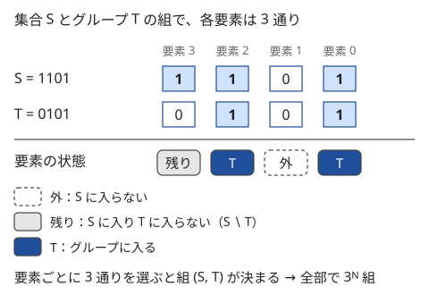

!!! abstract "要点"
    - **何ができるか**：集合を「1 つのグループ」と「残り」に分ける遷移を $T \gets (T - 1) \text{ AND } S$ で列挙し、$N$ 個をグループに分けるときの最適値や分け方の数を全体 $O(3^N)$ で求める。グループの順序の重複を除くため、最小の要素を含む部分集合だけを列挙する。
    - **いつ使うか**：
        - N 個をいくつかのグループに分ける方法の数・最適値。
        - 集合を部分集合の和に分割する。
        - $N \le 15$〜$16$ 程度（$3^N \approx 1.4 \times 10^7$〜$4.3 \times 10^7$）、内側の処理が軽ければ $N = 18$ まで。
    - **計算量**：遷移は全体で $O(3^N)$。各グループの値（得点・可否）の前計算は別に $O(2^N N)$ などかかる。グループの数 $K$ を状態に足すと $O(K \cdot 3^N)$。
    - **前提**：[bitDP](../dp/bit-dp.md)

<!-- textlint-disable -->
別名：3^N DP・部分集合の部分集合・Submask Enumeration・グループ分け DP
<!-- textlint-enable -->

部分集合を列挙する DP は、$\mathrm{dp}[S]$ ＝「集合 $S$ をいくつかのグループに分けたときの最適値（または分け方の数）」とし、$S$ から 1 つのグループ $T$ を取り出して残り $S \setminus T$ の値につなぐ DP である。[bitDP](../dp/bit-dp.md) が要素を 1 つずつ足していくのに対し、ここではグループを丸ごと 1 つずつ足す。$S$ ごとに部分集合をすべて試すので一見 $4^N$ に見えるが、実際の回数は $3^N$ で、$N \le 16$ ならたやすく、$N = 18$ でもループが軽ければ間に合う。

## 部分集合の部分集合を列挙する（T = (T − 1) & S） {#submask-loop}

グループ分けの問題は、要素の順番ではなく「どの要素が同じグループか」だけで値が決まることが多い。$N$ 人を自由にグループに分ける方法は[ベル数](../comb/bell-number.md) $B_N$ 通りあり、$B_{16} \approx 10^{10}$ なので全列挙は間に合わない。そこで集合を状態にし、次の式で計算する。

$$
\mathrm{dp}[S] = \max_{\varnothing \ne T \subseteq S} \bigl( f(T) + \mathrm{dp}[S \setminus T] \bigr), \qquad \mathrm{dp}[\varnothing] = 0
$$

ここで $f(T)$ は「$T$ を 1 つのグループにしたときの値」で、あらかじめ全部の $T$ について求めておく。数え上げなら $\max$ を和に、$+$ を積に読み替え、$\mathrm{dp}[\varnothing] = 1$ とする。$\mathrm{dp}[S]$ で足りる理由は、残りの $S \setminus T$ をどう分けるかが、$T$ の中身によらず $S \setminus T$ だけで決まるからである。

$S$ の部分集合 $T$ は、$T = S$ から始めて $T \gets (T - 1) \text{ AND } S$ を繰り返すと、大きい順にちょうど 1 回ずつ現れる。この操作がなぜ漏れなく重複なく進むかは、[bit 演算の部分集合の列挙](../basics/bit-operations.md#submask)に証明と図がある。DP で使うときに気をつけるのは次の 3 点である。

- **空集合で止める**：`T > 0` をループの条件にすると $T = \varnothing$ を処理せずに止まる。空でないグループだけを試したいならこれでよい。$T = \varnothing$ も処理したいなら、処理してから `if (T == 0) break;` で抜ける（条件を書かないと $(0 - 1) \text{ AND } S = S$ に戻って無限に回る）
- **自分自身への遷移**：$T = \varnothing$ を許すと $\mathrm{dp}[S]$ が $\mathrm{dp}[S]$ 自身に依存する。グループは空でないものだけを選ぶ
- **計算順序**：$T \ne \varnothing$ なら $S \setminus T$ は $S$ の真の部分集合で、整数としても $S$ より小さい。だから $S$ を $0, 1, \dots, 2^N - 1$ の昇順に回せば、使う値はすでに求まっている（[bitDP の昇順に回してよい理由](../dp/bit-dp.md#subsets-as-integers)と同じ）

$f(T)$ の前計算も遅くしない工夫が要る。「同じグループになった組ごとの得点 $a_{ij}$ の和」なら、$T$ の最小の要素 $v$ を外した集合の値に、$v$ と残りの要素の組の得点を足せば $O(N)$ で済み、全体で $O(2^N N)$ になる。遷移の内側で $f(T)$ を $O(N^2)$ で数え直すと $O(3^N N^2)$ になり、$N = 16$ でも間に合わない。

```cpp
--8<-- "subset-enumeration-dp/grouping.cpp:precompute"
```

完全なプログラム：[`grouping.cpp`](https://github.com/yuukougun/kyopro-atlas/blob/main/snippets/subset-enumeration-dp/grouping.cpp)（GitHub）
{ .kp-code-src }

## 3^N になる理由（各要素が 3 通り） {#why-3n}

$S$ ごとに部分集合 $T$ を全部列挙するとき、内側のループの回数は $\lvert S \rvert$ 個の要素からなる $S$ について $2^{\lvert S \rvert}$ 回である。$S$ も $2^N$ 通りあるので $2^N \times 2^N = 4^N$ と見積もりたくなるが、組 $(S, T)$ を要素ごとに見ると数え方が変わる。



各要素は「$S$ に入らない」「$S$ に入り $T$ に入らない」「$T$ に入る」の 3 通りのどれかで、3 通りの選び方の列と組 $(S, T)$ が 1 対 1 に対応する。だから組の数は $3^N$ である。式で書けば、二項定理から次のようになる。

$$
\sum_{S} 2^{\lvert S \rvert} = \sum_{k=0}^{N} \binom{N}{k} 2^k = (1 + 2)^N = 3^N
$$

| $N$ | $2^N N$ | $3^N$ | $4^N$ |
| --- | --- | --- | --- |
| 14 | $2.3 \times 10^5$ | $4.8 \times 10^6$ | $2.7 \times 10^8$ |
| 16 | $1.0 \times 10^6$ | $4.3 \times 10^7$ | $4.3 \times 10^9$ |
| 18 | $4.7 \times 10^6$ | $3.9 \times 10^8$ | $6.9 \times 10^{10}$ |
| 20 | $2.1 \times 10^7$ | $3.5 \times 10^9$ | $1.1 \times 10^{12}$ |

1 秒に $10^8$ 回ほどの目安（[計算量の見積もり](../basics/complexity-estimation.md)）で見ると、$N \le 16$ なら余裕があり、$N = 18$ は内側が加算と比較だけなら 1〜2 秒に収まる。次の節の「最小の要素を含む $T$ だけ」に絞ると回数は $(3^N - 1)/2$ にほぼ半減するので、$N = 18$ ではこれが効く。$N = 20$ は $3^N$ では無理で、別の方法（[高速ゼータ変換](#vs-zeta)など）を考える。

逆向きに、$\mathrm{dp}[S]$ から $S$ に入っていない要素の部分集合 $T$ を足して $\mathrm{dp}[S \cup T]$ を更新する配る DP もある。この場合も組 $(S, T)$ の各要素は「$S$ に入る」「$T$ に入る」「どちらにも入らない」の 3 通りなので、同じく $3^N$ である。

## 最小の要素を含むグループから決める（順序の重複を除く） {#fix-minimum}

前の節の式は「$S$ のどの部分集合を最初のグループにしてもよい」としている。最大値や最小値を求めるだけなら、同じ分け方を何度試しても答えは変わらない。しかし分け方を**数える**ときは、グループを取り出す順番の違いを別々に数えてしまう。

たとえば $S = \{0, 1, 2\}$ を $\{0\}, \{1, 2\}$ に分ける方法は、「先に $\{0\}$、次に $\{1, 2\}$」と「先に $\{1, 2\}$、次に $\{0\}$」の 2 回数えられる。$N = 3$ の分け方は $B_3 = 5$ 通りなのに、素朴な式では 13 通り（順序を区別した分け方の数）になる。グループの数によって重複の回数が違うので、後から割って直すこともできない。

直し方は、**$S$ の最小の要素 $v$ を含むグループ $T$ だけを選ぶ**ことである。分け方が 1 つ決まれば、$v$ を含むグループは 1 つに決まる。そのグループを取り出した残りでも同じ規則を使うので、グループを取り出す順は「各グループの最小の要素の小さい順」の 1 通りだけになる（[重複を除く数え方の最小番号の規則](../comb/counting-dedup.md#min-index)と同じ考え方で、全列挙なら[組分け型の再帰](../basics/recursive-enumeration.md#partition)にあたる）。

実装では、$v$ の bit を `low = S & -S` で取り出し、$S$ から $v$ を除いた集合 `rest` の部分集合 $t$ を列挙して、グループを $t \cup \{v\}$ とする。$t = \varnothing$（$v$ だけのグループ）も処理するので、0 を処理してから止める形にする。

```cpp
--8<-- "subset-enumeration-dp/partition-count.cpp:core"
```

完全なプログラム：[`partition-count.cpp`](https://github.com/yuukougun/kyopro-atlas/blob/main/snippets/subset-enumeration-dp/partition-count.cpp)（GitHub）
{ .kp-code-src }

コード片の全体では、`fixed` がベル数 $1, 1, 2, 5, 15, \dots$ に、`naive` が順序を区別した分け方の数 $1, 1, 3, 13, 75, \dots$ に一致することを $N \le 10$ で確かめている。

最大化・最小化でもこの形にしておくとよい。答えは同じで、内側のループが $2^{\lvert S \rvert - 1}$ 回に減るので全体で $\sum_{S \ne \varnothing} 2^{\lvert S \rvert - 1} = (3^N - 1)/2$ 回になる。最大化の遷移は次のようになる（要素の組ごとの得点の和を最大にする例）。

```cpp
--8<-- "subset-enumeration-dp/grouping.cpp:core"
```

完全なプログラム：[`grouping.cpp`](https://github.com/yuukougun/kyopro-atlas/blob/main/snippets/subset-enumeration-dp/grouping.cpp)（GitHub）
{ .kp-code-src }

??? question "確認問題：最小の要素の代わりに最大の要素を使ってよいか"
    「$S$ の最小の要素を含むグループ」を「$S$ の最大の要素を含むグループ」に変えても、分け方を重複なく数えられるか。

    ??? success "答え"
        数えられる。必要なのは「$S$ だけで決まる要素を 1 つ選び、それを含むグループを選ぶ」ことで、最小でも最大でもよい。分け方が決まれば、その要素を含むグループは 1 つに決まるからである。最小を使うのは `S & -S` で 1 回の演算で取り出せるからである。

## グループの数を状態に足す {#group-count}

「ちょうど $K$ 個のグループに分ける」「$K$ 個以下に分ける」のようにグループの数に条件があるときは、状態に数を足して $\mathrm{dp}[j][S]$ ＝「$S$ をちょうど $j$ 個の空でないグループに分けたときの最適値」とする。

$$
\mathrm{dp}[j][S] = \operatorname*{opt}_{v \in T \subseteq S} \Bigl( f(T) \circ \mathrm{dp}[j - 1][S \setminus T] \Bigr), \qquad \mathrm{dp}[0][\varnothing] = \text{単位元}
$$

ここで $v$ は $S$ の最小の要素、$\operatorname{opt}$ と $\circ$ は問題に合わせた演算（最大と和、最小と最大など）である。$\mathrm{dp}[0][S]$（$S \ne \varnothing$）は「分けられない」を表す値にし、遷移で読まないようにする。$j$ ごとに $3^N$ の遷移を回すので、全体で $O(K \cdot 3^N)$ になる。次は、重さの付いた $N$ 個をちょうど $K$ 個のグループに分け、グループの重さの和の最大を最小にする例である。

```cpp
--8<-- "subset-enumeration-dp/k-groups.cpp:core"
```

完全なプログラム：[`k-groups.cpp`](https://github.com/yuukougun/kyopro-atlas/blob/main/snippets/subset-enumeration-dp/k-groups.cpp)（GitHub）
{ .kp-code-src }

グループの数の扱いは問題文で次のように分かれる。

- **グループの数を最小にする**：数そのものを DP の値にし、$\mathrm{dp}[S] = \min_T (\mathrm{dp}[S \setminus T] + 1)$ とすれば数の次元は要らない（[例題 ABC187 F](#abc187_f)）
- **K 個以下**：「ちょうど $j$ 個」の表を $j = 1, \dots, K$ で作り、答えを $\min_{j \le K} \mathrm{dp}[j][\text{全体}]$（最大化なら max）とする
- **空のグループを許す**：空のグループが値に影響しないなら「$K$ 個以下の空でないグループ」に直す。袋の重さの分散のように**空のグループにも値がある**ときは、空でないグループが $j$ 個なら、残りの $K - j$ 個の空のグループの値を足してから比べる。「分けられない」の印と取り違えやすいので、空のグループの値を ±∞ にしない

$\mathrm{dp}[j][S]$ は $\lvert S \rvert < j$ のとき使えない。これを読み飛ばしても計算量の次数は変わらないが、表は $(K + 1) \times 2^N$ 個になるので、$K = N = 18$ でメモリが足りるかを先に見積もる（`long long` なら約 $40$ MB）。$\mathrm{dp}[j]$ は $\mathrm{dp}[j - 1]$ だけから作るので、2 本の配列を入れ替えて使えばメモリは $2 \times 2^N$ で済む。

「最大の最小化」でグループの数に上限がある問題は、[答えで二分探索](../basics/binary-search-answer.md)に直すと $K$ の次元を外せることがある。答えを $x$ に決め、$f(T) \le x$ のグループだけを使って「グループの数の最小」を $O(3^N)$ で求め、$K$ 以下かを判定する。全体は $O(3^N \log V)$（$V$ は答えの候補の数）で、$K$ が大きいときに速い。

??? question "確認問題：j の次元を外せるか"
    $N$ 個をちょうど $K$ 個のグループに分けるとき、各グループの得点の和の最大を求めたい。$K$ の次元を持たず、$\mathrm{dp}[S]$ だけで求められるか。

    ??? success "答え"
        一般には求められない。$\mathrm{dp}[S]$ は $S$ の分け方のうち最もよいものだけを覚えているので、それが何個のグループでできたかが分からない。$K$ 個という条件を守るには $\mathrm{dp}[j][S]$ が要る。

## 高速ゼータ変換との使い分け {#vs-zeta}

この節は黄の内容である。前提として[高速ゼータ変換](../comb/zeta-mobius-subset.md)を使う。どちらも「部分集合をすべて見る」計算なので混同しやすいが、求めるものが違う。

- **高速ゼータ変換**：決まった値 $f$ について $g(S) = \sum_{T \subseteq S} f(T)$ を全部の $S$ で求める。右辺に $g$ 自身が出てこないので、bit を 1 つずつ足し込む方法で $O(2^N N)$ になる
- **部分集合を列挙する DP**：$\mathrm{dp}[S]$ の式の右辺に $\mathrm{dp}[S \setminus T]$ が出てくる。$f(T)$ と $\mathrm{dp}[S \setminus T]$ の両方が $T$ に依存するので、素直には $T$ ごとに組を作って試すことになり、$O(3^N)$ になる（速くする道具は下に述べる）

区別の目安は「グループを 1 つだけ選ぶか、全体をグループに分け切るか」である。「$S$ の部分集合のうち条件を満たすものの数」「$S$ の部分集合の値の和」は 1 つを選ぶ話なので高速ゼータ変換で足りる。「$S$ をいくつかのグループに分ける」は分け切る話なので $3^N$ が要る。

分け切る話でも、$N = 20$ 前後で $3^N$ が間に合わないときに使える道具がある。グループの条件が部分集合でも保たれる（独立集合・[クリーク](../guide/glossary.md#clique)のように）とき、グループの数の最小は包除原理と高速ゼータ変換で $O(2^N N)$ にできる（[彩色数](../graph/chromatic-number.md#chromatic-number)）。条件が部分集合で保たれないと、「$k$ 個で覆える」と「$k$ 個に分け切れる」が一致しないので使えない。$\mathrm{dp}[S] = \sum_T f(T) \, \mathrm{dp}[S \setminus T]$ の形の数え上げは、右辺の $\mathrm{dp}$ を要素数の小さい順に層ごとに求める部分集合の畳み込み（要素数ごとに分けたゼータ変換）で $O(2^N N^2)$ にできる。どちらも手間のかかる道具で、ABC のグループ分けの問題は $3^N$ で間に合う制約になっていることが多い。

## 落とし穴 {#pitfalls}

**順序の重複を数える**。数え上げで「$S$ のどの部分集合を先に取り出してもよい」とすると、グループの順序の違いを別々に数える。$N = 3$ で 5 になるはずが 13 になる。最小の要素を含むグループだけを選ぶ（[最小の要素の節](#fix-minimum)）。

**空集合でループが止まらない・自分に遷移する**。`for (T = S;; T = (T - 1) & S)` に止める条件がないと、$T = 0$ の次に $S$ へ戻って無限に回る。`T > 0` で止めれば空のグループを避けられるが、`rest` の部分集合を回す形では $t = 0$（最小の要素だけのグループ）を落とす。どちらの形を書いたかで止め方を合わせる。

**グループの値を遷移の中で数え直す**。$f(T)$ を内側のループで $O(N)$ や $O(N^2)$ かけて求めると、全体が $O(3^N N)$〜$O(3^N N^2)$ になる。$f$ は先に $O(2^N N)$ などで全部求めておく。

**$3^N$ を $4^N$ と見積もって諦める**。$S$ と $T$ を独立に $2^N$ 通りずつ動かすと考えると $4^N$ だが、$T \subseteq S$ の組だけを回すので $3^N$ である。逆に、$T$ を $0$ から $2^N - 1$ まで回して `(T & S) == T` を調べる書き方は本当に $4^N$ になる。

**`1 << N` の大きさと表のメモリ**。$N = 18$ で $2^N = 262144$ なので 1 次元の表は軽いが、グループの数を足した $\mathrm{dp}[K][2^N]$ や、$S$ ごとに配列を持つ書き方はメモリを先に見積もる。

## 例題 {#examples}

### EDPC U. Grouping {#dp_u}

<div class="kp-problems" data-role="example" markdown>

- [EDPC U. Grouping](https://atcoder.jp/contests/dp/tasks/dp_u)（diff なし）：N 羽のうさぎをいくつかのグループに分け、同じグループになった組ごとの得点の和を最大化する。

</div>

この手法をそのまま使う問題である。$f(T)$ を「$T$ を 1 つのグループにしたときの、$T$ の中の組の得点の和」として前計算し、$\mathrm{dp}[S]$ ＝「$S$ を分けたときの得点の和の最大」を求める。得点は負にもなるので、全員を 1 つのグループにするのが最善とは限らない。

??? note "解法の詳細"
    - **前計算**：$f(T)$ は、$T$ の最小の要素 $v$ を外した集合の値に、$v$ と $T$ の残りの要素との得点を足して求める。全体で $O(2^N N)$ である
    - **状態と遷移**：$\mathrm{dp}[\varnothing] = 0$、$\mathrm{dp}[S] = \max_{v \in T \subseteq S} (f(T) + \mathrm{dp}[S \setminus T])$（$v$ は $S$ の最小の要素）。$S$ の昇順に計算する
    - **答え**：$\mathrm{dp}[2^N - 1]$。$N \le 16$ なので遷移は $3^{16}/2 \approx 2 \times 10^7$ 回ほどで済む
    - 最大化なので最小の要素を固定しなくても答えは同じだが、固定すれば回数が半分になる。コードは[最小の要素の節](#fix-minimum)の後半のものがそのまま使える

### ABC187 F. Close Group {#abc187_f}

<div class="kp-problems" data-role="example" markdown>

- [ABC187 F. Close Group](https://atcoder.jp/contests/abc187/tasks/abc187_f)（diff 1895）：N 頂点（≤ 18）のグラフの辺を取り除き、各連結成分の中がすべて辺で結ばれるようにするときの、連結成分の数の最小を求める。

</div>

辺を取り除いた後の各連結成分は、どの 2 頂点の間にも辺がある頂点の集合（クリーク）である。だから問題は「頂点をクリークに分けるときのグループの数の最小」に言い換えられる。各集合がクリークかを前計算し、グループの数そのものを DP の値にする。

??? note "解法の詳細"
    - **前計算**：$\mathrm{ok}[T]$ ＝ $T$ がクリークか。頂点 $u$ に隣接する頂点の集合を bit で $\mathrm{adj}[u]$ と持つと、$T$ の最小の要素を $v$、$T' = T \setminus \{v\}$ として $\mathrm{ok}[T] = \mathrm{ok}[T'] \text{ かつ } (T' \subseteq \mathrm{adj}[v])$ で、1 つあたり $O(1)$ で決まる
    - **状態と遷移**：$\mathrm{dp}[S]$ ＝ $S$ をクリークに分けるときのグループの数の最小。$\mathrm{dp}[\varnothing] = 0$、$\mathrm{dp}[S] = \min_{v \in T \subseteq S,\ \mathrm{ok}[T]} (\mathrm{dp}[S \setminus T] + 1)$
    - **計算量**：$N = 18$ で $3^{18} \approx 3.9 \times 10^8$ だが、最小の要素を固定すれば約半分になり、内側は比較と加算だけなので間に合う
    - 補グラフで考えると「同じ色の頂点の間に辺がない色の塗り方の、色の数の最小」（彩色数）になり、包除原理で $O(2^N N)$ にもできる（[彩色数](../graph/chromatic-number.md#chromatic-number)）

## 練習問題 {#practice}

<div class="kp-problems" data-role="practice" markdown>

- [ABC310 D. Peaceful Teams](https://atcoder.jp/contests/abc310/tasks/abc310_d)（diff 1368）：N ≤ 10 人を T 個のチームに分ける方法のうち、仲の悪い組が同じチームにならないものの数を求める。
- [典型90 045. Simple Grouping（★6）](https://atcoder.jp/contests/typical90/tasks/typical90_as)（diff なし）：平面上の N 点を K 個のグループに分け、各グループ内の 2 点間の距離の最大の、全グループでの最大を最小化する。
- [ABC332 E. Lucky bag](https://atcoder.jp/contests/abc332/tasks/abc332_e)（diff 1883）：N ≤ 15 個の品物を D 個の袋に分け（空の袋も許す）、袋ごとの重さの分散を最小にする。

</div>

??? note "練習の方針"
    - **ABC310 D**：仲の悪い組を含まない集合を前計算し、$\mathrm{dp}[j][S]$ ＝「$S$ をちょうど $j$ 個のチームに分ける方法の数」を最小の要素を含むチームから数える。$N \le 10$ なので、最小番号の人から入るチームを決める全列挙（[組分け型の再帰](../basics/recursive-enumeration.md#partition)）でも解ける
    - **典型90 045**：各部分集合の中の 2 点間の距離の最大（2 乗のまま比べてよい）を前計算し、$\mathrm{dp}[j][S]$ ＝「$S$ を $j$ 個に分けたときの、グループの値の最大の最小」とする。遷移は $\max(f(T), \mathrm{dp}[j - 1][S \setminus T])$ の最小で、[グループの数の節](#group-count)のコードと同じ形である
    - **ABC332 E**：重さの平均は分け方によらず全体の和 $\div D$ に決まるので、分散の最小は袋の重さの 2 乗の和の最小に直せる。$\mathrm{dp}[j][S]$ ＝「$S$ を $j$ 個の袋に入れたときの 2 乗の和の最小」とし、$j$ 個目の袋に入れる部分集合 $T \subseteq S$（空も許す）を列挙する。最小値を求めるだけなので、袋の順序による重複は気にしなくてよく、最小の要素の固定は要らない。全体 $O(D \cdot 3^N)$

## 力試し {#challenge}

<div class="kp-problems" data-role="challenge" markdown>

- [ABC321 G. Electric Circuit](https://atcoder.jp/contests/abc321/tasks/abc321_g)（diff 2439）：部品の端子を電線でランダムにつないだときの、連結成分の個数の期待値を求める。

</div>

??? note "力試しの方針"
    期待値の線形性で、答えを「各頂点の集合 $S$ がちょうど 1 つの連結成分になる確率」の和に分ける。$S$ の中の赤と青の端子の数が等しいとき、$S$ の中だけでつなぐ方法の数 $g(S)$ は階乗で決まる。そのうち $S$ が連結になるものの数 $c(S)$ は、$S$ の最小の要素 $v$ を含む連結成分 $T$ で場合を分けて求める。式は $c(S) = g(S) - \sum_{v \in T \subsetneq S} c(T) \, g(S \setminus T)$ で、[連結なグラフの数え上げ](../comb/counting-labeled-graphs.md#complement)の「連結 = 全体 − 非連結」の型である。最小の要素を固定するのは、非連結な場合を 1 回ずつ引くためである。$N \le 17$ で $O(3^N)$ になる。

## 確認問題 {#quiz}

??? question "確認問題：この遷移は何回か"
    $N = 15$ で、$\mathrm{dp}[S]$ の遷移を「$S$ の空でない部分集合すべて」で回すと何回か。最小の要素を含む部分集合だけにすると何回か。

    ??? success "答え"
        空でない部分集合すべてなら $\sum_S (2^{\lvert S \rvert} - 1) = 3^{15} - 2^{15} \approx 1.4 \times 10^7$ 回である。最小の要素を含むものだけなら $(3^{15} - 1)/2 \approx 7.2 \times 10^6$ 回になる。

??? question "確認問題：ゼータ変換で足りるか"
    $N \le 20$ の集合について、各 $S$ の「部分集合のうち条件 $P$ を満たすものの数」を求めたい。部分集合を列挙する DP が要るか。

    ??? success "答え"
        要らない。$P$ を満たすかを $f(T) \in \{0, 1\}$ として、$\sum_{T \subseteq S} f(T)$ を全部の $S$ で求めればよい。右辺に求める値自身が出てこないので、[高速ゼータ変換](../comb/zeta-mobius-subset.md)で $O(2^N N)$ になる。$N = 20$ では $3^N \approx 3.5 \times 10^9$ なので、部分集合を列挙すると間に合わない。

## 使い分け {#comparison}

| 状況 | 手法 | 計算量 |
| --- | --- | --- |
| 要素を 1 つずつ足す・並べる順を決める | [bitDP](../dp/bit-dp.md) | $O(2^N N)$〜$O(2^N N^2)$ |
| 全体をグループに分け切る（値がグループごとに決まる） | 部分集合を列挙する DP | $O(3^N)$ |
| 部分集合の値の和を全部の集合で求める | [高速ゼータ変換](../comb/zeta-mobius-subset.md) | $O(2^N N)$ |
| $N \le 10$ 程度で、分け方全体を見ないと値が決まらない | [再帰による全列挙](../basics/recursive-enumeration.md#partition) | $O(B_N)$ 程度 |

分け方の値が「グループごとの値の和・最大・積」で決まるなら、この DP が使える。グループどうしの関係（隣のグループとの差など）で値が決まるなら、状態に情報を足すか全列挙にする（[ベル数の使い分け](../comb/bell-number.md#vs-subset-dp)）。

## 参考 {#references}

- [Series_205「Educational DP Contest (EDPC) T ~ W 問題 解説」](https://qiita.com/Series_205/items/7d2c57b45179006d0bc6)：例題 EDPC U の状態・遷移と、$3^N$ になる理由
- [drken「AtCoder ABC 187 F - Close Group (青色, 600 点)」](https://drken1215.hatenablog.com/entry/2021/01/02/224300)：例題 ABC187 F の方針（クリークの前計算と配る形の $3^N$、補グラフの彩色数）
- [drken「AtCoder ABC 310 D - Peaceful Teams (1Q, 水色, 400 点)」](https://drken1215.hatenablog.com/entry/2023/07/17/213800)：練習 ABC310 D の方針（1 人ずつ既存の組か新しい組に入れる全列挙で、組の並びの重複を防ぐ）
- [E869120「kyopro_educational_90 sol/045.cpp」](https://github.com/E869120/kyopro_educational_90/blob/main/sol/045.cpp)：練習 典型90 045 の状態（グループの数と集合）と遷移
- [drken「AtCoder ABC 321 G - Electric Circuit (橙色, 600 点)」](https://drken1215.hatenablog.com/entry/2023/09/26/105540)：力試し ABC321 G の方針（連結になる場合の数を最小の要素を含む成分で数える）
- [rareshana「ABC332 E - Lucky bag 解説」](https://qiita.com/rareshana/items/76af4e8d8dcbedfc8714)：空のグループにも値がある場合の初期値の注意
