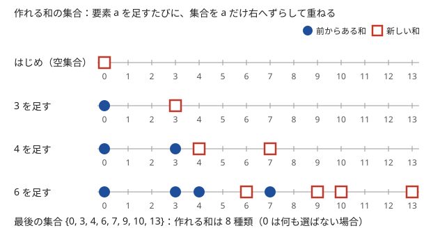

!!! abstract "要点"
    - **何ができるか**：いくつか選んで作れる和の集合や、和が $S$ になる選び方の数を、和を添字にした DP で求める。2 グループへの分け方や ± の符号の付け方も、部分和に言い換えて解ける。
    - **いつ使うか**：
        - いくつか選んで和をちょうど $S$ にできるか・その選び方の数。
        - 2 つのグループに分けて差（遅い方）を最小にする。
        - 各要素に + か − を付けて和を $K$ にする。
        - $N \le 100$、値の総和 $\le 10^5$ 程度。
    - **計算量**：和の上限を $S$ として $O(NS)$。表は 1 次元に使い回せば $O(S)$。可否だけなら bitset で $O(NS / 64)$。
    - **前提**：[DP の基本](../dp/dp-basics.md)

<!-- textlint-disable -->
別名：部分和・部分和問題・Subset Sum・部分和の数え上げ
<!-- textlint-enable -->

部分和 DP は、「ここまでの要素から選んで和を $t$ にできるか（何通りあるか）」を $t$ ごとに持ち、要素を 1 つずつ足していく DP である。選び方は $2^N$ 通りあるが、和の値は高々 $S + 1$ 種類しかない。同じ和になる選び方を 1 つの状態にまとめるので、和の範囲が小さければ速い。難しいのは DP そのものより、問題を「部分和」に言い換えるところである。

## 可否・数え上げ・最大の 3 つの形 {#three-forms}

部分和 DP の[状態](../guide/glossary.md#state)は「$\mathrm{dp}[i][t]$ ＝ 先頭 $i$ 個の要素から選んで和を $t$ にしたときの値」である。要素 $a_i$ を選ばなければ和は $t$ のまま、選べば $t + a_i$ になる。どの要素を選んだかは後の選び方に関係せず、和だけで先が決まるので、この状態で足りる。求めるものによって、まとめる演算と初期値が変わる（[DP の基本](../dp/dp-basics.md#three-kinds)の 3 種類と同じ骨組み）。

| 形 | $\mathrm{dp}[i+1][t]$ の式 | 初期値 | 答えの例 |
| --- | --- | --- | --- |
| 可否 | $\mathrm{dp}[i][t] \lor \mathrm{dp}[i][t - a_i]$ | $\mathrm{dp}[0][0] = \text{true}$ | $\mathrm{dp}[N][S]$、true の個数 |
| 数え上げ | $\mathrm{dp}[i][t] + \mathrm{dp}[i][t - a_i]$ | $\mathrm{dp}[0][0] = 1$ | $\mathrm{dp}[N][S]$ |
| 最大 | $\max(\mathrm{dp}[i][t],\ \mathrm{dp}[i][t - a_i] + v_i)$ | $\mathrm{dp}[0][0] = 0$、ほかは $-\infty$ | $\mathrm{dp}[N][S]$ |

$t - a_i < 0$ の項はないものとして扱う。最大の形は、和をちょうど $S$ にしたうえで、選んだ個数や別の値 $v_i$ の和を最大にするときに使う。重さと価値の組なら[ナップサック DP](../dp/knapsack-01.md)そのものである。

可否の形は、作れる和の集合を数直線の上の点で表すと分かりやすい。要素 $a$ を足すと、今の集合を $a$ だけ右へずらしたものが新しく作れる和になり、元の集合と重ねた（OR を取った）ものが次の集合になる。



この「ずらして重ねる」は、和の集合をビット列で持てば `dp |= dp << a` の 1 行になる。bitset で 64 個ずつまとめて処理すれば $O(NS / 64)$ になる（[bitset による高速化](../misc/bitset-speedup.md#subset-sum-shift)）。

表は 1 次元に使い回せる。そのときは $t$ を**大きい方から**更新する。$\mathrm{dp}[t]$ を書き換える時点で、$\mathrm{dp}[t - a_i]$ がまだ $i$ 番目の要素を使う前の値であるためである。次のコードは可否と数え上げを同時に求める。

```cpp
--8<-- "subset-sum/count.cpp:core"
```

完全なプログラム：[`count.cpp`](https://github.com/yuukougun/kyopro-atlas/blob/main/snippets/subset-sum/count.cpp)（GitHub）
{ .kp-code-src }

可否と数え上げを別の配列にしているのは、数え上げを mod で持つと、選び方があっても値が 0 になることがあるからである（[落とし穴](#pitfalls)）。

## 典型の言い換え（2 グループに分ける・± の和・x と y が独立・平均） {#reformulations}

部分和 DP がそのまま問われることは少なく、多くは問題を部分和に言い換えてから使う。よく出る言い換えは次の 3 つである。

**2 つのグループに分ける**。全体の和を $D$ とし、一方のグループの和を $x$ とすると、もう一方は $D - x$ である。遅い方（大きい方）$\max(x, D - x)$ を最小にするには、作れる和 $x$ のうち $D / 2$ に最も近いものを選べばよい。作れる和のうち $\lfloor D / 2 \rfloor$ 以下で最大のものを $x^*$ とすると、答えは $D - x^*$ である。和 $x$ が作れれば、残りを選んで $D - x$ も作れるので、半分以下だけを見れば足りる。

**各要素に + か − を付ける**。$+$ を付けた要素の和を $P$、$-$ を付けた要素の和を $M$ とすると、条件は $P - M = K$ で、$P + M = D$（全体の和）は付け方によらない。2 つの式を足すと

$$
P = \frac{K + D}{2}
$$

になる。符号の付け方は「$+$ を付ける要素の集合」と 1 対 1 に対応するので、和が $(K + D) / 2$ になる部分集合を数えればよい。$K + D$ が奇数か、$\lvert K \rvert > D$ なら答えは 0 である。負の和の添字を作らずに済むのが利点である。

**x と y が独立になる**。平面の上を動く問題でも、各手が x 座標と y 座標の片方だけを動かすなら、2 つの座標の条件は別々に判定できる。たとえば線分を直角に曲げながらつなぐと、奇数番目の線分は x 方向、偶数番目は y 方向に進む。x 座標は奇数番目の $\pm a_i$ の和、y 座標は偶数番目の $\pm a_i$ の和だけで決まるので、± の部分和の判定を 2 回行い、両方が可なら可である。向きが固定された手（最初の 1 本など）は、目標から先に引いておく。

もう 1 つ、**平均をちょうど A にする**型もある。選んだ値の平均が $A$ であることは、$\sum (a_i - A) = 0$ と同じである。各値から $A$ を引いてから、和が 0 になる 1 つ以上の選び方を数える。引いた値は負にもなるので、添字のずらしが要る（[落とし穴](#pitfalls)、[余りを状態に持つ DP](../dp/dp-mod-state.md#average)）。

??? question "確認問題：± の数え上げを部分和に直す"
    $a = (1, 2, 3, 4)$ の各要素に + か − を付けて、和を 2 にする付け方は何通りか。部分和の言い換えで求めよ。

    ??? success "答え"
        $D = 10$、$K = 2$ なので、$+$ を付ける要素の和は $P = (2 + 10) / 2 = 6$ である。和が 6 になる部分集合は $\{2, 4\}$ と $\{1, 2, 3\}$ の 2 つなので、2 通りである（$-1 + 2 - 3 + 4 = 2$ と $1 + 2 + 3 - 4 = 2$）。

## 最大値を固定するためにソートしてから数える {#sort-then-count}

「選んだ集合での $A$ の最大値が、$B$ の和以上になる選び方の数」のように、条件に集合の最大値が入ると、そのままでは部分和 DP にならない。最大値は要素を足すたびに変わり、状態に持つと重いからである。

部分和 DP では、要素を足す順番を変えても最後の表は同じになる。そこで要素を $A$ の昇順に並べ替えてから DP する。$i$ 番目の要素を処理する時点で、それまでに足した要素の $A$ はすべて $A_i$ 以下である。だから「$i$ を選び、$i$ より前の要素から残りを選ぶ」選び方では、最大値が $A_i$ に決まる。

1. $A$ の昇順に並べる（$A$ が同じなら順番は何でもよい）
2. $\mathrm{dp}[t]$ ＝ これまでに処理した要素から選んで、$B$ の和が $t$ になる選び方の数（$\mathrm{dp}[0] = 1$）
3. $i$ を最大とする選び方の数は、$\sum_{t \le A_i - B_i} \mathrm{dp}[t]$ である。これを答えに足してから、要素 $i$ を DP に加える

どの集合も、並べた順で最後の要素を処理するときにちょうど 1 回だけ数えられる。$A$ が同じ要素があっても、並べた順の最後が 1 つに決まるので重複しない。$t$ は $\max A$ を超える部分を数えないので、表の幅は $\max A + 1$ で打ち切ってよく、計算量は $O(N \max A)$ である。

「最大値（最小値）を固定するために並べてから DP」は、[並べ替えてから DP する](../dp/exchange-argument-dp.md) と同じ考え方の、最も簡単な場合である。

## 全部分集合についての和（含む部分集合の数を重みにする） {#over-all-subsets}

「すべての部分集合 $T$ について、$T$ の部分集合で和が $S$ になるものの個数を求め、その総和を出す」という問題を考える。$T$ を全部試すと $2^N$ 通りあって間に合わない。

[主客転倒](../thinking/contribution.md#swap-roles)で数える順番を入れ替える。和が $S$ になる集合 $U$ を 1 つ固定すると、$U$ を含む $T$ は、$U$ にない $N - \lvert U \rvert$ 個の要素を入れるか入れないかで $2^{N - \lvert U \rvert}$ 通りある。だから答えは

$$
\sum_{U : \text{和が } S} 2^{N - \lvert U \rvert}
$$

である。$\lvert U \rvert$ を状態に持つと $O(N^2 S)$ になる。そこで重み $2^{N - \lvert U \rvert}$ を「$U$ に入れない要素 1 つにつき 2 倍」と分けて、DP の遷移で掛ける。

```text
dp[0] = 1, ほかは 0
各要素 a について:
    t = S, S-1, ..., 0 の順に:        # t < a も含めて 0 まで回す
        dp[t] = 2 * dp[t] + (t >= a ? dp[t - a] : 0)
答え = dp[S]
```

要素ごとに「$T$ に入れない」「$T$ に入れるが $U$ に入れない」「$U$ に入れる（$T$ にも入る）」の 3 通りがある。このうち、前の 2 つは和を変えないので、まとめて 2 倍になる。和を変えない 2 通りは $t < a$ の和にもあるので、普通の部分和のように $t \ge a$ で止めず、$t$ を 0 まで回して全部を 2 倍する。計算量は普通の部分和と同じ $O(NS)$ である。

## 落とし穴 {#pitfalls}

**負の和を添字にする**。± を付ける問題や値から平均を引いた問題では、和が $-D$ から $D$ まで動く。添字に $D$ を足して $0$ から $2D$ に写し、配列の大きさを $2D + 1$ にする。足す量（オフセット）を出力のときに引き忘れないよう、`dp[t + OFF]` のように 1 か所で書く。± の問題なら、[± の和を部分和に直す](#reformulations)とオフセット自体が要らなくなる。

**空集合を数えるかを確かめない**。$\mathrm{dp}[0] = 1$（true）は「何も選ばない」選び方である。「1 つ以上選ぶ」問題で和 0 の選び方を数えるなら、最後に 1 を引く。逆に「作れる和の種類数」で 0 点も 1 種類に数える問題もある。問題文がどちらかを確かめる。

**1 次元にして小さい方から更新する**。$t$ を小さい方から更新すると、$\mathrm{dp}[t - a_i]$ がすでに $a_i$ を使った後の値になり、同じ要素を何度でも使えることになる。それは個数制限なしのナップサックの式である（[ナップサック DP のループの向き](../dp/knapsack-01.md#dp-rolling-array)）。部分和では大きい方から更新する。

**数え上げの値で可否を判定する**。選び方の数を mod $998244353$ で持つと、選び方が $998244353$ 通りあれば値は 0 になる。`cnt[s] > 0` で可否を判定すると、作れる和を作れないと答えてしまう。可否が要るなら bool の表を別に持つ。

**目標が表の外にある**。表の幅を全体の和 $D$ にしたとき、目標 $S > D$ で `dp[S]` を読むと範囲外になる。先に $S > D$ なら答え（不可・0 通り）を出す。目標の上限で表を打ち切るなら、目標を超えた和は捨ててよい（値が正なら二度と目標に戻らない）。

**復元が要るのに表を使い回す**。どの要素を選んだかを出力する問題では、1 次元にすると後から辿れない。$\mathrm{dp}[i][t]$ の 2 次元の表を残し、後ろから辿る（[復元](../dp/dp-reconstruction.md#trace-back)）。

## 上位の手法へのつながり {#next-steps}

部分和 DP の表は、次の手法の土台になる。

- **要素を取り除く**：数え上げの表は、要素を足した更新を引き算で戻せる。「$i$ 番目を使わないときの部分和」を全部の $i$ で求められる（[戻す DP](../dp/knapsack-undo.md)）。
- **可否を速くする**：可否だけなら、表を bitset に詰めてシフトと OR で更新すると、計算量がおよそ 1/64 になる（[部分和 DP のシフト OR](../misc/bitset-speedup.md#subset-sum-shift)）。
- **和が大きすぎる**：$N \le 40$ 程度で和の上限が大きいときは、表を作らずに半分ずつ全列挙して組み合わせる（[半分全列挙](../basics/meet-in-the-middle.md)）。
- **余りや個数を持つ**：和そのものではなく和の余りや選んだ個数が問われるなら、それを状態にする（[余り・個数を状態に持つ DP](../dp/dp-mod-state.md)）。

## 例題 {#examples}

### TDPC A. コンテスト {#tdpc_contest}

<div class="kp-problems" data-role="example" markdown>

- [TDPC A. コンテスト](https://atcoder.jp/contests/tdpc/tasks/tdpc_contest)（diff なし）：N 問の配点が決まったコンテストで、取り得る合計点の種類数を求める。

</div>

合計点は「解いた問題の配点の和」なので、作れる部分和の種類数を求める問題である。問題数と配点はどちらも 100 以下なので、和は高々 $10^4$ である。可否の DP は $O(N \cdot \sum p)$ で間に合う。1 問も解かない 0 点を合計点の 1 つに数える。

??? note "解法の詳細"
    - 状態：$\mathrm{can}[t]$ ＝ ここまでの問題から選んで合計点を $t$ にできるか。$\mathrm{can}[0] = \text{true}$ から始める。
    - 遷移：配点 $p$ の問題ごとに、$t$ を大きい方から見て $\mathrm{can}[t - p]$ が true なら $\mathrm{can}[t]$ を true にする。
    - 答え：$t = 0, 1, \dots, \sum p$ のうち $\mathrm{can}[t]$ が true の個数。0 点を含む。
    - コードは[3 つの形](#three-forms)の可否の部分と同じで、表の幅を配点の総和にする。

## 練習問題 {#practice}

<div class="kp-problems" data-role="practice" markdown>

- [ABC204 D. Cooking](https://atcoder.jp/contests/abc204/tasks/abc204_d)（diff 832）：N 個の料理を 2 台のオーブンに分けて調理するとき、すべて調理し終えるまでの時間の最小を求める。
- [ABC274 D. Robot Arms 2](https://atcoder.jp/contests/abc274/tasks/abc274_d)（diff 916）：長さの決まった線分を順につなぎ、つなぎ目ごとに 90 度左右どちらかに曲げるとき、終点を (x, y) にできるかを判定する。
- [ABC222 E. Red and Blue Tree](https://atcoder.jp/contests/abc222/tasks/abc222_e)（diff 1491）：木の上を決まった順に移動するとき、各辺を赤か青に塗って、赤の辺を通る回数と青の辺を通る回数の差を K にする塗り方の数を求める。
- [ABC216 F. Max Sum Counting](https://atcoder.jp/contests/abc216/tasks/abc216_f)（diff 1541）：添字の集合 S のうち、S での A の最大値が S での B の和以上になるものの個数を求める。
- [ABC169 F. Knapsack for All Subsets](https://atcoder.jp/contests/abc169/tasks/abc169_f)（diff 1698）：数列のすべての部分集合 T について、T の部分集合で和が S になるものの個数を求め、その総和を出す。

</div>

??? note "練習の方針"
    - **ABC204 D**：一方のオーブンの合計時間として作れる和を可否の DP で求める。全体の和を $D$ とする。$\lfloor D / 2 \rfloor$ 以下で作れる最大の和を $x^*$ とすると、答えは $D - x^*$ である（[2 つのグループに分ける](#reformulations)）
    - **ABC274 D**：奇数番目の線分は x 方向、偶数番目は y 方向に進む。最初の線分は向きが固定なので目標の x から引き、残りを x と y で別々に ± の部分和として判定する
    - **ABC222 E**：各辺を通る回数 $D_i$ を移動ごとの経路から数える。赤の辺を通る回数を $R$ とすると、$R = (K + \sum D_i) / 2$ になる。この値が 0 以上 $\sum D_i$ 以下の整数でなければ 0 通りである。整数なら、$D_i$ の部分和が $R$ になる選び方を数える
    - **ABC216 F**：$A$ の昇順に並べる。各要素 $i$ を最大とする選び方は、それより前の要素から $B$ の和が $A_i - B_i$ 以下になるように選ぶ方法の数である。数えてから要素 $i$ を DP に加える（[ソートしてから数える](#sort-then-count)）
    - **ABC169 F**：和が $S$ になる集合 $U$ のそれぞれについて、$2^{N - \lvert U \rvert}$ 個の $T$ が数えられる。遷移は $\mathrm{dp}[t] \leftarrow 2\,\mathrm{dp}[t] + \mathrm{dp}[t - a]$ にする（$t < a$ でも 2 倍する）（[全部分集合についての和](#over-all-subsets)）

## 確認問題 {#quiz}

??? question "確認問題：小さい方から更新したら"
    値 $(3)$ の 1 要素だけで、1 次元の可否の表を $t$ の小さい方から更新した。和の上限が 9 のとき、true になる $t$ はどれか。

    ??? success "答え"
        $t = 3$ で $\mathrm{dp}[0]$ から true になり、$t = 6$ では更新済みの $\mathrm{dp}[3]$ から true になり、$t = 9$ も true になる。$0, 3, 6, 9$ が true で、要素 3 を 3 回まで使ったことになる。大きい方から更新すれば $0, 3$ だけが true になる。

## 使い分け {#comparison}

- 値（重さ）とは別の価値の和を最大にするなら[ナップサック DP](../dp/knapsack-01.md)。部分和は価値と重さが同じ場合である
- $N \le 40$ 程度で値が $10^9$ のように大きく、和を添字にできないなら[半分全列挙](../basics/meet-in-the-middle.md)
- 可否だけで $NS$ が $10^9$ を超えるなら、[bitset](../misc/bitset-speedup.md#subset-sum-shift) で 64 倍速くする
- 「$i$ 番目の要素を除いたときの部分和」を各 $i$ について求めるなら、数え上げの更新を逆にたどる[戻す DP](../dp/knapsack-undo.md#undo-by-subtraction)
- 和を $M$ で割った余りだけが問われるなら、和の代わりに余りを状態にする（[余りを状態に持つ DP](../dp/dp-mod-state.md#why-remainder)）

## 参考 {#references}

- [drken「TDPC (Typical DP Contest) A - コンテスト (2Q)」](https://drken1215.hatenablog.com/entry/2020/12/21/153600)：例題の状態・遷移と、0 点を数えること
- [ikatakos「AtCoder Beginner Contest 204 D,E,F問題メモ」](https://ikatakos.com/pot/programming_algorithm/contest_history/atcoder/2021/0606_abc204)：2 つのグループに分ける言い換えと、ずらして重ねる更新（解説の部分だけを参照）
- [Kazun「AtCoder Beginner Contest 274 D問題 Robot Arms 2」](https://kazun-kyopro.hatenablog.com/entry/ABC/274/D)：x と y が独立になる理由と ± の部分和の判定
- [hamayan「Red and Blue Tree [エクサウィザーズプログラミングコンテスト2021（AtCoder Beginner Contest 222） E]」](https://blog.hamayanhamayan.com/entry/2021/10/10/142820)：辺を通る回数への言い換えと、負の和のオフセット
- [ikatakos「AtCoder Beginner Contest 216 F,G,H問題メモ」](https://ikatakos.com/pot/programming_algorithm/contest_history/atcoder/2021/0829_abc216)：最大値を固定するためのソートと表の幅（解説の部分だけを参照）
- [ikatakos「AtCoder Beginner Contest 169 D,E,F問題メモ」](https://ikatakos.com/pot/programming_algorithm/contest_history/atcoder/2020/0531_abc169)：重み $2^{N - \lvert U \rvert}$ を遷移の 2 倍に分けること（解説の部分だけを参照）
