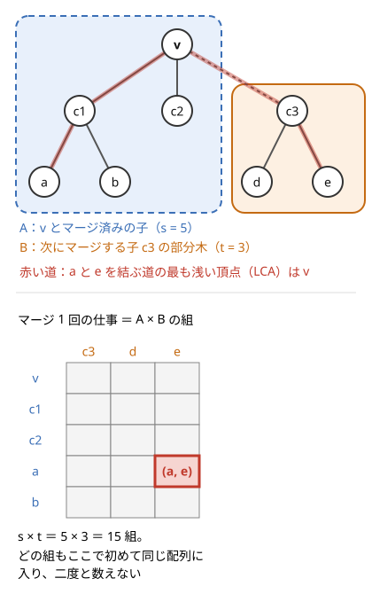

!!! abstract "要点"
    - **何ができるか**：子の配列を順にマージする木の上のナップサックのような DP を、配列の長さを部分木のサイズに合わせることで全体 $O(N^2)$ で計算する。どの頂点の組も、LCA でのマージで 1 回だけ数えられるからである。
    - **いつ使うか**：
        - $N \le 2000$〜$5000$ の木。
        - 部分木から K 個選ぶ・連結成分の数ごとに数える。
        - $\mathrm{dp}[v][k]$ を子の $\mathrm{dp}[c][j]$ との $(k, j)$ の組の全探索でマージしていて、$O(N^3)$ に見える。
    - **計算量**：添字の範囲を部分木のサイズまでにすると全体 $O(N^2)$。添字を $K$ で打ち切ると $O(NK)$。子の配列をマージ後に捨てればメモリは $O(N)$
    - **前提**：[木 DP](../dp/tree-dp.md)、[ナップサック DP](../dp/knapsack-01.md)

<!-- textlint-disable -->
別名：2 乗の木 DP・O(N^2) の木 DP・木の上のナップサック
<!-- textlint-enable -->

二乗の木 DP は、[木 DP](../dp/tree-dp.md) の状態に「部分木から選んだ個数」のような添字を持たせる DP である。添字の範囲は部分木のサイズまでで、子の配列を親の配列へ 1 つずつ[ナップサック](../dp/knapsack-01.md)のように合わせていく。マージ 1 回は 2 重ループで、頂点ごとに $O(N^2)$ かかるように見えるが、ループの範囲を部分木のサイズまでに抑えれば全体で $O(N^2)$ に収まる。手法の中身は「ループの上限をどこまでにするか」という実装の約束と、それで速くなる理由である。頂点番号は問題文では 1-indexed、実装では 0-indexed で書く。

## O(N^2) で済む理由（頂点の組が LCA で 1 回だけ数えられる） {#why-n2}

二乗の木 DP の計算量は、マージ 1 回の仕事を「頂点の組」に対応させると分かる。頂点 $v$ で子を順にマージしている途中を考え、すでにマージした部分（$v$ 自身と、先にマージした子の部分木）を $A$、次にマージする子 $c$ の部分木を $B$ とする。$\lvert A \rvert = s$、$\lvert B \rvert = t$ とすると、添字の範囲が $0$〜$s$ と $0$〜$t$ の 2 重ループなので、マージ 1 回の仕事は $(s + 1)(t + 1)$ である。



$s \times t$ は「$A$ の頂点 $u$ と $B$ の頂点 $w$ の組」の数に等しい。この組には次の 2 つの性質がある。

- **$u$ と $w$ の [LCA](../tree/lca.md) は $v$ である**：$w$ は $c$ の部分木にあり、$u$ は $v$ 自身か $c$ 以外の子の部分木にあるので、2 つを結ぶ道は $v$ を通る。
- **この組はここで 1 回だけ数えられる**：マージの後、$u$ と $w$ は同じ配列（$v$ の配列）に入る。以後のマージは別々の配列どうしを合わせるので、同じ組が再び $A$ と $B$ に分かれて現れることはない。

逆に、異なる 2 頂点の組 $\{u, w\}$ はどれも、LCA $\ell$ でのどれかのマージで数えられる。$u = \ell$ なら $w$ を含む子をマージするとき、そうでなければ $u$ と $w$ を含む 2 つの子のうち後からマージする方のときである。したがって、すべてのマージの $s \times t$ を足すと、ちょうど組の総数 $N(N-1)/2$ になる。

$s, t \ge 1$ なので $(s + 1)(t + 1) \le 4st$ であり、すべてのマージの仕事の和は $4 \cdot N(N-1)/2 = O(N^2)$ で抑えられる。木の形（一直線・星形・二分木）にも、子をマージする順にもよらない。

この議論が使える条件は、**部分木 $B$ の配列の添字の範囲が $O(\lvert B \rvert)$ であること**だけである。「選んだ頂点の数」「連結成分の数」「見張られた頂点の数」「部分木の中での順位」はどれも部分木のサイズを超えないので、この形に収まる。

??? question "確認問題：根に $N - 1$ 個の葉がつながる星形の木で、マージの仕事の和はいくつか"
    根の配列に葉を 1 つずつ合わせるので、$k$ 回目のマージは $s = k$、$t = 1$ で仕事は $2(k + 1)$ である。$k = 1, \dots, N - 1$ で足すと $O(N^2)$ になる。組で数えても、根と葉の組・葉と葉の組がすべて根で数えられ、合わせて $N(N-1)/2$ 組である。

## 配列の長さを部分木のサイズに合わせる {#size-bounded}

$O(N^2)$ にするための実装の約束は、**各頂点の配列を、その時点でマージし終えた頂点の数 $s$ に合わせた長さ $s + 1$ で持ち、ループの上限もそこまでにする**ことである。例として、木の頂点に重み $a_v$ があり、根を含み「選んだ頂点の親も選ぶ」ように頂点を選ぶとき、選んだ個数ごとに重みの和の最大を求める DP を考える。

- **状態**：$\mathrm{dp}[v][k]$ ＝ $v$ の部分木から、$v$ を含み親へ閉じた $k$ 頂点を選んだときの重みの和の最大（$k = 0$ は何も選ばない）。
- **初期値**：子をマージする前は $\mathrm{dp}[v] = (0, a_v)$ で、長さは $2$（$s = 1$）。
- **遷移**：子 $c$（サイズ $t$）を合わせるたびに長さ $s + t + 1$ の新しい配列を作り、$1 \le i \le s$、$0 \le j \le t$ のすべての組で $\mathrm{new}[i + j] = \max(\mathrm{new}[i + j],\ \mathrm{dp}[v][i] + \mathrm{dp}[c][j])$ とする。$i \ge 1$ は「$c$ の側から選ぶなら $v$ も選ぶ」という条件である。最後に $\mathrm{new}[0] = 0$。
- **計算順序**：子を先に確定させる（帰りがけ順）。マージの後で $s \leftarrow s + t$ とする。

次のコードは、選ぶ個数を $K$ に固定した版である（$K$ での打ち切りは[次の節](#cap-k)）。$K = N$ にすれば、配列の長さはちょうど部分木のサイズ $+ 1$ になる。

```cpp
--8<-- "tree-dp-square/tree-knapsack.cpp:core"
```

完全なプログラム：[`tree-knapsack.cpp`](https://github.com/yuukougun/kyopro-atlas/blob/main/snippets/tree-dp-square/tree-knapsack.cpp)（GitHub）
{ .kp-code-src }

ここで守っていることは 3 つある。

- **新しい配列に書く**：$\mathrm{dp}[v][i]$ をその場で書き換えると、同じマージの中で書き換えた値を読み、$c$ の部分木から 2 回選んだことになる。[0-1 ナップサック](../dp/knapsack-01.md)と同じ理由である。添字を大きい方から回す書き方もできるが、新しい配列を作る方が確実である。
- **サイズはマージの後で足す**：ループの上限 $s$ は「マージ前の $A$ のサイズ」である。先に $s \leftarrow s + t$ としてからループすると、上限が $s + t$ になる（[落とし穴](#pitfalls)）。
- **子の配列は使い終わったら捨てる**：コードでは子の配列を戻り値で受け取り、マージの後に自然に捨てている。全頂点の配列を残すと、長さの和が $\sum_v \mathrm{sz}[v]$（一直線の木で約 $N^2/2$）になる。捨てていけば、同時に残る配列は互いに交わらない部分木のものだけなので、長さの和は $O(N)$ である。

??? question "確認問題：子の配列を長さ $N + 1$ で確保し、ループの上限も $N$ にすると計算量はどうなるか"
    マージ 1 回が $(N + 1)^2$ になり、マージは $N - 1$ 回あるので $O(N^3)$ である。$N = 5000$ なら $10^{11}$ を超え、間に合わない。配列の中身がほとんど 0 でも、ループを回すだけで時間がかかる。

## サイズを K で打ち切ると O(NK) {#cap-k}

答えに要るのが添字 $K$ までで、マージで添字が減らないなら、添字が $K$ を超える状態は捨ててよい。配列の長さを $\min(\mathrm{sz}, K) + 1$ にすると、全体の計算量は $O(NK)$ になる。「$N \le 10^5$ の木から $K \le 100$ 個選ぶ」のように、$N^2$ は無理でも $NK$ なら間に合う問題に使う。

打ち切ってよい条件は、**マージした後の添字が、マージ前のどちらの添字よりも小さくならないこと**である。選んだ個数の和 $i + j$ は当然満たす。連結成分の数の $i + j - 1$（$v$ と子の両方を選んでつながる場合）も、$i, j \ge 1$ なら $i + j - 1 \ge \max(i, j)$ なので満たす。添字が $K$ を超えた状態から、後のマージで $K$ 以下に戻ることはないので、捨てても答えは変わらない。

実装では、配列の長さと 2 つのループの上限をすべて $\min(\cdot, K)$ で抑え、さらに $i + j \le K$ の範囲だけを回す。[上のコード](#size-bounded)の `min(s + t, K)`・`min(s, K)`・`min(t, K - i)` がそれである。

$O(NK)$ になる理由は「$O(N)$ 回のマージ × 1 回 $O(K^2)$」の $O(NK^2)$ ではない。マージ 1 回の仕事 $\min(s, K) \cdot \min(t, K)$ を、合わせる 2 つの部分の大きさで 3 通りに分けて数える。

??? note "証明（$O(NK)$ になる理由）"
    サイズが $K$ 以上の部分を「大」、$K$ 未満を「小」と呼ぶ。マージで部分は大きくなるだけなので、頂点が一度大の部分に入れば、以後ずっと大の部分にいる。

    - **大と大のマージ**（仕事 $K^2$）：小と小を合わせて大ができると大の個数が 1 増え、大と大を合わせると 1 減る。だから大と大のマージの回数は「小と小から大ができた回数」以下である。小から大ができるたびに、それまで小の部分にいた $K$ 個以上の頂点が大へ移り、各頂点が移るのは 1 回だけなので、この回数は $N/K$ 以下である。合わせて $K^2 \cdot N/K = NK$。
    - **大と小のマージ**（仕事 $K \cdot t$、$t$ は小の側のサイズ）：小の側の各頂点に $K$ ずつ割り当てる。小の側の頂点はこのマージで大の部分に入るので、各頂点が割り当てを受けるのは 1 回だけである。合わせて $NK$ 以下。
    - **小と小のマージ**（仕事 $s \cdot t$）：$A$ の頂点と $B$ の頂点の組に対応させる。頂点 $u$ がこの種類のマージで組になる相手は、マージの後で $u$ と同じ部分に入る。$u$ が小と小のマージを最後に受けた後の部分のサイズは $2K$ 未満なので、相手は $2K$ 個未満である。組の総数は $N \cdot 2K$ 以下。

    3 つを足して $O(NK)$ である。

打ち切りを忘れやすいのは、配列の長さだけ $K$ で抑えてループの上限を $t$ のままにする書き方である。添字が範囲外になるか、$K$ を超える組を回して $O(NK)$ にならない。

## 頂点の状態と個数を同時に持つ {#state-and-count}

[木 DP](../dp/tree-dp.md#vertex-states) で頂点ごとに持っていた「選ぶか」「白か黒か」の状態に、部分木のサイズまでの個数の添字を足すと、$\mathrm{dp}[v][x][k]$（$x$ は頂点の状態、$k$ は個数）の形になる。状態の数が定数なら、マージは $x$ の組ごとの 2 重ループで、計算量は $O(N^2)$ のまま定数倍が増えるだけである。

例として、頂点の選び方を「選んだ頂点が作る連結成分の数 $k$」ごとに数える問題（[例題 ABC287 F](#abc287_f)）を考える。

- **状態**：$\mathrm{dp}[v][x][k]$ ＝ $v$ の部分木で、$v$ を選ぶか（$x = 1$）選ばないか（$x = 0$）、選んだ頂点の連結成分が $k$ 個になる選び方の数。
- **初期値**：$\mathrm{dp}[v][0] = (1, 0)$（成分 0 個が 1 通り）、$\mathrm{dp}[v][1] = (0, 1)$（成分 1 個が 1 通り）。
- **遷移**：子 $c$ を合わせるとき、$v$ の状態 $x$ と $c$ の状態 $y$ の 4 通りで場合分けする。

| $v$ | $c$ | 合わせた成分の数 | 合わせた後の $v$ |
| --- | --- | --- | --- |
| 選ばない | 選ばない・選ぶ | $i + j$ | 選ばない |
| 選ぶ | 選ばない | $i + j$ | 選ぶ |
| 選ぶ | 選ぶ | $i + j - 1$（辺 $(v, c)$ で 2 つの成分がつながる） | 選ぶ |

- **答え**：根 $r$ で $\mathrm{dp}[r][0][k] + \mathrm{dp}[r][1][k]$。空の選び方は $k = 0$ にだけ入るので、$k \ge 1$ を出力すれば空集合は自然に除かれる。

```cpp
--8<-- "tree-dp-square/components.cpp:core"
```

完全なプログラム：[`components.cpp`](https://github.com/yuukougun/kyopro-atlas/blob/main/snippets/tree-dp-square/components.cpp)（GitHub）。`mint` は ACL の `modint998244353`（[modint](../math/modint.md)）。
{ .kp-code-src }

成分の数は部分木のサイズを超えないので、添字の範囲は $0$〜$\mathrm{sz}$ でよく、[頂点の組の議論](#why-n2)がそのまま使える。

状態と個数を同時に持つときに迷うのは、**個数をいつ数えるか**である。部分木の中だけでは決まらず、親との関係で後から決まる量がある。たとえば「見張りを置いた頂点とその隣が見張られる」とき、見張られる頂点の数を数えたいが、見張りのない頂点 $v$ が見張られるかは、$v$ の親に見張りを置くかで後から決まる。こういう量は次のように扱う。

- 確定した分だけを添字に数え、まだ決まらない頂点は「$v$ はまだ見張られていない」のような状態で持つ。
- 決まった時点（親に見張りを置くマージ、子が見張りを持つと分かったマージ）で添字を $+1$ する。
- 根では親がないので、未確定の状態はそのまま確定する（見張られないまま終わる）。

この型の練習が [ABC207 F](#practice) で、頂点の状態を「見張られていない・子に見張られている・見張りを置いた」の 3 つにする。

**応用の型**：添字は個数に限らない。「$v$ と子を結ぶ辺のうち選んだ本数」（添字の範囲は子の数まで）や、「部分木の中での $v$ の順位」（範囲は部分木のサイズまで）でもよい。前者は 1 頂点あたり $O(\text{子の数}^2)$ で、合わせて $O(N^2)$ に収まる。後者は順位を合わせるときに二項係数を掛け、累積和で遷移を速くすることが多い。

## 落とし穴 {#pitfalls}

**サイズをマージの前に足す**。`sz[v] += sz[c];` をループの前に書くと、ループの上限が $s + t$ と $t$ になり、仕事が $(s + t)\,t$ に増える。$st$ の部分は組で数えられるが、$t^2$ の部分は数えられない。一直線の木では $t$ が $N - 1, N - 2, \dots$ と続くので、$\sum t^2$ で $O(N^3)$ になる。サイズの更新はマージの後に置く。

**配列を最初から長さ $N + 1$ で確保する**。2 次元配列 `dp[N][N + 1]` を作ってループを $N$ まで回すと $O(N^3)$ である（[確認問題](#size-bounded)）。ループの上限を部分木のサイズにすれば時間は $O(N^2)$ になるが、メモリは $N = 5000$ の `long long` で約 200 MB かかる。子の配列は戻り値で受け取るか、マージ後に `dp[c] = vector<long long>();`（または `vector<long long>().swap(dp[c]);`）で捨てる。`dp[c] = {};` や `clear()` は要素を消すだけで、容量を解放しない。

**同じ配列に書きながら読む**。マージで $\mathrm{dp}[v]$ を直接書き換えると、同じマージで更新した値を読み、子の部分木を 2 回使った数になる。新しい配列 `nxt` に書いてから入れ替える。

**打ち切りで添字が戻る遷移**。[K での打ち切り](#cap-k)は、マージで添字が減らないときだけ正しい。「差」や「余り」を添字にした DP で $K$ を超えた状態を捨てると、後のマージで $K$ 以下に戻るはずの状態を失う。

**両方を選ぶ遷移で添字が $-1$ になる**。成分の数の例で、$v$ と子をともに選ぶ遷移では、両側が $1$ 個以上の成分を持つ。だから $i, j \ge 1$ の範囲だけを回す。添字 $0$ の値は 0 のはずでも、条件を付けずに回すと $i = j = 0$ のときに添字 $-1$ へ書き込み、範囲外になる。

**再帰の深さ**。$N \le 5000$ なら再帰の DFS で足りるが、打ち切りで $N \le 10^5$ 以上を扱うときは、一直線の木で再帰が深くなる。BFS 順を逆からたどる書き方にする（[木 DP の帰りがけ順](../dp/tree-dp.md#postorder)）。

## 例題 {#examples}

### ABC287 F. Components {#abc287_f}

<div class="kp-problems" data-role="example" markdown>

- [ABC287 F. Components](https://atcoder.jp/contests/abc287/tasks/abc287_f)（diff 2034）：木の頂点の空でない部分集合のうち、選んだ頂点が作る連結成分の個数が x になるものの数を、x = 1〜N のすべてについて求める。

</div>

$N \le 5000$ の木で、成分の数ごとの個数をすべて出すので、成分の数を添字に持つ DP になる。[頂点の状態と個数を同時に持つ](#state-and-count)の $\mathrm{dp}[v][x][k]$ がそのまま使える。$v$ を選ぶかを状態に持つのは、子を合わせるときに「$v$ と子の両方を選ぶと成分が 1 つ減る」を判定するためである。

??? note "解法の詳細"
    根を頂点 1 にして帰りがけ順に計算する。子 $c$ を合わせるとき、$v$ を選ばない値には子の 2 状態の和を掛け、添字 $i + j$ へ足す。$v$ を選ぶ値には、子を選ばない値を掛けたものを添字 $i + j$ へ、子を選ぶ値を掛けたものを添字 $i + j - 1$ へ足す。ループの範囲は $0 \le i \le \mathrm{sz}[v]$（マージ前）、$0 \le j \le \mathrm{sz}[c]$ で、全体 $O(N^2)$ である。答えは $x = 1, \dots, N$ について根の 2 状態の和を 998244353 で割った余りで出す。コードは[上の節](#state-and-count)のとおりである。

## 練習問題 {#practice}

<div class="kp-problems" data-role="practice" markdown>

- [ARC171 C. Swap on Tree](https://atcoder.jp/contests/arc171/tasks/arc171_c)（diff 2244）：木の頂点 i に駒 i を置き、まだ選んでいない辺を 1 本選んで両端の駒を入れ替える操作を好きな回数行う（各辺は 1 回まで）。最後の駒の並びとしてありうるものの数を求める。
- [ABC207 F. Tree Patrolling](https://atcoder.jp/contests/abc207/tasks/abc207_f)（diff 2398）：木のいくつかの頂点に見張りを置き、置いた頂点とその隣が見張られるとき、見張られる頂点の数がちょうど k になる置き方の数を k = 0〜N について求める。
- [TDPC P. うなぎ](https://atcoder.jp/contests/tdpc/tasks/tdpc_eel)（diff なし）：木から、互いに共有しない K 本のパスを選ぶ方法の数を求める。

</div>

??? note "練習の方針"
    - **ARC171 C**：使う辺の集合が違えば結果も違い、集合が同じなら、各頂点で「その頂点に接する選んだ辺を使う順」だけが結果を決める。だから辺の集合ごとに、各頂点の選んだ次数 $d$ の $d!$ の積を足せばよい。$v$ と子を結ぶ辺のうち選んだ本数を添字にし、親との辺を選ぶかで最後に $i!$ か $(i + 1)!$ を掛ける（[頂点の状態と個数を同時に持つ](#state-and-count)の応用の型）。
    - **ABC207 F**：頂点の状態を「見張られていない・子に見張られている・見張りを置いた」の 3 つにし、見張られた頂点の数を添字にする。見張られていない頂点は、隣（親か子）に見張りを置くと分かったマージで $+1$ する（[個数をいつ数えるか](#state-and-count)）。
    - **TDPC P**：使った本数と、$v$ から下へ伸びている途中のパスの本数（0〜2）を状態にする。本数は $K$ を超えても使わないので、[K で打ち切る](#cap-k)。

## 力試し {#challenge}

<div class="kp-problems" data-role="challenge" markdown>

- [ARC130 D. Zigzag Tree](https://atcoder.jp/contests/arc130/tasks/arc130_d)（diff 2437）：木の各頂点に 1〜N を 1 つずつ書き、どの頂点も隣接する頂点すべてより大きいか、すべてより小さいようにする方法の数を求める。

</div>

??? note "力試しの方針"
    - **ARC130 D**：$v$ が子より小さく、部分木の中で $v$ が $n$ 番目である数え方を $f(v, n)$ とする。値の大小を入れ替えると「子より大きい」場合の数え方は $f$ の順位を逆から読んだものになるので、$f$ だけを計算すればよい。子を合わせるときは 2 つの部分木の値の並べ方を二項係数で数え、子の側の順位の条件を累積和で処理する。添字は部分木の中の順位なので、[組の議論](#why-n2)で全体 $O(N^2)$ である。

## 確認問題 {#quiz}

??? question "確認問題：二乗の木 DP の計算量が $O(N^3)$ にならないのはなぜか"
    マージ 1 回の仕事 $s \times t$ は、合わせる 2 つの部分の頂点の組の数に等しい。組の 2 頂点の LCA はマージしている頂点で、マージの後は同じ配列に入るので、同じ組が 2 回数えられることはない。全体の仕事は組の総数 $N(N-1)/2$ の定数倍で $O(N^2)$ である。

??? question "確認問題：$N = 10^5$、$K = 300$ で「部分木から選んだ個数」を $K$ で打ち切ると、何回くらいの計算になるか"
    $O(NK)$ なので $10^5 \times 300 = 3 \times 10^7$ の定数倍である。打ち切らずに部分木のサイズまで回すと $O(N^2) = 10^{10}$ で間に合わない。「マージの回数 × $K^2$」と見積もると $9 \times 10^9$ になるが、実際はそこまでかからない。

??? question "確認問題：連結成分の数ごとに数える DP で、添字の上限を部分木のサイズにしてよいのはなぜか"
    連結成分は選んだ頂点を 1 つ以上含み、互いに頂点を共有しない。だから成分の数は選んだ頂点の数以下で、部分木のサイズ以下である。したがって、添字が部分木のサイズを超える状態の値は 0 で、配列に持たなくてよい。

## 使い分け {#comparison}

| 状況 | 使う手法 |
| --- | --- |
| 状態が定数個（選ぶか・色など）だけ | [木 DP](../dp/tree-dp.md)（$O(N)$） |
| 部分木のサイズまでの添字を子どうしで掛け合わせる（$N \le 5000$ 程度） | 二乗の木 DP（$O(N^2)$） |
| 添字が $K$ までで足りる（$N$ が大きく $K$ が小さい） | [K での打ち切り](#cap-k)（$O(NK)$） |
| 部分木ごとの集合・色の集計を合わせる | [マージテク](../tree/small-to-large.md)（小さい方を大きい方へ移す） |
| 木の形がなく、品物を順に足すだけ | [ナップサック DP](../dp/knapsack-01.md)・[部分和](../dp/subset-sum.md) |

マージテクも「小さい方を大きい方へ」で計算量を抑えるが、合わせ方が違う。マージテクは要素を 1 つずつ移すので、移す側の大きさだけがかかる。二乗の木 DP は両方の添字の組をすべて回すので、両方の大きさの積がかかり、組の議論で全体を抑える。

## 参考 {#references}

- [jikei「RustでABC287復習」（Qiita）](https://qiita.com/jikei/items/780bc6f793e1b12e3a37)：例題 abc287_f の 2 つの配列（頂点を使う・使わない）と、両方を使うと成分が 1 減る遷移
- [merom686「ABC287」](https://merom686.hatenablog.com/entry/2023/01/28/234655)：例題 abc287_f を二乗の木 DP と見る見方と、計算量を完全グラフの辺（頂点の組）に対応させる議論
- [かんプリン「競技プログラミング　典型問題メモ」](https://kanpurin.hatenablog.com/entry/2020/04/07/182948)：2 乗の木 DP に当たる問題の一覧（abc287_f・abc207_f・arc130_d など）
- [kmjp「AtCoder ABC #207 : F - Tree Patrolling」](https://kmjp.hatenablog.jp/entry/2021/06/27/0900)：練習 abc207_f の 3 状態と、見張られる頂点を数える時点
- [drken1215「AtCoder ARC 171 C - Swap on Tree (黄色, 600 点)」](https://drken1215.hatenablog.com/entry/2024/02/05/021046)：練習 arc171_c を二乗の木 DP で $O(N^2)$ にする方針
- [Luogu 专栏「【题解】ARC171C - Swap on Tree」](https://www.luogu.com.cn/article/kjm1y7yt)：練習 arc171_c の問いと、各頂点の次数の階乗の積に帰着する見方・選んだ辺の本数を添字にする遷移
- [sigma425「Typical DP Contest (TDPC)」](https://sigma425.hatenablog.com/entry/2016/08/02/214547)：練習 tdpc_eel の状態（本数と下へ伸びる本数）
- [kmjp「AtCoder ARC #130 : D - Zigzag Tree」](https://kmjp.hatenablog.jp/entry/2021/12/21/0930)：力試し arc130_d の $f(v, n)$ と大小を入れ替える対称性
