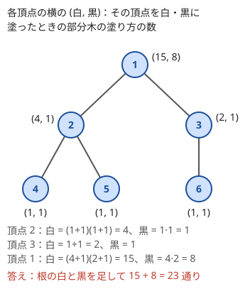
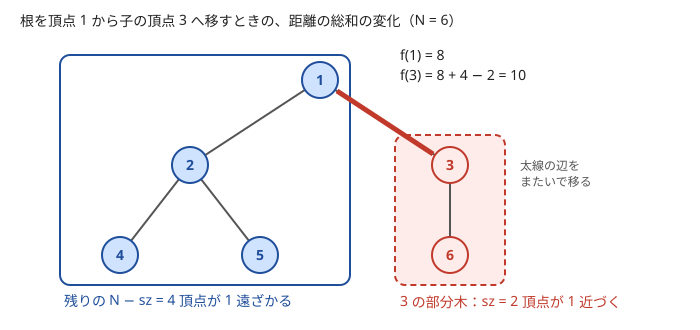

!!! abstract "要点"
    - **何ができるか**：木の問題を、根を決めて「頂点 $v$ の部分木についての値」を子の値から順に求める DP に直す。子どうしの部分木は頂点を共有しないので、子の値をまとめれば親の値が決まる。頂点自身の選択（白黒・選ぶか）を状態に足すのが基本形である。
    - **いつ使うか**：
        - 木の各頂点を塗る・選ぶ（隣り合う頂点に条件がある）
        - 木の辺を選ぶ（次数の上限つき）
        - 部分木ごとの値（部分木の上位 K 個など）
        - 木の各頂点からほかの全頂点への距離の総和
    - **計算量**：子の値をまとめる計算が子の数に比例すれば、全体で $O(N)$（各頂点は 1 度だけ親に集められる）。子をソートする型は $O(N \log N)$、map を小さい方から合わせる型は $O(N \log^2 N)$
    - **前提**：[DP の基本](../dp/dp-basics.md)、[根付き木と走査順](../tree/tree-traversal.md)

<!-- textlint-disable -->
別名：Tree DP・部分木の DP・木の上の DP
<!-- textlint-enable -->

木 DP は、木の頂点を 1 つ根に決め、各頂点 $v$ について「$v$ の[部分木](../tree/tree-traversal.md)の中だけで考えたときの答え」を状態にする DP である。同じ頂点の子の部分木どうしは交わらないので、親の値は子の値だけから決まり、葉から根へ向かって 1 度ずつ計算すれば全体の答えが根に集まる。木は頂点数 $N$、辺数 $N - 1$ で、問題文の頂点番号は 1-indexed、実装は 0-indexed で書く。

## 帰りがけ順に子から集める（再帰なしなら BFS 順の逆） {#postorder}

木 DP の骨組みは、どの問題でも同じである。根 $r$ を決め、次の 4 つを決める（[DP の基本](../dp/dp-basics.md#four-parts)の木の版）。

- **状態**：$\mathrm{dp}[v]$ ＝ $v$ の部分木だけを見たときの値（個数・最大値・可否など）
- **遷移**：$v$ の子 $c_1, \dots, c_k$ の $\mathrm{dp}[c_i]$ と $v$ 自身の情報から $\mathrm{dp}[v]$ を作る
- **計算順序**：子をすべて確定させてから親を計算する（[帰りがけ順](../tree/tree-traversal.md)）
- **初期値と答え**：葉は子がないので、空の積（1）・空の和（0）・空の最大（$-\infty$ か 0）から始まる。答えは $\mathrm{dp}[r]$

**なぜ子の値だけで足りるか**：$v$ の部分木の頂点と、部分木の外の頂点を結ぶ辺は、$v$ とその親を結ぶ 1 本しかない。だから部分木の中の選び方が外に与える影響は、$v$ のまわりの情報（$v$ を選んだか、$v$ から上へ伸びるパスの長さなど）だけで決まる。その情報を状態に入れておけば、子の部分木の中の細かい選び方を忘れてよい。2 人の子の部分木も頂点を共有しないので、子ごとの選び方は独立に組み合わせられる。

**計算量**：頂点 $v$ での遷移が子の数 $k_v$ に比例するなら、全体は $\sum_v (1 + k_v) = N + (N - 1)$ で $O(N)$ である。各頂点はちょうど 1 度、親の計算に使われる。

計算順序は、再帰の DFS で子を呼んでから親を計算するのが素直である。ただし木が一直線だと再帰が $N$ 段になる（[落とし穴](#pitfalls)）。再帰を使わないなら、根から BFS した順 `order` を作り、それを逆からたどる。BFS 順では親が必ず子より前に並ぶので、逆順にたどれば子は親より先に確定している。次は部分木のサイズ $\mathrm{sz}[v]$ を求める例である。

```cpp
--8<-- "tree-dp/postorder.cpp:core"
```

集める値は数に限らない。「部分木に含まれる値の大きい方から $K$ 番目」を答えるなら、各頂点に部分木の上位 $K$ 個の列を持たせ、子の列と自分の値をまとめて上位 $K$ 個に切り詰める（練習の ABC239 E）。子の列をまとめてソートすると、子が $k_v$ 人の頂点で $k_v K + 1$ 個を並べるので、全体は $O(NK \log (NK))$ 程度になる。子を 1 人合わせるたびに $K$ 個へ切り詰めれば $O(NK \log K)$ で済む。$K$ が小さければどちらでも間に合う。

## 頂点の選択を状態に足す（独立集合型） {#vertex-states}

隣り合う頂点の間に条件がある問題では、$\mathrm{dp}[v]$ だけでは足りない。親が子の値を使うとき、子が何を選んだかで親に許される選択が変わるからである。そこで $v$ 自身の選択を添字に足す。

典型は、各頂点を白か黒に塗り、黒どうしを隣り合わせない塗り方を数える問題（例題の [EDPC P](#dp_p)）である。

- **状態**：$\mathrm{dp}[v][0]$ ＝ $v$ を白に塗ったときの $v$ の部分木の塗り方の数、$\mathrm{dp}[v][1]$ ＝ 黒に塗ったときの数（コードでは `white[v]`・`black[v]` と書く）
- **遷移**：$v$ が白なら、子は白黒どちらでもよい。$v$ が黒なら、子は白だけである

$$
\mathrm{dp}[v][0] = \prod_{c} \left(\mathrm{dp}[c][0] + \mathrm{dp}[c][1]\right), \qquad
\mathrm{dp}[v][1] = \prod_{c} \mathrm{dp}[c][0]
$$

- **初期値と答え**：葉は $(1, 1)$（空の積）。答えは $\mathrm{dp}[r][0] + \mathrm{dp}[r][1]$

子ごとの塗り方は互いに独立なので、積の法則で掛け合わせる。次の図は 6 頂点の木で値が集まる様子である。



葉 4・5 の値から、頂点 2 は白なら $(1 + 1)(1 + 1) = 4$ 通り、黒なら $1 \cdot 1 = 1$ 通りになる。根まで同じ計算を続けると $15 + 8 = 23$ 通りである。

```cpp
--8<-- "tree-dp/independent-set.cpp:core"
```

同じ形で、最適化も書ける。隣り合わない頂点の重みの和の最大を求めるなら、積を和に、和を $\max$ に置き換える。すなわち $\mathrm{dp}[v][0] = \sum_c \max(\mathrm{dp}[c][0], \mathrm{dp}[c][1])$、$\mathrm{dp}[v][1] = w_v + \sum_c \mathrm{dp}[c][0]$ とする。状態に足す情報は白黒に限らない。「$v$ に接する辺を何本選んだか」「$v$ が見張られているか」のように、親との間の条件を判定するのに要る最小限の情報を選ぶ。

??? question "確認問題：根をどの頂点に選んでも、塗り方の数は同じになるか"
    同じになる。木 DP は「どの頂点の組が隣り合うか」だけを使って数えており、根は計算の順序を決めるだけである。根を変えても数える対象（条件を満たす塗り方の集合）は変わらない。根によって答えが変わるのは、問題が根付き木として与えられ、「子」「部分木」が問題文で定義されているときだけである。

## パスを最も浅い頂点で数える（子の上位 2 つ） {#path-at-top}

木の中のパスについての最大値（最長のパス・条件つきのパスなど）は、パスを「最も浅い頂点」で分類すると木 DP になる。根付き木のどのパスにも、最も根に近い頂点がちょうど 1 つあるからである。その頂点を $v$ とすると、パスは $v$ から下へ伸びる高々 2 本の枝からなる。

- **上へ伸ばせる値**：$\mathrm{up}[v]$ ＝ $v$ を端とし、$v$ の部分木の中を下へ伸びるパスの最大（親につなげる候補）
- **$v$ で折り返すパス**：$v$ を最も浅い頂点とするパスの最大は、子の $\mathrm{up}[c]$ の上位 2 つと $v$ 自身からできる

木の直径なら $\mathrm{up}[v] = 1 + \max_c \mathrm{up}[c]$ で、$v$ で折り返すパスは上位 2 つの和に $v$ の分を足したものになる。ここでは長さを頂点数で数えている（子がなければ $\max$ を 0 として葉は $\mathrm{up} = 1$）。辺の数で答えるなら最後に 1 を引く。子ごとに最大と 2 番目を更新すれば、ソートしなくても $O(N)$ で済む。答えはすべての $v$ での値の最大である（根の値だけではない）。

パスの各頂点に条件がある問題では、$\mathrm{up}$ に伸ばせる条件と折り返せる条件が別々に付く（例題の [ABC447 F](#abc447_f)）。そのとき「端になる頂点」と「途中の頂点」で条件が違うことが多いので、場合分けを $v$ が端か途中かで分ける。

## 子の値の積・和（数え上げ） {#product-of-children}

数え上げの木 DP は、子ごとの選び方が独立になるように状態を決め、子の値を掛け合わせる形になる。遷移では「その子との辺を使う・使わない」などの選択肢の数を、子ごとに足してから掛ける。

最も簡単な例は、頂点 $v$ を含み、$v$ の部分木の中で連結な頂点集合の数である。各子 $c$ について「$c$ 側を使わない（1 通り）」か「$c$ を含む連結な集合を 1 つ選ぶ（$\mathrm{dp}[c]$ 通り）」かを選べるので、次のようになる。

$$
\mathrm{dp}[v] = \prod_{c} \left(1 + \mathrm{dp}[c]\right)
$$

条件が「どの成分にも〜が含まれる」のように成分全体にかかるなら、$v$ を含むまだ閉じていない成分の中身を状態にする。辺を切ると子の側の成分はそこで閉じるので、閉じる時点で条件を満たしているかを確かめられる。

- 「両方含む」のような状態は、直接数えるより「全体 − 条件を満たさないもの」で求めると遷移が短くなる。たとえば頂点に a か b が書かれた木で、どの成分も a と b を両方含むように辺を切る数え上げ（練習の典型90 073）では、$v$ が a のとき、$v$ の成分が両方を含む数は「何でもよい数」から「a しか含まない数」を引いて求める
- 辺を切るか残すかの両方が許される子の状態は、遷移で 2 倍に数える。切ってよいのは子の成分がすでに条件を満たしているときだけ、残してよいのは親の成分に合わさっても条件を壊さないときだけである

数え上げでは mod を取るので、引き算の後に負にならないよう、modint を使うか $m$ を足してから余りを取る。

## 根から下へ配る {#top-down}

木 DP は葉から根へ集めるだけではない。根から葉へ向かって、親の値から子の値を決める DP もある。根からの深さ $\mathrm{dep}[v]$ や根からの累積 $S[v]$ はこの形で、$\mathrm{dep}[c] = \mathrm{dep}[v] + 1$ のように親を先に確定させる。計算順序は帰りがけ順の逆で、BFS 順（または DFS の行きがけ順）にそのままたどればよい。

数え上げでは、根から順に決めると「各頂点の選択肢の数が、それまでの決め方によらず一定」になることがある。そのときは選択肢の数を掛けるだけで答えが出る。木の頂点を $K$ 色で、距離 2 以内の頂点どうしが異なる色になるように塗る数え上げ（練習の ABC133 E）では、根から BFS 順に塗る。

- 根は $K$ 通り
- 根の $i$ 番目（$i = 0, 1, \dots$）の子は、根と先に塗った兄弟を避けるので $K - 1 - i$ 通り
- 根以外の頂点 $v$ の $i$ 番目の子は、$v$・$v$ の親・先に塗った兄弟を避けるので $K - 2 - i$ 通り

避ける色はどれも互いに距離 2 以内なので、すでに異なる色である。だから避ける色の数は塗り方によらない。選択肢が 0 以下になったら答えは 0 なので、負の値を掛けないよう $\max(0, \cdot)$ を取る。

集める DP と配る DP を 1 回ずつ行うと、根の位置に依存する値をすべての頂点について求められる（[根を動かした差分](#reroot-difference)）。

## 根を動かした差分（全方位の入口） {#reroot-difference}

「各頂点について、その頂点から見た値」を問われたとき、頂点ごとに根を変えて木 DP をやり直すと $O(N^2)$ かかる。根を隣の頂点へ 1 歩動かしたときの変化が簡単な式で書けるなら、1 回目の DP で根の値を求め、2 回目に根から下へ差分を配れば、$O(N)$ で全頂点の値が求まる。

各頂点 $v$ からほかの全頂点への距離の総和 $f(v)$ を例にする（例題の [ABC220 F](#abc220_f)）。根を親 $p$ から子 $c$ へ移すと、$c$ の部分木の $\mathrm{sz}[c]$ 頂点はどれも 1 近づき、残りの $N - \mathrm{sz}[c]$ 頂点はどれも 1 遠ざかる。よって次の式が成り立つ。

$$
f(c) = f(p) + (N - \mathrm{sz}[c]) - \mathrm{sz}[c]
$$



図の木では、$f(1)$ は深さの和 $8$ である。頂点 3 の部分木は 2 頂点なので $f(3) = 8 + 4 - 2 = 10$ になる。処理の流れは次のとおりである。

1. 根から BFS して、親 $\mathrm{par}$・深さ $\mathrm{dep}$・順 `order` を作る
2. `order` の逆順で $\mathrm{sz}$ を集め、$f(r) = \sum_v \mathrm{dep}[v]$ とする
3. `order` の順で、子 $c$ に $f(c) = f(\mathrm{par}[c]) + N - 2\,\mathrm{sz}[c]$ を配る

```cpp
--8<-- "tree-dp/reroot-difference.cpp:core"
```

頂点に重み $C_i$ があり $\sum_i C_i \, d(v, i)$ を求めるなら、頂点数の代わりに重みの和を使う。部分木の重みの和を $W_c$、全体を $W$ とすると $f(c) = f(p) + W - 2W_c$ である（練習の ABC348 E）。

差分が $\mathrm{sz}$ のような部分木の量だけで書けないとき（「各頂点から最も遠い頂点への距離」で、親側の部分木の最大が要るときなど）は、親側の値を子に渡す一般の枠組みが要る。それが[全方位木 DP](../dp/rerooting.md) である。

??? question "確認問題：根を $p$ から子 $c$ へ移したとき、距離の和が変わらないのはどんなときか"
    $N - \mathrm{sz}[c] = \mathrm{sz}[c]$、すなわち $c$ の部分木がちょうど $N / 2$ 頂点のときである。$\mathrm{sz}[c] > N / 2$ なら $c$ へ移すと和が減る。和が最小になる頂点では、どの隣へ移しても和が減らないので、隣の側の頂点数はどれも $N / 2$ 以下になる。これは[重心](../tree/tree-centroid.md#definition)の定義と同じである。

## 子ごとの「得」を大きい順に取る {#greedy-children}

この節は[貪欲法](../basics/greedy-basics.md)を前提にする。

辺を選ぶ問題で、各頂点に「接する選んだ辺の本数の上限」があるとき、子との辺のどれを選ぶかは個数の制約でつながっている。子が $k$ 人いれば選び方は $2^k$ 通りあるが、全部は試せない。子ごとの選択の効果を「選ぶと何点増えるか」という 1 つの数（得）にまとめれば、上限の本数まで得の大きい順に取ればよい。

次数の上限 $d_v$ のもとで辺の重みの和を最大にする問題（練習の ABC259 F）で状態を決める。

- $\mathrm{full}[v]$ ＝ $v$ の部分木で、$v$ と子を結ぶ辺を $d_v$ 本まで選んだときの最大
- $\mathrm{rest}[v]$ ＝ 親との辺も選ぶ前提で、子との辺を $d_v - 1$ 本まで選んだときの最大（$d_v = 0$ なら選べないので $-\infty$）

子 $c$ との辺（重み $w$）を選ばなければ $c$ の側は $\mathrm{full}[c]$、選べば $w + \mathrm{rest}[c]$ になる。そこで、まず全部の子で選ばない場合の和 $\sum_c \mathrm{full}[c]$ を取り、子ごとの得 $g_c = w + \mathrm{rest}[c] - \mathrm{full}[c]$ を求める。$\mathrm{full}[v]$ は得の正のものを大きい順に $d_v$ 個まで足したもの、$\mathrm{rest}[v]$ は $d_v - 1$ 個まで足したものである。

**なぜ大きい順でよいか**：子 $c$ の側の値は「$c$ との辺を選ぶか」だけで決まり、ほかの子の選択によらない。だから $v$ での問題は「得 $g_c$ の中から上限の個数まで選び、和を最大にする」になる。選んだ中に、選ばなかったものより得の小さいものがあれば、入れ替えても和は減らない。負の得は選ばない方がよい。

```cpp
--8<-- "tree-dp/greedy-children.cpp:core"
```

頂点 $v$ で子の得をソートするので、全体は $O(N \log N)$ である。$\mathrm{rest}[c] = -\infty$ の子は得の候補から外す。外さずに $-\infty$ のまま得を計算すると、$-\infty$ の表し方によってはオーバーフローする。選べない辺は得の候補に入れないのが安全である。

## 二分探索と組み合わせて判定にする {#with-binary-search}

この節は[答えで二分探索](../basics/binary-search-answer.md)の[判定を DP で作る](../basics/binary-search-answer.md#dp-check)を前提にする。

木の上の最適化をそのまま DP にすると状態が大きすぎるとき、答えを $x$ に決め打ちすると「値が $x$ 以上の頂点」に印を付けた可否の問題になり、木 DP 1 回で判定できることがある。判定が $x$ について単調なら、二分探索で全体は「木 DP 1 回 × $O(\log V)$」（$V$ は値の範囲）になる。

典型は、根から子へ駒を進める人と、毎手どこか 1 つの頂点の値を 0 にする人の 2 人ゲームである（力試しの ABC246 G）。値が $x$ 以上の頂点を黒とすると、「黒の頂点で駒を止められるか」の勝ち負けに直る。黒い頂点を消す側は、駒がどの子に進むかを先に知らない。そこで「駒が $v$ に入る前に、$v$ の部分木の中で消しておかなければならない頂点の数」を状態にする。

- 駒が $v$ を出るとき、どの子へ進まれても間に合うよう、消す側はすべての子の要求を満たし終えていなければならない。進む子は 1 つでも、どれかは前もって分からないので、要求は $\max$ でなく和で効く
- そのうち 1 手は、駒が $v$ にある間に打てる。だから子の要求の合計から 1 を引いたもの（0 未満なら 0）が、$v$ に入る前に必要な分になる。たとえば $v$ の子のうち黒い葉が 2 つなら 1、3 つなら 2 である
- $v$ 自身が黒なら、駒が入る前に消すしかないので 1 を足す

この 2 つから $\mathrm{dp}[v] = \max\left(0, \sum_c \mathrm{dp}[c] - 1\right) + [v \text{ が黒}]$ を作り、根で 1 以上なら進める側の勝ちと判定する。決め打ちのたびに表を作り直すこと、判定が単調であること（$x$ を下げると黒が増えるだけ）を確かめることは、[答えで二分探索](../basics/binary-search-answer.md#dp-check)と同じである。ゲームとしての見方は[ミニマックス](../comb/minimax.md#binary-search)にある。

## 部分木の情報をデータ構造で持ってマージする（マージテク） {#tree-dp-merge}

この節は[マージテク](../tree/small-to-large.md)を前提にする。

$\mathrm{dp}[v]$ が数ではなく「部分木に含まれる色ごとの個数」のような集合や map になると、子の map を親に合わせるだけで遅くなる。一直線の木では、毎回大きな map をコピーして $O(N^2)$ になる。小さい方の map の要素を大きい方へ移す（大きい方を親の map として引き継ぐ）と、各要素が移るたびに入っている map の大きさが 2 倍以上になるので、1 つの要素が移るのは $O(\log N)$ 回である。map の操作を合わせると全体は $O(N \log^2 N)$ になる。

同じ色の頂点の組すべての距離の和（力試しの ABC359 G）では、色ごとに「頂点の数」と「根からの深さの和」を map に持つ。組 $(u, w)$ の距離は、2 頂点の LCA を $v$ として $\mathrm{dep}[u] + \mathrm{dep}[w] - 2\,\mathrm{dep}[v]$ である。$v$ で 2 つの map を合わせるとき、同じ色について「数 × 相手の深さの和」を両側分足し、$2\,\mathrm{dep}[v] \times$ 数 × 数を引けば、$v$ を LCA とする組の分がまとめて足せる。

C++ では、子の map を `swap` で親に引き継ぐと、大きい方をコピーせずに済む。`map` を値で返すと、戻り値のムーブで済むので、関数の外でコピーしなければ追加の計算量はかからない。

## 落とし穴 {#pitfalls}

- **再帰が深すぎる**：木が一直線（パス状）だと、DFS の再帰は $N$ 段になる。$N = 2 \times 10^5$ 程度で、手元の環境（スタックの上限が 8 MiB のことが多い）では落ちる。ジャッジの上限は環境によるので、手元で落ちるなら提出でも危ないと考える（[環境の設定](../cpp/cpp-environment.md#stack-depth)）。ランダムな木の入力例では起きないので、提出前に一直線の木で試す。心配なら[帰りがけ順に子から集める](#postorder)の BFS 順の逆で書けば、再帰を使わずに済む
- **親へ逆流する**：無向の隣接リストには親も入っている。DFS では親を引数 `p` で渡し、`c == p` を飛ばす。BFS 順の作り方でも同じである。忘れると親と子を往復し続けるか、親の値を子として掛けてしまう
- **次数と子の数を取り違える**：根以外の頂点では「子の数 ＝ 次数 − 1」だが、根では「子の数 ＝ 次数」である。条件が次数（隣接する頂点の数）で書かれているなら、子の数ではなく `g[v].size()` を使う。親も「足」や「残す辺」の候補になるからである
- **根の選び方**：根なしの木の問題では、どの頂点を根にしても答えは同じである（[確認問題](#vertex-states)）。一方、問題が根付き木として与えられ、部分木が問題文で定義されているなら、その根で DP する。根を勝手に頂点 1 以外にすると答えが変わる
- **頂点が 1 つ**：$N = 1$ では辺がなく、根が葉でもある。葉の初期値（空の積 1、空の和 0）と、折り返すパスの初期値が正しく決まっているかを確かめる
- **場合分けの落とし**：答えが明らかに 1 以上になる小さい入力で DP が 0 を返すなら、初期値より先に場合分けの落としを疑う（例題の [ABC447 F](#abc447_f) では、次数 2 の頂点だけでできる長さ 1 の解を落としやすい）
- **到達できない状態**：$\mathrm{rest}[v] = -\infty$ のような状態を、ほかの値と同じように足し合わせない。[DP の基本](../dp/dp-basics.md#pitfalls)と同じく、INF に足して溢れないよう、使う前に除外する

## 例題 {#examples}

### EDPC P. Independent Set {#dp_p}

<div class="kp-problems" data-role="example" markdown>

- [EDPC P. Independent Set](https://atcoder.jp/contests/dp/tasks/dp_p)（diff —）：N 頂点の木の各頂点を白か黒に塗り、黒どうしが隣り合わないようにする方法の数を求める。

</div>

頂点ごとに白・黒の 2 状態を持つ独立集合型の基本形である。[頂点の選択を状態に足す](#vertex-states)の式のとおり、白の値は子の白と黒の和の積、黒の値は子の白の積になる。答えは $10^9 + 7$ で割った余りで出す。

??? note "解法の詳細"
    頂点 1（0-indexed で 0）を根にし、$\mathrm{dp}[v][0]$・$\mathrm{dp}[v][1]$ を帰りがけ順に求める。葉は $(1, 1)$ で、答えは $\mathrm{dp}[0][0] + \mathrm{dp}[0][1]$ である。各頂点で子を 1 度ずつ見るので $O(N)$ になる。$N$ は $10^5$ まで来るので、再帰で書くなら一直線の木で試しておく。

### ABC220 F. Distance Sums 2 {#abc220_f}

<div class="kp-problems" data-role="example" markdown>

- [ABC220 F. Distance Sums 2](https://atcoder.jp/contests/abc220/tasks/abc220_f)（diff 1304）：N 頂点の木の各頂点について、ほかのすべての頂点への距離の総和を求める。

</div>

頂点ごとに BFS すると $O(N^2)$ で間に合わない。根を 1 歩動かしたときの差分が部分木のサイズだけで書けるので、[根を動かした差分](#reroot-difference)の 2 回の走査で $O(N)$ になる。

??? note "解法の詳細"
    根 1 から BFS し、深さの和を $f(1)$ とする。BFS 順の逆で $\mathrm{sz}$ を求め、BFS 順で子 $c$ に $f(c) = f(\mathrm{par}[c]) + N - 2\,\mathrm{sz}[c]$ を配る。答えは一直線の木の端で最大の $N(N - 1) / 2$（$N = 2 \times 10^5$ でおよそ $2 \times 10^{10}$）になるので `long long` で持つ。

### ABC447 F. Centipede Graph {#abc447_f}

<div class="kp-problems" data-role="example" markdown>

- [ABC447 F. Centipede Graph](https://atcoder.jp/contests/abc447/tasks/abc447_f)（diff 1480）：木の部分グラフとして含まれるムカデグラフ（k 頂点のパスの各頂点に、葉を 2 つずつ付けたもの）の k の最大を求める（複数のテストケース）。

</div>

ムカデの胴体はパスなので、[パスを最も浅い頂点で数える](#path-at-top)形になる。胴体の頂点には足が 2 本要るので、木全体での次数について、胴体の端は 3 以上、途中は 4 以上、長さ 1 の胴体だけは 2 以上という条件が付く。$\mathrm{up}[v]$ ＝「$v$ を端として下へ伸び、親へつなげられる胴体の最長」を求め、各頂点で上位 2 つから折り返す胴体の長さを作る。

??? note "解法の詳細"
    $\deg(v)$ を木全体での次数とする（親も足の候補になる）。$\mathrm{up}[v]$ は、$v$ が親と胴体でつながる前提での最長である。

    - $\deg(v) \ge 4$ なら、子の胴体を 1 本つないで $\mathrm{up}[v] = 1 + \max_c \mathrm{up}[c]$（子がなければ 1）
    - $\deg(v) = 3$ なら、$v$ は胴体の端にしかなれないので $\mathrm{up}[v] = 1$
    - $\deg(v) \le 2$ なら、親とつながる胴体には使えないので $\mathrm{up}[v] = 0$

    $v$ を最も浅い頂点とする胴体の最長は、$\deg(v) \ge 4$ なら上位 2 つの $\mathrm{up}$ の和 $+ 1$、$\deg(v) = 3$ なら最大の $\mathrm{up}$ $+ 1$、$\deg(v) = 2$ なら 1 である。答えはすべての頂点でのこの値の最大である。上位 2 つは子を見ながら最大と 2 番目を更新すれば求まり、全体で $O(N)$ になる。

    次数 2 の頂点だけでも長さ 1 のムカデになる点を落とすと誤答になる（参考の merom686 氏の記録にある失敗）。

## 練習問題 {#practice}

<div class="kp-problems" data-role="practice" markdown>

- [ABC239 E. Subtree K-th Max](https://atcoder.jp/contests/abc239/tasks/abc239_e)（diff 1084）：根付き木の各頂点に値があり、頂点 v の部分木に含まれる値の大きい方から K 番目（K ≤ 20）を答えるクエリに答える。
- [ABC348 E. Minimize Sum of Distances](https://atcoder.jp/contests/abc348/tasks/abc348_e)（diff 1347）：頂点に重み C_i のついた木で、Σ C_i × d(v, i) を最小にする頂点 v での値を求める。
- [典型90 073. We Need Both a and b（★5）](https://atcoder.jp/contests/typical90/tasks/typical90_bu)（diff —）：a か b が書かれた木の辺をいくつか切り、どの連結成分にも a と b の両方が含まれるようにする方法の数を求める。
- [ABC133 E. Virus Tree 2](https://atcoder.jp/contests/abc133/tasks/abc133_e)（diff 1505）：N 頂点の木の各頂点を K 色で塗るとき、距離 2 以下の 2 頂点がすべて異なる色になる塗り方の数を求める。
- [ABC259 F. Select Edges](https://atcoder.jp/contests/abc259/tasks/abc259_f)（diff 1961）：木の辺をいくつか選び、各頂点 i に接する選んだ辺が d_i 本以下になるようにするときの、辺の重みの和の最大を求める。

</div>

??? note "方針"
    - **ABC239 E**：各頂点に部分木の値の上位 20 個を持たせ、子の列と自分の値を合わせてソートし、20 個に切り詰める（[帰りがけ順に子から集める](#postorder)）
    - **ABC348 E**：根での値を求め、根を子へ動かすたびに $W - 2W_c$ だけ変わる差分で全頂点の値を求めて最小を取る（[根を動かした差分](#reroot-difference)）。重み付きの重心を探しても解ける
    - **典型90 073**：$v$ を含む、まだ切っていない成分の中身で 3 状態（a だけ・b だけ・両方）に分ける。「両方」の数は「全体 − a だけ」のように引き算で求める（[子の値の積・和](#product-of-children)）。答えは根の「両方」
    - **ABC133 E**：根から BFS 順に、選べる色の数（根は $K$、根の子は $K - 1 - i$、ほかは $K - 2 - i$）を掛ける（[根から下へ配る](#top-down)）
    - **ABC259 F**：親との辺を使うかで 2 状態に分け、子ごとの得を大きい順に上限まで取る（[子ごとの「得」を大きい順に取る](#greedy-children)）。$d_i = 0$ の頂点に注意する

## 力試し {#challenge}

<div class="kp-problems" data-role="challenge" markdown>

- [ABC359 G. Sum of Tree Distance](https://atcoder.jp/contests/abc359/tasks/abc359_g)（diff 2099）：各頂点に色がついた木で、同じ色の頂点の組すべてについての距離の総和を求める。
- [ABC246 G. Game on Tree 3](https://atcoder.jp/contests/abc246/tasks/abc246_g)（diff 2313）：根から子へ駒を進める人と、毎手 1 つの頂点の値を 0 にする人の 2 人ゲームで、両者が最適に動いたときの、駒を止めた頂点の値を求める。

</div>

??? note "方針"
    - **ABC359 G**：色ごとの（頂点の数, 深さの和）を map で持ち、小さい方を大きい方へ合わせながら、合わせた頂点を LCA とする組の距離を足す（[マージテク](#tree-dp-merge)）。色ごとに数える方法や重心分解でも解ける
    - **ABC246 G**：答えを $x$ に決め打ちし、$x$ 以上の頂点を黒にして、「駒が入る前に消しておく必要がある数」を木 DP で求める（[二分探索と組み合わせて判定にする](#with-binary-search)）

## 確認問題 {#quiz}

??? question "確認問題：独立集合の数え上げで、$v$ を白にしたとき子は白黒どちらでもよいのはなぜか"
    条件は「辺の両端がともに黒でない」ことだけで、$v$ と子 $c$ を結ぶ辺については $v$ が白なら満たされるからである。$c$ の部分木の中の辺の条件は $\mathrm{dp}[c][\cdot]$ がすでに満たしているので、$c$ が白でも黒でもよい。

??? question "確認問題：子の値を「和」でなく「積」でまとめるのはどんなときか"
    子ごとの選び方が独立で、全体の選び方が「子ごとの選び方の組」と 1 対 1 に対応するとき（数え上げ）である。最適化なら同じ場面で和（重みの合計）や max を使う。どちらも「子どうしは頂点を共有しない」ことが前提である。

??? question "確認問題：$N = 2 \times 10^5$ の一直線の木で、再帰の DFS が落ちる。どう書き直すか"
    根から BFS（または明示的なスタックで DFS）して訪れた順を作り、その順を逆からたどって子の値を親へ足す。訪れた順では親が子より前に並ぶので、逆順なら子が先に確定している。

## 使い分け {#comparison}

| 状況 | 使う手法 |
| --- | --- |
| すべての頂点を根にした値（差分が部分木の量で書ける） | このページの[根を動かした差分](#reroot-difference) |
| すべての頂点を根にした値（一般の合成） | [全方位木 DP](../dp/rerooting.md) |
| 部分木のサイズまでの配列を子どうしで掛け合わせる（$N \le 5000$ 程度） | [二乗の木 DP](../dp/tree-dp-square.md#size-bounded) |
| 最長のパス・最も遠い頂点だけ | [木の直径](../tree/tree-diameter.md)（2 回の探索でも求まる） |
| 部分木ごとの集合・色の集計 | [マージテク](../tree/small-to-large.md#subtree-merge) |
| 辺や頂点の値が書き換わるたびに木 DP の答えを返す | [Static Top Tree](../tree/static-top-tree.md) |

## 参考 {#references}

- [Series_205「Educational DP Contest (EDPC) P ~ S 問題 解説」](https://qiita.com/Series_205/items/6bad5c32a1fce8dc2914)：例題 dp_p の白・黒の 2 状態と遷移
- [ikatakos「AtCoder Beginner Contest 220 E,F問題メモ」](https://ikatakos.com/pot/programming_algorithm/contest_history/atcoder/2021/0926_abc220)：例題 abc220_f の解法の節（差分の式はこのページで導いた）
- [merom686「ABC447」](https://merom686.hatenablog.com/entry/2026/03/01/013149)：例題 abc447_f の次数の条件と、パスを最も浅い頂点で場合分けする方針・長さ 1 の見落とし
- [torus711「Haskell で AtCoder ABC447 A-F」](https://torus711.hatenablog.com/entry/2026/03/01/213520)：例題 abc447_f の 2 つの値（部分木で完結する最大・根の方向へ伸ばせる最大）と次数ごとの場合分け
- [E869120「典型90 073 の解説」（GitHub）](https://github.com/E869120/kyopro_educational_90/blob/main/editorial/073.jpg)：練習 typical90_bu の 3 状態と、引き算で「両方」を求める遷移
- [kazun「ABC239 E」](https://kazun-kyopro.hatenablog.com/entry/ABC/239/E)：練習 abc239_e の上位 K 個を集める方針
- [gotoki_no_joe「ABC348 A～F をHaskellで」](https://qiita.com/gotoki_no_joe/items/6a3a10194d5a276281ca)：練習 abc348_e の問い
- [drken「AtCoder ABC 133 E - Virus Tree 2 (1Q, 水色, 500 点)」](https://drken1215.hatenablog.com/entry/2019/07/08/002700)：練習 abc133_e の根から順に選択肢を掛ける方針
- [drken「ABC259 F - Select Edges」](https://drken1215.hatenablog.com/entry/2023/05/04/015400)：練習 abc259_f の 2 状態と、子の得を貪欲に取る方針
- [drken「AtCoder ABC 359 G - Sum of Tree Distance (3D, 黄色, 600 点)」](https://drken1215.hatenablog.com/entry/2024/06/23/025552)：力試し abc359_g の色ごとの（深さの和, 個数）とマージテクでの距離の足し方
- [drken「AtCoder ABC 246 G - Game on Tree 3 (3D, 黄色, 600 点)」](https://drken1215.hatenablog.com/entry/2022/04/04/023800)：力試し abc246_g の決め打ちと「余裕」を表す木 DP の式
