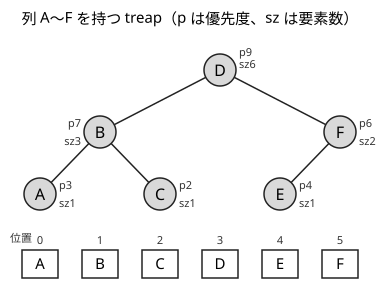
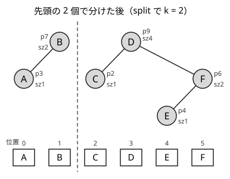

!!! abstract "要点"
    - **何ができるか**：位置で指定した挿入・削除・区間の反転・区間の総積を、期待 $O(\log N)$ で処理する列の構造。treap などで split・merge を基本操作にし、K 番目と順位だけなら GCC の pb_ds の tree で足りる。
    - **いつ使うか**：
        - 列の途中（位置で指定）への挿入・削除と、区間の反転
        - K 番目の値と、値の順位の両方をオンラインで答える
    - **計算量**：split・merge と、それで書く挿入・削除・区間の反転・区間の総積は期待 $O(\log N)$（ならしではなく、1 回ごとの期待値）。pb_ds の tree の挿入・削除・`order_of_key`・`find_by_order` は $O(\log N)$
    - **前提**：[set・multiset・map の応用](../ds/ordered-set.md)

<!-- textlint-disable -->
別名：平衡二分木・balanced binary search tree・treap・implicit treap・RBST・splay・pb_ds tree・order statistics tree
<!-- textlint-enable -->

平衡二分探索木は、二分探索木の深さを $O(\log N)$ に保つ工夫をしたデータ構造の総称である。GCC の `std::set` の中身（赤黒木）もその 1 つだが、競技プログラミングで自作するのは、木を「位置で 2 つに分ける（split）」「2 つの木をつなぐ（merge）」操作を持つ treap などである。split と merge があれば、列の途中への挿入や区間の反転を、配列のように位置で指定して期待 $O(\log N)$ で行える。

ABC で平衡二分探索木が必須の問題はほとんどない。K 番目と順位は BIT・pb_ds の tree で、位置での挿入は逆順の処理で済むことが多い（[代わりの手](#alternatives)）。ここでは、できること・速さの理由・自作するときの要点だけを述べ、詳しい実装は[学ぶための資料](#resources)に任せる。

## 何ができるか（位置で分割・結合する列の構造） {#what-it-does}

列 $a_0, \dots, a_{N-1}$（0-indexed）を、通りがけ順（左の部分木 → 自分 → 右の部分木）に並べると列になる二分木で持つ。各ノードに部分木の要素数 $\mathrm{sz}$ を持たせると、根から「左の部分木の要素数」と比べて降りるだけで、位置 $k$ の要素にたどり着ける。キー（値）の大小ではなく位置で降りるこの使い方を implicit treap と呼ぶ。

基本の 2 つの操作は次のとおりである。

- **split(t, k)**：木 $t$ を「先頭の $k$ 個」と「残り」の 2 つの木に分ける
- **merge(a, b)**：木 $a$ の列の後ろに木 $b$ の列をつないだ木を作る

ほかの操作は、この 2 つの組み合わせで書ける。区間は[半開区間](../guide/glossary.md#half-open-interval) $[l, r)$ で表す。

| やりたいこと | split・merge での書き方 |
| --- | --- |
| 位置 $i$ の直前に $x$ を挿入 | $i$ で分け、間に $x$ だけの木をはさんで merge |
| 位置 $i$ の要素を削除 | $i$ と $i + 1$ で 3 つに分け、真ん中を捨てて merge |
| $[l, r)$ を反転 | $[l, r)$ を切り出し、その根に「反転する」保留を付けて merge |
| $[l, r)$ の総積を取得 | $[l, r)$ を切り出し、その根に持たせた部分木の総積を読んで merge |
| $[l, r)$ に一律に作用 | $[l, r)$ を切り出し、その根に作用の保留を付けて merge |

区間の総積と作用は、[遅延セグメント木](../ds/lazy-segment-tree.md)と同じ考え方で、ノードに部分木の集約値と保留を持たせて実現する。遅延セグメント木と違い、列の長さが途中で変わってよく、区間を反転できる。

問題文のサインは、「列の $i$ 番目の直後に挿入する」「列の $[l, r)$ を反転する」のように、要素を値ではなく位置で指定する操作が、途中の質問と混ざって来ることである。値で指定するなら set や連結リストで足り、操作がすべて先に分かるなら逆順の処理で足りることが多い。

## treap の split・merge と、深さが期待 O(log N) になる理由 {#treap}

treap は、各ノードにランダムな優先度を持たせ、「親の優先度は子の優先度以上」というヒープの条件を保つ二分木である。優先度がすべて異なるとき、並び（通りがけ順）と優先度の両方の条件を満たす木は、ちょうど 1 通りに決まる。列の全体で優先度が最大の要素が根になり、その左の要素たちと右の要素たちが、それぞれ同じ規則で左右の部分木になるからである。32 ビットの乱数では等しい優先度の組がまれに出て、そのときは形が 1 通りに決まらないが、深さの評価にはほとんど影響しない。

次の図は、列 $(A, B, C, D, E, F)$ を持つ treap である。優先度が最大の $D$（9）が根になり、左の $(A, B, C)$ では $B$（7）が、右の $(E, F)$ では $F$（6）が部分木の根になる。



**split(t, k)** は根から降りながら木を切る。根の左の部分木の要素数を $s$ とすると、$k \le s$ なら切れ目は左の部分木の中にあるので、左の部分木を再帰的に $k$ で分け、その後ろ半分を根の新しい左の子にする（根は後ろ半分の側に入る）。$k > s$ なら右の部分木を $k - s - 1$ で分け、前半分を根の新しい右の子にする。どちらの場合も、切った後に根の $\mathrm{sz}$ と集約値を子から作り直す。

図の木を $k = 2$ で分けると、根 $D$ では左の要素数が 3 なので左へ、$B$ では左の要素数が 1 なので右へ進み、$C$ の手前で切れる。$C$ が $D$ の新しい左の子になり、$B$ の右の子は空になる。



**merge(a, b)** は 2 つの根のうち優先度の大きい方を新しい根にする。$a$ の根が大きければ、$a$ の根の右の子を「$a$ の右の部分木と $b$ を merge したもの」にする。$b$ の根が大きければ、$b$ の根の左の子を「$a$ と $b$ の左の部分木を merge したもの」にする。並びの条件とヒープの条件の両方が保たれる。

split は根から 1 本の経路を、merge は $a$ の右端の経路と $b$ の左端の経路を降りるだけなので、かかる時間は木の深さ（merge は 2 つの木の深さの和）に比例する。split で分けた後の木も、それぞれの列を持つ treap になっているので、次の深さの評価がそのまま使える。

**深さが期待 $O(\log N)$ になる理由**：列の位置 $i$ と $j$（$i \ne j$）について、$j$ のノードが $i$ のノードの祖先になるのは、位置 $\min(i, j)$ から $\max(i, j)$ までの $\lvert i - j \rvert + 1$ 個の中で $j$ の優先度が最大のときに限る。優先度が独立な乱数なら、その確率は $1 / (\lvert i - j \rvert + 1)$ である。$i$ の深さ（祖先の個数）の期待値は、これを $j$ について足して

$$
\sum_{j \ne i} \frac{1}{\lvert i - j \rvert + 1} < 2 \left( \frac{1}{2} + \frac{1}{3} + \dots + \frac{1}{N} \right) < 2 \ln N
$$

になる。$N = 10^5$ なら $2 \ln N$ はおよそ 23 である。木の形は列と優先度だけで決まり、どんな順で操作したかによらないので、挿入・削除・split・merge を何度くり返しても、この期待値はそのまま成り立つ。入力を作る側は優先度を知らないので、わざと深い木を作らせることもできない。

??? note "祖先になる条件の証明"
    位置 $i$ から $j$ までの範囲 $R$ を考える。根から降りていくと、根の位置が $R$ の外にある間は、$i$ と $j$ は同じ側の部分木に入り続ける。初めて $R$ の中の位置のノード $m$ に着いたとき、$m$ はその部分木の根なので、$m$ の優先度は $R$ の中で最大である。$m = j$ なら $j$ は $i$ の祖先である。$m \ne j$ なら、$i$ と $j$ は $m$ の左右に分かれる（または $m = i$ で、$j$ は $i$ の子孫になる）ので、$j$ は $i$ の祖先にならない。よって $j$ が $i$ の祖先になるのは、$j$ の優先度が $R$ の中で最大のときに限る。

[ならし計算量](../guide/glossary.md#amortized-complexity)とは違い、1 回ごとの操作の時間の期待値が $O(\log N)$ である。ほかに、RBST（優先度の代わりに、merge のたびに部分木の大きさに比例した確率で根を選ぶ）や splay 木（ならし $O(\log N)$）も同じ split・merge を持ち、使い方は変わらない。

## 自作するときの要点と Library Checker {#library}

自作するときに保つ性質は次の 3 つである。

- 通りがけ順に並べたものが、表したい列である
- 親の優先度は子の優先度以上である（ヒープの条件。優先度はランダムに決める）
- 各ノードの $\mathrm{sz}$ と集約値は、保留を除いた子の値から正しく作られている。保留は「自分の集約値には反映済みで、子にはまだ配っていない」作用である（反転の保留の扱いは下の「push の位置」）

ノードは配列に置き、子は番号で持つ（$-1$ を空の木とする）と、ポインタを使わずに書ける。各ノードには値 `val`・部分木の和 `sum`・優先度 `pri`・要素数 `sz`・反転の保留 `rev` と左右の子 `l`・`r` を持たせる。中心のコードは次のとおりである（完全なプログラムは [`snippets/balanced-bst/implicit-treap.cpp`](https://github.com/yuukougun/kyopro-atlas/blob/main/snippets/balanced-bst/implicit-treap.cpp) で、乱数の操作を `vector` の愚直な方法と比べて確かめている）。まず、子から作り直す pull と、保留を降ろす push である。

```cpp
--8<-- "balanced-bst/implicit-treap.cpp:node"
```

完全なプログラム：[`implicit-treap.cpp`](https://github.com/yuukougun/kyopro-atlas/blob/main/snippets/balanced-bst/implicit-treap.cpp)（GitHub）
{ .kp-code-src }

`using namespace std;` の下では `merge` が `std::merge` と同じ名前になるので、コード片では `join` と名付けた。

```cpp
--8<-- "balanced-bst/implicit-treap.cpp:core"
```

完全なプログラム：[`implicit-treap.cpp`](https://github.com/yuukougun/kyopro-atlas/blob/main/snippets/balanced-bst/implicit-treap.cpp)（GitHub）
{ .kp-code-src }

挿入・削除・反転・区間の和は、[何ができるか](#what-it-does)の表のとおり、split で区間を切り出してから merge で戻す形になる（完全なプログラムの `insert_at`・`erase_at`・`reverse_range`・`range_sum`）。

実装で間違えやすい点は次のとおりである。

- **push の位置**：子を読む前（split で左の部分木の要素数を見る前、merge で子を付け替える前）に必ず保留を降ろす。反転の保留は「この部分木を反転する」という意味なので、降ろすときに左右の子を入れ替え、子に保留を渡す。コード片の反転の保留は、自分の左右の子の入れ替えも push まで遅らせる約束である
- **pull の位置**：子を付け替えたら、そのノードの $\mathrm{sz}$ と集約値を作り直す。切り出した木を読むだけなら、その根の集約値がそのまま区間の答えになる
- **split の $k$ の意味**：「先頭の $k$ 個」か「位置 $k$ 以下」かを決めて、すべての呼び出しでそろえる。コード片は先頭の $k$ 個である
- **反転と非可換な演算**：区間の和や最大値は反転しても変わらないが、1 次関数の合成のように順序で結果が変わる演算では、各ノードに「逆向きに合成した値」も持つ。このときは、保留を付けた時点で自分の 2 つの集約値（順向きと逆向き）を入れ替え、push では子の左右の入れ替えと子への保留の受け渡しだけをする、と約束をそろえる（子が保留を受け取った時点で自分の集約値を入れ替える）
- **ノードの配列への参照**：`vector` にノードを足すと再確保が起き、`auto& x = t[v];` のような参照が壊れる。新しいノードを作る操作と参照を混ぜない（[イテレータと参照の無効化](../cpp/cpp-container-idioms.md#invalidation)）
- **再帰の深さ**：深さは期待 $O(\log N)$ なので、再帰で書いてよい。コード片では $10^5$ 個を末尾に順に挿入しても深さが 60 未満であることを確かめている

自作したら、Library Checker で確かめる。

- [Range Reverse Range Sum](https://judge.yosupo.jp/problem/range_reverse_range_sum)：区間の反転と区間の和（このページの検証問題）
- [Dynamic Sequence Range Affine Range Sum](https://judge.yosupo.jp/problem/dynamic_sequence_range_affine_range_sum)：位置での挿入・削除・区間の反転・区間のアフィン変換・区間の和をすべて混ぜたもの（このページの検証問題）
- [Ordered Set](https://judge.yosupo.jp/problem/ordered_set)：値の集合への挿入・削除と、K 番目・$x$ 以下の個数・前後の値（値をキーにした使い方や pb_ds の tree の確認）

## pb_ds の tree（order_of_key・find_by_order。重複は値と通し番号の組にする） {#pbds}

値の集合で K 番目と順位を両方答えるだけなら、自作しなくても GCC の拡張の pb_ds の tree で足りる。set に次の 2 つの操作を足したものとして使える。

- `order_of_key(x)`：$x$ 未満の要素の個数（順位）を $O(\log N)$ で返す
- `find_by_order(k)`：小さい方から $k$ 番目（0 から数える）の要素のイテレータを $O(\log N)$ で返す

`rb_tree_tag` と `tree_order_statistics_node_update` を指定すると、中身は部分木の要素数を持たせた赤黒木になる。set と同じく同じ値を 1 個しか持たない。重複を許すには（値, 通し番号）の組を入れ、`order_of_key({x, -1})` で値が $x$ 未満の組を数える。比較関数を `less_equal` にする書き方は比較関数の約束を破り、削除や検索が壊れるので使わない。型の書き方・版・落とし穴の実例は C++ の章の [pb_ds の順序付き集合](../cpp/cpp-container-idioms.md#pb-ds)にまとめてある。

pb_ds の tree はキー（値）の大小で並べる集合なので、位置で指定した挿入や区間の反転はできない。列を位置で扱うなら treap を自作する。ACL には平衡二分探索木と順序付き集合のどちらもない。

## 代わりの手（BIT 上の二分探索・連結リスト・逆順の処理と BIT） {#alternatives}

平衡二分探索木を自作する前に、問題の形から軽い方法で足りるかを確かめる。

| 問題の形 | 代わりの手 |
| --- | --- |
| 値の K 番目・順位で、値の範囲が小さいか先読みして座標圧縮できる | 個数の BIT と [BIT 上の二分探索](../ds/kth-element.md#bit-binary-search) |
| 値の K 番目・順位で、値が大きく先読みできない | pb_ds の tree |
| 「$x$ の直後に $y$ を入れる」のように値（名前）で場所を指定する | [配列で作る連結リスト](../ds/linked-list.md) |
| 位置で指定した挿入で、操作がすべて先に分かり最後の列だけを問う | [逆順に処理して空きの P 番目に置く](../ds/kth-element.md#reverse-insertion) |
| 位置で指定した操作と質問が混ざり、先読みできない | treap を自作するか、[平方分割](../ds/sqrt-decomposition.md#buckets)のバケットに分けて持つ |

K が 5 程度に小さいなら、multiset の `lower_bound` からイテレータを K 歩動かすだけで足りる（[set・multiset・map の応用](../ds/ordered-set.md#near-kth)）。

## 学ぶための資料 {#resources}

- [hamamu「Implicit Treap解説」](https://qiita.com/hamamu/items/570e7c36bf73913cbeb8)（Qiita）：位置で分割・結合する treap の split・merge、区間の反転、遅延評価による区間の作用と取得を、日本語で順に説明している
- [ei1333「Luzhiled's Library」](https://ei1333.github.io/library/)の平衡二分探索木（structure/bbst）の一覧：RBST・splay 木・赤黒木などに、遅延評価や反転を付けたライブラリがあり、自作するときの関数の切り分けの参考になる
- [GCC「Policy-Based Data Structures」](https://gcc.gnu.org/onlinedocs/libstdc++/manual/policy_data_structures.html)（英語）：pb_ds の tree の型引数と `tree_order_statistics_node_update` の説明

## 練習問題 {#practice}

<div class="kp-problems" data-role="practice" markdown>

- [ABC241 D. Sequence Query](https://atcoder.jp/contests/abc241/tasks/abc241_d)（diff 1177）：数の追加と、x 以下（以上）の中で大きい（小さい）方から K 番目の値の質問を処理する。
- [ARC033 C. データ構造](https://atcoder.jp/contests/arc033/tasks/arc033_3)（diff 1641・参考値）：数の集合への追加と、小さい方から x 番目の数を答えて削除するクエリを処理する。

</div>

??? note "練習の方針"
    - ABC241 D：K が 5 以下と小さいので、multiset の `lower_bound` からイテレータを K 歩動かせば足りる。pb_ds の tree に（値, 通し番号）の組で入れ、`order_of_key` で $x$ 以下の個数 $c$ を求めて `find_by_order(c - K)` を読む方法でも解ける。こちらは K が大きくても使える
    - ARC033 C：値の範囲が $2 \times 10^5$ までなので、値ごとの個数の BIT を作る。BIT 上の二分探索で x 番目を探し、その値の個数から 1 を引けばよい（[K 番目の値を求めるデータ構造](../ds/kth-element.md#arc033_3)の例題）。（値, 通し番号）の組を入れた pb_ds の tree で、`find_by_order(x - 1)` で読んでその組を `erase` しても解ける

## 参考 {#references}

- [hamamu「Implicit Treap解説」](https://qiita.com/hamamu/items/570e7c36bf73913cbeb8)：学ぶための資料。位置で分割・結合する treap と、反転・遅延評価の扱い
- [ei1333「Luzhiled's Library」](https://ei1333.github.io/library/)：学ぶための資料。平衡二分探索木（structure/bbst）のライブラリの一覧
- [GCC「Policy-Based Data Structures」](https://gcc.gnu.org/onlinedocs/libstdc++/manual/policy_data_structures.html)：pb_ds の tree と `tree_order_statistics_node_update`
- [yosupo06「library-checker-problems/data_structure」](https://github.com/yosupo06/library-checker-problems/tree/master/data_structure)：検証に使う問題（range_reverse_range_sum ほか）の内容
- [Wikipedia「Treap」](https://en.wikipedia.org/wiki/Treap)：treap の定義と、木の形が優先度で一意に決まること
- [kyo-pro「(C++)ABC241D - Sequence Query」](https://kyo-pro.hatenablog.com/entry/ABC241D-cpp)：練習 ABC241 D の multiset による解き方
- [recuraki「AtCoder ABC241 D - Sequence Query を __gnu_pbds::treeで解く」](https://qiita.com/recuraki/items/993d08d87084fec671ae)：練習 ABC241 D の pb_ds の tree による解き方
- [drken「AtCoder ARC 033 C - データ構造 (1D, 試験管青色)」](https://drken1215.hatenablog.com/entry/2020/02/29/035900)：練習 ARC033 C の値の範囲と解き方
