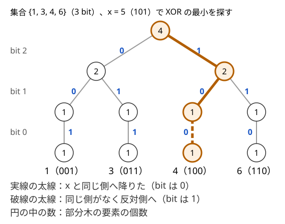

!!! abstract "要点"
    - **何ができるか**：整数を 2 進数の上位 bit から Trie に入れ、各ノードに部分木の個数を持たせる。$x$ との XOR の最小・最大、K 番目に小さい値、全体に XOR をかける操作を、bit 数を $B$ として $O(B)$ で処理する。
    - **いつ使うか**：
        - x を選んで XOR の最大値を最小にする・集合の中で x との XOR が最小の要素
        - 追加・削除のたびに、任意の 2 要素の XOR の最小値を答える
        - 全体に XOR をかけてから K 番目に小さい値
        - $A_i < 2^{30}$ で、追加・削除・質問が合わせて $2 \times 10^5$ 回程度
    - **計算量**：追加・削除・$x$ との XOR の最小と最大・K 番目はどれも $O(B)$（ならしではなく 1 回ごとの上限）。領域は要素数 $N$ に対して $O(NB)$
    - **前提**：[Trie](../string/trie.md)、[bit 演算の基本と XOR の性質](../basics/bit-operations.md)

<!-- textlint-disable -->
別名：二分トライ・2 進 Trie・ビット Trie・XOR Trie・XOR の最小化
<!-- textlint-enable -->

Binary Trie は、整数を上位 bit から並べた 0・1 の列とみて [Trie](../string/trie.md) に入れたものである。XOR を取った値の大小は上位 bit から決まるので、根から 1 段ずつ「どちらの子へ降りるか」を決めるだけで、XOR の最小・最大や K 番目が求まる。

## 作り方（上位 bit からたどる二分木・ノードに個数） {#build}

「集合 $S$ の中で $x$ との XOR が最小の要素」を、$S$ への追加・削除をはさみながら何度も答えたいとする。XOR は大小の順序を保たないので、`set` の `lower_bound` で近い値を探しても答えにならない。たとえば $x = 4$ に対して、値として近い $3$ との XOR は $7$、遠い $5$ との XOR は $1$ である。毎回すべての要素を調べると、$N, Q = 2 \times 10^5$ で $4 \times 10^{10}$ 回になり間に合わない。

Binary Trie では、値を $0 \le a < 2^B$ の範囲に限り、$a$ を bit $B-1$ から bit $0$ への長さ $B$ の 0・1 の列とみる。根から、bit $B-1$ が 0 なら子 0、1 なら子 1 へ降り、続けて bit $B-2$、… と $B$ 回降りた先が $a$ の葉になる。深さ $d$ のノードは「上位 $d$ bit がこの値の要素の集まり」を表す。

### 保つ性質

- 各ノード $v$ に、$v$ の部分木に入っている要素の個数 $\mathrm{cnt}[v]$ を持つ。多重集合なら同じ値も数える
- 葉 $a$ の $\mathrm{cnt}$ は値 $a$ の個数で、内部ノードの $\mathrm{cnt}$ は 2 つの子の $\mathrm{cnt}$ の和に等しい
- 部分木の要素はどれも、上位 bit がそのノードまでの道と一致する。だから、子 0 の部分木の要素は、子 1 の部分木のどの要素よりも小さい

### 各操作の手順

- **追加**：根から $a$ の bit に従って降り、通ったノードすべての $\mathrm{cnt}$ に 1 を足す。子がなければ作る
- **削除**：同じ道をたどって $\mathrm{cnt}$ から 1 を引く。ノードは消さずに残す（$\mathrm{cnt} = 0$ のノードは「空」として扱う）
- **個数**：$a$ の道をたどり、途中で子がなければ 0、最後まで行けば葉の $\mathrm{cnt}$ を返す

ノードは配列に通し番号で置き、子の番号を `ch[v][0]`・`ch[v][1]`（なければ $-1$）で持つ。

```cpp
--8<-- "binary-trie/trie.cpp:core"
```

### 境界

- **空の集合**：$\mathrm{cnt}[\text{根}] = 0$ のとき、XOR の最小・最大や K 番目は定まらない。質問の前に個数を確かめる
- **削除は入っているときだけ**：入っていない値を消すと $\mathrm{cnt}$ が負になり、以後の降り方が狂う。`count(a) > 0` を確かめてから消す
- **$B$ の決め方**：値と質問の $x$ がどちらも $2^B$ 未満になる $B$ を選ぶ。$10^9$ 以下なら $2^{30} > 10^9$ なので $B = 30$ で足りる
- **ノード数**：1 回の追加で作るノードは最大 $B$ 個なので、全体で $1 + NB$ 個以下である（[落とし穴](#pitfalls)）

## XOR の最小・最大（同じ側を優先して降りる） {#xor-min-max}

$\min_{a \in S} (a \oplus x)$ は、根から次の規則で降りれば求まる。bit $b$ の段では、$x$ の bit $b$ と同じ側の子が空でなければそちらへ降りる。空なら反対側へ降り、答えの bit $b$ を 1 にする。

**なぜ正しいか**：XOR を取った値の大小は、上位 bit から比べて最初に違う bit で決まる。bit $b$ が 0 になる要素が 1 つでもあれば、bit $b$ が 1 になる要素は、下の bit がどうであっても負ける（$2^b > 2^{b-1} + \dots + 2^0$）。だから上の bit から順に「0 にできるなら 0」と決めてよく、決めた後に残る候補は、降りた先の部分木の要素だけになる。

次の図は、集合 $\{1, 3, 4, 6\}$ を $B = 3$ で入れ、$x = 5 = (101)_2$ との XOR の最小を求める道を示す。



道を文章で追うと次のとおりである。

- bit 2：$x$ の bit は 1 で、子 1（$4, 6$）は空でないので子 1 へ降りる。答えの bit 2 は 0
- bit 1：$x$ の bit は 0 で、子 0（$4$）があるので子 0 へ降りる。答えの bit 1 は 0
- bit 0：$x$ の bit は 1 だが、子 1 がない。子 0 へ降り、答えの bit 0 を 1 にする

答えは $1$（$= 4 \oplus 5$）である。ほかの要素は $1 \oplus 5 = 4$、$3 \oplus 5 = 6$、$6 \oplus 5 = 3$ で、どれも大きい。

最大は、反対側を優先して降りれば求まる。$\max (a \oplus x) = (2^B - 1) \oplus \min (a \oplus \bar{x})$（$\bar{x} = x \oplus (2^B - 1)$）なので、最小の関数を使い回してもよい。どちらも $B$ 段降りるだけなので $O(B)$ である。

**応用の型**：

- **2 要素の XOR の最大**：要素を 1 つずつ入れながら、入れる前に「今の集合との XOR の最大」を質問する。どの組も、後から入れた側の質問で一度ずつ調べられるので、$O(NB)$ で求まる。区間の XOR の最大は、[累積 XOR](../basics/bitwise-independence.md#range-xor) $s_l \oplus s_r$ の 2 要素の最大に言い換える
- **部分木ごとの値を持ち上げる**：各ノードに個数以外の値を持たせ、追加・削除のたびに通った道を葉から根へ作り直す。[セグメント木](../ds/segment-tree.md)の一点更新と同じ形で、1 回 $O(B)$ である。「2 要素の XOR の最小値」なら、各ノードにその部分木の中の最小値を持たせる（[例題 ABC308 G](#abc308_g)）

## K 番目と全体への XOR（bit ごとの反転フラグ） {#kth-and-global-xor}

$\{a \oplus x \mid a \in S\}$ の中で小さい方から K 番目（0-indexed）は、各ノードの $\mathrm{cnt}$ を使って降りれば求まる。bit $b$ の段で、$a \oplus x$ の bit $b$ が 0 になる側は子 $x_b$（$x$ の bit $b$）である。その子の個数を $c$ とすると、$K < c$ なら子 $x_b$ へ降りる。そうでなければ $K$ から $c$ を引き、反対側へ降りて答えの bit $b$ を 1 にする。$x = 0$ なら、ただの K 番目に小さい値になる。

この降り方は、[BIT 上の二分探索](../ds/kth-element.md#bit-binary-search)と同じく「左の部分の個数と比べて、入るなら左、入らなければ引いて右」である。違うのは、どちらが「左」かを $x$ の bit が決める点だけである。

**全体に $X$ をかける**：「すべての要素を $a \leftarrow a \oplus X$ にする」操作を何度も受けるときは、要素を書き換えない。かけた値の累計 $T$（初めは 0）だけを持ち、木には元の値を入れたままにする。今の要素は $s \oplus T$（$s$ は木に入っている値）なので、各操作は次のように直す。

| 操作 | 木に対して行うこと |
| --- | --- |
| 全体に $X$ をかける | $T \leftarrow T \oplus X$ |
| 値 $v$ を追加・削除 | 木の値 $v \oplus T$ を追加・削除 |
| $x$ との XOR の最小 | $x \oplus T$ との XOR の最小 |
| K 番目に小さい値 | $x = T$ として K 番目 |

$T$ の bit $b$ が 1 であることは、深さ $B - 1 - b$ のすべてのノードで子 0 と子 1 を入れ替えたことに当たる。これが「bit ごとの反転フラグ」である。木を実際に入れ替えると $O(N)$ かかるが、降りるときに「どちらが左か」を読み替えれば済むので $O(1)$ になる。

**応用の型**：

- **$a \oplus x < y$ を満たす要素の個数**：bit $b$ の段で $y$ の bit が 1 なら、$a \oplus x$ の bit が 0 になる側の子の個数を足して、反対側へ降りる。0 なら 0 になる側へ降りるだけにする。上限が「$y$ 以下」なら $y + 1$ 未満として数える
- **各ノードに遅延の XOR を持たせる**：全体ではなく部分木ごとに XOR をかけるときは、ノードに保留の XOR を持たせ、降りるときに子へ配る（[遅延セグメント木](../ds/lazy-segment-tree.md#idea)の保留と同じ考え方）

## 明示的に作らない Binary Trie（上位 bit で分ける再帰） {#implicit}

要素が初めから全部そろっていて追加・削除がないなら、木を作らずに済む。要素を昇順に並べると、Binary Trie の深さ $d$ のノードの部分木は、上位 $d$ bit が等しい要素の集まりなので、配列の連続した区間になる。子 0 と子 1 の境目は、区間の中で bit $B-1-d$ が 1 になる最初の位置である。だから「区間 $[l, r)$ と bit $b$」を引数にした再帰が、そのまま木の深さ優先の探索になり、領域は $O(N)$ で済む。

この再帰で答える典型は「$x$ を 1 つ選んで $\max_i (a_i \oplus x)$ を最小にする」である。漸化式と擬似コードは [bit ごとに独立に考える](../basics/bitwise-independence.md#split-by-top-bit)にある（[例題 ABC281 F](#abc281_f)）。

もう 1 つの型は、部分木ごとに値をまとめて返す再帰である。たとえば、$x$ を $0$ から $2^{b+1} - 1$ まですべて動かしたときの $\min_i (a_i \oplus x)$ の和を考える（区間の要素は bit $b$ より上がそろっているとし、bit $b$ 以下だけを見る）。区間を bit $b$ で 2 つに分けると、次のようになる。

- **両側にある**：$x$ の bit $b$ が 0 の半分は子 0 へ、1 の半分は子 1 へ降り、どちらも bit $b$ は 0 で済む。和は 2 つの子の和の合計である
- **片側だけ**：$x$ の半分は同じ側へ降りて bit $b$ が 0、残りの半分は必ず bit $b$ が 1 になり $2^b$ ずつ払う。下の bit はどちらの半分も同じ子の問題になるので、和は「子の和 × 2 + $2^b \cdot 2^b$」である

```cpp
--8<-- "binary-trie/implicit.cpp:core"
```

再帰の 1 段で、各要素はちょうど 1 つの区間に入るので、分ける手間は段ごとに合わせて $O(N)$、全体で $O(NB)$ である。$x$ の範囲が $[0, M)$ のように 2 の冪でないときは、上限 $M$（ABC425 G の記号）を上位 bit から見て、丸ごと入る半分にはこの関数を使い、はみ出す半分だけ再帰を続ける（[練習問題](#practice)の ABC425 G）。

木を明示的に作るか再帰で済ませるかは、次の基準で選ぶ。

- 追加・削除がある、またはクエリごとに $x$ が違う：木を作る
- 集合が固定で、答えが木全体から 1 回で決まる：ソートした配列の区間で再帰する

## 落とし穴 {#pitfalls}

**ノード数を見積もらずに確保する**。ノードは最大 $1 + NB$ 個で、$N = 2 \times 10^5$、$B = 30$ なら $6 \times 10^6$ 個になる。子 2 つと個数を `int` で持つと 1 ノード 12 バイトで約 72 MB である。`push_back` で伸ばす `vector` は、容量を倍に広げる瞬間に古い領域と新しい領域を両方持つので、一時的に 2〜3 倍のメモリを使う。最大のノード数が分かっているので `reserve` しておく。ノードを `new` で 1 つずつ作ると遅いので、配列に通し番号で置く。

**ノードへの参照を持ったまま新しいノードを作る**。`auto& node = ch[v];` を持ったまま `push_back` すると、領域の付け替えで `node` が[ダングリング（ぶら下がり参照）](../guide/glossary.md#dangling)になる。`ch[v][c] = new_node();` は C++17 以降なら右辺が先に評価されるので安全だが、迷うなら `int u = new_node(); ch[v][c] = u;` と 2 文に分ける。

**削除した後に「子があるか」だけで判定する**。削除してもノードは残るので、子の番号が $-1$ でなくても部分木が空のことがある。XOR の最小・最大で降りる側を決めるときは、`ch[v][c] != -1 && cnt[ch[v][c]] > 0` で判定する。

**全体の XOR を追加の値にかけ忘れる**。全体に $X$ をかけた後に入る値 $v$ は、木には $v \oplus T$ として入れる（[K 番目と全体への XOR](#kth-and-global-xor)の表）。そのまま $v$ を入れると、取り出すときに $T$ がかかって別の値になる。

**$B$ が足りない**。質問の $x$ が値より大きいことがある。$a < 2^{30}$ でも $x < 2^{60}$ なら $B = 60$ にする。$b \ge 31$ の bit を `1 << b` と書くと `int` があふれるので、`1LL << b` にする（[オーバーフロー](../guide/glossary.md#overflow)）。

## 例題 {#examples}

### ABC281 F. Xor Minimization {#abc281_f}

<div class="kp-problems" data-role="example" markdown>

- [ABC281 F. Xor Minimization](https://atcoder.jp/contests/abc281/tasks/abc281_f)（diff 1714）：x を選んで、全要素と x の XOR の最大値を最小にする。

</div>

**方針**：$A$ を Binary Trie に入れたと考え、根から深さ優先にたどる。ノードの子が 1 つだけなら、$x$ の bit をその子に合わせれば bit は 0 で済む。子が 2 つあると、どちらかの部分木の要素は bit が 1 になる。最大値を作るのはその側だけなので、$2^b$ を払ってもう一方を捨ててよい。追加・削除がないので、[明示的に作らない形](#implicit)で書ける。

??? note "解法の詳細"
    部分木 $v$（bit $b$ より上がそろった要素の集まり）について、bit $b$ 以下で作れる最大値の最小を $f(v, b)$ とする。子 0 と子 1 の部分木を $v_0, v_1$ とすると、次のとおりである。

    - $b < 0$ なら $f = 0$
    - 片方だけが空でないなら、$f(v, b) = f(\text{その子}, b - 1)$
    - どちらも空でないなら、$f(v, b) = 2^b + \min(f(v_0, b - 1), f(v_1, b - 1))$

    答えは $f(\text{根}, 29)$ である。ソートした配列の区間で再帰すれば、各段で要素を 1 回ずつ見るので $O(NB)$ になる（$A_i < 2^{30}$ なので $B = 30$）。漸化式の正しさは [bit ごとに独立に考える](../basics/bitwise-independence.md#split-by-top-bit)で示している。

### ABC308 G. Minimum Xor Pair Query {#abc308_g}

<div class="kp-problems" data-role="example" markdown>

- [ABC308 G. Minimum Xor Pair Query](https://atcoder.jp/contests/abc308/tasks/abc308_g)（diff 2008）：整数の追加・削除のたびに、集合内の 2 要素の XOR の最小値を答える。

</div>

**方針**：各ノードに「部分木の中の 2 要素の XOR の最小値」を持たせ、追加・削除のたびに通った道を葉から根へ作り直す（[部分木ごとの値を持ち上げる](#xor-min-max)型）。bit $b$ の段のノードでは、同じ子に入る 2 要素の XOR は $2^b$ 未満、違う子に入る 2 要素の XOR は $2^b$ 以上である。だから、要素を 2 個以上持つ子があれば、その子の値の最小が答えになる。

??? note "解法の詳細"
    ノード $v$ に、個数 $\mathrm{cnt}[v]$、部分木の要素の XOR $\mathrm{xs}[v]$（個数が 1 ならその要素そのもの）、答え $\mathrm{best}[v]$（個数が 2 未満なら $\infty$）を持たせる。作り直しは次のとおりである。

    - 葉：同じ値が 2 個以上あれば $0$、なければ $\infty$
    - 内部ノード：個数が 2 以上の子の $\mathrm{best}$ の最小を取る。そのような子がなく、2 つの子の個数がどちらも 1 なら、$\mathrm{xs}[\text{子 } 0] \oplus \mathrm{xs}[\text{子 } 1]$ にする

    $\mathrm{xs}$ は追加でも削除でも同じ値を XOR するだけで直せる。1 回の操作は $O(B)$ で、全体は $O(QB)$ である。

    ```cpp
    --8<-- "binary-trie/min-pair.cpp:core"
    ```

    別解として、XOR が最小の組は昇順で隣り合う 2 要素の中にあるので、隣り合う組の XOR を multiset で持つ方法もある（[使い分け](#comparison)）。

## 練習問題 {#practice}

<div class="kp-problems" data-role="practice" markdown>

- [ARC033 C. データ構造](https://atcoder.jp/contests/arc033/tasks/arc033_3)（diff 1641）：数の集合に値を追加するクエリと、小さい方から x 番目の値を出力してそれを集合から取り除くクエリを処理する。
- [ABC403 G. Odd Position Sum Query](https://atcoder.jp/contests/abc403/tasks/abc403_g)（diff 2028）：空の多重集合に値を 1 つずつ追加し、そのたびに昇順に並べたときの奇数番目の要素の和を答える（追加する値は前の答えから決まる）。
- [ABC425 G. Sum of Min of XOR](https://atcoder.jp/contests/abc425/tasks/abc425_g)（diff 2205）：x = 0, 1, …, M − 1 について min_i (x xor A_i) を求め、その総和を答える。

</div>

??? tip "ヒント"
    - **ARC033 C**：各ノードに部分木の個数を持つ Binary Trie に値を入れる。K 番目は、全体への XOR が 0 のときの降り方で、左の子の個数と K を比べて降りれば見つかる。見つけた葉の値を削除し、1 回 $O(B)$ である
    - **ABC403 G**：先読みできないので座標圧縮はできない。値域 $[0, 2^{30})$ の Binary Trie（必要なノードだけ作る値域のセグメント木と同じ形）の各ノードに（個数, 奇数番目の和, 偶数番目の和）を持たせる。左の子の個数が奇数なら右の子の 2 つの和を入れ替えて合成し、追加のたびに葉から根へ作り直す
    - **ABC425 G**：$x$ が 2 の冪の範囲を丸ごと動くなら、[明示的に作らない Binary Trie](#implicit) の和の再帰で求まる。$[0, M)$ を上位 bit から、丸ごと入る半分とはみ出す半分に分け、はみ出す側だけ $M$ の bit に沿って降りる。

## 力試し {#challenge}

<div class="kp-problems" data-role="challenge" markdown>

- [ABC451 G. Minimum XOR Walk](https://atcoder.jp/contests/abc451/tasks/abc451_g)（diff 2221）：辺に重みのある連結な無向グラフで、2 頂点を結ぶウォークの重み（通った辺の重みの XOR）の最小値が K 以下になる頂点の組の数を求める。
- [ARC122 D. XOR Game](https://atcoder.jp/contests/arc122/tasks/arc122_d)（diff 2331）：2N 個の整数を 2 人が 1 つずつ交互に取って N 組を作り、組ごとの XOR の最大値を先手は大きく、後手は小さくしたいとき、最適に行動した結果の値を求める。

</div>

??? note "力試しの方針"
    - **ABC451 G**：全域木で根からの XOR $D(v)$ を求め、木に入らない辺が作る閉路の値で XOR 基底を作って各 $D(v)$ を最小化する。そのあと値を 1 つずつ Binary Trie に入れながら、入っている値との XOR が $K + 1$ 未満のものの個数を数える（$a \oplus x < y$ の個数を数える降り方）
    - **ARC122 D**：上位 bit で集合を 2 つに分ける。両側が偶数個なら、両側で再帰した値の最大が答えである。奇数個なら、2 つの集合をまたぐ組の XOR の最小が答えで、片方を Binary Trie に入れ、もう片方の各要素について XOR の最小を引けばよい

## 確認問題 {#quiz}

??? question "確認問題：全体に XOR をかけると木のどこが入れ替わるか"
    $B = 3$ の Binary Trie の要素すべてに $X = 5 = (101)_2$ をかけた。木を実際に組み替えるなら、どのノードの子を入れ替えればよいか。

    ??? success "答え"
        bit 2 と bit 0 で枝分かれする段、すなわち根（深さ 0）と深さ 2 のすべてのノードで、子 0 と子 1 を入れ替える。bit 1 の段（深さ 1）はそのままである。実際には入れ替えず、累計の $T$ を持って降りるときに読み替える。

??? question "確認問題：子の有無で降りる側を決めるとどうなるか"
    $B = 2$ の木に $\{2, 3\}$ を入れてから $3$ を削除した（ノードは残す）。$x = 3$ との XOR の最小を、`ch[v][c] != -1` だけで判定して求めると何が返るか。

    ??? success "答え"
        $0$ が返る。根から bit 1 で子 1、bit 0 で $x$ と同じ子 1（値 3 の葉）へ降りてしまう。その葉の個数は 0 なので、本当は子 0（値 2）へ降りて $2 \oplus 3 = 1$ を返すべきである。個数が正かどうかで判定する。

??? question "確認問題：2 要素の XOR の最大を O(NB) で求める"
    列 $a_0, \dots, a_{N-1}$ から 2 要素を選ぶときの XOR の最大を、Binary Trie で $O(NB)$ で求める手順を述べよ。

    ??? success "答え"
        空の木から始め、$i = 0, 1, \dots$ の順に、$i \ge 1$ なら木との $\max (a \oplus a_i)$ を質問して答えを更新し、その後に $a_i$ を木に入れる。組 $(j, i)$（$j < i$）は $a_i$ の質問で必ず候補に入るので、すべての組を調べたことになる。各要素で質問と追加が 1 回ずつ $O(B)$ なので、全体は $O(NB)$ である。

## 使い分け {#comparison}

- **2 要素の XOR の最小**：昇順で隣り合う組だけを見ればよい。$a < b < c$ で、$a$ と $c$ が上から見て最初に違う bit を $k$ とする。$b$ は bit $k$ より上が $a, c$ と同じなので、bit $k$ が 0 なら $a \oplus b < 2^k \le a \oplus c$、1 なら $b \oplus c < 2^k \le a \oplus c$ になる。追加・削除があっても、[ソート順で隣り合う組の集合](../ds/ordered-set.md#adjacent-pairs)を multiset で持てば解ける。全体に XOR をかけても 2 要素の XOR は変わらないので、元の値のまま持てばよい
- **選んだ要素をいくつでも XOR して作れる値**（最大値・個数・K 番目）：Binary Trie ではなく [XOR 基底](../math/xor-basis.md)で掃き出す。Binary Trie が扱うのは「1 つの要素と $x$ の XOR」である
- **XOR がない K 番目**：値を[座標圧縮](../basics/coordinate-compression.md)できるなら BIT 上の二分探索のほうが軽い（[K 番目の要素](../ds/kth-element.md)）。値の範囲が大きくオンラインで、全体に XOR をかけるなら Binary Trie を使う
- **集合が固定で 1 回だけ答える**：木を作らず、ソートした配列の区間で再帰する（[明示的に作らない Binary Trie](#implicit)）

## 参考 {#references}

- [drken「AtCoder ABC 281 F - Xor Minimization (2D, 青色, 500 点)」](https://drken1215.hatenablog.com/entry/2022/12/13/144200)：上位 bit から 0・1 で分ける木と再帰（例題 ABC281 F の方針）
- [merom686「ABC308」](https://merom686.hatenablog.com/entry/2023/07/02/004802)：部分木ごとに 2 要素の XOR の最小値を持ち、根へ持ち上げる方法。個数が 1 のノードに部分木の XOR を持たせる工夫（例題 ABC308 G の方針）
- [Library Checker「Set Xor-Min」](https://judge.yosupo.jp/problem/set_xor_min)：追加・削除・$x$ との XOR の最小の検証
- [drken「AtCoder ARC 033 C - データ構造 (1D, 試験管青色)」](https://drken1215.hatenablog.com/entry/2020/02/29/035900)：練習 ARC033 C の K 番目の取得と削除
- [ikatakos「AtCoder Beginner Contest 403（Promotion of AtCoder Career Design DAY）F,G問題メモ」](https://ikatakos.com/pot/programming_algorithm/contest_history/atcoder/2025/0427_abc403)：練習 ABC403 G の動的セグメント木とノードの持ち方（解説の部分だけを参照）
- [kmjp「AtCoder ABC #403 : G - Odd Position Sum Query」](https://kmjp.hatenablog.jp/entry/2025/04/28/1030)：練習 ABC403 G の問いの確認
- [kmjp「AtCoder ABC #451 : G - Minimum XOR Walk」](https://kmjp.hatenablog.jp/entry/2026/03/28/0930)：力試し ABC451 G の XOR 基底と Binary Trie での数え上げ
- [kmjp「AtCoder ARC #122 (東京海上日動 プログラミングコンテスト2021) : D - XOR Game」](https://kmjp.hatenablog.jp/entry/2021/06/13/0930)：力試し ARC122 D の偶奇の場合分けと Binary Trie での XOR の最小
- [ikatakos「東京海上日動 プログラミングコンテスト2021（AtCoder Regular Contest 122) A,C,D,E問題メモ」](https://ikatakos.com/pot/programming_algorithm/contest_history/atcoder/2021/0612_arc122)：力試し ARC122 D の同じ場合分け（解説の部分だけを参照）
