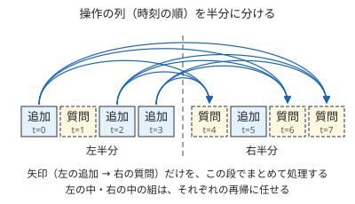

!!! abstract "要点"
    - **何ができるか**：3 次元の支配点の数え上げや、点の追加つきの長方形クエリを、オフラインで $O(N \log^2 N)$ で解く。更新とクエリの列を時刻で半分に分け、左の更新が右のクエリに与える影響だけを BIT で処理する。
    - **いつ使うか**：
        - 3 つの値すべての大小関係を満たす組を数える
        - 点の追加と長方形の質問が混ざるが、オフラインでよい
    - **計算量**：$O(N \log^2 N)$（$N$ は点・操作の数。各段を平面走査と BIT で処理するとき）、メモリ $O(N)$
    - **前提**：[分割統治](../basics/divide-and-conquer.md)、[BIT（Fenwick Tree）](../ds/fenwick-tree.md)

<!-- textlint-disable -->
別名：CDQ divide and conquer・時系列の分割統治・オフラインの分割統治・3 次元の支配点の数え上げ
<!-- textlint-enable -->

CDQ 分割統治は、操作の列を時刻で半分に分け、「左半分の更新が右半分の質問に与える影響」だけを各段でまとめて処理する[オフライン](../guide/glossary.md#offline)の分割統治である。時刻の条件が分割で消えるので、残りの 2 つの条件を[平面走査](../ds/sweep-line-2d.md)と BIT で数えればよい。名前は、この考え方を高校生のときにまとめた陳丹琦（Chen Danqi）氏の頭文字に由来する。

ABC で必須になった例は見つかっておらず、黄までの範囲では平面走査や 2 次元 BIT で足りることが多い。点の追加と長方形の質問が混ざり、座標が大きい問題に出会ったときの切り札として知っておけばよい。

## 何ができるか（時系列の分割統治で 1 次元を消す） {#what-it-does}

**3 次元の支配点の数え上げ**：点 $(a_j, b_j, c_j)$ が点 $(a_i, b_i, c_i)$ に対して $a_j \le a_i$ かつ $b_j \le b_i$ かつ $c_j \le c_i$ を満たすとき、$i$ は $j$ を支配するという。各 $i$ について、$i$ が支配する $j$（$j \ne i$）の個数を求める問題が基本形である。値が 2 つなら、一方でソートして他方を BIT で数える。この平面走査は $O(N \log N)$ である。3 つになると BIT をもう 1 段重ねたくなるが、座標が大きいと配列の 2 次元 BIT はそのままでは置けない（先読みして圧縮する方法を[代わりの手](#alternatives)に挙げた）。

そこで点を $(a, b, c)$ の辞書順に並べ、並びの位置を「時刻」とみなす（$a$ が等しい点の扱いは[自作するときの要点](#library)）。時刻 $j$ の点が時刻 $i$ の点より前にあれば $a_j \le a_i$ が保証されるので、残る条件は $b$ と $c$ の 2 つだけになる。

**点の追加つきの長方形クエリ**：「点 $(x, y)$ に重み $w$ を足す」と「長方形 $[x_1, x_2) \times [y_1, y_2)$ の重みの和を答える」が混ざる問題では、操作の番号がそのまま時刻である。質問 $i$ に効くのは、時刻が前で、$x$ と $y$ が範囲に入る追加 $j$ だけである。長方形の和は[2 次元累積和](../basics/prefix-sum-2d.md)と同じく、原点を角とする 4 つの長方形の和の足し引きに分けられる。そうすると「時刻・$x$・$y$ の 3 つがすべて小さい追加の重みの和」になり、3 次元の支配点の数え上げと同じ形になる。

どちらも、組 $(j, i)$ のうち「$j$ が更新で時刻が前、$i$ が質問」のものの寄与を足し合わせる問題である。CDQ 分割統治は、この組を時刻で分割統治して数える。



時刻の区間 $[l, r)$ を中央 $\mathit{mid}$ で分けると、組 $(j, i)$（$j < i$）は次の 3 種類に分かれる。

- $j$ と $i$ が両方とも左半分 $[l, \mathit{mid})$ にある：左の再帰で数える。
- $j$ と $i$ が両方とも右半分 $[\mathit{mid}, r)$ にある：右の再帰で数える。
- $j$ が左半分、$i$ が右半分にある：この段で数える。

3 つ目の組では $j < i$ が分割によって自動的に成り立つので、時刻の条件を見なくてよい。これが「1 次元を消す」の意味である。どの組も、$j$ と $i$ が初めて別の半分に分かれる段でちょうど 1 回だけ数えられるので、数え漏れと重複はない。転倒数をマージソートで数える[またぐものの数え方](../basics/divide-and-conquer.md#crossing)で、添字の条件が消えるのと同じ仕組みである。

## 手順（左の更新 → 右のクエリを平面走査で処理する）と計算量 O(N log^2 N) {#procedure}

区間 $[l, r)$ の処理は次のとおりである。3 次元の支配点の数え上げなら、点をあらかじめ $(a, b, c)$ の辞書順に並べておき、左半分の点を「更新」、右半分の点を「質問」として扱う。

```text
cdq(l, r):
    if r - l <= 1: return
    mid = (l + r) / 2
    cdq(l, mid); cdq(mid, r)
    # 左の更新 → 右の質問だけを数える（2 次元の平面走査）
    左の更新と右の質問を b の昇順に並べる（同じ b なら更新を先に）
    この順に見て、
        更新なら BIT の位置 c に重みを足す
        質問なら BIT の位置 c 以下の和を、その質問の答えに足す
    左の更新で足した分を BIT から引いて空に戻す
```

各段の処理は、[平面走査で長方形の中の点を数える](../ds/sweep-line-2d.md#rectangle-count)方法そのものである。同じ $b$ で更新を先にするのは、条件が $b_j \le b_i$（等号を含む）だからで、狭義の不等号なら質問を先にする。

計算量は、区間の長さを $n$ として、各段がソート $O(n \log n)$ と BIT の操作 $O(n \log N)$ で済む。漸化式 $T(n) = 2T(n/2) + O(n \log N)$ を解くと、全体で $O(N \log^2 N)$ になる。再帰の深さは $\log_2 N$ 段で、各段の区間の長さの合計は $N$ だからである。ソートを再帰の戻りでマージソートに置き換えると定数倍が軽くなるが、log の次数は BIT の分が残るので変わらない。

**右の処理が左の答えに依存するとき**：DP の遷移で「左で確定した値を右に配る」ような問題では、`cdq(l, mid)` → 左から右への処理 → `cdq(mid, r)` の順にする（中間順）。右の点の値は、左から全部の寄与を受け取ってから右の中の再帰に使われる。更新どうしが独立（足し算だけ）なら、どの順でもよい。

## 自作するときの要点と Library Checker {#library}

ACL に CDQ 分割統治はなく、問題ごとに書く。自作するときの要点は次のとおりである。

- **辞書順に並べ、同じ点をまとめる**：3 次元の支配点の数え上げで $a$ だけでソートすると、$a$ が等しい点の並びが任意になる。たとえば $(1, 2, 2)$ が $(1, 1, 1)$ より前に来ると、後ろの $(1, 1, 1)$ は前の点に支配されるが、数えられない。CDQ は前から後ろへの寄与しか数えないからである。$(a, b, c)$ の辞書順に並べれば、支配される異なる点は必ず自分より前に来る。ただし、まったく同じ点どうしは互いに支配し合う。そこで同じ点を重み（個数）つきの 1 点にまとめ、最後に同じ点のうち自分以外の個数（重み − 1）を足す。
- **BIT は引いて戻す**：段ごとに BIT をまるごと初期化すると、区間の数だけ $O(N)$ かかって全体が $O(N^2)$ になる。左の更新で足した位置だけを引いて戻す（[分割統治の落とし穴](../basics/divide-and-conquer.md#pitfalls)と同じ）。
- **座標圧縮は最初に 1 回**：BIT の添字にする $c$（長方形クエリなら $y$）は、全体で 1 回だけ[座標圧縮](../basics/coordinate-compression.md)しておく。
- **長方形は 4 つの質問に分ける**：長方形 $[x_1, x_2) \times [y_1, y_2)$ の和を、符号 $\pm 1$ つきの 4 つの質問に分ける。各質問は「$x < X$ かつ $y < Y$」の形である。半開区間にそろえれば、$X \in \{x_1, x_2\}$・$Y \in \{y_1, y_2\}$ のどれも「未満」で数えればよい。最初からある点は、時刻が最も前の追加として扱う。

3 次元の支配点の数え上げの中心は次のとおりである（完全なプログラムは `snippets/cdq-divide-and-conquer/dominance.cpp`）。同じ点をまとめた後の列 `u`（辞書順）・重み `w`・圧縮した $c$ の添字 `ci` を使う。コード片では、同じ値が多く出る小さい乱数の入力で、愚直な $O(N^2)$ の数え上げと答えを照らし合わせている。

```cpp
--8<-- "cdq-divide-and-conquer/dominance.cpp:core"
```

自作したら、Library Checker で確かめる。

- [Point Add Rectangle Sum](https://judge.yosupo.jp/problem/point_add_rectangle_sum)：重みつきの点の追加と、長方形の重みの和（このページの検証問題）。座標は $10^9$ まであるので配列の 2 次元 BIT は置けない。重みも $10^9$ まで、$N, Q \le 10^5$ なので、重みの和は $2 \times 10^{14}$ ほどになり `long long` で持つ
- [Rectangle Add Point Get](https://judge.yosupo.jp/problem/rectangle_add_point_get)：長方形への重みの追加と、1 点を含む長方形の重みの和。長方形の追加を 2 次元の差分（4 つの点への $\pm w$）にすれば、1 点の値は原点を角とする長方形の和になり、上と同じ形に帰着する

## 代わりの手（座標が小さいなら 2 次元 BIT、更新がなければ平面走査） {#alternatives}

CDQ 分割統治より軽い方法で足りるかを先に考える。

| 問題の形 | 使う方法 |
| --- | --- |
| 点の追加がなく、長方形の質問だけ | [平面走査](../ds/sweep-line-2d.md)と BIT。$O((N + Q) \log N)$ |
| 点の追加があり、座標が小さい（$HW$ 個の配列が置ける） | [2 次元 BIT](../ds/fenwick-tree.md#variants)。1 回 $O(\log H \log W)$ でオンラインにも答えられる |
| 点の追加があり、座標は大きいが先読みできる | CDQ 分割統治。または追加される点の座標を先読みし、BIT の各ノードに圧縮した BIT を持たせる（1 回 $O(\log^2 N)$、メモリ $O(N \log N)$） |
| 先読みできない（[オンライン強制](../guide/glossary.md#forced-online)） | 2 次元セグメント木・平衡二分探索木の入れ子など（[発展的なデータ構造の一覧](../ds/advanced-ds-catalog.md)） |

クエリの先読みで解ける問題の全体は[クエリの先読み](../ds/offline-queries.md)にまとまっている。各質問の答えを二分探索で決める問題を、全部の質問でまとめて分割統治する[並列二分探索](../ds/parallel-binary-search.md)も、オフラインの分割統治の仲間である。CDQ が時刻で分けるのに対し、並列二分探索は答えの値の範囲で分ける。

## 学ぶための資料 {#resources}

- OI Wiki の「CDQ 分治」（中国語）：3 次元の支配点の数え上げ、DP の遷移の高速化、動的な問題を静的にする使い方の 3 つの型と例題がまとまっている。同じ点をまとめる実装もここで確かめられる
- robert1003 氏の「A Simple Introduction to CDQ Divide and Conquer」（英語）：分割・再帰・左から右への寄与・マージの 4 段で枠組みを説明し、3 次元の支配点、点の追加つきの長方形の和、削除つきの転倒数へと進む

## 参考 {#references}

- [OI Wiki「CDQ 分治」](https://oi-wiki.org/misc/cdq-divide/)：学ぶための資料。名前の由来、3 つの型、同じ点をまとめる扱い、更新が独立でないときは中間順にすること（文章・図は使っていない）
- [robert1003「A Simple Introduction to CDQ Divide and Conquer」](https://robert1003.github.io/2020/01/31/cdq-divide-and-conquer.html)：学ぶための資料。枠組みの 4 段と計算量 $T(N) = 2T(N/2) + O(N \log N)$
- [yosupo「Library Checker の問題（point_add_rectangle_sum・rectangle_add_point_get）」](https://github.com/yosupo06/library-checker-problems/tree/master/data_structure)：検証に使う問題の内容と制約
