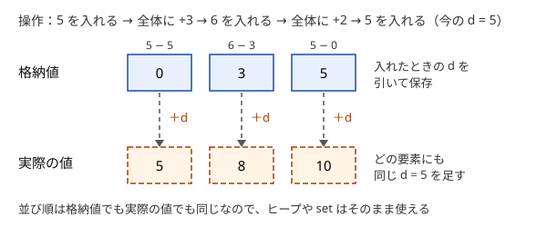

!!! abstract "要点"
    - **何ができるか**：「全要素に $x$ を足す」「全体を反転する」「全体を回転する」を、要素を書き換えずにオフセット・反転フラグ・先頭位置の変数で表す。入れるときに引き、取り出すときに足すのが基本になる。
    - **いつ使うか**：
        - 全要素に $x$ を足す・全体に代入する操作がクエリに混ざる。
        - 列全体を反転してから先頭・末尾に追加する。
        - 配列を回転してから $i$ 番目を参照する。
        - $Q \le 2 \times 10^5$ で、全体への操作を毎回 $O(N)$ で行うと間に合わない。
    - **計算量**：全体への操作は $O(1)$。要素の追加・取得は、もとのコンテナの計算量のまま（ヒープなら $O(\log N)$、deque なら $O(1)$）。全体代入で差分を消す手間は、全体でならし $O(N + Q)$ 回に収まる。
    - **前提**：[STL コンテナの使い分け](../ds/stl-containers.md)

<!-- textlint-disable -->
別名：global offset・オフセット・全体加算・反転フラグ・回転量・全体に反映させる値を別に持つ
<!-- textlint-enable -->

全体への操作を変数で持つとは、すべての要素に同じように効く操作を、要素を 1 つずつ書き換える代わりに 1 個の変数に記録しておく工夫である。要素を読むときにその変数で読み替えれば、全体への操作は $O(1)$ で済む。$Q$ 回の全体への操作を毎回 $O(N)$ で行うと $O(NQ)$ になり、$N, Q = 2 \times 10^5$ では間に合わない。この工夫で、その $O(N)$ が消える。

## オフセット（入れるときに引き、出すときに足す） {#offset}

「全要素に $x$ を足す」操作が混ざるときは、それまでに全体へ足した量の合計 $d$（オフセット）を 1 つの変数に持つ。コンテナの中には、要素の値そのものではなく格納値を入れておき、次の性質を保つ。

$$
\text{実際の値} = \text{格納値} + d \quad (\text{すべての要素で同じ } d)
$$

この性質を保つための各操作の手順は次のとおりである。

- **全体に $x$ を足す**：$d \leftarrow d + x$ だけを行う。すべての要素の実際の値が $x$ だけ増えたことになる
- **値 $v$ を入れる**：$v - d$ を格納する。今の $d$ を足すとちょうど $v$ に戻る。これより前の全体への加算は、この要素には効いていないので、その分をあらかじめ引いておく
- **取り出す・読む**：格納値に $d$ を足して返す
- **しきい値と比べる**：「実際の値が $H$ 以上」は「格納値が $H - d$ 以上」と同じである。比べる側を $d$ でずらせば、格納値のままで探せる



この工夫がヒープや set とそのまま組めるのは、すべての要素に同じ $d$ を足しても大小の順が変わらないからである。格納値で最小の要素は、実際の値でも最小である。だから最小値の取り出しや `lower_bound` を格納値のまま行い、答えるときだけ $d$ を足せばよい。

```cpp
--8<-- "global-offset/offset-heap.cpp:core"
```

格納値と実際の値を 1 つの変数で行き来できれば、足し算以外の全体への操作にも同じ考え方が使える。ただし大小の順を保たない操作では、ヒープや set の順序を格納値のまま使えない。

- **全体を XOR $x$ する**：格納値 $\oplus$ $d$ が実際の値になるように $d \leftarrow d \oplus x$ とし、入れるときは $v \oplus d$ を格納する。XOR は大小の順を保たないので、ヒープや set の順序は使えない。値ごとの個数を数える用途や、bit ごとに見る構造と組む
- **全体を $a$ 倍してから $b$ を足す**：実際の値 ＝ $a' \times \text{格納値} + b'$ の組 $(a', b')$ を持てばよい。入れるときに $a'$ で割る必要があるので、素数 $p$ を法とする計算で $a' \not\equiv 0$ のときに限られる（[逆元](../math/mod-inverse.md)が要る）。全体への操作では $a' \leftarrow a a'$、$b' \leftarrow a b' + b$ とし、値 $v$ を入れるときは $(v - b') \cdot a'^{-1}$ を格納する。mod の値は大小の順を持たないので、ヒープとは組めない。$a = 0$ は全体代入にあたるので、[全体代入](#assign-all)の節の方法で扱う

??? question "確認問題：オフセットつきヒープに入れる値"
    最小ヒープとオフセット $d$ を持っている。今 $d = 7$ で、実際の値が $4$ の要素を入れたい。何を格納するか。その後、全体に $-10$ を足してからこの要素を取り出すと、出力は何になるか。

    ??? success "答え"
        格納するのは $4 - 7 = -3$ である。全体に $-10$ を足すと $d = -3$ になり、取り出すときは $-3 + (-3) = -6$ を返す。実際に $4$ に $-10$ を足した値と一致する。格納値が負になってもよいので、符号なしの型は使わない。

## 反転フラグ（追加する側や添字の読み方を入れ替え、最後に向きを直す） {#flip-flag}

「列全体を反転する」操作は、要素を並べ替えず、今が反転しているかどうかの 1 ビットのフラグ $\mathrm{rev}$ を持って表す。保つ性質は次のとおりである。

- $\mathrm{rev}$ が偽なら、コンテナの並びがそのまま実際の列である
- $\mathrm{rev}$ が真なら、コンテナを末尾から読んだものが実際の列である

この性質から、各操作の手順が決まる。

- **全体を反転する**：$\mathrm{rev}$ を反転させるだけである
- **実際の先頭に追加する**：$\mathrm{rev}$ が偽ならコンテナの先頭へ、真ならコンテナの末尾へ追加する。実際の末尾への追加も逆にする
- **実際の $i$ 番目を読む**（0-indexed）：$\mathrm{rev}$ が偽なら $i$ 番目、真なら $n - 1 - i$ 番目を読む（$n$ は今の要素数）
- **最後に列全体を出力する**：$\mathrm{rev}$ が真なら、コンテナ全体を 1 回だけ反転してから出力する

両端への追加が要るので、コンテナには [deque](../ds/stl-containers.md#comparison) を使う。

```cpp
--8<-- "global-offset/flip-deque.cpp:core"
```

反転の回数は数えなくてよい。反転を 2 回行うと元に戻るので、偶奇だけが効く。これを使うと「末尾に追加してから全体を反転する」を $N$ 回繰り返す形は、追加する側が先頭と末尾で交互に入れ替わるだけになる。最後の 1 回の反転の向きだけを、$N$ の偶奇で直せばよい。

反転以外の「2 回で元に戻る全体の操作」も同じ形で扱える。長さ $2N$ の列の前半と後半を入れ替える操作なら、入れ替わっているかのフラグを持ち、フラグが真のとき実際の位置 $i$ を $(i + N) \bmod 2N$ に読み替えてから要素を読み書きする。最後にフラグが真なら、前半と後半を 1 回だけ入れ替える。

## 全体代入と個別の差分（代入のたびに差分の map を空にする。ならし） {#assign-all}

「全要素を $x$ に置き換える」操作と、「1 か所に足す」「1 か所を読む」操作が混ざる場合は、オフセットだけでは足りない。代入の前に個別に足した量が、代入で消えるからである。そこで、全体代入の値 $\mathrm{base}$ と、$\mathrm{base}$ からの個別の差分を持つ map $\mathrm{diff}$ の 2 つで表す。

- 保つ性質：位置 $i$ の実際の値は $\mathrm{base} + \mathrm{diff}[i]$（$\mathrm{diff}$ に $i$ がなければ $0$ とみなす）
- **全体を $x$ に代入する**：$\mathrm{base} \leftarrow x$ とし、$\mathrm{diff}$ を空にする
- **位置 $i$ に $x$ を足す**：$\mathrm{diff}[i] \leftarrow \mathrm{diff}[i] + x$
- **位置 $i$ を読む**：$\mathrm{base} + \mathrm{diff}[i]$。初期値は $\mathrm{base} = 0$、$\mathrm{diff}[i] = A_i$ と入れておけば、場合分けが要らない

```text
assign_all(x): base = x; diff.clear()
add(i, x):     diff[i] += x
get(i):        return base + (diff に i があれば diff[i]、なければ 0)
```

$\mathrm{diff}$ を空にする時間は、入っている要素の数に比例する。それでも全体では速い。$\mathrm{diff}$ に要素が増えるのは、初期値の $N$ 個と、1 か所への加算 1 回ごとの高々 1 個だけである。一度消えた要素は、また足されない限り戻らない。だから $Q$ 回の操作の間に消す要素の数は合わせて $N + Q$ 個以下で、map を使っても全体で $O((N + Q) \log N)$ になる。1 回の代入は重くても合計は抑えられるという、[ならし計算量](../basics/complexity-estimation.md#amortized)の典型である。

$\mathrm{diff}$ を map ではなく長さ $N$ の配列にすると、空にする手間が毎回 $O(N)$ になって効果がなくなる。配列で持ちたいときは、各位置の実際の値を配列 $A$ に、各位置を最後に書いた時刻を別の配列に持つ。読むときや足すときに、その時刻が最後の全体代入より前なら、まず $A_i \leftarrow \mathrm{base}$ としてから使う。

## 回転は先頭位置の添字で表す {#rotation}

長さ $N$ の配列を回転する操作は、要素を動かさず、実際の 0 番目がもとの配列のどこにあるかを表す変数 $s$ で表す。保つ性質は「実際の $i$ 番目 ＝ もとの配列の $(i + s) \bmod N$ 番目」である。

- **右に 1 つ回転する**（末尾の要素が先頭へ来る）：実際の 0 番目は、それまでの末尾、すなわちもとの配列の $(s - 1) \bmod N$ 番目になる。だから $s \leftarrow (s + N - 1) \bmod N$ とする
- **左に $k$ 回転する**：$s \leftarrow (s + k) \bmod N$
- **実際の $i$ 番目を読む・書く・2 つを交換する**：添字を $(i + s) \bmod N$ に読み替えてから、もとの配列を操作する

回転を $k$ 回まとめて行うときも、$s$ に $k$ を足して $N$ で割った余りをとるだけで済む。同じ配列を何度も回すと周期 $N$ で元に戻るのは、この式から分かる（周期の使い方は[シミュレーションを速く進める](../basics/periodicity.md#simulation-speedup)）。

回転と反転が両方あるときは、実際の $i$ 番目がもとの配列の $(\sigma i + s) \bmod N$ 番目（$\sigma = \pm 1$）になるように、$\sigma$ と $s$ の 2 つを持つ。反転では、新しい $i$ 番目が古い $N - 1 - i$ 番目になることから、$s \leftarrow (s + \sigma (N - 1)) \bmod N$ としてから $\sigma \leftarrow -\sigma$ とする。右に 1 つ回転するときは、新しい $i$ 番目が古い $i - 1$ 番目なので $s \leftarrow (s - \sigma) \bmod N$ とする。どちらの操作も $\sigma$ と $s$ の更新だけで $O(1)$ である。

??? question "確認問題：回転の向き"
    $A = (10, 20, 30, 40)$ で $s = 0$ から始める。右に 1 つ回転してから、実際の 0 番目を読むと何が返るか。$s$ はいくつになるか。

    ??? success "答え"
        $s = (0 + 4 - 1) \bmod 4 = 3$ になり、実際の 0 番目はもとの 3 番目の $40$ である。右回転で末尾の $40$ が先頭へ来たことと合っている。$s - 1$ を `% 4` で割ると C++ では $-1$ になるので、$N$ を足してから割る。

## 落とし穴 {#pitfalls}

**反転中に先頭と末尾を取り違える**。$\mathrm{rev}$ が真のとき「先頭に追加」をコンテナの先頭へ入れてしまう誤りが多い。実際の位置とコンテナの位置を変換する処理を `push_front`・`push_back`・`at` のような関数 1 か所にまとめ、クエリの処理からは実際の位置だけで呼ぶ。小さな例で、反転を 0 回・1 回・2 回挟んだ結果を手で確かめる。

**最後に向きを直し忘れる**。全部のクエリを処理した後に列全体を出力する問題では、$\mathrm{rev}$ が真ならコンテナを反転してから出力する。前半と後半の入れ替えフラグも同じで、最後にフラグを見る処理を忘れると、反転の回数が奇数のときだけ答えが合わない。

**オフセットに入れる前の値を格納する**。値 $v$ を入れるときに $v$ をそのまま格納すると、それより前の全体への加算まで効いてしまう。格納するのは $v - d$ で、出すときに $d$ を足す。しきい値と比べるときも、$H$ ではなく $H - d$ と比べる。

**オフセットや格納値があふれる**。$d$ は全体への加算の合計なので、$x \le 10^9$ が $2 \times 10^5$ 回なら $2 \times 10^{14}$ に達する。$d$ と格納値は `long long` で持つ。格納値 $v - d$ は負になりうるので、符号なしの型は使わない（[整数のオーバーフロー](../cpp/cpp-integer-overflow.md)）。

**負の数の余り**。回転量を減らして $s - 1$ や $s - k$ が負になると、C++ の `%` は負の値を返す。$s \leftarrow (s - k \bmod N + N) \bmod N$ のように、$N$ を足してから余りをとる。

**全体代入のときに差分を消し忘れる**。$\mathrm{base}$ を書き換えても $\mathrm{diff}$ が残っていると、代入より前の加算が読み出しに混ざる。代入では必ず $\mathrm{diff}$ を空にする。

## 遅延セグメント木とのつながり（全体への操作を区間への操作に広げる） {#to-lazy-segment-tree}

この節は [セグメント木](../ds/segment-tree.md)を前提にする。オフセットは、全体への操作を各要素へ配らず保留しておく工夫である。操作する範囲が全体ではなく区間 $[l, r)$ になると、1 個の変数では表せない。

[遅延セグメント木](../ds/lazy-segment-tree.md)は、セグメント木の各ノードにこのオフセットを 1 つずつ持たせたものと見られる。ノードが受け持つ区間の全体に効く操作を、そのノードの保留として持ち、子を見る必要が出たときに初めて子へ配る（[保留を持たせるアイデア](../ds/lazy-segment-tree.md#idea)）。

全体への操作が複数の種類にまたがるときの考え方も、そのまま遅延セグメント木に持ち込める。

- **操作の合成**：「$x$ を足す」と「$y$ に代入する」が混ざるとき、保留を「代入するか・代入する値・足す値」の組で持ち、2 つの操作を続けて行った結果を 1 つの組で表す。区間が全体だけなら、全体代入の値とオフセットを組にして持つことにあたる
- **値への作用**：オフセットの節で、ヒープの順序が足し算で変わらなかったように、遅延セグメント木では「保留をノードの集約値（和・最小値）にどう効かせるか」を決める必要がある。和に $x$ を足す操作を効かせるには区間の長さが要る

ある区間にだけ足す操作を、読み出しの前にまとめて行えばよいなら、遅延セグメント木を使わずに[いもす法](../basics/imos.md)で足りる。

## 例題 {#examples}

### ABC212 D. Querying Multiset {#abc212_d}

<div class="kp-problems" data-role="example" markdown>

- [ABC212 D. Querying Multiset](https://atcoder.jp/contests/abc212/tasks/abc212_d)（diff 775）：袋への数の追加・全体への加算・最小値の取り出しのクエリを処理する。

</div>

最小値を何度も取り出すので最小ヒープを使い、全体への加算はオフセット $d$ に足すだけにする。すべての要素に同じ量を足しても大小の順は変わらないので、ヒープの中身は格納値のままでよい。数を入れるときに $d$ を引いて格納し、取り出すときに $d$ を足す。

??? note "解法の詳細"
    - $d = 0$ と空の最小ヒープ（`priority_queue` に `greater` を指定）を用意する。
    - 数 $X$ を入れるクエリでは $X - d$ をヒープに入れる。全体に $X$ を足すクエリでは $d \leftarrow d + X$ とする。
    - 最小を取り出すクエリでは、ヒープの top に $d$ を足して出力し、pop する。
    - $d$ は加算の合計なので `long long` で持つ。各クエリはヒープの操作 1 回で、全体で $O(Q \log Q)$ になる。コードは[オフセット](#offset)の節のものと同じ形である。

## 練習問題 {#practice}

<div class="kp-problems" data-role="practice" markdown>

- [典型90 044. Shift and Swapping（★3）](https://atcoder.jp/contests/typical90/tasks/typical90_ar)（diff —）：配列の右回転・2 要素の交換・参照のクエリを処理する。
- [ABC199 C. IPFL](https://atcoder.jp/contests/abc199/tasks/abc199_c)（diff 436）：長さ 2N の文字列に、2 文字の入れ替えと前半・後半の入れ替えを繰り返した後の文字列を求める。
- [ARC077 C. pushpush](https://atcoder.jp/contests/arc077/tasks/arc077_a)（diff 552）：末尾への追加と全体の反転を繰り返した後の列を求める。
- [ABC278 D. All Assign Point Add](https://atcoder.jp/contests/abc278/tasks/abc278_d)（diff 559）：全体への一括代入・一点への加算・一点の取得のクエリを処理する。
- [ABC158 D. String Formation](https://atcoder.jp/contests/abc158/tasks/abc158_d)（diff 610）：文字列の反転と、先頭・末尾への文字の追加のクエリを処理した後の文字列を求める。
- [ABC379 D. Home Garden](https://atcoder.jp/contests/abc379/tasks/abc379_d)（diff 745）：植える・全体が育つ・高さ H 以上を収穫するクエリを処理する。

</div>

??? note "練習の方針"
    - **典型90 044**：回転量 $s$ を持ち、右回転では $s \leftarrow (s + N - 1) \bmod N$。交換と参照は添字を $(i + s) \bmod N$ に読み替えて行う
    - **ABC199 C**：前半と後半が入れ替わっているかのフラグを持つ。入れ替えのクエリではフラグを反転させ、2 文字の入れ替えでは、フラグが真なら位置を $N$ ずらしてから入れ替える。最後にフラグが真なら前半と後半を入れ替えて出力する
    - **ARC077 C**：反転を実際には行わず、追加する側を先頭と末尾で交互に切り替える。最後に反転の回数の偶奇で向きを直す
    - **ABC278 D**：全体代入の値と、個別の差分を持つ map で表す。代入のたびに map を空にしても、消す要素の数は合計で $N + Q$ 個以下である
    - **ABC158 D**：反転フラグを持ち、フラグが真なら先頭と末尾への追加を入れ替えて deque に入れる。最後にフラグが真なら反転して出力する
    - **ABC379 D**：成長をオフセットで持ち、植えるときは $-d$ を格納する。後から植えたものほど格納値が小さいので、queue の先頭が常に最も高い。先頭から「格納値 $+ d \ge H$」の間だけ取り出せば収穫できる

## 参考 {#references}

- [drken「AtCoder ABC 212 D - Querying Multiset (2Q, 茶色, 400 点)」](https://drken1215.hatenablog.com/entry/2025/02/06/101932)：例題の方針（オフセットを引いて入れ、足して出す）
- [drken「AtCoder ABC 379 D - Home Garden (2Q, 茶色, 400 点)」](https://drken1215.hatenablog.com/entry/2024/11/10/153300)：しきい値を $H - d$ に直して比べること、queue で足りる理由
- [drken「AtCoder ABC 278 D - All Assign Point Add (2Q, 茶色, 400 点)」](https://drken1215.hatenablog.com/entry/2023/05/05/002000)：全体代入と個別の差分、消す回数によるならしの議論
- [drken「AtCoder ABC 158 D - String Formation (2Q, 茶色, 400 点)」](https://drken1215.hatenablog.com/entry/2020/03/08/144800)：反転フラグと deque、最後の反転
- [drken「AtCoder ABC 066 C - pushpush (4Q, 茶色, 300 点)」](https://drken1215.hatenablog.com/entry/2025/01/01/174846)：反転を追加する側の交代に言い換えること
- [hamayan「IPFL [AtCoder Beginner Contest 199（Sponsored by Panasonic） C]」](https://blog.hamayanhamayan.com/entry/2021/04/25/002202)：ABC199 C の別法（前半と後半を別の文字列で持ち、入れ替えを swap で済ませる）
- [E869120「競プロ典型 90 問 044 の解答例」](https://raw.githubusercontent.com/E869120/kyopro_educational_90/main/sol/044.cpp)：回転量の更新と添字の読み替えの式
