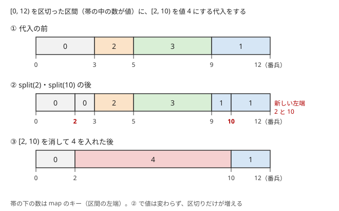

!!! abstract "要点"
    - **何ができるか**：互いに重ならない区間を左端をキーにした `set`・`map` で持ち、点を含む区間の検索・区間の追加と併合・区間への代入を、ならし $O(\log N)$ で行う。座標が $10^9$ でも、配列を使わないのでそのまま扱える。
    - **いつ使うか**：
        - 区間を塗るたびに、塗られたマスの数や色ごとのマスの数を答える
        - 同じ色でつながった区間をまとめて塗り替える
        - 点 x が覆われているか・x を含む区間はどこか
        - 座標が $10^9$ まで（配列の添字にできない）
    - **計算量**：点を含む区間の検索は $O(\log N)$。区間の分割・代入・追加・削除はならし $O(\log N)$（$N$ は区間の数）。1 回で何個も消すことがあっても、各区間が消えるのは一度だけなので、合計で抑えられる。区間をたどるだけで消さない操作（区間和の質問・区間加算）が混ざると、この評価は成り立たない
    - **前提**：[set・multiset・map の応用](../ds/ordered-set.md)

<!-- textlint-disable -->
別名：IntervalSet・RangeSet・ODT・Chtholly Tree・珂朵莉树・互いに素な区間の集合
<!-- textlint-enable -->

区間を set で管理する手法は、数直線の上の互いに重ならない区間を、左端をキーとして `std::map` に入れて持つ方法である。点を含む区間は `upper_bound` の 1 つ前として $O(\log N)$ で見つかる。区間への代入は「区間を 2 か所で切り、間を消して 1 つ入れる」で書け、消える区間はそれぞれ一度しか消えないので、全体の計算量が抑えられる。

## 持ち方（左端をキーにした map・両端の番兵の区間） {#representation}

区間を set で管理するときの持ち方は、問題に合わせて次の 2 つから選ぶ。どちらも区間は[半開区間](../guide/glossary.md#half-open-interval) $[l, r)$ で表し、区間どうしは重ならない。

| 持ち方 | キー → 値 | 向いている問題 |
| --- | --- | --- |
| 覆われた区間だけを持つ | 左端 → 右端 | 塗られたかどうかだけが要る（覆われた長さ・点が覆われているか・mex） |
| 全体を区切り、各区間に値を持つ | 左端 → 値 | 区間ごとに色や数値が違う（色ごとのマスの数・区間代入） |

1 つ目の「覆われた区間だけを持つ」形では、区間の間に隙間がある。重なる区間や接する区間（$[1, 3)$ と $[3, 5)$）はまとめて 1 つにしておく。こうしておくと区間の表し方が 1 通りに決まり、「$x$ を含む区間」がそのまま「$x$ を含む覆われたひとかたまり」になる。

2 つ目の「全体を区切る」形では、隙間がない。区間の右端は次のキーなので、右端を持たなくてよい。塗られていない部分も「値 0 の区間」として持つ。1 つ目の形は、2 つ目の形で値を 0 と 1 にしたものとも見られる。

どちらの形でも、両端に[番兵](../guide/glossary.md#sentinel)の区間を入れておくと、端の場合分けが消える。

- 覆われた区間だけを持つ形：$[-\infty, -\infty)$ と $[\infty, \infty)$ のような長さ 0 の区間を入れる。どの $x$ にも「左端が $x$ 以下の区間」と「左端が $x$ より大きい区間」が必ずある
- 全体を区切る形：座標の範囲を $[\mathrm{lo}, \mathrm{hi})$ とし、キー $\mathrm{lo}$（最初の値）とキー $\mathrm{hi}$（右の番兵）を入れる。$\mathrm{hi}$ は最後の区間の右端を表すためのキーで、値は使わない

`std::set<pair<long long, long long>>` に $(l, r)$ の組を入れてもよい。ただし `set` の要素は書き換えられないので、右端を延ばすには消して入れ直すことになる。`map` なら右端や値を `it->second` で直接書き換えられる。

## x を含む区間の検索（upper_bound の 1 つ前） {#find}

$x$ を含む区間は、左端が $x$ 以下の区間のうち最も右のものである。`mp.upper_bound(x)` は左端が $x$ より大きい最初の区間を指すので、その 1 つ前が求める区間の候補になる。

- 全体を区切る形では、候補がそのまま答えである。番兵があるので、$\mathrm{lo} \le x < \mathrm{hi}$ なら `prev(mp.upper_bound(x))` は必ず存在する
- 覆われた区間だけを持つ形では、候補の右端が $x$ より大きいときだけ $x$ を含む。右端が $x$ 以下なら、$x$ は隙間にある

`lower_bound(x)` を使うと、左端がちょうど $x$ の区間とそうでない区間で場合分けが要る。左端が $x$ に等しい区間も「$x$ を含む」側に入れたいので、`upper_bound` の 1 つ前と覚えるのがよい。`set` の前後の要素の探し方は [set・multiset・map の応用](../ds/ordered-set.md)にまとめる。

## split(x)（区間の分割）を先に書き、代入・削除はその組み合わせで書く {#split}

全体を区切る形の操作は、すべて $\mathrm{split}(x)$ から組み立てると短く書ける。$\mathrm{split}(x)$ は「$x$ を左端とする区間を作り、そのイテレータを返す」関数で、$x$ が区間 $[a, b)$ の途中にあれば $[a, x)$ と $[x, b)$ に分ける。分けた 2 つの区間の値は元の区間と同じなので、表している列は変わらない。

区間 $[l, r)$ を値 $v$ にする代入は、次の 3 段で書ける。

1. $\mathrm{split}(l)$ と $\mathrm{split}(r)$ で、$l$ と $r$ を区間の境目にする
2. 左端が $[l, r)$ に入る区間をすべて消す。消す前に 1 つずつ見れば、消える区間の長さと値が分かる
3. 区間 $[l, r)$ を値 $v$ で 1 つ入れる

次の図は、4 つに区切った $[0, 12)$ へ「$[2, 10)$ を値 4 にする」代入をする様子である。



図の流れを文章で追うと次のとおりである。

- 代入の前は、キー 0・3・5・9 と右の番兵 12 の 5 つが `map` に入っている
- $\mathrm{split}(2)$ は $[0, 3)$ を $[0, 2)$ と $[2, 3)$ に分け、$\mathrm{split}(10)$ は $[9, 12)$ を $[9, 10)$ と $[10, 12)$ に分ける。キーが 2 と 10 の 2 つ増える
- キー 2・3・5・9 の 4 区間を消し、キー 2 に値 4 を入れる。消える 4 区間を見ながら「値 0 が 1 マス・値 2 が 2 マス・値 3 が 4 マス・値 1 が 1 マス減る」と数えれば、値ごとのマスの数を更新できる

```cpp
--8<-- "interval-set/paint.cpp:core"
```

`assign` の引数 `f` は、消える区間ごとに呼ぶ関数である。値ごとのマスの数や区間の和を持つときは、ここで消える区間の分を引き、最後に入れる区間の分を足す。

区間の削除（全体を区切る形で「値をなしにする」）も、$\mathrm{split}(l)$ と $\mathrm{split}(r)$ の後に間を消して「なし」の区間を 1 つ入れるだけである。区間の中の一部だけを読みたいときも、先に $\mathrm{split}(l)$ と $\mathrm{split}(r)$ をすると、端の区間がはみ出す場合を考えなくてよい。

覆われた区間だけを持つ形では、追加と削除を直接書く方が短い。

- **追加 $[l, r)$**：左隣の区間が $l$ に届いていればそこから始め、左端が $r$ 以下の区間を順に消しながら $l$ と $r$ を広げ、最後に 1 つ入れる
- **削除 $[l, r)$**：$[l, r)$ と重なる区間を順に消し、$l$ より左にはみ出した部分と $r$ より右にはみ出した部分を入れ直す

```cpp
--8<-- "interval-set/cover.cpp:core"
```

追加では「接する」も含めて左端が $r$ 以下（`<=`）の区間をまとめ、削除では重なる区間（`<`）だけを触る。この不等号の違いが、区間の表し方を 1 通りに保つ。

## なぜならしで速いか（新しくできる区間は O(1) 個、消える区間は一度だけ）と、走査だけの操作が混ざると崩れる理由 {#amortized}

1 回の代入で消える区間は何個にもなりうるが、全体の計算量は[ならし計算量](../basics/complexity-estimation.md#amortized)で抑えられる。理由は次の 2 つである。

- 1 回の代入で新しくできる区間は 3 個以下である（$\mathrm{split}(l)$ と $\mathrm{split}(r)$ で 2 個、最後に入れる 1 個）
- 区間は一度消えたら戻らないので、消える回数の合計は、できた回数の合計以下である

最初の区間の数を $N_0$、代入の回数を $Q$ とすると、区間ができる回数の合計は $N_0 + 3Q$ 以下で、消える回数の合計もそれ以下になる。`map` への 1 回の挿入・削除は $O(\log N)$ なので、全体は $O((N_0 + Q) \log (N_0 + Q))$ である。覆われた区間だけを持つ形の追加（新しくできるのは 1 個）と削除（2 個）も同じ評価になる。

この評価が成り立つのは、たくさんの区間を見た操作が、見た区間をすべて消して 1 つにまとめるからである。区間を見るだけで消さない操作が混ざると、評価は崩れる。

- **区間の和を答えるだけの質問**：$[l, r)$ の中の区間をたどって和を求めると、区間が $K$ 個あれば $O(K)$ かかる。最初に全体を $N$ 個の区間に分けておき、全体の和を何度も聞けば、毎回 $O(N)$ になる
- **区間への加算**：$[l, r)$ の中の各区間の値に $x$ を加えると、区間の数は減らない。広い区間への加算をくり返すと、毎回すべての区間を触る

区間の和を答えたいときは、区間ごとの和を [BIT](../ds/fenwick-tree.md) などに別に持ち、代入のたびに差分を反映させる（[応用](#applications)）。区間への加算が要るなら、[遅延セグメント木](../ds/lazy-segment-tree.md)を使う。

!!! warning "ODT（珂朵莉树）がならしで速いのは、代入が十分に混ざるときだけ"
    区間をたどるだけの操作も代入と同じ構造で処理する書き方を ODT と呼ぶことがある。区間の数を減らすのは代入だけなので、代入が来ない入力では区間が減らず、1 回の操作が $O(N)$ のままになる。入力が乱数で作られ、代入が一定の割合で来る問題でだけ速いと考えてよい。ABC で使うなら、[なぜならしで速いか](#amortized)の評価が自分の問題で成り立つかを先に確かめる。

## 応用（mex・塗り分け・和集合の長さ・値ごとの合計の差分更新） {#applications}

区間を set で管理する手法は、次の型で使う。

- **和集合の長さ**（サイン：区間を塗るたびに、塗られたマスの数を答える）：覆われた区間だけを持つ形で追加する。覆われた長さの合計 `total` は、消える区間の分を引いて入れる区間の分を足せば保てる。塗られていないマスの数は全体の長さから `total` を引けばよい
- **mex**（サイン：1 点の書き換えのたびに、数列に含まれない最小の非負整数を答える）：数列に 1 個以上ある値 $v$ ごとに、覆われた区間 $[v, v + 1)$ を持つ。個数が 0 から 1 になったら追加し、1 から 0 になったら削除する。mex は「0 以上で覆われていない最小の値」である。0 を含む区間があればその右端、なければ 0 になる（コードの `next_free(0)`）
- **塗り分け**（サイン：同じ色でつながった区間をまとめて塗り替える）：全体を区切る形を使い、隣り合う区間の値が必ず違うように保つ（同じ値になったら 1 つへまとめる）。こうすると「$x$ を含む区間」が「$x$ と同じ色でつながった部分」と一致する
- **値ごとの合計の差分更新**（サイン：区間を塗るたびに、色ごとのマスの数や、値の和を答える）：代入で消える区間の寄与を引き、入れる区間の寄与を足す。色ごとのマスの数なら、消える区間の色の数から長さを引けばよい。和を BIT に持つなら、区間ごとに区間加算をする

和集合の長さと mex は「塗られたかどうか」しか要らないので、覆われた区間だけを持つ形が短い。値が区間ごとに違うなら、全体を区切る形と $\mathrm{split}$ を使う。

!!! tip "座標が小さければ配列でもよいかを先に考える"
    座標が $2 \times 10^5$ 程度で、操作が「区間を一度だけ塗る」なら、[次の空きへ飛ぶ Union-Find](../ds/union-find-applications.md) で済む。座標が大きいだけなら、[座標圧縮](../basics/coordinate-compression.md)して遅延セグメント木を使う方法もある。区間を set で管理する手法は、座標圧縮が要らず、オンラインで処理できるのが利点である。

## 落とし穴 {#pitfalls}

**`upper_bound` の前に `begin()` を確かめ忘れる**。番兵を入れない場合、$x$ が最も左の区間より左にあると `upper_bound(x)` は `begin()` を返し、その 1 つ前を参照すると未定義動作になる。両端に番兵の区間を入れれば、この確認は要らない。番兵を入れたら、区間の数や長さの合計を答えるときに番兵の分を除く。

**消しながらイテレータを進める**。`mp.erase(it)` の後に `++it` をすると、消えた要素のイテレータを使うことになる。`it = mp.erase(it);` と書けば、次の要素を受け取れる。代入のように連続した範囲を消すなら、`mp.erase(itl, itr)` 1 回で済む。

**右端を要素に持つ `set` で、split の順序を間違える**。区間を $(l, r, v)$ の組で `set` に入れると、分割は「消して 2 つ入れ直す」になる。$l$ と $r$ が同じ区間にあるとき、$\mathrm{split}(l)$ の後に $\mathrm{split}(r)$ をすると、先に得たイテレータの要素が消えてしまう。この書き方では $\mathrm{split}(r)$ を先にする。左端をキーにした `map` で値だけを持つ形なら、分割は 1 個入れるだけで要素を消さないので、順序を気にしなくてよい（`map` への挿入は、ほかのイテレータを無効にしない）。

**空の区間**。$l = r$ のとき、$\mathrm{split}$ の後の `mp[l] = v` は、キー $l$ から始まる区間 $[l, b)$ の値を $v$ に書き換えてしまう（何も塗らないはずが $b - l$ マス塗られる）。$l \ge r$ なら何もしないで戻る。

**閉区間と半開区間の取り違え**。問題文の閉区間 $[L, R]$（1-indexed）は、0-indexed の半開区間 $[L - 1, R)$ に直す。覆われた区間だけを持つ形で「隣り合う区間をまとめる」とき、半開区間なら $[1, 3)$ と $[3, 5)$ が接すると判定するのは `r == l` で、閉区間なら `r + 1 == l` である。混ぜると、まとめ忘れや余分なまとめが起きる。

**長さの型**。座標が $10^9$ までなら、長さの合計は $10^9$ 程度で済む。しかし区間の長さに値を掛けた和や番兵の座標は `int` に収まらない。座標も値も `long long` で持つ。

## 例題 {#examples}

### ABC435 E. Cover query {#abc435_e}

<div class="kp-problems" data-role="example" markdown>

- [ABC435 E. Cover query](https://atcoder.jp/contests/abc435/tasks/abc435_e)（diff 982）：白いマスの列（長さは 10^9 まで）で、区間を黒く塗るたびに白いマスの数を答える。

</div>

列の長さが $10^9$ までなので、マスを配列で持てない。黒く塗られた部分を、覆われた区間だけを持つ形で持つ。塗る区間を追加するたびに重なる区間を消してまとめ、覆われた長さの合計を保てば、白いマスの数は全体の長さから合計を引いた値になる。

??? note "解法の詳細"
    マスを 0-indexed にし、問題文の閉区間 $[L, R]$ を半開区間 $[L - 1, R)$ に直す。覆われた区間の `map`（左端 → 右端）と、覆われた長さの合計 `total` を持つ。

    各クエリでは、[split の節](#split)の `insert(L - 1, R)` を呼ぶ。消える区間の長さを `total` から引き、まとめた区間の長さを足す。答えは $N - \mathrm{total}$ である。

    1 回の追加で新しくできる区間は 1 個で、消える区間はそれぞれ一度しか消えない。よって `map` の操作の回数は全体で $O(Q)$ 回で、計算量は $O(Q \log Q)$ になる。端点を[座標圧縮](../basics/coordinate-compression.md)し、白いマスの数を遅延セグメント木で持つ解き方もある。

### ABC380 E. 1D Bucket Tool {#abc380_e}

<div class="kp-problems" data-role="example" markdown>

- [ABC380 E. 1D Bucket Tool](https://atcoder.jp/contests/abc380/tasks/abc380_e)（diff 1230）：1 列のマスで、同じ色でつながった区間の塗り替えと、色ごとのマスの数の質問を処理する。

</div>

最初はマス $i$ が色 $i$ で、塗り替えはマス $x$ と同じ色でつながった部分全体に及ぶ。全体を区切る形で、隣り合う区間の色が必ず違うように保てば、「$x$ を含む区間」がそのまま塗り替える範囲になる。塗り替えた後に左右の区間と色が同じになったら、1 つにまとめる。

??? note "解法の詳細"
    `map`（左端 → 色）に、最初は $N$ 個の長さ 1 の区間と右の番兵を入れる。色ごとのマスの数 $\mathrm{cnt}[c]$ も持ち、最初はどれも 1 である。

    塗り替え（マス $x$ を含む部分を色 $c$ にする）：$x$ を含む区間 $[a, b)$ と、その色 $p$ を `prev(upper_bound(x))` で求める。$\mathrm{cnt}[p]$ から $b - a$ を引き、$\mathrm{cnt}[c]$ に足して、区間の色を $c$ にする。続けて、右隣の区間の色が $c$ なら右隣のキーを消し、左隣の区間の色が $c$ なら自分のキーを消す。これで隣り合う区間の色が違うという性質が戻る。右の番兵の値はどの色とも違う値（たとえば 0）にしておく。左の番兵はないので、左隣は自分が最初の区間（キー 0）でないときだけ見る。質問には $\mathrm{cnt}[c]$ を答える。

    区間は分割されず、まとめるたびにキーが 1 つ減る。キーは最初の $N$ 個から増えないので、消える回数の合計は $N$ 以下である。全体で $O((N + Q) \log N)$ になる。区間の左右の端と色を根に持つ Union-Find や、遅延セグメント木の二分探索でも解ける。

## 練習問題 {#practice}

<div class="kp-problems" data-role="practice" markdown>

- [ABC330 E. Mex and Update](https://atcoder.jp/contests/abc330/tasks/abc330_e)（diff 1004）：1 点を書き換えるたびに数列の mex を答える。
- [ABC430 G. Range Set Modifying Query](https://atcoder.jp/contests/abc430/tasks/abc430_g)（diff 2371）：区間の各集合への値の追加・削除と、区間の中で要素数が最大の集合の数の質問を処理する。

</div>

??? note "練習の方針"
    - **ABC330 E**：値ごとの個数を持ち、個数が 0 から 1 になった値 $v$ について $[v, v + 1)$ を追加し、1 から 0 になったら削除する。mex は 0 を含む区間の右端（なければ 0）である。mex は $N$ 以下なので、$N$ より大きい値は無視してもよい。「まだ出ていない値」を `set` に入れて最小を取る方法でも解ける
    - **ABC430 G**：値（60 種類）ごとに、その値を含む集合の添字の区間を、覆われた区間だけを持つ形で持つ。追加では、まだ覆われていない部分だけが新しく覆われるので、その部分に遅延セグメント木で $+1$ をする。削除では、外れる部分に $-1$ をする。遅延セグメント木には区間加算と「最大値とその個数」を載せる

## 力試し {#challenge}

<div class="kp-problems" data-role="challenge" markdown>

- [ABC255 Ex. Range Harvest Query](https://atcoder.jp/contests/abc255/tasks/abc255_h)（diff 2430）：毎日実がなる木々の区間を収穫する質問ごとに、収穫量を答える。
- [ABC256 Ex. I like Query Problem](https://atcoder.jp/contests/abc256/tasks/abc256_h)（diff 2531）：区間の各要素を x で割る（切り捨て）・区間代入・区間和のクエリを処理する。

</div>

??? note "力試しの方針"
    - **ABC255 Ex**：「最後に収穫した日」が同じ木の区間を、全体を区切る形で持つ。$D$ 日目の $[L, R]$ の収穫では、消える区間 $[a, b)$ ごとに（経過日数）×（木の番号の和）を足し、$[L, R]$ を値 $D$ に代入する。木の番号の和は、等差数列の和の公式から $O(1)$ で求まる。答えは 998244353 で割った余りを求める。木の番号も日付も大きいので、番号の和は掛け算の途中で `long long` を超える。`__int128` で計算してから余りを取るか、2 の逆元を使って mod の下で計算する
    - **ABC256 Ex**：同じ値が続く区間を、全体を区切る形で持つ。割り算はたどった区間の値を割るだけで区間を消さないので、[値つきの区間の分割・統合](#valued-intervals)の評価が要る。区間和は BIT に持ち、区間の値が変わるたびに差分を足す

## 確認問題 {#quiz}

??? question "確認問題：代入を Q 回したとき、区間の総数が O(N + Q) で抑えられるのはなぜか"
    最初の区間の数を $N$ とする。1 回の代入で新しくできる区間は、$\mathrm{split}(l)$・$\mathrm{split}(r)$ で 2 個と、最後に入れる 1 個の合わせて 3 個以下である。区間は消えると増えないので、ある時点の区間の数は「それまでにできた区間の数」以下で、$N + 3Q$ を超えない。消える回数の合計も同じ数で抑えられる。

??? question "確認問題：代入しないで区間をたどるだけの操作が混ざると、なぜ遅くなりうるか"
    区間の数を減らすのは、たどった区間をまとめて 1 つにする代入だけだからである。たとえば最初に $N$ 個の区間があり、全体の和を答える質問だけが $Q$ 回来ると、区間は減らないまま毎回 $N$ 個をたどるので $O(NQ)$ になる。ならし計算量の評価は「たどった区間はその場で消える」ことに頼っている。

??? question "確認問題：覆われた区間 [1, 3) と [3, 5) があるとき、まとめておかないと何が困るか"
    $x = 3$ を含む区間として $[3, 5)$ が見つかるだけで、覆われたひとかたまりが $[1, 5)$ であることは分からない。mex を「0 を含む区間の右端」で求めるときも、$[0, 3)$ と $[3, 5)$ に分かれていれば 3 と答えてしまう（正しくは 5）。追加で接する区間（左端 $\le r$）までまとめておけば、区間の表し方が 1 通りに決まり、この食い違いは起きない。

## 使い分け {#comparison}

区間を set で管理する手法と、似た問題に使える手法の選び方は次のとおりである。

| 状況 | 使う手法 |
| --- | --- |
| 各位置を一度だけ塗る（塗った所は飛ばすだけ） | [次の空きへ飛ぶ Union-Find](../ds/union-find-applications.md)、または未処理の位置の `set` |
| 座標が小さく、区間代入と区間和・区間最小値が要る | [遅延セグメント木](../ds/lazy-segment-tree.md) |
| 座標が大きく、区間を塗る・同じ値の塊を扱う | 区間を set で管理する手法 |
| 座標が大きく、区間への加算と区間和が要る | [座標圧縮](../basics/coordinate-compression.md)＋遅延セグメント木 |
| 区間 chmin や区間の割り算と区間和 | [Segment Tree Beats](../ds/segment-tree-beats.md) |

次の空きへ飛ぶ Union-Find は、塗った位置を後で塗り直すことがない問題に向く。区間を set で管理する手法は、塗り直しがあっても使え、区間ごとの値を持てる。遅延セグメント木は区間ごとの集約値を $O(\log N)$ で答えられるが、座標を配列の添字にできることが前提である。

## 値つきの区間の分割・統合 {#valued-intervals}

この節は[遅延セグメント木](../ds/lazy-segment-tree.md)と [BIT](../ds/fenwick-tree.md) を前提にする。難しい問題では、区間を set で管理する手法を、区間の値をたどって書き換える操作と組み合わせることがある。そのときは、[なぜならしで速いか](#amortized)の評価を自分で作り直す必要がある。

**値を書き換える操作でも速い条件**。たどった区間を消さない操作でも、次のどちらかが言えれば全体の計算量が抑えられる。

- たどった区間の値が速く減る：区間の各要素を $x \ge 2$ で割る操作なら、1 つの区間の値は $\log_2 (\max A)$ 回ほど割られると 0 になる。0 になった区間どうしを隣とまとめれば、0 の区間をたどり続けることはない
- たどった区間がすべて同じ値になる：その操作は、たどった区間を 1 つにまとめる代入と同じである

区間の割り算の例で数えてみる。区間 1 つは、割られるたびに値が半分以下になるので、0 になるまでに割られるのは $O(\log \max A)$ 回である。分割でできた区間は元の値を受け継ぐが、新しい区間として数え直す。区間ができる回数の合計は $O(N + Q)$ なので、値が正の区間を割る回数の合計は $O((N + Q) \log \max A)$ になる。値が 0 の区間は隣とまとめてあるので、1 回の割り算でたどる 0 の区間は、正の区間の数より 1 個多い程度で済む。

**集約値は別のデータ構造に持つ**。区間を set で管理する手法そのものは区間の和や最大値を答えられない。区間の値が変わるたびに、変わった部分の差分を別のデータ構造に流す。

- 区間和：区間 $[a, b)$ の値が $u$ から $w$ に変わったら、BIT 2 本（区間加算・区間和）に $[a, b)$ へ $w - u$ を加える
- 区間の中の最大値とその個数：値の種類が少なければ、値ごとに覆われた区間の `map` を 1 つずつ持つ。追加で新しく覆われた部分 $[a, b)$ には遅延セグメント木（区間加算・最大値とその個数）で $+1$ を、削除で外れた部分には $-1$ を加える

どの場合も、差分を流す回数は区間の値が変わる回数に比例する。代入だけなら値が変わる回数は区間が消える回数と同じで、[なぜならしで速いか](#amortized)の評価に $\log N$ が 1 つ掛かるだけで済む。割り算のように区間を消さずに値だけを変える操作では、上で数えた割る回数がそのまま差分の回数になり、その回数に $\log N$ が掛かる。

**区間に「最後に触った時刻」を持たせる**。時刻とともに一様に増える量（毎日実がなる、毎秒水がたまるなど）を区間ごとに取り出す問題では、区間の値を「最後に取り出した時刻」にする。時刻 $t$ に区間を取り出すときは、消える区間ごとに（$t$ − 最後の時刻）×（区間の重みの和）を足し、取り出した区間を時刻 $t$ に代入する。取り出しが代入そのものなので、ならしの評価がそのまま使える。

## 参考 {#references}

- [omakasessan「ABC435E - Cover query を Python で解いた」](https://qiita.com/omakasessan/items/4d5dfca408ace2f70f7c)：例題 abc435_e の、覆われた区間をまとめて持つ方針と番兵の区間
- [merom686「ABC435」](https://merom686.hatenablog.com/entry/2025/12/07/023253)：例題 abc435_e の別解（座標圧縮と遅延セグメント木）
- [drken「AtCoder ABC 380 E - 1D Bucket Tool (1D, 水色, 450 点)」](https://drken1215.hatenablog.com/entry/2024/11/17/035045)：例題 abc380_e の制約と、set・Union-Find・遅延セグメント木の解き方
- [drken「AtCoder ABC 330 E - Mex and Update (1Q, 緑色, 475 点)」](https://drken1215.hatenablog.com/entry/2023/11/26/233800)：練習 abc330_e の mex が N 以下であることと、まだ出ていない値の set
- [kmjp「AtCoder ABC #430 : G - Range Set Modifying Query」](https://kmjp.hatenablog.jp/entry/2025/11/01/1030)：練習 abc430_g の、値ごとの区間の set と遅延セグメント木の組み方
- [kmjp「AtCoder ABC #255 (エイシングプログラミングコンテスト2022) : Ex - Range Harvest Query」](https://kmjp.hatenablog.jp/entry/2022/06/12/0930)：力試し abc255_h の、最後に収穫した日を区間の値にする方針
- [kmjp「AtCoder ABC #256 (東京海上日動プログラミングコンテスト2022) : Ex - I like Query Problem」](https://kmjp.hatenablog.jp/entry/2022/06/18/0930)：力試し abc256_h の、同じ値の区間の map と割り算のならし評価
