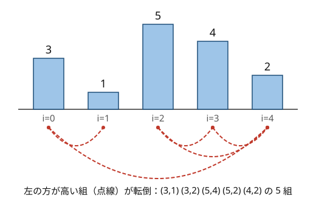

!!! abstract "要点"
    - **何ができるか**：列の転倒数（$i < j$ かつ $A_i > A_j$ の組の数）を、左から見て既に出た値のうち自分より大きいものの個数を BIT で足して $O(N \log N)$ で数える。隣接 swap でソートする最小回数に等しい。
    - **いつ使うか**：
        - 隣り合う要素の交換でソートする最小回数・バブルソートの交換回数
        - $i < j$ かつ $A_i > A_j$ を満たす組の数
        - 巡回シフトや、全体に加算して mod を取った各列の転倒数
        - $N \le 2 \times 10^5$ で、答えが約 $2 \times 10^{10}$ まで大きくなる
    - **計算量**：座標圧縮を含めて $O(N \log N)$。1 要素を足す・外すときの増減は $O(\log N)$、順列の先頭を末尾へ回すときの増減は $O(1)$
    - **前提**：[BIT（Fenwick Tree）](../ds/fenwick-tree.md)、[座標圧縮](../basics/coordinate-compression.md)

<!-- textlint-disable -->
別名：inversion・inversion number・inversion count・反転数・バブルソートの交換回数・隣接 swap の最小回数
<!-- textlint-enable -->

転倒数は、列の中で「前にある方が大きい」2 要素の組の数であり、列がどれだけ昇順から離れているかを表す。[BIT](../ds/fenwick-tree.md) で値ごとの個数を持ち、左から 1 つずつ数えると $O(N \log N)$ で求まる。隣接 swap でソートする最小回数と一致するので、並べ替えの回数を問う問題の多くがこの数え上げに帰着する。

## BIT で数える手順（値を座標圧縮し、左から自分より大きい既出の個数を足す） {#count-with-bit}

転倒数は、長さ $N$ の列 $A = (A_0, \dots, A_{N-1})$（0-indexed）について、$i < j$ かつ $A_i > A_j$ を満たす組 $(i, j)$ の個数である。等しい値の組は数えない。全部の組を調べると $N(N-1)/2$ 組で、$N = 2 \times 10^5$ なら約 $2 \times 10^{10}$ 組になり間に合わない。

次の図は、列 $(3, 1, 5, 4, 2)$ の転倒している組を点線で結んだものである。5 組あるので、転倒数は 5 である。



**アイデア**：組を右側の要素 $j$ で分類する。$j$ を固定すると、数えるのは「$A_0, \dots, A_{j-1}$ のうち $A_j$ より大きいものの個数」である。左から順に見ていけば、これは「これまでに出た値のうち $A_j$ より大きいものの個数」になる。値を添字にした個数の表 $c[v]$（値 $v$ がこれまでに何回出たか）を BIT に持てば、この個数は $c[A_j + 1] + c[A_j + 2] + \cdots$ という区間の和として $O(\log N)$ で取れる。

**処理の流れ**：

1. 値を[座標圧縮](../basics/coordinate-compression.md)して $0, 1, \dots, m - 1$ の番号に直す（$m$ は相異なる値の個数）。大小関係は保たれるので、転倒数は変わらない
2. 長さ $m$ の BIT を 0 で作り、答え $\mathrm{inv} = 0$ とする
3. $j = 0, 1, \dots, N - 1$ の順に、$A_j$ の番号を $v$ として、$\mathrm{inv}$ に $[v + 1, m)$ の和を足し、その後で $c[v]$ に 1 を足す

足す前に数えるのは、自分自身を数えないためである。$[v + 1, m)$ は $v$ を含まないので、等しい値は数えない。

列 $(3, 1, 5, 4, 2)$ で一度動かすと次のようになる（値が $1$〜$5$ なので、圧縮した番号は値から 1 を引いたものである）。

| $j$ | $A_j$ | これまでに出た値 | $A_j$ より大きい個数 | $\mathrm{inv}$ |
| --- | --- | --- | --- | --- |
| 0 | 3 | なし | 0 | 0 |
| 1 | 1 | 3 | 1 | 1 |
| 2 | 5 | 1, 3 | 0 | 1 |
| 3 | 4 | 1, 3, 5 | 1 | 2 |
| 4 | 2 | 1, 3, 4, 5 | 3 | 5 |

```cpp
--8<-- "inversion-number/count.cpp:core"
```

完全なプログラム：[`count.cpp`](https://github.com/yuukougun/kyopro-atlas/blob/main/snippets/inversion-number/count.cpp)（GitHub）
{ .kp-code-src }

**計算量**：座標圧縮のソートが $O(N \log N)$、各 $j$ で `lower_bound`・`sum`・`add` が $O(\log N)$ なので、全体で $O(N \log N)$ である。値がはじめから $0$〜$N - 1$ の順列なら、座標圧縮は要らない。

数える向きは逆でもよい。右から見て「これまでに出た値のうち $A_i$ より小さいものの個数」を足しても、同じ組を左側の要素で分類しただけなので答えは同じである。

!!! info "ACL では"
    `atcoder::fenwick_tree<int> bit(m);`。`bit.add(p, x)` で $c[p]$ に $x$ を足し、`bit.sum(l, r)` で $[l, r)$ の和を返す。どちらも $O(\log m)$ で、構築は $O(m)$。添字は 0-indexed で、`sum` の区間は半開区間である。

## なぜ隣接 swap の最小回数か（1 回の隣接 swap で転倒数はちょうど 1 増減する） {#adjacent-swaps}

隣り合う 2 要素の交換（隣接 swap）を何回か行って列を昇順にするとき、必要な最小回数は転倒数に等しい。理由は次の 2 つの事実による。

- **1 回で転倒数はちょうど 1 増減する**：位置 $k$ と $k + 1$ を交換しても、ほかの要素から見た「自分より左にあるか右にあるか」は変わらない。$k$ と $k + 1$ の 2 要素の組だけが、転倒から非転倒へ、または非転倒から転倒へ変わる。よって転倒数はちょうど 1 増えるか 1 減る（2 要素が等しいときだけ変わらない）
- **昇順の列は転倒数が 0**：昇順（等しい値を許す）であることと、転倒している組がないことは同じである

1 回で 1 しか減らないので、転倒数が $T$ の列には $T$ 回以上の交換が要る。逆に、昇順でない列には必ず隣り合う転倒した組 $A_k > A_{k+1}$ がある。それを交換すれば転倒数がちょうど 1 減るので、$T$ 回で昇順にできる。バブルソートはまさにこの交換だけを行うので、交換の回数は転倒数に等しい。1 回で高々 1 しか減らない量で回数の下限を出し、その下限を達成する手順を示すこの論法は、ほかの操作の問題にも使える（[単調量で操作回数を抑える](../thinking/invariant.md#monovariant)）。

同じ値を含む列でも、最小回数は等しい値を数えない転倒数である。等しい値どうしを交換しても転倒数は減らないので、最小の手順では等しい値どうしは交換しない。言い換えると、等しい値は元の順序を保ったまま並ぶ（安定ソート）。

任意の 2 要素を交換できる場合は答えが変わる。値が相異なる（順列の）ときは[置換の巡回分解](../comb/permutation-cycles.md#min-swaps)を使う（[使い分け](#comparison)）。

## 言い換え（P を Q に並べ替える回数＝Q での位置に置き換えた列の転倒数、累積和の大小の組） {#reformulation}

転倒数の形に直せる問いは、昇順に並べる回数だけではない。よく出る言い換えは次の 2 つである。

**目標の並びへ隣接 swap で並べ替える**：列 $P$ を隣接 swap で列 $Q$ にする最小回数は、$P$ の各要素を「$Q$ でのその要素の位置」に置き換えた列の転倒数である。置き換えた列を昇順にすることが、$P$ を $Q$ にすることと同じだからである。たとえば $P = (\text{c}, \text{a}, \text{b})$ を $Q = (\text{a}, \text{b}, \text{c})$ にするなら、置き換えた列は $(2, 0, 1)$ で、転倒数は 2 である。

同じ値が複数あるときは、$P$ で $k$ 番目に出る値 $x$ を、$Q$ で $k$ 番目に出る $x$ の位置に対応させる。同じ値どうしを追い越させても得をしないので、出てくる順のまま対応させるのが最小である。

**累積和の大小の組**：累積和 $S_0, S_1, \dots, S_N$ を作ると、区間 $[l, r)$ の和は $S_r - S_l$ である。「和が正の区間の個数」は、$l < r$ かつ $S_l < S_r$ の組の個数である。「区間和を $M$ で割った余りの総和」は、$S$ を $M$ で割った余りの列で $l < r$ かつ $S_l > S_r$ の組の個数を使って求まる。どちらも、等号の有無と向きを変えただけの転倒数で、同じ BIT の手順で数えられる（[練習問題](#practice)の ABC378 E・ARC075 E）。累積和の値は大きくなりうるので、座標圧縮してから BIT に入れる。

## 差分で更新する（先頭を末尾へ回す・全体に足して mod を取る・色ごとの転倒数を引く） {#incremental}

列を少しずつ変えながら、各時点の転倒数を答える問題では、毎回数え直すと $O(N^2 \log N)$ かかる。最初の転倒数を一度だけ BIT で数え、変化した組だけを足し引きするのが基本である。考えるのは「動いた要素と、ほかの要素との組のうち、どれの転倒が変わるか」である。

**先頭を末尾へ回す**：値が $0$〜$N - 1$ の順列で、先頭の値 $x$ を末尾へ移すとする。$x$ が先頭にあったときは、後ろにある $x$ 未満の $x$ 個と転倒していた。末尾へ移ると、前にある $x$ 超の $N - 1 - x$ 個と転倒する。ほかの組の前後関係は変わらないので、転倒数は $(N - 1 - x) - x = N - 1 - 2x$ だけ変わる。順列でない列なら、$x$ の代わりに「ほかの要素のうち $x$ より小さいものの個数」と「大きいものの個数」を使う。

```cpp
--8<-- "inversion-number/shift.cpp:core"
```

完全なプログラム：[`shift.cpp`](https://github.com/yuukougun/kyopro-atlas/blob/main/snippets/inversion-number/shift.cpp)（GitHub）
{ .kp-code-src }

**全体に 1 を足して mod $M$ を取る**：値が $0$〜$M - 1$ の列の全要素に 1 を足して $M$ で割った余りにすると、ほとんどの要素どうしの大小は変わらない。変わるのは $M - 1$ から $0$ に戻る要素と、ほかの要素との組だけである。その要素は最大から最小に変わるので、左にある（その値と等しくない）要素の個数だけ転倒が増え、右にある（等しくない）要素の個数だけ減る。各要素が $0$ に戻るのは $M$ 回のうち 1 回だけなので、値ごとに位置の一覧を作っておけば、差分の合計は $O(N + M)$ で求まる（[練習問題](#practice)の ABC396 F）。

**色ごとの転倒数を引く**：色の付いた球を隣接 swap で昇順にし、色の違う 2 球の交換にだけコストがかかるとする。どんな手順でも、転倒している 2 球は少なくとも 1 回は直接交換されないと前後が入れ替わらない。1 回の隣接 swap で前後が入れ替わる組は 1 つだけなので、色の違う転倒している組の個数だけはコストがかかる。転倒している隣の組だけを交換する手順（バブルソート、[なぜ隣接 swap の最小回数か](#adjacent-swaps)）なら、転倒している組はちょうど 1 回ずつ交換されるので、ちょうどその個数で済む。よって最小コストは「色の違う転倒している組」の個数であり、全体の転倒数から、色ごとに取り出した部分列の転倒数の和を引けばよい（[練習問題](#practice)の ABC261 F）。色ごとに長さ $m$ の BIT を作ると色の数だけ領域が要るので、1 本の BIT を使い回し、色ごとに入れた分を後で取り消す。

## 窓を伸縮しながら転倒数を増減する（尺取り・期待値と組む） {#sliding-window}

この節は[尺取り法](../basics/two-pointers.md)を前提にする。連続部分列（窓）の転倒数を、窓の端を 1 つずつ動かしながら BIT で増減させる。

窓の中にある値の個数を BIT に持つ。右端に値 $x$ を足すと、窓の中で $x$ より大きい要素の個数だけ転倒数が増える（足した要素は右端にあるので、窓の中の大きい要素とだけ転倒する）。左端の値 $x$ を外すと、窓の中で $x$ より小さい要素の個数だけ減る。どちらも BIT の和 1 回と加算 1 回で $O(\log N)$ である。

**単調性**：窓を広げても転倒数は減らず、縮めても増えない。転倒している組が増えるか、そのまま残るだけだからである。よって「転倒数が $K$ 以下」の窓は、右端を固定すると左端が一定の位置以上の範囲になり、右端を進めてもその位置は戻らない。尺取り法がそのまま使え、端はどちらも $N$ 回ずつしか動かないので、全体で $O(N \log N)$ である。

「ちょうど $K$」の左端も、単調性から範囲にはなる。しかし範囲の両端がどちらも右端とともに動くので、左端を 2 本追う必要がある。「$K$ 以下」の個数から「$K - 1$ 以下」の個数を引けば、1 本の左端の尺取りを 2 回使い回すだけで済む。

```cpp
--8<-- "inversion-number/window.cpp:core"
```

完全なプログラム：[`window.cpp`](https://github.com/yuukougun/kyopro-atlas/blob/main/snippets/inversion-number/window.cpp)（GitHub）
{ .kp-code-src }

**長さ固定の窓と期待値**：長さ $K$ の窓を 1 つずつずらすときは、左端を外して右端を足す。窓の中の転倒数 $w$ がどの窓についても $O(\log N)$ で更新できる。値が相異なる（順列の）とき、窓の中だけを一様にシャッフルした後の転倒数の期待値は、窓の中の組はどれも確率 $1/2$ で転倒するので、$T - w + K(K-1)/4$ になる（$T$ は列全体の転倒数）。同じ値があると、等しい値の組はシャッフルしても転倒しないので、$K(K-1)/4$ は窓の中の値の異なる組の数の半分に置き換わる。窓の外の要素と窓の中の要素の組は、窓の外の要素から見て窓全体が同じ側にあるので、シャッフルしても転倒の個数が変わらない。期待値の考え方は[期待値の線形性](../comb/linearity-of-expectation.md)にまとめる（[力試し](#challenge)の ABC380 G）。

## 落とし穴 {#pitfalls}

- **等しい値を数えてしまう**：転倒数は $A_i > A_j$ の組で、等しい値は数えない。BIT の和を $[v, m)$ にすると等しい値まで数え、同じ値を含む列で答えが大きくなる。逆に問題が $A_i \ge A_j$ の組を求めるなら $[v, m)$ にする（自分を足す前に数えるのを忘れない）。累積和の大小の組に言い換えたときは、問題の条件が $<$ か $\le$ かを必ず確かめる
- **値をそのまま添字にする**：値が $10^9$ まであると、長さ $10^9$ の BIT は作れない。負の値はそもそも添字にできない。先に座標圧縮する。順列で値が $1$〜$N$ なら、1 を引いて $0$〜$N - 1$ にすれば圧縮は要らない
- **答えが int に収まらない**：転倒数は最大 $N(N-1)/2$ で、$N = 2 \times 10^5$ なら約 $2 \times 10^{10}$ になり、`int`（約 $2.1 \times 10^9$ まで）を超える。合計は `long long` で持つ。BIT が持つのは個数なので `fenwick_tree<int>` でよいが、`sum` の結果を足す先は `long long` にする
- **回す式を値の範囲を確かめずに使う**：先頭を末尾へ回したときの増減 $N - 1 - 2x$ は、値が $0$〜$N - 1$ の順列のときの式である。値が $1$〜$N$ なら $x$ を $x - 1$ に読み替え、同じ値があるなら「ほかの要素のうち小さい個数・大きい個数」で数える
- **色ごとの BIT を色の数だけ作る**：色の数が $N$ 近くあると、長さ $m$ の BIT を色ごとに作るだけで $O(Nm)$ の領域になる。1 本を使い回して、色ごとに入れた要素を後で取り消す

## 例題 {#examples}

### CHOKUDAI_S001 J. 転倒数 {#chokudai_S001_j}

<div class="kp-problems" data-role="example" markdown>

- [CHOKUDAI_S001 J. 転倒数](https://atcoder.jp/contests/chokudai_S001/tasks/chokudai_S001_j)（diff なし）：数列を隣接交換でソートするときの交換回数を求める。

</div>

[なぜ隣接 swap の最小回数か](#adjacent-swaps)のとおり、バブルソートの交換回数は転倒数そのものである。[BIT で数える手順](#count-with-bit)をそのまま書けば $O(N \log N)$ で求まる。素朴にバブルソートを実行すると $O(N^2)$ かかる。

??? note "解法の詳細"
    左から順に、BIT で「これまでに出た値のうち自分より大きいものの個数」を取って足し、その後で自分の値を BIT に入れる。値が大きいときは座標圧縮してから入れる。答えは `long long` で持つ。

### ABC190 F. Shift and Inversions {#abc190_f}

<div class="kp-problems" data-role="example" markdown>

- [ABC190 F. Shift and Inversions](https://atcoder.jp/contests/abc190/tasks/abc190_f)（diff 1321）：0〜N−1 の順列を巡回シフトした N 通りの列それぞれの転倒数を答える。

</div>

$N$ 通りを毎回数え直すと $O(N^2 \log N)$ で間に合わない。最初の列の転倒数を BIT で数え、先頭の値 $x$ を末尾へ移すたびに $N - 1 - 2x$ を足せば、各列が $O(1)$ で求まる（[差分で更新する](#incremental)）。

??? note "解法の詳細"
    $k$ 回回した列の先頭は $A_k$ である。$k = 0$ の転倒数 $T_0$ を BIT で $O(N \log N)$ で数え、$T_{k+1} = T_k + (N - 1 - 2A_k)$ で順に求める。先頭の $x$ は後ろの $x$ 未満の $x$ 個との転倒を失い、末尾で前の $x$ 超の $N - 1 - x$ 個との転倒を得る。値が $0$〜$N - 1$ なので、$x$ 未満の要素はちょうど $x$ 個ある。全体で $O(N \log N)$ である。

### ABC452 F. Interval Inversion Count {#abc452_f}

<div class="kp-problems" data-role="example" markdown>

- [ABC452 F. Interval Inversion Count](https://atcoder.jp/contests/abc452/tasks/abc452_f)（diff 1630）：転倒数がちょうど K の連続部分列の個数を求める。

</div>

連続部分列の転倒数は、区間を広げると減らず、縮めると増えない。この単調性から「転倒数が $K$ 以下」の区間は尺取り法で数えられる。答えは「$K$ 以下」の個数から「$K - 1$ 以下」の個数を引いたものである（[窓を伸縮しながら転倒数を増減する](#sliding-window)）。

??? note "解法の詳細"
    窓に入っている値の個数を BIT に持つ。右端を 1 つ進めるたびに、窓の中で新しい値より大きい要素の個数を足す。転倒数が上限を超えている間は、左端の値より小さい要素の個数を引いて左端を進める。右端 $r$ ごとに、左端としてありうる $r - l + 1$ 個を答えに足す。これを上限 $K$ と $K - 1$ で 2 回行って差を取る（$K = 0$ なら $K - 1$ の側は 0 個）。各端は $N$ 回ずつしか動かないので、全体で $O(N \log N)$ である。

## 練習問題 {#practice}

<div class="kp-problems" data-role="practice" markdown>

- [ABC264 D. "redocta".swap(i,i+1)](https://atcoder.jp/contests/abc264/tasks/abc264_d)（diff 414）：隣接交換で文字列を atcoder に並べ替える最小回数を求める。
- [ABC378 E. Mod Sigma Problem](https://atcoder.jp/contests/abc378/tasks/abc378_e)（diff 1406）：すべての区間について区間和 mod M を求め、その総和を答える。
- [ABC396 F. Rotated Inversions](https://atcoder.jp/contests/abc396/tasks/abc396_f)（diff 1479）：全要素に k を足して mod M を取った列の転倒数を、各 k について答える。
- [ABC261 F. Sorting Color Balls](https://atcoder.jp/contests/abc261/tasks/abc261_f)（diff 1587）：色と数の書かれた球の列を、色の違う球の交換にだけコストがかかる隣接交換でソートする最小コストを求める。
- [ARC075 E. Meaningful Mean](https://atcoder.jp/contests/arc075/tasks/arc075_c)（diff 1979）：平均が K 以上の連続部分列の個数を求める。

</div>

??? note "練習の方針"
    - **ABC264 D**：各文字を「atcoder の中での位置」に置き換えた列の転倒数が答えである（[言い換え](#reformulation)）。長さが 7 なので $O(N^2)$ で数えてもよい
    - **ABC378 E**：累積和を $M$ で割った余りを $S_0, \dots, S_N$ とすると、区間 $[l, r)$ の値は $S_r - S_l$ に、$S_l > S_r$ なら $M$ を足したものである。総和は $\sum_{l<r} (S_r - S_l)$ に「$S_l > S_r$ の組の数 $\times M$」を足したものになる
    - **ABC396 F**：$k = 0$ の転倒数を BIT で数える。$k$ を 1 増やすと値が $M - 1$ から $0$ に戻る要素だけが動き、左にある等しくない要素の数だけ増え、右にある等しくない要素の数だけ減る（[差分で更新する](#incremental)）
    - **ABC261 F**：全体の転倒数から、色ごとの部分列の転倒数の和を引く。BIT は 1 本を使い回す
    - **ARC075 E**：各要素から $K$ を引いた列の累積和 $S_0, \dots, S_N$ で、$l < r$ かつ $S_l \le S_r$ の組を数える。累積和は大きくなるので座標圧縮し、等号を含めることに注意する

## 力試し {#challenge}

<div class="kp-problems" data-role="challenge" markdown>

- [ABC479 F. Narrow Passage](https://atcoder.jp/contests/abc479/tasks/abc479_f)（diff 1938）：数直線上に並ぶ人々を、隣と位置を入れ替える操作のくり返しで目標の配置にするための最小の操作回数を求める。
- [ABC380 G. Another Shuffle Window](https://atcoder.jp/contests/abc380/tasks/abc380_g)（diff 1995）：長さ K の区間を一様に選んでシャッフルした後の転倒数の期待値を求める。

</div>

??? note "力試しの方針"
    - **ABC479 F**：人のいない座標にも仮の人がいると考えると、操作は隣接 swap になり、答えは目標の並びでの番号に置き換えた列の転倒数になる（[言い換え](#reformulation)）。座標が大きくて仮の人を並べきれないので、組を種類で分ける。仮の人どうしは転倒しない。人と仮の人の組は、各人について「左にいる仮の人の数」の始めと終わりの差の絶対値を足す。人どうしは BIT で数える
    - **ABC380 G**：入力は順列なので、窓の中の組はどれも確率 $1/2$ で転倒する。窓を 1 つずつずらしながら窓の中の転倒数 $w$ を BIT で更新し、各窓の期待値 $T - w + K(K-1)/4$ を平均する（[窓を伸縮しながら転倒数を増減する](#sliding-window)）。答えは mod 998244353 で、$2$ や窓の数 $N - K + 1$ で割るところは逆元を掛ける

## 確認問題 {#quiz}

??? question "確認問題：列 (2, 2, 1) を隣接 swap で昇順にする最小回数は何回か"
    2 回である。転倒している組は (2, 1) が 2 組で、等しい 2 と 2 の組は数えない。1 を左へ 2 回動かせば $(1, 2, 2)$ になる。等しい値の組を数えて 3 と答えるのが典型の誤りである。

??? question "確認問題：0〜N−1 の順列で、先頭が 0 のとき末尾へ回すと転倒数はどう変わるか"
    $N - 1$ 増える。0 は先頭にいる間は誰とも転倒していないが、末尾に移ると前にある $N - 1$ 個すべてと転倒する。式 $N - 1 - 2x$ に $x = 0$ を入れた値と一致する。先頭が $N - 1$ なら逆に $N - 1$ 減る。

??? question "確認問題：任意の 2 要素を交換してよいなら、(2, 3, 1) を昇順にする最小回数は何回か"
    1 → 2 → 3 → 1 の巡回が 1 つなので、$3 - 1 = 2$ 回である。転倒数も 2 なので、この例では一致する。しかし $(3, 2, 1)$ では、転倒数は 3 だが、両端を 1 回交換すれば昇順になる。隣接 swap に限るときだけ転倒数が答えになる。

??? question "確認問題：転倒数がちょうど K の区間を、尺取り法で直接数えにくいのはなぜか"
    右端を固定したとき、転倒数がちょうど $K$ になる左端は範囲にはなるが、その範囲の両端がどちらも右端とともに動く。尺取り法は「条件を満たす左端が、ある位置以上のすべて」という形のときに 1 本の左端で数えられる。「$K$ 以下」はこの形なので、2 回数えて差を取る。

## 使い分け {#comparison}

転倒数に似た問いでも、操作や質問の形で使う手法が変わる。

| 状況 | 使う手法 |
| --- | --- |
| 任意の 2 要素を交換できる（順列） | 置換の巡回分解（$N -$ 巡回の個数） |
| 列全体の転倒数を 1 回求める | BIT（このページの手順）か[分割統治](../basics/divide-and-conquer.md#crossing)（マージソート） |
| 区間ごとの転倒数を多数聞かれる | [Mo's algorithm](../ds/mo-algorithm.md#implementation) と BIT で $O(N \sqrt{Q} \log N)$ |
| 0/1 の列の区間反転と区間の転倒数 | [遅延セグメント木の載せ方の型](../ds/lazy-segment-tree-patterns.md#flip) |
| 窓を伸縮させながら転倒数を追う | [尺取り法](../basics/two-pointers.md)と BIT（[窓を伸縮しながら転倒数を増減する](#sliding-window)） |

マージソートで数える方法は、左右の半分をそれぞれソートした後、左の要素が右の要素より大きい組を併合しながら数える。BIT は書くのが短く、1 要素の出し入れの増減にもそのまま使える。よって、差分の更新や窓と組むときは BIT を選ぶ。

## 参考 {#references}

- [AtCoder Library「Fenwick Tree」（document_ja）](https://github.com/atcoder/ac-library/blob/master/document_ja/fenwicktree.md)：`fenwick_tree` の宣言・`add`・`sum` の区間と計算量（v1.6 の手元の版で確かめた）
- [vain0x「競プロ参戦記 第10回「転倒数」 Chokudai Speed Run 001 [J]」（note）](https://note.com/vain0x/n/n0037d6468812)：例題 chokudai_S001_j の問い（バブルソートの交換回数）と、値ごとの個数を BIT で数える方針
- [kmjp「AtCoder ABC #190 F」](https://kmjp.hatenablog.jp/entry/2021/01/30/0900)：例題 abc190_f の値の範囲と、先頭を末尾へ回したときの増減 $N - 1 - 2x$
- [cutelxy「ABC452 F」（博客园）](https://www.cnblogs.com/cutelxy/p/19831149)：例題 abc452_f の単調性・端の出し入れでの増減・「K 以下」の差に分けること
- [kcpc「ABC396 F」](https://kcpc.hatenablog.com/entry/2025/03/09/020000)：練習 abc396_f の、$M - 1$ から $0$ に戻る要素の増減の式
- [kyo-pro「ABC261 F」](https://kyo-pro.hatenablog.com/entry/ABC261F)：練習 abc261_f の、全体の転倒数から同じ色の転倒数を引く方針と、色ごとの BIT で RE になった注意
- [ikatakos「オムロンプログラミングコンテスト2026 （AtCoder Beginner Contest 479）F,G問題メモ」](https://ikatakos.com/pot/programming_algorithm/contest_history/atcoder/2026/1011_abc479)：力試し abc479_f の、仮の人を置いて隣接 swap に言い換える方針と組の分け方（解法の部分だけ）
- [drken「AtCoder ABC 380 G - Another Shuffle Window (3D, 青色, 575 点)」](https://drken1215.hatenablog.com/entry/2024/11/17/113336)：力試し abc380_g の、入力が順列であることと、窓から $K$ 以上離れた組の転倒が変わらないこと（記事は組ごとに転倒する確率を足す別の解き方）
