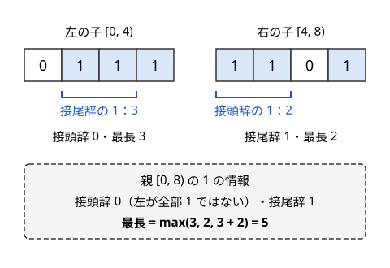

!!! abstract "要点"
    - **何ができるか**：区間[作用](../guide/glossary.md#action)の問題で、遅延セグメント木に載せる値 $S$ と作用 $F$・`mapping`・`composition` の組を、型の表から選んで組み立てる。そのままでは載らない問題も、0/1 の列や $X_i - i$ への言い換えで載る形に直せることが多い。
    - **いつ使うか**：
        - 区間をソートする操作を繰り返す
        - 2 つの数列への区間加算と、区間の $\sum A_i B_i$
        - 0/1 列の区間反転と、区間で 1 が連続する最大の長さ
        - 一列に並ぶ人を順に動かす総移動量
    - **計算量**：値と作用の計算が $O(1)$ なら、構築 $O(N)$、区間作用・区間取得 $O(\log N)$。値が $K$ 個の数の組なら、定数倍がおよそ $K$ 倍
    - **前提**：[遅延セグメント木](../ds/lazy-segment-tree.md)、[セグメント木に何を載せるか](../ds/segment-tree-monoids.md)

<!-- textlint-disable -->
別名：遅延セグ木のチートシート・S と F の設計・区間加算区間最小・区間代入区間和・Range Affine Range Sum・区間反転
<!-- textlint-enable -->

遅延セグメント木の載せ方の型は、ACL の `lazy_segtree` に渡す 7 つの部品（`S`・`op`・`e`・`F`・`mapping`・`composition`・`id`）を、問題の操作から組み立てる手順と、よく出る組の一覧である。中心の考え方は「作用の結果を計算するのに足りない情報を値に足す」ことで、区間和に長さを足すのはその最も簡単な例である。

## 設計の手順と載せられる条件（S はモノイド・F は恒等写像を含み合成で閉じる・f(x·y) = f(x)·f(y)） {#design-steps}

遅延セグメント木に載せられるのは、次の 3 つを満たす組である（理由は[遅延セグメント木の何ができるか](../ds/lazy-segment-tree.md#what-it-does)）。

1. 値の集合 $S$ と演算 $\cdot$ が[結合法則](../guide/glossary.md#associativity)を満たし、[単位元](../guide/glossary.md#identity-element) $e$ を持つ（[モノイド](../guide/glossary.md#monoid)）
2. 作用の集合 $F$ が何もしない作用 $\mathrm{id}$ を含み、2 つの作用を続けたもの $f \circ g$ も $F$ に入る
3. どの作用 $f$ と値 $x, y$ についても $f(x \cdot y) = f(x) \cdot f(y)$

問題の操作がそのまま 3 つを満たすことは少ない。次の手順で、足りないものを $S$ と $F$ に足していく。

1. **取得したい量を $S$ に置く**。和なら `op` は和、`e()` は 0。最小値なら `op` は `min`、`e()` は大きい番兵。左右をつなげるように $S$ を作る考え方は[セグメント木に何を載せるか](../ds/segment-tree-monoids.md#design-steps)と同じである
2. **作用を $F$ に置き、`mapping(f, x)` を書いてみる**。$x$ の成分だけでは作用後の値が計算できなければ、計算に要る量を $S$ に足す。足した量も `op` で左右から作れて、作用の後の値が計算できるかを確かめ、足す量がなくなるまでくり返す
3. **`composition` を書いてみる**。2 つの作用を続けたものが $F$ の形で表せなければ、$F$ を広げる（加算と代入の両方が来るなら「代入してから加算」の形にする、など）
4. **`e()` と `id()` を決め、条件 3 を小さな例で確かめる**。`mapping(f, op(x, y))` と `op(mapping(f, x), mapping(f, y))` が一致するかを見る

**例：区間加算・区間の二乗和**。$S$ に二乗和 $q = \sum a_i^2$ を置く。区間に $f$ を加えると $\sum (a_i + f)^2 = q + 2f \sum a_i + f^2 \cdot (\text{長さ})$ なので、和 $s$ と長さ $\mathit{len}$ が要る。そこで $S = (q, s, \mathit{len})$ とする。$s$ は $s + f \cdot \mathit{len}$ で更新でき、$\mathit{len}$ は変わらないので、ここで閉じる。`op` は成分ごとの和、`e()` は $(0, 0, 0)$ である。作用は加算どうしなので、`composition` を $f + g$、`id()` を 0 にすればよい。

`mapping` で $q$ を更新するときは、更新する前の $s$ を使う。先に $s$ を書き換えてから $q$ の式に使うと、$2f \cdot (s + f \cdot \mathit{len})$ になり答えがずれる。

!!! info "ACL では"
    `lazy_segtree<S, op, e, F, mapping, composition, id> seg(v);`。`seg.apply(l, r, f)`・`seg.prod(l, r)` はどちらも $O(\log N)$ で、`mapping` などの中身に $O(T)$ かかれば $O(T \log N)$ になる。`S` と `F` は構造体でも `bool` でもよい。`seg.max_right(l, f)`・`seg.min_left(r, f)` で、遅延セグメント木の上の二分探索もできる（[遅延セグメント木の上で使う](../ds/segment-tree-binary-search.md#on-lazy-segment-tree)）。この `f` は作用ではなく `S` を受け取って `bool` を返す判定の関数で、外の変数を参照するラムダでよい。要件は[セグメント木上の二分探索](../ds/segment-tree-binary-search.md#what-it-does)の ACL の囲みと同じである。

## 型の表（S・op・e・F・mapping・composition・id） {#pattern-table}

区間加算・区間代入・区間アフィンと、区間の和・最小値・最大値の組は、遅延セグメント木の[標準の型](../ds/lazy-segment-tree.md#acl-standard)と[区間和の表](../ds/lazy-segment-tree.md#size-in-node)にある。ここでは、それ以外によく出る組を並べる。どれも区間の長さを $\mathit{len}$ と書き、葉は長さ 1、`e()` は長さ 0 で作る。`composition(f, g)` は「$g$ の後に $f$」である。

| やりたいこと：$S$ と `op` | $F$ と `mapping` | `composition` と `id` |
| --- | --- | --- |
| 区間加算・最小値とその個数：（最小, 個数）。小さい方を取り、同じなら個数を足す | 加算量 $f$：（最小 $+ f$, 個数） | $f + g$ と 0 |
| 区間加算・最大値とその位置：（最大, 位置）。大きい方を取る | 加算量 $f$：（最大 $+ f$, 位置） | $f + g$ と 0 |
| 区間加算・二乗和：$(q, s, \mathit{len})$。成分ごとの和 | 加算量 $f$：$(q + 2fs + f^2 \mathit{len}, s + f \mathit{len}, \mathit{len})$ | $f + g$ と 0 |
| 区間代入と区間加算・区間和：（和, $\mathit{len}$） | 「代入してから $\mathit{add}$ を加算」 | [代入の節](#assign-sentinel) |
| 0/1 反転・1 の個数：（1 の数, $\mathit{len}$） | 反転なら（$\mathit{len} -$ 1 の数, $\mathit{len}$） | XOR と false |
| 0/1 反転・転倒数：（0 の数, 1 の数, 転倒数） | [反転の節](#flip) | XOR と false |
| 0/1 反転・1 の最長の連続：0 と 1 それぞれの（接頭辞, 接尾辞, 最長）と $\mathit{len}$ | 0 と 1 の欄を入れ替える | XOR と false |
| $-1$ 倍・区間最大：（最大, 最小） | 反転なら（$-$最小, $-$最大） | XOR と false |
| 2 列への加算・$\sum a_i b_i$：$(\Sigma a, \Sigma b, \Sigma ab, \mathit{len})$ | [等差数列の節](#arithmetic-add) | 成分ごとの和と $(0, 0)$ |
| 等差数列の加算・区間和：（和, $\mathit{len}$, 添字の和） | $(c, d)$：和 $+ c \cdot \mathit{len} + d \cdot$ 添字の和 | 成分ごとの和と $(0, 0)$ |
| 区間 chmin・区間最大：値。`max` と $-\infty$ | $\min(f, x)$ | $\min(f, g)$ と $+\infty$ |
| 値の置き換え（0〜2）・転倒数：各値の個数と、各順序対の個数 | 置き換えの表 $f$ で個数を移す | 表の合成 $v \mapsto f[g[v]]$ と恒等の表 |
| 区間代入・一次関数の合成：（左から合成した一次関数, $\mathit{len}$） | 代入する関数 $h$：$h$ を $\mathit{len}$ 回合成したもの | 「なし」なら $g$、ほかは $f$ と「なし」 |

表の下の 3 行には補足がある。

- **区間 chmin・区間最大**：$\min(f, \max(x, y)) = \max(\min(f, x), \min(f, y))$ なので条件 3 を満たす。区間の最小値でも同じである。区間の**和**とは組めない（[載らない作用](#not-applicable)）
- **値の置き換え**：値が 0・1・2 の 3 種類なら、各値の個数 3 つと、順序対 $(u, v)$（$i < j$ で $a_i = u$、$a_j = v$）の個数 9 つを持つ（対角の $(u, u)$ は置き換えの後も対角に移るだけで転倒数にもつなぎにも使わないので、異なる値の対 6 つでもよい。9 つの表にすると書きやすい）。`op` で左右をつなぐと、対の個数に「左の $u$ の個数 × 右の $v$ の個数」が加わる。`mapping` は個数を $f[u]$ の欄へ、対を $(f[u], f[v])$ の欄へ足し込む。2 つの値が同じ値に移ると欄が合流するが、足し込むので正しく数えられる
- **区間代入・一次関数の合成**：Library Checker の range_set_range_composite の型である。区間に同じ関数 $h$ が $\mathit{len}$ 個並ぶので、合成は $h^{\mathit{len}}$ になる。これを[繰り返し二乗法](../math/mod-pow.md)で求めると `mapping` が $O(\log N)$ かかり、全体で 1 回 $O(\log^2 N)$ になる。関数の合成は可換でないので、`op` で左右の順序を守る

## 区間代入の「なし」の番兵と composition の向き {#assign-sentinel}

区間代入を載せるときは、「何もしない」作用 `id()` を「代入する値」と区別して表す必要がある。代入する値の範囲の外の数を[番兵](../guide/glossary.md#sentinel)にするのが手軽だが、値の範囲が分からないときや、加算と組むときは、「代入するか」のフラグを値と別に持つのが安全である。

区間代入と区間加算の両方が来る問題では、作用を「代入するか $\mathit{set}$、代入する値 $v$、その後に足す値 $\mathit{add}$」の組にする。作用は $x \mapsto (\mathit{set} \text{ なら } v \text{、そうでなければ } x) + \mathit{add}$ である。代入の後に加算が来ても、加算の後に代入が来ても、この形で表せる。

- **$f$ が代入を含むとき**：$f$ が前の作用 $g$ をすべて上書きするので、合成は $f$ そのものである
- **$f$ が加算だけのとき**：$g$ の代入（あれば）は残り、加算は $g$ の加算に足し込む。合成は $(g.\mathit{set}, g.v, g.\mathit{add} + f.\mathit{add})$ である

ACL の `composition(f, g)` の $f$ は新しく届いた作用、$g$ はノードがすでに持つ保留である。向きを逆にすると、「3 を代入」の後の「5 を加算」が「5 を加算」の後の「3 を代入」として扱われ、加算が消える。加算だけ、反転だけの問題では向きを間違えても答えが変わらないので、代入やアフィン変換を含む問題で初めてバグが表に出る。

区間和と区間最小値の両方を取る例を示す。`mapping` は値の側に長さがあるので、代入の後の和を $(v + a) \cdot \mathit{len}$ で計算できる。

```cpp
--8<-- "lazy-segment-tree-patterns/assign-add.cpp:core"
```

完全なプログラム：[`assign-add.cpp`](https://github.com/yuukougun/kyopro-atlas/blob/main/snippets/lazy-segment-tree-patterns/assign-add.cpp)（GitHub）
{ .kp-code-src }

代入のある問題では、和以外の値でも長さを使うことがある。たとえば「最小値とその個数」に区間代入が来ると、代入後の個数は区間の長さになる。$S$ に長さを足しておかないと `mapping` が書けない。

## 0/1 反転・転倒数・最長の連続（0 と 1 の情報を入れ替える） {#flip}

0/1 の列の区間反転を載せるときは、1 についての情報と同じものを 0 についても持たせる。反転は 0 と 1 を入れ替えるだけなので、`mapping` は 2 つの欄を入れ替えれば済む。反転を 2 回続けると元に戻るので、作用は `bool` で、`composition` は XOR、`id()` は false である。

**1 の個数**：$S$ を（1 の数, 長さ）にすれば、反転後の 1 の数は「長さ − 1 の数」である。0 の数を別に持っても同じことになる。

**転倒数**（$i < j$ で $a_i = 1$、$a_j = 0$ の組の数）：$S$ を（0 の数 $z$, 1 の数 $o$, 転倒数 $t$）にする。`op` で左右をつなぐと、左の 1 と右の 0 の組が新たに転倒になるので、$t = t_L + t_R + o_L \cdot z_R$ である。区間を反転すると、区間内の 0 と 1 の組 $z \cdot o$ 個のうち、転倒だった $t$ 個が転倒でなくなり、残りが転倒になる。よって反転後は $(o, z, z \cdot o - t)$ である。転倒数そのものは[転倒数](../ds/inversion-number.md)を参照。

**1 が連続する最長の長さ**：$c = 0, 1$ のそれぞれについて、左端から続く $c$ の長さ（接頭辞）・右端まで続く $c$ の長さ（接尾辞）・区間内の $c$ の最長の連続を持つ。次の図は、左の子 $(0, 1, 1, 1)$ と右の子 $(1, 1, 0, 1)$ をつなぐ様子である。



つなぐ規則は次の 3 つである。

- 親の最長は、左の最長・右の最長・「左の接尾辞 + 右の接頭辞」（境目をまたぐ連続）の最大である
- 親の接頭辞は、左が全部 $c$（左の接頭辞 = 左の長さ）なら「左の長さ + 右の接頭辞」、そうでなければ左の接頭辞である
- 親の接尾辞も、右が全部 $c$ かどうかで同じように決める

反転は 0 の欄と 1 の欄を入れ替えるだけである。1 の情報だけを持っていると、反転後の 1 の連続（元の 0 の連続）が分からない。

```cpp
--8<-- "lazy-segment-tree-patterns/flip-run.cpp:core"
```

完全なプログラム：[`flip-run.cpp`](https://github.com/yuukougun/kyopro-atlas/blob/main/snippets/lazy-segment-tree-patterns/flip-run.cpp)（GitHub）
{ .kp-code-src }

**応用の型**：符号の反転（$-1$ 倍）と区間最大値も同じ考え方である。（最大, 最小）を持てば、$-1$ 倍の後は（$-$最小, $-$最大）になる。括弧列の `(` と `)` の入れ替えも、両方の向きの情報を持てば載る（[括弧列をモノイドにする](../patterns/bracket-sequence.md#monoid)）。サインは「反転」「入れ替え」と、区間の個数・最長・転倒数の質問が並ぶことである。

## 等差数列の加算・2 列の積の和（添字の和や Σa・Σb を S に足す） {#arithmetic-add}

### 等差数列の加算

区間 $[l, r)$ の各位置 $i$ に $c + d \cdot i$ を足す作用を考える（$i$ は列全体での 0-indexed の添字）。区間の和は $c \cdot (\text{長さ}) + d \cdot \sum i$ だけ増えるので、$S$ に長さと添字の和 $\sum i$ を足す。葉 $i$ は（$a_i$, 1, $i$）で作り、`op` は成分ごとの和である。

作用 $(c, d)$ を 2 つ続けると $(c_f + c_g, d_f + d_g)$ になるので、`composition` は成分ごとの和でよい。この形にできるのは、作用を「区間の左端から何番目か」ではなく「列全体での添字」で書いたからである。問題文が「位置 $l$ から初項 $a$・公差 $d$」のように左端から数えるなら、$c = a - d \cdot l$ と直してから作用させる。左端から数える形のまま作用を持つと、子へ降ろすたびに初項をずらす計算が要る。

```cpp
--8<-- "lazy-segment-tree-patterns/arith-add.cpp:core"
```

完全なプログラム：[`arith-add.cpp`](https://github.com/yuukougun/kyopro-atlas/blob/main/snippets/lazy-segment-tree-patterns/arith-add.cpp)（GitHub）
{ .kp-code-src }

取得が一点だけなら、[差分列](../basics/difference-sequence.md)を 2 回取ると等差数列の加算は数点の更新になる。取得がすべての更新の後に来るなら、一点の値は 2 回の累積和で戻せる（更新と取得が交互に来るなら、累積和を BIT で持つ）。遅延セグメント木を使うのは、区間和の取得が混ざるときである。

### 2 列の積の和

2 つの列 $a, b$ への区間加算と、区間の $\sum a_i b_i$ の取得を考える。$a$ の要素を $x$ ずつ、$b$ の要素を $y$ ずつ増やすと、

$$
\sum (a_i + x)(b_i + y) = \sum a_i b_i + y \sum a_i + x \sum b_i + xy \cdot (\text{長さ})
$$

なので、$S$ を $(\Sigma a, \Sigma b, \Sigma ab, \text{長さ})$ にする。作用は $(x, y)$ の加算で、`composition` は成分ごとの和である。$\Sigma ab$ を先に、更新する前の $\Sigma a$・$\Sigma b$ で計算するのが要点である。

```cpp
--8<-- "lazy-segment-tree-patterns/two-seq.cpp:core"
```

完全なプログラム：[`two-seq.cpp`](https://github.com/yuukougun/kyopro-atlas/blob/main/snippets/lazy-segment-tree-patterns/two-seq.cpp)（GitHub）。`mint` は ACL の `modint998244353`（[modint](../math/modint.md)）。
{ .kp-code-src }

**応用の型**：取得したい量が「作用の多項式」で書けるとき、その係数になる量を $S$ に足す。二乗和なら和と長さ（[設計の手順](#design-steps)の例）、相異なる 2 要素の積の和なら和と長さが要る。サインは、取得したい量が $\sum a_i b_i$・$\sum a_i^2$ のような積の和であることである。

## 載らない作用（区間 chmin と区間和・区間の割り算・区間の並べ替え）と逃げ道 {#not-applicable}

次の操作は、固定の大きさの $S$ では条件 3 を満たせない。

- **区間 chmin と区間和**：$\sum \min(a_i, t)$ は、区間の中で $t$ を超える要素の個数と和で決まる。どの $t$ が来ても計算できるようにするには、値の分布をまるごと持つ必要がある
- **区間の割り算・平方根・mod**：$\lfloor (x + y) / k \rfloor \ne \lfloor x / k \rfloor + \lfloor y / k \rfloor$ なので、和に直接施せない。最大値に施しても、ほかの要素の値は分からない
- **区間の並べ替え（ソート・並びの反転）**：要素の位置が区間をまたいで動くので、各ノードの値に作用を施す形にならない

逃げ道は、作用が値を「潰す」性質や、列の単調性を使うものが多い。

| 載らない操作 | 逃げ道 |
| --- | --- |
| 区間 chmin・chmax と区間和 | [Segment Tree Beats](../ds/segment-tree-beats.md)（ならし計算量） |
| 区間の割り算・平方根 | 区間の最大値と最小値が同じなら代入に直す（Segment Tree Beats の考え方）。値が早く 1 や 0 に潰れることでならせる |
| 列が単調なときの chmin・chmax | 値を変える範囲が連続するので、二分探索で範囲を求めて区間代入にする（[言い換え](#reformulate)） |
| 区間の並べ替え | しきい値で 0/1 の列にする（[言い換え](#reformulate)）。一般には平衡二分探索木 |
| 区間を同じ値で塗り、塗られた区間ごとに数える | [区間を set で管理する](../ds/interval-set.md) |
| どれも合わない | [平方分割](../ds/sqrt-decomposition.md#buckets)。ブロックごとに保留を持ち、端は 1 つずつ処理する |

区間代入があると値が塊になるので、chmin や割り算も「塊ごとに 1 回」で済むことがある。塊の数のならし計算量を考えるのが区間を set で管理する方法である。

## 言い換えてから載せる（しきい値で 0/1 にする・X_i − i・寄与） {#reformulate}

この節は、[寄与](../thinking/contribution.md)による数え上げと、[遅延セグメント木の上での二分探索](../ds/segment-tree-binary-search.md#on-lazy-segment-tree)を前提にする。問題の操作のままでは載らなくても、見る量を変えると区間代入・区間和のような標準の型に落ちることがある。

### しきい値で 0/1 にする

区間のソートは載らないが、0/1 の列のソートは簡単である。区間 $[l, r)$ にある 1 の数を $c$ とすると、昇順のソートは「$[l, r - c)$ を 0 に、$[r - c, r)$ を 1 に代入する」ことと同じになる。区間和と区間代入だけで、1 回 $O(\log N)$ でできる。

元の列 $a$ を、しきい値 $X$ について「$a_i \ge X$ なら 1、そうでなければ 0」の列にする。ソートは大小の関係だけで決まるので、元の列をソートしてから 0/1 にした結果と、0/1 にしてからソートした結果は一致する。すべての操作の後に 0/1 の列を見れば、$X$ 以上の値がどこに集まったかが分かる。しきい値を $X$ と $X + 1$ の 2 通りで追えば、2 つの列で食い違う位置が、値 $X$ のある位置である。

サインは「区間をソートする」「最後に特定の値の位置や、$K$ 番目の値を答える」である。値 $X$ の位置ではなく、位置 $p$ の値（や $K$ 番目の値）を求めるなら、位置 $p$ が 1 になるかは $X$ について単調なので、「$p$ が 1 になる最大の $X$」をしきい値の[答えで二分探索](../basics/binary-search-answer.md)する。判定 1 回に $O((N + Q) \log N)$ かかる。

### 追い越さない列を X_i − i に直す

数直線上に $X_1 < X_2 < \dots < X_N$ と並ぶ人が、互いに追い越さずに動く状況を考える。$Y_i = X_i - i$ とすると、$X_{i+1} \ge X_i + 1$ から $Y_{i+1} \ge Y_i$ となり、$Y$ は[広義単調増加](../guide/glossary.md#non-decreasing)になる。隙間なく詰まった人たちは $Y$ が同じ値になる。

人 $k$ を右へ動かして $Y_k = g$ にすると、$k$ より後ろで $Y_j < g$ の人は押されて $Y_j = g$ になる。$Y$ は単調なので、押される人は $k$ から始まる連続した範囲 $[k, m)$ である。$m$ は遅延セグメント木の上の二分探索で求まり、その範囲に $g$ を区間代入すればよい。人が動いた距離の総和は、$Y$ の区間和の変化 $g \cdot (m - k) - \sum_{j=k}^{m-1} Y_j$ である。左へ動かすときも向きを変えて同じようにする。

$X$ のままでは押された人が 1 つずつずれた位置に並ぶので、代入にならない。添字を引くと「同じ値に揃う」ので、区間代入で書けるようになる。サインは「追い越せない」「押し出す」「順番が変わらない」である。

### 寄与に言い換えて単調な列を保つ

非負整数の列の、すべての区間の mex の総和を考える。区間の mex は、「$0, 1, \dots, m$ をすべて含む」ような $m \ge 0$ の個数に等しい（mex が $k$ なら $m = 0, \dots, k - 1$ の $k$ 個）。よって

$$
\sum_{\text{区間}} \mathrm{mex} = \sum_{m \ge 0} \#\{\text{区間} : 0, \dots, m \text{ をすべて含む}\}
$$

と[寄与](../thinking/contribution.md)に言い換えられる。0-indexed で、左端 $L$ ごとに「閉区間 $[L, R]$ が $0, \dots, m$ をすべて含む最小の $R$」を $f_m(L)$ とする（なければ $N$）。各 $m$ の個数は $\sum_L (N - f_m(L))$ なので、$f_m$ の区間和で数えられる。$m$ を 1 つ増やすときの更新は「値 $m$ の次の出現位置」との chmax で、これは区間 chmax・区間和なのでそのままでは載らない。

ここで、$f_m(L)$ は $L$ について広義単調増加である（左端を左へ広げても、同じ右端で済む）。単調な列への chmax は、値を変える要素が連続した範囲になるので、二分探索でその範囲を求めて区間代入にできる。区間代入・区間和の遅延セグメント木で、全体 $O(N \log N)$ になる。Segment Tree Beats を使っても解ける。

サインは「すべての区間についての総和」「mex・種類数のような、区間を広げると単調に変わる量」である。mex の題材は [mex](../patterns/mex.md#overview) にまとめる。

## 落とし穴 {#pitfalls}

- **`mapping` で更新後の値を使う**：$\Sigma ab$ や二乗和の式に、すでに書き換えた $\Sigma a$ を使うと $xy$ や $f^2$ の項が二重に入る。新しい値はすべて、受け取った $x$ の成分から計算する
- **足した成分の `e()` と葉を忘れる**：`e()` の長さは 0、葉の長さは 1、添字の和の葉は $i$ である。`lazy_segtree<…> seg(n)` は全要素を `e()` で作るので、長さ 0 の葉になる（[遅延セグメント木の境界](../ds/lazy-segment-tree.md#boundaries)）
- **可換でない `op` の左右**：転倒数・最長の連続・関数の合成は、左と右を入れ替えると値が変わる。`op(x, y)` の $x$ が左である
- **`composition` の向き**：代入・アフィン・置き換えの表では、$f$ が新しい作用である（[代入の節](#assign-sentinel)）。置き換えの表の合成は $v \mapsto f[g[v]]$ で、$g[f[v]]$ ではない
- **XOR の合成を和で書く**：`bool` の作用で `f + g` と書くと、2 回の反転が `true` になる。`f != g`（XOR）にする
- **オーバーフロー**：添字の和は $N^2 / 2$ ほど、二乗和は値の 2 乗 × $N$ ほどになる。$d \cdot \sum i$ のような積が `long long` を超えないか見積もり、超えるなら mod を取るか `__int128` を使う
- **条件 3 を確かめずに書く**：区間 chmin と区間和のように、`mapping` を書けても答えの合わない組がある。小さな列でランダムに操作し、素朴な計算と比べるのが確実である（このページのコード片は、すべて素朴な計算と `assert` で照らし合わせている）

## 例題 {#examples}

### ABC357 F. Two Sequence Queries {#abc357_f}

<div class="kp-problems" data-role="example" markdown>

- [ABC357 F. Two Sequence Queries](https://atcoder.jp/contests/abc357/tasks/abc357_f)（diff 1793）：2 つの数列への区間加算と、区間の Σ A_i B_i の質問を処理する。

</div>

[2 列の積の和](#arithmetic-add)の型をそのまま使う。$S$ を $(\Sigma A, \Sigma B, \Sigma AB, \text{長さ})$、作用を $(x, y)$ の加算にすれば、`mapping` は $(A_i + x)(B_i + y)$ を展開した式で書ける。答えは mod 998244353 で求めるので、成分は `modint` で持つ。

??? note "解法の詳細"
    葉 $i$ は $(A_i, B_i, A_i B_i, 1)$ で作る。$A$ への加算は作用 $(x, 0)$、$B$ への加算は $(0, y)$ として `apply` する。`mapping` は $\Sigma AB + y \Sigma A + x \Sigma B + xy \cdot \text{長さ}$ を、更新する前の $\Sigma A$・$\Sigma B$ で計算する。加算どうしの合成は成分ごとの和で、`id()` は $(0, 0)$ である。

    $N, Q \le 2 \times 10^5$ で、全体で $O(N + Q \log N)$ になる。コード片 `two-seq.cpp` は、この問題と同じ形の操作を 0-indexed の半開区間で受け取る。

### ABC322 F. Vacation Query {#abc322_f}

<div class="kp-problems" data-role="example" markdown>

- [ABC322 F. Vacation Query](https://atcoder.jp/contests/abc322/tasks/abc322_f)（diff 1806）：0/1 の列の区間反転と、区間で 1 が連続する最大の長さの質問を処理する。

</div>

[0/1 反転と最長の連続](#flip)の型である。1 の情報だけでは反転後の値が計算できないので、0 と 1 の両方について（接頭辞, 接尾辞, 最長）を持ち、反転では 2 つの欄を入れ替える。

??? note "解法の詳細"
    問題文の閉区間 $[L, R]$（1-indexed）は、0-indexed の半開区間 $[L - 1, R)$ にして `apply`・`prod` を呼ぶ。`op` は図の 3 つの規則で、接頭辞は「左が全部 $c$ なら右の接頭辞までつながる」、接尾辞はその逆、最長は境目をまたぐ連続を含めた最大である。作用は `bool` で、合成は XOR、`id()` は false である。

    質問の答えは `prod(L - 1, R)` の「1 の最長」の欄である。$N \le 5 \times 10^5$、$Q \le 10^5$ で、全体で $O(N + Q \log N)$ になる。

## 練習問題 {#practice}

<div class="kp-problems" data-role="practice" markdown>

- [PRACTICE2 L. Lazy Segment Tree](https://atcoder.jp/contests/practice2/tasks/practice2_l)（diff なし）：0/1 の列の区間反転と、区間の転倒数の質問を処理する。
- [ABC332 F. Random Update Query](https://atcoder.jp/contests/abc332/tasks/abc332_f)（diff 1786）：区間内の 1 点を等確率で選んで X に書き換える操作を繰り返した後の、各要素の期待値を答える。
- [ABC237 G. Range Sort Query](https://atcoder.jp/contests/abc237/tasks/abc237_g)（diff 2088）：区間を昇順・降順にソートする操作を繰り返した後の、値 X の位置を求める。
- [ABC371 F. Takahashi in Narrow Road](https://atcoder.jp/contests/abc371/tasks/abc371_f)（diff 2109）：一列に並ぶ人を順に目的地へ動かすときの、総移動回数を求める。

</div>

??? note "方針"
    - **PRACTICE2 L**：[反転の節](#flip)の転倒数の型である。$S$ を（0 の数, 1 の数, 転倒数）にし、反転後の転倒数を「0 の数 × 1 の数 − 転倒数」で求める
    - **ABC332 F**：長さ $w$ の区間の各要素は、確率 $1/w$ で $X$ になり、残りの確率で元のままである。よって期待値は $x \mapsto (1 - 1/w) x + X/w$ という一次関数で変わる。区間アフィンの作用を積み、最後に各点の値を `get` で読む。区間の取得がないので、[双対セグメント木](../ds/lazy-segment-tree.md#dual-segment-tree)でも足りる
    - **ABC237 G**：[しきい値で 0/1 にする](#reformulate)型である。しきい値 $X$ と $X + 1$ の 2 本の 0/1 列それぞれで、ソートを「1 の数を数えて 2 つの区間に代入する」操作として再現する。最後に 2 本で食い違う位置が答えである
    - **ABC371 F**：[X_i − i に直す](#reformulate)型である。$Y_i = X_i - i$ は単調なので、押される人の範囲を二分探索で求めて区間代入し、移動量を区間和の変化で数える。値に（和, 最小, 最大, 長さ）を持てば、二分探索の判定に最小・最大を使える

## 力試し {#challenge}

<div class="kp-problems" data-role="challenge" markdown>

- [ABC470 G. Σex](https://atcoder.jp/contests/abc470/tasks/abc470_g)（diff 2097）：非負整数の列のすべての連続部分列について、mex の総和を求める。
- [ABC265 G. 012 Inversion](https://atcoder.jp/contests/abc265/tasks/abc265_g)（diff 2436）：0/1/2 の列の区間の転倒数と、区間の値を写像で置き換える操作のクエリを処理する。

</div>

??? note "方針"
    - **ABC470 G**：[寄与に言い換える](#reformulate)型である。mex を「$0, \dots, m$ をすべて含む区間の数」の $m$ についての和に直し、左端ごとの最小の右端を $m$ の小さい順に更新する。最小の右端は左端について単調なので、chmax は二分探索と区間代入で書ける（Segment Tree Beats の区間 chmax・区間和でもよい）
    - **ABC265 G**：[型の表](#pattern-table)の値の置き換えである。各値の個数 3 つと順序対の個数 9 つ（異なる値の対 6 つでもよい）を持ち、置き換えの表で欄を移し替える。転倒数は対 $(1, 0)$・$(2, 0)$・$(2, 1)$ の個数の和である

## 確認問題 {#quiz}

??? question "確認問題：0/1 反転と 1 の個数で、値に区間の長さを持たせるのはなぜか"
    反転後の 1 の数は「区間の要素数 − 1 の数」で、1 の数だけからは要素数が分からないからである。`mapping` は値と作用だけを受け取るので、要素数（長さ）を値の側に持たせる。0 の数を持っても同じ役割を果たす。

??? question "確認問題：区間加算・最小値とその個数の木に、区間代入も来るようになった。値に何を足せばよいか"
    区間の長さを足す。代入の後は区間の全要素が同じ値になり、最小値の個数は区間の要素数になる。加算だけなら個数は変わらないので長さは要らなかったが、代入では要る。作用は「代入してから加算」の形にする（[代入の節](#assign-sentinel)）。

??? question "確認問題：区間の並び（位置）を逆にする操作は、和の取得となら載るか。転倒数の取得ではどうか"
    どちらも載らない。並びを逆にすると要素がノードの境目をまたいで動くので、各ノードの値に作用を施す形では表せない。逆にした区間とちょうど同じ区間の和は変わらないが、たとえば (1, 2, 3) を (3, 2, 1) にすると先頭 1 つの和は 1 から 3 に変わる。転倒数でも同じで、平衡二分探索木などが要る。

??? question "確認問題：作用「x ↦ (set なら v、そうでなければ x) + add」で、保留が（代入 3, 加算 0）のノードに（代入なし, 加算 5）が届いた。合成はどうなるか"
    （代入 3, 加算 5）、すなわち「3 を代入してから 5 を足す」で、要素はすべて 8 になる。新しい作用が代入を含まないので、前の代入を残し、加算を足し込む。向きを逆にして（代入なし, 加算 5）の後に（代入 3）とみると、要素は 3 になり加算が消える。

## 使い分け {#comparison}

| 状況 | 使う手法 |
| --- | --- |
| 加算・代入・アフィンと、和・最小値・最大値の組 | [遅延セグメント木](../ds/lazy-segment-tree.md)の標準の型 |
| 一点更新だけで、値の設計が要る | [セグメント木に何を載せるか](../ds/segment-tree-monoids.md) |
| 区間作用・一点取得だけ | [双対セグメント木](../ds/lazy-segment-tree.md#dual-segment-tree) |
| 区間 chmin・chmax と区間和、区間の割り算 | [Segment Tree Beats](../ds/segment-tree-beats.md) |
| 区間を塗って塊ごとに数える | [区間を set で管理する](../ds/interval-set.md) |
| 2 次元の点・長方形を、1 軸を走査して数える | [平面走査](../ds/sweep-line-2d.md)で遅延セグメント木を使う |

## 参考 {#references}

- [AtCoder Library「Lazy Segtree」（document_ja）](https://github.com/atcoder/ac-library/blob/master/document_ja/lazysegtree.md)：載せられる条件、`mapping`・`composition` の約束、`max_right`・`min_left`
- [drken「AtCoder ABC 357 F - Two Sequence Queries (2D, 青色, 550 点)」](https://drken1215.hatenablog.com/entry/2024/06/09/022229)：例題 abc357_f の値と作用の設計・制約
- [drken「AtCoder ABC 322 F - Vacation Query (2D, 青色, 550 点)」](https://drken1215.hatenablog.com/entry/2023/10/08/033507)：例題 abc322_f の値の持ち方と反転の扱い・制約
- [drken「AtCoder Library Practice Contest L - Lazy Segment Tree (2D)」](https://drken1215.hatenablog.com/entry/2023/11/18/030700)：練習 practice2_l の転倒数の合成と反転
- [merom686「ABC332」](https://merom686.hatenablog.com/entry/2023/12/11/021036)：練習 abc332_f の一次関数の作用
- [kmjp「AtCoder ABC #237 : G - Range Sort Query」](https://kmjp.hatenablog.jp/entry/2022/01/31/0900)：練習 abc237_g の 2 通りのしきい値と、区間和・代入でのソートの再現
- [merom686「ABC371」](https://merom686.hatenablog.com/entry/2024/09/15/021105)：練習 abc371_f の添字を引く言い換えと、区間代入・最小・最大・和を持つ値
- [kmjp「AtCoder ABC #470 (JPRSプログラミングコンテスト2026#2) : G - ΣШX」](https://kmjp.hatenablog.jp/entry/2026/08/13/0930)：力試し abc470_g の寄与への言い換えと、区間 chmax・区間和（Segment Tree Beats による解）
- [kmjp「AtCoder ABC #265 : G - 012 Inversion」](https://kmjp.hatenablog.jp/entry/2022/08/23/0900)：力試し abc265_g の個数・順序対の個数と置き換えの表の合成
