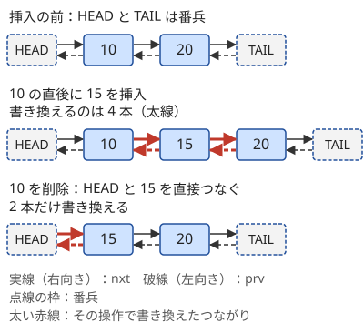

!!! abstract "要点"
    - **何ができるか**：各要素の前と次を配列（値が大きければ map）で持つ双方向リストで、「x の直後に y を挿入」「x を削除」「列の付け替え」を $O(1)$ で行い、最後に先頭からたどって列を出力する。
    - **いつ使うか**：
        - 値 x の直後に y を挿入・値 x を削除する操作を繰り返し、最後の列を出力する。
        - カードの山を別のカードの上へ付け替える。
        - 列車の連結・切り離し。
    - **計算量**：挿入・削除・付け替えは $O(1)$。値が大きくて map で持つなら $O(\log N)$（$N$ は要素の総数）、unordered_map なら平均 $O(1)$。最後の出力は列の長さに比例する。
    - **前提**：[STL コンテナの使い分け](../ds/stl-containers.md)

<!-- textlint-disable -->
別名：連結リスト・双方向リスト・linked list・doubly linked list・prev・next の配列
<!-- textlint-enable -->

配列で作る連結リストは、列を「各要素の前と次は誰か」という情報だけで表す方法である。`vector` の途中に挿入すると後ろの要素をすべてずらすので 1 回 $O(N)$ かかるが、前後のつながりだけを持てば、挿入・削除は数本のつながりの書き換えで済む。要素を値（や番号）で直接指定できることが前提で、「何番目か」で指定される操作は速くならない。

## prev・next の配列と番兵（先頭・末尾） {#arrays}

要素 $v$ の次の要素を $\mathrm{nxt}[v]$、前の要素を $\mathrm{prv}[v]$ に持つ。要素が $1, \dots, N$ の番号なら長さ $N + 2$ の配列で足り、値が $10^9$ までのように大きければ map（または unordered_map）にする。列が増える問題では、配列の大きさを最終的な要素数（初期の $N$ ＋挿入の回数）で取る。

先頭の前と末尾の次には、列に現れない[番兵](../guide/glossary.md#sentinel)を置く。番号が $1, \dots, N$ なら HEAD $= 0$・TAIL $= N + 1$、値が 1 以上なら HEAD $= 0$・TAIL $= -1$ などにする。空の列は $\mathrm{nxt}[\mathrm{HEAD}] = \mathrm{TAIL}$、$\mathrm{prv}[\mathrm{TAIL}] = \mathrm{HEAD}$ である。番兵を置けば、どの要素にも前と次が必ずある。だから「先頭の要素を消す」「末尾に足す」も場合分けせずに書ける。

保つ性質は次の 1 つである。

- 列に入っている要素と HEAD のどれについても、$\mathrm{prv}[\mathrm{nxt}[v]] = v$（次の要素の前は自分）

各操作では、この性質が崩れないよう、変わるつながりを両向きとも書き換える。片方の向きだけ直すと、後で逆向きにたどったとき、消えたはずの要素へ戻ってしまう。

## 挿入・削除・付け替えの手順 {#operations}

次の図は、列 10, 20 に「10 の直後に 15 を挿入」「10 を削除」を順に行ったときのつながりである。挿入では 4 本、削除では 2 本だけを書き換え、ほかの要素には触れない。



- **$x$ の直後に $y$ を挿入**：先に $z = \mathrm{nxt}[x]$ を読んでおき、$\mathrm{nxt}[x] = y$、$\mathrm{prv}[y] = x$、$\mathrm{nxt}[y] = z$、$\mathrm{prv}[z] = y$ とする。$z$ を読む前に $\mathrm{nxt}[x]$ を書き換えると、元の次の要素が分からなくなる
- **$x$ を削除**：$p = \mathrm{prv}[x]$、$n = \mathrm{nxt}[x]$ として、$\mathrm{nxt}[p] = n$、$\mathrm{prv}[n] = p$ とする。$x$ 自身の $\mathrm{nxt}$・$\mathrm{prv}$ は古い値のまま残るので、後で読まない（[落とし穴](#pitfalls)）
- **$x$ の直前に $y$ を挿入**：$\mathrm{prv}[x]$ の直後に挿入すればよい

値が大きいときに map で書くと、中心は次の数行になる。

```cpp
--8<-- "linked-list/insert-erase.cpp:core"
```

**付け替え**は、ひと続きの区間を切り取って別の場所へつなぐ操作である。$a$ から $b$ までの区間（$\mathrm{nxt}$ でたどって $a$ から $b$ に着く）を $c$ の直後へ移すなら、区間の外側の 2 か所をつなぎ直してから、$c$ と $\mathrm{nxt}[c]$ の間に区間の両端をつなぐ。区間の中のつながりは変わらないので、区間の長さによらず $O(1)$ である。

```text
p = prv[a], n = nxt[b]            // 区間の外側
nxt[p] = n, prv[n] = p            // 区間を切り取る
d = nxt[c]                        // c は区間の外にあること
nxt[c] = a, prv[a] = c
nxt[b] = d, prv[d] = b
```

付け替えには、次のような形がある。

- **山の付け替え**：カード $c$ とその上に乗ったカード全部を、一番上のカード $p$ の上へ移すなら、変わるのは $c$ の下とのつながりだけである。上下のつながりを 2 本の配列で持ち、$c$ とその下のカードとの間を切って、$c$ を $p$ の上につなぐ。各山の土台を番兵にすると、山が空になる場合も同じ手順で済む
- **列車の連結・切り離し**：列が 1 本ではなく何本もある形である。つながっていないことを番兵の値（0 や $-1$）で表し、連結は 2 本を書き、切り離しは 2 本を番兵に戻す
- **「前の要素」だけが与えられる**：各要素の直前の要素が与えられたら、$\mathrm{nxt}[\mathrm{prv}[v]] = v$ と逆向きの対応を作れば、先頭から順にたどれる

## 最後に先頭からたどって出力する {#output}

連結リストは「$k$ 番目の要素」をすぐには答えられないので、列そのものが要るのは最後の 1 回にまとめる。$v = \mathrm{nxt}[\mathrm{HEAD}]$ から始めて、TAIL に着くまで $v = \mathrm{nxt}[v]$ を繰り返す。1 歩が $O(1)$ なので、列の長さ $L$ に対して $O(L)$ である（map なら、map に入っている行の数を $M$ として $O(L \log M)$）。

```cpp
--8<-- "linked-list/insert-erase.cpp:output"
```

列が何本もあるとき（カードの山・列車）は、各列の先頭からたどる。先頭は「前がない要素」で、山なら土台である。各要素はちょうど 1 本の列に属するので、全部の列をたどっても合計 $O(N)$ で済む。

途中で「$x$ を含む列を出力せよ」と問われたら、$\mathrm{prv}$ をたどって先頭まで戻り、そこから $\mathrm{nxt}$ でたどる。1 回の手間は列の長さに比例するので、出力する要素の合計が制約で抑えられているときに使える。

??? question "確認問題：毎回の出力"
    挿入・削除の後に毎回、列全体の和を出力する問題に変わったとする。毎回先頭からたどると何が困るか。どうすればよいか。

    ??? success "答え"
        1 回のたどりが列の長さに比例するので、$Q$ 回で $O(NQ)$ になり間に合わない。和なら、挿入のたびに $y$ を足し、削除のたびに $x$ を引いて、合計を別の変数に持てばよい。列の中身を見ずに更新できる量だけを別に持ち、列全体は最後に 1 回だけたどる。

## 使い分け {#comparison}

連結リストが速いのは、操作する場所を値や番号で直接引けるからである。「先頭から $i$ 番目の直後に挿入」のように位置で指定されると、$i$ 番目の要素を見つけるのに先頭から $i$ 歩たどる必要があり、1 回 $O(N)$ に戻る。

| 操作の指定のしかた | 使うもの |
| --- | --- |
| 値・番号で指定（値は重複しない） | 配列（値が大きければ map）の連結リスト |
| 両端にだけ足す・逆順に見ると両端にだけ足す形になる | deque（[スタック・キュー・deque の使いどころ](../ds/stack-techniques.md)） |
| 位置で指定し、全部の操作が先に分かる（オフライン） | 逆順に処理して空きの $i$ 番目を BIT で探す（[K 番目の値を求めるデータ構造](../ds/kth-element.md)） |
| 位置で指定し、途中の質問に答える（オンライン） | [平衡二分探索木](../ds/balanced-bst.md) |
| 値の大小の順で前後を問う | set（[set・multiset・map の応用](../ds/ordered-set.md)） |
| 値の大小の順で $k$ 番目を問う | BIT（[K 番目の値を求めるデータ構造](../ds/kth-element.md)）か pb_ds の tree |

`std::list` は位置（イテレータ）が分かっていれば挿入・削除が $O(1)$ だが、値からイテレータを引くために map が別に要る。配列で前後を持つ方が短く書けて速い。

??? question "確認問題：位置で指定する挿入"
    「列の先頭から $i$ 番目の直後に $y$ を挿入する」操作を $Q$ 回行う。$\mathrm{nxt}$・$\mathrm{prv}$ の配列を持っていても速くならないのはなぜか。

    ??? success "答え"
        配列の添字は値（要素の名前）であって位置ではないので、$i$ 番目の要素がどれかは先頭から $i$ 歩たどらないと分からない。挿入のつながりの書き換えは $O(1)$ でも、場所を探すのに $O(N)$ かかり、全体で $O(NQ)$ になる。位置を速く探すには、各部分の要素数を持つ BIT や平衡二分探索木が要る。

## 落とし穴 {#pitfalls}

**値が重複すると節点を特定できない**。$\mathrm{nxt}[v]$ を値 $v$ で引くので、同じ値が 2 か所にあるとどちらの要素か区別できない。問題が値で場所を指定するなら、制約に「常に相異なる」があるかを確かめる。値が重複しうるなら、要素に通し番号を振って番号で連結リストを作り、値は別の配列に持つ。

**削除した節点の指す先を使う**。削除しても $x$ 自身の $\mathrm{nxt}[x]$・$\mathrm{prv}[x]$ は古い値のまま残る。消したはずの $x$ を起点にたどったり、$x$ が列にあるかを $\mathrm{nxt}[x]$ の値で判定したりすると、消えた要素を経由した誤った列になる。列にあるかを問うなら、削除のときに $x$ の行を消す（map なら `erase`）か、在否の印を別に持つ。消した値をまた挿入する問題でも、挿入の手順で $\mathrm{nxt}[y]$・$\mathrm{prv}[y]$ を両方書き直せば古い値は残らない。

**書き換えの順序**。挿入で $\mathrm{nxt}[x] = y$ を先に書いてから $\mathrm{nxt}[y] = \mathrm{nxt}[x]$ とすると、$y$ の次が $y$ 自身になり、出力のたどりが止まらない。変わる前の値（$z = \mathrm{nxt}[x]$）を先に変数へ取る。

**付け替え先が区間の中にある**。区間 $a$〜$b$ を、区間の中の要素 $c$ の直後へ移すと、区間が列から外れて閉路になる。先頭からのたどりは区間を通らず TAIL へ着くので止まるが、区間の要素が黙って出力から消える（区間の中からたどると止まらない）。山の付け替えなら、$p$ が $c$ と同じ山にない（$c$ の上に乗っていない）ことが制約で保証されているかを確かめる。

**番兵の初期化と map の `[]`**。$\mathrm{nxt}[\mathrm{HEAD}] = \mathrm{TAIL}$ を忘れると、最初の挿入で TAIL とつながらず、出力のたどりが止まらない。また map の `[]` は、存在しない鍵を読むと値 0 の要素を作って 0 を返す。HEAD を 0 にしていると、列にない値の次を読んだときに黙って HEAD が返り、誤りに気づきにくい。列にあるかは `count` で確かめる。

## 上位の手法へのつながり {#next-steps}

- **削除だけなら、隣の生き残りが $O(1)$ で分かる**：列から要素を消していくだけの問題では、消す時点の $\mathrm{prv}[x]$・$\mathrm{nxt}[x]$ が「まだ残っている左右の最も近い要素」である。値の小さい順に消せば、各要素について左右で最も近い、自分より大きい要素が分かる。set でも書けるが、連結リストなら対数が付かない
- **未訪問の頂点の集合**：[補グラフ上の BFS](../graph/complement-graph-bfs.md#take-unvisited) では、まだ訪れていない頂点を連結リスト（または set）で持ち、訪れた頂点を $O(1)$ で取り除く
- **位置で指定する操作**：逆順の処理と BIT、または平衡二分探索木へ進む（[使い分け](#comparison)）

## 例題 {#examples}

### ABC344 E. Insert or Erase {#abc344_e}

<div class="kp-problems" data-role="example" markdown>

- [ABC344 E. Insert or Erase](https://atcoder.jp/contests/abc344/tasks/abc344_e)（diff 973）：値の直後への挿入と値の削除を繰り返した後の列を出力する。

</div>

値は常に相異なるので、値で要素を特定できる。値は $10^9$ までと大きいので、前後の値を map で持つ。値は 1 以上なので、0 と $-1$ を先頭と末尾の番兵にすれば、先頭の要素の削除や末尾への挿入も同じ手順で書ける。

??? note "解法の詳細"
    - 初期の列を、HEAD の後ろへ順に挿入して作る。
    - 挿入の操作では $x$ の次 $z$ を読み、$x$ と $z$ の間に $y$ を入れる（4 本の書き換え）。削除の操作では $x$ の前と次を直接つなぐ。
    - 最後に HEAD の次から TAIL まで $\mathrm{nxt}$ をたどって出力する。
    - 1 回の操作は map の $O(\log(N + Q))$ で、全体で $O((N + Q) \log(N + Q))$。コードは[挿入・削除・付け替えの手順](#operations)の節のものと同じ形である。

## 練習問題 {#practice}

<div class="kp-problems" data-role="practice" markdown>

- [ABC337 C. Lining Up 2](https://atcoder.jp/contests/abc337/tasks/abc337_c)（diff 258）：各人の「自分の前にいる人」の情報から、列全体を前から順に出力する。
- [ABC237 D. LR insertion](https://atcoder.jp/contests/abc237/tasks/abc237_d)（diff 544）：文字列の L・R に従って数を左右へ足していった最終的な列を求める。
- [ABC455 D. Card Pile Query](https://atcoder.jp/contests/abc455/tasks/abc455_d)（diff 796）：山に積まれたカードを別のカードの上へ移す操作を繰り返した後の、各山のカードの枚数を求める。

</div>

??? note "練習の方針"
    - **ABC337 C**：与えられるのは各人の前の人なので、$\mathrm{nxt}[\mathrm{prv}[v]] = v$ と逆向きの対応を作り、先頭の人からたどる。毎回全員から「前が $v$ の人」を探すと $O(N^2)$ になる
    - **ABC237 D**：$i$ は $i - 1$ のすぐ左か右に入る。これは $i - 1$ の直前・直後への挿入なので、連結リストで書ける。後ろから見ると両端に足す形になるので、deque でも解ける
    - **ABC455 D**：カードの上下のつながりを 2 本の配列で持ち、土台を番兵にする。移す操作は $c$ とその下との間を切り、$c$ を $p$ の上につなぐだけで、$c$ より上のカードには触れない。最後に各土台から上へたどって枚数を数える

## 参考 {#references}

- [プロひろ「ABC344 E問題（Insert or Erase）を解く」](https://programming-hiroba.com/abc344-e/)：例題の方針（前後の値を連想配列で持ち、0 と −1 を番兵にする）
- [torus711「AtCoder Beginner Contest 344, E : Insert or Erase」](https://torus711.hatenablog.com/entry/2024/03/10/192517)：例題の制約と、`std::list` と値からイテレータを引く map を使う方法
- [tmsn「AtCoder Beginer Contest 301~350 D or E までの要点・解答（Go）」](https://zenn.dev/shinonome81/articles/3e1c0c8a9c00fc)：練習の方針（前の人から次の人への対応を作ってたどる）
- [kyo-pro「ABC237D - LR insertion」](https://kyo-pro.hatenablog.com/entry/ABC237D)：練習の方針（左右の隣を配列で持つ方法と、逆順に deque で処理する方法）
- [comet725「ABC455Dを解いた【双方向リスト】」](https://qiita.com/comet725/items/b8d667d45fc386392f6f)：練習の方針（上下のつながりを 2 本の配列で持ち、土台からたどる）
