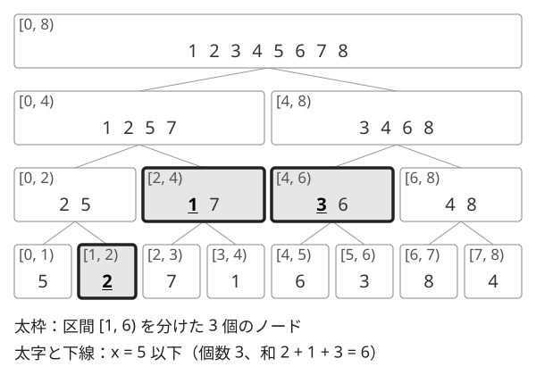

!!! abstract "要点"
    - **何ができるか**：区間内の $x$ 以下の要素の個数・和を、オンラインに 1 回 $O(\log^2 N)$ で答える。セグメント木の各ノードにその区間をソートした列と累積和を持つ静的な構造で、メモリは $O(N \log N)$ である。
    - **いつ使うか**：
        - 区間内で $X$ 以下の要素の個数・和を多数のクエリで答える
        - 前の答えで次のクエリが決まる（オンライン強制）
    - **計算量**：構築 $O(N \log N)$、区間の $x$ 以下の個数・和は 1 回 $O(\log^2 N)$（ならしではない）、メモリ $O(N \log N)$。要素の更新はできない
    - **前提**：[セグメント木](../ds/segment-tree.md)、[二分探索](../basics/binary-search.md)

<!-- textlint-disable -->
別名：Merge Sort Tree・マージソートツリー・領域木・Range Tree
<!-- textlint-enable -->

マージソート木は、[セグメント木](../ds/segment-tree.md)の各ノードに「そのノードの区間の要素をソートした列」を持たせたデータ構造である。区間をセグメント木と同じく $O(\log N)$ 個のノードに分け、各ノードで二分探索して数を合わせると、区間内の $x$ 以下の要素の個数が求まる。列ごとに累積和も持てば、和も同じ手間で求まる。

## 必要になる場面とアイデア {#idea}

列 $A = (a_0, \dots, a_{N-1})$（0-indexed）は変わらず、次の質問が $Q$ 個来るとする。区間は[半開区間](../guide/glossary.md#half-open-interval) $[l, r)$ で表す。

> 区間 $[l, r)$ の要素のうち、値が $x$ 以下のものの個数（と和）を答えよ。

素朴に区間を走査すると 1 回 $O(N)$ で、$N, Q$ が $2 \times 10^5$ ほどなら合わせて $4 \times 10^{10}$ 回になり間に合わない。

クエリを先に全部読めるなら、[オフライン](../guide/glossary.md#offline)の処理で軽く解ける。要素とクエリを値の順に並べ、$x$ 以下の要素だけを BIT に足してから区間の和を取ればよい（[しきい値でソート](../ds/offline-queries.md#threshold)）。困るのは、次のクエリの入力が前の答えで暗号化されている[オンライン強制](../guide/glossary.md#forced-online)の形である。このときはクエリを来た順に 1 つずつ答える構造が要る。

マージソート木のアイデアは次の 2 つを組み合わせることである。

- **区間を分ける**：セグメント木と同じく、任意の区間 $[l, r)$ は $O(\log N)$ 個のノードの区間にちょうど分かれる。「$x$ 以下の個数」は分けた部分ごとの個数の和なので、ノードごとに数えて足せばよい
- **ノードの中は二分探索**：ノードの区間の要素をソートした列を持っておけば、その中の $x$ 以下の個数は `upper_bound` 1 回、$O(\log N)$ で分かる。列の先頭からの累積和も持てば、$x$ 以下の要素の和も同時に分かる

次の図は、列 $(5, 2, 7, 1, 6, 3, 8, 4)$ のマージソート木である。各ノードに、区間の要素を昇順に並べた列を書いた。



区間 $[1, 6)$ で $x = 5$ 以下を数える流れを文章で追う。

- $[1, 6)$ は、ノード $[1, 2)$・$[2, 4)$・$[4, 6)$ の 3 個にちょうど分かれる
- 列 $(2)$ の中で $5$ 以下は 1 個（和 $2$）、列 $(1, 7)$ では 1 個（和 $1$）、列 $(3, 6)$ では 1 個（和 $3$）である
- 合わせて個数 $3$、和 $6$ になる。実際に $a_1, \dots, a_5 = 2, 7, 1, 6, 3$ のうち $5$ 以下は $2, 1, 3$ である

**なぜ正しいか**：分けたノードの区間どうしは重ならず、合わせると $[l, r)$ になる。各ノードの列はその区間の要素を並べ替えただけなので、列の中の $x$ 以下の個数は、その区間の中の $x$ 以下の個数に等しい。よって各ノードの個数の和が答えである。和も同じ理由で正しい。

## 作り方（子の列をマージする）とメモリ O(N log N) {#build}

### 保つ性質

セグメント木と同じ配列の並べ方を使う。葉の数を $N$ 以上の最小の 2 の冪 $\mathrm{size}$ とし、根を 1、ノード $k$ の子を $2k$ と $2k + 1$、要素 $a_i$ の葉をノード $\mathrm{size} + i$ に置く。各ノード $k$ に次の 2 本の列を持つ。

- $\mathrm{val}[k]$：$k$ の区間の要素を昇順に並べた列
- $\mathrm{acc}[k]$：$\mathrm{acc}[k][j]$ は $\mathrm{val}[k]$ の先頭 $j$ 個の和。$\mathrm{acc}[k][0] = 0$ で、長さは $\lvert \mathrm{val}[k] \rvert + 1$

### 構築の手順

葉には要素を 1 つだけ置く。余りの葉（$i \ge N$）は空の列にする。内部ノードは添字の大きい方から順に、2 つの子の列をマージして作る。子の列はどちらもソート済みなので、マージソートの 1 段と同じく、長さの和に比例する時間で 1 本のソート済みの列にできる。

ACL にはないので自作する。区間は ACL と同じく 0-indexed の半開区間で受け取る。`count_sum_le(l, r, x)` は、区間の $x$ 以下の要素の個数と和の組を返す。名前の約束は[インターフェースの決め方](../guide/library-design.md#interface)、確かめ方は[動作確認の手順](../guide/library-design.md#verify)にある。

```cpp
--8<-- "merge-sort-tree/mst.cpp:core"
```

### 計算量とメモリ

木の各段では、ノードの区間が $[0, N)$ を重ならずに覆う。よって各段の列の長さの和はちょうど $N$ で、段は $\log_2 \mathrm{size} + 1$ 個ある。

- **メモリ**：列の長さの合計は $N(\lceil \log_2 N \rceil + 1)$ で、$O(N \log N)$ である。$N = 2 \times 10^5$ なら 19 段で約 $3.8 \times 10^6$ 個になる。値と累積和を `long long` で持つと各 8 バイトなので、合わせて約 61 MB である。ノードごとに `vector` を持つと管理の領域が加わり、手元の計測では 100 MB ほどになる（[落とし穴](#pitfalls)）。メモリの制限が 1024 MB なら十分に収まる
- **時間**：各段のマージは長さの和 $N$ に比例するので、構築は $O(N \log N)$ である

各ノードの列をマージせずに `sort` し直しても正しい。ただし構築が $O(N \log^2 N)$ に増えるので、子の列が手元にあるならマージする。

## クエリの手順（O(log N) 個のノードで二分探索）と累積和で和も {#query}

### 各操作の手順

区間 $[l, r)$ の $x$ 以下の個数と和は、セグメント木の区間取得と同じ手順で区間をノードに分け、使うノードごとに二分探索する。

```text
count_sum_le(l, r, x):
    cnt ← 0, sum ← 0
    l ← l + size, r ← r + size
    l < r の間くり返す:
        l が奇数なら: ノード l を使う; l ← l + 1
        r が奇数なら: r ← r − 1; ノード r を使う
        l ← l / 2, r ← r / 2
    (cnt, sum) を返す

ノード k を使う:
    j ← val[k] の中で x より大きい最初の位置（upper_bound）
    cnt ← cnt + j, sum ← sum + acc[k][j]
```

`upper_bound` が返す位置 $j$ は、列の中の $x$ 以下の要素の個数そのものである。列が昇順なので、$x$ 以下の要素は先頭の $j$ 個に集まっていて、その和は $\mathrm{acc}[k][j]$ になる。

使うノードは各段で 2 個以下なので $O(\log N)$ 個で、それぞれ二分探索に $O(\log N)$ かかる。よって 1 回 $O(\log^2 N)$ である。これはならし計算量ではなく 1 回ごとの上限である。$N = Q = 2 \times 10^5$ なら、使うノードは 1 回あたり多くても約 36 個で、比較は全体で多くても約 $1.3 \times 10^8$ 回である。手元の計測（$N = Q = 2 \times 10^5$、値は $10^9$ 以下の乱数）では 0.4 秒ほどだった。

### 境界

- **以下と未満**：$x$ 以下なら `upper_bound`、$x$ 未満なら `lower_bound` を使う。値の範囲 $[p, q)$ に入る個数は「$q$ 未満の個数 − $p$ 未満の個数」で、整数なら「$q - 1$ 以下 − $p - 1$ 以下」とも書ける
- **空区間**：$l = r$ ならループに入らず $(0, 0)$ を返す。$x$ が全要素より小さいときも、各ノードで $j = 0$・$\mathrm{acc}[k][0] = 0$ になり $(0, 0)$ を返す
- **余りの葉**：空の列なので、使っても個数・和に何も足さない
- **$x$ より大きい要素**：和なら「区間の総和 − $x$ 以下の和」、個数なら「$(r - l) - x$ 以下の個数」で求まる

### 応用の型

区間の $x$ 以下の個数が答えられると、次の形の質問に言い換えて使える。

- **区間の K 番目に小さい値**：「$x$ 以下が $K$ 個以上」になる最小の $x$ が答えなので、$x$ を[答えで二分探索](../basics/binary-search-answer.md)する。候補は根の列 $\mathrm{val}[1]$（全要素のソート済みの列）の添字で探せばよく、1 回 $O(\log^3 N)$ である。下のコードでは $k$ を 0-indexed にし、「$x$ 以下が $k + 1$ 個以上」を条件にする。速さが要るなら [Wavelet Matrix](../ds/wavelet-matrix.md) で $O(\log \sigma)$ にする（$\sigma$ は値の種類数）。サイン：「区間の K 番目」「区間の中央値」をオンラインで答える

```cpp
--8<-- "merge-sort-tree/mst.cpp:kth"
```

- **平面上の長方形の中の点の数**：点を $x$ 座標の順に並べ、その順の $y$ 座標の列でマージソート木を作る。$x$ 座標の範囲は列の区間に、$y$ 座標の範囲は値の範囲になる。サイン：点が動かず、長方形の質問がオンラインで来る
- **区間の種類数**：$\mathrm{prev}_i$ を「$a_i$ と同じ値が $i$ より前で最後に出た位置（なければ $-1$）」とする。$[l, r)$ の種類数は、$[l, r)$ の位置 $i$ のうち $\mathrm{prev}_i < l$ を満たすものの個数である（[区間の種類数](../ds/offline-queries.md#distinct-count)）。$\mathrm{prev}$ の列でマージソート木を作れば、オンラインで $O(\log^2 N)$ になる
- **部分木の中の条件付きの個数**：[オイラーツアー](../tree/euler-tour.md)で部分木を行きがけ順の区間にすると、「部分木の中で値が $x$ 以下の頂点の数」が区間の質問になる

## 各段に BIT を持たせる（先読みと組む） {#bit-per-level}

この節は発展の内容で、[BIT](../ds/fenwick-tree.md) と[クエリの先読み](../ds/offline-queries.md)（特に[先に全部読んで座標圧縮する](../ds/offline-queries.md#compress)）を前提にする。

マージソート木は静的だが、要素の更新があっても、クエリを先に全部読めるなら使える。更新で現れる値を含めて、ありうる「(位置, 値)」の組を先に全部集めておき、それぞれを木の 1 つの枠にするのが要点である。

- **木を作る**：枠を位置の順に葉へ並べ、各ノードは区間の枠を値の順に並べた列を持つ（作り方はこれまでと同じ）。初めから置く値と、更新で入る値の両方を枠にする
- **今いるかを BIT で持つ**：各段に、その段の列を左から並べた長さ（枠の数）の BIT を 2 本持つ。今その値が列にある枠には、個数を数える BIT で 1、和を取る BIT でその値を立てる。ない枠は 0 にする。段の中でノードの列は連続しているので、ノードの中の接頭辞の和も BIT で取れる
- **更新**：$a_i$ を $v$ から $w$ に変えるとき、枠 $(i, v)$ を 0 にし、枠 $(i, w)$ を 1 にする。各枠が各段のどこにあるかを前計算しておけば、段ごとに BIT の一点更新を 1 回で済む。1 回 $O(\log^2 M)$ である（$M$ は枠の数で、$N + Q$ 以下）
- **クエリ**：同じ位置に枠が何個もあるので、まず位置の区間 $[l, r)$ を枠の区間に直す。枠は位置の順に並ぶので、位置が $l$ 以上の最初の枠から、位置が $r$ 以上の最初の枠の手前までを二分探索で求める。その枠の区間を、セグメント木と同じくノードに分ける。各ノードでは、二分探索で「値が $x$ 以下の枠」の個数 $j$ を求め、その段の 2 本の BIT でノードの先頭 $j$ 個の個数と和を取る。今いる要素だけが数えられ、1 回 $O(\log^2 M)$ である

どちらの軸を木にするかは入れ替えられる。値の順を葉にして各ノードの列を位置の順に並べると、ノードの中では「位置が $[l, r)$ にある今いる要素」を数えることになる。ノードの列は位置の順なので、列の中で $l$ と $r$ を二分探索して枠の範囲を出し、その段の BIT で範囲の和を取ればよい。この形では根から値の大きい子へ降りていけるので、「大きい方から和が $K$ に届くまで取る」のような貪欲を木の上で行える（[力試し](#challenge)）。

先読みできないオンライン強制で更新もあるときは、この方法は使えない。ノードごとの列を平衡二分探索木にする方法などがあるが、定数倍が重い。

## 落とし穴 {#pitfalls}

- **和のオーバーフロー**：値が $10^9$ で $N = 2 \times 10^5$ なら、和は $2 \times 10^{14}$ ほどになり `int` に収まらない。累積和と答えは `long long` で持つ。オンライン強制で答えを XOR に使うときは、`long long` のまま XOR する
- **更新できない**：要素を 1 つ変えると、その葉の祖先 $O(\log N)$ 個の列を作り直すことになり、根の列だけで $O(N)$ かかる。更新があるなら、先読みできるかを先に確かめる（[各段に BIT を持たせる](#bit-per-level)）。先読みできないなら[平方分割](../ds/sqrt-decomposition.md)で、ブロックごとのソート済みの列を持つ
- **メモリの見積もり**：メモリは $N \log N$ に比例する。$N = 10^6$ なら 21 段で約 $2.1 \times 10^7$ 個になり、値と累積和を `long long` で持つと 300 MB を超える。ノードごとに `vector` を持つと、1 本あたり数十バイトの管理の領域も増える。大きな $N$ では、各段を長さ $N$ の 1 本の配列にまとめて書く
- **閉区間との取り違え**：問題文の区間は 1-indexed の閉区間 $[L, R]$ が多い。0-indexed の半開区間 $[L - 1, R)$ に直してから渡す。オンライン強制なら、復号してから直す
- **以下と未満**：`upper_bound` と `lower_bound` を取り違えると、$x$ と等しい要素の分だけずれる（[境界](#query)）

## 例題 {#examples}

### ABC339 G. Smaller Sum {#abc339_g}

<div class="kp-problems" data-role="example" markdown>

- [ABC339 G. Smaller Sum](https://atcoder.jp/contests/abc339/tasks/abc339_g)（diff 1792）：区間内で X 以下の要素の和を、前の答えで次の質問が決まる形で多数答える。

</div>

**方針**：各クエリの $L, R, X$ は、前のクエリの答えとの XOR で暗号化されて与えられる（最初のクエリは 0 との XOR）。先読みできないので、オフラインのしきい値の処理は使えない。マージソート木で、区間の $X$ 以下の和を 1 回 $O(\log^2 N)$ で答える。

??? note "解法の詳細"
    - 列 $A$ でマージソート木を作り、各ノードに列と累積和を持つ（[作り方](#build)）
    - 前の答え $B$ を `long long` で持ち、最初は $B = 0$ とする
    - 各クエリで $L, R, X$ をそれぞれ $B$ と XOR して復号する。$L, R$ は 1-indexed の閉区間なので、半開区間 $[L - 1, R)$ に直す
    - $[L - 1, R)$ の $X$ 以下の和を求めて出力し、$B$ をその答えにする

    全体で構築 $O(N \log N)$、クエリ $O(Q \log^2 N)$ である。ブロックごとにソート済みの列と累積和を持つ平方分割でも解けるが、ブロックの大きさを選ばないと時間がかかる。

## 練習問題 {#practice}

<div class="kp-problems" data-role="practice" markdown>

- [ABC174 F. Range Set Query](https://atcoder.jp/contests/abc174/tasks/abc174_f)（diff 1495）：長さ N の列について、区間 [l, r] に含まれる値の種類数を Q 個の質問に答える。
- [ABC405 F. Chord Crossing](https://atcoder.jp/contests/abc405/tasks/abc405_f)（diff 1588）：円周上の 2N 個の点の間に互いに交わらない M 本の弦が引かれていて、質問ごとに 2 点を結ぶ弦が与えられ、既存の弦のうちそれと交わるものの本数を答える。
- [ABC202 E. Count Descendants](https://atcoder.jp/contests/abc202/tasks/abc202_e)（diff 1638）：根付き木で、頂点 U を祖先に持つ（U 自身を含む）深さ D の頂点の数を Q 個の質問に答える。
- [ABC379 F. Buildings 2](https://atcoder.jp/contests/abc379/tasks/abc379_f)（diff 1659）：高さが相異なる N 棟のビルが一列に並び、l < r の組の質問ごとに、r より東にあるビルのうち l と r の両方から見える（間のビルがすべてそれより低い）ものの数を答える。

</div>

??? note "練習の方針"
    - **ABC174 F**：各位置 $i$ で同じ値が直前に出た位置を $\mathrm{prev}[i]$（なければ 0）とすると、種類数は「区間 $[l, r]$ の中で $\mathrm{prev}[i] < l$ の $i$ の個数」に等しい。列 prev にマージソート木を作れば、先読みせずに 1 回 $O(\log^2 N)$ で答えられる（標準の解き方は先読みして BIT で数える）
    - **ABC405 F**：円を 1 か所で切って点を一列に並べると、答えは「質問の区間の中に端点がちょうど 1 つある弦の本数」になる。各端点に相手の端点の位置を書いた列にマージソート木を作り、区間 $(C, D)$ の中で相手が $C$ 未満か $D$ より大きいものの個数を数える
    - **ABC202 E**：行きがけ順で頂点を並べると $U$ の部分木は区間 $[\mathrm{in}[U], \mathrm{out}[U])$ になる。各位置に深さを書いた列にマージソート木を作り、区間の中で「$D$ 以下の個数」から「$D - 1$ 以下の個数」を引けば答えになる。深さごとの番号の列に二分探索する方が簡単で、ここでは差で「ちょうど $D$」を数える練習として解く
    - **ABC379 F**：$r$ より東では、$l$ から見えるビルの集合は $r$ から見えるビルの集合に含まれる。ビル $j$ の左で最も近い高いビルの位置を $p(j)$ とすると、答えは「区間 $(r, N]$ の中で $p(j) \le l$ の $j$ の個数」になり、列 $p$ にマージソート木を作れば 1 回 $O(\log^2 N)$ で答えられる

## 力試し {#challenge}

<div class="kp-problems" data-role="challenge" markdown>

- [ABC467 G. Many Sweets Problem](https://atcoder.jp/contests/abc467/tasks/abc467_g)（diff 2544）：要素を 1 つ更新するたびに、区間 [L, R] の要素からいくつか選んで和を K 以上にするときに選ぶ個数の最小を答える。

</div>

??? note "方針"
    個数を最小にするには、区間の中で大きい値から順に選べばよい。更新後の値もクエリを先読みすれば全部分かるので、[各段に BIT を持たせる](#bit-per-level)形にする。値の順を葉にした木で、各ノードの列を位置の順に並べ、各段の BIT で「区間 $[L, R]$ にあって今いる要素」の個数と和を数える。根から、値の大きい方の子を先に見て、和が足りる範囲を貪欲に取りながら降りる。

## 確認問題 {#quiz}

??? question "確認問題：区間 $[l, r)$ の $x$ 以下の個数を、ノードごとに数えて足してよいのはなぜか"
    区間を分けたノードの区間どうしは重ならず、合わせるとちょうど $[l, r)$ になるからである。各ノードの列はその区間の要素を並べ替えただけなので、列の中で数えた個数はその区間の中の個数に等しい。個数は区間を分けても足し算で戻せる量なので、和が答えになる。

??? question "確認問題：メモリが $O(N)$ ではなく $O(N \log N)$ になるのはなぜか"
    各要素は、自分の葉から根までのすべてのノードの列に 1 回ずつ入る。葉から根までのノードは $\lceil \log_2 N \rceil + 1$ 個なので、列の長さの合計は $N(\lceil \log_2 N \rceil + 1)$ になる。セグメント木では各ノードが値を 1 つしか持たないので $O(N)$ だった。

??? question "確認問題：クエリを先に全部読めるなら、マージソート木を使わずに済むか"
    更新がなく、区間の $x$ 以下の個数・和だけを答えるなら済む。要素とクエリを値の順に並べ、$x$ 以下の要素を BIT に足してから区間の和を取れば、全体 $O((N + Q) \log (N + Q))$ でメモリも $O(N + Q)$ で済む。マージソート木が要るのは、オンライン強制のときか、先読みに[各段の BIT](#bit-per-level)を組んで木の上を降りる必要があるときである。

??? question "確認問題：区間の K 番目に小さい値を、答えの二分探索で求めると 1 回いくらかかるか"
    二分探索の 1 歩で、区間の $x$ 以下の個数を $O(\log^2 N)$ で数える。候補は全要素のソート済みの列の添字で、$O(\log N)$ 歩で決まる。よって 1 回 $O(\log^3 N)$ である。

## 使い分け {#comparison}

| 状況 | 使う手法 |
| --- | --- |
| 先読みでき、更新がない | 値の順に BIT（[しきい値でソート](../ds/offline-queries.md#threshold)）、または[平面走査](../ds/sweep-line-2d.md) |
| オンライン強制で、実装を軽くしたい | マージソート木（このページ） |
| オンライン強制で、K 番目も速く答えたい | [Wavelet Matrix](../ds/wavelet-matrix.md)、または接頭辞ごとの版を持つ[永続セグメント木](../ds/persistent-data-structures.md)（どちらも 1 回 $O(\log N)$） |
| 更新があり、先読みできる | [各段に BIT を持たせる](#bit-per-level) |
| 更新があり、先読みできない | [平方分割](../ds/sqrt-decomposition.md)（ブロックごとにソート済みの列） |

マージソート木の 1 回 $O(\log^2 N)$ のうち、二分探索を根の 1 回にまとめて $O(\log N)$ にする Fractional Cascading という工夫もある。競技プログラミングでは、そこまで要るなら Wavelet Matrix を使うことが多い。

## 参考 {#references}

- [tayu0110「ABC339G - Smaller Sum」](https://tayu0110.hatenablog.com/entry/2024/02/05/205618)：例題 abc339_g の方針（各ノードにソート済みの列と累積和、二分探索で $O(\log^2 N)$）と、子の列をマージすると構築が $O(N \log N)$ になること
- [kmjp「AtCoder ABC #339 (日本レジストリサービス（JPRS）プログラミングコンテスト2024) : G - Smaller Sum」](https://kmjp.hatenablog.jp/entry/2024/02/03/0900)：例題 abc339_g のクエリの復号（前の答えとの XOR）と 1-indexed の閉区間、平方分割による別解
- [viral_8「ABC339の解答[Java]」](https://qiita.com/viral_8/items/674923749d2d6feb775a)：例題 abc339_g の復号と、ノードの列と累積和を使う実装
- [yuu_kyopro「マージソート木（merge-sort tree）」](https://qiita.com/yuu_kyopro/items/51ad67c3c980bf91c5a6)：対応するクエリ（$x$ 以下の個数・値の範囲の個数）と計算量・メモリ
- [kmjp「AtCoder ABC #467 : G - Many Sweets Problem」](https://kmjp.hatenablog.jp/entry/2026/07/25/0900)：力試し abc467_g の先読みと、各段に BIT を持たせたマージソート木の上の貪欲
- [firiexp「静的区間の種類数を直接返す StaticRangeDistinct helperを追加する（Issue #158）」](https://github.com/firiexp/library/issues/158)：練習 ABC174 F の prev[i] < l の個数への言い換え
- [ikatakos「AtCoder Beginner Contest 174 C,D,E,F問題メモ」](https://ikatakos.com/pot/programming_algorithm/contest_history/atcoder/2020/0802_abc174)：練習 ABC174 F の先読みして BIT で数える標準の解き方（解説の部分だけを参照）
- [merom686「ABC405」](https://merom686.hatenablog.com/entry/2025/05/11/021302)：練習 ABC405 F の区間にちょうど 1 個ある弦の数への言い換え
- [hamayan「Count Descendants [エイシングプログラミングコンテスト2021（AtCoder Beginner Contest 202） E]」](https://blog.hamayanhamayan.com/entry/2021/05/22/225525)：練習 ABC202 E のオイラーツアーによる区間への言い換え
- [2yuu「Atcoder解いてみた　AtCoder Beginner Contest E - Count Descendants」](https://qiita.com/2yuu/items/898b95864905dcbc8e7d)：練習 ABC202 E の深さごとの列への二分探索
- [RomanLin「【离线+单调栈】AtCoder ABC379 F. Buildings 2」](https://www.cnblogs.com/RomanLin/p/18677191)：練習 ABC379 F の r より東だけ考えればよいという観察
