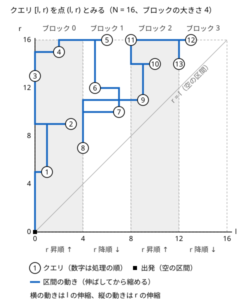

!!! abstract "要点"
    - **何ができるか**：更新のない列への区間クエリを並べ替え（$l$ のブロックの順、次に $r$ の順）、前の区間から 1 要素ずつ伸び縮みして答える。伸縮は合計 $O(N \sqrt{Q})$ 回で、区間の種類数のように左右を合成できない量に使う。
    - **いつ使うか**：
        - 静的な列で、区間ごとの同じ値の組の数・出現回数が条件を満たす値の種類数を答える。
        - 木のパス上の値の頻度を多数のクエリで答える。
        - $N, Q \approx 2 \times 10^5$ で、制限時間が長めにとってある。
    - **計算量**：並べ替え $O(Q \log Q)$、区間の伸縮は合計 $O(N \sqrt{Q})$ 回。1 回の伸縮が $O(1)$ なら全体で $O(N \sqrt{Q} + Q \log Q)$、$O(\log N)$ なら $O(N \sqrt{Q} \log N)$。クエリを先に全部読める（オフライン）ことが条件である。
    - **前提**：[クエリの先読み](../ds/offline-queries.md)

<!-- textlint-disable -->
別名：Mo・Mo 法・クエリ平方分割・木上の Mo・Mo on tree・時間付き Mo
<!-- textlint-enable -->

Mo's algorithm は、区間クエリを答えやすい順に並べ替え、今の区間の両端を 1 つずつ動かして次のクエリの区間に合わせていく方法である。区間に 1 要素を入れる・出すときの答えの変化さえ計算できれば、左右の区間の情報を合成できない量でも答えられる。[クエリの先読み](../ds/offline-queries.md)の一種で、クエリを先に全部読めることが前提になる。

## 何ができるか（1 要素の出入りで答えを差分更新できる量） {#what-it-does}

Mo's algorithm は、長さ $N$ の更新のない列 $a_0, \dots, a_{N-1}$（0-indexed）と $Q$ 個の区間クエリ $[l, r)$（[半開区間](../guide/glossary.md#half-open-interval)）に答える。使うのは次の 3 つの操作だけである。

- **add(i)**：位置 $i$ の要素を今の区間に入れ、答えを直す
- **remove(i)**：位置 $i$ の要素を今の区間から出し、答えを直す
- **answer()**：今の区間の答えを読む

区間 $[l, r)$ の答えが分かっていれば、add と remove を使って $[l-1, r)$・$[l+1, r)$・$[l, r-1)$・$[l, r+1)$ の答えが求まる。前のクエリの区間から次のクエリの区間まで端を 1 つずつ動かせば、どのクエリにも答えられる。並べ方を工夫すると、端の動く回数の合計が $O(N \sqrt{Q})$ に収まる（[クエリの並べ方と計算量](#ordering)）。

**セグメント木で済まない量に使う**。[セグメント木](../ds/segment-tree.md)は、左半分と右半分の答えから全体の答えを作れる量にしか使えない。たとえば「区間の中で同じ値を持つ 2 つ組の個数」は、左右それぞれの組の数を足しても、左と右にまたがる組が数えられない。またがる組を数えるには左右の値の分布がまるごと要る。一方、1 要素の出入りなら次のように $O(1)$ で直せる。

- 値ごとの個数 $\mathrm{cnt}[x]$ を持つ。値 $x$ の要素を入れると、すでにある $\mathrm{cnt}[x]$ 個のそれぞれと新しい組ができるので、答えに $\mathrm{cnt}[x]$ を足してから $\mathrm{cnt}[x]$ を 1 増やす
- 出すときは逆に、$\mathrm{cnt}[x]$ を 1 減らしてから、答えから $\mathrm{cnt}[x]$ を引く

たとえば列 $(2, 7, 2, 2)$ で区間 $[0, 3)$ の答えは 1（位置 0 と 2 の組）である。右端を伸ばして位置 3 の値 2 を入れると、$\mathrm{cnt}[2] = 2$ なので答えは $1 + 2 = 3$ になる。

1 要素の出入りで答えを直せる量の例を挙げる。値はどれも、値ごとの個数 $\mathrm{cnt}[x]$ を持てば直せる。

| 区間について求める量 | 値 $x$ が入るときの変化（$c = \mathrm{cnt}[x]$ は入る前の個数） |
| --- | --- |
| 値の種類数 | $c = 0$ なら $+1$ |
| 同じ値の 2 つ組の数 $\sum \binom{\mathrm{cnt}[x]}{2}$ | $+c$ |
| 同じ値の 3 つ組の数 $\sum \binom{\mathrm{cnt}[x]}{3}$ | $+\binom{c}{2}$ |
| 同じ値どうしで作れるペアの最大数 $\sum \lfloor \mathrm{cnt}[x] / 2 \rfloor$ | $c$ が奇数なら $+1$ |
| 出現回数が $k$ 以上の値の数 | $c + 1 = k$ なら $+1$ |

[BIT](../ds/fenwick-tree.md) を組み合わせれば、「区間の中で $a_i$ より小さい要素の数」を使う量（転倒数など）も 1 回 $O(\log N)$ で直せる。

使えないのは次の 2 つの場合である。

- **列に更新がある**：区間の答えを差分で直す前提が崩れる。点の更新だけなら、時間の軸を足した[時間付き Mo](#variants) がある
- **[オンライン](../guide/glossary.md#offline)で答える必要がある**：前のクエリの答えで次のクエリが決まると、並べ替えられない（[オンライン強制の見分け方](../ds/offline-queries.md#online)）

## クエリの並べ方と計算量（ブロックの大きさ N/√Q、伸縮の総回数 O(N√Q)） {#ordering}

Mo's algorithm の並べ方は、左端 $l$ を大きさ $B$ のブロックに分け、ブロック番号 $\lfloor l / B \rfloor$ の小さい順、同じブロックの中では右端 $r$ の小さい順にするものである。$B$ は $N / \sqrt{Q}$ ほどにする。

**素朴な順ではなぜ遅いか**。入力の順に答えると、1 回のクエリで端が最大 $N$ 動くので、合計 $O(NQ)$ になる。左端の順に並べても、右端が毎回 $0$ と $N$ の間を往復しうるので $O(NQ)$ のままである。$N = Q = 2 \times 10^5$ なら $4 \times 10^{10}$ 回で間に合わない。

次の図は、クエリ $[l, r)$ を平面の点 $(l, r)$ とみて、$N = 16$・$B = 4$ で並べた順に区間を動かした様子である。点どうしの道のりの長さが、端の動く回数になる。



この並べ方で、端の動く回数を左右に分けて数える。

- **右端 $r$**：同じブロックの中では $r$ が単調に動くので、1 つのブロックで合計 $N$ 回以下である。ブロックが変わるときの移動も $N$ 回以下で、ブロックは $\lceil N / B \rceil$ 個なので、合計 $O(N^2 / B)$ 回
- **左端 $l$**：同じブロックの中では、1 回のクエリで $B$ 回未満しか動かない。ブロック $b$ から $b'$ へ変わるときの動きは $(b' - b + 1)B$ 回以下で、$b' - b$ の合計はブロックの数 $\lceil N / B \rceil$ 以下なので、切り替え全部で $O(N)$ 回である。合計 $O(QB + N)$ 回

合わせると $O(N^2 / B + QB)$ 回で、2 つの項が等しくなる $B = N / \sqrt{Q}$ のとき最小の $O(N \sqrt{Q})$ になる。これに並べ替えの $O(Q \log Q)$ と、$Q$ 回の answer の分を足したものが全体の計算量である。

$N = Q = 2 \times 10^5$ では $N \sqrt{Q} \approx 9 \times 10^7$ で、定数倍を含めると伸縮は $10^8$ 回ほどになる。伸縮が $O(1)$ なら 1〜2 秒で間に合う見込みだが、伸縮に BIT の $O(\log N)$ が掛かると $10^9$ 回を超えうる。Mo's algorithm を使う問題の制限時間が長めにとってあるのは、このためである。

!!! tip "ブロックの大きさを √N にしない"
    $B = \sqrt{N}$ とする説明も多い。このときの伸縮は $O((N + Q) \sqrt{N})$ 回で、$N$ と $Q$ が同じくらいなら差はない。$Q$ が $N$ よりずっと大きいと差が出る。$N = 10^5$・$Q = 10^6$ なら、式 $N^2 / B + QB$ による上限の見積もりは、$B = \sqrt{N}$ では約 $3.5 \times 10^8$ 回、$B = N / \sqrt{Q} = 100$ では約 $2 \times 10^8$ 回（$N \sqrt{Q} = 10^8$ の 2 倍）になる。

## 実装の要点（伸ばしてから縮める・奇数ブロックで r を逆順・取得を重くしてよい（値の平方分割）） {#implementation}

Mo's algorithm の本体は、クエリを並べ替えて端を動かすだけの短い関数である。add・remove・answer を関数（ラムダ式）で受け取る形にしておくと、問題ごとに差分の計算だけを書けばよい。

```cpp
--8<-- "mo-algorithm/mo-basic.cpp:core"
```

**伸ばしてから縮める**。端を動かす 4 つのループは、区間を広げる 2 つ（$l$ を減らす・$r$ を増やす）を先に、狭める 2 つ（$l$ を増やす・$r$ を減らす）を後に置く。逆にすると、途中で $l > r$ になることがある。たとえば今の区間が $[0, 2)$ で次が $[5, 8)$ のとき、先に左端を縮めると $l = 5$・$r = 2$ になる。このとき、区間に入っていない位置 2〜4 の要素を remove してしまう。値ごとの個数が負になるので、個数を配列の添字に使う実装（出現回数が $k$ の値の数を持つ配列など）では範囲外を触る。広げる方を先にすれば、区間は常に $l \le r$ を保つ。

**奇数ブロックで $r$ を逆順にする**。偶数番目のブロックでは $r$ の昇順、奇数番目では降順に並べると、ブロックが変わるときに右端を $N$ から $0$ 近くまで戻す動きがなくなる（[クエリの並べ方と計算量](#ordering)の図の上下の往復）。計算量の式は変わらないが、右端の動きがおよそ半分になり、実際に速くなる。

区間の中の 3 つ組の数を数える add・remove は次のようになる。値 $x$ の要素を入れると、すでにある $c$ 個から 2 つを選ぶ $\binom{c}{2}$ 通りの組が新しくできる。

```cpp
--8<-- "mo-algorithm/mo-basic.cpp:triple"
```

**左右で変化が違うとき**。転倒数のように、要素が左端から入るか右端から入るかで答えの変化が違う量もある。左端から入る要素は区間の中の自分より小さい要素と、右端から入る要素は自分より大きい要素と転倒の組を作る。この場合は出し入れを 4 つの関数に分ける。次の例は、値を座標圧縮して BIT で個数を持ち、区間の転倒数を 1 回の伸縮 $O(\log N)$ で直す。Library Checker の [Static Range Inversions Query](https://judge.yosupo.jp/problem/static_range_inversions_query) で確かめられる形である。

```cpp
--8<-- "mo-algorithm/mo-inversions.cpp:core"
```

**取得を重くしてよい（値の平方分割）**。伸縮は $O(N \sqrt{Q})$ 回あるのに対し、answer は $Q$ 回しかない。伸縮を $O(1)$ に軽くするかわりに answer を $O(\sqrt{V})$ に重くすると、全体が速くなる（$V$ は値の範囲。座標圧縮すれば $V \le N$）。たとえば「区間の中で値が $x$ 未満の要素の数」を BIT で持つと、伸縮も取得も $O(\log N)$ で、全体は $O(N \sqrt{Q} \log N)$ である。値の範囲 $[0, V)$ を大きさ $\sqrt{V}$ のブロックに分ける。値ごとの個数とブロックごとの個数の合計を持てば、伸縮は 2 か所を直すだけの $O(1)$ になる。取得は、$x$ 未満の完全なブロックの合計と、端のブロックの値ごとの個数を足して $O(\sqrt{V})$ になる。全体は $O(N \sqrt{Q} + Q \sqrt{V})$ で、$\log$ が消える。この考え方は[平方分割](../ds/sqrt-decomposition.md)と同じである。

??? question "確認問題：区間の中の最頻値の出現回数を、伸縮 O(1) で答えるには"
    値ごとの個数 $\mathrm{cnt}[x]$ に加えて、「個数がちょうど $k$ の値の数」$\mathrm{num}[k]$ と、今の最大の個数 $m$ を持つ。add では $\mathrm{num}[\mathrm{cnt}[x]]$ を 1 減らし、$\mathrm{cnt}[x]$ を 1 増やして $\mathrm{num}[\mathrm{cnt}[x]]$ を 1 増やし、$m$ を $\max(m, \mathrm{cnt}[x])$ にする。remove では、出す値の個数がちょうど $m$ で、それが $\mathrm{num}[m]$ の最後の 1 つなら、$m$ を 1 減らす。個数は 1 ずつしか減らないので、その値の個数は $m - 1$ に残り、新しい最大は $m - 1$ である。どちらも $O(1)$ である。

## 例題 {#examples}

### ABC293 G. Triple Index {#abc293_g}

<div class="kp-problems" data-role="example" markdown>

- [ABC293 G. Triple Index](https://atcoder.jp/contests/abc293/tasks/abc293_g)（diff 1753）：区間内で同じ値を持つ 3 つ組 (i < j < k) の個数を、多数のクエリで答える。

</div>

区間の 3 つ組の数は、左右の区間に分けると、またがる組が数えられないので合成できない。値ごとの個数 $\mathrm{cnt}[x]$ を持てば、1 要素の出入りで $\binom{c}{2}$ だけ増減するので、Mo's algorithm の典型の形になる。add・remove は[実装の要点](#implementation)の 3 つ組のコードそのものである。

??? note "解法の詳細"
    答えは $\sum_x \binom{\mathrm{cnt}[x]}{3}$ である。値 $x$ の個数が $c$ から $c + 1$ になると、$\binom{c+1}{3} - \binom{c}{3} = \binom{c}{2}$ だけ増える。新しい要素と、すでにある $c$ 個から 2 つを選ぶ組がちょうど増えるからである。remove はこの逆で、$\mathrm{cnt}[x]$ を 1 減らしてから $\binom{\mathrm{cnt}[x]}{2}$ を引く。

    問題文の区間は 1-indexed の閉区間 $[L, R]$ なので、0-indexed の半開区間 $[L - 1, R)$ に直してから並べる。答えは区間の長さの 3 乗のオーダー（$10^{15}$ 程度）になりうるので `long long` で持つ。1 回の伸縮が $O(1)$ なので、全体は $O(N \sqrt{Q} + Q \log Q)$ である。

### ABC242 G. Range Pairing Query {#abc242_g}

<div class="kp-problems" data-role="example" markdown>

- [ABC242 G. Range Pairing Query](https://atcoder.jp/contests/abc242/tasks/abc242_g)（diff 1828）：区間内で同じ値どうしを組にするとき、作れる組の最大数を多数のクエリで答える。

</div>

値 $x$ が区間に $\mathrm{cnt}[x]$ 個あれば、その値だけで $\lfloor \mathrm{cnt}[x] / 2 \rfloor$ 組が作れ、異なる値は組にならない。答えはこの和なので、1 要素の出入りで答えが $1$ だけ変わるかどうかを個数の偶奇で決められる。$N \le 10^5$ に対して $Q \le 10^6$ とクエリが多いので、ブロックの大きさは $N / \sqrt{Q}$ にする。

??? note "解法の詳細"
    値 $x$ の個数が $c$ から $c + 1$ になると、$\lfloor (c + 1) / 2 \rfloor - \lfloor c / 2 \rfloor$ は $c$ が奇数なら 1、偶数なら 0 である。出すときは、$c$ から $c - 1$ になるとき $c$ が偶数なら答えが 1 減る。

    $B = N / \sqrt{Q} \approx 100$ にすると、伸縮は上限の見積もりで合計 $2 N \sqrt{Q} \approx 2 \times 10^8$ 回である（[ブロックの大きさを √N にしない](#ordering)）。$Q$ が大きいので入出力も重く、入出力を速くする書き方（`ios::sync_with_stdio(false)` など）を使う。並べ替えは $O(Q \log Q)$ である。

## 2 つの接頭辞の長さ (X, Y) を区間と見る {#two-prefixes}

この節は、[クエリの並べ方と計算量](#ordering)の数え方を理解していることを前提にする。

Mo's algorithm で並べているのは、本当は区間ではなく「2 つの整数の組 $(l, r)$ の状態」である。状態を 1 だけ動かしたときの答えの変化が速く計算できれば、組が区間を表していなくても同じ並べ方が使える。$l \le r$ の制約もいらない。計算量の数え方は同じで、2 つの座標の範囲が $N$ までなら伸縮は $O(N \sqrt{Q})$ 回である。

典型は、2 つの列の接頭辞の長さ $(X, Y)$ を状態にする形である。たとえば 2 つの列 $A, B$ について

$$
f(X, Y) = \sum_{i < X} \sum_{j < Y} \lvert A_i - B_j \rvert
$$

を多数の $(X, Y)$ で答えたいとする。$X$ を 1 増やすと $\sum_{j < Y} \lvert A_X - B_j \rvert$ だけ増える。これは $B$ の先頭 $Y$ 項のうち $A_X$ 以下の要素の個数と和、$A_X$ より大きい要素の個数と和が分かれば計算できる。$B$ の先頭 $Y$ 項を値で座標圧縮した BIT（個数と和の 2 本）に持てば、1 回 $O(\log N)$ で直せる。$Y$ を動かすときも、$A$ の側の BIT で同じように直す。$(X, Y)$ を $(l, r)$ と見て Mo's algorithm の順に並べれば、全体は $O(N \sqrt{Q} \log N)$ になる（[ABC384 G](#practice)）。

$(n, k)$ を状態とする二項係数の和 $S(n, k) = \sum_{i \le k} \binom{n}{i}$ も同じ形である。$S(n, k \pm 1)$ は 1 項の増減で、$S(n + 1, k) = 2 S(n, k) - \binom{n}{k}$ なので、どちらの座標も $O(1)$ で動かせる（[二項係数の部分和](../comb/binomial-prefix-sum.md#update)）。

## 木上の Mo（入りと出の両方を記録した列で、パスを区間にする。LCA を別に足す） {#mo-on-tree}

この節は、[オイラーツアー](../tree/euler-tour.md)の入りと出の両方を記録した列と、[最小共通祖先（LCA）](../tree/lca.md)を前提にする。

木上の Mo は、木のパスについてのクエリを長さ $2N$ の列の区間クエリに直し、Mo's algorithm にかける方法である。部分木のクエリなら、行きがけ順の列で部分木が区間 $[\mathrm{in}[v], \mathrm{out}[v])$ になるので、列の Mo をそのまま使える。パスは行きがけ順の区間にならないので、次の工夫がいる。

DFS で頂点に入るときと出るときの両方で頂点を列に記録し、頂点 $v$ の入りの位置を $\mathrm{ST}(v)$、出の位置を $\mathrm{EN}(v)$ とする。パス $u$–$v$ で $\mathrm{ST}(u) < \mathrm{ST}(v)$ とし、$w = \mathrm{lca}(u, v)$ とする。

- **$u$ が $v$ の祖先（$w = u$）**：閉区間 $[\mathrm{ST}(u), \mathrm{ST}(v)]$ を取る
- **そうでない**：閉区間 $[\mathrm{EN}(u), \mathrm{ST}(v)]$ を取り、$w$ を別に足す

どちらの区間でも、ちょうど 1 回現れる頂点がパス上の頂点（2 つ目の場合は $w$ を除く）で、2 回現れる頂点と 1 回も現れない頂点はパスの外である。区間の中で入りと出の両方が現れる頂点は、その部分木の探索が区間の中で始まって終わったもので、パスから外れた寄り道だからである。2 つ目の場合、$u$ の探索を終えてから $v$ に入るまでの間に $w$ の入りも出も現れないので、$w$ は区間に現れない。

**頂点の出し入れは反転にする**。列の位置 $i$ を add・remove するときは、どちらも「頂点 $\mathrm{seq}[i]$ が区間に奇数回現れるか」の印を反転させる。印が立てば値を入れ、消えれば値を出す。2 回現れた頂点は打ち消し合って、自然にパスの外として扱われる。LCA は answer のときだけ一時的に入れて読み、すぐに出す。次のコードは、パス上の頂点の値の種類数を答える。

```cpp
--8<-- "mo-algorithm/mo-tree.cpp:core"
```

列の長さが $2N$ なので、ブロックの大きさは $2N / \sqrt{Q}$ にし、伸縮は $O(N \sqrt{Q})$ 回である。LCA は前処理 $O(N \log N)$・1 回 $O(\log N)$ のダブリングなどで求める（コードの LCA は確かめ用の素朴な版）。

**つまずきやすい点**。$\mathrm{ST}(u) > \mathrm{ST}(v)$ のまま区間を作ると、$l > r$ の区間になる。$u = v$ のときは $w = u$ で、区間は $u$ の入りの 1 か所だけになる。LCA を toggle で入れて戻し忘れると、印が残って次のクエリを壊す。印と関係のない put・take で入れて、読んだらすぐ出す。

## 時間付き Mo・ロールバック Mo {#variants}

この節は発展の内容で、Mo's algorithm の 2 つの拡張の要点だけを書く。

**時間付き Mo（更新のある Mo）**。列への点の更新があるとき、クエリを $(l, r, t)$ の 3 つの座標の点とみる（$t$ はそれまでに行った更新の数）。$t$ を 1 進める・戻すのは、更新を 1 つ施す・取り消すことで、その位置が今の区間の中なら remove と add で直す。$l$ と $r$ をどちらも大きさ $B$ のブロックに分け、$(l \text{ のブロック}, r \text{ のブロック}, t)$ の順に並べる。$N$ と $Q$ が同じくらいなら、$B = N^{2/3}$ で全体の伸縮は $O(N^{5/3})$ 回である。定数倍が大きく、$N = 10^5$ 程度が限度になる。

**ロールバック Mo（追加しかできない量）**。区間の最大値や Union-Find のつながりのように、要素を入れるのは易しいが出すのが難しい量に使う。左端のブロックが同じクエリをまとめ、右端の順に並べる。右端はブロックの右の境界から伸ばしていくだけで、縮めない。左端の部分は、クエリごとに境界から左へ伸ばして答えを読んだ後、変更の記録を使って伸ばす前の状態に戻す（ロールバック）。長さが $B$ 未満のクエリは素朴に計算する。伸縮の回数は Mo's algorithm と同じ $O(N \sqrt{Q})$ 回で、remove の代わりに「状態の保存と巻き戻し」がいる。

## 落とし穴 {#pitfalls}

- **縮めてから伸ばす**：端を動かすループの順を間違えると、途中で $l > r$ になり、区間にない要素を remove する。個数が負になり、個数を添字にした配列では範囲外を触る。広げる 2 つのループを先に置く（[実装の要点](#implementation)）
- **ブロックの大きさが 0**：$B = N / \sqrt{Q}$ を整数で計算すると、$Q > N^2$ のとき 0 になり、ブロック番号の割り算で落ちる。`max(1, …)` で 1 以上にする。$Q = 0$ のときの $\sqrt{Q}$ の割り算も避ける
- **閉区間のまま並べる**：問題文の 1-indexed の閉区間 $[L, R]$ を、0-indexed の半開区間 $[L - 1, R)$ に直し忘れると、1 要素ずれる。直してからクエリに入れる
- **答えのオーバーフロー**：組の数は区間の長さの 2 乗・3 乗で増える。$2 \times 10^5$ 個の同じ値の 3 つ組は約 $1.3 \times 10^{15}$ なので、`int` では足りない
- **answer が重い**：answer に $O(N)$ かけると全体が $O(NQ)$ になる。answer は $O(\sqrt{N})$ 程度までに抑え、それ以上かかるなら、伸縮のたびに答えそのものを直す形にする
- **伸縮の関数が遅い**：伸縮は $10^8$ 回ほど呼ばれるので、`std::function` に入れて渡すと、呼び出しのたびに間接呼び出しになって遅くなりやすい。ラムダ式はテンプレートの引数で受け取る。伸縮の中では `map` や `set` を使わず、値を座標圧縮して配列で持つ
- **木上の Mo で LCA を印で入れる**：LCA を反転の関数で入れて出し忘れると、印が残って次のクエリの答えがずれる（[木上の Mo](#mo-on-tree)）

## 練習問題 {#practice}

<div class="kp-problems" data-role="practice" markdown>

- [ABC477 G. Frequency Query on Tree](https://atcoder.jp/contests/abc477/tasks/abc477_g)（diff 2226）：木のパス上で、出現回数が A 以上 B 以下の値の種類数を答える。
- [ABC384 G. Abs Sum](https://atcoder.jp/contests/abc384/tasks/abc384_g)（diff 2343）：2 つの数列の先頭 X 項と先頭 Y 項の全組について |A_i − B_j| の和を、多数のクエリで答える。

</div>

??? note "練習の方針"
    - **ABC477 G**：[木上の Mo](#mo-on-tree) でパスを列の区間にし、値ごとの個数 $\mathrm{cnt}[x]$ と、「個数が $f$ 以上の値の数」$\mathrm{ge}[f]$ を持つ。$\mathrm{cnt}[x]$ が $c$ から $c + 1$ になると $\mathrm{ge}[c + 1]$ が 1 増え、減るときは逆なので、伸縮は $O(1)$ である。答えは $\mathrm{ge}[A] - \mathrm{ge}[B + 1]$ で、LCA は answer のときだけ一時的に足す
    - **ABC384 G**：[2 つの接頭辞の長さ (X, Y) を区間と見る](#two-prefixes)の形そのものである。$A$ と $B$ の値をまとめて座標圧縮し、個数と和の BIT を $A$ 側・$B$ 側に 2 本ずつ持つ。1 回の伸縮が $O(\log N)$ で、全体は $O(N \sqrt{Q} \log N)$ と重いので、BIT の定数倍を小さく書く

## 力試し {#challenge}

<div class="kp-problems" data-role="challenge" markdown>

- [ABC405 G. Range Shuffle Query](https://atcoder.jp/contests/abc405/tasks/abc405_g)（diff 2354）：区間内の X 未満の要素を並べ替えてできる列の種類数を、多数のクエリで答える。

</div>

??? note "力試しの方針"
    - **ABC405 G**：値 $v$ の区間の中の個数を $c_v$ とすると、答えは多項係数 $\left(\sum_{v < X} c_v\right)! \,/\, \prod_{v < X} c_v!$ である。必要なのは「値が $X$ 未満の要素の個数の和」と「$1 / c_v!$ の積」の 2 つの接頭辞の取得である。これらを BIT やセグメント木に載せると伸縮が $O(\log N)$ になり、間に合わない。[値の平方分割](#implementation)で、ブロックごとに個数の和と $1 / c_v!$ の積を持つ。$c_v$ が 1 変わると、積には $1 / (c_v + 1)$ か $c_v$ を掛ければよいので伸縮は $O(1)$、取得は $O(\sqrt{N})$ になる。階乗とその逆元は前計算する

## 確認問題 {#quiz}

??? question "確認問題：クエリを左端 l の順に並べるだけでは、なぜ遅いか"
    左端は単調に動くので合計 $O(N)$ で済むが、右端は左端の順と関係なく並ぶので、毎回 $0$ と $N$ の間を往復しうる。たとえば $[0, N), [1, 2), [2, N), [3, 4), \dots$ の順に来ると、1 回ごとに右端が $N$ 近く動き、合計 $O(NQ)$ になる。左端をブロックにまとめて、ブロックの中で右端を単調にすれば、右端の往復はブロックの数の $O(N / B)$ 回に減る。

??? question "確認問題：ブロックの大きさを B としたとき、端の動く回数の合計はいくつか。B をいくつにすると最小か"
    右端は 1 つのブロックで $N$ 回以下、ブロックは $N / B$ 個なので $O(N^2 / B)$ 回である。左端は 1 回のクエリで $B$ 回未満なので $O(QB)$ 回である。合計 $O(N^2 / B + QB)$ は、2 つの項が等しくなる $B = N / \sqrt{Q}$ で最小の $O(N \sqrt{Q})$ になる。

??? question "確認問題：伸縮の関数を、伸ばす方より先に縮める方を呼ぶとどうなるか"
    次の区間が今の区間と重ならないとき（今が $[0, 2)$ で次が $[5, 8)$ など）、左端を先に縮めると途中で $l > r$ になる。区間に入っていない要素を remove するので、値ごとの個数が負になる。足し引きだけで答えを直す量なら最後に帳尻が合うこともある。しかし、個数を配列の添字に使う実装では範囲外を触る。伸ばす方を先に呼べば、区間は常に $l \le r$ を保つ。

??? question "確認問題：区間の値の種類数だけなら、Mo's algorithm より速い方法は何か"
    クエリを右端の順に並べ、各値の最後の出現位置だけを 1 にした BIT で区間和を取る方法で、全体は $O((N + Q) \log N)$ である（[区間の種類数](../ds/offline-queries.md#distinct-count)）。Mo's algorithm は $O(N \sqrt{Q})$ で、$N = Q = 2 \times 10^5$ なら 10 倍ほど遅い。Mo's algorithm は、種類数の条件が「出現回数が $k$ 以上」のように BIT に載らない形になったときに使う。

## 使い分け {#comparison}

| 状況 | 使う手法 |
| --- | --- |
| 左右の答えを合成できる量（和・最小値など） | [セグメント木](../ds/segment-tree.md) |
| 区間の種類数・$X$ 以下の個数（オフライン） | [クエリの先読み](../ds/offline-queries.md#distinct-count) と BIT |
| 合成できない量（組の数・頻度の条件）でオフライン | Mo's algorithm |
| オンライン強制 | [永続データ構造](../ds/persistent-data-structures.md)・[マージソート木](../ds/merge-sort-tree.md) |
| 列に点の更新がある | [時間付き Mo](#variants)・[平方分割](../ds/sqrt-decomposition.md) |
| 要素を出すのが難しい（最大値・連結性） | [ロールバック Mo](#variants) |
| 部分木ごとの値の集計 | [マージテク](../tree/small-to-large.md) |
| 2 つの区間の多重集合が等しいか | [集合のハッシュ](../string/hashing-for-sets.md) |

区間ごとの転倒数は、Mo's algorithm と BIT で $O(N \sqrt{Q} \log N)$ になる（[転倒数](../ds/inversion-number.md)）。部分木のクエリはマージテクと Mo's algorithm のどちらでも書けるが、マージテクは $O(N \log N)$ 回の追加で済み、速い。

## 参考 {#references}

- [ei1333「Mo's algorithm」](https://ei1333.hateblo.jp/entry/2017/09/11/211011)：使える条件、ブロックの数を $\sqrt{Q}$ にしたときの $O(N \sqrt{Q})$ の数え方、伸ばしてから縮める順、奇数ブロックの逆順、木上の Mo・時間付き Mo の概要
- [snuke「Mo's algorithm とその上位互換の話」](https://snuke.hatenablog.com/entry/2016/07/01/000000)：ブロックの大きさ $N / \sqrt{Q}$ の計算量の改善と、ロールバックで追加だけにする方法
- [kmjp「AtCoder ABC #293 : G - Triple Index」](https://kmjp.hatenablog.jp/entry/2023/03/12/0900)：例題 abc293_g の差分の更新 $\binom{c}{2}$
- [Kazun「AtCoder Beginner Contest 242 G問題 Range Pairing Query」](https://kazun-kyopro.hatenablog.com/entry/ABC/242/G)：例題 abc242_g の答えの式（個数の半分の切り捨ての和）と制約（$N \le 10^5$、$Q \le 10^6$）
- [kmjp「AtCoder ABC #477 (UNICORNプログラミングコンテスト2026) : G - Frequency Query on Tree」](https://kmjp.hatenablog.jp/entry/2026/09/27/0930)：練習 abc477_g のパスの区間への直し方と、個数が $f$ 以上の値の数の持ち方
- [kmjp「AtCoder ABC #384 (トヨタ自動車プログラミングコンテスト2024#12) : G - Abs Sum」](https://kmjp.hatenablog.jp/entry/2024/12/14/0900)：練習 abc384_g の $(X, Y)$ の Mo と BIT の組
- [kmjp「AtCoder ABC #405 : G - Range Shuffle Query」](https://kmjp.hatenablog.jp/entry/2025/05/10/0900)：力試し abc405_g の値の平方分割（伸縮 $O(1)$・取得 $O(\sqrt{N})$）
- [Library Checker「Static Range Inversions Query」](https://judge.yosupo.jp/problem/static_range_inversions_query)：区間の転倒数のコード片の動作確認の対象
