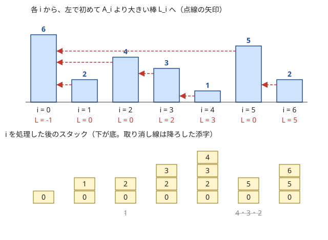
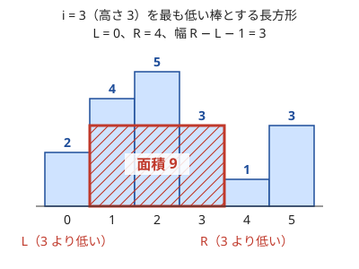

!!! abstract "要点"
    - **何ができるか**：各要素について「左（右）で初めて自分より大きい（小さい）要素」の位置を、添字を値が単調になるように積んだスタックで、全体 $O(N)$ で求める。同じ考え方で幅 $K$ の窓の最小値を deque で全体 $O(N)$ で求め、最大値を根にする Cartesian tree も $O(N)$ で作れる。
    - **いつ使うか**：
        - 左（右）で初めて自分より大きい（小さい）要素の位置
        - 各ビルから見えるビルの数・すべての区間の最小値の和
        - 長さ $K$ のすべての区間の最小値（最大値）
        - $\mathrm{dp}[i] = \min(\mathrm{dp}[i-K], \dots, \mathrm{dp}[i-1]) + c$ のように、直前 $K$ 個の最小値で決まる遷移
        - $N \le 2 \times 10^5$ で、各要素から左右を見ていくと $O(N^2)$ になる
    - **計算量**：全体 $O(N)$。各添字は 1 回積まれて高々 1 回降ろされるので、1 要素あたりならし $O(1)$ である。SWAG は追加・削除がならし $O(1)$、窓全体の総積の取得が $O(1)$
    - **前提**：[スタック・キュー・deque の使いどころ](../ds/stack-techniques.md)

<!-- textlint-disable -->
別名：monotonic stack・単調 stack・ヒストグラム内最大長方形・sliding window minimum・単調 deque・単調キュー・SWAG・Sliding Window Aggregation・Cartesian Tree・デカルト木
<!-- textlint-enable -->

単調スタックは、列を端から 1 つずつ見ながら「これから先の要素の答えになりうる添字」だけをスタックに残す技法である。残る添字の値は底から上へ単調に並び、新しい要素に負けた添字は二度と答えにならないので捨ててよい。スライド最小値は、この考え方を両端から出し入れできる deque へ移し、右へ動く窓でも使えるようにしたものである。

## 単調スタックの手順と保つ性質 {#procedure}

単調スタックの基本の問いは、各 $i$ について $L_i$（$i$ より左で $A_j > A_i$ となる最大の $j$。なければ $-1$）を求めることである。以下、列は 0-indexed の $A = (A_0, \dots, A_{N-1})$ とする。素朴には $i$ から左へ 1 つずつ見ていくが、$A$ が単調減少だと毎回左端まで見ることになり、全体で $O(N^2)$ かかる。

鍵になる観察は次のとおりである。$j < k$ かつ $A_j \le A_k$ なら、$k$ より右のどの $i$ から見ても、$j$ が $L_i$ になることはない。$A_j > A_i$ なら $A_k \ge A_j > A_i$ でもあり、$k$ の方が $i$ に近いからである。$k$ が来た時点で $j$ は「$k$ の陰に隠れた」と言える。隠れた添字を捨てていくと、残る添字の値は底から上へ狭義減少に並ぶ。

### 保つ性質

$i$ を処理する直前のスタックは、次の性質を満たす。

- 中身は $0, \dots, i-1$ のうち、右にそれ以上の値がない添字だけで、底から上へ添字が増える
- 値は底から上へ狭義減少である（$A_{\text{底}} > \dots > A_{\text{上}}$）
- いちばん上は $i - 1$ である（$i \ge 1$ のとき）

### 各操作の手順

```text
st ← 空のスタック
for i = 0, 1, …, N−1:
    while st が空でなく A[st.top] ≤ A[i]:  st.pop()   # i に隠れる添字を降ろす
    L[i] ← st が空なら −1、そうでなければ st.top
    st.push(i)
```

降ろし終えた時点のいちばん上は、$A_i$ より大きい添字のうち最も右のものなので、それが $L_i$ になる。$A_i$ 以下の添字を降ろしてから $i$ を積むので、値の狭義減少は保たれる。次の図は $A = (6, 2, 4, 3, 1, 5, 2)$ での動きである。



図で $i = 5$（$A_5 = 5$）を見ると、スタック $[0, 2, 3, 4]$ から値が $5$ 以下の $4, 3, 2$ を降ろし、残った $0$ が $L_5$ になる。降ろした $2, 3, 4$ は、$5$ より右から見ると $A_5$ に隠れるので、もう要らない。

```cpp
--8<-- "monotonic-stack/prev-greater.cpp:core"
```

### 境界

答えがないとき、左側なら $-1$、右側なら $N$ とする。こうそろえると、幅 $R_i - L_i - 1$ や個数 $(i - L_i)(R_i - i)$ が場合分けなしで正しくなる。空のスタックの top は読まない。降ろすループの条件に空かどうかを先に書くか、左端に番兵 $+\infty$ を置いて空にしない。

### なぜ O(N) か

`while` の 1 回の実行は 1 つの添字を降ろす。各添字は 1 回だけ積まれ、降ろされるのは高々 1 回なので、`while` の実行は全体で $N$ 回以下である。1 回の $i$ で多くの添字を降ろすことはあるが、合計は $N$ を超えない。よって全体で $O(N)$、1 要素あたり[ならし](../guide/glossary.md#amortized-complexity) $O(1)$ である。

### 4 つの向きと等号

求めたいものに合わせて、走査の向きと降ろす条件を変える。

| 求めるもの | 走査の向き | 降ろす条件 | スタックの値 |
| --- | --- | --- | --- |
| 左で初めて大きい | 左から | $A_{\text{top}} \le A_i$ | 狭義減少 |
| 左で初めて以上 | 左から | $A_{\text{top}} < A_i$ | 広義減少 |
| 左で初めて小さい | 左から | $A_{\text{top}} \ge A_i$ | 狭義増加 |
| 右で初めて大きい | 右から | $A_{\text{top}} \le A_i$ | 狭義減少 |

降ろす条件は「答えにしたくない値」で書くと迷わない。「初めて大きい」なら答えにしたくないのは $A_i$ 以下なので $\le$ で降ろす。右向きの答えは、左から走査して「降ろされた瞬間」に記録してもよい。$j$ を降ろした $i$ が、$j$ の右で初めて $A_j$ 以上になる位置である。

## ヒストグラムの最大長方形 {#histogram}

ヒストグラムの最大長方形は、幅 1 の棒が並ぶとき、棒の内側に収まる長方形の面積の最大値を求める問題である。区間 $[l, r)$ を選んで $(r - l) \times \min_{l \le j < r} A_j$ を最大にする問題と同じである。

最適な長方形の高さは、その区間の最も低い棒 $A_i$ に等しい。そこで「$i$ を最も低い棒とする長方形」を各 $i$ について考える。区間はできるだけ広げてよいので、$L_i$（左で初めて $A_i$ より低い位置）と $R_i$（右で初めて $A_i$ より低い位置。なければ $N$）の間の開区間 $(L_i, R_i)$ になる。面積は $A_i \times (R_i - L_i - 1)$ で、その最大が答えである。



$L_i$ と $R_i$ はどちらも「初めて小さい」の向きの単調スタックによって $O(N)$ で求まるので、全体も $O(N)$ である。同じ高さの棒があると同じ長方形を何度か数えるが、最大値を求めるだけなら答えは変わらない。

2 次元の格子で「障害物を含まない最大の長方形」を求めるときは、行ごとに「その行から上（または下）へ連続して空いているマスの数」を棒の高さにして、各行でこの節の処理を行う。全体は $O(HW)$ になる（[ABC311 G](#challenge) はこの形を使う）。

## i が最小（最大）になる区間の数と寄与の数え上げ {#contribution}

すべての区間の最小値の和は、区間を列挙すると $O(N^2)$ 個あって間に合わない。そこで和の順序を入れ替え、各 $A_i$ が「何個の区間で最小値になるか」を数えて $A_i \times \text{個数}$ を足す（[寄与](../thinking/contribution.md)の考え方）。

$A_i$ が区間 $[l, r)$ の最小値になるのは、$L_i < l \le i < r \le R_i$ のときである。ここで $L_i$ は左で初めて $A_i$ より小さい位置、$R_i$ は右で初めて $A_i$ より小さい位置である。$l$ の選び方が $i - L_i$ 通り、$r$ の選び方が $R_i - i$ 通りなので、個数は $(i - L_i)(R_i - i)$ になる。

$$
\sum_{0 \le l < r \le N} \min_{l \le j < r} A_j = \sum_{i=0}^{N-1} A_i \, (i - L_i)(R_i - i)
$$

**同じ値の扱い**：最小値をとる要素が区間に 2 つ以上あると、両方で数えてしまう。片側を $<$、もう片側を $\le$ で止めて、代表を 1 つに決める。たとえば「左は $A_j < A_i$ の位置で止め、右は $A_j \le A_i$ の位置で止める」とすると、区間の最小値をとる要素のうち最も右のものだけが数えられる。$A = (1, 1)$ では、両側を $<$ で止めると区間 $[0, 2)$ を 2 回数えて $4$ になるが、片側を $\le$ にすると正しく $3$ になる。

```cpp
--8<-- "monotonic-stack/sum-of-min.cpp:core"
```

最大値の和なら不等号をすべて逆にする。和の大きさは制約から見積もる。区間は $N(N+1)/2$ 個あるので、$N = 2 \times 10^5$・$A_i \le 10^9$ では和が約 $2 \times 10^{19}$ に届く。これは `long long` の上限（約 $9.2 \times 10^{18}$）を超える。この場合は mod を取るか、`__int128` を使う。和が非負なら、`unsigned long long` の上限約 $1.8 \times 10^{19}$ で足りるかも見積もる。[AGC005 B](#practice) のように値が $N$ 以下なら、和は $N \cdot N(N+1)/2 \approx 4 \times 10^{15}$ 以下で `long long` に収まる。

この形は「区間の最大値と最小値の差の和」（最大値の和から最小値の和を引く）や、「窓の幅ごとの最大値の和」（$i$ が最大になる窓を幅ごとに数える）にも広がる。

## 見えるビルの数・水位のシミュレーション {#visible}

単調スタックの中身そのものが答えになる型がある。ここでいう「$i$ から $j$ が見える」は、間に $A_j$ より高い建物がないことを指す。

**見えるビルの数**：右から左へ走査し、「$i$ を処理する直前のスタックの大きさ」を $i$ の答えにする。そのあと $A_i$ より低い添字を降ろし、$i$ を積む。$i$ を処理する直前のスタックには、$i$ から見える建物がちょうど入っている。$A_i$ より低い建物は、$i$ より左から見ると $i$ に隠れるからである（[ABC372 D](#abc372_d)）。この節の定義では同じ高さの建物は隠さないので、降ろすのは真に低いものだけにする。

**水位のシミュレーション**：仕切りで区切られた水槽へ端から水を入れる問題では、ある仕切りを越えるには、その手前で「より高い仕切り」までの区画をすべてその高さまで満たす必要がある。各仕切り $i$ について、手前で初めて $A_i$ より高い仕切り $L_i$ を単調スタックで求めれば、$L_i$ と $i$ の間を高さ $A_i$ まで満たす量が $A_i \times (i - L_i)$ と分かる。これを $L_i$ までの時刻へ足していく DP である（[ABC359 E](#abc359_e)）。

どちらの型も、各要素の答えを「降ろされずに残っている添字」から決める点が共通している。

## スライド最小値（単調 deque） {#sliding-window-minimum}

スライド最小値は、長さ $K$ のすべての窓 $[i - K + 1, i]$ の最小値を全体 $O(N)$ で求める方法である。窓ごとに $K$ 個を見ると $O(NK)$ で、$N, K$ が $2 \times 10^5$ だと間に合わない。

単調スタックとの違いは、古い要素が窓の左から出ていく点である。そこで添字を deque に入れ、末尾では単調スタックと同じように降ろし、先頭では窓から出た添字を捨てる。

- **末尾から捨てる**：$j < i$ かつ $A_j \ge A_i$ なら、$j$ は $i$ より先に窓から出て、$i$ より小さくもない。よって $i$ が入った後は、$j$ がどの窓でも最小値になることはない
- **先頭から捨てる**：先頭の添字が $i - K$ 以下なら、窓から出たので捨てる
- **保つ性質**：deque の添字は先頭から末尾へ増え、値は狭義増加である。中身は窓の中の添字だけなので、先頭が窓の最小値になる

```cpp
--8<-- "monotonic-stack/sliding-min.cpp:core"
```

各添字は 1 回入って高々 1 回出るので、全体で $O(N)$ である。窓の幅が固定でなくても、[尺取り法](../basics/two-pointers.md#fixed-window)のように左端と右端がどちらも戻らずに進むなら、同じ deque が使える。そのときは先頭から捨てる条件を「添字が今の左端より小さい」に変える。最大値なら不等号を逆にする（値の符号を反転してもよい）。

deque には値ではなく添字を入れる。値だけでは、先頭が窓から出たかどうかが分からないからである。

## DP の遷移の高速化に使う {#dp-transition}

$\mathrm{dp}[i] = \min(\mathrm{dp}[i-K], \dots, \mathrm{dp}[i-1]) + c_i$ のように、直前 $K$ 個の最小値で決まる遷移は、素朴には全体 $O(NK)$ かかる。遷移元の窓 $[i-K, i)$ は $i$ とともに右へ動くので、スライド最小値の deque に dp の値を入れれば全体 $O(N)$ になる。

```text
dq ← 空の deque；dq.push_back(0)               # dp[0] は初期値
for i = 1, 2, …, N:
    while dq.front < i − K:  dq.pop_front()      # 遷移元 [i−K, i) から出た
    dp[i] ← dp[dq.front] + c[i]
    while dq が空でなく dp[dq.back] ≥ dp[i]:  dq.pop_back()
    dq.push_back(i)                              # dp[i] が決まってから入れる
```

順番が大事で、$\mathrm{dp}[i]$ を計算してから $i$ を deque に入れる。先に入れると、まだ決まっていない値を遷移元に使ってしまう。遷移できない状態（$+\infty$）がある問題では、その添字を deque に入れないか、$+\infty$ のまま入れて最後に判定する。入れない場合は deque が空になりうるので、空なら $\mathrm{dp}[i] = +\infty$ とし、`dq.front` を読まない。

遷移元の範囲が単調に動かない場合や、値を添字にした範囲から取る場合は、dp をセグメント木に載せる方法へ切り替える（[セグメント木による DP の高速化](../dp/dp-segment-tree.md)）。[ABC359 E](#abc359_e) のように、遷移元が「手前で初めて大きい位置」で決まる DP には単調スタックを使う。

## 落とし穴 {#pitfalls}

- **値を積んで添字を失う**：幅（$R_i - L_i - 1$）や窓から出たかの判定には添字が要る。添字を積み、値は $A[\text{添字}]$ で引く。値と添字の組を積んでもよい
- **等号の向きの取り違え**：「初めて大きい」なのに $<$ で降ろすと、同じ値を答えにしてしまう。寄与の数え上げでは、両側を同じ不等号にすると同じ値の区間を二重に数えるか、まったく数えない
- **空のスタックの top**：`st.back()` を空のときに呼ぶと未定義動作である。降ろすループの条件に `!st.empty()` を先に書く。番兵（左端に $+\infty$ を置くなど）を使えば空にならない
- **答えがないときの値**：左側の答えがなければ $-1$、右側なら $N$ にそろえると、幅 $R_i - L_i - 1$ や個数 $(i - L_i)(R_i - i)$ がそのまま正しくなる
- **積と和のあふれ**：$A_i (i - L_i)(R_i - i)$ は $10^9 \times 10^5 \times 10^5 = 10^{19}$ に届くことがあり、`long long` でも足りないことがある。制約から和の大きさを見積もり、mod を取るか `__int128` を使う（[寄与の数え上げ](#contribution)）
- **1-indexed との変換**：問題文の位置が 1-indexed なら、出力のときに $+1$ する。答えがない場合の $-1$ や $0$ などの約束も問題文に合わせる

## 例題 {#examples}

### ABC372 D. Buildings {#abc372_d}

<div class="kp-problems" data-role="example" markdown>

- [ABC372 D. Buildings](https://atcoder.jp/contests/abc372/tasks/abc372_d)（diff 901）：各ビルについて、右側にある「見える」ビルの数を答える。

</div>

ビル $i$ から右のビル $j$ が見えるのは、間のどのビルも $j$ より高くないときである。右から左へ走査し、[見えるビルの数](#visible)の手順で、$i$ を処理する直前のスタックの大きさを答えにする。$N \le 2 \times 10^5$ で、全体 $O(N)$ である。

??? note "解法の詳細"
    右から $i = N-1, \dots, 0$ の順に見る。$i$ を処理する直前のスタックには、$i$ から見えるビルが上ほど近い順に入っているようにする。

    1. スタックの大きさを $i$ の答えとして記録する
    2. スタックの上から、高さが $A_i$ より真に低いビルを降ろす
    3. $i$ を積む

    これで、$i - 1$ から見えるビルがちょうど残る。$i - 1$ から見ると、ビル $i$ は必ず見える。$i$ より右のビル $j$ が見えるのは、「$i$ から見えて、しかも $A_j \ge A_i$」のときである。$A_j < A_i$ なら $i$ に隠れる。$i$ 自身の高さは $i$ の答えに関係しないので、記録は降ろす前に行う。

### ABC359 E. Water Tank {#abc359_e}

<div class="kp-problems" data-role="example" markdown>

- [ABC359 E. Water Tank](https://atcoder.jp/contests/abc359/tasks/abc359_e)（diff 1275）：板で仕切られた水槽に左端から水を入れ続けるとき、各区画に初めて水が入る時刻を答える。

</div>

仕切り $i$ を水が越えるには、手前で初めて $H_i$ より高い仕切り $j$ から $i$ までの区画を、すべて高さ $H_i$ まで満たす必要がある。$j$ を単調スタックで求めると、$\mathrm{dp}[i] = \mathrm{dp}[j] + H_i \times (i - j)$ の DP で、全体 $O(N)$ になる。

??? note "解法の詳細"
    仕切りを 1-indexed で $H_1, \dots, H_N$ とし、番兵 $H_0 = +\infty$ を置く。$\mathrm{dp}[i]$ を「区画 $i - 1$ の水位が $H_i$ に達する時刻（仕切り $i$ の左側がすべて満ちるのに要る水の量）」とし、$\mathrm{dp}[0] = 0$ とする。

    仕切り $i$ の手前で初めて $H_i$ より高い仕切りを $j$ とする（$H_0 = +\infty$ なので必ずある）。$j$ と $i$ の間の仕切りはどれも $H_i$ 以下なので、水位が $H_i$ に届く前に越えられ、区画 $j, \dots, i - 1$ は 1 つの水槽として $H_i$ まで満ちる。一方 $j$ より左は、$H_j > H_i$ なので、それまでに入った分から増えない。よって $\mathrm{dp}[i] = \mathrm{dp}[j] + H_i (i - j)$ である。

    $j$ は「左で初めて大きい」の単調スタックで求まる。答えは、仕切り $i$ を越えた次の瞬間に区画 $i$ に水が入るので $\mathrm{dp}[i] + 1$ である。$H_i (i - j)$ は $10^9 \times 2 \times 10^5$ に届くので `long long` で持つ。同じ高さの仕切りを降ろしても残しても、$\mathrm{dp}$ の値は変わらない。

## 練習問題 {#practice}

<div class="kp-problems" data-role="practice" markdown>

- [鉄則本 A60. Stock Price](https://atcoder.jp/contests/tessoku-book/tasks/tessoku_book_bh)（diff —）：各日について、それより前で株価が高かった最後の日を答える。
- [ABC352 D. Permutation Subsequence](https://atcoder.jp/contests/abc352/tasks/abc352_d)（diff 714）：順列で、連続する値 K 個の位置の最大 − 最小の最小値を求める。
- [ABC435 F. Cat exercise](https://atcoder.jp/contests/abc435/tasks/abc435_f)（diff 1385）：最大値の位置で区間を左右に分けて進む過程の、移動距離の合計の最大値を求める。
- [DONUTS-2015 C. 行列のできるドーナツ屋](https://atcoder.jp/contests/donuts-2015/tasks/donuts_2015_3)（diff 1661）：行列に並ぶ各人から前方に見える人の数を答える。
- [AGC005 B. Minimum Sum](https://atcoder.jp/contests/agc005/tasks/agc005_b)（diff 1828）：すべての区間の最小値の総和を求める。

</div>

??? note "方針"
    - **鉄則本 A60**：[手順](#procedure)そのものである。「左で初めて大きい」なので、株価が今日以下の日を降ろす
    - **ABC352 D**：値 $v$ の位置を $Q_v$ とすると、$Q$ の長さ $K$ の窓ごとの「最大 − 最小」の最小値が答えになる。最大と最小をそれぞれスライド最小値の deque で求める（multiset でもよい）
    - **ABC435 F**：最大値の位置で区間を左右に割る再帰の構造を、[Cartesian tree](#cartesian-tree) として作る（level 黄の節の内容を使う）。根から葉までの経路で、移動距離の合計が最大のものを探す
    - **DONUTS-2015 C**：[見えるビルの数](#visible)を左から行う。各人の答えは、その人を積む直前のスタックの大きさである
    - **AGC005 B**：[寄与の数え上げ](#contribution)の式そのものである。順列なので同じ値の扱いは要らない

## 力試し {#challenge}

<div class="kp-problems" data-role="challenge" markdown>

- [ARC189 D. Takahashi is Slime](https://atcoder.jp/contests/arc189/tasks/arc189_d)（diff 2006）：各スライムが隣の真に小さいスライムを吸収し続けるとき、到達できる最大の大きさを全員分求める。
- [ABC311 G. One More Grid Task](https://atcoder.jp/contests/abc311/tasks/abc311_g)（diff 2265）：グリッドの長方形領域のうち、(和 × 最小値) の最大値を求める。

</div>

??? note "方針"
    - **ARC189 D**：区間の最大値で左右に割ると、各部分の和が親の最大値を超えれば親と同じ大きさまで届き、超えなければ部分の和で止まる。この分割統治を [Cartesian tree](#cartesian-tree) の上で回すと $O(N)$ になる。同じ最大値が並ぶときの扱いに気を付ける
    - **ABC311 G**：値が 300 以下なので、最小値の下限 $v$ を決め打ちし、$v$ 未満のマスを障害物にする。値はすべて正なので、和が最大の長方形は極大な長方形の中にある。行ごとのヒストグラムと単調スタックで極大な長方形を調べ、和は 2 次元累積和で求める（[ヒストグラムの最大長方形](#histogram)）

## 確認問題 {#quiz}

??? question "確認問題：スタックの値が常に単調に並ぶのはなぜか"
    $i$ を積む直前に、値が $A_i$ 以下の添字をすべて降ろすからである。降ろし終えたいちばん上は $A_i$ より大きいので、$i$ を積んでも「底から上へ狭義減少」は崩れない。最初の空のスタックでも成り立つので、帰納的に常に成り立つ。

??? question "確認問題：1 つの i で多くの添字を降ろすことがあるのに、全体が O(N) なのはなぜか"
    降ろした添字は二度と積まれないからである。各添字は 1 回だけ積まれるので、降ろされる回数も合計で $N$ 回以下になる。1 回ごとの上限ではなく、合計で抑えるならし計算量の議論である。

??? question "確認問題：すべての区間の最小値の和で、左右とも「A_j < A_i で止める」とすると何が起きるか"
    同じ最小値をとる要素を 2 つ以上含む区間を、その要素の数だけ重ねて数える。$A = (1, 1)$ なら、区間 $[0, 2)$ を $i = 0$ と $i = 1$ の両方で数えて、正しい $3$ ではなく $4$ になる。片側を $\le$ で止めると、区間ごとに代表が 1 つ（最も右か最も左）に決まる。

??? question "確認問題：スライド最小値で、deque の末尾から A_j ≥ A_i の添字を捨ててよいのはなぜか"
    $j < i$ なので、$j$ は $i$ より先に窓から出る。$j$ が窓にいる間は $i$ も窓にいて、$A_i \le A_j$ である。よって $j$ が窓の最小値として必要になる場面はない（同じ値なら $i$ で代わりがきく）。

## 使い分け {#comparison}

単調スタック・スライド最小値と、ほかの道具の使い分けは次のとおりである。

| 状況 | 使う手法 |
| --- | --- |
| すべての $i$ について、左右で初めて大きい（小さい）位置 | 単調スタック |
| 幅が固定、または両端が戻らない窓の最小値 | スライド最小値（単調 deque） |
| 任意の区間の最大値を多数聞く（更新なし） | [Sparse Table](../ds/sparse-table.md) |
| 区間の最大値を聞き、値の更新もある | [セグメント木](../ds/segment-tree.md) |
| 1 つの位置から「初めて x を超える位置」を多数聞く | [セグメント木上の二分探索](../ds/segment-tree-binary-search.md) |
| 窓の最小値を手早く書く（$O(N \log N)$ でよい） | `multiset` に出し入れする |
| min・max 以外（gcd・行列の積など）の窓の総積 | [SWAG](#swag) |

単調スタックは、すべての $i$ についてまとめて答えを出すオフラインの処理である。質問の位置や閾値がばらばらに来るなら、セグメント木上の二分探索の方が素直に書ける。スライド最小値は窓が戻らずに動くことが前提で、窓が行き来するならセグメント木か Sparse Table を使う。

## Cartesian tree（最大値で区間を割る再帰を O(N) で作る） {#cartesian-tree}

この節は、[最大値の位置で分ける分割統治](../basics/divide-and-conquer.md)を前提にする。Cartesian tree は、列の最大値を根にし、その左の部分列と右の部分列をそれぞれ同じ規則で木にして左右の子にした二分木である。「区間の最大値の位置で左右に割って再帰する」処理の、再帰の木そのものである。

値が相異なるとき、ノード $i$ の部分木は、$A_i$ が最大になる極大な区間 $(L_i, R_i)$ とちょうど対応する。$L_i$・$R_i$ は左右で初めて $A_i$ より大きい位置である（同じ値があるときは下の等号の話のとおり、片側を「以上」で止める）。素朴に「区間の最大値を探して割る」を再帰すると、列が単調なとき $O(N^2)$ になる。単調スタックを使えば $O(N)$ で作れる。

**作り方**：左から「左で初めて大きい」の単調スタックを回す。スタックには、今の木の根から右端へ下る経路（右の子をたどる経路）が入っている。$i$ を処理するとき、

- 降ろした添字のうち最後に降ろしたもの（降ろした中で最大）が、$i$ の左の子になる
- 降ろし終えたいちばん上が、$i$ を右の子にする（なければ $i$ が新しい根）

降ろした添字はどれも $A_i$ 以下で、$i$ の左にあるので、$i$ の左の部分木に入る。最後にスタックの底に残る添字が根である。同じ値があるときは、降ろす条件を $<$ にすると左にある方が上になる。

```cpp
--8<-- "monotonic-stack/cartesian-tree.cpp:core"
```

木ができれば、最大値で割る再帰は木の上の DFS になる。単調な列では木がパス状になり深さが $N$ に達するので、$N = 5 \times 10^5$ では再帰がスタックを使い果たすことがある。再帰を使わずに明示的なスタックで DFS するか、根から BFS の順に並べた列を逆順に処理して、子から親へ値を集める。

最小値を根にする Cartesian tree は、不等号を逆にすれば同じように作れる。ノード $i$ の部分木が「$A_i$ が最小になる極大な区間」なので、ヒストグラムの最大長方形や寄与の数え上げを木の言葉で言い直したものになる。

??? question "確認問題：単調スタックで作るとき、降ろされた添字は新しい要素 i から見て何になるか"
    $i$ の左の部分木に入る。最後に降ろした添字（降ろした中で最大）が $i$ の左の子になり、ほかの降ろした添字はその子孫として、もとの親子関係のまま残る。

## SWAG：スタック 2 本で作る総積つきキュー {#swag}

SWAG（Sliding Window Aggregation）は、キューに要素を追加・削除しながら、中身全体の総積を $O(1)$ で取り出すデータ構造である。追加・削除はならし $O(1)$ で、演算は[結合法則](../guide/glossary.md#associativity)を満たせばよい。スライド最小値が使えない演算（gcd・行列の積・一次関数の合成など）の窓に使う。Library Checker の Queue Operate All Composite が練習になる。

**アイデア**：キューを、先頭側のスタック $F$ と末尾側のスタック $B$ の 2 本で表す。キューの順に $x_1, \dots, x_m$ が並び、$F$ に $x_1, \dots, x_p$（$x_1$ が上）、$B$ に $x_{p+1}, \dots, x_m$（$x_m$ が上）が入っているとする。

- $F$ の各要素 $x_j$ には、$x_j \cdot x_{j+1} \cdots x_p$（自分から $F$ の底まで）の総積を一緒に持たせる
- $B$ については、全体の総積 $b = x_{p+1} \cdots x_m$ だけを持つ
- キュー全体の総積は「$F$ の上の総積」$\cdot\, b$ である（空なら[単位元](../guide/glossary.md#identity-element)）

```text
push(x):  B.push(x)；b ← b · x
pop():
    F が空なら：B が空になるまで、B の上の y を取り出して
               F.push(y, y · (F の上の総積。F が空なら e))；b ← e
    F.pop()
```

$B$ から $F$ へ移すとき、$B$ の上（キューの末尾側）から順に積むので、最後に $x_{p+1}$ が $F$ の上に来る。総積は「自分 $\cdot$ すぐ下の総積」の順に掛けるので、演算が可換でなくても順序は正しい。

**計算量**：各要素は $B$ に 1 回入り、$F$ へ 1 回移り、1 回取り出されるので、追加・削除は合わせてならし $O(1)$ である。両端から出し入れする deque 版（Deque Operate All Composite）は、片方が空になったら残りを半分ずつに分け直すと、同じくならし $O(1)$ になる。

## 参考 {#references}

- [けんちょん「AtCoder ABC 372 D - Buildings (1Q, 緑色, 400 点)」](https://drken1215.hatenablog.com/entry/2024/09/22/015541)：例題 abc372_d の走査の向き・スタックの大きさが答えになること・真に低いものだけを降ろすこと
- [けんちょん「AtCoder ABC 359 E - Water Tank (1D, 水色, 500 点)」](https://drken1215.hatenablog.com/entry/2024/11/04/011552)：例題 abc359_e の DP の式と番兵 $H_0 = \infty$
- [けんちょん「AtCoder AGC 005 B - Minimum Sum (青色, 400 点)」](https://drken1215.hatenablog.com/entry/2019/04/04/210200)：寄与 $(i - L_i)(R_i - i)$ の数え方と、ヒストグラムの最大長方形との関係
- [けんちょん「Donutsプロコンチャレンジ2015 C - 行列のできるドーナツ屋 (1Q)」](https://drken1215.hatenablog.com/entry/2024/11/02/195011)：練習 donuts_2015_3 の方針（左から走査して大きさを出力）
- [けんちょん「AtCoder ARC 189 D - Takahashi is Slime (3D, 黄色, 700 点)」](https://drken1215.hatenablog.com/entry/2025/01/04/101100)：力試し arc189_d の最大値で割る分割統治と Cartesian tree、同じ最大値が並ぶ場合
- [けんちょん「AtCoder ABC 311 G - One More Grid Task (3D, 黄色, 575 点)」](https://drken1215.hatenablog.com/entry/2023/07/23/190400)：力試し abc311_g の最小値の決め打ちと行ごとのヒストグラム
- [atlantis「スライド最小値・最大値アルゴリズム from ABC352」](https://zenn.dev/atlantis/articles/8a4c3d20c05624)：練習 abc352_d を位置の列の窓の最大・最小に言い換えること
- [ファイ「ABC435 F問題復習 （Cartesian Tree）」](https://note.com/hip_crow3665/n/ne7a656317cea)：練習 abc435_f を Cartesian tree の上の DFS で解くこと
- [E869120「競技プログラミングの鉄則」第 8 章の解答例 answer_A60.cpp](https://github.com/E869120/kyopro-tessoku/blob/main/codes/cpp/chap08/answer_A60.cpp)：練習 tessoku_book_bh の (日, 株価) を積む単調スタックと等号の向き
