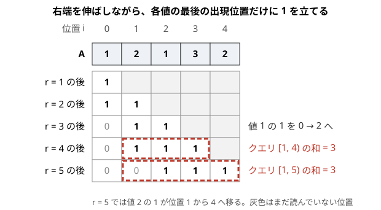

!!! abstract "要点"
    - **何ができるか**：クエリを入力の順に答えなくてよいとき、答えやすい順（右端の順・しきい値の順・時間の逆順）に並べ替えて処理し、最後に元の順に戻す。前の答えで次の入力が決まる問題には使えない。
    - **いつ使うか**：
        - 区間 [l, r] に含まれる値の種類数を多数のクエリで答える
        - 重み w 以下の辺だけを使ったときの連結・X 以下の要素の和をクエリごとに答える
        - クエリどうしが独立で、順番を入れ替えても答えが変わらない
        - 値が 10^9 まで、N, Q ≤ 2×10^5 で、クエリにも新しい値が現れる
    - **計算量**：並べ替えに $O(Q \log Q)$、そのうえで状態を一方向に進める更新が全体で 1 回ずつ。区間の種類数は $O((N + Q) \log N)$、しきい値の順に Union-Find で併合する型は $O((M + Q) \log (M + Q))$
    - **前提**：[BIT（Fenwick Tree）](../ds/fenwick-tree.md)、[ソートで考える](../basics/sorting-techniques.md)

<!-- textlint-disable -->
別名：オフライン処理・offline queries・クエリ先読み・クエリのソート・区間の種類数・Range Set Query・オンライン強制
<!-- textlint-enable -->

クエリの先読みは、すべてのクエリを先に読み込み、答えやすい順に並べ替えてから処理する技法である。並べ替えると、データ構造の状態を一方向に進めるだけで全クエリに答えられることが多い。答えは元の番号の場所に書き、最後に入力の順に出力する。

## 考え方（並べ替えて処理し、元の順に戻して出力する） {#idea}

クエリの先読みが使えるのは、入力をすべて読んでから答えを出力してよく、各クエリの答えが処理の順番に左右されないときである。このように全部の入力を先に見てよい処理を[オフライン](../guide/glossary.md#offline)という。AtCoder のほとんどの問題はオフラインで解いてよい。

素朴にクエリを 1 つずつ答えると、クエリごとに $O(N)$ かかり、全体で $O(NQ)$ になる。$N, Q \le 2 \times 10^5$ なら $4 \times 10^{10}$ 回で間に合わない。ところが多くのクエリは「列の先頭 $r$ 個だけを見る」「重み $w$ 以下の辺だけを使う」のように、何かの値 $t$ までの状態を問う。$t$ の小さい順にクエリを並べれば、状態は前のクエリの続きから伸ばすだけで済む。状態を進める更新は、クエリがいくつあっても全体で $N$ 回（辺なら $M$ 回）なので、手間は $NQ$ ではなく $N + Q$ に比例する（データ構造の log を除く）。

手順は次のとおりである。

```text
1. クエリをすべて読み、各クエリに入力の番号 k = 0, 1, ..., Q-1 を付ける
2. 番号の列 ord をキー（右端・しきい値・時刻など）の順にソートする
3. ord の順にクエリを見て、状態をそのキーまで進めてから答えを求め、ans[k] に書く
4. ans[0], ans[1], ..., ans[Q-1] の順に出力する
```

並べ替えるのはクエリそのものではなく番号の列にすると、元の順への戻し忘れが起きにくい。キーの順に進める状態は、増える一方（または減る一方）でなければならない。戻る操作が要るなら、ほかの型（[時間を逆にする](#reverse-time)・Mo's algorithm）を考える。

## 右端でソートして BIT（区間の種類数：各値の最後の出現位置にだけ 1 を立てる） {#distinct-count}

区間の種類数とは、列 $A = (a_0, \dots, a_{N-1})$（0-indexed）と半開区間 $[l, r)$ について、$a_l, \dots, a_{r-1}$ に現れる値の種類の数である。区間ごとに `set` へ入れると 1 回 $O(N \log N)$ かかる。種類数は 2 つの区間の答えから合成できないので、セグメント木にもそのままでは載らない。

右端 $r$ を固定すると、次の言い換えができる。

> $[0, r)$ だけを見たときの各値の最後の出現位置に 1 を立て、ほかの位置を 0 にする。$[l, r)$ の種類数は、この 0/1 の列の $[l, r)$ の和に等しい。

区間 $[l, r)$ に現れる値は、その最後の出現位置（$r$ より前で最も右の位置）も $[l, r)$ に入る。現れない値は、最後の出現位置が $l$ より前か、そもそも出現しない。よって $[l, r)$ にある 1 と、$[l, r)$ に現れる値とが 1 対 1 に対応する。同じ値が何度現れても、1 が立つのは最も右の 1 か所だけなので重複して数えない。

右端を 1 つ伸ばして $a_r$ を読むときは、$a_r$ の古い最後の出現位置の 1 を消し、位置 $r$ に 1 を立てる。0/1 の列を BIT で持てば、更新も区間和も $O(\log N)$ である。クエリを右端の小さい順に並べれば、右端は戻らない。

次の図は $A = (1, 2, 1, 3, 2)$ で右端を伸ばす様子である。各行が「$r$ 個読んだ後の 0/1 の列」で、赤い破線の枠がその時点で答えるクエリの区間を表す。



$r = 3$ で値 1 が再び現れ、1 は位置 0 から位置 2 へ移る。$r = 5$ では値 2 の 1 が位置 1 から位置 4 へ移る。$[1, 5)$ の値は $2, 1, 3, 2$ の 3 種類で、枠の中の 1 も位置 2・3・4 の 3 個である。位置 1 の値 2 は数えないが、同じ値 2 を位置 4 で数えている。

実装の中心は次のとおりである。値が $10^9$ までなら、最後の出現位置を配列で持てるよう、先に[座標圧縮](../basics/coordinate-compression.md)しておく（`c[i]` は $a_i$ の圧縮後の番号）。

```cpp
--8<-- "offline-queries/distinct-count.cpp:core"
```

完全なプログラム：[`distinct-count.cpp`](https://github.com/yuukougun/kyopro-atlas/blob/main/snippets/offline-queries/distinct-count.cpp)（GitHub）
{ .kp-code-src }

計算量は、クエリのソートが $O(Q \log Q)$、右端を伸ばす処理が全体で $N$ 回、区間和が $Q$ 回なので、合わせて $O(Q \log Q + (N + Q) \log N)$ である。領域は $O(N + Q)$ で済む。

!!! info "ACL では"
    `fenwick_tree<T> fw(n);`（全要素 0）。`fw.add(p, x)` で $a_p$ に $x$ を足し、`fw.sum(l, r)` で半開区間 $[l, r)$ の和を返す。どちらも $O(\log N)$。添字は 0-indexed で、`T` は整数型か modint を使う（和だけを扱う）。

同じことを「$[l, r)$ の位置 $i$ のうち、直前の同じ値の位置 $\mathrm{prev}_i$ が $l$ より前のものの個数」とも言える。これは点 $(i, \mathrm{prev}_i)$ の 2 次元の数え上げなので、[平面走査と BIT](../ds/sweep-line-2d.md#rectangle-count) と同じ形であり、オンラインで答えるときの出発点にもなる（[オンライン強制](#online)）。

## しきい値でソート（重み w 以下の辺だけで連結か・X 以下の要素の和） {#threshold}

しきい値の型は、クエリごとに「値が $w$ 以下のものだけを使う」という条件が付く問題である。辺やデータとクエリを同じ値の軸で並べると、しきい値が上がるにつれて使えるものが増える一方になる。増える一方の操作が得意なデータ構造（Union-Find・BIT）にそのまま載る。

たとえば「重み $w$ 以下の辺だけで頂点 $u$ と $v$ が連結か」は、辺を重みの順に、クエリを $w$ の順に並べる。クエリ $(u, v, w)$ の番になったら、重みが $w$ 以下の辺をすべて Union-Find で併合してから $u$ と $v$ が同じ成分かを見る。辺の併合は全体で $M$ 回なので、ソートを含めて $O((M + Q) \log (M + Q))$ である。

```cpp
--8<-- "offline-queries/threshold.cpp:core"
```

完全なプログラム：[`threshold.cpp`](https://github.com/yuukougun/kyopro-atlas/blob/main/snippets/offline-queries/threshold.cpp)（GitHub）
{ .kp-code-src }

同じ形で載るものの例を挙げる。

- **区間の $X$ 以下の要素の和・個数**：要素を値の順に、クエリを $X$ の順に並べる。値が $X$ 以下の要素を、その位置に BIT で足してから、$[l, r)$ の和を取る
- **最小全域木に入るか**：クエリの辺を元の辺に混ぜて重みの順に処理する。クエリの辺は併合せず、その時点で両端がすでに連結かだけを見る（[練習の ABC235 E](#practice)）
- **年 $w$ より後に作られた道路だけで**：「より後」なので、大きい順に並べ、条件を等号なしで判定する（[練習の ABC040 D](#practice)）

しきい値と等しい辺を含めるかどうかで答えが変わる。「以下」なら同じ値の辺をクエリより先に、「未満」ならクエリを先に処理する。比較を `<=` と `<` のどちらにするかで決めればよく、ソートのキーを組にする必要はない。

「$u$ と $v$ が連結になる最小の $w$」のように、しきい値そのものを答えるクエリは、この型だけでは答えられない。全クエリの二分探索を一斉に進める[並列二分探索](../ds/parallel-binary-search.md#what-it-does)を使う。

## 時間を逆にする（削除を追加に → グラフの章の Union-Find と連結性） {#reverse-time}

時間を逆にする型は、操作の列を後ろから処理して、苦手な操作を得意な操作に変える技法である。代表は Union-Find で、併合はできても分割はできない。辺を 1 本ずつ削除しながら各時点の連結を問う問題は、時間を逆にたどると、辺を 1 本ずつ追加する問題になる。

手順は次のとおりである。

```text
1. すべての削除を済ませた後の状態を作る（一度も削除されない辺だけを入れる）
2. 操作を最後から順に見る
   - 質問なら、今の状態で答えて記録する
   - 削除なら、その辺を追加する（逆向きには追加になる）
3. 記録した答えを逆順に並べ替えて出力する
```

先読みが要るのは、手順 1 で「最後まで削除されない辺」を知るためである。答えは後ろから求まるので、元の順に戻すのを忘れない。

Union-Find での使い方と、質問の時点のずれ（削除の前に答えるのか後に答えるのか）は、[Union-Find で連結性を扱う](../graph/union-find-connectivity.md)にある。削除以外にも、「最後に塗った色が残る」のように後ろから見ると決まる問題は[逆から考える](../thinking/reverse-thinking.md)にまとめる。

## 答えを 2 時点の差に分ける {#difference-of-times}

2 時点の差の型は、クエリの答えを「時刻 $t_2$ の値 − 時刻 $t_1$ の値」に分け、2 つの時刻にそれぞれ小さなクエリを置く技法である。値が足し算で積み上がるとき、途中の区間の寄与は差で取り出せる。

もっとも身近な例は、区間の $X$ 以下の個数である。$[l, r)$ の $X$ 以下の個数は「先頭 $r$ 個の $X$ 以下の個数 − 先頭 $l$ 個の $X$ 以下の個数」に分けられる。2 つの接頭辞のクエリにして右端の順に処理すれば、値を添字にした BIT 1 本で済む。

時刻の差にもなる。上書きと加算が混ざる問題では、最後の上書きの後に足された分だけが今の値に残る。そこで次のように分ける。

```text
答え = （最後の上書きの値） + （今までの加算の合計） − （最後の上書きの時刻までの加算の合計）
```

最後の上書きの時刻は、クエリを先に全部読めば分かる。その時刻に「加算の合計を記録する」小さなクエリを置き、加算の BIT を時刻の順に 1 回だけ流す。各時刻で記録しておいた値を、本来のクエリの時刻で引けばよい（[例題の ABC253 F](#abc253_f)）。

差に分けられるのは、値が足し算で積み上がり、引き算で戻せるときである。最小値や最大値のように引けない量では、この型は使えない。

## 先に全部読んで座標圧縮する {#compress}

座標圧縮と組む型は、クエリを先に全部読んで、更新とクエリに現れる値をすべて集めてから圧縮する技法である。値が $10^9$ までの集合に挿入・削除をくり返す問題でも、現れる値は高々 $N + Q$ 種類なので、BIT やセグメント木の添字にできる。

注意するのは、更新に現れる値だけでなく、クエリにしか現れない値も集めることである。集めなかった値 $x$ を `lower_bound` で引くと、$x$ 以上の最小の値の番号が返る。返った番号を $x$ の番号とみなして、その位置までの和を取ると、「$x$ 以下の個数」を求めたつもりが $x$ より大きい値まで数えることになる。クエリの値もすべて集めれば、この食い違いは起きない。圧縮の手順と、区間の端点を入れる注意は[座標圧縮の BIT・セグメント木と組む節](../basics/coordinate-compression.md#with-ds)にある。

この型はほかの型と重ねて使う。たとえば[力試しの ABC356 F](#challenge) では、挿入・削除される整数を先に全部読んで圧縮し、存在の有無を BIT、成分の端を遅延セグメント木で持つ。値を添字にするデータ構造の型は[値を添字にするセグメント木](../ds/segment-tree-on-values.md)にある。

## オンライン強制の見分け方と、そのときの構造（永続・マージソート木・動的セグメント木） {#online}

オンライン強制とは、クエリを入力の順に 1 つずつ答えないと、次のクエリが分からない形式である。この形式ではクエリの先読みも、先読みに頼る座標圧縮も使えない。問題文の次の言い回しで見分ける。

- 「前のクエリの答えを $\mathrm{last}$ として、$l = l' \oplus \mathrm{last}$ とする」のように、入力が前の答えで暗号化されている
- 「前の答えを使って次に追加する値を決める」のように、操作そのものが答えに依存する
- 対話（インタラクティブ）の問題で、答えを出力するまで次の入力が与えられない

逆に、更新とクエリが交互に来るだけならオンライン強制ではない。更新の列も先に全部読めるので、時刻を 1 つの軸として並べ替えればよい（[答えを 2 時点の差に分ける](#difference-of-times)）。

オンライン強制のときは、先読みの代わりに次の構造を使う。どれも先読みの版より実装が重く、領域も $O(N \log N)$ 程度になるので、先読みできるならそちらを先に考える。

| やりたいこと | 先読みできるとき | オンライン強制のとき |
| --- | --- | --- |
| 区間の種類数 | 右端の順に BIT | 接頭辞ごとの版の[永続セグメント木](../ds/persistent-data-structures.md#prefix-versions) |
| 区間の $X$ 以下の個数・和 | しきい値の順に BIT | [マージソート木](../ds/merge-sort-tree.md)・Wavelet Matrix |
| 値が $10^9$ までの集合 | 座標圧縮して BIT | 動的セグメント木（[値を添字にするセグメント木](../ds/segment-tree-on-values.md)） |

区間の種類数は、[右端の節](#distinct-count)の言い換えで「$[l, r)$ の位置 $i$ のうち $\mathrm{prev}_i < l$ のものの個数」になる。これは区間の $X$ 以下の個数と同じ形なので、マージソート木でもオンラインに答えられる。

## 落とし穴 {#pitfalls}

- **元の順に戻し忘れる**：クエリそのものをソートすると、答えがソート後の順に並ぶ。番号の列 `ord` をソートし、答えを `ans[k]`（$k$ は入力の番号）に書く
- **しきい値と等しいものの扱い**：「以下」と「未満」、「より後」と「以後」で、同じ値を含めるかが変わる。比較の `<=` と `<` を問題文に合わせ、境界の値ちょうどのクエリで手計算と照らし合わせる
- **区間の種類数で古い 1 を消し忘れる**：同じ値が 2 回目に現れたとき、古い位置の 1 を消さないと二重に数える。最初の出現（古い位置がない）を $-1$ などの番兵で区別する
- **閉区間と半開区間**：問題文の 1-indexed の閉区間 $[L, R]$ は、0-indexed の半開区間 $[L - 1, R)$ になる。右端でソートするキーも、変換した後の $R$ でそろえる
- **クエリにしか現れない値を圧縮し忘れる**：圧縮する値の列には、更新の値とクエリの値の両方を入れる
- **時間を逆にしたときの初期状態**：すべての削除を済ませた状態から始める。最初から何もない状態で始めると、一度も削除されない辺が抜ける

## 例題 {#examples}

### ABC174 F. Range Set Query {#abc174_f}

<div class="kp-problems" data-role="example" markdown>

- [ABC174 F. Range Set Query](https://atcoder.jp/contests/abc174/tasks/abc174_f)（diff 1495）：列の区間に含まれる値の種類数を、多数のクエリで答える。

</div>

[右端でソートして BIT](#distinct-count) をそのまま使う代表例である。$N, Q \le 5 \times 10^5$ なので、クエリごとに数える $O(NQ)$ は間に合わない。クエリを右端の順に並べ、各値の最後の出現位置だけに 1 を立てた BIT の区間和で答える。

??? note "解法の詳細"
    - 問題文の閉区間 $[l, r]$（1-indexed）を、0-indexed の半開区間 $[l - 1, r)$ に直す。
    - 番号の列を右端の順にソートし、右端を伸ばしながら、値ごとの最後の出現位置を配列 `last` で持つ。値が $N$ 以下なら圧縮は要らない。
    - $a_r$ を読むたびに、`last` に古い位置があれば、BIT のその位置へ $-1$、位置 $r$ へ $+1$ を足す。
    - クエリの番になったら BIT の $[l, r)$ の和を答えの配列の元の番号の場所に書き、最後に入力の順に出力する。
    - 計算量は $O(Q \log Q + (N + Q) \log N)$ である。入出力が多いので、`cin` を使うなら `ios::sync_with_stdio(false)` などで速くする。
    - Mo's algorithm でも解けるが $O(N \sqrt{Q})$ で、この制約では定数倍に気を遣う。

### ABC253 F. Operations on a Matrix {#abc253_f}

<div class="kp-problems" data-role="example" markdown>

- [ABC253 F. Operations on a Matrix](https://atcoder.jp/contests/abc253/tasks/abc253_f)（diff 1756）：行の上書き・列の範囲への加算・1 マスの値の取得のクエリを処理する。

</div>

[答えを 2 時点の差に分ける](#difference-of-times)の代表例である。マス $(i, j)$ の値は「行 $i$ を最後に上書きした値」に「その後に列 $j$ へ足された量」を加えたものである。後半を「今までの列 $j$ への加算の合計 − 上書きの時刻までの合計」に分けると、列の範囲への加算は区間加算・一点取得の BIT 1 本で扱える。

??? note "解法の詳細"
    - 先読み：クエリを 1 回なめて、行ごとに最後の上書きの時刻と値を持つ。取得のクエリ $k$（行 $i$・列 $j$）ごとに、その時点の行 $i$ の最後の上書きの時刻 $t$ と値 $x$ を記録する。上書きがまだなければ $x = 0$ とし、記録する合計も 0 として扱う（小さなクエリはぶら下げない）。
    - 時刻 $t$ の上書きのクエリに、「列 $j$ のその時点の加算の合計を記録する」小さなクエリ（番号 $k$ と列 $j$）をぶら下げる。
    - 本処理：クエリを順に処理する。列の範囲 $[l, r]$ への加算は、差分の BIT で位置 $l$ へ $+x$、位置 $r + 1$ へ $-x$ を足す。列 $j$ の加算の合計は BIT の接頭辞の和で求まる。
    - 上書きのクエリでは、ぶら下げた小さなクエリについて列 $j$ の合計を記録する。取得のクエリ $k$ では、$x$ ＋（今の列 $j$ の合計）−（記録した合計）を出力する。
    - 加算が何度も積み重なるので、BIT と答えは `long long` で持つ。計算量は $O(Q \log M)$ である（$M$ は列の数）。

## 練習問題 {#practice}

<div class="kp-problems" data-role="practice" markdown>

- [ABC235 E. MST + 1](https://atcoder.jp/contests/abc235/tasks/abc235_e)（diff 1304）：グラフに辺を 1 本加えたとき、その辺が最小全域木に使われるかを多数の質問で答える。
- [ABC040 D. 道路の老朽化対策について](https://atcoder.jp/contests/abc040/tasks/abc040_d)（diff 1656・参考値）：年 w より後に作られた道路だけで行ける都市の数を、各クエリについて答える。
- [ABC128 E. Roadwork](https://atcoder.jp/contests/abc128/tasks/abc128_e)（diff 1840）：時間帯ごとに通行止めになる地点があり、各人が最初に止まる地点を答える。

</div>

??? note "練習の方針"
    - **ABC235 E**：元の辺とクエリの辺を合わせて重みの順にソートし、クラスカル法を進める。元の辺は Union-Find で併合し、クエリの辺は併合せずに、その時点で両端が別の成分なら Yes、同じ成分なら No とする。元の辺の重みは互いに異なり、クエリの辺の重みも元の辺と重ならないので、同じ重みの順序に迷わない
    - **ABC040 D**：道路とクエリを年の大きい順に並べる。クエリ $(v, w)$ の番では、年が $w$ より大きい道路をすべて併合してから、$v$ を含む成分の大きさを答える。「より後」なので年がちょうど $w$ の道路は含めない
    - **ABC128 E**：工事を「出発時刻の軸の区間」に直し、開始と終了のイベントと人の出発をまとめて時刻の順に処理する。有効な工事の位置を multiset で持ち、出発した人には最小の位置を答える。詳しくは[イベントソート](../basics/event-sort.md)の力試しの方針にある

## 力試し {#challenge}

<div class="kp-problems" data-role="challenge" markdown>

- [ABC356 F. Distance Component Size Query](https://atcoder.jp/contests/abc356/tasks/abc356_f)（diff 2152）：整数の集合への挿入・削除と、差が K 以下でつながる成分の大きさの質問を処理する。

</div>

??? note "力試しの方針"
    - **ABC356 F**：クエリを先に全部読み、現れる整数を座標圧縮する。値の順に並べると、差が $K$ 以下でつながる成分は、集合の要素の連続した範囲になる。存在の有無を BIT で持ち、範囲の中の要素数（成分の大きさ）と前後の要素を求める。各要素の成分の左端と右端は、挿入・削除で前後のつながりが変わったときに区間でまとめて書き換えるので、遅延セグメント木で持つ。全体で $O(Q \log Q)$

## 確認問題 {#quiz}

??? question "確認問題：区間の種類数で、最初の出現位置ではなく最後の出現位置に 1 を立てるのはなぜか"
    クエリを右端の順に処理し、区間の左端 $l$ は自由に動くからである。$[l, r)$ に値 $v$ が現れるとき、$r$ より前で最も右の $v$ は必ず $[l, r)$ に入る。最初の出現位置は $l$ より前にあるかもしれず、その場合は数え漏れる。左端の順に処理するなら、逆に「$l$ 以降の最初の出現位置」に 1 を立てればよい。

??? question "確認問題：「前のクエリの答えと XOR を取った値が本当の入力」とある問題で、クエリの先読みが使えないのはなぜか"
    2 番目以降のクエリの本当の $l, r$ は、前のクエリに答えるまで分からないからである。並べ替えるためのキー（右端やしきい値）が読めないので、答えやすい順に並べられない。永続セグメント木やマージソート木のように、どの順に来たクエリにも 1 つずつ答えられる構造を使う。

??? question "確認問題：「重み w 未満の辺だけで連結か」に変わったら、しきい値の型のどこを直すか"
    辺を足す条件を `edges[e].w <= qs[k].w` を `edges[e].w < qs[k].w` に変えるだけである。重みがちょうど $w$ の辺は、そのクエリの後に足される。クエリのソートの順序は変えなくてよい。

## 使い分け {#comparison}

- **オフラインの BIT と Mo's algorithm**：区間の種類数や $X$ 以下の個数のように BIT に載る量なら、クエリの先読みと BIT が $O((N + Q) \log N)$ で速い。1 要素の出入りでしか更新できない量（区間の中の同じ値の組の数など）は [Mo's algorithm](../ds/mo-algorithm.md#what-it-does) を使う
- **先読みとオンラインの構造**：先読みできるなら BIT と Union-Find で足りる。オンライン強制のときだけ、[永続データ構造](../ds/persistent-data-structures.md)・[マージソート木](../ds/merge-sort-tree.md)・動的セグメント木を使う（[オンライン強制の見分け方](#online)）
- **2 次元の数え上げ**：「位置が $[l, r)$ で値が $X$ 以下」のように条件が 2 つの軸にまたがるなら、[平面走査と BIT](../ds/sweep-line-2d.md) として考えると整理しやすい
- **イベントの並べ替え**：区間の開始と終了をイベントにして座標の順に処理するのは[イベントソート](../basics/event-sort.md)で、クエリをイベントに混ぜればクエリの先読みになる

## 参考 {#references}

- [procon-kirokuyou「ABC174 F - Range Set Query (600)」](https://scrapbox.io/procon-kirokuyou/ABC174_F_-_Range_Set_Query_(600))：例題の方針（右端の順のソートと、各色の最も右の位置に 1 を立てる BIT）と計算量
- [kanpurin「Mo's algorithm」](https://kanpurin.hatenablog.com/entry/2021/04/09/001439)：例題の制約の確認と、Mo's algorithm で解く方法との比較
- [recuraki「ABC253 F Operations on a Matrix」](https://qiita.com/recuraki/items/57b9f539511ef0876a5f)：例題の方針（上書きの時刻の先読みと、その時刻の BIT の値を記録して差を取ること）
- [drken「AtCoder ABC 235 E - MST + 1 (1D, 水色, 500 点)」](https://drken1215.hatenablog.com/entry/2023/06/11/023548)：練習の方針（クエリの辺を元の辺と混ぜてクラスカル法を進めること）
- [pyteyon「ABC040: D - 道路の老朽化対策について」](https://pyteyon.hatenablog.com/entry/2019/09/30/110202)：練習の方針（道路とクエリを年の大きい順に並べること、等号の扱い）
- [drken「AtCoder ABC 128 E - Roadwork (1D, 青色, 500 点)」](https://drken1215.hatenablog.com/entry/2019/06/15/174200)：練習の方針（通行止めを出発時刻の区間に直すこと）
- [drken「AtCoder ABC 356 F - Distance Component Size Query」](https://drken1215.hatenablog.com/entry/2024/06/08/024017)：力試しの方針（先読みと座標圧縮、BIT と遅延セグメント木で持つもの）
- [AtCoder Library「Fenwick Tree」（document_ja）](https://github.com/atcoder/ac-library/blob/master/document_ja/fenwicktree.md)：`fenwick_tree` の宣言・メソッド・計算量
