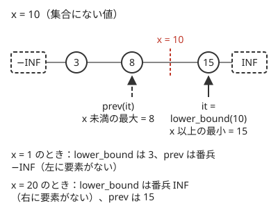

!!! abstract "要点"
    - **何ができるか**：set・multiset・map の `lower_bound` で「$x$ 以上の最小」「$x$ 未満の最大」を $O(\log N)$ で求め、要素の追加・削除と組み合わせる。番兵で端の場合分けを消し、mex や同じ行・列の次の要素も同じ形で求める。
    - **いつ使うか**：
        - $x$ 以上で最小の値・最も近い値を、追加・削除しながら何度も答える。
        - まだ使われていない最小の値（mex）を更新のたびに答える。
        - 同じ行・同じ列で次にある壁や家を見つけて壊す。
        - 値が $10^9$ まであり、配列の添字にできない。
    - **計算量**：追加・削除・`lower_bound` は $O(\log N)$。イテレータを 1 つ進める・戻すのは最悪 $O(\log N)$（続けて動かすと 1 歩あたりならし $O(1)$）。
    - **前提**：[STL コンテナの使い分け](../ds/stl-containers.md)

<!-- textlint-disable -->
別名：順序付き集合・ordered set・set::lower_bound・前後の要素・番兵・パレート境界
<!-- textlint-enable -->

set・multiset・map の応用は、値を昇順に保ったまま追加・削除できる性質を使い、「ある値の前後にある要素」を何度も調べる技法である。ソートした配列の二分探索は要素が変わると作り直しになるが、set なら追加・削除と探索がどちらも $O(\log N)$ で済む。ここでは使い方の基本は前提に任せ、よく出る応用の型と落とし穴に絞る。

## 前後の要素（lower_bound とその 1 つ前。番兵で端の場合分けを消す） {#neighbors}

set の中で $x$ の前後を調べる操作は、すべて `st.lower_bound(x)` が返すイテレータ `it` から作る。`it` は $x$ 以上で最小の要素を指し、`prev(it)` は $x$ 未満で最大の要素を指す。set は値を昇順に並べて持つので、$x$ を入れるとしたら入る隙間の右が `it`、左が `prev(it)` である。



| 知りたい要素 | 求め方 | ないとき |
| --- | --- | --- |
| $x$ 以上の最小 | `*st.lower_bound(x)` | `end()` |
| $x$ より大きい最小 | `*st.upper_bound(x)` | `end()` |
| $x$ 未満の最大 | `*prev(st.lower_bound(x))` | 返った位置が `begin()` |
| $x$ 以下の最大 | `*prev(st.upper_bound(x))` | 返った位置が `begin()` |

「ないとき」の列の場合を毎回確かめるのは面倒で、書き忘れると未定義動作になる。そこで、どの値よりも小さい $-\infty$ とどの値よりも大きい $+\infty$ を[番兵](../guide/glossary.md#sentinel)として最初に入れておく。$x$ が番兵の間にあれば、`lower_bound(x)` は必ず $+\infty$ 以下の要素を指し、その 1 つ前には必ず $-\infty$ 以上の要素がある。`end()` も `begin()` の前も参照しなくなる。

```cpp
--8<-- "ordered-set/neighbors.cpp:core"
```

```cpp
--8<-- "ordered-set/neighbors.cpp:query"
```

答えが番兵だったら「その側に要素がない」と読めばよい。番兵の値は、距離を計算してもあふれない大きさにする。値が $10^{18}$ までで差を取るなら、$2 \times 10^{18}$ の番兵との差は約 $3 \times 10^{18}$ で `long long` に収まる。

問題によっては、番兵に意味のある値を使える。長さ $L$ の棒を切る問題なら、両端 $0$ と $L$ を最初から「切れ目」として入れておけば、点 $x$ を含む木片は `lower_bound(x)` とその 1 つ前の切れ目の間になる（[例題](#abc217_d)）。

??? question "確認問題：x と等しい要素があるとき"
    set $\{3, 8, 15\}$ で、`*prev(st.lower_bound(8))` と `*prev(st.upper_bound(8))` はそれぞれ何か。

    ??? success "答え"
        `lower_bound(8)` は 8 を指すので、その 1 つ前は 3 である（8 未満の最大）。`upper_bound(8)` は 15 を指すので、その 1 つ前は 8 である（8 以下の最大）。「未満」か「以下」かで lower と upper を使い分ける。

## K 番目付近（イテレータを K 歩動かす。K が小さいときだけ） {#near-kth}

「$x$ 以上の中で小さい方から $K$ 番目」は、`lower_bound(x)` から `++it` を $K - 1$ 回行えば求まる。「$x$ 以下の中で大きい方から $K$ 番目」は、`upper_bound(x)` から `--it` を $K$ 回行う。重複を数えるなら multiset を使う。

- 1 歩ごとに端に着いていないかを確かめる。進める前に `it != end()`、戻す前に `it != begin()` を見て、端に着いたら「ない」と答える
- 端の確かめを省くなら、$-\infty$ と $+\infty$ の番兵を multiset に $K$ 個ずつ入れておく。$K$ 歩動いても番兵の中にとどまり、答えが番兵なら「ない」と読める
- 1 回の質問は $O(\log N + K)$ である。1 歩は最悪 $O(\log N)$ だが、続けて $K$ 歩動かす手間は合計 $O(K + \log N)$ で済む

この方法は $K$ が 5 程度に小さいときだけ使う。set のイテレータは 1 歩ずつしか動けず、$K$ が $N$ に近いと 1 回の質問が $O(N)$ になる。$K$ が大きいときは、値を添字にした BIT で数える（[K 番目の値を求めるデータ構造](../ds/kth-element.md)）か、GCC の拡張の [pb_ds の tree](../cpp/cpp-container-idioms.md#pb-ds) を使う。

## まだ出ていない値の set で mex を管理する（→ 題材別の mex） {#mex}

[mex](../patterns/mex.md) は集合に含まれない最小の非負整数である。数列の 1 点の書き換えのたびに mex を答えるには、出ている値ではなく「まだ出ていない値」を set に入れて持つ。mex はその set の最小 `*st.begin()` になる。

長さ $N$ の数列の mex は $N$ 以下である。$0$ から $N$ までの $N + 1$ 個の値を $N$ 個の要素ですべて埋めることはできないからである。したがって、値は $0$ から $N$ までだけを見ればよく、$N$ より大きい値は無視してよい。

- **保つもの**：$\mathrm{cnt}[v]$ ＝ 値 $v$ の出現回数（$0 \le v \le N$）、set ＝ $\mathrm{cnt}[v] = 0$ の $v$ の集合。set は少なくとも 1 つの値を含むので空にならない
- **書き換え**：古い値 $u$ の $\mathrm{cnt}[u]$ を 1 減らし、0 になったら $u$ を set へ入れる。新しい値 $w$ の $\mathrm{cnt}[w]$ を 1 増やし、0 から 1 になったら $w$ を set から消す。どちらも $O(\log N)$

同じ set から「$x$ 以上でまだ使われていない最小の値」も `lower_bound(x)` で求まる。空いている番号を割り当てる、使っていない席を探すといった問題も同じ形である。値の範囲が $10^9$ まであって set に全部を入れられないときは、まだ出ていない値を区間の集合として持つ（[区間を set で管理する](../ds/interval-set.md)）。

## 行ごと・列ごとの set（グリッドで次の壁を探し、両方から消す） {#rows-and-columns}

グリッドで「同じ行で $c$ 列より右にある最初の壁」「同じ列で $r$ 行より上にある最初の壁」を何度も調べるときは、行ごとに壁の列番号の set、列ごとに壁の行番号の set を持つ。1 つの壁は 2 つの set に入る。

- **探す**：$(r, c)$ に壁がないとき、行 $r$ の set で `lower_bound(c)` を取れば右の最初の壁、その 1 つ前が左の最初の壁である。$(r, c)$ 自身が壁なら `lower_bound(c)` はその壁を指すので、先に `*it == c` を調べて分ける（自身を含めずに右を探すなら `upper_bound(c)` を使う）。上下は列 $c$ の set で同じようにする。番兵（行の set には $-1$ と $W$、列の set には $-1$ と $H$）を入れておけば、端の確かめが要らない
- **消す**：見つけた壁 $(r', c')$ を、行 $r'$ の set と列 $c'$ の set の**両方**から消す。片方だけ消すと、もう片方の向きから探したときに壊したはずの壁が見つかる

座標が $10^9$ まであって行や列を配列で持てないときは、`map<int, set<int>>` で座標をキーにして持つ。

線分の上にある点を全部消す問題では、点の座標を $(x, y)$ とし、`row[y]` に $y$ 座標が $y$ の点の $x$ 座標の set、`col[x]` に $x$ 座標が $x$ の点の $y$ 座標の set を持つ。$y$ 座標が $y$ で $x_1 \le x \le x_2$ の横向きの線分なら、「`lower_bound(x1)` で最初の点を取り、$x_2$ 以下なら両方の set から消す」を、範囲に点がなくなるまで繰り返す。

```text
it = row[y].lower_bound(x1)
while it が end でなく *it <= x2:
    x = *it
    it = row[y].erase(it)     # 次の点へ進む
    col[x].erase(y)           # もう片方からも消す
    count += 1
```

1 回の移動で多くの点を消すことがあっても、各点は一度しか消えない。全体の set の操作は（点の数 ＋ 移動の回数）回なので、合計 $O((N + M) \log N)$ である（$N$ は点の数、$M$ は移動の回数）。

## パレート境界を map で持つ（支配される点を消す。ならし O(log N)） {#pareto}

点 $(a, b)$ を追加しながら「$a \ge x$ の点の中で $b$ の最大」を答える問題を考える。点 $p$ が別の点 $q$ に**支配される**とは、$a_q \ge a_p$ かつ $b_q \ge b_p$ であることをいう（同じ点が 2 つあれば、1 つだけ残して考える）。支配される点は、どの質問でも答えにならない。$p$ が条件 $a \ge x$ を満たせば $q$ も満たし、しかも $b$ は $q$ の方が大きい。そこで、支配されない点（パレート境界）だけを $a$ をキーとする map に残す。

残った点を $a$ の昇順に並べると、$b$ は狭義の降順になる。右の点（$a$ が大きい）の $b$ が左の点以上なら、左の点は支配されて消えているはずだからである。この並びから次のことが言える。

- **質問**：$a \ge x$ の点のうち $b$ が最大なのは、$a$ が最小のもの、すなわち `lower_bound(x)` が指す点である
- **追加**：`lower_bound(a)` の点の $b$ が新しい $b$ 以上なら、新しい点は支配されるので入れない。そうでなければ、新しい点の左にあって $b$ 以下の点をすべて消す。左ほど $b$ が大きいので、消える点はすぐ左から続けて並んでいる

```cpp
--8<-- "ordered-set/pareto.cpp:core"
```

1 回の追加で多くの点を消すことがあっても、各点は一度入って一度しか消えない。消す操作は全体で追加の回数以下なので、追加 1 回はならし $O(\log N)$ である。同じ $a$ の点が来たときは、$b$ の大きい方だけを残す。

向きを変えた問題（「$a \le x$ で $b$ の最小」など）は、$a$ や $b$ の符号を反転すれば同じ形になる。削除がある場合は、消した点に支配されていた点が戻るのでこの方法は使えない。値を添字にしたセグメント木などを使う。

## ソート順で隣り合う組の集合（2 番目に大きい値の寄与。最小 XOR の組は Binary Trie のページ） {#adjacent-pairs}

この節は[前後の要素](#neighbors)を前提にする。「追加・削除のたびに、2 要素の差の最小値を答える」問題では、差が最小になる組はソート順で隣り合う 2 要素の中にある。隣り合わない 2 要素の差は、間にある要素との差の和なので、隣り合う組の差より小さくならないからである。そこで、隣り合う組の差を別の multiset に入れて持ち、その最小を答える。

- **追加**：$x$ が $p$ と $n$ の間に入るなら、組 $(p, n)$ の差を消し、$(p, x)$ と $(x, n)$ の差を入れる
- **削除**：逆に $(p, x)$ と $(x, n)$ の差を消し、$(p, n)$ の差を入れる。片側に要素がなければ、その側の組はない

```cpp
--8<-- "ordered-set/adjacent-pairs.cpp:core"
```

差の multiset には同じ値が何度も入るので、消すときは必ず `gap.erase(gap.find(d))` で 1 個だけ消す。差の代わりに XOR の最小を答える問題も、最小の組がソート順で隣り合う点は同じだが、全体に XOR をかけるなどの変種が多いので [Binary Trie](../ds/binary-trie.md#comparison) で扱う。

隣り合う要素を 2 つ先まで見る型もある。順列のすべての区間で 2 番目に大きい値を求めて和を取るには、値の大きい順に位置を set へ入れていく。位置 $i$ を入れた時点で、set の中は $P_i$ より大きい値の位置だけである。左に近い順の 2 つを $l_1 > l_2$、右に近い順の 2 つを $r_1 < r_2$ とする。$P_i$ が 2 番目になる区間は「$l_1$ を含み $l_2$ と $r_1$ を含まない」か「$r_1$ を含み $r_2$ と $l_1$ を含まない」かのどちらかである。その個数は次のとおりである。

$$
(l_1 - l_2)(r_1 - i) + (i - l_1)(r_2 - r_1)
$$

1-indexed で左の番兵 $0$、右の番兵 $N + 1$ を multiset に 2 個ずつ入れておくと、大きい値がない側の項が 0 になり、場合分けが消える。各値の寄与の和として数える考え方は[寄与](../thinking/contribution.md)のページにある。

## 落とし穴 {#pitfalls}

**multiset の `erase(x)` は同じ値を全部消す**。1 個だけ消すつもりで `ms.erase(x)` と書くと、同じ値の要素がまとめて消える。`ms.erase(ms.find(x))` と書き、`find` が `end()` を返さないことを確かめる（[multiset から 1 個だけ消す](../cpp/cpp-container-idioms.md#multiset-erase-one)）。

**`*st.end()` と `begin()` での `prev`**。`lower_bound` の結果が `end()` のときに読む、`begin()` のときに `prev` を取る、空の set で `*st.begin()` を読む、はどれも未定義動作である。手元では正しく動いて見えることもあるので気づきにくい。番兵を入れるか、毎回 `it != st.end()`・`it != st.begin()` を確かめる（[イテレータの基本](../cpp/cpp-container-idioms.md#iterators)）。

**消した要素のイテレータを使う**。`st.erase(it)` の後の `it` は無効で、`++it` や `*it` は未定義動作になる。回しながら消すときは `it = st.erase(it)` で次の位置を受け取る。前後の値が後で要るなら、消す前に `prev(it)`・`next(it)` の値を読んでおく。set・map では、消した要素以外を指すイテレータは使い続けてよい（[イテレータの無効化](../cpp/cpp-container-idioms.md#invalidation)）。

**`std::lower_bound(st.begin(), st.end(), x)` は $O(N)$**。set のイテレータは 1 歩ずつしか進めないので、自由関数の `lower_bound` は二分探索にならない。クエリごとに書くと TLE する。必ずメンバの `st.lower_bound(x)` を使う（[メンバの lower_bound](../cpp/cpp-container-idioms.md#member-lower-bound)）。

**set の要素は書き換えられない**。`*it` は読み取り専用なので、値を変えるときは消してから入れ直す。map の値（`it->second`）は書き換えてよいが、キーは同じく書き換えられない。

**map の `[]` で要素ができる**。行ごとの `map<int, set<int>>` で `row[y].lower_bound(l)` と書くと、行 $y$ がなかったときに空の set ができる。結果は正しいが、存在を調べるつもりで `[]` を使うと要素が増え、`size()` を数える処理を壊す。調べるだけなら `find`・`contains`（C++20）を使う（[contains と find・count](../cpp/cpp-container-idioms.md#contains)）。

## 使い分け {#comparison}

- 要素が変わらないなら、ソートした vector と `lower_bound` で足りる（[二分探索](../basics/binary-search.md#lower-bound)）。set より定数倍が小さい
- 最小値・最大値の取り出しだけなら priority_queue で足りる（[優先度付きキュー](../ds/priority-queue.md)）。任意の値の削除や、最小と最大の両方が要るなら multiset を使う
- 「$x$ 未満の個数」や「$K$ 番目」を $K$ が大きいまま聞くなら、set では速くならない。値を添字にした BIT（[K 番目の値を求めるデータ構造](../ds/kth-element.md)）か pb_ds の tree を使う
- 上位 $K$ 個の和や中央値を更新のたびに答えるなら、multiset を 2 つに分けて持つ（[上位 K 個の和と中央値の管理](../ds/top-k-multiset.md)）
- 重ならない区間の集まりを持ち、塗る・併合するなら、左端をキーにした set で持つ（[区間を set で管理する](../ds/interval-set.md)）

## 例題 {#examples}

### ABC217 D. Cutting Woods {#abc217_d}

<div class="kp-problems" data-role="example" markdown>

- [ABC217 D. Cutting Woods](https://atcoder.jp/contests/abc217/tasks/abc217_d)（diff 802）：長さ L の木材の切断と、点 x を含む木片の長さの質問を処理する。

</div>

$L$ は $10^9$ まであるので、長さ $L$ の配列は作れない。切れ目の位置を set に入れて持ち、点 $x$ を含む木片の両端を「$x$ 以上の最小の切れ目」と「その 1 つ前の切れ目」として求める。木材の両端 $0$ と $L$ を最初から切れ目として入れておくと、これが番兵になり、端の場合分けが要らない。

??? note "解法の詳細"
    - 最初に $0$ と $L$ を set へ入れる。
    - 切断のクエリでは、$x$ を set に入れる。
    - 長さのクエリでは、`it = st.lower_bound(x)` とし、`*it - *prev(it)` を出力する。$0 < x < L$ なので、`it` は $L$ 以下を指し、`prev(it)` は $0$ 以上を指す。
    - 1 回のクエリは $O(\log Q)$ で、全体で $O(Q \log Q)$ である。`std::lower_bound` を set に使うと 1 回 $O(Q)$ になるので、メンバの `lower_bound` を使う。

## 練習問題 {#practice}

<div class="kp-problems" data-role="practice" markdown>

- [ABC330 E. Mex and Update](https://atcoder.jp/contests/abc330/tasks/abc330_e)（diff 1004）：1 点を書き換えるたびに数列の mex を答える。
- [ABC370 D. Cross Explosion](https://atcoder.jp/contests/abc370/tasks/abc370_d)（diff 1088）：爆弾で上下左右の最も近い壁を壊していくシミュレーションの後に残る壁の数を求める。
- [ABC385 D. Santa Claus 2](https://atcoder.jp/contests/abc385/tasks/abc385_d)（diff 1171）：軸に平行に移動したときの最終位置と、通過した家の数を求める。
- [ABC241 D. Sequence Query](https://atcoder.jp/contests/abc241/tasks/abc241_d)（diff 1177）：数の追加と「x 以下で大きい方から K 番目」「x 以上で小さい方から K 番目」の質問を処理する（K ≤ 5）。
- [ABC245 E. Wrapping Chocolate](https://atcoder.jp/contests/abc245/tasks/abc245_e)（diff 1571）：縦と横の大きさが決まったチョコを、それぞれ別の箱に縦横とも収まるように入れられるか判定する。

</div>

??? note "練習の方針"
    - **ABC330 E**：$0$ から $N$ までの値の出現回数を持ち、出現回数が 0 の値を set に入れる。書き換えで回数が変わった値だけ set を直し、`*st.begin()` を答える（[mex の節](#mex)）
    - **ABC370 D**：行ごと・列ごとに残っている壁の set を持ち、番兵を入れる。爆弾のマスに壁があればそれだけを消す。なければ 4 方向の最も近い壁を `lower_bound` とその 1 つ前で探し、番兵でなければ両方の set から消す
    - **ABC385 D**：$x$ 座標ごと・$y$ 座標ごとに家の set を持つ。移動した線分の範囲を `lower_bound` で走査し、見つけた家を両方から消して数える。各家は一度しか消えず、全体は $O((N + M) \log N)$ になる
    - **ABC241 D**：値を multiset に入れる。質問では `upper_bound(x)` の位置を起点に $K$ 歩戻るか、`lower_bound(x)` の位置を起点に $K - 1$ 歩進む。端に着いたら $-1$（[K 番目付近の節](#near-kth)）
    - **ABC245 E**：箱を縦の長さの小さい順に見る。縦がその箱以下のチョコを順に足し、その横の長さを multiset に入れる。各箱では、箱の横以下で最大の横の長さを `prev(upper_bound(D))` で選んで消す（なければその箱は使わない）。入れられたチョコが $N$ 個なら Yes。縦が等しいチョコも入るので、チョコを足してから箱で選ぶ

## 力試し {#challenge}

<div class="kp-problems" data-role="challenge" markdown>

- [ABC140 E. Second Sum](https://atcoder.jp/contests/abc140/tasks/abc140_e)（diff 1873）：順列のすべての区間について、2 番目に大きい値の総和を求める。

</div>

??? note "力試しの方針"
    - **ABC140 E**：値の大きい順に位置を set（番兵を 2 個ずつ入れるので multiset）に入れ、入れた位置から左右に 2 つずつ近い位置を取る。各値が 2 番目になる区間の数を[ソート順で隣り合う組の節](#adjacent-pairs)の式で数え、値との積を足す。答えは `long long` で持つ

## 参考 {#references}

- [kanpurin「ABC217 D - Cutting Woods」](https://kanpurin.hatenablog.com/entry/2021/09/05/163703)：例題の解き方（切れ目の set と番兵 0・L）
- [drken「AtCoder ABC 330 E - Mex and Update (1Q, 緑色, 475 点)」](https://drken1215.hatenablog.com/entry/2023/11/26/233800)：mex が N 以下であることと、出現回数 0 の値の set
- [drken「AtCoder ABC 370 D - Cross Explosion (1Q, 緑色, 400 点)」](https://drken1215.hatenablog.com/entry/2024/09/14/030141)：行ごと・列ごとの set と番兵、両方から消すこと
- [drken「AtCoder ABC 385 D - Santa Claus 2 (1Q, 緑色, 425 点)」](https://drken1215.hatenablog.com/entry/2024/12/25/040700)：線分上の点を消しながら走査することと、ならしの計算量
- [kyo-pro「(C++)ABC241D - Sequence Query」](https://kyo-pro.hatenablog.com/entry/ABC241D-cpp)：multiset からイテレータを k 歩動かす方法
- [drken「AtCoder ABC 245 E - Wrapping Chocolate (1D, 水色, 500 点)」](https://drken1215.hatenablog.com/entry/2022/03/30/003800)：片方の辺で並べ、もう片方を multiset で選ぶ貪欲
- [betrue12「AtCoder Beginner Contest 140 E - Second Sum」](https://betrue12.hateblo.jp/entry/2020/03/28/124002)：大きい順に位置を set に入れ、左右 2 つずつの位置から寄与を数える方法
- [cpprefjp「std::set::lower_bound」](https://cpprefjp.github.io/reference/set/set/lower_bound.html)：メンバの lower_bound の仕様と計算量
