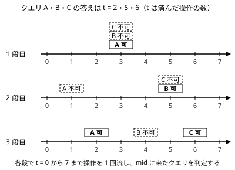

!!! abstract "要点"
    - **何ができるか**：多数のクエリがそれぞれ「単調な過程のどの時点で条件を満たすか」を二分探索するとき、全クエリの探索を同時に進める。各段で過程を最初から 1 回だけ流して判定し、段の数は $O(\log M)$ で済む。
    - **いつ使うか**：
        - 多数のクエリが、それぞれ何回目の操作で条件を満たすようになるかを問う
        - 最初の t 回の操作の後に条件を満たす最小の t を、クエリごとに答える
    - **計算量**：操作の数を $M$、クエリの数を $Q$ として段の数は $O(\log M)$。1 段で「状態の初期化・$M$ 回の操作・$Q$ 回の判定」を 1 回ずつ行う。Union-Find と組むと全体で $O((N + M + Q) \log M)$ 回の操作（1 回はならし $O(\alpha(N))$）
    - **前提**：[答えで二分探索](../basics/binary-search-answer.md)、[クエリの先読み](../ds/offline-queries.md)

<!-- textlint-disable -->
別名：parallel binary search・整体二分・全クエリの二分探索を同時に進める
<!-- textlint-enable -->

並列二分探索は、クエリごとに別々に行う二分探索を、段をそろえて一斉に進める方法である。1 クエリずつ判定すると判定のたびに過程を最初から流し直すが、同じ段の判定をまとめれば、過程を 1 回流すだけで全クエリの判定が済む。全クエリを先に読む[オフライン](../guide/glossary.md#offline)の方法で、ABC で必須になることはまれである。

## 何ができるか（オフラインで全クエリの二分探索を一斉に進める） {#what-it-does}

操作の列 $1, 2, \dots, M$ があり、操作は状態を一方向に変える（Union-Find に辺を足す、BIT に値を足す、など）。各クエリ $i$ について、判定 $P_i(t)$ を「最初の $t$ 回の操作の後の状態で、クエリ $i$ の条件を満たすか」とする。$P_i(t)$ が $t$ について単調（ある時点から先はずっと満たす）なら、満たす最小の $t$ は[答えで二分探索](../basics/binary-search-answer.md)で求まる。

困るのは、判定 1 回に過程の再現が要ることである。状態を時刻 $t$ まで戻す手段がなければ、判定のたびに操作を先頭から $t$ 回やり直すので、1 クエリに $O(M \log M)$ 回の操作がかかり、全体で $O(QM \log M)$ になる。

並列二分探索は判定の順序を入れ替える。各クエリの二分探索の「1 回目の判定」を全クエリ分まとめ、判定する時刻 mid の小さい順に並べる。操作を先頭から 1 回流しながら、時刻 mid に来たクエリをその場で判定すれば、1 段の判定がすべて済む。これを段の数だけ繰り返す。

使えるのは次の条件がそろうときである。

- クエリをすべて先に読める（前の答えで次のクエリが決まる問題には使えない）
- 各クエリの判定が時刻について単調である
- 操作を先頭から順に行う手段と、ある時点の状態で判定する手段がある（過去に戻る手段は要らない）

操作が「時刻」でなく「値」の順でもよい。区間の $K$ 番目に小さい値を答えるクエリなら、要素を値の小さい順に、BIT のその要素の位置へ足していく。判定は「区間に $v$ 以下の要素が $K$ 個以上あるか」である。

## 手順（各段で mid の順にクエリを並べ、過程を 1 回流して判定する）と計算量 {#procedure}

各クエリに [二分探索](../basics/binary-search.md#meguru)の ng と ok を持たせる。$P_i(\mathrm{ng}_i)$ は不可、$P_i(\mathrm{ok}_i)$ は可という不変条件を保つ。初期値は[番兵](../guide/glossary.md#sentinel)の $\mathrm{ng}_i = -1$、$\mathrm{ok}_i = M + 1$ にする（$t = M + 1$ は「最後まで満たさない」の印）。

```text
while ok[i] - ng[i] > 1 のクエリが残っている:
    bucket[0..M] を空にする
    残っている各クエリ i を bucket[(ok[i] + ng[i]) / 2] に入れる
    状態を操作 0 回の状態に戻す
    for t = 0, 1, ..., M:
        t > 0 なら t 番目の操作を行う        # これで最初の t 回が済んだ
        bucket[t] の各クエリ i について:
            P_i が成り立てば ok[i] = t、そうでなければ ng[i] = t
答えは ok[i]（M + 1 なら一度も満たさない）
```

次の図は、操作が 7 回で、答えがそれぞれ $t = 2, 5, 6$ のクエリ A・B・C の例である。各段で mid の位置にあるクエリだけを判定し、操作は段ごとに左から右へ 1 回だけ流す。



計算量の根拠は次のとおりである。

- 各クエリの区間 $(\mathrm{ng}_i, \mathrm{ok}_i)$ の幅は、初めの $M + 2$ から段ごとに半分ほどになる。全クエリの段がそろっているので、段の数は高々 $\lceil \log_2 (M + 2) \rceil = O(\log M)$ である（図の例は答えの位置がよいので 3 段で済んだ）。
- 1 段では、状態の初期化を 1 回、操作を $M$ 回、判定を合わせて $Q$ 回行う。クエリを mid ごとのバケットに入れる並べ替えは $O(M + Q)$ で済む（比較のソートなら $O(Q \log Q)$）。
- よって全体は $O(\log M) \times$（初期化 $+ M$ 回の操作 $+ Q$ 回の判定）になる。

## 自作するときの要点と Library Checker {#library}

ACL に並列二分探索はなく、問題ごとに書く。自作するときの要点は次の 4 つである。

- **判定の時点**：「最初の $t$ 回の操作の後」に判定する。操作の前後を取り違えると答えが 1 ずれる。$t = 0$（操作 0 回）で満たすクエリもあるので、$t$ の範囲は $0$ から $M$ までにする。
- **初期化の費用**：状態は段ごとに作り直す。Union-Find なら $O(N)$ が段の数だけかかるので、計算量に $N \log M$ が足される。
- **段を止める条件**：全クエリで $\mathrm{ok}_i - \mathrm{ng}_i = 1$ になったら止める。段の数を $\lceil \log_2(M + 2) \rceil$ に固定して回してもよい。
- **再帰の形（整体二分）**：区間 $[l, r)$ と、答えがその区間にあるクエリの組を受け取る書き方もある。$[l, \mathrm{mid})$ の操作だけを足して各クエリを判定し、足した操作を取り消してから、クエリを左右に分けて再帰する。右へ送るクエリには、左半分の寄与を差し引いて渡す（区間の $K$ 番目なら、数えた個数を $K$ から引く）。各深さで操作は合わせて $M$ 回なので、計算量は変わらない。寄与を足し引きできる BIT の型でよく使う。取り消せない Union-Find では、上の反復の形が手軽である。

ライブラリとして持つなら、3 つの関数を受け取る形にしておく。「状態を戻す」「$j$ 番目の操作をする」「クエリ $i$ を判定する」の 3 つで、Union-Find でも BIT でも使い回せる（完全なプログラムは `snippets/parallel-binary-search/usage.cpp`）。

```cpp
--8<-- "parallel-binary-search/usage.cpp:core"
```

判定の関数は、その時点の状態だけを見て答える。状態を書き換える判定を書くと、同じ段の後のクエリが狂う。

Library Checker で確かめるなら、[練習問題](#practice)の Range Kth Smallest（区間の K 番目に小さい値）を BIT と組んで解くとよい。

## Union-Find と組む例（最初の t 本の辺で条件を満たすか） {#with-union-find}

並列二分探索が最もよく現れるのは、辺を 1 本ずつ足していく過程と組むときである。操作は「$j$ 番目の辺を [Union-Find](../ds/union-find.md) に足す」、判定は「この時点で頂点 $x_i$ と $y_i$ が連結か」や「$x_i$ を含む成分の頂点数が $z_i$ 以上か」になる。辺を足すと成分は合わさって大きくなるだけなので、こうした判定は時刻について単調である。

2 点 $x_i, y_i$ が初めて連結になる辺の本数を全クエリで求めるなら、使い方は次のようになる。

```cpp
--8<-- "parallel-binary-search/usage.cpp:usage"
```

計算量は、段の数 $O(\log M)$ に、1 段の「作り直し $O(N)$・併合 $M$ 回・判定 $Q$ 回」を掛けて、$O((N + M + Q) \log M)$ 回の操作になる。Union-Find の 1 回はならし $O(\alpha(N))$ である。

判定に使える量は連結かどうかに限らない。根に成分の頂点数を持たせれば「頂点数が $z$ 以上か」を、辺の数を持たせれば「成分に閉路があるか」を判定できる（[Union-Find の応用](../ds/union-find-applications.md#data-on-root)）。どれも辺を足すほど成り立ちやすくなる量なので、単調性はそのまま保たれる。

クエリが 1 つなら、辺を順に足して条件を満たした瞬間を見れば済む。クエリが多いと、辺を足すたびに全クエリを確かめることになり、$O(MQ)$ 回の判定がかかる。並列二分探索はこれを $O(Q \log M)$ 回に減らす（[Union-Find で連結性を扱う](../graph/union-find-connectivity.md#binary-search)）。

## 代わりの手（部分永続 Union-Find・併合過程の木） {#alternatives}

過程が Union-Find の併合なら、並列二分探索のほかに 2 つの方法がある。

- **[部分永続 Union-Find](../ds/partially-persistent-union-find.md#what-it-does)**：経路圧縮をせず、根が変わった時刻を記録して、過去の時刻での find を $O(\log N)$ で行う。状態を過去に戻せるので、各クエリで普通に二分探索できる。クエリを先に読まなくてよい。
- **[併合過程の木](../tree/merge-process-tree.md#bottleneck)**：併合のたびに新しい頂点を作って木にする。「初めて連結になる時刻」は 2 頂点の LCA の時刻になり、成分の頂点数のような条件も木の上のダブリングで求まる。

どちらも Union-Find の過程に限った方法である。並列二分探索は、操作を順に行えて判定ができるデータ構造なら何にでも使える。過程が BIT への加算などで、過去の版を持つ構造（[永続データ構造](../ds/persistent-data-structures.md#prefix-versions)）を作るのが重いときは、並列二分探索が手軽である。逆に、クエリが前の答えに依存する問題（オンライン）では並列二分探索は使えず、過去に戻れる構造を使う。

1 次元を時系列の分割統治で消す [CDQ 分割統治](../ds/cdq-divide-and-conquer.md#what-it-does)も、オフラインで再帰的にクエリを分ける点は似ている。ただし並列二分探索が分けるのは各クエリの答えの範囲で、CDQ 分割統治が分けるのは更新とクエリの時刻である。

## 学ぶための資料 {#resources}

- cp-algorithms の「Binary search」の Parallel Binary Search の節（英語）：mid ごとにまとめて判定する考え方と、BIT と組む例が短くまとまっている
- OI Wiki の「整体二分」（中国語）：再帰の形（整体二分）と、区間の K 番目に小さい値への適用を、例題とともに説明している

## 例題 {#examples}

### AGC002 D. Stamp Rally {#agc002_d}

<div class="kp-problems" data-role="example" markdown>

- [AGC002 D. Stamp Rally](https://atcoder.jp/contests/agc002/tasks/agc002_d)（diff 2514）：最初の t 本の辺だけを使ったとき、x と y を含む成分の頂点数（同じ成分なら 1 回）が z 以上になる最小の t を各クエリで答える。

</div>

辺を番号順に Union-Find へ足す過程で、各クエリの判定を「最初の $t$ 本の辺の後に、$x$ と $y$ から訪れられる頂点数が $z$ 以上か」とする。辺を足すほど成分は大きくなるので判定は単調で、全クエリの二分探索を並列に進められる。

??? note "解法の詳細"
    - 判定：$x$ と $y$ が同じ成分なら、その成分の頂点数が $z$ 以上か。別の成分なら、2 つの成分の頂点数の和が $z$ 以上か。頂点数は Union-Find の `size` で $O(\alpha(N))$ で取れる。
    - $x$ と $y$ の成分が合わさる瞬間、頂点数の和は合わさった成分の頂点数に等しく、それ以降は増えるだけである。だから同じ成分かどうかで場合分けしても単調性は崩れない。
    - [手順](#procedure)の関数に、操作として「$j$ 番目の辺を併合する」、判定として上の条件を渡す。グラフは連結なので、全辺を使えば必ず満たし、答えは $M$ 以下に決まる。番兵は $\mathrm{ok} = M + 1$ のままでよい。
    - 段の数は $O(\log M)$、1 段の Union-Find の操作は $O(N + M + Q)$ 回で、全体は $O((N + M + Q) \log M)$ 回である。
    - 部分永続 Union-Find で各クエリを二分探索しても、併合過程の木を使っても解ける。

## 練習問題 {#practice}

<div class="kp-problems" data-role="practice" markdown>

- [CODE-THANKS-FESTIVAL-2017 H. Union Sets](https://atcoder.jp/contests/code-thanks-festival-2017/tasks/code_thanks_festival_2017_h)（diff —）：集合の併合を順に行う列に対し、2 要素が初めて同じ集合になった操作の番号を各クエリで答える。

</div>

??? note "方針"
    - **Union Sets**：操作を併合、判定を「2 要素が同じ集合か」にして並列二分探索する。[Union-Find と組む例](#with-union-find)の使い方がそのまま当てはまる。最後まで同じ集合にならないクエリは、ok が番兵の $M + 1$ のまま残る。そのクエリには -1 を出力する。

### Library Checker

- [Range Kth Smallest](https://judge.yosupo.jp/problem/range_kth_smallest)：区間の $k + 1$ 番目に小さい値を答える。値を小さい順に BIT へ足す過程で、「区間に足された要素が $k + 1$ 個以上あるか」を判定にすれば並列二分探索で解ける。代表的な解き方は [Wavelet Matrix](../ds/wavelet-matrix.md#what-it-does) である。並列二分探索なら 1 段が $O((N + Q) \log N)$、全体が $O((N + Q) \log^2 N)$ になる。

## 確認問題 {#quiz}

??? question "確認問題：判定を mid の順に並べず、クエリの番号順に行うとどうなるか"
    操作は時刻の順にしか進められないので、mid が前のクエリより小さいクエリに来るたびに状態を作り直すことになる。最悪では 1 段に $Q$ 回の作り直しと $O(QM)$ 回の操作がかかり、まとめた意味がなくなる。mid の順に並べるから、1 段で操作を 1 回流すだけで済む。

    ??? success "補足"
        mid は $0$ から $M$ までの整数なので、比較のソートでなくバケットに入れれば並べ替えは $O(M + Q)$ で済む。

??? question "確認問題：「x と y が非連結である最後の時刻」を求めたいとき、どう直せばよいか"
    「非連結」は時刻とともに可から不可へ変わる。可と不可が逆向きなだけで単調なので、判定を「連結か」にして初めて連結になる時刻 $t$ を求め、$t - 1$ を答えればよい。判定の向きをそろえてから二分探索すると、ok と ng の取り違えが起きにくい。

## 参考 {#references}

- [drken「AtCoder AGC 002 D - Stamp Rally (橙色, 1000 点)」](https://drken1215.hatenablog.com/entry/2018/09/15/193722)：例題の並列二分探索と部分永続 Union-Find の 2 つの解法
- [buyoh「AtCoder Grand Contest 002 - D Stamp Rally」](https://buyoh.hateblo.jp/entry/2017/12/08/181813)：例題を素朴な二分探索から並列二分探索へ直していく流れと、再帰の形での書き方
- [drken「CODE THANKS FESTIVAL 2017 H - Union Sets (3D, 600 点)」](https://drken1215.hatenablog.com/entry/2018/09/15/193740)：練習の問いの確認（記事の解法は部分永続 Union-Find）
- [cp-algorithms「Binary search」](https://cp-algorithms.com/num_methods/binary_search.html)：Parallel Binary Search の節。mid ごとにまとめて判定する考え方と、BIT と組む例（文章と図は使っていない）
- [OI Wiki「整体二分」](https://oi-wiki.org/misc/parallel-binsearch/)：再帰の形（整体二分）と、区間の K 番目に小さい値への適用（文章と図は使っていない）
- [Library Checker「Range Kth Smallest」](https://judge.yosupo.jp/problem/range_kth_smallest)：練習の問題の内容
