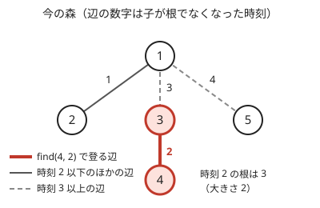

!!! abstract "要点"
    - **何ができるか**：過去の時刻 t の時点での連結判定や成分の大きさを答えられる Union-Find。経路圧縮をせず各頂点に根でなくなった時刻を記録し、時刻の二分探索で初めて連結になる時刻も求める。
    - **いつ使うか**：
        - 最初の t 本の辺だけを使ったときに連結か・成分の大きさは
        - x と y が初めて同じ集合になるのは何回目の操作か
    - **計算量**：併合・時刻 $t$ の根・時刻 $t$ の大きさは、どれも最悪 $O(\log N)$（ならしでない）。初めて同じ集合になる時刻を求める手間は、二分探索で $O(\log N \log M)$、2 頂点から登る方法で $O(\log N)$。メモリ $O(N + M)$（$M$ は併合の回数）
    - **前提**：[Union-Find](../ds/union-find.md)、[二分探索](../basics/binary-search.md)

<!-- textlint-disable -->
別名：部分永続 UF・時刻つき Union-Find・partially persistent union-find
<!-- textlint-enable -->

部分永続 Union-Find は、併合を 1 回ずつ時刻を進めながら行い、過去のどの時刻の状態も読める Union-Find である。更新は最新の状態にしかしないので、版が一直線に並ぶ部分永続（[永続データ構造](../ds/persistent-data-structures.md#partial-vs-full)）の代表になっている。ABC で必須になることはまれで、AGC や企業コンテストで見かける。添字は 0-indexed、図の頂点の番号は 1-indexed で書く。

## 何ができるか（過去の時刻での find） {#what-it-does}

併合の $i$ 回目を時刻 $i$ とし、何もしていない状態を時刻 0 とする。部分永続 Union-Find は次の操作を持つ。

- **merge(x, y)**：最新の状態で $x$ と $y$ の集合を併合し、時刻を 1 進める。同じ集合どうしでも時刻は進める（操作の番号と時刻をそろえるため）。
- **find(x, t)**：時刻 $t$ の時点で $x$ を含む集合の根を返す。same(x, y, t) は 2 つの根が等しいかで判定する。
- **size(x, t)**：時刻 $t$ の時点で $x$ を含む集合の大きさを返す。

普通の [Union-Find](../ds/union-find.md) との違いは、持つものが 2 つ増えることだけである。

- $\mathrm{tm}[v]$：$v$ が根でなくなった時刻（根のままなら $\infty$）。併合で $y$ を $x$ の下につないだとき、$\mathrm{tm}[y]$ に今の時刻を書く。$\mathrm{par}[v]$ は普通どおり親を指し、一度書いたら変えない。
- 根ごとの大きさの履歴：根 $r$ の大きさが変わるたびに（時刻, 大きさ）を末尾に足す。初めは（0, 1）である。

時刻 $t$ の find は、$\mathrm{tm}[x] \le t$ である間だけ親へ登る。$\mathrm{tm}[x] > t$ の頂点は、時刻 $t$ ではまだ根だったからである。size(x, t) は、時刻 $t$ の根 $r$ を求めてから、$r$ の履歴で時刻 $t$ 以下の最後の記録を `upper_bound` で探す。履歴は時刻の昇順に並ぶので二分探索できる。

次の図は、5 頂点で「1 と 2」「3 と 4」「1 と 3」「4 と 5」を時刻 1〜4 に順に併合した後の森である（union by size で、大きさが同じなら先に書いた側を根にした）。頂点 4 から時刻 2 の根を求めると、時刻 2 の辺（4 から 3）は登り、時刻 3 の辺（3 から 1）は登らないので、根は 3 になる。



時刻 $t$ の根が「$\mathrm{tm}$ が $t$ を超える最初の頂点」で求まるのは、根へ向かう道の上で $\mathrm{tm}$ が真に増えていくからである。$y$ を $x$ の下につないだ時刻 $s$ には $x$ は根なので、$x$ が根でなくなるのは $s$ より後である。だから $\mathrm{tm}[y] < \mathrm{tm}[x]$ で、道を登るほど時刻は大きくなる。時刻 $t$ の森は、今の森から時刻 $t$ より後の辺を切ったものにほかならない。

## 自作するときの要点と Library Checker {#library}

自作するときの要点は次の 4 つである。完全なプログラムは `snippets/partially-persistent-union-find/usage.cpp` にある。

- **時刻の約束**：併合の前に時刻を 1 進め、その時刻を $\mathrm{tm}$ と履歴に書く。すると「最初の $t$ 回の併合の後」が時刻 $t$ に当たり、find の条件は $\mathrm{tm}[x] \le t$ になる。$<$ と取り違えると答えが 1 ずれる。
- **根の印**：$\mathrm{tm}$ の初期値を $\infty$（`INT_MAX`）にすれば、find のループの条件だけで根で止まる。
- **併合は最新の時刻で**：merge の中の find は今の時刻で呼ぶ。過去の状態は更新しない（部分永続）。
- **大きさの履歴**：探すときは「時刻が $t$ 以下の最後の記録」を取る。（$t$, $\infty$）で `upper_bound` を取り、1 つ前を見ればよい。

```cpp
--8<-- "partially-persistent-union-find/usage.cpp:core"
```

ACL には部分永続 Union-Find はない。[Library Checker](https://judge.yosupo.jp/) にもそのまま対応する問題はない（近い [Persistent UnionFind](https://judge.yosupo.jp/problem/persistent_unionfind) は、過去の版から枝分かれして更新する完全永続の問題で、このデータ構造では解けない。[代わりの手](#alternatives)を参照）。

## なぜ経路圧縮をしないのか {#no-path-compression}

経路圧縮は、find でたどった頂点の親を根に付け替える。部分永続 Union-Find で $\mathrm{par}$ を書き換えると、過去の時刻の森が壊れる。[図の例](#what-it-does)（4 は時刻 2 に 3 の下へ、3 は時刻 3 に 1 の下へつながっている）で、今の時刻の find(4) を経路圧縮すると、4 の親が 1 に変わる。すると時刻 2 の find(4, 2) が、時刻 3 にならないとつながらない 1 まで登ってしまう。過去の形を読むには、親の付け替えを一度もしてはいけない。

経路圧縮をやめても、union by size（小さい方を大きい方の下へつなぐ）だけで木の深さは $\log_2 N$ 以下に収まる。深さが 1 増えるたびに属する木の大きさが 2 倍以上になるからである（[Union-Find のなぜ速いか](../ds/union-find.md#complexity)）。だから find は 1 回ごとに最悪 $O(\log N)$ で、[ならし計算量](../guide/glossary.md#amortized-complexity)ではない。過去の時刻の find は今の道の途中で止まるだけなので、同じ上限が成り立つ。size(x, t) は find と履歴の二分探索で $O(\log N)$ になる。

大きさの比べ方を省いて任意の向きにつなぐと、鎖ができて find が $O(N)$ になる。経路圧縮が使えない以上、union by size（または union by rank）は必須である。

## 時刻の二分探索で「初めて連結になる時刻」を求める {#binary-search-time}

$x$ と $y$ が同じ集合かどうかは、時刻について[単調](../guide/glossary.md#monotonicity)である。一度同じ集合になれば、その後もずっと同じ集合だからである。だから、same(x, y, t) が真になる最小の $t$ は時刻の二分探索で求まる。判定 1 回が $O(\log N)$ なので、1 クエリは $O(\log N \log M)$ である。

[二分探索](../basics/binary-search.md#meguru)の ok と ng は、ok を今の時刻（そこで同じ集合であることを先に確かめる）、ng を $-1$ にする。$x = y$ なら時刻 0 でも同じ集合なので、ng には判定しない番兵の $-1$ を置く。今の時刻でも別の集合なら、最後まで同じ集合にならない。

```cpp
--8<-- "partially-persistent-union-find/usage.cpp:first-same"
```

二分探索をしない方法もある。今の森で $x$ と $y$ からそれぞれ根へ向かう道が初めて出会う頂点を $w$ とすると、2 頂点が同じ集合になるのは、$x$ から $w$ と $y$ から $w$ の道の辺がすべてそろったときである。各辺の時刻はその子の $\mathrm{tm}$（子が根でなくなった時刻）なので、答えは 2 本の道の辺の時刻の最大になる。道の上で時刻は真に増えるので、$\mathrm{tm}$ の小さい側から 1 歩ずつ登れば、2 本の道を時刻順に合わせるように $w$ で出会える。手間は 2 本の道の長さで $O(\log N)$ である。

```cpp
--8<-- "partially-persistent-union-find/usage.cpp:climb"
```

条件が連結に限らないときは二分探索が便利である。「$x$ と $y$ の成分の大きさの和が $z$ 以上か」のような条件も、時刻について単調なら same を size に替えて同じように探せる（[練習問題](#practice)の Stamp Rally）。

## 代わりの手（並列二分探索・併合過程の木（Kruskal 再構築木）） {#alternatives}

「時刻 $t$ の連結性」を問う問題は、ほかに 2 つの方法でも解ける。

- **[並列二分探索](../ds/parallel-binary-search.md#with-union-find)**：全クエリの二分探索を一斉に進め、各段で普通の Union-Find に辺を先頭から足し直す。[オフライン](../guide/glossary.md#offline)でしか使えないが、併合以外の過程（BIT への加算など）にも使える。全体は $O((N + M + Q) \log M)$ 回の Union-Find の操作である。
- **[併合過程の木](../tree/merge-process-tree.md#bottleneck)**：併合のたびに新しい頂点を作り、併合した 2 つの根をその子にする木を作る。初めて連結になる時刻は 2 頂点の LCA の時刻になり、「大きさが $z$ 以上になる時刻」も木の上のダブリングで求まる。最小全域木と組む使い方は[最小ボトルネック路](../graph/bottleneck-path.md#reconstruction-tree)にある。

部分永続 Union-Find は、クエリを先に読まなくてよく（オンライン）、普通の Union-Find に 2 つの配列を足すだけで書ける。一方、使えるのは「最新の状態だけを更新し、過去を読む」場合だけである。

- 操作を直前から順に取り消すだけなら、[ロールバックできる Union-Find](../ds/rollback-union-find.md#what-it-does) で足りる。
- 過去の版から枝分かれして併合する（完全永続）なら、部分永続では足りない。オフラインなら版の木を DFS し、入るとき併合し、出るとき取り消す（[永続データ構造](../ds/persistent-data-structures.md#offline-version-tree)）。Library Checker の [Persistent UnionFind](https://judge.yosupo.jp/problem/persistent_unionfind) はこの方法で解ける。オンラインで答えるには、$\mathrm{par}$ を永続配列で持つ完全永続の Union-Find が要る（1 回 $O(\log^2 N)$）。

## 学ぶための資料 {#resources}

- noshi91 氏の Union-Find の知見をまとめた記事：union by size だけでも $O(\log N)$ になること、部分永続は効率よく作れるが完全永続は $O(\log^2 N)$ ほどかかることを、Union-Find の変形の一覧の中で説明している
- drken 氏の CODE THANKS FESTIVAL 2017 H の解説記事：根でなくなった時刻と大きさの履歴を持つ実装を、問題に沿って示している

## 例題 {#examples}

### CODE-THANKS-FESTIVAL-2017 H. Union Sets {#code_thanks_festival_2017_h}

<div class="kp-problems" data-role="example" markdown>

- [CODE-THANKS-FESTIVAL-2017 H. Union Sets](https://atcoder.jp/contests/code-thanks-festival-2017/tasks/code_thanks_festival_2017_h)（diff —）：集合の併合を順に行う列に対し、2 要素が初めて同じ集合になった操作の番号を各クエリで答える。

</div>

併合の $i$ 回目を時刻 $i$ として部分永続 Union-Find に入れ、各クエリで same(x, y, t) が真になる最小の $t$ を求める。

??? note "解法の詳細"
    - $M$ 回の併合を順に merge する。同じ集合どうしの併合も時刻を 1 進めるので、操作の番号と時刻がそろう。
    - 各クエリは、今の時刻で別の集合なら最後まで別なので、その場合の出力（問題の指定）を返す。同じ集合なら[時刻の二分探索](#binary-search-time)で最小の $t$ を求める。1 クエリ $O(\log N \log M)$ である。
    - 2 頂点から $\mathrm{tm}$ の小さい側を登る方法なら、1 クエリ $O(\log N)$ で済む。
    - 並列二分探索や併合過程の木でも解ける（[代わりの手](#alternatives)）。

## 練習問題 {#practice}

<div class="kp-problems" data-role="practice" markdown>

- [AGC002 D. Stamp Rally](https://atcoder.jp/contests/agc002/tasks/agc002_d)（diff 2514）：最初の t 本の辺だけを使ったとき、x と y の成分の頂点数の合計が z 以上になる最小の t を各クエリで答える。

</div>

??? note "方針"
    - **Stamp Rally**：辺の番号を時刻として併合する。時刻 $t$ で $x$ と $y$ が同じ成分ならその大きさ、別の成分なら 2 つの大きさの和を size(x, t) で求め、$z$ 以上かを判定する。2 つの成分が合わさる瞬間に和は合わさった成分の大きさに等しく、その後は増えるだけなので、判定は時刻について単調である。クエリごとに時刻で二分探索すれば、全体は $O(Q \log N \log M)$ になる。

## 確認問題 {#quiz}

??? question "確認問題：merge の中の find だけなら経路圧縮をしてもよいか"
    してはいけない。merge の中の find も $\mathrm{par}$ を書き換えるので、過去の時刻の森が壊れる。たとえば[図の森](#what-it-does)（4 は時刻 2 に 3 の下へ、3 は時刻 3 に 1 の下へつながっている）で今の時刻に find(4) を経路圧縮すると、4 の親が 1 になり、find(4, 2) が 3 で止まらずに 1 まで登る。$\mathrm{par}$ は一度書いたら変えないことが、過去の時刻を正しく読むための条件である。

??? question "確認問題：時刻 $t$ の find の条件を $\mathrm{tm}[x] < t$ にするとどうなるか"
    時刻 $t$ に行った併合が反映されず、「最初の $t - 1$ 回の併合の後」の根を返す。初めて同じ集合になる時刻を二分探索すると、多くの組で答えが 1 大きくなる。さらに、最後の併合で初めてつながった組は、今の時刻の判定で別の集合と見なされ、「最後まで別」と誤る。merge で書く時刻と find の比べ方を、どちらも「時刻 $t$ の併合の後」にそろえる。

## 参考 {#references}

- [noshi91「UnionFindTree に関する知見の諸々」](https://noshi91.hatenablog.com/entry/2018/05/30/191943)：union by size だけでも $O(\log N)$ になること、部分永続は効率よく作れるが完全永続は $O(\log^2 N)$ ほどかかること
- [drken「CODE THANKS FESTIVAL 2017 H - Union Sets (3D, 600 点)」](https://drken1215.hatenablog.com/entry/2018/09/15/193740)：例題の問いの確認と、根でなくなった時刻と大きさの履歴を持つ実装
- [drken「AtCoder AGC 002 D - Stamp Rally (橙色, 1000 点)」](https://drken1215.hatenablog.com/entry/2018/09/15/193722)：練習の問題の部分永続 Union-Find と並列二分探索の 2 つの解法
- [Library Checker「Persistent UnionFind」](https://judge.yosupo.jp/problem/persistent_unionfind)：完全永続の Union-Find の問題の内容
