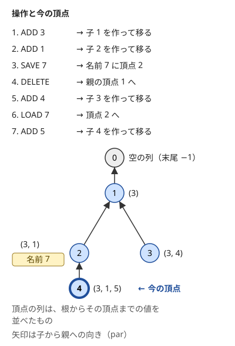
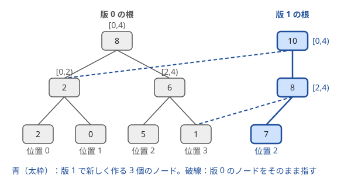

!!! abstract "要点"
    - **何ができるか**：過去の版を残したまま更新し、任意の版から続きの操作をする。末尾の追加・削除・保存・読み込みは版を木の頂点にして表し（版の木）、配列やセグメント木は更新した経路だけを作り直して古い版と共有する。
    - **いつ使うか**：
        - 状態を保存し、あとで読み込んで続きの操作をする。
        - 配列を丸ごとコピーする操作と、1 点更新・区間和が混ざる。
        - 時刻 t の時点での区間の値の分布を問う。
    - **計算量**：版の木は 1 操作 $O(1)$（名前の表を `map` にすると保存・読み込みは $O(\log Q)$）。長さ $N$ の列の永続セグメント木は更新・取得が $O(\log N)$ で、1 回の更新でノードが $O(\log N)$ 個増える（メモリは $O(N + Q \log N)$）。版の丸ごとのコピーは $O(1)$。ノードの配列を先に確保すれば、どれも 1 回ごとの上限である。
    - **前提**：[セグメント木](../ds/segment-tree.md)、[スタック・キュー・deque の使いどころ](../ds/stack-techniques.md)

<!-- textlint-disable -->
別名：persistent data structure・永続・版の木・永続スタック・永続セグ木・経路コピー・path copying・操作の巻き戻し
<!-- textlint-enable -->

永続データ構造は、更新しても前の版を壊さず、どの版もあとから読めるデータ構造である。状態を丸ごとコピーする代わりに、変わった部分だけを新しく作り、変わらない部分は古い版と共有する。共有の仕方は 2 つあり、列の末尾だけを触るなら版を木の頂点にし（版の木）、配列やセグメント木なら根から葉への経路だけを作り直す（経路コピー）。添字は 0-indexed で書く。

## 版の木（追加は子を作る・削除は親へ戻る・保存は頂点を覚える） {#version-tree}

「末尾に追加」「末尾を削除」「今の列に名前を付けて保存」「保存した列を読み込む」が混ざる問題を考える。列の長さは追加の回数なので最大 $Q$ になり、保存のたびに列をコピーすると 1 回 $O(Q)$、全体で $O(Q^2)$ になる。$Q = 5 \times 10^5$ では間に合わない。

版の木では、列の各版を根付き木の頂点で表す。保つ性質は次の 1 つである。

- 頂点 $v$ が表す列は、根から $v$ までの経路の値を順に並べたもの。根は空の列を表す

この性質があれば、各操作は今の頂点 $\mathrm{cur}$ を動かすだけになる。

- **末尾に $x$ を追加**：$\mathrm{cur}$ の子として値 $x$ の頂点を新しく作り、そこへ移る。新しい頂点の列は「$\mathrm{cur}$ の列の末尾に $x$ を足したもの」になる
- **末尾を削除**：親 $\mathrm{par}[\mathrm{cur}]$ へ移る。親の列は、定義から今の列の末尾を除いたものである。今の頂点は消さずに残す（ほかの名前がまだ指しているかもしれない）
- **保存**：名前から頂点への表に $\mathrm{cur}$ を書く
- **読み込み**：表に書いた頂点へ $\mathrm{cur}$ を移す
- **末尾の値**：$\mathrm{cur}$ の値を読む。根に −1 などの番兵の値を置けば、空の列を特別に扱わずに済む

次の図は、ADD 3・ADD 1・SAVE 7・DELETE・ADD 4・LOAD 7・ADD 5 の順に操作したときの木である。DELETE で頂点 1 に戻っても頂点 2 は残っているので、LOAD 7 で $(3, 1)$ の列に戻れる。



どの操作も頂点を高々 1 つ作り、ポインタを 1 回動かすだけなので $O(1)$ である（名前の表を `map` にすれば、保存と読み込みは $O(\log Q)$）。頂点の数は追加の回数 + 1 を超えない。

```cpp
--8<-- "persistent-data-structures/version-tree.cpp:core"
```

保存の表は名前から頂点番号への `map` にし、まだ保存していない名前は根（空の列）を指すことにする。

```cpp
--8<-- "persistent-data-structures/version-tree.cpp:save"
```

- **末尾以外の値を問う**：各頂点に深さ $\mathrm{dep}[v]$ を持てば列の長さが分かり、根からの累積 $S[v]$ を持てば列の和が分かる。先頭から $k$ 番目の値は、$\mathrm{cur}$ の祖先のうち深さ $k + 1$ の頂点の値なので、[ダブリング](../basics/doubling.md)で祖先を求めれば $O(\log Q)$ で読める。ただし頂点を作るときに祖先の表を埋めるので、追加は $O(\log Q)$ になる。版ごとに取り出した個数も持てば、先頭は深さ（取り出した個数 + 1）の祖先なので、末尾への追加と先頭の取り出しができる永続キュー（Library Checker の persistent_queue）になる
- **取り消しのスタックとの違い**：[取り消しのスタック](../ds/stack-techniques.md#undo)は、戻ると上の版を捨てる。版の木は捨てずに残すので、一度離れた版へも読み込みで戻れる
- **木の上の DFS で使う**：根からのパス上の値を列として持つ問題（[根からのパスを DFS で持ち回る](../tree/root-path-dfs.md)）では、DFS の行きに追加し、帰りに削除する。これは版の木を DFS の順にたどるのと同じである

## 経路コピー（1 回の更新で O(log N) 個のノードを新しく作る。丸ごとのコピーは根の指し替え） {#path-copying}

この節は[セグメント木](../ds/segment-tree.md)の再帰の書き方を前提にする。長さ $M$ の数列が $N$ 本あり、「数列 $y$ を数列 $x$ に丸ごとコピーする」「1 点の値を変える」「区間の和を答える」が混ざる問題を考える。コピーのたびに配列を作り直すと $O(M)$ かかり、$M, Q = 2 \times 10^5$ では $4 \times 10^{10}$ 回になって間に合わない。

経路コピーでは、セグメント木のノードを一度作ったら書き換えない。1 点を更新するときは、その葉から根までの経路上のノードだけを新しく作り、経路から外れる子は前の版のノードをそのまま指す。新しい根からたどると更新後の版が、古い根からたどると更新前の版が見える。古い根から届くノードは 1 つも書き換えていないからである。



保つ性質と各操作の手順は次のとおりである。ノードは配列の番号で表し、子の番号 $\mathrm{lc}[t]$・$\mathrm{rc}[t]$ と区間の和 $\mathrm{sum}[t]$ を持つ。

- **保つ性質**：一度作ったノードの $\mathrm{lc}$・$\mathrm{rc}$・$\mathrm{sum}$ は変えない。版はその根の番号だけで表す
- **更新**：版 $t$ の位置 $p$ を $v$ にするとき、$p$ を含む側の子だけを再帰で新しく作り、もう一方の子は $t$ の子をそのまま使って、新しいノードを作って返す。葉に着いたら値 $v$ の葉を作る
- **取得**：ふつうのセグメント木と同じ。根の番号を入口にするだけである
- **丸ごとのコピー**：$\mathrm{root}[x] \leftarrow \mathrm{root}[y]$ と根の番号を代入する。どちらかをあとで更新しても、新しいノードができるだけで、もう一方の版は変わらない

1 回の更新で作るノードは、根から葉までの経路のノードの数、すなわち木の高さ + 1 個である。$M = 2 \times 10^5$ なら $\lceil \log_2 M \rceil + 1 = 19$ 個になる。

```cpp
--8<-- "persistent-data-structures/persistent-segtree.cpp:core"
```

ノード 0 は「子が自分自身で、和が 0」のノードで、どの長さの区間でも「すべて 0 の木」として使える。最初の列がすべて 0 なら、構築をせずに全数列の根を 0 にすればよい。0 でない初期値があるなら、最初に一度だけふつうに構築する（ノードが $2M$ 個ほど増える）。

```cpp
--8<-- "persistent-data-structures/persistent-segtree.cpp:main"
```

メモリは、ノードの数 $1 + Q \times (\text{高さ} + 1)$ に 1 ノードの大きさを掛けて見積もる。$Q = 2 \times 10^5$・$M = 2 \times 10^5$ なら $3.8 \times 10^6$ 個で、`int` 2 つと `long long` 1 つの 16 バイトなら約 61 MB である。

- **永続配列**：区間の取得が要らず、過去の版の 1 点を読むだけなら、同じ経路コピーで永続配列になる。和を持たず、葉に値を置くだけでよい
- **区間への一括更新も永続にする**：遅延セグメント木を永続にするときは、保留を子へ降ろす push でも子を新しく作る。1 回の操作で作るノードは $O(\log N)$ 個のままである。Library Checker の persistent_range_affine_range_sum がこの形である

## 部分永続と完全永続 {#partial-vs-full}

永続には、過去の版をどこまで触れるかで 2 つの段階がある。

| 種類 | 読める版 | 更新できる版 | 版の形 |
| --- | --- | --- | --- |
| 取り消し（ロールバック） | 今の版だけ | 今の版だけ | 一直線。戻ると上を捨てる |
| 部分永続 | すべて | 最新の版だけ | 一直線 |
| 完全永続 | すべて | すべて | 木 |

**部分永続**は、過去の版を読めるが、更新は最新の版にしかしない。更新の順に版が並ぶので、版を時刻と言い換えられる。各値に「いつからこの値か」の履歴を持たせれば作れることが多い。代表が[部分永続 Union-Find](../ds/partially-persistent-union-find.md#what-it-does)で、各頂点が根でなくなった時刻を記録し、「時刻 $t$ の時点で $x$ と $y$ が同じ組か」に答える。

**完全永続**は、どの版からでも更新でき、更新のたびに版が枝分かれする。版の木と経路コピーはどちらも完全永続である。古いノードを書き換えずに新しいノードを作るので、どの版から更新しても、ほかの版に影響しない。

完全永続では、[ならし計算量](../guide/glossary.md#amortized-complexity)の構造をそのまま永続にしてはいけない。ならし計算量は「重い操作のあとは当分軽い」ことで平均を抑えるが、完全永続では重い操作の直前の版から何度でも枝分かれして、同じ重い操作をくり返せるからである。部分永続でも、読むだけのはずの操作が構造を書き換えるもの（Union-Find の経路圧縮など）は使えない。過去の版を読むときに過去の親を書き換えると、その版の内容自体が変わってしまう。永続にする Union-Find は、経路圧縮をせず union by size だけで高さを $O(\log N)$ に抑える。

## 操作の版を木にしてオフラインで処理する（版の木の DFS と取り消し） {#offline-version-tree}

クエリをすべて先に読めるなら、永続データ構造を作らずに済むことが多い。版を頂点にした木を先に作り、ふつうのデータ構造 1 つを持って木を DFS する。頂点に入るときは、その版を作った操作を施す。出るときは取り消す。こうすると、頂点 $v$ にいる間のデータ構造は、ちょうど $v$ の版になっている。

経路コピーの節と同じ問題（コピー・1 点の変更・区間和）なら、木は次のように作る。

- 頂点 0 はすべて 0 の列で、各数列の今の頂点 $\mathrm{cur}[x]$ を 0 にしておく
- 1 点の変更は、$\mathrm{cur}[x]$ の子として「位置 $p$ を $v$ にする」頂点を作り、$\mathrm{cur}[x]$ をそこへ移す
- 丸ごとのコピーは、$\mathrm{cur}[x] \leftarrow \mathrm{cur}[y]$ とするだけで頂点を作らない
- 区間和の質問は、頂点 $\mathrm{cur}[x]$ の質問の一覧に足しておき、DFS のときに答える

```cpp
--8<-- "persistent-data-structures/offline-version-tree.cpp:build"
```

DFS では、入るときに変更前の値を覚えてから施し、出るときに覚えた値へ戻す（[取り消しのスタック](../ds/stack-techniques.md#undo)と同じ）。木の辺 1 本につき施すのと戻すのが 1 回ずつなので、データ構造への操作は全体で $O(Q)$ 回になる。[BIT](../ds/fenwick-tree.md) で持てば $O((M + Q) \log M)$ で、メモリは $O(N + M + Q)$ で済む。経路コピーの $O(Q \log M)$ 個のノードが要らない。

```cpp
--8<-- "persistent-data-structures/offline-version-tree.cpp:dfs"
```

版の木の深さは更新の回数（最大 $Q$）まで伸びるので、DFS は再帰でなく、出るときの印 `~v` を積む非再帰の形で書く。DFS の訪問順で見ると、これは版の木の[オイラーツアー](../tree/euler-tour.md)をたどって、入ると出るで施すと戻すを並べた列を処理していることになる。

- **取り消せる操作であることが条件**：施した操作を $O(1)$ や $O(\log N)$ で元に戻せる必要がある。Union-Find なら経路圧縮をしない[ロールバックできる Union-Find](../ds/rollback-union-find.md#no-path-compression)を使う
- **先読みできないとき**：前の答えで次のクエリが決まる（[オンライン強制](../guide/glossary.md#forced-online)）なら、木を先に作れないので経路コピーを使う（[オンライン強制の見分け方](../ds/offline-queries.md#online)）

## 接頭辞ごとの版で区間の K 番目・x 以下の個数をオンラインで求める {#prefix-versions}

この節は[座標圧縮](../basics/coordinate-compression.md)と[値を添字にするセグメント木](../ds/segment-tree-on-values.md#index-by-value)を前提にする。列 $A$ の区間 $[l, r)$ について「$K$ 番目に小さい値」「$x$ 以下の個数」をオンラインで答える方法である。

値を座標圧縮し、値ごとの個数を持つセグメント木を考える。版 $i$ を「$A_0, \dots, A_{i-1}$ を入れた木」とし、版 $i + 1$ は版 $i$ に $A_i$ を 1 個足して経路コピーで作る。個数は足し算なので、区間 $[l, r)$ の値ごとの個数は、どのノードでも「版 $r$ の個数 − 版 $l$ の個数」になる。版は $N + 1$ 個、ノードは $O(N \log N)$ 個である。

- **$x$ 以下の個数**：版 $r$ と版 $l$ のそれぞれで、圧縮した値が $x$ 以下の範囲の個数を取って引く。$O(\log N)$
- **$K$ 番目に小さい値**：2 つの版の根から同時に降りる。$K$ は 0-indexed で数える（最小の値が 0 番目）。左の子の個数の差 $c$ を見て、$K < c$ なら左へ、そうでなければ $K$ から $c$ を引いて右へ進む。葉に着いたらその値が答えで、$O(\log N)$

```cpp
--8<-- "persistent-data-structures/prefix-kth.cpp:core"
```

ノードに値の和も持てば、「区間の $x$ 以下の要素の和」も同じ形で求まる。先読みできるなら、右端でソートして BIT を使う方が軽い（[クエリの先読み](../ds/offline-queries.md)）。オンラインで答えるほかの方法に、[マージソート木](../ds/merge-sort-tree.md)と [Wavelet Matrix](../ds/wavelet-matrix.md#library) がある。マージソート木は $x$ 以下の個数を $O(\log^2 N)$、$K$ 番目を $O(\log^3 N)$ で求め、実装が素直である。Wavelet Matrix はどちらも $O(\log \sigma)$ で、メモリが小さい。

## 落とし穴 {#pitfalls}

- **古いノードを書き換える**：更新で `sum[t] += v` のように既存のノードを直すと、そのノードを共有するほかの版まで変わる。更新では必ず新しいノードを作り、古いノードは読むだけにする。すべて 0 の木を表すノード 0 に書き込むと、全部の版が壊れる
- **ノードの配列の伸長で参照が無効になる**：`auto& nd = pool[t];` のような参照やポインタを持ったまま、ノードを `vector` に `push_back` する再帰を呼ぶと、参照は配列の伸長で[ダングリング](../guide/glossary.md#dangling)になる。[イテレータの無効化](../guide/glossary.md#iterator-invalidation)と同じ理由である。子の番号はローカル変数に読んでから再帰し、ノードは番号で指す。必要な数が見積もれるなら `reserve` しておく
- **メモリの見積もり忘れ**：1 回の更新で高さ + 1 個のノードが増える。$Q \times (\lceil \log_2 M \rceil + 1)$ を先に計算し、1 ノードのバイト数を掛けて制限に収まるか確かめる。`new` で 1 ノードずつ作ると遅いので、配列にまとめて置く
- **版の木の DFS を再帰で書く**：1 本の数列を $Q$ 回更新するだけで版の木は一直線に $Q$ 段伸びるので、再帰の DFS はスタックがあふれる。非再帰で書く
- **空の列からの削除**：版の木で根の親を根自身にしておかないと、空の列での削除で範囲外を読む。問題が「空なら何もしない」と言っているかを確かめ、根で止める
- **ならし計算量の構造を永続にする**：[部分永続と完全永続](#partial-vs-full)のとおり、完全永続ではならしで速い操作の上限が保てず、部分永続でも経路圧縮のように読むときに書き換える操作は使えない

## 例題 {#examples}

### ABC273 E. Notebook {#abc273_e}

<div class="kp-problems" data-role="example" markdown>

- [ABC273 E. Notebook](https://atcoder.jp/contests/abc273/tasks/abc273_e)（diff 1624）：末尾への追加・末尾の削除・ページへの保存・ページの読み込みの操作のたびに、列の末尾を答える。

</div>

保存のたびに列をコピーすると、長い列を何度も保存されたときに間に合わない。列の版を木の頂点にする（[版の木](#version-tree)）。追加は子を作って移り、削除は親へ戻る。保存はページ番号から頂点への表に書き、読み込みは表の頂点へ移る。答えは今の頂点の値で、根に −1 を置けば空の列もそのまま答えられる。

??? note "解法の詳細"
    $Q \le 5 \times 10^5$ で、ページ番号は $10^9$ まであるので、ページの表は `map`（または `unordered_map`）にする。まだ保存していないページは空の列なので、表にないページを読み込んだら根へ移る。最初からすべてのページが根を指すと考えれば、この扱いは自然である。根の親を根にしておけば、空の列での削除は何もしない操作になる。

    頂点は追加 1 回につき 1 つで、全体で $O(Q \log Q)$（`map` の分）である。コードは[版の木](#version-tree)の節のものと同じである。

### ABC453 G. Copy Query {#abc453_g}

<div class="kp-problems" data-role="example" markdown>

- [ABC453 G. Copy Query](https://atcoder.jp/contests/abc453/tasks/abc453_g)（diff 1735）：多数の数列について、丸ごとのコピー・1 点更新・区間和のクエリを処理する。

</div>

数列は最初すべて 0 で、ある数列を別の数列の丸ごとのコピーにする操作が混ざる。コピーのたびに配列を作り直すと $O(M)$ かかるので、各数列を永続セグメント木の根の番号で持つ。コピーは根の番号の代入、1 点の更新は経路コピーで新しい根を作る、区間和はその根から取る（[経路コピー](#path-copying)）。クエリは先に全部読めるので、版の木を作って DFS と取り消しで処理してもよい（[オフラインで処理する](#offline-version-tree)）。

??? note "解法の詳細"
    $N, M, Q \le 2 \times 10^5$ で、問題文の区間は 1-indexed の閉区間 $[L, R]$ なので、0-indexed の半開区間 $[L - 1, R)$ に直す。

    **永続セグメント木**：すべての数列の根をノード 0（すべて 0 の木）にしておけば、構築は要らない。コピーは $O(1)$、更新と区間和は $O(\log M)$ で、全体で $O(N + Q \log M)$ である。更新 1 回で 19 個ほどのノードを作るので、ノードは高々 $4 \times 10^6$ 個ほどになる。

    **オフライン**：更新ごとに版の木の頂点を作り、コピーは今の頂点の指し替えにする。版の木を非再帰の DFS でたどり、1 本の BIT に入るときは施し、出るときは戻す。全体で $O(N + (M + Q) \log M)$ で、メモリは $O(N + M + Q)$ である。

    2 つのコード（[経路コピー](#path-copying)と[オフライン](#offline-version-tree)の節）は、同じ入力で同じ答えを出すことを乱択の入力で確かめてある。

## 練習問題 {#practice}

<div class="kp-problems" data-role="practice" markdown>

- [ABC339 G. Smaller Sum](https://atcoder.jp/contests/abc339/tasks/abc339_g)（diff 1792）：列の区間に含まれる X 以下の要素の和を、前の答えで次の質問が決まる形で多数答える。
- [ABC165 F. LIS on Tree](https://atcoder.jp/contests/abc165/tasks/abc165_f)（diff 1843）：木の各頂点に数が書かれ、頂点 1 から各頂点へのパス上の数を並べた列の最長増加部分列の長さを、すべての頂点について求める。

</div>

??? note "練習の方針"
    - **ABC339 G**：値を座標圧縮し、接頭辞 $A_0, \dots, A_{i-1}$ を入れた「値ごとの個数と和」のセグメント木を、経路コピーで版 $i$ として残す。版 $r$ と版 $l$ の差で、区間の X 以下の和を $O(\log N)$ で答える。オンライン強制なので先読みはできない。主な解き方はマージソート木である
    - **ABC165 F**：LIS の末尾の配列を 1 つだけ持って DFS する。頂点に入るときに二分探索で 1 か所を書き換え（または末尾に追加し）て変更前の値を覚え、出るときに元へ戻す。版の木が入力の木として与えられている形で、入るときに施して出るときに取り消す手順がそのまま使える

## 力試し {#challenge}

<div class="kp-problems" data-role="challenge" markdown>

- [ABC133 F. Colorful Tree](https://atcoder.jp/contests/abc133/tasks/abc133_f)（diff 2330）：辺に色と長さがある木で、色 x の辺の長さをすべて y に変えたときの 2 頂点間の距離を、多数の質問に答える。

</div>

??? note "力試しの方針"
    - **ABC133 F**：根から各頂点までの「色ごとの本数と長さの和」を、親の版から 1 か所だけ変えた永続配列として DFS で作る。LCA で 2 頂点の距離を組み立て、色 $x$ の分だけ差し替える。想定解はオフラインの DFS で数える方法で、永続配列は別解である

## 確認問題 {#quiz}

??? question "確認問題：版の木で「末尾の削除」が親へ戻るだけで済むのはなぜか"
    頂点 $v$ の列は、根から $v$ までの値を並べたものと決めてある。よって親 $\mathrm{par}[v]$ の列は、$v$ の列から末尾の 1 つを除いたものにちょうど等しい。削除した後の列を新しく作る必要はない。$v$ を消さずに残すのは、保存した名前がまだ $v$ を指しているかもしれないからである。

??? question "確認問題：長さ 2^17 = 131072 の列の永続セグメント木で、1 点の更新は何個のノードを新しく作るか"
    18 個である。根から葉までの経路は高さ 17 の段を下るので、根と葉を含めて 18 個のノードを通る。経路の外の子はすべて前の版のノードを指す。

??? question "確認問題：区間加算・区間和の永続化で、保留を古いノードにそのまま書き込んではいけないのはなぜか"
    そのノードは前の版とも共有されているからである。書き込むと前の版の値まで変わってしまう。保留を置くときも子へ降ろすときも、新しいノードを作ってそこに書く。

??? question "確認問題：クエリを先に読めるとき、永続セグメント木の代わりに何が使えるか"
    版を頂点にした木を先に作り、ふつうのセグメント木か BIT を 1 つ持って DFS する。入るときに更新を施し、出るときに取り消せば、各頂点にいる間はその版の状態になっている。ノードを増やさないのでメモリが少なく済む。

## 使い分け {#comparison}

| 戻り方・問われ方 | 使う手法 |
| --- | --- |
| 直前から順に取り消すだけ | [取り消しのスタック](../ds/stack-techniques.md#undo)・[ロールバックできる Union-Find](../ds/rollback-union-find.md) |
| 保存した版を読み込む（列の末尾だけを触る） | [版の木](#version-tree) |
| 配列の丸ごとのコピーと 1 点更新・区間の取得 | [経路コピー](#path-copying)。先読みできるなら[版の木の DFS](#offline-version-tree) |
| 過去の時点を問うが、更新は最新の版だけ | 部分永続（[部分永続 Union-Find](../ds/partially-persistent-union-find.md) など） |
| 区間の K 番目・x 以下の個数をオンラインで | [接頭辞ごとの版](#prefix-versions)・[マージソート木](../ds/merge-sort-tree.md)・[Wavelet Matrix](../ds/wavelet-matrix.md) |

## 参考 {#references}

- [kazun「AtCoder Beginner Contest 273 E問題 Notebook」](https://kazun-kyopro.hatenablog.com/entry/ABC/273/E)：例題 abc273_e の制約と、版の木の操作（根に −1 を置く扱い）
- [Billlly「ABC 453 个人题解」](https://www.cnblogs.com/CR-J/p/19853087)：例題 abc453_g の制約と、永続セグメント木での解き方（コピーを根の代入にすること）
- [hotman78「つくってなぐろ (永続配列/永続Union-Find木/永続セグメント木の作り方と意義、具体例)」](https://qiita.com/hotman78/items/9c643feae1de087e6fc5)：経路コピーの永続配列、経路圧縮をしない永続 Union-Find、接頭辞ごとの版の差で区間を問う使い方
- [Library Checker「Persistent Queue」](https://judge.yosupo.jp/problem/persistent_queue)・[「Persistent Range Affine Range Sum」](https://judge.yosupo.jp/problem/persistent_range_affine_range_sum)：自作するときの確かめ先
- [tayu0110「ABC339G - Smaller Sum」](https://tayu0110.hatenablog.com/entry/2024/02/05/205618)：練習 ABC339 G の問いの形とオンライン強制
- [HackMD「題單收藏」](https://hackmd.io/@rfr9XKMgQ7iE-PzOXscYEw/ry8CYJA7yl)：練習 ABC339 G が永続セグメント木でも解けるという指摘
- [kmjp「AtCoder ABC #165 : F - LIS on Tree」](https://kmjp.hatenablog.jp/entry/2020/05/02/0930)：練習 ABC165 F の DFS で 1 か所を更新して戻す方針
