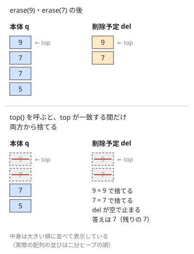

!!! abstract "要点"
    - **何ができるか**：最大（最小）の要素の取り出しと追加を $O(\log N)$ で行い、最大（最小）を見るだけなら $O(1)$ で済む。ソートと組む貪欲・上位 $K$ 個の列挙・接頭辞の $K$ 番目に使い、任意の要素の削除は削除予定のヒープで遅らせて行う。
    - **いつ使うか**：
        - 毎回いちばん大きい（小さい）ものを取り出し、新しい候補を入れる
        - 接頭辞ごとに K 番目に大きい値を答える
        - グループ間の移動のたびに、各グループの最大値のうちの最小値を答える
        - 追加と取り出しが合わせて $2 \times 10^5$ 回程度
    - **計算量**：追加 ならし $O(\log N)$、取り出し $O(\log N)$、最大（最小）を見る $O(1)$、$N$ 個からまとめて構築 $O(N)$。遅延削除は、追加と削除の回数の合計を $M$ として 1 回あたりならし $O(\log M)$
    - **前提**：[STL コンテナの使い分け](../ds/stl-containers.md)

<!-- textlint-disable -->
別名：priority_queue・ヒープ・heap・二分ヒープ・binary heap・削除できるヒープ・遅延削除・erasable heap
<!-- textlint-enable -->

優先度付きキューは、入れた要素のうち最大（または最小）のものだけをすぐ取り出せるコンテナである。C++ では `std::priority_queue` が二分ヒープで実装されている。できることは「入れる」「最大を見る」「最大を取り出す」の 3 つだけだが、ソートと組み合わせた貪欲や上位 $K$ 個の列挙など、使い方の型が多い。

## 何ができるか（push・top・pop。最小を取り出す向きと pair の比較順。書き方は C++ 章） {#what-it-does}

`priority_queue<T>` の操作は次の 3 つが中心である。中身は `vector` なので、push は末尾への追加の再確保を含めるとならし $O(\log N)$ になる。

| 操作 | 意味 | 計算量 |
| --- | --- | --- |
| `push(x)` | $x$ を入れる | ならし $O(\log N)$ |
| `top()` | 最大の要素を返す（取り出さない） | $O(1)$ |
| `pop()` | 最大の要素を取り除く（値は返さない） | $O(\log N)$ |

`vector` の範囲から作る `priority_queue<T> pq(a.begin(), a.end());` は、中で `make_heap` を呼び、比較 $3N$ 回以下の $O(N)$ で構築する。$N$ 回 push するより速い理由は[二分ヒープの仕組み](#binary-heap)にある。中身を順に見る・$K$ 番目を取る・任意の要素を消す、といった操作はない。

既定では **最大** が先頭に来る。最小を先頭にするには、3 つ目の型引数に `greater<T>` を渡す。`pair` や `tuple` は辞書順で比べるので、「主なキー」を先頭の成分に置き、同じときの順を 2 つ目の成分で決める。

```cpp
--8<-- "priority-queue/usage.cpp:core"
```

完全なプログラム：[`usage.cpp`](https://github.com/yuukougun/kyopro-atlas/blob/main/snippets/priority-queue/usage.cpp)（GitHub）
{ .kp-code-src }

比較関数の向きが `sort` と逆に見える理由や、ラムダを比較関数に渡す書き方は [比較関数の書き方](../cpp/cpp-comparators.md#priority-queue-order) にまとめてある。

## 二分ヒープの仕組み（保つ性質「親 ≤ 子」・push で上げる・pop で下げる・heapify は O(N)） {#binary-heap}

二分ヒープは、[完全二分木](../guide/glossary.md#complete-binary-tree)（最下段以外は埋まり、最下段は左から詰まった二分木）を配列 1 本で表したものである。ここでは最小ヒープ（根が最小）で説明する。`priority_queue` の既定（最大ヒープ）は不等号を逆にすればよい。

下の 2 つの図は、どちらも同じヒープ $[1, 3, 2, 6, 4, 8, 5]$ から別々に始める。木は値を動かす前の状態で、赤い線がこれから値の動く経路である。

![push(0)：末尾の [7] に置いた 0 が、親の 6・3・1 と順に入れ替わって根まで上がる経路。下段に同じ木を表す配列 d と添字を並べる](../img/priority-queue/heap-push.svg)

![pop()：根の 1 を消して末尾の 5 を根に移し、小さい方の子 2 と入れ替えて [2] で止まる経路。下段に同じ木を表す配列 d と添字を並べる](../img/priority-queue/heap-pop.svg)

どちらも動く値は根と葉を結ぶ 1 本の経路の上だけで、入れ替えは高々木の高さ（$\lfloor \log_2 N \rfloor$）回で済む。

### 保つ性質

- 0-indexed の配列 $d$ で、頂点 $v$ の子は $2v + 1$ と $2v + 2$、親は $\mathrm{par}(v) = \lfloor (v - 1) / 2 \rfloor$ である。要素数が $N$ なら、木の高さは $\lfloor \log_2 N \rfloor$ になる
- **ヒープ条件**：根以外のすべての $v$ で $d[\mathrm{par}(v)] \le d[v]$。親から子へたどると値は減らないので、根 $d[0]$ が全体の最小である
- 兄弟どうしや、別の枝の要素の大小は決めない。ソートより緩い条件しか保たないので、1 回の操作が木の高さ分の手間で済む

### 各操作の手順

- **push(x)**：$x$ を配列の末尾（最下段の左詰めの次）に置く。親より小さい間は親と入れ替えて上げる。入れ替えのたびに、上げた頂点と親の関係は正しくなり、ほかの親子の関係は変わらない
- **pop()**：根を末尾の要素と入れ替え、末尾を消す。新しい根を、子の **小さい方** と比べて大きければ入れ替えて下げる。小さい方の子を上げるので、上がった値は兄弟以下になり、ヒープ条件が保たれる
- **top()**：$d[0]$ を返す

どちらも 1 段ずつ上下に動くだけなので、比較と入れ替えは高さ分の $O(\log N)$ 回で済む。

### 境界

- 空のときの top・pop は呼ばない（`std::priority_queue` では未定義動作）。pop の後に要素が 0 個になったら下げる処理をしない
- 子が 1 つだけの頂点がある（$2v + 2 = N$ のとき）。右の子があるかを $2v + 2 < N$ で確かめてから比べる
- 同じ値が複数あってもよい。比較は「親が子以下なら止まる」として、等しいときに無駄な入れ替えをしない

```cpp
--8<-- "priority-queue/binary-heap.cpp:core"
```

完全なプログラム：[`binary-heap.cpp`](https://github.com/yuukougun/kyopro-atlas/blob/main/snippets/priority-queue/binary-heap.cpp)（GitHub）
{ .kp-code-src }

**まとめて構築（heapify）が $O(N)$ である理由**：配列をそのまま木と見て、子を持つ頂点を添字の大きい方から順に下げる。各頂点を下げる手間は、その頂点から葉までの高さ $h$ に比例する。高さ $h$ の頂点は $N / 2^{h+1}$ 個程度しかなく、ほとんどの頂点は葉の近くにある。よって合計は次のように $O(N)$ で抑えられる。

$$
\sum_{h \ge 0} \frac{N}{2^{h+1}} \cdot h = N \sum_{h \ge 1} \frac{h}{2^{h+1}} = N
$$

1 つずつ push すると、各要素が根まで上がりうるので $O(N \log N)$ かかる。heapify では各頂点を下げる距離（葉までの高さ）が手間で、高さの大きい頂点は少ない。push の繰り返しでは各頂点を上げる距離（根までの深さ）が手間で、深い頂点が多い。だから合計が違うのである。

## 使い方の型（ソートと組む貪欲・上位 K 個の列挙・大きさ K のヒープで接頭辞の K 番目） {#patterns}

優先度付きキューの使い方は、次の 3 つの型にまとまる。どれも「今の候補のうち最良のもの 1 つ」だけが要り、候補全体の順序は要らないところが共通である。

**ソートと組む貪欲**。開始時刻や締め切りで候補をソートしておき、時刻を進めながら「今使えるようになった候補」をキューに入れ、別の軸（報酬・終わる時刻など）で最良のものを取り出す。ソートの軸とキューの軸は別になる。ソートは「いつ候補に加わるか」を、キューは「加わった中でどれを選ぶか」を決める。後ろの日から決める型・締め切りの早いものから処理する型など、貪欲の正しさまで含めた詳しい型は[優先度付きキューを使う貪欲](../basics/greedy-priority-queue.md)にまとめてある。

**上位 $K$ 個の列挙**。候補が多すぎて全部は作れないが、「最良の候補」と「ある候補の次に良い候補」が分かるとき、最良の候補から始めて、取り出した候補の次の候補をキューに入れていく。取り出した順がそのまま良い順になる。たとえば降順にソートした 3 つの数列から 1 つずつ選ぶ和なら、最良は添字 $(0, 0, 0)$ で、$(i, j, k)$ の次は添字を 1 つ進めた 3 通りである。別々の候補から同じ組が作られるので、入れた組を `set` で覚えて重複を除く。取り出しが $K$ 回、入れるのは $3K$ 回以下なので $O(K \log K)$ で済む（[ABC123 D](#abc123_d)）。一般形は[小さい順に K 個を列挙する](../basics/greedy-priority-queue.md#k-best)にある。

**大きさ $K$ のヒープで接頭辞の $K$ 番目**。列を前から見ながら「今までの $K$ 番目に大きい値」を毎回答えるなら、今までの上位 $K$ 個だけを **最小** ヒープに持つ。新しい値を入れて $K + 1$ 個になったら最小を捨てる。残った $K$ 個がちょうど上位 $K$ 個で、その最小（top）が $K$ 番目に大きい値である。捨てた値は、後から何が来ても上位 $K$ 個に戻らないので、捨ててよい。

```cpp
--8<-- "priority-queue/kth-prefix.cpp:core"
```

完全なプログラム：[`kth-prefix.cpp`](https://github.com/yuukougun/kyopro-atlas/blob/main/snippets/priority-queue/kth-prefix.cpp)（GitHub）
{ .kp-code-src }

$K$ 番目に大きい値を最大ヒープで探そうとすると、上位 $K - 1$ 個を一度取り出して戻す必要があり遅い。「大きい方の $K$ 個を残し、その中の最小を見る」ので最小ヒープを使う。削除もある場合や $K$ が変わる場合は、[2 つのヒープで上位 K 個を管理する](../ds/top-k-multiset.md)方法に進む。

??? question "確認問題：上位 K 個の列挙で重複を除かないと"
    降順にソートした 3 つの数列から 1 つずつ選んだ和を大きい順に $K$ 個出す。入れた組を `set` で覚えずに、取り出した組の 3 つの次の組をすべて入れると、何が起きるか。

    ??? success "答え"
        $(1, 1, 0)$ は $(1, 0, 0)$ からも $(0, 1, 0)$ からも作られるように、同じ組が複数の経路から入る。同じ組が何度も取り出されて答えに重複して並び、キューの中身も経路の数だけ膨らむので、誤答になるうえに遅くなる。

## 全体への加算と組む（入れるときに引き、出すときに足す） {#with-offset}

「キューの全要素に $d$ を足す」操作があっても、全要素を書き換える必要はない。これまでの全体への加算の合計 $\mathit{add}$ を変数で持ち、次の約束を守る。

- 値 $x$ を入れるときは $x - \mathit{add}$ を入れる
- 全体に $d$ を足すときは $\mathit{add} \mathrel{+}= d$ だけをする
- 取り出した値（や top）には $\mathit{add}$ を足して実際の値に戻す

中身はどれも「実際の値 − $\mathit{add}$」で、全要素から同じ数を引いているだけなので、大小の順序は実際の値と変わらない。だから最大の取り出しはそのまま正しく、全体への加算は $O(1)$ になる。

```cpp
--8<-- "priority-queue/offset-heap.cpp:core"
```

完全なプログラム：[`offset-heap.cpp`](https://github.com/yuukougun/kyopro-atlas/blob/main/snippets/priority-queue/offset-heap.cpp)（GitHub）
{ .kp-code-src }

時刻とともにすべての値が同じ速さで増える問題も、この形に直せる。時刻 $t$ に値 $w$ で入った要素は、時刻 $s$ には $w + (s - t)$ になるので、$w - t$ を入れておき、時刻 $s$ に取り出したら $s$ を足せばよい（$\mathit{add}$ が時刻そのものになる）。上限 $V$ で止まる値でも、$\min(\cdot, V)$ は大小の順序を崩さないので、取り出した後に $\min$ を取ればよい。ヒープ以外にも使える考え方の全体は [全体への操作を変数で持つ](../ds/global-offset.md) にある。

??? question "確認問題：何を入れるか"
    これまでの全体への加算の合計が $\mathit{add} = 7$ のとき、新しい値 $10$ を入れる。キューに入れる値は何か。その直後に全体に $3$ を足してから取り出すと、何を出力するか。

    ??? success "答え"
        $10 - 7 = 3$ を入れる。全体に $3$ を足すと $\mathit{add} = 10$ になり、取り出した $3$ に $10$ を足した $13$ を出力する。これは $10 + 3$ と一致する。

## 削除できるヒープ（遅延削除：削除予定のヒープの top と一致したら両方から捨てる） {#lazy-deletion}

`priority_queue` は top 以外の要素を消せない。そこで、消したい値を **すぐには消さず**、削除予定のヒープ $\mathit{del}$ に入れておく。本体 $q$ と $\mathit{del}$ は同じ向き（どちらも最大ヒープ）にする。

- **保つ性質**：$\mathit{del}$ の中身（多重集合）は $q$ の中身に含まれる。実際の集合は「$q$ から $\mathit{del}$ を除いたもの」である
- **erase(x)**：$x$ を $\mathit{del}$ に入れる。$x$ が実際の集合にあるときだけ呼ぶ
- **top()・pop()**：先に、$q$ と $\mathit{del}$ の top が等しい間は両方を pop する。止まったときの $q$ の top が実際の最大である
- **大きさ**：$q$ の大きさから $\mathit{del}$ の大きさを引いたもの。空かどうかもこの差で判定する



**なぜ正しいか**：$q$ の top を $a$、$\mathit{del}$ の top を $b$ とする。$\mathit{del} \subseteq q$ なので $b \le a$ である。$b = a$ なら、最大の $a$ のうち 1 個は消す予定なので、両方から 1 個ずつ捨ててよい。$b < a$ なら、$\mathit{del}$ のどの値も $a$ より小さいので、$a$ は消す予定ではなく、実際の集合の最大である。消す予定の小さい値が $q$ の奥に残っていても、それが top に上がってくるまでは答えに影響しない。

```cpp
--8<-- "priority-queue/erasable-heap.cpp:core"
```

完全なプログラム：[`erasable-heap.cpp`](https://github.com/yuukougun/kyopro-atlas/blob/main/snippets/priority-queue/erasable-heap.cpp)（GitHub）
{ .kp-code-src }

**計算量**：push と erase はそれぞれ 1 回の push で、捨てる処理では、入れた要素をそれぞれ高々 1 回しか pop しない。よって追加と削除の回数の合計を $M$ とすると全体で $O(M \log M)$、1 回あたりならし $O(\log M)$ である。消した要素もしばらく残るので、ヒープの大きさは今の要素数ではなく、入れた回数で抑える。

**検証して捨てる形**：値ではなく「その要素が今も有効か」を判定できるなら、$\mathit{del}$ を持たずに済む。取り出した要素が古い（グループの最大値が変わった後のものなど）と分かれば捨てて、次を見る。[ダイクストラ法](../graph/dijkstra.md)で、取り出した距離が記録より大きければ捨てるのも同じ考え方である。有効かどうかは、要素に「入れた時点の版の番号」を持たせて今の番号と比べるか、今の値と比べて判定する（[ABC170 E](#abc170_e)）。

??? question "確認問題：放っておいてよい理由"
    最大ヒープで遅延削除をしている。$\mathit{del}$ の top が $q$ の top より小さいとき、$\mathit{del}$ の中身を $q$ から探して消さなくてよいのはなぜか。

    ??? success "答え"
        $\mathit{del}$ のどの値も $q$ の top より小さいので、$q$ の top は消す予定の値ではなく、実際の集合の最大である。消す予定の値は $q$ の top より下にあり、top や pop の結果に現れない。その値が $q$ の top に上がってきたときは、同じ値が $\mathit{del}$ の top にも来ているので、そこで両方から捨てられる。

## priority_queue と multiset の使い分け（任意の削除・両端・前後の要素が要るなら multiset） {#vs-multiset}

`multiset` も最大・最小を $O(\log N)$ で取り出せ、任意の要素も消せる。どちらを使うかは、要る操作で決める。

| 要る操作 | priority_queue | multiset |
| --- | --- | --- |
| 最大（か最小）の片方だけ | 速く短い | 使える |
| 任意の要素の削除 | 遅延削除で | `erase(find(x))` |
| 最大と最小の両方 | 2 本と遅延削除で | `begin()`・`prev(end())` |
| $x$ 以上の最小・前後の要素 | できない | `lower_bound` |

- 片方の端だけを取り出すなら `priority_queue` がよい。中身は `vector` 1 本なので、`multiset`（平衡二分探索木）より定数倍が軽く、メモリも少ない
- 削除が要るだけなら、遅延削除でも `multiset` でもよい。書き慣れた方を使う。`multiset` の `erase(x)` は値 $x$ をすべて消すので、1 個だけなら `erase(find(x))` と書く（[STL コンテナの使い分け](../ds/stl-containers.md)）
- 両端・前後の要素・範囲の走査が要るなら `multiset` にする（[set・multiset・map の応用](../ds/ordered-set.md)）。2 つの集合の間で要素を移す管理（上位 $K$ 個・中央値）も、削除があるなら `multiset` の方が書きやすい
- 併合（2 つのヒープを 1 つにまとめる）が要るときは、小さい方を大きい方に入れ直すマージテクで足りることが多い。$O(\log N)$ で併合できるヒープは [見慣れないデータ構造の名前と用途](../ds/advanced-ds-catalog.md#meldable-heap) にある

## 落とし穴 {#pitfalls}

**最大と最小の向きを取り違える**。`priority_queue<T>` は最大が先頭である。最小が要るのに既定のまま使うと、小さな例では偶然合うこともあるので、気づきにくい。最小を取り出すときは `priority_queue<T, vector<T>, greater<T>>` と書く。値に $-1$ を掛けて入れる方法もあるが、取り出すときに戻し忘れやすい。`pair` の 1 つ目の成分だけに $-1$ を掛けると、1 つ目が同じときは 2 つ目の大きい方が先に出る（`greater` を使ったときと逆）。2 つ目も小さい順にしたいなら両方に掛ける。

**pair の比較順を考えずに並べる**。`pair` は 1 つ目の成分で比べ、等しいときだけ 2 つ目で比べる。（頂点, 距離）の順で入れると、距離ではなく頂点番号の順に出てくる。優先したいキーを 1 つ目に置き、`(距離, 頂点)` のように並べる。

**空のときに top・pop を呼ぶ**。空の `priority_queue` の top・pop は未定義動作である。実行時エラーで止まるとは限らず、でたらめな値のまま進むこともある。ループの条件や取り出しの前で `empty()` を確かめる。遅延削除をしているときは $q$ が空でなくても実際の集合は空のことがあるので、大きさの差で判定する。

**top() の参照を持ったまま pop する**。`top()` は先頭の要素への参照を返す。`const auto& x = pq.top(); pq.pop();` と書くと、pop で配列の中身が動いた後の $x$ を読むことになる。`auto x = pq.top();` とコピーしてから pop する。

**古いエントリを捨て忘れる**。要素の値が変わるたびに新しい組を入れる書き方では、古い組がキューに残る。取り出したら、今も有効か（記録の値と一致するか、消す予定ではないか）を確かめてから使う。確かめずに使うと、すでに変わった値や消えた要素が答えに混ざる。

**遅延削除で、集合にない値を erase する**。$\mathit{del} \subseteq q$ が崩れると、次のどれかが起きうる。$\mathit{del}$ の top が $q$ の top より大きくなると、その値は捨てられずに残り、以後それより小さい値の削除も処理されなくなる。後で同じ値を push すると、それが代わりに消える。$q$ が空のまま $\mathit{del}$ が残ると、大きさの差が負になり、空でないと判定して空の $q$ の top を読む（未定義動作）。消す前に、その値が今の集合にあることを個数の `map` などで確かめる。

## 確認問題 {#quiz}

??? question "確認問題：K 番目に大きい値に最小ヒープを使う理由"
    接頭辞ごとに $K$ 番目に大きい値を答えるのに、大きさ $K$ の **最小** ヒープを使う。最大ヒープに全要素を入れる方法では何が困るか。

    ??? success "答え"
        最大ヒープの top は 1 番目に大きい値で、$K$ 番目を見るには $K - 1$ 個を取り出して戻す必要があり、1 回の答えに $O(K \log N)$ かかる。最小ヒープに上位 $K$ 個だけを持てば、$K$ 番目に大きい値は「上位 $K$ 個の中の最小」なので top で $O(1)$ に見え、更新も $O(\log K)$ で済む。

??? question "確認問題：heapify の向き"
    配列からまとめてヒープを作るとき、子を持つ頂点を添字の大きい方から順に下げる。添字の小さい方（根）から順に下げると、何がまずいか。

    ??? success "答え"
        頂点 $v$ を下げるときには、$v$ の 2 つの子の部分木がすでにヒープ条件を満たしている必要がある。添字の大きい方から処理すれば子の部分木が先に整うが、根から処理すると子の部分木がまだ整っておらず、下げ終えてもヒープ条件が成り立たないことがある。

## 例題 {#examples}

### ABC234 D. Prefix K-th Max {#abc234_d}

<div class="kp-problems" data-role="example" markdown>

- [ABC234 D. Prefix K-th Max](https://atcoder.jp/contests/abc234/tasks/abc234_d)（diff 503）：数列の接頭辞ごとに、K 番目に大きい値を答える。

</div>

[大きさ K のヒープで接頭辞の K 番目](#patterns)の型そのものである。上位 $K$ 個を最小ヒープに持ち、新しい値を入れて $K + 1$ 個になったら最小を捨てる。$N \le 5 \times 10^5$ でも全体で $O(N \log K)$ になる。

??? note "解法の詳細"
    - 最初の $K$ 個をヒープに入れ、top を出力する。
    - 以降は値を 1 つ入れて最小を 1 つ捨て、top を出力する。新しい値が top 以下なら、入れてすぐ捨てることになるので、入れずに済ませてもよい。
    - コードは[使い方の型](#patterns)の節のものと同じ形である。

### ABC123 D. Cake 123 {#abc123_d}

<div class="kp-problems" data-role="example" markdown>

- [ABC123 D. Cake 123](https://atcoder.jp/contests/abc123/tasks/abc123_d)（diff 1489）：3 つの数列から 1 つずつ選んだ和のうち、大きい方から K 個を出力する。

</div>

組は最大 $10^9$ 通りあって全部は作れないが、$K \le 3000$ なので上位 $K$ 個だけを順に取り出せばよい。3 つの数列を降順にソートすると、最大の和は添字 $(0, 0, 0)$ で、ある組の次の候補は添字を 1 つ進めた 3 通りに限られる。最大ヒープで最良の組から広げる、[上位 K 個の列挙](#patterns)の型である。

??? note "解法の詳細"
    - $A, B, C$ を降順にソートし、$(A_0 + B_0 + C_0, 0, 0, 0)$ を最大ヒープに入れ、`set` に組 $(0, 0, 0)$ を記録する。
    - $K$ 回、最大の組 $(i, j, k)$ を取り出して和を出力し、$(i + 1, j, k)$・$(i, j + 1, k)$・$(i, j, k + 1)$ のうち範囲内で未記録のものを入れて記録する。
    - **取り出した順が和の大きい順である理由**：どの組も、$(0, 0, 0)$ から添字を 1 つずつ進める経路でたどり着ける。数列は降順なので、経路上の和は減っていく。よって未出力の最大の組の手前の組はすでに出力済みで、その組はキューに入っている。
    - 取り出しは $K$ 回、入れるのは $3K$ 回以下なので、ソートを除いて $O(K \log K)$ である。

### ABC170 E. Smart Infants {#abc170_e}

<div class="kp-problems" data-role="example" markdown>

- [ABC170 E. Smart Infants](https://atcoder.jp/contests/abc170/tasks/abc170_e)（diff 1502）：幼児の転園のたびに、各幼稚園の最強レートのうちの最小値を答える。

</div>

園ごとの「最強レート」の集合から最小を答えるが、転園で園の最強が変わると、古い最強を集合から消す必要がある。園ごとに（レート, 幼児の番号）の最大ヒープ、全体に（園の最強, 園の番号）の最小ヒープを持ち、どちらも[削除できるヒープ](#lazy-deletion)の「検証して捨てる形」で古いエントリを読み飛ばす。

??? note "解法の詳細"
    - 幼児ごとに今いる園を配列で持つ。転園では、移動先の園のヒープに（レート, 番号）を入れ、配列を書き換えるだけで、元の園のヒープからは消さない。
    - 園のヒープの top を見るときは、その幼児が今もこの園にいるかを配列で確かめ、いなければ捨てて次を見る。こうして求めた最強を、園の「今の最強」として記録する。
    - 転園のたびに、元の園と移動先の園の今の最強を求め直し、変わった園は（新しい最強, 園の番号）を全体のヒープに入れる。空になった園は記録を「なし」にする。
    - 答えるときは全体のヒープの top を見て、その園の今の最強と一致しなければ捨てる。一致した top が答えである。
    - 入れる回数は $O(N + Q)$ で、各エントリは高々 1 回しか捨てないので、全体で $O((N + Q) \log (N + Q))$ になる。
    - 園ごとの `multiset` と、園の最強を集めた `multiset` で書いてもよい（[使い分け](#vs-multiset)）。

## 練習問題 {#practice}

<div class="kp-problems" data-role="practice" markdown>

- [ABC471 D. Chargers](https://atcoder.jp/contests/abc471/tasks/abc471_d)（diff 570）：時刻とともに増え上限で止まる値を追加するクエリと、最大のものを取り出してその値を答えるクエリを処理する。
- [ABC217 E. Sorting Queries](https://atcoder.jp/contests/abc217/tasks/abc217_e)（diff 986）：末尾への追加・先頭の取り出し・全体のソートのクエリを処理する。
- [ABC391 F. K-th Largest Triplet](https://atcoder.jp/contests/abc391/tasks/abc391_f)（diff 1554）：3 つの数列から 1 つずつ選んだ組の評価値のうち、K 番目に大きいものを求める。
- [ABC116 D. Various Sushi](https://atcoder.jp/contests/abc116/tasks/abc116_d)（diff 1712）：種類数のボーナスつきで K 個の寿司を選ぶときの満足度の最大値を求める。
- [ABC214 E. Packing Under Range Regulations](https://atcoder.jp/contests/abc214/tasks/abc214_e)（diff 1835）：各ボールを区間 [L, R] の中の別々の箱に入れられるかを判定する。

</div>

??? note "練習の方針"
    - **ABC471 D**：すべての値が時刻と同じ速さで増えるので、[全体への加算と組む](#with-offset)の形で $w - t$ を最大ヒープに入れる。取り出したら今の時刻を足し、上限 $V$ との $\min$ を答える。空なら決められた値を出す
    - **ABC217 E**：ソート済みの先頭部分を最小ヒープ、ソートの後に追加された部分を `queue` で持つ。ソートのクエリでは `queue` の中身を全部ヒープに移す。先頭の取り出しは、ヒープが空でなければヒープから、空なら `queue` から行う。各要素がヒープに移るのは 1 回だけなので、全体で $O(Q \log Q)$
    - **ABC391 F**：降順にソートすると、評価値はどの添字を進めても増えない。[上位 K 個の列挙](#patterns)の型で $(0, 0, 0)$ から広げ、訪問済みの組を `set` で除き、$K$ 回目に取り出した値を答える
    - **ABC116 D**：種類数 $x$ を $K$ から 1 つずつ減らしながら、選んだ寿司を差し替える。各種類の最もおいしい寿司を種類の代表とし、おいしさの大きい代表から $K$ 種類を選び（種類が $K$ 未満なら、$x$ を種類数から始める）、残りの寿司はすべて最大ヒープに入れておく。$x$ を 1 減らすたびに、選んでいる代表のうち最もおいしさの小さいものを外してヒープに戻し、ヒープの最大を代わりに選ぶ。各 $x$ で「おいしさの和 + $x^2$」の最大を答える
    - **ABC214 E**：ボールを $L$ の順に並べ、箱の位置 $x$ を左から進める。$L \le x$ になったボールの $R$ を最小ヒープに入れ、$R$ の最小のボールを $x$ に置く。そのとき $R < x$ なら置けないので No。ヒープが空なら $x$ を次の $L$ まで飛ばす（締め切りの早いものから処理する貪欲）

## 参考 {#references}

- [kyo-pro「ABC234D - Prefix K-th Max」](https://kyo-pro.hatenablog.com/entry/ABC234D)：例題の方針（大きさ K の最小ヒープ）
- [drken「AtCoder ABC 123 D - Cake 123 (1Q, 水色, 400 点)」](https://drken1215.hatenablog.com/entry/2019/04/07/001000)：例題の方針（降順にソートして添字の組を広げ、重複を set で除く）と計算量
- [drken「AtCoder ABC 170 E - Smart Infants (1D, 水色, 500 点)」](https://drken1215.hatenablog.com/entry/2020/11/15/195000)：例題の問題の確認と、set とセグメント木による別解
- [nishio「ABC170 E」](https://scrapbox.io/nishio/ABC170_E)：例題の方針（top の古いエントリを読み飛ばすヒープ）
- [comet725「ABC471Dを解いた【優先度つきキュー】」](https://qiita.com/comet725/items/cc08f26bb6f986813248)：練習の方針（時刻を引いた値をヒープに入れる）
- [snsn46「AtCoder ABC217 E - Sorting Queries 解」](https://qiita.com/snsn46/items/4f48057fa1b13f8a7ae5)：練習の方針（最小ヒープと queue の組）
- [merom686「ABC391」](https://merom686.hatenablog.com/entry/2025/02/02/020402)：練習の方針（最大の組から広げる列挙と訪問済みの管理）
- [drken「AtCoder ABC 116 D - Various Sushi (2D, 青色, 400 点)」](https://drken1215.hatenablog.com/entry/2019/05/15/002400)：練習の方針（種類数を減らしながらの差し替え）
- [procon-kirokuyou「ABC214 E - Packing Under Range Regulations (500)」](https://scrapbox.io/procon-kirokuyou/ABC214_E_-_Packing_Under_Range_Regulations_(500))：練習の方針（L の順に入れ、R の最小から置く貪欲と位置の飛ばし方）
- [cpprefjp「std::priority_queue」](https://cpprefjp.github.io/reference/queue/priority_queue.html)：メンバ関数と、既定で最大が先頭になること
- [cpprefjp「std::priority_queue::コンストラクタ」](https://cpprefjp.github.io/reference/queue/priority_queue/op_constructor.html)：範囲からの構築が `make_heap` を呼ぶこと
- [cpprefjp「std::make_heap」](https://cpprefjp.github.io/reference/algorithm/make_heap.html)：まとめて構築の比較回数（$3N$ 回以下）
