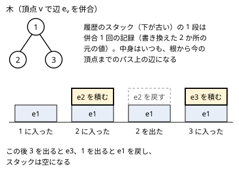

!!! abstract "要点"
    - **何ができるか**：直前の併合から順に取り消せる Union-Find。経路圧縮をせず、書き換えた場所と元の値をスタックに積み、木の DFS（入るとき併合・出るとき取り消し）やオフライン動的連結性の部品に使う。
    - **いつ使うか**：
        - 木の根から各頂点へのパスごとに、パス上の要素どうしのつながりを答える。
        - 辺の追加と削除が混ざり、そのたびに 2 頂点が連結かを答える。
    - **計算量**：併合・判定・大きさの取得は 1 回ごとに最悪 $O(\log N)$（ならしではない）、取り消し 1 回は $O(1)$。オフライン動的連結性に使うと全体で $O(Q \log Q \log N)$
    - **前提**：[Union-Find](../ds/union-find.md)

<!-- textlint-disable -->
別名：ロールバック UF・Undo つき Union-Find・undoable union-find・rollback union-find
<!-- textlint-enable -->

ロールバックできる Union-Find は、併合を「新しいものから順に」取り消せる Union-Find である。ふつうの Union-Find から経路圧縮を外し、併合のたびに書き換えた場所と元の値を記録しておく。任意の併合は取り消せないが、DFS の帰りや再帰の戻りのように後入れ先出しで戻す場面ならこれで足りる。ABC で必要になるのはまれで、主な出番は木の DFS と組む形である。

## 何ができるか（後入れ先出しの取り消し） {#what-it-does}

操作は、ふつうの [Union-Find](../ds/union-find.md) の併合（merge）・判定（same）・大きさ（size）に、次の 2 つを足したものである。

- **undo**：最後に行った併合を 1 回取り消す。
- **snapshot と rollback**：今の時点（ここまでの併合の回数）を覚え、後でその時点まで一気に戻す。

取り消せるのは、まだ取り消していない併合のうち最も新しいものだけである。「3 回前の併合だけを取り消す」ことはできない。辺を好きな順で消したいときは、消す順を後入れ先出しに並べ替える工夫（[オフライン動的連結性](#offline-dynamic-connectivity)）と組み合わせる。

## 自作するときの要点と Library Checker {#library}

自作するときの要点は次の 3 つである。

- **保つ性質**：各グループは根付き木で、根が代表元である。$\mathrm{par}[v]$ は、根なら $-(\text{大きさ})$、根でなければ親を指す（[Union-Find の保つ性質](../ds/union-find.md#invariants)と同じ）。加えて、記録のスタックを下から順に施せば、どの併合もしていない状態から今の状態が再現できる。
- **各操作の手順**：$\mathrm{find}$ は根までたどるだけで、経路上の親を書き換えない。merge は 2 つの根 $a, b$ を求め、$(a, \mathrm{par}[a])$ と $(b, \mathrm{par}[b])$ をスタックに積んでから、小さい方を大きい方の下へつなぐ（union by size）。undo はスタックから 2 件取り出し、それぞれの位置へ元の値を書き戻す。
- **境界**：すでに同じグループの 2 頂点を merge したときも、記録を 2 件積む。par は何も変わらないので、書き戻すだけなら害はない。ただし根の合計を引き算で戻す場合は、同じグループどうしの記録を取り消すときに引かない（引くと根の合計が 0 になる。引き算で戻す型は[オフライン動的連結性の DFS の節](../graph/offline-dynamic-connectivity.md#dfs-rollback)）。こうしておくと「merge 1 回 ＝ undo 1 回」が常に成り立ち、呼び出し側は merge の結果を見ずに undo できる。積まない作り方にするなら、merge が false を返したときは undo を呼ばないよう呼び出し側で区別する。

```cpp
--8<-- "rollback-union-find/version-tree.cpp:core"
```

ACL の `dsu` は `leader` の中で経路圧縮をするので、取り消しには使えない。上のように自作するか、公開されているライブラリ（[参考](#references)の ei1333 氏・Nyaan 氏のもの）を使う。ただし ei1333 氏のものの snapshot は記録を捨てて今の時点を基準にし、rollback は引数なしでその時点まで戻す形で、上の説明の snapshot（併合の回数を返す）とは意味が違う。

Library Checker で確かめるなら、[練習問題](#practice)の Persistent Unionfind（版の木を DFS でたどる）が使える。

## なぜ経路圧縮をしないのか（戻すコストとならしの保証が崩れること） {#no-path-compression}

この節は [Union-Find の計算量](../ds/union-find.md#complexity)の union by size と経路圧縮の議論を前提にする。

経路圧縮をすると、$\mathrm{find}$ のたびに経路上の多くの頂点の親が書き換わる。これらをすべて記録すれば正しく戻せるが、1 回の $\mathrm{find}$ で記録が何件も増え、戻すのも同じだけ重くなる。記録しなければ、併合を戻した後も圧縮された頂点が併合先の根を直接指したまま残り、グループが分かれない。

さらに、経路圧縮の「ならし $O(\alpha(N))$」は、一度圧縮した経路を再びたどらないことに頼っている。取り消すと深い経路が元に戻るので、同じ深い $\mathrm{find}$ を何度でも繰り返させられ、ならしの保証が成り立たない。[ならし計算量](../guide/glossary.md#amortized-complexity)のデータ構造は、一般に巻き戻しと相性が悪い。

そこで union by size だけにする。これだけで木の高さは $\log_2 N$ 以下に保たれるので、$\mathrm{find}$ は 1 回ごとに最悪 $O(\log N)$ で、ならしではない。併合で書き換わるのは根 2 つの $\mathrm{par}$ だけなので、記録は 2 件、undo は $O(1)$ である。要点は[根からのパスを DFS で持ち回る](../tree/root-path-dfs.md#no-path-compression)にもある。

成分ごとに辺の数などを根に持たせるときは、それらの元の値も同じスタックに積んで戻す。取り消しの間に値を加える問題では、元の値を書き戻すと加えた分まで消えるので、引き算で戻す（[オフライン動的連結性の DFS の節](../graph/offline-dynamic-connectivity.md#dfs-rollback)）。

## 木の DFS と組む（入るとき併合・出るとき取り消し） {#with-dfs}

ABC で出てくるのは、根付き木を DFS しながら、頂点に入るとき併合し、出るときその併合を取り消す形である。こうすると、Union-Find の中身はいつも「根から今の頂点までのパス上の併合だけを施した状態」になる。パスごとに Union-Find を作り直す必要がないので、全体は $O(N \log N)$ で済む。正しさの根拠（子を出るときにその子の記録がすべて取り除かれること）は[変更の記録と巻き戻し](../tree/root-path-dfs.md#undo-log)にある。

次の図は、頂点 1 の子が 2 と 3 の木で、頂点 $v$ に入るとき辺 $e_v$ を併合する様子である。2 を出るときに $e_2$ の記録が取り除かれるので、3 に入ったときのスタックには $e_2$ が残らない。



同じ形は、操作の履歴が木になる問題にも使える。「版 $k$ に辺を足したものを新しい版とする」「版 $k$ で 2 頂点が連結かを答える」が混ざるとき、版を頂点にした木を先に作り、根（辺のない版）から DFS すればよい（[版の木の DFS と取り消し](../ds/persistent-data-structures.md#offline-version-tree)）。Library Checker の [Persistent Unionfind](#practice) はこの形で、DFS の部分は次のようになる。非再帰で書き、出るときの印 $\sim x$ を子より先に積む。

```cpp
--8<-- "rollback-union-find/version-tree.cpp:dfs"
```

質問のたびにすぐ答える必要がある（オンライン）なら、DFS の順に並べ替えられないので、過去の時点の判定ができる[部分永続 Union-Find](../ds/partially-persistent-union-find.md#what-it-does) や[永続データ構造](../ds/persistent-data-structures.md)を使う。

## オフライン動的連結性の部品（時間軸のセグメント木に辺を載せる → グラフの章） {#offline-dynamic-connectivity}

辺の追加と削除が混ざり、ところどころで「2 頂点は連結か」を問われる問題は、クエリをすべて先に読める（[オフライン](../guide/glossary.md#offline)）なら、ロールバックできる Union-Find で解ける。手順と、頂点の値の加算が混ざる型の扱いは[オフライン動的連結性](../graph/offline-dynamic-connectivity.md)のページが受け持つ。ここでは、このデータ構造から見た要点だけを書く。

- **辺を時間軸に載せる**：各辺が存在する時刻の区間 $[l, r)$ を、時刻を葉とする[セグメント木](../ds/segment-tree.md)の $O(\log Q)$ 個のノードに載せる（[時間軸のセグ木](../graph/offline-dynamic-connectivity.md#time-segment-tree)）
- **入るとき併合・出るとき取り消す**：セグメント木を DFS すると、ノードの入りと出が後入れ先出しになるので、取り消しは常に最も新しい併合に当たる。この性質が、最も新しい併合だけを戻せるこのページの構造とかみ合う（[DFS で取り消す](../graph/offline-dynamic-connectivity.md#dfs-rollback)）
- **計算量**：辺 1 本が $O(\log Q)$ 個のノードに載り、併合 1 回が $O(\log N)$ なので、全体は $O(Q \log Q \log N)$ である

## 学ぶための資料 {#resources}

- cp-algorithms の「Deleting from a data structure in O(T(n) log n)」（英語）：時間軸のセグメント木に辺を載せ、経路圧縮なしの Union-Find を DFS で取り消しながら使う手順を、短い実装とともに説明している
- OI Wiki の「线段树与离线询问」（中国語）：時間軸のセグメント木で取り消しの構造を使う方法と、その応用の例がまとまっている

## 例題 {#examples}

### ABC302 Ex. Ball Collector {#abc302_h}

<div class="kp-problems" data-role="example" markdown>

- [ABC302 Ex. Ball Collector](https://atcoder.jp/contests/abc302/tasks/abc302_h)（diff 2407）：木の根から各頂点へのパス上で各頂点のボールの片方を選ぶとき、書かれた値の種類数の最大値を各頂点について求める。

</div>

値を頂点、各頂点の 2 つのボール $(A_i, B_i)$ を辺とするグラフを考える。ボールを選ぶことは辺を片方の端点に向けることにあたり、ある連結成分から得られる値の種類数の最大値は $\min(\text{頂点数}, \text{辺数})$ になる。根からのパス上の辺だけを入れたグラフで成分ごとの和を答えればよいので、木を DFS して入るとき併合・出るとき取り消す。

??? note "解法の詳細"
    - **成分ごとの値**：頂点数 $s$・辺数 $e$ の連結成分では、得られる種類数は辺数 $e$ を超えず、頂点数 $s$ も超えない。木（$e = s - 1$）なら、1 頂点を根にして各辺を子の側に向ければ $s - 1$ 種類が取れる。閉路があれば（$e \ge s$）、閉路を 1 つ選んで一方向に回るように向ける。閉路の外の各頂点へは、全域木の中でその頂点へ入る辺を閉路から遠ざかる向きに向ける。残った辺の向きは何でもよく、これで $s$ 種類すべてが取れる。よって $\min(s, e)$ である。
    - **持つもの**：Union-Find の根に頂点数と辺数を持たせ、全成分の $\min(s, e)$ の和 $\mathrm{total}$ を保つ。辺 $(A_i, B_i)$ を足すときは、両端の成分の寄与を $\mathrm{total}$ から引き、併合（同じ成分なら辺数だけ $+1$）してから新しい成分の寄与を足す。
    - **DFS**：頂点 $v$ に入るとき辺 $(A_v, B_v)$ を足し、そのときの $\mathrm{total}$ が $v$ の答えである。子をすべて回った後、併合を取り消し、$\mathrm{total}$ も入る前の値に戻す（入る前の値を局所変数に残せばよい）。同じ成分どうしの辺でも辺数を書き換えるので、記録を積んで undo と 1 対 1 にしておく。
    - **計算量**：併合と取り消しは各頂点で 1 回ずつで、$\mathrm{find}$ が $O(\log N)$ なので、全体で $O(N \log N)$ である。根を頂点 1 にした DFS はパス状の木で深くなるので、手元では非再帰で書くか、スタックの大きさに気を付ける。

## 練習問題 {#practice}

### Library Checker

- [Persistent Unionfind](https://judge.yosupo.jp/problem/persistent_unionfind)：版 $k$ のグラフに辺を足して新しい版を作る操作と、版 $k$ で 2 頂点が連結かを答える質問を処理する。[木の DFS と組む](#with-dfs)のコード片がそのまま使える。
- [Dynamic Graph Vertex Add Component Sum](https://judge.yosupo.jp/problem/dynamic_graph_vertex_add_component_sum)：辺の追加・削除と頂点の値への加算が混ざり、頂点を含む成分の値の合計を答える。本文の[オフライン動的連結性の部品](#offline-dynamic-connectivity)の形で、加算の扱いは[オフライン動的連結性の DFS の節](../graph/offline-dynamic-connectivity.md#dfs-rollback)にある。

## 確認問題 {#quiz}

??? question "確認問題：undo で、子にした根 b の par だけを書き戻し、残った根 a の par（大きさ）を戻さないとどうなるか"
    木の形は元に戻るので、same の答えは正しいままである。しかし $\mathrm{par}[a]$ には取り消した併合の分の大きさが残り、size の答えが大きすぎる。さらに、後の併合で union by size が実際より小さい木を親に選ぶことがあり、木の高さが $\log_2 N$ 以下という保証がなくなって、$\mathrm{find}$ の最悪 $O(\log N)$ も成り立たない。記録を 2 件積み、2 件とも書き戻すのはこのためである。

??? question "確認問題：木の DFS で、子へ降りる前に答えを読む頂点 v のところで return すると何が起きるか"
    $v$ に入るときの併合が取り消されないまま、DFS が兄弟の部分木へ進む。すると兄弟の部分木では、根からのパス上にない辺 $e_v$ まで併合された状態で答えを求めてしまう。取り消しは関数の最後の 1 か所にまとめ、途中で抜けない。DFS の後に記録のスタックが空かを `assert` で確かめると見つけやすい。

## 参考 {#references}

- [drken「AtCoder ABC 302 Ex - Ball Collector (橙色, 625 点)」](https://drken1215.hatenablog.com/entry/2023/06/10/032900)：例題の値を頂点にしたグラフ、成分ごとの $\min(\text{頂点数}, \text{辺数})$、DFS と undo つき Union-Find の組み合わせ、経路圧縮をしない注意
- [ikatakos「AtCoder Beginner Contest 302 Ex 問題」](https://ikatakos.com/pot/programming_algorithm/contest_history/atcoder/2023/0520_abc302)：例題の解法の確認（同じ成分どうしの辺でも辺数を数えること。解法の節だけを読んだ）
- [cp-algorithms「Deleting from a data structure in O(T(n) log n)」](https://cp-algorithms.com/data_structures/deleting_in_log_n.html)：オフライン動的連結性の手順（時間軸のセグメント木・経路圧縮なしの Union-Find）（文章と図は使っていない）
- [OI Wiki「线段树与离线询问」](https://oi-wiki.org/topic/segment-tree-offline/)：時間軸のセグメント木で取り消しの構造を使う方法と、その応用の例（文章と図は使っていない）
- [ei1333「union-find-undo.hpp」](https://ei1333.github.io/library/structure/union-find/union-find-undo.hpp)：undo・snapshot・rollback を持つライブラリの例
- [Nyaan「RollbackつきUnion Find」](https://nyaannyaan.github.io/library/data-structure/rollback-union-find.hpp)：各操作の計算量と、Library Checker での検証の例
- [Library Checker「Persistent Unionfind」](https://judge.yosupo.jp/problem/persistent_unionfind)・[「Dynamic Graph Vertex Add Component Sum」](https://judge.yosupo.jp/problem/dynamic_graph_vertex_add_component_sum)：練習の問題の内容（問題文は library-checker-problems のリポジトリで確かめた）
