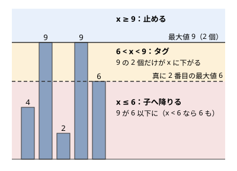

!!! abstract "要点"
    - **何ができるか**：区間 chmin・chmax と区間和のように遅延セグメント木の条件を満たさない更新を、ならし計算量で処理する。効かないなら止める・最大値だけ変わるならタグ・それ以外は子へ、の 3 つに分ける。
    - **いつ使うか**：
        - 区間 chmin・chmax と区間和を同時に答える
        - 区間の各要素を x で割る（切り捨て）操作と区間和
    - **計算量**：区間 chmin と区間和だけならならし $O((N + Q) \log N)$。区間加算が混ざるとならし $O((N + Q) \log^2 N)$。区間和の取得は 1 回 $O(\log N)$
    - **前提**：[遅延セグメント木](../ds/lazy-segment-tree.md)

<!-- textlint-disable -->
別名：beats・Ji Driver Segment Tree・吉司机线段树・区間 chmin 区間和・区間 chmin・chmax
<!-- textlint-enable -->

Segment Tree Beats は、遅延セグメント木の更新を「ノードの情報だけで処理できるなら止める、できなければ子へ降りる」と変えたものである。子へ降りる回数を[ならし計算量](../guide/glossary.md#amortized-complexity)で抑えるのが要点で、中国の吉（Ji）氏が 2016 年に広めた。ABC で必須になることはまれで、区間を set で管理する手法で代わりが利く問題も多い。

## 何ができるか（遅延セグメント木に載らない更新） {#what-it-does}

区間 chmin（$i \in [l, r)$ の各 $a_i$ を $\min(a_i, x)$ にする）と区間和を、遅延セグメント木に載せることはできない。$\sum \min(a_i, x)$ を求めるには、区間の中で $x$ を超える要素の個数と和が要る。どの $x$ が来ても答えられるようにするには、値の分布をまるごと持つしかない（[載らない作用](../ds/lazy-segment-tree-patterns.md#not-applicable)）。

Segment Tree Beats は、ノードに少し多めの情報を持たせ、「この $x$ ならノードの情報だけで更新できる」場合にだけ保留にする。できない場合は子へ降り、葉に近づくほど更新しやすくなるので、最後には必ず処理できる。素朴な遅延セグメント木では 1 回の更新で触るノードが $O(\log N)$ 個に限られるが、Segment Tree Beats は 1 回の更新で多くのノードを触ることを許し、その合計を全クエリでならして抑える。

使える操作の代表は次のとおりである。

- 区間 chmin・区間 chmax・区間加算と、区間和・区間最大値・区間最小値（Library Checker の Range Chmin Chmax Add Range Sum）
- 区間の各要素を $x$ で割る（切り捨て）・平方根を取る・$x$ で割った余りにする操作と区間和。値が速く潰れることでならす（[値が潰れる操作](#shrinking-values)）

サインは「区間の各要素に $\min$・$\max$・割り算を施し、区間和や区間最大値を答える」「操作が要素ごとには簡単だが、和に直接施せない」である。chmin の対象の列が単調なら、値を変える範囲が連続するので、二分探索で範囲を求めて区間代入にすれば遅延セグメント木で済む（[言い換えてから載せる](../ds/lazy-segment-tree-patterns.md#reformulate)）。

## ノードに持つもの（最大値・真に 2 番目の最大値・最大値の個数・和）と 3 つの場合 {#node-data}

区間 chmin と区間和なら、各ノードに次の 4 つを持たせる。

- 最大値 $m_1$
- 真に 2 番目の最大値 $m_2$（$m_1$ より真に小さい値の最大。値が 1 種類なら $-\infty$）
- 最大値の個数 $c$
- 和 $s$

ノード $v$ の区間全体に $\min(\cdot, x)$ を施すとき、$x$ と $m_1, m_2$ の位置で 3 つに分ける。

1. **$x \ge m_1$：止める**。どの要素も変わらない。
2. **$m_2 < x < m_1$：タグ**（ノードの値だけ直し、子には保留を残して止める）。変わるのは値が $m_1$ の $c$ 個だけで、どれも $x$ になる。$s \gets s - c(m_1 - x)$、$m_1 \gets x$ と更新し、子には保留として「最大値を $x$ に切り詰める」を残す。$m_2$ と $c$ は変わらない。
3. **$x \le m_2$：子へ降りる**。$m_1$ の要素が $m_2$ 以下に下がり、$x < m_2$ なら $m_2$ の要素も変わる。どちらの場合も、新しい最大値の個数と真に 2 番目の最大値がノードの情報だけでは分からない（$x = 6$ なら和が 24 になることは分かるが、新しい最大値 6 の個数 3 と真に 2 番目の 4 は出ない）。保留を子に渡し、子で処理してから親を計算し直す。

次の図は、値が $4, 9, 2, 9, 6$ のノードでの 3 つの場合である。最大値 9 が 2 個で、真に 2 番目の最大値が 6 である。$6 < x < 9$ なら 9 の 2 個を $x$ に下げるだけで済む。



タグの場合に子へ残す保留は「子の最大値を親の最大値に切り詰める」だけでよい。親のタグの条件 $m_2 < x$ から、子の要素のうち $x$ を超えるのは子の最大値だけで、子でもタグの場合になるからである。

区間 chmax も対称で、最小値・真に 2 番目の最小値・最小値の個数を足して持つ。区間加算は全部の値に同じ数を足すだけなので、ふつうの遅延セグメント木と同じく保留にできる。

### 自作するときの要点

ACL には Segment Tree Beats がない（`lazy_segtree` は作用が必ずノードの情報だけで済む前提で、子へ降りる場合を持たない）。自作するときは、chmin の更新を次の形にする（完全なプログラムは `snippets/segment-tree-beats/beats.cpp`。区間 chmax・区間加算も入れてある）。

```cpp
--8<-- "segment-tree-beats/beats.cpp:core"
```

子へ降りる前の保留の受け渡しは、加算を先に、切り詰めを後にする。親の最大値・最小値は加算をすでに含んだ値なので、子にも先に加算を施してから比べる。

```cpp
--8<-- "segment-tree-beats/beats.cpp:push"
```

実装で間違えやすいのは次の点である。

- **真に 2 番目**：$m_2$ は $m_1$ と等しい値を数えない。2 つの子をまとめるとき、子の最大値どうしが等しければ $c$ を足し、$m_2$ は 2 つの子の $m_2$ の大きい方にする。等しい値を $m_2$ に入れると、タグの場合を取り逃して遅くなるか、個数がずれて和が狂う。
- **最小値の側との連動**：chmin と chmax を両方持つと、chmin で最大値を下げたときに最小値の側も変わることがある。値が 1 種類のノードでは最小値も同じ要素なので $\min$ 側の $m_1$ も $x$ にし、値が 2 種類のノードでは真に 2 番目の最小値が最大値に等しいので、そちらを $x$ にする。
- **番兵**：値が 1 種類のときの $m_2 = -\infty$ は、加算で動かさない。番兵に加算を足すと、ふつうの値と区別が付かなくなる。
- **和のオーバーフロー**：和は `long long` で持つ。Library Checker の制約（$N \le 2 \times 10^5$、クエリの途中も常に $\lvert a_i \rvert \le 10^{12}$）では和の絶対値は $2 \times 10^{17}$ 以下に収まる。

ACL の `lazy_segtree` を使いたいなら、作用が失敗したら子へ降りる 1 行を `all_apply` に足す方法がある（[学ぶための資料](#resources)の rsm9 氏の記事）。ノードの値に「失敗した」の印を持たせ、印が立ったら保留を子に渡して計算し直す。

## 計算量（chmin と和だけならならし O((N+Q) log N)、区間加算が混ざると log^2） {#complexity}

1 回の更新で触るノードは、ふつうの遅延セグメント木と同じく区間の境界に沿う $O(\log N)$ 個と、区間に丸ごと入るのに子へ降りた余分なノードに分かれる。余分なノードの合計を[ポテンシャル](../guide/glossary.md#potential)で抑える。

- **区間 chmin と区間和だけ**：各ノードについて、その部分木の中の「相異なる値の種類」に当たる量を数え、全ノードの和をポテンシャルにする。初めは $O(N \log N)$ で、1 回の更新で増えるのは境界のノードの分の $O(\log N)$ である。余分なノードを 1 つ訪れるたびに、そのノードの最大値と 2 番目の最大値が同じ値にまとまり、ポテンシャルが 1 以上減る。よって余分なノードの訪問は全体で $O((N + Q) \log N)$ 回である。
- **区間加算が混ざるとき**：加算は値の種類をまとめ直さないので、上の評価が使えない。別のポテンシャルで、全体がならし $O((N + Q) \log^2 N)$ になることが示されている。元の解説は $O((N + Q) \log N)$ で済む可能性に触れていたが、のちに $\log^2$ の回数かかる入力が作られ、Library Checker のテストにも加わった（2026 年）。

区間和・区間最大値の取得は余分なノードを訪れないので、ふつうのセグメント木と同じく 1 回 $O(\log N)$ である。ならしなので、1 回の更新だけを見ると $O(N)$ かかることもある。過去の版に戻す（永続にする・ロールバックする）と、ならしの評価が崩れる。

証明の詳細は[学ぶための資料](#resources)に任せる。

## 値が潰れる操作（割り算・mod・平方根）と、区間を set で管理する別解 {#shrinking-values}

区間の各要素を $x$ で割る（切り捨て）操作も、和に直接施せない（$\lfloor (a + b) / x \rfloor$ は $\lfloor a / x \rfloor + \lfloor b / x \rfloor$ と限らない）。この種の操作は、次の打ち切りで同じように処理できる。

- **最大値と最小値が等しいノード**：区間の値がすべて同じなので、割った後もすべて同じである。割り算を「その値への区間代入」に直して保留にする。
- **それ以外**：子へ降りる。

ここでは値は 0 以上とする。$x = 1$ の割り算は何も変えないので、クエリごと飛ばす。$x \ge 2$ なら、子へ降りた余分なノードでは最大値が半分以下になる。ノードの値が 1 種類でないときだけ $\lfloor \log_2 m_1 \rfloor + 1$ を数え、その和をポテンシャルとする。余分なノードを訪れるたびに、そのノードの分が 1 以上減る（最大値が半分以下になるか、すべて 0 になって 1 種類にまとまる）。1 種類でなくなりうるのは区間代入と割り算の境界の $O(\log N)$ 個のノードだけである。よって 1 回のクエリで増えるポテンシャルは $O(\log N \log A)$ である（$A$ は値の最大）。したがって余分なノードの訪問は全体で $O((N + Q \log N) \log A)$ 回に収まる。

平方根も同じで、$\lfloor \sqrt{a} \rfloor$ は $O(\log \log A)$ 回で 1 以下になる。区間加算が混ざると、最大値と最小値の差が 1 のノードで差の縮まらないことがある。たとえば 3 と 4 は 1 と 2 になり、2 を足すと元に戻る。そこで「施した後の差が施す前の差と同じなら区間加算に直す」打ち切りを足す。

$x$ で割った余りは、最大値が $x$ 未満のノードで止め、それ以外で子へ降りる。値が 0 以上で、値が変わる要素は $a \bmod x < a / 2$ で半分未満になるので、各要素が変わるのは $O(\log A)$ 回である。降りたノードには必ず値の変わる要素がある。1 つの変化は祖先 $O(\log N)$ 個に数えられ、各クエリの境界のノードも加わるので、区間代入がなければ全体で $O((N \log A + Q) \log N)$ 回のノードの訪問に収まる。

区間代入が混ざる問題では、[区間を set で管理する](../ds/interval-set.md)別解もある。同じ値が続く区間を `map` で持ち、割り算ではたどった区間の値を割るだけにする。区間を消さない操作なので、ならしの評価は[値つきの区間の分割・統合](../ds/interval-set.md#valued-intervals)で作り直す。区間和は [BIT](../ds/fenwick-tree.md) か遅延セグメント木で別に持つ。どちらで書くかは慣れで選んでよい。

## 学ぶための資料 {#resources}

- 計算量の証明は、ferin 氏の HackMD のメモ「Segment Tree Beats」（原典の Codeforces のブログの和訳）と、37zigen 氏の「Segment Tree Beats の計算量解析」が日本語で読める。どちらもポテンシャルの取り方から追っている
- 実装は、rsm9 氏の「atcoder::lazy_segtree に 1 行書き足すだけの抽象化 Segment Tree Beats」が、ACL を土台にした書き方を示している。区間 chmin・chmax・加算・和の値と作用の組も載っている
- 原典の整理は OI Wiki の「吉司机线段树」にある（中国語）

## 例題 {#examples}

### ABC256 Ex. I like Query Problem {#abc256_h}

<div class="kp-problems" data-role="example" markdown>

- [ABC256 Ex. I like Query Problem](https://atcoder.jp/contests/abc256/tasks/abc256_h)（diff 2531）：区間の各要素を x で割る（切り捨て）・区間代入・区間和のクエリを処理する。

</div>

割り算は区間和に直接施せない。ただし値は割るたびに半分以下になる。区間代入で値がそろうので、[値が潰れる操作](#shrinking-values)の打ち切り（区間の値がすべて同じなら代入として扱う）で処理できる。

??? note "解法の詳細"
    - ノードに和・最大値・最小値と、保留中の区間代入を持つ。区間代入はふつうの遅延セグメント木の代入である。
    - 割り算は、区間に丸ごと入るノードで最大値と最小値が等しければ、$\lfloor m_1 / x \rfloor$ の代入に直して止める。等しくなければ子へ降りる。葉では必ず等しいので止まる。
    - 最大値が 0 のノードでは割っても変わらないので、すぐ止めてよい（最大値と最小値が等しい場合に含まれる）。
    - 計算量は[値が潰れる操作](#shrinking-values)の評価で、全体 $O((N + Q \log N) \log A)$ 回のノードの訪問である。
    - 同じ値の連続を `map` で持ち、和を BIT に持つ別解もある（[区間を set で管理する](../ds/interval-set.md)の力試し）。

## 練習問題 {#practice}

### Library Checker

- [Range Chmin Chmax Add Range Sum](https://judge.yosupo.jp/problem/range_chmin_chmax_add_range_sum)：区間 chmin・区間 chmax・区間加算と区間和。`snippets/segment-tree-beats/beats.cpp` はこの入力の形で書いてある。

## 確認問題 {#quiz}

??? question "確認問題：chmin の値 x が真に 2 番目の最大値より大きいとき、なぜ子へ降りなくてよいか"
    $x$ を超える要素は最大値 $m_1$ の要素だけで、その個数 $c$ はノードに持っている。だから和は $c(m_1 - x)$ だけ減り、最大値は $x$ になり、ほかの量は変わらない。子については、子の最大値が $m_1$ なら子でも同じことが言えるので、「子の最大値を $x$ に切り詰める」という保留を残せば済む。

??? question "確認問題：真に 2 番目でなく、最大値と等しい値も含めた 2 番目を持つとどうなるか"
    最大値が 2 個以上あると $m_2 = m_1$ になり、$m_2 < x < m_1$ の場合が起きなくなる。どの $x < m_1$ でも子へ降りるので、葉まで降りることが増え、ならしの評価が成り立たない。

## 参考 {#references}

- [ferin「Segment Tree Beats」](https://hackmd.io/@a4YdmMWJSTa0aHKUX3wNcA/S1MJhbSLV?type=view)：ノードに持つ値と 3 つの場合、chmin と和でならし $O(N \log N)$・加算が混ざると $O(N \log^2 N)$ の評価とポテンシャルの取り方
- [37zigen「Segment Tree Beats の計算量解析」](https://scrapbox.io/37zigen-43465887/Segment_Tree_Beats%E3%81%AE%E8%A8%88%E7%AE%97%E9%87%8F%E8%A7%A3%E6%9E%90)：境界のノードと余分なノードの分け方と、chmin と和のならしの評価
- [rsm9（ひとなので）「atcoder::lazy_segtree に1行書き足すだけの抽象化 Segment Tree Beats」](https://rsm9.hatenablog.com/entry/2021/02/01/220408)：ACL の `all_apply` に失敗の印を見る 1 行を足す方法
- [yosupo06/library-checker-problems issue #1369](https://github.com/yosupo06/library-checker-problems/issues/1369)：加算が混ざる場合に log^2 かかる入力のテストの追加
- [OI Wiki「吉司机线段树」](https://oi-wiki.org/ds/seg-beats/)：2016 年の論文が原典であることと、2 つの計算量の確認（学ぶための資料。文章と図は使っていない）
- [Library Checker「Range Chmin Chmax Add Range Sum」](https://judge.yosupo.jp/problem/range_chmin_chmax_add_range_sum)：練習の問題の内容と制約（GitHub の task.md で確かめた）
- [kmjp「AtCoder ABC #256 (東京海上日動プログラミングコンテスト2022) : Ex - I like Query Problem」](https://kmjp.hatenablog.jp/entry/2022/06/18/0930)：例題の問いと、同じ値の区間を map で持つ別解
- [Nyaan「解説一覧」](https://nyaannyaan.github.io/docs/problems/editorials/)：例題が Segment Tree Beats で解けること
