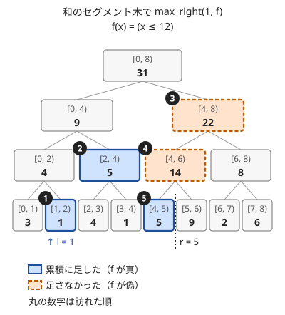

!!! abstract "要点"
    - **何ができるか**：左端 $l$ を固定し、区間 $[l, r)$ の総積が条件を満たす最大の $r$ を、木を登って降りる手順で $O(\log N)$ で求める。$l$ 以降で初めて $x$ 以上になる位置・和が $w$ を超えない最長の区間・K 番目の 1 に使う。右端を固定して左へ伸ばす版（`min_left`）もある。
    - **いつ使うか**：
        - 位置 i 以降で初めて値が x 以上になる位置
        - 空いている場所のうち K 番目
        - 各 l について、条件を満たす最長の区間
        - $N, Q \le 2 \times 10^5$ で、更新のたびに条件を満たす最初の位置を答える
    - **計算量**：1 回 $O(\log N)$（条件の判定と演算の呼び出しがそれぞれ $O(\log N)$ 回）。外側で二分探索して毎回区間取得を呼ぶと $O(\log^2 N)$ になる
    - **前提**：[セグメント木](../ds/segment-tree.md)、[二分探索](../basics/binary-search.md)

<!-- textlint-disable -->
別名：セグ木上の二分探索・セグ木の二分探索・binary search on segment tree・max_right・min_left
<!-- textlint-enable -->

セグメント木上の二分探索は、[セグメント木](../ds/segment-tree.md)のノードが持つ区間の集約値を使って、「条件を満たし続ける最長の区間」の右端を、木を登って降りる $O(\log N)$ 個のノードだけを見て見つける方法である。ACL では `segtree` と `lazy_segtree` のメンバ関数 `max_right`・`min_left` として用意されているので、条件の関数を正しく書くことが仕事の中心になる。

## 何ができるか（max_right・min_left）と f の条件 {#what-it-does}

長さ $N$ の列 $a_0, \dots, a_{N-1}$（0-indexed）がセグメント木に載っているとする。演算を $\cdot$、[単位元](../guide/glossary.md#identity-element)を $e$ とし、$[l, r)$ の総積を $\mathrm{prod}(l, r) = a_l \cdot a_{l+1} \cdot \dots \cdot a_{r-1}$（$l = r$ なら $e$）と書く。総積は、和のセグメント木なら和、max のセグメント木なら最大値のことである。

**max_right**：左端 $l$ と、総積を受け取って真偽を返す関数 $f$ を渡すと、次の $r$（$l \le r \le N$）を返す。

- $f(\mathrm{prod}(l, r))$ が真であり、$r = N$ か $f(\mathrm{prod}(l, r + 1))$ が偽である

$f$ が単調なら、これは「$f(\mathrm{prod}(l, r))$ が真になる最大の $r$」である。単調とは、区間を右へ伸ばすと $f$ が真から偽へ一度だけ変わり、二度と真に戻らないことをいう。

**min_left**：右端 $r$ と $f$ を渡すと、次の $l$（$0 \le l \le r$）を返す。左へ伸ばす向きの `max_right` である。

- $f(\mathrm{prod}(l, r))$ が真であり、$l = 0$ か $f(\mathrm{prod}(l - 1, r))$ が偽である

$f$ が単調なら、これは「$f(\mathrm{prod}(l, r))$ が真になる最小の $l$」である。

たとえば max のセグメント木で $f(v) = (v < x)$ とすると、$\mathrm{prod}(l, r) < x$ は「$[l, r)$ の要素がすべて $x$ 未満」と同じである。よって `max_right` の返り値 $r$ は、$l$ 以降で初めて $a_r \ge x$ になる位置になる（なければ $N$）。`min_left` では返り値を $l$ とすると、$r$ より前で最後に $x$ 以上になる要素は $a_{l-1}$ である。見つからなければ $l = 0$ が返る。

```cpp
--8<-- "segment-tree-binary-search/first-at-least.cpp:core"
```

```cpp
--8<-- "segment-tree-binary-search/first-at-least.cpp:left"
```

完全なプログラム：[`first-at-least.cpp`](https://github.com/yuukougun/kyopro-atlas/blob/main/snippets/segment-tree-binary-search/first-at-least.cpp)（GitHub）
{ .kp-code-src }

$f$ には次の 3 つの条件がある。ACL のドキュメントが要件として挙げるのは 1 と 2 で、3 は返り値を「最大の $r$」と読むために要る。

1. **副作用がない**：同じ引数なら同じ値を返す。中で外の変数を書き換えたり、呼ばれた回数を数えたりしない
2. **$f(e)$ が真**：空の区間 $[l, l)$ の総積は $e$ である。返り値 $r = l$ は「空の区間は条件を満たし、1 つ伸ばすと満たさない」という意味なので、空の区間が条件を満たさないと意味が壊れる。ACL は `assert(f(e()))` で確かめている
3. **単調である**：単調でなければ、真と偽の境目のどれか 1 つが返る。最大の $r$ とは限らない

$f$ は「探しているものがまだ見つかっていない」間だけ真になるように書く。「$x$ 以上の要素を探す」なら $f(v) = (v < x)$ であり、$v \ge x$ ではない。この向きを逆にするのが最もよくある間違いである（[落とし穴](#pitfalls)）。

素朴に $l$ から 1 つずつ伸ばすと 1 回 $O(N)$ かかる。$N, Q \le 2 \times 10^5$ で毎回これをすると $4 \times 10^{10}$ 回ほどになり間に合わない。左端が常に 0 で更新もなければ、先頭からの最大値の列を前計算して二分探索する手もある。しかし左端が動くときや更新が混ざるときは、それも使えない。

!!! info "ACL では"
    `seg.max_right(l, f)`・`seg.min_left(r, f)`（`f` は `S` を受け取り `bool` を返す関数オブジェクト。外の変数を参照するラムダでよい。[キャプチャのあるラムダ](../cpp/acl-reading.md#capturing-lambda)）。どちらも $O(\log N)$ で、要件は $0 \le l \le N$（`min_left` は $0 \le r \le N$）・$f(e())$ が真・副作用がないこと。`lazy_segtree` にも同じ名前・同じ約束の関数がある。

## なぜ O(log N) か（登る段階と降りる段階） {#complexity}

外側で $r$ を二分探索し、毎回 $\mathrm{prod}(l, r)$ を呼べば、$O(\log N)$ 回の取得で $O(\log^2 N)$ になる。セグメント木上の二分探索は、取得の途中で分かる集約値をそのまま判定に使い、$O(\log N)$ に落とす。

ACL と同じく、葉の数を $N$ 以上の最小の 2 の冪 $\mathrm{size}$ とし、根を 1、ノード $k$ の子を $2k$ と $2k + 1$、葉 $i$ をノード $\mathrm{size} + i$ に置く。余りの葉は $e$ で埋める。手順は、累積 $\mathrm{sm}$（はじめは $e$）を持って次の 2 段階で進む。

- **登る段階**：今いるノードが左の子である間は親へ登る（親の区間も左端が同じなので、まとめて試せる）。そのノードを $\mathrm{sm}$ に足しても $f$ が真なら、足して右隣のノードへ進む。右隣が木の右端（余りの葉を含む）を超えたら、すべて足しても真だったので $r = N$ を返す
- **降りる段階**：足すと $f$ が偽になるノードに当たったら、境目はこのノードの中にある。左の子を足しても真なら、足して右の子へ進む。偽なら左の子へ進む。葉まで降りたら、そこが境目である

次の図は、列 $(3, 1, 4, 1, 5, 9, 2, 6)$ の和のセグメント木で、$l = 1$、$f(x) = (x \le 12)$ として `max_right` を動かした様子である。丸の数字は訪れた順を表す。実線の箱は累積に足したノード、破線の箱は足すと $f$ が偽になったノードである。



図の流れを文章で追うと次のとおりである。

1. 葉 $[1, 2)$ を足すと累積 $1 \le 12$ で真。右隣の $[2, 3)$ へ進む
2. $[2, 3)$ は左の子なので、親の $[2, 4)$ へ登る。足すと $1 + 5 = 6$ で真。右隣の $[4, 6)$ へ進む
3. $[4, 6)$ も左の子なので、親の $[4, 8)$ へ登る。足すと $6 + 22 = 28$ で偽。ここから降りる
4. 左の子 $[4, 6)$ を足すと $20$ で偽。足さずに、その左の子へ進む
5. 左の子 $[4, 5)$ を足すと $11$ で真。足して右隣の $[5, 6)$ へ進み、葉に着いたので $r = 5$ を返す

実際、$a_1 + \dots + a_4 = 11 \le 12$ で、$a_5 = 9$ を足すと $20$ になるので答えは $r = 5$ である。

**なぜ速いか**：登る段階で足すノードは、足した後に右隣へ進むと必ず左の子になり、少なくとも 1 段登る。よって足すノードの段は毎回上がり、登る段階で足すノードは段の数 $\lceil \log_2 N \rceil + 1$ 個以下である。降りる段階は 1 段ごとに 1 ノードしか見ないので、これも段の数以下である。$f$ と演算を呼ぶ回数はどちらも $O(\log N)$ で、それぞれ $O(1)$ なら 1 回 $O(\log N)$ になる。ならし計算量ではなく、1 回ごとの上限である。

**なぜ正しいか**：常に次の性質を保つ。

> $\mathrm{sm}$ は、$l$ から今いるノードの左端までの総積であり、$f(\mathrm{sm})$ は真である。

ノードを足すのは $f$ が真のときだけなので、後半は保たれる。登るときは左端が変わらないので、前半も保たれる。降りる段階で「左の子を足すと偽」なら、単調性から境目は左の子の中にある。「真」なら境目は右の子の中にある。葉 $p$ で止まったとき、$f(\mathrm{prod}(l, p))$ は真で $f(\mathrm{prod}(l, p + 1))$ は偽なので、$r = p$ が答えである。余りの葉は $e$ なので、足しても $f$ の値は変わらず、列の右端を超えて止まることはない。

### 再帰で書くとき

自作のライブラリでは、再帰で書くと手順が見やすい。ノード $k$（区間 $[k_l, k_r)$）について、$l$ より左なら何もしない。区間が $l$ 以降に収まり、丸ごと累積に掛けても真なら掛けて戻る。そうでなければ左の子、右の子の順に探す。左の子で境目が見つかれば、右の子は見ない。

訪れるノードは、葉 $l$ への道の上のノードと、その右側で丸ごと掛けるノードと、境目へ降りる 1 本の道だけなので、これも $O(\log N)$ である。`min_left` は左右を入れ替えたもので、右の子を先に見る。累積には左から掛ける（$\mathrm{sm} \leftarrow d[k] \cdot \mathrm{sm}$）。演算が可換でないとき、この掛ける向きを間違えると答えがずれる。

??? note "自作するとき：再帰で書く `max_right`（ACL の `max_right` に当たる）"
    [セグメント木の自作](../ds/segment-tree.md#operations)の `SegTree` は、ACL と同じ非再帰の手順（登る段階と降りる段階）の `max_right`・`min_left` を持つ。次はその `max_right` を再帰で書いた版である。名前・引数・返り値の約束は ACL の `max_right(l, f)` と同じにし、$f(e)$ が真であることを `assert` で確かめる。`SegTree` で使うときは、非再帰の `max_right` を、この `search` と `max_right` の 2 つで置き換える。両方の `max_right` を残すと、同じ形のメンバ関数が 2 つになってコンパイルできない。

    ```cpp
    --8<-- "segment-tree-binary-search/own-max-right.cpp:core"
    ```

    完全なプログラム：[`own-max-right.cpp`](https://github.com/yuukougun/kyopro-atlas/blob/main/snippets/segment-tree-binary-search/own-max-right.cpp)（GitHub）
    { .kp-code-src }

    試験では、和のセグメント木で「和が $w$ 以下」の境目を、素朴に右へ伸ばした結果と照らし合わせている。名前の約束は[インターフェースの決め方](../guide/library-design.md#interface)、確かめ方は[動作確認の手順](../guide/library-design.md#verify)にある。

## 条件の書き方の型（初めて x 以上・和が w 以下・mex） {#predicate-patterns}

セグメント木上の二分探索を使う問題では、何を載せて $f$ をどう書くかが解法のほとんどを占める。よく出る形は次のとおりである。どれも「探しているものがまだない」間だけ真になる。

| 求めるもの | 載せるもの / 単位元 | $f$ | 呼び方 |
| --- | --- | --- | --- |
| $l$ 以降で初めて $a_i \ge x$ の $i$ | max / $-\infty$ | $v < x$ | `max_right(l, f)` の返り値 |
| $l$ 以降で初めて $a_i \le x$ の $i$ | min / $+\infty$ | $v > x$ | `max_right(l, f)` の返り値 |
| $r$ より前で最後に $a_i \ge x$ の $i$ | max / $-\infty$ | $v < x$ | `min_left(r, f)` の返り値 $- 1$ |
| 和が $w$ 以下の最長の $[l, r)$ | 和 / $0$（値は非負） | $s \le w$ | `max_right(l, f)` の返り値が $r$ |
| $l$ 以降の K 番目の 1 | 和 / $0$ | $s < K$ | `max_right(l, f)` の返り値 |
| 出てこない最小の値（mex） | 値ごとの個数の min / $+\infty$ | $c > 0$ | `max_right(0, f)` の返り値 |

mex では、値 $0, 1, \dots, N$ を添字にして各値の出現回数を持つ。長さ $N$ の列の mex は $N$ 以下なので、$N$ より大きい値は数えなくてよい。「個数の最小値が正」の間は $0$ から順にすべての値が出ているので、初めて個数が 0 になる位置が mex である。値を添字にする持ち方は[値を添字にするセグメント木](../ds/segment-tree-on-values.md)で詳しく扱う。

左右で初めて大きい要素を探す問題は、列が変わらないなら[単調スタック](../ds/monotonic-stack.md)で全体 $O(N)$ にできる。一点更新が混ざるときや、探す閾値 $x$ がクエリごとに変わるときに、セグメント木上の二分探索が要る。

## 和が K に達する位置（K 番目の 1・空きの K 番目） {#kth-one}

0 と 1 の列を和のセグメント木に載せると、$l$ 以降の K 番目の 1 の位置は `max_right(l, f)`、$f(s) = (s < K)$ で求まる。返り値を $r$ とすると、$[l, r)$ の 1 の個数は $K - 1$ 以下で、閉区間 $[l, r]$ にすると $K$ 個に達する。よって $r < N$ なら $a_r$ が K 番目の 1 であり、$r = N$ なら 1 が $K$ 個ない。

```cpp
--8<-- "segment-tree-binary-search/kth-one.cpp:core"
```

完全なプログラム：[`kth-one.cpp`](https://github.com/yuukougun/kyopro-atlas/blob/main/snippets/segment-tree-binary-search/kth-one.cpp)（GitHub）
{ .kp-code-src }

1 の代わりに「空いている場所」を 1 にすれば、空きの K 番目が求まる。埋めたら 0 に更新する。指定の位置への挿入をくり返す問題は、後ろから処理すると「まだ埋まっていない位置のうち K 番目に置く」に言い換えられ、この形になる（[ABC392 F](#abc392_f)）。

この形が成り立つのは、値が非負で、区間を伸ばすと和が減らないからである。値に負の数があると $s < K$ は単調でなくなる。値が個数ではなく重さなら、「重さの和が初めて $w$ を超える位置」も同じ書き方になる。多重集合の K 番目に小さい値は、値を添字にした個数の列で同じことをすればよい（[K 番目の値を求めるデータ構造](../ds/kth-element.md)）。

## 境界（l = N・返り値が N・f(e()) が偽になる条件・1-indexed） {#boundaries}

セグメント木上の二分探索のバグは、ほとんどが返り値の読み方と端で起きる。

- **$l = N$**：`max_right(N, f)` は何も調べずに $N$ を返す。$l$ 以降に要素がないので「見つからない」と同じ扱いでよい
- **返り値が $N$**：$[l, N)$ 全体で $f$ が真、すなわち最後まで見つからなかったことを表す。「位置 $r$ の要素」と読んで `a[r]` を触ると配列の外になる
- **`min_left` の返り値が 0**：$[0, r)$ 全体で $f$ が真で、見つからなかったことを表す。見つかった要素の位置は返り値の 1 つ左なので、0 のときは $-1$ になる
- **$f(e())$ が偽になる条件**：条件をそのまま書くと空の区間で偽になるものがある。言い換えて $f(e())$ を真にする
    - 和が $K$ に達する位置で $K \le 0$ のとき、$f(s) = (s < K)$ は $f(0)$ が偽になる。答えは自明に $l$ なので、呼ぶ前に分ける
    - gcd のセグメント木（単位元 $0$）で「区間の gcd が 1 になるまで伸ばす」とき、$f(g) = (g > 1)$ と書くと $f(0)$ が偽になる。$f(g) = (g \ne 1)$ と書けば、$\gcd = 0$ の空の区間でも真になる
    - min の単位元を `INT_MAX` にした `int` の木で $f(v) = (v + 1 \le x)$ のように単位元に計算を加えると、あふれる。$f$ の中では単位元に算術をしない
- **1-indexed への直し**：問題文が 1-indexed なら、左端 $X$ は $X - 1$ にして渡す。返り値 $r$（0-indexed の位置）は $r + 1$ が 1-indexed の位置である。「見つからなければ $N + 1$」を答える問題では、返り値 $N$ に 1 を足すとちょうど $N + 1$ になる（[PRACTICE2 J](#practice2_j)）

## 落とし穴 {#pitfalls}

- **$f$ に探しているものの条件を書く**：「$x$ 以上の最初の位置」で $f(v) = (v \ge x)$ と書くと、$f(e()) = (-\infty \ge x)$ が偽になって ACL の assert で止まる。止まらない書き方をしても、返り値は意味のない位置になる。$f$ は「まだ見つかっていない」条件で、`max_right` でも `min_left` でも同じ $f(v) = (v < x)$ を使う
- **`min_left` の返り値を見つかった位置と読む**：`max_right` の返り値 $r$ は、見つかった要素そのものの位置である。一方 `min_left` の返り値 $l$ は「$[l, r)$ では見つからない」の左端で、見つかった要素は $l - 1$ にある。`max_right` と同じ読み方を流用すると 1 つずれる
- **$f$ が単一の要素を見ていると思い込む**：$f$ に渡るのは要素 $a_i$ ではなく、区間の総積である。「$a_i$ が偶数になる最初の位置」を和のセグメント木で $f(s) = (s \bmod 2 = 1)$ と書いても、渡るのは和なので意味をなさない。要素ごとの条件なら、条件を満たす位置を 1 にした列の和で「1 が 1 個に達する位置」を探す（[和が K に達する位置](#kth-one)）
- **単調でない条件**：「区間の和が偶数」は伸ばすたびに真偽が入れ替わりうるので単調でない。値に負の数がある列の「和が $w$ 以下」も単調でない。どちらも ACL は何かの境目を返すが、最大の $r$ ではない。gcd が 1 に「なるまで」・max が $x$ 以上に「なるまで」のように、区間を伸ばすと一方向にしか変わらない量で条件を書く
- **$f$ に副作用を持たせる**：「真を返した回数を数える」「足した値を記録する」などを $f$ の中でしない。ACL は $f$ を `assert(f(e()))` で 1 回と、木のノードの累積ごとに呼ぶ。呼ぶ回数・順序・引数は木の形で決まり、要素の数とも真になった区間とも対応しない。必要な値は返り値 $r$ から `prod(l, r)` で取り直す

## 遅延セグメント木の上の二分探索（単調な列への区間作用） {#on-lazy-segment-tree}

この節は[遅延セグメント木](../ds/lazy-segment-tree.md)の区間作用・区間取得が分かっていることを前提にする。ACL の `lazy_segtree` にも `max_right`・`min_left` があり、約束と計算量 $O(\log N)$ は `segtree` と同じである。途中で保留を降ろしながら同じ手順で進む。

よく使うのは、広義単調増加な列を保ったまま区間作用をかけ、「値が $[L, R]$ に入る要素」の範囲を探す形である。列が単調なら、値が $L$ 以上の要素は後ろにまとまっているので、max の木で $f(v) = (v < L)$ の `max_right(0, f)` が値 $L$ 以上の先頭 $i$ を返す。同じく $f(v) = (v \le R)$ で値 $R$ を超える先頭 $j$ が求まり、$[i, j)$ が値 $[L, R]$ の要素である。列が単調なら総積の max は区間の最後の要素なので、これは「初めて値が $L$ 以上になる位置」の二分探索そのものである。

```cpp
--8<-- "segment-tree-binary-search/lazy-monotone.cpp:core"
```

完全なプログラム：[`lazy-monotone.cpp`](https://github.com/yuukougun/kyopro-atlas/blob/main/snippets/segment-tree-binary-search/lazy-monotone.cpp)（GitHub）
{ .kp-code-src }

この方法の要は、$[i, j)$ に $+1$ しても単調さが崩れないことである。値が $L$ 未満の要素は変わらず、$[L, R]$ の要素は $R + 1$ 以下になり、$R$ を超えていた要素は $R + 1$ 以上である。よって並びは広義単調増加のままで、次の操作でも同じ探し方ができる。

この形は「初期値を変えた多数の質問に、同じ操作列を施した結果を答える」問題で現れる。質問の初期値を小さい順に並べて列にすると、操作が「値が範囲に入っていれば変える」の形で、大小関係を保つなら、列は単調なまま変化する。全質問をまとめて 1 本の遅延セグメント木で処理できる（[ABC389 F](#practice)）。

## 例題 {#examples}

### ABC382 C. Kaiten Sushi {#abc382_c}

<div class="kp-problems" data-role="example" markdown>

- [ABC382 C. Kaiten Sushi](https://atcoder.jp/contests/abc382/tasks/abc382_c)（diff 476）：客 1, 2, … の前を寿司が順に流れ、美味しさが美食度以上の寿司を客が取るとき、各寿司を誰が食べるかを答える。

</div>

寿司 $j$ を食べるのは、美食度 $A_i$ が美味しさ $B_j$ 以下になる最初の客である。客の美食度を min のセグメント木に載せ、$f(v) = (v > B_j)$ で `max_right(0, f)` を呼べば、その客が求まる。返り値が $N$ なら誰も食べない。

??? note "解法の詳細"
    客は寿司を取っても美食度が変わらないので、寿司ごとに独立に答えられる。$f(v) = (v > B_j)$ は「先頭からの最小値がまだ $B_j$ より大きい」、すなわちまだ取る客が現れていないことを表す。区間を伸ばすと最小値は増えないので、一度偽になると真に戻らない。単位元 $+\infty$ では真になる。返り値 $r < N$ なら客 $r + 1$（1-indexed）、$r = N$ なら $-1$ を出力する。全体で $O(N + M \log N)$ である。

    更新がないので、先頭からの最小値の列（広義単調減少）を作って二分探索してもよい。寿司を美味しい順に並べて貪欲に割り当てる解き方もある。セグメント木上の二分探索は、これらと同じことを更新があっても使える形で書いたものである。

### PRACTICE2 J. Segment Tree {#practice2_j}

<div class="kp-problems" data-role="example" markdown>

- [PRACTICE2 J. Segment Tree](https://atcoder.jp/contests/practice2/tasks/practice2_j)（diff —）：一点更新・区間の最大値・「位置 X 以降で値が V 以上になる最初の位置」のクエリを処理する。

</div>

ACL の練習用の問題で、`max_right` の使い方をそのまま問う。max のセグメント木を作り、3 つ目のクエリでは $f(v) = (v < V)$ で `max_right(X - 1, f)` を呼ぶ。$N, Q \le 2 \times 10^5$ なので、外側の二分探索の $O(\log^2 N)$ でも間に合うが、ここで `max_right` に慣れておく。

??? note "解法の詳細"
    入力の位置は 1-indexed なので、左端は $X - 1$ にして渡す。返り値 $r$ は 0-indexed で初めて $A \ge V$ になる位置なので、$r + 1$ を出力する。見つからなければ $r = N$ で、$r + 1 = N + 1$ がそのまま「なければ $N + 1$」の答えになる。max の単位元は、すべての $A_i$ と $V$ より小さい値にし、$f(e())$ を真にする。値が 0 以上なので $-1$ でよい。区間の最大値のクエリは閉区間 $[L, R]$ なので `prod(L - 1, R)` で求める。

### ABC392 F. Insert {#abc392_f}

<div class="kp-problems" data-role="example" markdown>

- [ABC392 F. Insert](https://atcoder.jp/contests/abc392/tasks/abc392_f)（diff 1395）：空の列に、i = 1, 2, …, N の順に i を先頭から P_i 番目の位置へ挿入した後の列を求める。

</div>

前から順に挿入すると、後ろの要素を毎回ずらすので遅い。後ろから考えると、$i$ の最終的な位置は「$i + 1, \dots, N$ がまだ使っていない位置のうち、前から $P_i$ 番目」である。空いている位置を 1 にした和のセグメント木で、$i = N, N - 1, \dots, 1$ の順に $f(s) = (s < P_i)$ で `max_right(0, f)` を呼んで位置を求め、そこを 0 にする。

??? note "解法の詳細"
    **言い換えが正しい理由**：$i$ を挿入した直後、$i$ は前から $P_i$ 番目にある。その後に挿入される $i + 1, \dots, N$ は $i$ の前後に入るが、$1, \dots, i$ どうしの並びは変えない。よって最終的な列から $i + 1, \dots, N$ を取り除くと、$i$ は前から $P_i$ 番目にある。言い換えると、$i$ の位置は $i + 1, \dots, N$ の位置を除いた中で $P_i$ 番目である。

    **手順**：長さ $N$ の列を全部 1 で作る。$i = N$ から順に、$f(s) = (s < P_i)$ で `max_right(0, f)` を呼び、返り値 $r$ に $i$ を書いて、位置 $r$ を 0 にする。$1 \le P_i \le i$ で、その時点で空きはちょうど $i$ 個あるので、$r < N$ が必ず成り立つ。全体で $O(N \log N)$ である。

    和が $P_i$ に達する位置なので、[BIT 上の二分探索](../ds/fenwick-tree.md#binary-search)でも同じことができ、定数倍はそちらが軽い。

## 練習問題 {#practice}

<div class="kp-problems" data-role="practice" markdown>

- [ABC330 E. Mex and Update](https://atcoder.jp/contests/abc330/tasks/abc330_e)（diff 1004）：1 点を書き換えるたびに数列の mex を答える。
- [ABC478 F. Min-First Search](https://atcoder.jp/contests/abc478/tasks/abc478_f)（diff 1588）：頂点 1 を根とする木のうち、決められた規則の探索で頂点を訪れる順が与えられた順列になるものの個数を、998244353 で割った余りで求める。
- [ABC389 F. Rated Range](https://atcoder.jp/contests/abc389/tasks/abc389_f)（diff 1642）：レートが範囲に入っていれば +1 される大会を順に経た後の最終レートを、初期レートを変えた多数の質問に答える。

</div>

??? note "方針"
    - **ABC330 E**：値 $0, \dots, N$ ごとの出現回数を min のセグメント木に載せ、$f(c) = (c > 0)$ の `max_right(0, f)` が mex になる（[条件の書き方の型](#predicate-patterns)）。個数 0 の値を `set` で持つ解き方もある
    - **ABC478 F**：順列の前から頂点を足していくと、各頂点の親になれるのは、自分より前で最も近い「自分より大きい値」の位置から自分の直前までの連続した範囲になる（大きい値がなければ前のすべて）。その位置は max のセグメント木の `min_left` の返り値の 1 つ左として求まるので、範囲の長さの積を取る。列が変わらないので[単調スタック](../ds/monotonic-stack.md)でも求まる
    - **ABC389 F**：初期レートを添字にし、値を現在のレートにした列は単調に増える。大会ごとに値が $[L, R]$ の範囲を `max_right` で 2 回探して $+1$ する（[遅延セグメント木の上の二分探索](#on-lazy-segment-tree)）

## 力試し {#challenge}

<div class="kp-problems" data-role="challenge" markdown>

- [ABC307 F. Virus 2](https://atcoder.jp/contests/abc307/tasks/abc307_f)（diff 2139）：日ごとに距離の上限が決まる感染の広がりで、各頂点が感染する日を答える。

</div>

??? note "方針"
    - **ABC307 F**：各頂点の状態を（感染した日, その日のうちに進んだ距離）の組にして、辞書順でダイクストラ法を回す。辺の長さがその日の残りでは足りないとき、翌日以降で初めて上限が辺の長さ以上になる日を、日ごとの上限を載せた max のセグメント木の `max_right` で探す

## 確認問題 {#quiz}

??? question "確認問題：f(e()) が真でなければならないのはなぜか"
    `max_right` の返り値 $r$ は「$[l, r)$ では $f$ が真」を意味し、$r = l$ のときの $[l, l)$ の総積は $e$ だからである。手順の上でも、累積 $\mathrm{sm}$ を $e$ から始め、「$\mathrm{sm}$ では $f$ が真」を保ちながら進むので、出発点で真でないと性質が成り立たない。

??? question "確認問題：max のセグメント木で f(v) = (v < x) は単調か。f(v) = (v ≠ x) はどうか"
    $v < x$ は単調である。区間を伸ばすと最大値は減らないので、一度 $x$ 以上になったら $x$ 未満に戻らない。

    $v \ne x$ は単調でない。最大値がちょうど $x$ になって偽になっても、もっと大きい要素まで伸ばすと最大値は $x$ を超え、再び真になる。「初めて $x$ に等しい要素」を探すなら、$x$ 以上の最初の位置を `max_right` で求めてから、その要素が $x$ に等しいかを確かめる。

??? question "確認問題：和のセグメント木で値に負の数があると、和が w 以下の最長の区間を max_right で求められないのはなぜか"
    負の数を足すと和が減るので、一度 $w$ を超えた和が再び $w$ 以下に戻ることがある。$f(s) = (s \le w)$ が単調でなくなり、ACL は境目の 1 つを返すだけで、最長とは限らない。何を求めたいかで直し方が変わる。

    - 「途中のどの $[l, r')$ も和が $w$ 以下」のまま伸ばせる最大の $r$ なら、値を（和, 接頭辞の和の最大値）の組にし、$f$ を「接頭辞の和の最大値が $w$ 以下」にする。この量は伸ばしても減らないので単調になる
    - 途中は問わず「$[l, r)$ の和が $w$ 以下」の最大の $r$ なら、累積和 $S$ を min の木に載せ、$S_r \le S_l + w$ になる最後の $r$ を `min_left` で探す

??? question "確認問題：min_left(r, f) が 3 を返した。見つかった要素の位置はどこか"
    位置 2 である。返り値 3 は「$[3, r)$ では $f$ が真（まだ見つからない）で、$[2, r)$ にすると偽」を意味するので、$a_2$ が見つかった要素である。

## 使い分け {#comparison}

セグメント木上の二分探索の代わりに使えるものは多い。何を探すかで選ぶ。

| 状況 | 使う手法 |
| --- | --- |
| 先頭からの和が K に達する位置（値が非負） | [BIT 上の二分探索](../ds/fenwick-tree.md#binary-search)。定数倍が軽い |
| $O(\log^2 N)$ で間に合う（$N, Q \le 2 \times 10^5$ など） | 外側の[二分探索](../basics/binary-search.md)と `prod`。書き間違えにくい |
| 条件を満たす位置の集合から $l$ 以降の最初を探す | 位置を `set` に持ち `lower_bound(l)` |
| 列が変わらず、左右で初めて大きい要素を全部求める | [単調スタック](../ds/monotonic-stack.md) |
| 値の K 番目、多重集合の K 番目 | [K 番目の値を求めるデータ構造](../ds/kth-element.md) |
| 区間作用もある | [遅延セグメント木](../ds/lazy-segment-tree.md)の `max_right` |

`set` の `lower_bound` が使えるのは、各位置が条件を満たすかどうかが閾値によらず決まるときである。「空いている位置のうち $l$ 以降の最初」は `set` で足りるが、「$l$ 以降で初めて $x$ 以上」は $x$ がクエリごとに変わるので `set` では表せない。外側の二分探索は、$N = 2 \times 10^5$ なら $\log^2 N \approx 324$ なので、$Q = 2 \times 10^5$ でも $6.5 \times 10^7$ 回ほどで多くは間に合う。BIT 上の二分探索は先頭からの和にしか使えないが、$l$ 以降の K 番目は「先頭から $K + (\text{位置 } l \text{ より前の個数})$ 番目」に直せる。

## 参考 {#references}

- [AtCoder Library「Segtree」（document_ja）](https://github.com/atcoder/ac-library/blob/master/document_ja/segtree.md)：`max_right`・`min_left` の返り値の定義・要件（副作用なし・$f(e())$ が真）・計算量（v1.6 の手元の版で確かめた）
- [AtCoder Library「segtree.hpp」](https://github.com/atcoder/ac-library/blob/master/atcoder/segtree.hpp)：登る段階と降りる段階の手順、`l == n` で $N$ を返すこと
- [AtCoder Library「Lazy Segtree」（document_ja）](https://github.com/atcoder/ac-library/blob/master/document_ja/lazysegtree.md)：`lazy_segtree` の `max_right`・`min_left` の約束
- [西懸のメモ帳「ACL のセグ木上の二分探索の条件判定には prod の結果が使われる」](https://blog.nishigake.net/posts/20250120/)：$f$ に要素ではなく総積が渡ることの誤用例、練習 abc389_f の単調な列と境界の探し方
- [hibit「憧れの「セグ木上の二分探索」の使い方をABC382-Cで覚えよう」](https://qiita.com/hibit/items/e0ed4e6d2604ff6cec49)：例題 abc382_c の min の木と述語の向き
- [drken「ACL Practice Contest J - Segment Tree」](https://drken1215.hatenablog.com/entry/2023/11/14/033300)：例題 practice2_j の 1-indexed の扱いと「なければ $N + 1$」
- [Yuulis「【AtCoder】ABC 392 F - Insert」](https://yuulis.hatenablog.com/entry/ABC-392-F)：例題 abc392_f の逆順の言い換えと和の木の `max_right`
- [drken「AtCoder ABC 330 E - Mex and Update (1Q, 緑色, 475 点)」](https://drken1215.hatenablog.com/entry/2023/11/26/233800)：練習 abc330_e の mex が $N$ 以下であることと、セグメント木上の二分探索の別解
- [ikatakos「AtCoder Beginner Contest 478 E,F,G問題メモ」](https://ikatakos.com/pot/programming_algorithm/contest_history/atcoder/2026/1003_abc478)：練習 abc478_f の親の候補の範囲と `min_left`（解法の部分だけ）
- [merom686「ABC478」](https://merom686.hatenablog.com/entry/2026/10/04/013441)：練習 abc478_f をセグメント木上の二分探索で解く方針
- [drken「ABC307 F - Virus 2」](https://drken1215.hatenablog.com/entry/2023/06/25/130110)：力試し abc307_f の（日, 距離）のダイクストラ法と、翌日以降で初めて通せる日の探索
