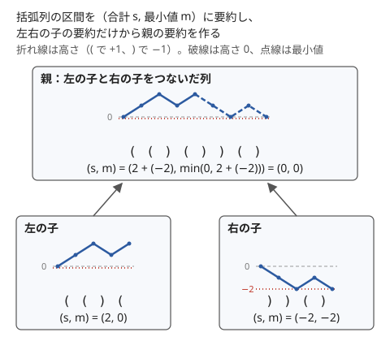

!!! abstract "要点"
    - **何ができるか**：左右の子の情報だけから親の情報を作れるように、答えに要る情報を足してセグメント木に載せる。最小値とその個数、最大値と 2 番目、括弧列の（合計, 最小接頭和）、ハッシュ、一次関数の合成、行列などの型がある。
    - **いつ使うか**：
        - 1 点の更新と、区間が正しい括弧列か・回文かの判定
        - 区間で 2 番目に大きい値（の個数）
        - 区間の最大部分配列和・区間で最長の連続する 1
        - 区間 $[l, r)$ の答えが、各位置の一次関数や小さな行列を順に合成したもので書ける
    - **計算量**：結合 1 回が $O(T)$ なら、構築 $O(TN)$、一点の更新・区間の取得は $O(T \log N)$（ならしではなく 1 回ごとの上限）。$k \times k$ 行列なら $T = k^3$
    - **前提**：[セグメント木](../ds/segment-tree.md)

<!-- textlint-disable -->
別名：モノイドの設計・monoid design・抽象化セグ木・second best・行列を載せるセグ木
<!-- textlint-enable -->

セグメント木に何を載せるかは、「区間の答え」をそのまま載せて足りなければ、左右をつなぐのに要る情報を足していく設計の問題である。各ノードの値を「その区間の列から決まる要約」として定め、左右の要約から親の要約を作る式を書ければ、[結合法則](../guide/glossary.md#associativity)は自動的に成り立ち、ACL の `segtree` にそのまま載る。

## 設計の手順（答えに要る情報を足し、結合法則と単位元を確かめる） {#design-steps}

セグメント木の区間の取得は、区間を $O(\log N)$ 個のノードに分け、その値を左から順に結ぶ（[セグメント木](../ds/segment-tree.md#complexity)）。そのため載せる値は、「隣り合う 2 つの区間の値だけから、つないだ区間の値が作れる」ものでなければならない。区間の最小値や和はそのまま作れるが、「2 番目に大きい値の個数」や「正しい括弧列か」は、左右の答えだけからは作れない。

設計は次の 4 段で行う。区間（連続する部分列）$X$ について、ノードに持たせる要約を $I(X)$ と書く。

1. **答えを決める情報を書く**：区間の何が分かれば答えが出るかを書き、それを $I(X)$ の候補にする
2. **つないだ区間の情報を作れるか試す**：$I(X)$ と $I(Y)$ だけから $I(XY)$（$X$ の後ろに $Y$ をつないだ区間）を作る式を書く。作れなければ、境目をまたぐ部分に何が要るかを調べて $I$ に足す。足した情報もつないだ区間で作れるかを確かめ、足すものがなくなるまで繰り返す
3. **空の区間の情報を単位元にする**：$e = I(\text{空の列})$ とする。「値がない」は、どの実際の値とも区別できる[番兵](../guide/glossary.md#sentinel)か、個数 0・空の印で表す
4. **小さな例で確かめる**：短い列について、式で結んだ値と、列から直接求めた $I$ が一致するかを比べる

**例：区間で 2 番目に大きい値の個数**。左の区間が $5$ と $3$、右の区間が $5$ と $4$ からなるとき、最大値は左右とも $5$ で、つないだ区間の 2 番目が $4$ であることは最大値だけからは分からない。2 番目が「左の 2 番目」「右の 2 番目」「負けた側の最大値」のどれになるかを決めるには、左右それぞれの最大値と 2 番目の値が要る。個数も答えに要るので、$I(X)$ を（最大値, その個数, 2 番目の値, その個数）にする。つないだ区間の値は、4 組の（値, 個数）を大きい順に並べ、同じ値の個数を足して上から 2 つを残せば作れる。足した情報（最大値とその個数）も同じ式で作れるので、これで閉じる。

**例：正しい括弧列か**。`(` を $+1$、`)` を $-1$ として先頭からの高さを考えると、正しい括弧列であることは「最後の高さが 0」かつ「途中の高さが一度も負にならない」ことである。そこで $I(X)$ を（合計 $s$, 空の接頭辞も含めた高さの最小値 $m$）にする。$XY$ の高さは、$Y$ の部分では $X$ の合計 $s_X$ だけ持ち上がるので、次の式で作れる。

$$
(s_X, m_X) \cdot (s_Y, m_Y) = \bigl(s_X + s_Y,\ \min(m_X,\ s_X + m_Y)\bigr)
$$

次の図は、左の子 `(()(` と右の子 `))()` から親を作る様子である。



右の子だけを見ると高さは $-2$ まで下がるが、左の子の合計 $2$ の上に置くと最小は $0$ である。区間 $[l, r)$ の要約が $(0, 0)$ なら、その区間は正しい括弧列である。空の列は $(0, 0)$ で、どちらにつないでも相手を変えない。括弧列のほかの性質は[括弧列](../patterns/bracket-sequence.md#monoid)にまとめてある。

**なぜ結合法則が成り立つか**：手順 2 の式が、すべての区間 $X, Y$ で $I(X) \cdot I(Y) = I(XY)$ を満たすとする。このとき 3 つの区間について

$$
\bigl(I(X) \cdot I(Y)\bigr) \cdot I(Z) = I(XY) \cdot I(Z) = I(XYZ) = I(X) \cdot I(YZ) = I(X) \cdot \bigl(I(Y) \cdot I(Z)\bigr)
$$

となる。$XYZ$ はどこで区切っても同じ列なので、結合法則は列の連結が結合的であることから従う。同じく $I(X) \cdot I(\text{空}) = I(X)$ なので、$e = I(\text{空})$ は[単位元](../guide/glossary.md#identity-element)になる。つまり、値を「区間の列から決まる要約」として定め、式が要約どうしを正しくつなぐことだけを確かめれば、結合法則を別に証明しなくてよい。セグメント木の中の値はどれも葉と $e$ から作られた要約なので、この範囲で成り立てば足りる。

逆に、$I$ を区間から決まる量として定めずに式だけを考えると誤りやすい。たとえば「区間の平均」を左右の平均の平均で作る式は、左右の長さが違うと $I(XY)$ と一致しない。平均は（和, 個数）を要約にして、最後に割る。

!!! info "ACL では"
    `segtree<S, op, e> seg(v);`（`v` は `vector<S>`。`seg(n)` なら全要素が `e()`）。`S` に構造体を、`op` に手順 2 の式を、`e` に空の区間の要約を渡す。`seg.set(p, x)` と `seg.prod(l, r)` は $O(\log N)$ 回の `op` で、`prod` は `op(a[l], …, a[r-1])` を左から順に結んだ値を返す。要件は `op` の結合法則と `e()` が単位元であることで、`l == r` の `prod` は `e()` を返す。

2 番目に大きい値とその個数は次のように書く。葉は「その値が 1 個、2 番目はなし」である。

```cpp
--8<-- "segment-tree-monoids/second-largest.cpp:core"
```

`op` の中では、4 組を大きい順に入れていく。上位 2 つの値は入れるたびに大きくなる一方なので、一度落ちた値が後から上位に戻ることはない。左右の中では値が異なるので、同じ値が出るのは左右に 1 つずつのときだけで、そのとき個数を足す。

## 型の表（和・min/max・gcd・最小値と個数・括弧列・最大部分配列和など） {#pattern-table}

よく使う要約を表にまとめる。和・最小値・最大値・gcd・XOR は値そのものを載せればよい（[セグメント木](../ds/segment-tree.md#what-it-does)の表）。ここでは情報を足す型を並べる。$x$ を左の区間、$y$ を右の区間の要約とする。

| 区間の何を求めるか | 載せる要約 | $x \cdot y$ | 単位元 |
| --- | --- | --- | --- |
| 最小値とその個数 | （最小値, 個数） | 小さい方。等しければ個数を足す | $(+\infty, 0)$ |
| 2 番目に大きい値（と個数） | （最大, 個数, 2 番目, 個数） | 4 組から大きい順に 2 つ。同じ値は個数を足す | （なし, 0, なし, 0） |
| ソート済みか | （左端の値, 右端の値, ソート済みか） | 両方ソート済みで、$x$ の右端 $\le$ $y$ の左端 | 空の印 |
| 括弧列が正しいか | （合計, 最小接頭和） | $(s_x + s_y, \min(m_x, s_x + m_y))$ | $(0, 0)$ |
| 最大部分配列和 | （和 sum, 最大接頭和 pre, 最大接尾和 suf, 最大 best） | 境目をまたぐ $\mathrm{suf}_x + \mathrm{pre}_y$ も候補 | $(0, -\infty, -\infty, -\infty)$ |
| 最長の連続する 1 | （長さ, 先頭から続く 1, 末尾に続く 1, 最長） | 全部 1 の側は先頭・末尾をつなぐ | $(0, 0, 0, 0)$ |
| 0/1 列の転倒数 | （0 の数, 1 の数, 転倒数） | 転倒数に $x$ の 1 の数 × $y$ の 0 の数を足す | $(0, 0, 0)$ |
| 文字列の一致・回文 | （ハッシュ, $B^{\text{長さ}}$） | $(h_x B^{\lvert y \rvert} + h_y, B^{\lvert x \rvert} B^{\lvert y \rvert})$ | $(0, 1)$ |
| 一次関数の合成 | $(c, d)$ で $t \mapsto ct + d$ | $x$ を施してから $y$ | $(1, 0)$ |
| 遷移の合成 | 小さな行列 | 行列の積（順序あり） | 単位行列 |

表のうち、ハッシュは[セグ木に載せるハッシュ](../string/rolling-hash.md#hash-segment-tree)、一次関数の合成は[非可換なモノイド](#non-commutative)、行列は[行列を載せる](#matrix)で扱う。0/1 列の転倒数は、区間の 0 と 1 を入れ替える反転と組むと、[遅延セグメント木の載せ方の型](../ds/lazy-segment-tree-patterns.md#flip)になる。

**ソート済みか**：左右がそれぞれソート済みで、境目の 2 つの値も並んでいれば、つないだ区間もソート済みである。境目を比べるために両端の値を持つ。空の区間には両端の値がないので、「空か」の印を持たせ、`op` の最初で「片方が空ならもう片方を返す」とする。「隣どうしがすべて異なるか」も同じ形で、境目の 2 つが異なるかを比べる。

**最大部分配列和**（空でない部分配列の和の最大）：つないだ区間の部分配列は、$x$ の中に収まるか、$y$ の中に収まるか、境目をまたぐかのどれかである。またぐものの最大は「$x$ の末尾で終わるものの最大」と「$y$ の先頭から始まるものの最大」の和なので、最大接頭和 $\mathrm{pre}$ と最大接尾和 $\mathrm{suf}$ を足す。これらをつないだ区間で作るには和 $\mathrm{sum}$ も要る。

$$
\begin{aligned}
\mathrm{pre} &= \max(\mathrm{pre}_x,\ \mathrm{sum}_x + \mathrm{pre}_y), \qquad \mathrm{suf} = \max(\mathrm{suf}_y,\ \mathrm{suf}_x + \mathrm{sum}_y), \\
\mathrm{best} &= \max(\mathrm{best}_x,\ \mathrm{best}_y,\ \mathrm{suf}_x + \mathrm{pre}_y)
\end{aligned}
$$

```cpp
--8<-- "segment-tree-monoids/max-subarray.cpp:core"
```

単位元の $-\infty$ は「空の区間には空でない部分配列がない」を表す。`NEG` を `LLONG_MIN` にすると、`a.suf + b.pre` が負の側にあふれる。和が型に収まるように $-2^{60}$ 程度にする。空の部分配列（和 0）を認める問題なら、単位元を $(0, 0, 0, 0)$ にし、葉を $(v, \max(v, 0), \max(v, 0), \max(v, 0))$ にする。

**最長の連続する 1**：先頭から続く 1 の長さ $\mathrm{pre}$ は、$x$ が全部 1（$\mathrm{pre}_x = \mathrm{len}_x$）なら $\mathrm{len}_x + \mathrm{pre}_y$、そうでなければ $\mathrm{pre}_x$ である。末尾も左右を入れ替えて同じで、最長は $\max(\mathrm{best}_x, \mathrm{best}_y, \mathrm{suf}_x + \mathrm{pre}_y)$ である。「全部 1 か」を判定するために長さを持つ。最大部分配列和の和が、ここでは長さに替わっている。

??? question "確認問題：最長の連続する 1 で、長さを持たずに（先頭の 1, 末尾の 1, 最長）だけを持つとどうなるか"
    $x$ が全部 1 かどうかが分からない。たとえば $x$ が `11` で $y$ が `1` のとき、つないだ区間の先頭から続く 1 は 3 だが、$x$ の要約 $(2, 2, 2)$ だけでは、$x$ が `11` なのか `110011` のような長い列なのか区別できない（後者なら先頭の 1 は 2 のまま）。全部 1 かを $\mathrm{pre}_x = \mathrm{len}_x$ で見分けるために長さが要る。

## 非可換なモノイド（一次関数の合成・ハッシュの連結。積む順序） {#non-commutative}

セグメント木の演算は、[交換法則](../guide/glossary.md#commutativity)（$x \cdot y = y \cdot x$）を満たさなくてよい。区間の取得は左の区間の値を左に置いて結ぶので、順序のある演算もそのまま載る。代表は一次関数の合成・文字列のハッシュの連結・行列の積である。

**一次関数の合成**：位置 $i$ に一次関数 $f_i(t) = c_i t + d_i$ があり、「$t$ に $f_l, f_{l+1}, \dots, f_{r-1}$ をこの順に施した値」を問われるとする。要約を $(c, d)$ とし、$x \cdot y$ を「$x$ を施してから $y$ を施す」関数にする。

$$
y(x(t)) = c_y (c_x t + d_x) + d_y \quad\Longrightarrow\quad (c_x, d_x) \cdot (c_y, d_y) = (c_x c_y,\ c_y d_x + d_y)
$$

単位元は恒等写像 $(1, 0)$ である。関数の合成は結合的なので、要約として定めたこの式も結合法則を満たす。

```cpp
--8<-- "segment-tree-monoids/affine.cpp:core"
```

順序を取り違えると答えが変わる。$f_0(t) = 2t + 1$、$f_1(t) = 3t$ で $t = 1$ なら、$f_0$ を先に施すと $3(2 + 1) = 9$、$f_1$ を先に施すと $2 \cdot 3 + 1 = 7$ である。

- **ACL の `prod` は左から結ぶ**：`prod(l, r)` は `op(a[l], …, a[r-1])` を左右の順を保って返す。式を「左が先」で書けば、そのまま使える
- **自作の区間取得**：右端の側を集める変数には、`sR = op(d[r], sR)` の形で左から付け足す。`op(sR, d[r])` と書くと順序が逆になる。可換な和や最小値では気づかず、合成を載せたときに初めて誤答になる（[セグメント木の落とし穴](../ds/segment-tree.md#pitfalls)）
- **逆の順も要るとき**：「$f_{r-1}$ を先に施す」順を問われるなら、`op` の左右を入れ替えた式で別に書く。両方の向きが要るなら、要約に両方の向きの合成を持つか、セグメント木を 2 本持つ。回文判定で前向きと後ろ向きのハッシュを持つのと同じ考え方である（[セグ木に載せるハッシュ](../string/rolling-hash.md#hash-segment-tree)）

一次関数の合成は、行列 $\begin{pmatrix} c & d \\ 0 & 1 \end{pmatrix}$ の積としても書ける（[行列累乗の合成の節](../math/matrix-power.md#composition)）。行列にすると、2 つ以上の値が互いに影響しながら変わる遷移も同じ枠組みで扱える。

## 行列を載せる（(min,+)・(max,+) の半環も） {#matrix}

この節は[行列累乗](../math/matrix-power.md)の行列の積と、[(min,+) の半環の行列](../math/matrix-power.md#semiring)を前提にする。

位置ごとに決まった遷移で状態が変わる DP があり、区間 $[l, r)$ を通した DP を何度も問われるとする。各位置の遷移を小さな行列 $T_i$ にすれば、区間を通した遷移は行列の積 $T_l T_{l+1} \cdots T_{r-1}$ である。行列の積は結合法則を満たすので、セグメント木に載る。単位元は単位行列である。

**積の向き**：このページでは、行列の $(p, q)$ 成分を「直前の状態が $p$ のとき、次の状態を $q$ にする係数（費用）」とする。状態を横ベクトル $v$ にすると 1 歩は $v \leftarrow v T_i$ で、区間を通すと $v T_l T_{l+1} \cdots T_{r-1}$ になる。左の区間の行列を左に置けばよいので、`op(a, b)` は積 $ab$ そのものである。[行列累乗](../math/matrix-power.md)のように状態を縦ベクトルにする書き方では、1 歩が $v \leftarrow T_i v$ で、区間の遷移は $T_{r-1} \cdots T_l$ と逆向きに並ぶ。その書き方のまま載せるなら `op(a, b)` を $ba$ にする。

**(min,+) の行列**：費用の最小を求める DP は、和を min に、積を + に替えた行列の積で書ける。

$$
(A \otimes B)_{pq} = \min_k \bigl(A_{pk} + B_{kq}\bigr)
$$

単位行列は対角が $0$、ほかが $+\infty$ である（普通の単位行列の 1 と 0 をそのまま使うと誤る）。最大を求める DP では (max,+) を使い、$+\infty$ を $-\infty$ に替える。

**例**：各位置 $i$ は費用 $a_i$ で 1 にでき、両隣が 1 の位置は費用なしで 1 にできるとき、長さ $K$ の窓を全部 1 にする費用の最小を考える（[ABC456 F](#abc456_f) の DP）。隣り合う 2 つのどちらを費用なしにするにも、もう片方がすでに 1 でなければならないので、両方を費用なしにはできない。費用なしの位置の両隣は、どちらも払った位置になる。状態を「今の位置は費用なしで 1 にした（0）／払って 1 にした（1）」とする。費用なしにできるのは直前を払ったときだけなので、遷移は次の行列になる。

$$
T_i = \begin{pmatrix} +\infty & a_i \\ 0 & a_i \end{pmatrix}
\qquad\text{（行が直前の状態、列が今の状態）}
$$

1 行目は「直前が費用なし」の行で、今の位置も費用なしにはできない（$+\infty$）。2 行目は「直前を払った」の行で、今の位置は費用なし（$0$）と払う（$a_i$）のどちらも選べる。

```cpp
--8<-- "segment-tree-monoids/min-plus.cpp:core"
```

区間の積 $P = T_l \otimes \cdots \otimes T_{r-1}$ の $(0, 1)$ 成分は、「窓の手前は費用なしの状態」とみなして始め、窓の最後を払って終える費用の最小である。手前を費用なしとみなすと、窓の先頭は払うしかない。

- **計算量**：$k \times k$ 行列の積は $O(k^3)$ なので、構築は $O(k^3 N)$、一点の更新と区間の取得は $O(k^3 \log N)$ である。$k = 2$ なら定数倍が 8 倍ほどで済むが、$k = 10$ なら 1000 倍になる。状態数は小さく抑える
- **$+\infty$ のあふれ**：$+\infty$ を `LLONG_MAX` にすると、`a[p][k] + b[k][q]` があふれる。$2^{60}$ 程度にし、結果を $+\infty$ から始めて min を取れば、$+\infty$ どうしの和が積み重なることはない
- **mod を取らない**：(min,+)・(max,+) は大小を比べるので mod を取れない。値の大きさを型の範囲で見積もる

1 点の遷移を書き換えるたびに木全体の DP の答えを求め直す問題は、同じ考え方を木へ広げた[動的 DP](../dp/dynamic-dp.md#on-trees) で扱う。区間ではなく同じ行列の $K$ 乗なら、セグメント木は要らず[行列累乗](../math/matrix-power.md)で $O(k^3 \log K)$ である。

## 落とし穴 {#pitfalls}

- **単位元になっていない `e`**：2 番目の値の「なし」を $0$ で表すと、値に $0$ や負の数が来たときに本物の値と区別できない。「なし」は個数 0 と組にするか、値の範囲の外の番兵にする。最大値の $e$ を $0$ にすると、負の値だけの区間の最大値が $0$ になる。$x \cdot e = e \cdot x = x$ を、負の値・同じ値を含む例で確かめる
- **区間から決まらない値を載せる**：平均や「左右の答えの大きい方の 2 倍」のように、区間の切り方で値が変わる式は結合法則を満たさない。手順 1 に戻り、区間の列から決まる要約で書き直す
- **左右の取り違え**：可換でない `op` で、自作の区間取得の右側を逆に積む。和や最小値の試験だけでは見つからないので、合成や連結を載せた小さな例で素朴な方法と比べる
- **番兵のあふれ**：$-\infty$ や $+\infty$ に `LLONG_MIN`・`LLONG_MAX` を使い、`op` の中の足し算であふれる。$\pm 2^{60}$ 程度にする
- **同じ値の個数の足し忘れ**：最小値と個数・2 番目と個数では、左右の値が等しいときに個数を足す。片方だけを残すと個数が減る
- **要約が大きすぎる**：要約に $O(T)$ の大きさがあると、すべての計算量が $T$ 倍になる。26 種類の文字の個数を持つなら 1 回 $O(26)$、$k \times k$ 行列なら $O(k^3)$ で、間に合うかを先に見積もる

## 例題 {#examples}

### ABC343 F. Second Largest Query {#abc343_f}

<div class="kp-problems" data-role="example" markdown>

- [ABC343 F. Second Largest Query](https://atcoder.jp/contests/abc343/tasks/abc343_f)（diff 1370）：1 点更新と、区間で 2 番目に大きい値の個数の質問を処理する。

</div>

最大値だけでは 2 番目が決まらないので、要約を（最大値, 個数, 2 番目の値, 個数）にする。結合は 4 組を大きい順に並べて上から 2 つを残すだけで、[設計の手順](#design-steps)のコード片がそのまま使える。

??? note "解法の詳細"
    問題文は 1-indexed なので、位置 $p$ の更新は `set(p - 1, leaf(x))`、閉区間 $[l, r]$ の質問は `prod(l - 1, r)` の 2 番目の個数 `c2` を答える。区間の値がすべて同じなら 2 番目はなく、`c2` は 0 になる。

    結合は 4 組の（値, 個数）のうち個数が 0 のものを飛ばし、大きい順に上位 2 つの値を残す。左右の要約の中ではそれぞれ値が異なるので、等しい値は左右に 1 つずつしか現れず、そのとき個数を足す。更新と質問はどちらも $O(\log N)$ で、全体は $O(N + Q \log N)$ である。

### ABC223 F. Parenthesis Checking {#abc223_f}

<div class="kp-problems" data-role="example" markdown>

- [ABC223 F. Parenthesis Checking](https://atcoder.jp/contests/abc223/tasks/abc223_f)（diff 1641）：括弧列の 2 文字の交換と、区間が正しい括弧列かの判定のクエリを処理する。

</div>

2 文字の交換は、2 つの位置の値を書き換える一点更新 2 回である。各文字を（合計, 最小接頭和）に要約して[設計の手順](#design-steps)の式で結べば、区間が正しい括弧列かは区間の要約が $(0, 0)$ かで判定できる。

??? note "解法の詳細"
    `(` の葉を $(1, 0)$、`)` の葉を $(-1, -1)$ とする（最小接頭和は空の接頭辞の高さ 0 を含める）。単位元は $(0, 0)$ である。

    **交換**：1-indexed の位置 $l, r$ の文字を入れ替えるなら、`set(l - 1, …)` と `set(r - 1, …)` で 2 つの葉を書き換える。

    **判定**：閉区間 $[l, r]$ の要約 `prod(l - 1, r)` が $(s, m)$ のとき、$s = 0$ かつ $m = 0$ なら正しい括弧列である。$m$ は空の接頭辞の 0 を含むので常に $m \le 0$ で、$m = 0$ は高さが一度も負にならないことを表す。

    どちらも $O(\log N)$ である。別解として、高さの累積和を[遅延セグメント木](../ds/lazy-segment-tree.md)に載せ、交換を区間加算、判定を区間の最小値と両端の値の比較で行う方法もある（[括弧列の区間の判定](../patterns/bracket-sequence.md#range-check)）。一点更新で済むこのページの方法の方が短い。

### ABC456 F. Plan Holidays {#abc456_f}

<div class="kp-problems" data-role="example" markdown>

- [ABC456 F. Plan Holidays](https://atcoder.jp/contests/abc456/tasks/abc456_f)（diff 1888）：各日を費用 A_i で休日にでき、両隣が休日の日は費用なしで休日にできるとき、K 日以上続く休日を作る費用の最小を求める。

</div>

K 日続く休日の始まりの日を決めると、その中の各日を「払う／費用なし」から選ぶ DP になる。始まりの日ごとに DP をやり直すと全体で $O(NK)$ かかる。そこで各日の遷移を [(min,+) の 2×2 行列](#matrix)で表し、窓の区間の積をセグメント木で求める。

??? note "解法の詳細"
    **窓の先頭と末尾**：続く休日のうち、いちばん左の日の左隣は休日ではないので、いちばん左の日は費用を払うしかない。そこで窓を続く休日の左端から始めるとし、窓の手前を「費用なし」の状態とみなして始める（行列の $(0, \cdot)$ 行から始める）。窓の末尾の日は、払うか、費用なしにするかである。費用なしにするなら窓の次の日が休日でなければならず、費用なしの日は隣り合えないので、次の日は払う。

    **答え**：0-indexed で窓 $[l, l + K)$ について、$P = T_l \otimes \cdots \otimes T_{l+K-1}$ の $(0, 1)$ 成分（末尾を払う）と、$l + K < N$ なら $T_l \otimes \cdots \otimes T_{l+K}$ の $(0, 1)$ 成分（次の日を払う）の小さい方を取る。すべての $l$ でこれらの最小が答えである。窓の外の日は払う必要がない。

    **計算量**：窓ごとに `prod` を 2 回呼び、1 回は 2×2 行列の積 $O(\log N)$ 回なので、全体で $O(N \log N)$ である。

    ```cpp
    --8<-- "segment-tree-monoids/min-plus.cpp:query"
    ```

    更新のない問題なので、セグメント木の代わりに固定長の窓の総積を求める方法（[SWAG](../ds/monotonic-stack.md#swag)）でも解ける。要約の設計は同じである。

## 練習問題 {#practice}

<div class="kp-problems" data-role="practice" markdown>

- [ABC331 F. Palindrome Query](https://atcoder.jp/contests/abc331/tasks/abc331_f)（diff 1666）：1 文字の更新と、区間が回文かの質問に答える。

</div>

??? note "方針"
    - **ABC331 F**：前向きと後ろ向きのハッシュを（ハッシュ, $B^{\text{長さ}}$）の組でセグメント木に載せ、区間とその反転のハッシュを比べる（[セグ木に載せるハッシュ](../string/rolling-hash.md#hash-segment-tree)）

## 力試し {#challenge}

<div class="kp-problems" data-role="challenge" markdown>

- [ABC460 F. Farthest Pair Query](https://atcoder.jp/contests/abc460/tasks/abc460_f)（diff 1987）：木の頂点の白と黒を切り替えるクエリのたびに、黒い頂点どうしの距離の最大を答える。
- [ABC467 F. Email Scheduling Optimization](https://atcoder.jp/contests/abc467/tasks/abc467_f)（diff 2052）：各メールに書く時間 A_j と返信までの時間 B_j があり、A・B の 1 点更新のたびに、メールを 1 通ずつ好きな順に書いて送るとき、すべての返信が届く最小の時刻を答える。
- [ARC008 D. タコヤキオイシクナール](https://atcoder.jp/contests/arc008/tasks/arc008_4)（diff 2430）：一次関数の列を 1 つずつ差し替えながら、すべてを合成した結果の値の最大・最小を求める。

</div>

??? note "方針"
    - **ABC460 F**：頂点集合の最も遠い 2 点は、2 つの部分集合それぞれの最も遠い 2 点、合わせて 4 頂点の中から選べる（[木の直径と最遠点](../tree/tree-diameter.md)）。頂点番号の順に並べたセグメント木の各区間に「黒い頂点の最も遠い 2 点」を要約として持ち、この性質で結ぶ。黒い頂点がない区間は空の印を持つ単位元にする。結合のたびに 2 点間の距離を [LCA](../tree/lca.md) で求めるので、距離の計算の速さが効く
    - **ABC467 F**：$B$ の大きい順に書くのが最適で（[交換論法](../basics/exchange-argument.md)）、答えはその順での $\max_i (A_1 + \dots + A_i + B_i)$ になる。クエリを先読みして $B$ の値を座標圧縮し、$B$ の大きい順に並べたセグメント木の各ノードに（$A$ の和 $s$, ノードの中で自分までの $A$ の和に $B_i$ を足した値の最大 $m$）を持つ。結合は[括弧列の要約](#design-steps)の min を max に替えた $(s_x + s_y, \max(m_x, s_x + m_y))$ で、空の葉は $(0, -\infty)$ にする。$B$ が等しいメールは同じ葉に $A$ の和をまとめる
    - **ARC008 D**：差し替えの起きる位置だけを座標圧縮すると、ほかの位置は恒等写像なので無視できる。（傾き, 切片）の合成を[非可換なモノイド](#non-commutative)の式で載せ、初期状態の値 1 と、差し替えのたびに全体の合成を 1 に施した値の、最大と最小を答える

## 確認問題 {#quiz}

??? question "確認問題：区間の平均を答えたい。何を載せればよいか"
    （和, 個数）を載せ、結合は成分ごとの和、単位元は $(0, 0)$ にする。平均は最後に和を個数で割る。平均そのものを左右の平均の平均で結ぶと、左右の個数が違うときに誤り、結合法則も満たさない。

??? question "確認問題：2 番目に大きい値の要約で「なし」を値 0 で表し、op で個数を見ずに値だけを比べるとどうなるか"
    値が負の数だけの区間では、「なし」の 0 がどの値よりも大きいので、最大値や 2 番目として選ばれてしまう。値に 0 が来る問題では、本物の 0 と「なし」を区別できない。「なし」は個数 0 と組にして結合の最初に飛ばすか、値の範囲の外の番兵（`LLONG_MIN` など）で表す。

??? question "確認問題：一次関数の合成を載せたとき、op の左右を逆にした式で書くと何が求まるか"
    $f_{r-1}$ を最初に、$f_l$ を最後に施した合成になる。関数が 1 つだけの区間や、すべての傾きが 1 の区間では、逆の式でも正しく見える。試験では、傾きの異なる関数を 2 つ以上並べる。

??? question "確認問題：(min,+) の行列を載せるセグメント木で、単位元を普通の単位行列（対角 1、ほか 0）にするとどうなるか"
    対角以外の 0 が「費用 0 でどの状態にも移れる」遷移になり、状態の区別が消える。対角の 1 は「状態を保つのに費用 1 がかかる」ことになり、空の区間を結ぶたびに費用が増える。対角を $0$、ほかを $+\infty$ にする。

## 使い分け {#comparison}

| 状況 | 使う手法 |
| --- | --- |
| 更新がなく、区間の和だけ | [累積和](../basics/prefix-sum.md) |
| 更新がなく、min・gcd などの冪等な演算 | [Sparse Table](../ds/sparse-table.md) |
| 更新がなく、固定長の窓ごとの総積 | [SWAG](../ds/monotonic-stack.md#swag) |
| 一点更新・区間和だけ | [BIT](../ds/fenwick-tree.md) |
| 区間に一括の更新が来る | [遅延セグメント木](../ds/lazy-segment-tree.md)・[遅延セグメント木の載せ方の型](../ds/lazy-segment-tree-patterns.md) |
| 値を添字にして個数や和を持つ | [値を添字にする BIT・セグメント木](../ds/segment-tree-on-values.md) |
| 条件を満たす境目の位置を探す | [セグメント木上の二分探索](../ds/segment-tree-binary-search.md) |

区間に一括の更新が来るときも、要約の設計はこのページと同じで、作用を施した後の要約が作用と要約だけから計算できるかが追加の条件になる。

## 参考 {#references}

- [AtCoder Library「Segtree」（document_ja）](https://github.com/atcoder/ac-library/blob/master/document_ja/segtree.md)：`op`・`e` の要件と、`prod` が左から順に結ぶこと（v1.6 の手元の版で確かめた）
- [プロひろ「ABC343 F問題（Second Largest Query）を解く」](https://programming-hiroba.com/abc343-f/)：例題 abc343_f の要約（最大値と個数・2 番目と個数）と単位元の置き方
- [gotoki_no_joe「ABC343をHaskellで」](https://qiita.com/gotoki_no_joe/items/7446ddde2d6a36eae210)：例題 abc343_f の結合をマージソートのマージのように行う考え方
- [amoshyc「AtCoder Beginner Contest 223 題解」](https://hackmd.io/@amoshyc/S1yZNoYBF)：例題 abc223_f の別解（累積和の遅延セグメント木）と判定の条件
- [loop0919「ABC456 F - Plan Holidays 復習勉強メモ」](https://zenn.dev/loop0919/articles/f779f54ccdfedf)：例題 abc456_f の窓を固定した DP、(min,+) の 2×2 行列、窓とその次の日までの 2 回の区間の積
- [ikatakos「AtCoder Beginner Contest 467 E,F問題メモ」](https://ikatakos.com/pot/programming_algorithm/contest_history/atcoder/2026/0718_abc467)：力試し abc467_f の、$B$ の大きい順に書く貪欲と、セグメント木のノードに持つ値とその結合（解法の部分だけを参照）
- [drken「AtCoder ARC 008 D - タコヤキオイシクナール」](https://drken1215.hatenablog.com/entry/2018/02/14/121239)：力試し arc008_4 の座標圧縮と一次関数の合成の向き
