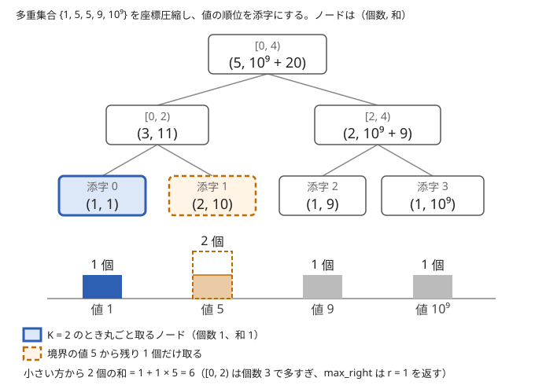

!!! abstract "要点"
    - **何ができるか**：値（必要なら座標圧縮した値）を添字にした BIT・セグメント木に個数や和を載せ、「$x$ 以下の個数・和」「小さい方（大きい方）から $K$ 個の和」を $O(\log N)$ で求める。DP の「その値で終わる最良」も値の添字で持てる。
    - **いつ使うか**：
        - 隣り合う要素の差が D 以下の部分列の最長
        - 値を追加しながら、上位 K 個の和・ソートしたときの奇数番目の和を答える
        - 前の答えを使って次のクエリが復号され、先読みができない
        - $\mathrm{dp}[v] = \max(\mathrm{dp}[v - D..v + D]) + 1$ のように、値の範囲から最大を取る遷移
        - 値が $10^9$ まで、$N, Q \le 2 \times 10^5$
    - **計算量**：座標圧縮は、集めた値の個数を $M$ として $O(M \log M)$。値の追加・削除、$x$ 以下の個数・和、小さい方から $K$ 個の和はどれも 1 回 $O(\log N)$（$N$ は値の種類数で $N \le M$。ならしではない）。先読みできないときの動的セグメント木は 1 回 $O(\log C)$（`vector` に足していくのでならし。先に `reserve` すれば最悪でも同じ）で、ノードは $O(Q \log C)$ 個（$C$ は値域の幅）
    - **前提**：[セグメント木](../ds/segment-tree.md)、[座標圧縮](../basics/coordinate-compression.md)

<!-- textlint-disable -->
別名：値域セグ木・権値線段樹・値を添字にするセグ木・動的セグ木・dynamic segment tree・sparse segment tree
<!-- textlint-enable -->

値を添字にする BIT・セグメント木は、列の位置ではなく値そのもの（またはその順位）を添字にする使い方である。各添字には「その値が何個あるか」「その値の和」などを載せる。値の多重集合をヒストグラムとして持つことになり、「$x$ 以下はいくつあるか」は接頭辞の和、「小さい方から $K$ 個」は接頭辞の和が $K$ に届く境界になる。データ構造そのものは [BIT](../ds/fenwick-tree.md#count-by-value) や[セグメント木](../ds/segment-tree.md)のままで、何を添字にするかだけが違う。

## 値を添字にする（個数・和を載せる）と座標圧縮 {#index-by-value}

### 必要になる場面

「$j < i$ かつ $A_j \le A_i$ を満たす $j$ の個数」や「$j < i$ かつ $A_j > A_i$ を満たす $A_j$ の和」を、すべての $i$ について求めたいとする。素朴に $j$ を全部見ると $O(N^2)$ で間に合わない。BIT のページの[値を添字にして数える](../ds/fenwick-tree.md#count-by-value)と同じ形で、$i$ を左から進めて見終わった要素を集合に入れていけば、位置の条件は「今の集合に入っている」に、値の条件は値を添字にした配列の区間になる。このページでは、個数と和を並べて持つこと、`upper_bound` と `lower_bound` の使い分け、クエリの値も含めた圧縮を扱う。

- $\mathrm{cnt}[v]$ ＝ 集合に入っている値 $v$ の個数、$\mathrm{sum}[v]$ ＝ 値 $v$ の和（$= v \cdot \mathrm{cnt}[v]$）
- $A_i$ 以下の個数は $\mathrm{cnt}$ の接頭辞の和、$A_i$ より大きい値の和は $\mathrm{sum}$ の接尾辞の和

一点への加算と区間の和なので、BIT（逆元のある和）でもセグメント木でも 1 回 $O(\log N)$ で済み、全体で $O(N \log N)$ になる。位置を順に走査し、もう一方の条件（値）を添字にするのが、このページのすべての型に共通する考え方である。

### 座標圧縮で添字を詰める

値が $10^9$ まであると、値をそのまま添字にした配列は作れない。そこで、出てくる値をすべて先に集めて座標圧縮し（[座標圧縮の BIT・セグメント木と組む節](../basics/coordinate-compression.md#with-ds)）、値の代わりに順位（小さい方から何番目の種類か）を添字にする。大小関係は順位でも保たれるので、「$x$ 以下」は「順位が $x$ の順位以下」のままである。以下では、圧縮でソートする値の個数（要素とクエリの値の合計）を $M$、添字の数（値の種類数）を $N$ と書く。$N \le M$ である。



座標圧縮には、使う値をすべて前もって知っている必要がある。入力を全部読んでから処理してよい（[オフライン](../ds/offline-queries.md#compress)）なら、クエリで追加される値も先に集める。前の答えで次の入力が決まる問題（[オンライン強制](../ds/offline-queries.md#online)）では先読みができないので、[動的セグメント木](#dynamic-segment-tree)を使う。

### 保つ性質

- 添字 $k$（$0 \le k < N$）は、圧縮した値の配列 $\mathrm{vals}$ の $k$ 番目の値 $\mathrm{vals}[k]$ を表す。$\mathrm{vals}$ は昇順で重複がない
- 添字 $k$ には、集合にある値 $\mathrm{vals}[k]$ の個数と和を載せる。同じ値が何個あっても、添字は 1 つで個数が増える
- 半開区間 $[l, r)$ の個数・和は、値が $\mathrm{vals}[l]$ 以上 $\mathrm{vals}[r]$ 未満（$r = N$ なら上限なし）の要素の個数・和である

### 各操作の手順

- **追加・削除**：$x$ の添字 $k$ を `lower_bound` で求め、個数に $\pm 1$、和に $\pm x$ を加える
- **$x$ 以下の個数・和**：$r$ ＝「$\mathrm{vals}$ で $x$ より大きい最初の位置」（`upper_bound`）とし、$[0, r)$ の和を取る。$x$ が $\mathrm{vals}$ にない値でも正しい
- **$x$ より大きい個数・和**：$[r, N)$ の和。全体から $[0, r)$ を引いてもよい

```cpp
--8<-- "segment-tree-on-values/count-sum.cpp:core"
```

### 境界

- 圧縮に入れた値は `lower_bound` で添字にしてよい。入れていない値（質問にだけ出る $x$ など）は、「以下」なら `upper_bound`、「未満」なら `lower_bound` で境界の位置にする
- 和は個数 × 値の上限まで大きくなる。$2 \times 10^5$ 個の $10^9$ で $2 \times 10^{14}$ なので `long long` で持つ
- ACL の `fenwick_tree` は 0-indexed で、`sum(l, r)` は半開区間である。内部の 1-indexed は気にしなくてよい

!!! info "ACL では"
    値を添字にする部分は自分で座標圧縮し、木は ACL のものをそのまま使う。`atcoder::fenwick_tree<long long> fw(n);` の `fw.add(p, x)`・`fw.sum(l, r)` はどちらも $O(\log n)$。（個数, 和）のような組や区間 max は `atcoder::segtree<S, op, e> seg(n);` に載せる。`seg.set(p, x)`・`seg.prod(l, r)`・`seg.max_right(l, f)` はどれも $O(\log n)$（`max_right` の `f` は単調で、`f(e())` が true であること）。動的セグメント木は ACL にないので自分で書く。

## DP の値を値の添字で持つ {#dp-on-values}

「隣り合う要素の差が $D$ 以下になる部分列の最長」のような DP では、状態に最後の値が要る。$\mathrm{dp}[v]$ ＝「ここまでに見た要素から作れる、最後の値が $v$ の部分列の最長」とすると、$A_i$ を見たときの遷移は次の 1 つである。

$$
\mathrm{dp}[A_i] \leftarrow \max_{A_i - D \le v \le A_i + D} \mathrm{dp}[v] + 1
$$

$\mathrm{dp}$ を値を添字にした区間 max のセグメント木に持てば、遷移は区間の max と一点の更新で 1 回 $O(\log V)$ になる（$V$ は添字の数）。素朴に範囲を全部見ると 1 回 $O(D)$ で、$D$ が大きいと間に合わない。

**1 本の配列を上書きしてよい理由**：本来の状態は「何番目の要素まで見たか」も含む $\mathrm{dp}[i][v]$ である。$A_i$ を選ばない遷移は $\mathrm{dp}[i][v] = \mathrm{dp}[i-1][v]$ の写しなので、配列を使い回せば何もしなくてよい。値が変わるのは添字 $A_i$ だけなので、1 か所を更新すれば $\mathrm{dp}[i]$ になる。区間の max は更新の前に取るので、$A_i$ 自身を 2 回使うこともない（[最長増加部分列](../dp/lis.md)の配列を使い回す DP と同じ考え方）。

**添字と初期値**：値の上限が $10^6$ 程度までなら、値をそのまま添字にする。閉区間 $[A_i - D, A_i + D]$ は、添字の範囲に収めた半開区間 $[\max(0, A_i - D), \min(V, A_i + D + 1))$ に直す。値が大きければ座標圧縮し、範囲の両端を `lower_bound(A_i - D)` と `upper_bound(A_i + D)` で半開区間に直す。長さは 0 以上なので、max の[単位元](../guide/glossary.md#identity-element)は 0 でよく、答えは全体の max である。

遷移の式の形（値の範囲から max を取る）から高速化を選ぶ考え方は、[セグメント木による遷移の高速化](../dp/dp-segment-tree.md#which-tool)にまとめてある。こちらは「何を添字にするか」の側から見た同じ技法である。

## 上位 K 個の和（境界はセグメント木上の二分探索で探す） {#top-k-sum}

この節は[セグメント木上の二分探索](../ds/segment-tree-binary-search.md)（ACL の `max_right`）を使う。$K$ 番目の値を求めるだけなら [K 番目の値を求めるデータ構造](../ds/kth-element.md)で足りる。

ここでは小さい方から $K$ 個の和を求める。大きい方（上位）から $K$ 個の和は、全体から引けば求まる（後述）。

値の追加・削除が続く中で「小さい方から $K$ 個の和」を毎回答えるには、各添字に（個数, 和）の組を載せたセグメント木を使う。演算は成分ごとの和で、単位元は $(0, 0)$ である。$K$ は集合の個数以下（$0 \le K \le$ 全体の個数）とする。

1. `max_right(0, f)` で、$[0, r)$ の個数が $K$ 以下となる最大の $r$ を求める（$f(s) = [s.\mathrm{cnt} \le K]$）
2. $[0, r)$ の（個数 $c$, 和 $s$）を取る。値の小さい方から $c$ 個は丸ごと取れる
3. $K = c$ なら答えは $s$ である。そうでなければ、足りない $K - c$ 個を境界の値 $\mathrm{vals}[r]$ から取り、答えは $s + (K - c) \cdot \mathrm{vals}[r]$ になる。$r = N$（$\mathrm{vals}[r]$ が配列の外）になるのは $c = K$ のときだけなので、$K = c$ を先に判定してから $\mathrm{vals}[r]$ を読む

**なぜ正しいか**：$f$ は $r$ を増やすと true から false に一度だけ変わる（個数は減らない）。$r$ が最大なので、$[0, r]$ まで広げると個数が $K$ を超える。よって $K - c$ は添字 $r$ の個数より少なく、境界の値から取る個数として足りる。同じ値が複数あっても、どれを取っても和は同じなので、個数だけ分かればよい。図の例（多重集合 $\{1, 5, 5, 9, 10^9\}$、$K = 2$）では、$r = 1$、$(c, s) = (1, 1)$ で、答えは $1 + 1 \times 5 = 6$ になる。

```cpp
--8<-- "segment-tree-on-values/top-k.cpp:core"
```

大きい方から $K$ 個の和は、全体の和から「小さい方から（全体の個数 $- K$）個の和」を引けば求まる。`min_left` で右から探してもよい。[BIT](../ds/fenwick-tree.md) を 2 本（個数と和）使い、[BIT 上の二分探索](../ds/fenwick-tree.md#binary-search)で境界を探しても同じ計算量で、定数倍は軽い。

$K$ が固定で 1 個ずつの追加・削除なら、[上位 K 個の和を保つ（2 つの multiset）](../ds/top-k-multiset.md#two-sets)でも書ける。値を添字にする方法は、$K$ がクエリごとに大きく変わる場合や、1 回の更新で個数がまとめて変わる場合（「値 $x$ のカードを $b$ 枚にする」）にも同じ手順で使える。

## 左の個数の偶奇で右の読み方が変わる量（ソート後の奇数番目の和） {#odd-position-sum}

この節は、セグメント木に載せる値を自分で設計できること（[セグメント木に載せるモノイドの設計](../ds/segment-tree-monoids.md)）を前提にする。

「集合を昇順に並べたときの奇数番目（1-indexed）の和」は、個数と和だけでは結合できない。右の子の要素が全体の何番目になるかは、左の子の個数で決まるからである。そこで各ノードに次の 3 つを持たせる。

- $\mathrm{cnt}$：区間にある要素の個数
- $\mathrm{odd}$：区間の要素を昇順に並べたときの、区間の中での奇数番目の和
- $\mathrm{even}$：同じく偶数番目の和

左の子 $a$ の後ろに右の子 $b$ を並べると、$b$ の中で $j$ 番目の要素は全体の $\mathrm{cnt}_a + j$ 番目になる。$\mathrm{cnt}_a$ が偶数なら $j$ の偶奇はそのままで、奇数なら入れ替わる。

$$
(\mathrm{odd}, \mathrm{even}) =
\begin{cases}
(\mathrm{odd}_a + \mathrm{odd}_b,\ \mathrm{even}_a + \mathrm{even}_b) & (\mathrm{cnt}_a \text{ が偶数}) \\
(\mathrm{odd}_a + \mathrm{even}_b,\ \mathrm{even}_a + \mathrm{odd}_b) & (\mathrm{cnt}_a \text{ が奇数})
\end{cases}
$$

単位元は $(0, 0, 0)$ で、この演算は[結合法則](../guide/glossary.md#associativity)を満たす。3 つの区間を並べたとき、どちらの順に結んでも、各要素の全体での番号は「前にある要素の個数 + 区間の中での番号」で同じになるからである。値 $x$ が $c$ 個ある葉は、$\mathrm{odd} = x \lceil c / 2 \rceil$、$\mathrm{even} = x \lfloor c / 2 \rfloor$ である。答えは根の $\mathrm{odd}$ を読む。

同じ考え方は「$m$ で割った余りごとの和」に広げられる。各ノードに余りごとの和を $m$ 個持ち、右の子の配列を $\mathrm{cnt}_a \bmod m$ だけずらして足す。1 回の結合が $O(m)$ になる。

## 動的セグメント木（必要なノードだけ作る） {#dynamic-segment-tree}

値域が $10^9$ と広く、しかも前の答えで次の値が決まる（先読みできない）と、座標圧縮が使えない。$10^9$ 個の葉を持つセグメント木は作れないが、$Q$ 回の操作で実際に触るノードは少ない。動的セグメント木は、値域を半開区間 $[\mathrm{LO}, \mathrm{HI})$ とし（幅 $C = \mathrm{HI} - \mathrm{LO}$）、その全体を根にして、更新で通ったノードだけをその場で作る。

- 1 回の更新で通るのは根から葉への 1 本の経路で、ノードは $\lceil \log_2 C \rceil + 1$ 個以下である。$C = 10^9$ なら 31 個
- よってノードは全部で $O(Q \log C)$ 個、1 回の更新と取得は $O(\log C)$
- まだ作っていないノードは「その区間に何もない」と見なし、取得では単位元を返す
- 区間の取得は普通のセグメント木と同じく上から再帰する。ノード $v$ の区間 $[l, r)$ が質問の区間の外か $v = 0$ なら単位元、質問の区間に含まれれば $v$ の値を返す。そうでなければ左右の子の結果を左・右の順に結ぶ

ノードは配列（`vector`）に通し番号で置き、子の番号を持たせる。番号 0 を「空のノード」の番兵にして、値を単位元、子を 0 にしておくと、作っていない子を読んでも単位元が返る。次のコードは前節の（個数, 奇数番目の和, 偶数番目の和）を載せたもので、答えは全体なので根の値を読むだけで済む。

```cpp
--8<-- "segment-tree-on-values/dynamic-odd-sum.cpp:core"
```

**メモリの見積もり**：$Q = 2 \times 10^5$、$C = 10^9$ とする。1 回の追加で作るノードは 31 個以下なので、全体で $Q \times 31 \approx 6.2 \times 10^6$ 個を超えない。実際は根に近い段のノードが多くの値で共有され、深さ $d$ の段には $\min(2^d, Q)$ 個までしかないので、最悪でも約 $2.9 \times 10^6$ 個である。このコードは 1 ノードに `int` 2 個と `long long` 3 個（32 バイト）を持つので、約 90 MB になる。`vector` は伸びるときに一時的に倍近くを使うので、`reserve` で先に確保しておくと安全である。確保する数は上界の $Q \times 31 + 1$ にすれば迷わない。和を持たない（個数だけの）木ならずっと小さい。

**先にオフラインを考える**：入力を全部読んでから処理してよいなら、出てくる値を集めて座標圧縮すれば、普通のセグメント木（ACL の `segtree`）で済む。ノード数とメモリが小さく、書く量も少ない。動的セグメント木が要るのは、先読みが禁じられた（[オンライン強制](../ds/offline-queries.md#online)の）問題や、対話の問題のように入力を先に全部は読めない場合である。ほかに、平衡二分探索木や[平方分割](../ds/sqrt-decomposition.md#buckets)（整列した列をバケットに分けて持つ）でも解けることが多い。

Library Checker の Point Set Range Composite (Large Array) は、長さ $N \le 10^9$ の一次関数の列への一点更新と区間の合成（$Q \le 5 \times 10^5$）で、動的セグメント木（またはクエリを先読みした座標圧縮）の確認に使える。合成は順序で結果が変わる（可換でない）ので、区間の取得で左の子の結果と右の子の結果を左・右の順に結ぶことも確かめられる。

## 落とし穴 {#pitfalls}

- **以下と未満の取り違え**：「$x$ 以下の個数」の右端を `lower_bound` で作ると、$x$ ちょうどの値が入らず「$x$ 未満」になる。「以下」の右端は `upper_bound` で作る
- **圧縮に入れ忘れた値**：クエリで後から追加される値を圧縮に入れないと、`lower_bound` が隣の値の添字を返し、別の値の個数を更新してしまう。追加・更新に出る値はすべて先に集める
- **同じ値を `set` で上書きする**：ACL の `segtree` には加算がなく `set` だけである。同じ値の 2 個目を `set(k, {1, x})` で書くと、個数が 2 にならず 1 のままになる。`get(k)` で読んで足してから `set` する（BIT なら `add` でよい）
- **`max_right` の条件**：「個数 $< K$」を条件にすると、$K = 0$ で $f(e()) = \text{false}$ となり、ACL の要件（$f(e())$ が true）を破る。「個数 $\le K$」にして、境界の値から足りない分を取る
- **和のオーバーフロー**：和は $2 \times 10^5$ 個の $10^9$ で $2 \times 10^{14}$ になり、`int` に収まらない。`int` の木や `fenwick_tree<int>` にしない
- **DP の範囲の切り詰め忘れ**：$A_i - D$ が負、$A_i + D$ が添字の上限を超えると、配列の外を指して壊れる（ACL は assert で落ちる）。$[\max(0, A_i - D), \min(V, A_i + D + 1))$ にする
- **動的セグメント木の参照の無効化**：`int& c = lch[v]; c = insert(c, …);` のように `vector` の要素への参照を持ったまま再帰を呼ぶと、再帰の中の `push_back` で配列が移動し、参照が壊れた場所を指す。返り値を一度ふつうの変数に受けてから代入する

## 例題 {#examples}

### ABC339 E. Smooth Subsequence {#abc339_e}

<div class="kp-problems" data-role="example" markdown>

- [ABC339 E. Smooth Subsequence](https://atcoder.jp/contests/abc339/tasks/abc339_e)（diff 1109）：隣り合う要素の差が D 以下であるような部分列の最大の長さを求める。

</div>

部分列の最後の値だけが次に選べる要素を決めるので、$\mathrm{dp}[v]$ ＝「最後の値が $v$ の部分列の最長」とする。$A_i$ を見るたびに $\mathrm{dp}[A_i]$ を $[A_i - D, A_i + D]$ の max に 1 を足した値にすればよく、[DP の値を値の添字で持つ](#dp-on-values)の形そのものである。値の上限が小さいので、座標圧縮せずに値をそのまま添字にした区間 max のセグメント木で解ける。

??? note "解法の詳細"
    値の上限を $U$ とし、長さ $V = U + 1$ の区間 max のセグメント木を 0 で初期化する。$A_1, \dots, A_N$ を順に見て、半開区間 $[\max(0, A_i - D), \min(V, A_i + D + 1))$ の max を $t$ とし、$\mathrm{dp}[A_i] = t + 1$ とする。範囲が $A_i$ 自身を含むので $t + 1 > \mathrm{dp}[A_i]$ であり、chmax ではなく代入でよい。答えは全体の max である。1 要素につき区間の取得と一点の更新が 1 回ずつなので、全体で $O(N \log V)$ になる。

### ABC281 E. Least Elements {#abc281_e}

<div class="kp-problems" data-role="example" markdown>

- [ABC281 E. Least Elements](https://atcoder.jp/contests/abc281/tasks/abc281_e)（diff 1334）：長さ M の各窓で、小さい方から K 個の和を答える。

</div>

窓を 1 つ右にずらすと、出ていく 1 個の削除と入ってくる 1 個の追加が起きる。値の多重集合を（個数, 和）のセグメント木に持てば、各窓の答えは[上位 K 個の和](#top-k-sum)の手順により $O(\log N)$ で求まる。列の値は最初にすべて分かるので、先に座標圧縮できる。

??? note "解法の詳細"
    $A$ のすべての値を座標圧縮する。最初の窓の $M$ 個を追加し、小さい方から $K$ 個の和を出力する。続けて $i = 0, 1, \dots, N - M - 1$ について、$A_i$ を削除し、$A_{i+M}$ を追加してから答えを出力する（0-indexed）。和は $K \times 10^9$ まで大きくなるので `long long` で持つ。全体で $O(N \log N)$ である。2 つの multiset で下位 $K$ 個と残りを分けて持つ方法（[上位 K 個の和を保つ（2 つの multiset）](../ds/top-k-multiset.md#two-sets)）でも同じ計算量で解ける。

## 練習問題 {#practice}

<div class="kp-problems" data-role="practice" markdown>

- [ABL D. Flat Subsequence](https://atcoder.jp/contests/abl/tasks/abl_d)（diff 1283）：隣り合う要素の差が K 以下であるような部分列の最大の長さを求める。
- [ABC276 F. Double Chance](https://atcoder.jp/contests/abc276/tasks/abc276_f)（diff 1562）：先頭 K 枚から 2 枚を復元抽出したときの最大値の期待値を、各 K について求める。

</div>

??? note "方針"
    - **ABL D**：例題 ABC339 E と同じ型である。値の上限が小さいので、値をそのまま添字にする。$\mathrm{dp}$ は区間 max のセグメント木で更新する
    - **ABC276 F**：先頭 $K$ 枚での最大値の総和（$K^2$ 通りの組）を $S_K$ とすると、$S_K = S_{K-1} + A_K + 2 \sum_{i<K} \max(A_i, A_K)$ である。$A_K$ 以下の値は $A_K$ を、より大きい値はその値を足すので、値で座標圧縮した BIT で「$A_K$ 以下の個数」と「$A_K$ より大きい値の和」を持つ。期待値は $S_K / K^2$ を mod で計算する

## 力試し {#challenge}

<div class="kp-problems" data-role="challenge" markdown>

- [ABC403 G. Odd Position Sum Query](https://atcoder.jp/contests/abc403/tasks/abc403_g)（diff 2028）：値を 1 つずつ追加するたびに、昇順に並べたときの奇数番目の和を答える（前の答えで次の値が決まる）。
- [ABC287 G. Balance Update Query](https://atcoder.jp/contests/abc287/tasks/abc287_g)（diff 2180）：得点ごとの枚数を更新しながら、上位 X 枚の得点の和の最大を答える。

</div>

??? note "方針"
    - **ABC403 G**：前の答えで次の値が決まるので座標圧縮できない。値域の[動的セグメント木](#dynamic-segment-tree)に（個数, 奇数番目の和, 偶数番目の和）を載せ、[左の個数の偶奇で右を入れ替えて](#odd-position-sum)結合する。整列した列を約 $\sqrt{Q}$ 個のバケットに分けて持つ平方分割でも解ける
    - **ABC287 G**：クエリを先読みして、出てくる得点をすべて座標圧縮する。得点を添字にして（枚数, 得点の和）を持ち、得点や枚数の変更は古い分を引いて新しい分を足す。上位 $X$ 枚の和は、全体から「小さい方から（全体の枚数 $- X$）枚の和」を引く。全体の枚数が $X$ 未満なら選べない

## 確認問題 {#quiz}

??? question "確認問題：値を添字にするとき、座標圧縮が要るのはなぜか。要らないのはどんなときか"
    値が $10^9$ まであると、値をそのまま添字にした長さ $10^9$ の配列や木はメモリに載らないからである。使う値の種類は高々 $N + Q$ 個なので、順位に置き換えれば大きさがそれで済み、大小関係も保たれる。値の上限が $10^6$ 程度までなら、値をそのまま添字にしてよい。

??? question "確認問題：小さい方から K 個の和で、境界の値が 3 個あり、そのうち 2 個だけ取る場合はどう計算するか"
    `max_right` で求めた $r$ までの（個数 $c$, 和 $s$）に、境界の値 $\mathrm{vals}[r]$ を $K - c = 2$ 個ぶん足す。同じ値のどれを取っても和は変わらないので、どの 2 個かを区別する必要はない。区別が要らないことが、値ごとに個数だけを持てばよい理由である。

??? question "確認問題：オフラインなら動的セグメント木を使わずに済むのはなぜか"
    動的セグメント木が触るのは、操作に出てくる値の位置だけである。入力を全部読めば、出てくる値の集合が先に分かるので、それを座標圧縮すれば葉は高々 $Q$ 個になる。値の大小の順序は保たれるので、区間の取得も同じ結果になる。動的に作る必要があるのは、次の値が前の答えで決まり、値の集合を先に知れない場合だけである。

??? question "確認問題：奇数番目の和の結合で、左の個数が偶数なら右の odd と even を入れ替えないのはなぜか"
    右の子の中で $j$ 番目の要素は、全体で $\mathrm{cnt}_a + j$ 番目になる。$\mathrm{cnt}_a$ が偶数なら $\mathrm{cnt}_a + j$ と $j$ の偶奇は同じなので、右の子の奇数番目はそのまま全体の奇数番目になる。

## 使い分け {#comparison}

| 状況 | 使う手法 |
| --- | --- |
| $K$ が固定で、1 個ずつ追加・削除する | [上位 K 個の和を保つ（2 つの multiset）](../ds/top-k-multiset.md) |
| $K$ 番目の値や $x$ の順位だけが要る | [K 番目の値を求めるデータ構造](../ds/kth-element.md)、[set・multiset・map の応用](../ds/ordered-set.md) |
| 値がオフラインで分かり、個数・和・上位 $K$ 個の和が要る | このページ（座標圧縮 + BIT・セグメント木） |
| 先読みできず値域が広い | このページの動的セグメント木、または[平方分割](../ds/sqrt-decomposition.md) |
| 列の区間 $[l, r)$ に限った「$x$ 以下の個数」 | [マージソート木](../ds/merge-sort-tree.md)・[Wavelet Matrix](../ds/wavelet-matrix.md)、またはクエリを並べ替える[オフラインのクエリ処理](../ds/offline-queries.md) |

## 参考 {#references}

- [AtCoder Library「Segtree」（document_ja）](https://github.com/atcoder/ac-library/blob/master/document_ja/segtree.md)：`max_right` の返り値の条件と `f(e())` が true の要件（v1.6 の手元の版で確かめた）
- [AtCoder Library「Fenwick Tree」（document_ja）](https://github.com/atcoder/ac-library/blob/master/document_ja/fenwicktree.md)：`add`・`sum` の引数と計算量
- [プロひろ「ABC339 E問題（Smooth Subsequence）を解く」](https://programming-hiroba.com/abc339-e/)：例題 abc339_e の値を添字にした区間 max の DP と、値の範囲の切り詰め
- [drken「AtCoder ABC 281 E - Least Elements (1D, 水色, 500 点)」](https://drken1215.hatenablog.com/entry/2022/12/14/185200)：例題 abc281_e の制約と、2 つの multiset・BIT 上の二分探索・（個数, 和）のセグメント木による解き方
- [drken「ACL Beginner Contest D - Flat Subsequence (1D, 水色, 400 点)」](https://drken1215.hatenablog.com/entry/2020/09/27/080300)：練習 abl_d の DP の配列を使い回す理由
- [gotoki_no_joe「ABC276 A～F をHaskellで」](https://qiita.com/gotoki_no_joe/items/a1f1755cfe99192773d6)：練習 abc276_f の総和の漸化式と、個数・和の 2 本の木
- [kmjp「AtCoder ABC #403 : G - Odd Position Sum Query」](https://kmjp.hatenablog.jp/entry/2025/04/28/1030)：力試し abc403_g の入力の復号と、想定解が動的セグメント木であること、平方分割による別解
- [Library Checker「Point Set Range Composite (Large Array)」](https://judge.yosupo.jp/problem/point_set_range_composite_large_array)：添字の範囲が大きい一点更新・区間取得の確認用（問題文と制約 $N \le 10^9$・$Q \le 5 \times 10^5$ は GitHub の library-checker-problems の task.md・info.toml で確かめた）
- [kmjp「AtCoder ABC #287 : G - Balance Update Query」](https://kmjp.hatenablog.jp/entry/2023/01/28/0900)：力試し abc287_g の先読みによる座標圧縮と、（枚数, 和）の BIT 2 本と二分探索
