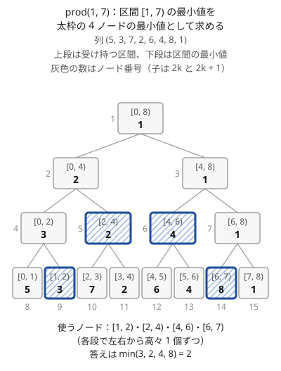
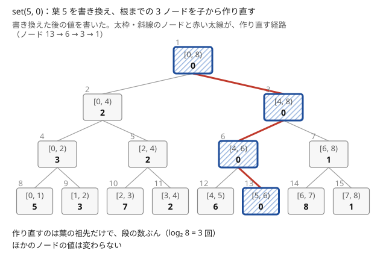

!!! abstract "要点"
    - **何ができるか**：結合法則を満たし単位元を持つ演算が載った列で、一点の更新と区間の総積（和・最小値・最大値・gcd など）の取得を、どちらも $O(\log N)$ で行う。演算は可換でなくてよい。
    - **いつ使うか**：
        - 配列の値を書き換えながら、区間の最小値（最大値・gcd）を何度も答える
        - 1 文字の更新と、区間に現れる文字の種類数
        - $N, Q \le 2 \times 10^5$〜$5 \times 10^5$ で、一点の更新と区間の質問が交互に来る
    - **計算量**：構築 $O(N)$、一点の更新・区間の取得は $O(\log N)$（ならしではなく 1 回ごとの上限）、一点の取得・全体の取得は $O(1)$
    - **前提**：[累積和](../basics/prefix-sum.md)

<!-- textlint-disable -->
別名：セグ木・segtree・Segment Tree・RMQ・非再帰セグ木・区間最小値・文字の集合を持つセグ木
<!-- textlint-enable -->

セグメント木は、列を 2 の冪の長さの区間に階層的に区切り、各区間の総積を完全二分木のノードに持たせたデータ構造である。どの区間も $O(\log N)$ 個のノードに分けられるので区間の取得が速く、一点を変えても作り直すのは葉から根までの $O(\log N)$ 個のノードで済む。

## 何ができるか（一点更新・区間取得） {#what-it-does}

セグメント木は、長さ $N$ の列 $a_0, \dots, a_{N-1}$（0-indexed）に対して、次の 2 つの操作をどちらも $O(\log N)$ で行う。区間は[半開区間](../guide/glossary.md#half-open-interval) $[l, r)$ で表す。

- **一点更新**：$a_p \leftarrow x$ とする
- **区間取得**：$a_l \cdot a_{l+1} \cdot \dots \cdot a_{r-1}$ を求める（$\cdot$ は和・最小値・最大値・gcd・XOR など）

[累積和](../basics/prefix-sum.md)は区間の和を $O(1)$ で答えるが、1 つの値を変えると後ろの累積和がすべて変わり、作り直しに $O(N)$ かかる。最小値には引き算がないので、累積和の差で区間を取り出すこともできない。値を配列のまま持って区間を毎回なめると 1 回 $O(N)$ で、$N, Q \le 2 \times 10^5$ なら合わせて $4 \times 10^{10}$ 回ほどになり間に合わない。

載せられる演算の条件は、値の集合 $S$・演算 $\cdot$・[単位元](../guide/glossary.md#identity-element) $e$ の組について次の 2 つである。この組を[モノイド](../guide/glossary.md#monoid)と呼び、ACL では `(S, op, e)` と書く。

1. **[結合法則](../guide/glossary.md#associativity)**：$(x \cdot y) \cdot z = x \cdot (y \cdot z)$。どこで区切って先に計算しても総積が同じになるので、ノードごとに前もって計算した値を組み合わせてよい
2. **単位元**：すべての $x$ で $x \cdot e = e \cdot x = x$。空の区間の答えと、積を集める変数の初期値に使う

交換法則（$x \cdot y = y \cdot x$）は要らない。左右の順序を保って積むので、文字列の連結・1 次関数の合成・行列の積も載る。逆に、平均や差（$x - y$）は結合法則を満たさないのでそのままでは載らない。平均は（和, 個数）の組にすれば載る。

| 区間の何を求めるか | $S$ | $x \cdot y$ | $e$ |
| --- | --- | --- | --- |
| 和 | 整数 | $x + y$ | $0$ |
| 最小値 | 整数 | $\min(x, y)$ | $+\infty$ |
| 最大値 | 整数 | $\max(x, y)$ | $-\infty$ |
| gcd | 非負整数 | $\gcd(x, y)$ | $0$ |
| XOR・OR | 整数 | $x \oplus y$・$x \text{ OR } y$ | $0$ |
| 1 次関数の合成 | $(c, d)$ で $t \mapsto ct + d$ | $x$ を施してから $y$ | $(1, 0)$ |

!!! info "ACL では"
    `segtree<S, op, e> seg(v);`（`v` は `vector<S>`。`seg(n)` なら全要素が `e()`）。`seg.set(p, x)` は $O(\log N)$、`seg.prod(l, r)` は $[l, r)$ の総積を $O(\log N)$ で返し、`seg.get(p)` と `seg.all_prod()` は $O(1)$。要件は `(S, op, e)` がモノイドであることで、`l == r` の `prod` は `e()` を返す。テンプレートの引数の読み方は [segtree の読み方](../cpp/acl-reading.md#segtree-args)にある。

一点更新・区間最小値は次のように書く。

```cpp
--8<-- "segment-tree/usage.cpp:core"
```

完全なプログラム：[`usage.cpp`](https://github.com/yuukougun/kyopro-atlas/blob/main/snippets/segment-tree/usage.cpp)（GitHub）
{ .kp-code-src }

## なぜ O(log N) か（各段で高々 2 個のノード） {#complexity}

セグメント木が速いのは、どの区間 $[l, r)$ も、各段から高々 2 個ずつ取ったノードへちょうど分けられるからである。段の数は $\lceil \log_2 N \rceil + 1$ なので、使うノードは $O(\log N)$ 個で、その値を順に $\cdot$ で結べば答えになる。

次の図は、列 $(5, 3, 7, 2, 6, 4, 8, 1)$ を区間最小値のセグメント木に載せ、$[1, 7)$ の最小値を求めたときに使うノードである。



使うのは $[1, 2)$・$[2, 4)$・$[4, 6)$・$[6, 7)$ の 4 個で、葉の段から 2 個、その上の段から 2 個である。$[2, 4)$ と $[4, 6)$ をまとめた $[2, 6)$ はノードにないので、これ以上は減らせない。答えは $\min(3, 2, 4, 8) = 2$ になる。

区間の取得と一点更新の様子は、次の動く図でも確かめられる。

<div class="kp-viz" data-viz="segment-tree" data-config='{"array": [5, 3, 7, 2, 6, 4, 8, 1], "op": "min", "ops": [{"type": "prod", "l": 1, "r": 7}, {"type": "set", "p": 5, "x": 0}, {"type": "prod", "l": 1, "r": 7}]}'></div>

動く図では、まず $[1, 7)$ の最小値を求め、左右の端から 1 段ずつ上がりながら上の 4 ノードを選ぶ。次に $a_5$ を $0$ にし、葉から根までの 3 ノードを作り直す。最後にもう一度 $[1, 7)$ を求めると、$[4, 6)$ の値が $0$ に変わっているので答えは $0$ になる。図の縦の棒は、その段での $l$ と $r$ の位置である。積んだノードには「sL へ」「sR へ」と書く。一点更新では、今のステップで書き換える・作り直すノードを太枠にし、書き換え済みの葉と作り直し済みのノードを点線の枠で囲む。

??? note "証明：各段で使うノードは高々 2 個"
    区間 $[l, r)$ を、区間にすっぽり入るノードのうち極大なもの（親はすっぽり入らないもの）で覆うとする。同じ段で 3 個以上のノードを使ったとすると、両端でない 1 個 $v$ を取れる。$v$ の兄弟（$v$ と同じ親を持つ、ノード番号が $2k$ と $2k + 1$ の相方）は $v$ の左右どちらかの隣にあり、$v$ の左右にある使ったノードの間に収まるので、区間にすっぽり入る。すると $v$ の親 $k$ もすっぽり入るので、極大であることに反する。

    同じ理由で、各段で使うノードは「区間の左端の側に 1 個」と「右端の側に 1 個」に限られる。一点更新では、葉から根までの経路上のノードだけが値を変えるので、作り直すのは段の数ぶんである。

結合法則と単位元は、この分け方を正しくするために要る。

- **結合法則**：ノードの値は、そのノードの区間を前もって計算した積である。区間を 4 個のノードで区切って積んでも、左から 1 つずつ積んでも同じ答えになるのは、結合法則があるからである
- **単位元**：使うノードが 1 個もない段や、空の区間でも、積を集める変数を $e$ で始めれば場合分けが要らない

演算の 1 回に $O(T)$ かかるなら、すべての計算量が $T$ 倍になる。たとえば $K \times K$ の行列を載せると、取得 1 回は $O(K^3 \log N)$ である。

## 保つ性質 {#invariants}

自分で書くときは、ACL と同じ配置にそろえると扱いやすい。葉の数 $\mathrm{size}$ を $N$ 以上の最小の 2 の冪とし、ノードを $1$ から $2 \cdot \mathrm{size} - 1$ の番号で配列 $d$ に並べる。

- 根はノード $1$ で、ノード $k$ の子は $2k$（左）と $2k + 1$（右）、親は $\lfloor k / 2 \rfloor$
- 葉 $i$（$a_i$ に当たる）はノード $\mathrm{size} + i$
- $d[k]$ は、ノード $k$ が受け持つ区間の総積に常に等しい。内部ノードでは $d[k] = d[2k] \cdot d[2k + 1]$（左の子が先）
- 余りの葉（$N \le i < \mathrm{size}$）は $e$ にする。区間の総積に影響しない

ノードを番号で並べる方法の詳細は[完全二分木の配列表現](../tree/complete-binary-tree.md)にある。領域は $2 \cdot \mathrm{size} < 4N$ 個で $O(N)$ である。構築では葉を並べてから、$k = \mathrm{size} - 1, \dots, 1$ の順に $d[k] = d[2k] \cdot d[2k + 1]$ を計算する。子の番号は親より大きいので、この順なら子が先に決まっている。全体で $O(N)$ になる。

## 各操作の手順 {#operations}

一点更新は葉を書き換えて、根まで親をたどりながら作り直す。



区間の取得は、左端 $l$ と右端 $r$ を葉の段に置き、1 段ずつ上へ上げながら使うノードを拾う。左端から集めた積 $s_L$ と右端から集めた積 $s_R$ を別々に持つのが要点である。

```text
set(p, x):
    k ← size + p; d[k] ← x
    k ← k / 2
    k ≥ 1 の間くり返す:
        d[k] ← op(d[2k], d[2k+1])
        k ← k / 2

prod(l, r):                      # [l, r) の総積
    sL ← e; sR ← e
    l ← l + size; r ← r + size
    l < r の間くり返す:
        l が奇数なら  sL ← op(sL, d[l]);  l ← l + 1    # l は右の子。親ははみ出す
        r が奇数なら  r ← r − 1;  sR ← op(d[r], sR)    # r − 1 は左の子。親ははみ出す
        l ← l / 2; r ← r / 2
    op(sL, sR) を返す
```

$l$ が奇数（右の子）のとき、その親は区間の左にはみ出す。だから $l$ のノード自身を使い、右隣へ 1 つ進めてから上がる。右端も同じで、$r - 1$ が左の子なら、そのノードを使って左隣へ寄せる。

このループが正しいのは、各段の始めに「$s_L \cdot (\text{今の段の } [l, r) \text{ のノードの積}) \cdot s_R$ が求める総積に等しい」が保たれるからである。端のノードを使ったあとは $l$ が偶数（左の子）、$r$ も偶数（$r - 1$ が右の子）になり、今の段の $[l, r)$ はちょうど親の段の $[l / 2, r / 2)$ にまとまるので、そのまま上がってよい。$l = r$ になれば残りの区間は空なので、$s_L \cdot s_R$ が答えである。

$s_L$ には右から、$s_R$ には左から付け足すのは、演算が可換でなくても順序を保つためである。$s_L$ は区間の左側から順に右へ伸び、$s_R$ は右側から左へ伸びる。最後に $s_L \cdot s_R$ とすれば、$a_l \cdot \dots \cdot a_{r-1}$ の順に積んだものと一致する。

列 $(5, 3, 7, 2, 6, 4, 8, 1)$（[なぜ O(log N) か](#complexity)の図）の $[1, 7)$ で追うと次のとおりである。

- 葉の段では $l = 9$、$r = 15$ である。$l$ は奇数なのでノード 9（$[1, 2)$、値 $3$）を $s_L$ に積み、$l = 10$ にする。$r$ も奇数なので $r = 14$ にし、ノード 14（$[6, 7)$、値 $8$）を $s_R$ に積む
- 1 つ上がって $l = 5$、$r = 7$ になる。ノード 5（$[2, 4)$）を $s_L$ に、ノード 6（$[4, 6)$）を $s_R$ に積む
- 上がると $l = r = 3$ で止まる。$s_L = \min(3, 2) = 2$、$s_R = \min(4, 8) = 4$ で、答えは $2$ である

??? note "自作するとき：`SegTree`（ACL の `segtree` に当たる）"
    ACL の `segtree` と同じ配置にした。メンバ関数の名前は `set`・`get`・`prod`・`all_prod`・`max_right`・`min_left` で、コンストラクタも含めて ACL と同じである。引数の約束（0-indexed・半開区間・前提を `assert` で確かめる）もそろえた。判定の関数は `max_right(l, f)`・`min_left(r, f)` の引数で渡す。ACL にある `max_right<f>(l)`・`min_left<f>(r)` の形（判定の関数をテンプレートの引数で渡す書き方）はない。`max_right`・`min_left` の手順（登る段階と降りる段階）は[セグメント木上の二分探索](../ds/segment-tree-binary-search.md#complexity)にある。

    ```cpp
    --8<-- "segment-tree/own.cpp:core"
    ```

    完全なプログラム：[`own.cpp`](https://github.com/yuukougun/kyopro-atlas/blob/main/snippets/segment-tree/own.cpp)（GitHub）
    { .kp-code-src }

    試験では可換でない演算（1 次関数の合成）を載せ、素朴に左から施した結果と照らし合わせている。`max_right`・`min_left` は、和と「区間が昇順か」（可換でない）の 2 つの演算で確かめた。乱数の列で、境目を素朴に求めた値と比べている。Library Checker の [Point Set Range Composite](https://judge.yosupo.jp/problem/point_set_range_composite) が同じ形の問題である。名前の約束は[インターフェースの決め方](../guide/library-design.md#interface)、確かめ方は[動作確認の手順](../guide/library-design.md#verify)にある。

## 境界（半開区間・空区間・単位元） {#boundaries}

セグメント木のバグは、ほとんどが次の境界で起きる。

- **区間の端**：ACL の引数は 0-indexed の半開区間である。問題文の閉区間 $[L, R]$（1-indexed）は `prod(L - 1, R)` に、$p$ 番目（1-indexed）の更新は `set(p - 1, x)` になる
- **空区間**：`l == r` の `prod` は $e$ を返す。答えに $e$ が出てきたら、空区間を問うていないかを先に疑う
- **単位元の選び方**：min の $e$ は「どの値よりも大きい数」、max の $e$ は「どの値よりも小さい数」である。max の $e$ を $0$ や $-1$ にすると、負の値が来たときに誤る。gcd の $e$ は $0$（$\gcd(x, 0) = x$）、積の $e$ は $1$ である
- **INF のあふれ**：min の $e$ を `LLONG_MAX` にすると、取得した結果へ何かを足した瞬間にあふれる。取得の結果を DP の遷移などで足し引きするなら、足しても型に収まる値（`1LL << 60` など）を使う
- **初期値**：`segtree<…> seg(n)` は全要素が $e$ で始まる。最初の列があるなら `vector<S>` から作る。$N$ 回の `set` で作ると $O(N \log N)$ になる
- **一点の取得**：`get(p)` は $O(1)$ で、`prod(p, p + 1)` と同じ値を返す

## 再帰型と非再帰型 {#recursive-vs-iterative}

セグメント木の書き方には、根から下りる再帰型と、葉から上がる非再帰型がある。計算量はどちらも同じで、ACL は非再帰型である。

再帰型では、ノード $k$ が区間 $[k_l, k_r)$ を受け持つとして、次のように下りる。

```text
prod(l, r, k, [kl, kr)):
    重ならない（r ≤ kl または kr ≤ l）なら e を返す
    すっぽり入る（l ≤ kl かつ kr ≤ r）なら d[k] を返す
    m ← (kl + kr) / 2
    op(prod(l, r, 2k, [kl, m)), prod(l, r, 2k+1, [m, kr))) を返す   # 左を先に結ぶ
```

再帰型が訪れるノードは各段 4 個以下であり、すっぽり入って値を返すのはそのうち 2 個以下である。

| | 再帰型 | 非再帰型 |
| --- | --- | --- |
| 分かりやすさ | 区間の分け方がそのまま書ける | 端を 1 段ずつ上げる理由を理解する必要がある |
| 定数倍 | 関数呼び出しのぶん重い | 軽い |
| 拡張 | [遅延セグメント木](../ds/lazy-segment-tree.md)・動的セグ木・永続化で、伝わり方を追いやすい | 二分探索（`max_right`）も非再帰で書ける |

コンテストでは ACL の `segtree` を使えば足りる。自作するなら、まず非再帰型を [各操作の手順](#operations)のとおりに書き、遅延伝搬が要るときに再帰型も覚えるとよい。遅延セグメント木も非再帰で書ける（ACL の `lazy_segtree` は非再帰）ので、どちらで書くかは好みの問題であり、再帰型は遅延の伝わり方を追いやすいのが利点である。

## 文字列へのクエリ（文字の集合をビットで持つ） {#string-queries}

文字列の 1 文字の書き換えと、区間に現れる文字の種類を問うクエリには、文字の集合をビットで表してセグメント木に載せる。英小文字なら集合は 26 ビットの整数で表せる。

- 葉 $i$ は、$S[i]$ に当たるビットだけを立てた整数
- 演算は OR（集合の和）で、単位元は $0$（空集合）
- 区間の種類数は、総積の立っているビットの数（`popcount`）。C++20 の `std::popcount` は符号なしの型しか受け取らないので、`int` の値は `(unsigned)` に直して渡す（[popcount](../basics/bit-operations.md#popcount)）

```cpp
--8<-- "segment-tree/char-set.cpp:core"
```

完全なプログラム：[`char-set.cpp`](https://github.com/yuukougun/kyopro-atlas/blob/main/snippets/segment-tree/char-set.cpp)（GitHub）
{ .kp-code-src }

更新と取得はどちらも $O(\log N)$ で、26 種類の文字を 1 本のセグメント木で扱える。

文字ごとに出現の有無を [BIT](../ds/fenwick-tree.md)（26 本）で持つ方法もある。この方法では区間に各文字が何個あるかまで分かるので、個数が要る問いではこちらを使う。1 回の取得に 26 本ぶんの $O(26 \log N)$ かかる。区間の一致や回文の判定には、ローリングハッシュを載せる（[セグ木に載せるハッシュ](../string/rolling-hash.md#hash-segment-tree)）。

??? question "確認問題：区間に各文字が何個あるかを 1 本のセグメント木で求めるには"
    値を「26 個の個数の配列」にし、演算を成分ごとの和、単位元をすべて 0 の配列にすればよい。結合法則を満たすので載る。ただし演算 1 回が $O(26)$ になるので、取得は $O(26 \log N)$ で、BIT 26 本と変わらない。

## DP の配列を載せる {#dp}

DP の遷移が「ある範囲の $\mathrm{dp}[j]$ の最大値（最小値・和）を取って、$\mathrm{dp}[i]$ を決める」形なら、$\mathrm{dp}$ の配列をセグメント木に載せると遷移 1 回が $O(\log N)$ になる。$\mathrm{dp}[i]$ を求めるたびに `set(i, dp[i])` し、次の $i$ の遷移で `prod(l, r)` を呼ぶ。素朴な $O(N^2)$ の遷移が $O(N \log N)$ に下がる。

たとえば「$\mathrm{dp}[i] = \max_{i - K \le j < i} \mathrm{dp}[j] + a_i$」は、区間最大値のセグメント木でそのまま速くなる。添字を位置ではなく値にする（座標圧縮した値ごとの最大値を持つ）と、最長増加部分列のような「値が小さいものからの遷移」も扱える。型の一覧と落とし穴（同じ $i$ の値を取得しない順番など）は [セグメント木・スライド最小値による DP の高速化](../dp/dp-segment-tree.md)と[値を添字にする BIT・セグメント木](../ds/segment-tree-on-values.md)で扱う。

## 落とし穴 {#pitfalls}

- **結合法則を満たさない演算を載せる**：平均・差・「大きい方の 2 倍」などは区間の切り方で答えが変わる。（和, 個数）のように、結合できる情報の組に直す。何を載せるかの設計は[セグメント木に何を載せるか](../ds/segment-tree-monoids.md#design-steps)にある
- **可換でない演算で左右を逆に積む**：自作の `prod` で、右端の側を `sR = op(sR, d[r])` と書くと順序が逆になる。和や最小値では気づかず、合成や連結を載せたとき初めて誤答になる
- **単位元でない値を `e` にする**：min の $e$ を $0$ にすると、正の値だけの区間の最小値が $0$ になる。$x \cdot e = x$ をいくつかの値で確かめる
- **区間の端の変換を忘れる**：問題文の閉区間 $[L, R]$ を `prod(L, R)` と渡すと、左端が 1 つずれ、右端の要素を含まない
- **位置も知りたいのに値だけを載せる**：最小値の位置が要るなら、（値, 位置）の組を載せて組の大小で min を取る。値が同じときに小さい位置が選ばれる

## 例題 {#examples}

### ABC341 E. Alternating String {#abc341_e}

<div class="kp-problems" data-role="example" markdown>

- [ABC341 E. Alternating String](https://atcoder.jp/contests/abc341/tasks/abc341_e)（diff 1223）：0/1 の列の区間反転と、区間が「隣どうしがすべて異なる」かの判定のクエリを処理する。

</div>

区間の反転は、そのままだと一点更新にならない。そこで「隣り合う 2 文字が異なるか」を 0/1 で表した列に言い換える。区間の中を反転しても、区間の内側の隣どうしの関係は変わらず、変わるのは区間の両端の境目だけである。反転は 2 点の更新になり、判定は区間和になる。

??? note "解法の詳細"
    1-indexed で、$1 \le i \le N - 1$ について $D_i = [S_i \ne S_{i+1}]$ とする（異なれば 1）。

    **判定**：$S_L \dots S_R$ で隣どうしがすべて異なることは、$D_L, \dots, D_{R-1}$ がすべて 1 であること、すなわち $\sum_{i=L}^{R-1} D_i = R - L$ である。$L = R$ なら和は 0 で、条件は成り立つ。

    **反転**：$S_L \dots S_R$ を反転すると、両方が区間の中にある組 $(S_i, S_{i+1})$ は両方とも反転するので、$D_i$ は変わらない。片方だけが区間に入る組は $(S_{L-1}, S_L)$ と $(S_R, S_{R+1})$ だけなので、$D_{L-1}$ と $D_R$（存在すれば）を $1 - D$ に変える。

    和のセグメント木（区間和だけなので [BIT](../ds/fenwick-tree.md) でもよい）に $D$ を載せれば、どちらの操作も $O(\log N)$ で、全体は $O(N + Q \log N)$ である。

### ABC157 E. Simple String Queries {#abc157_e}

<div class="kp-problems" data-role="example" markdown>

- [ABC157 E. Simple String Queries](https://atcoder.jp/contests/abc157/tasks/abc157_e)（diff 1443）：文字列の 1 文字の更新と、区間に現れる文字の種類数の質問を処理する。

</div>

[文字列へのクエリ](#string-queries)の型そのものである。各位置の文字を 26 ビットの集合にして OR のセグメント木に載せ、区間の総積の立っているビットを数える。文字ごとに BIT や `set` を持つ方法でも解ける。

??? note "解法の詳細"
    葉 $i$ を $2^{S_i - \texttt{a}}$ にする。更新は `set(i - 1, 1 << (c - 'a'))`、質問は `popcount((unsigned)prod(l - 1, r))` である（問題文は 1-indexed の閉区間なので 0-indexed の半開区間に直す）。どちらも $O(\log N)$ で、全体は $O(N + Q \log N)$ になる。

    文字ごとの方法では、文字 $c$ の出現位置の `set` を 26 個持ち、閉区間 $[l, r]$（1-indexed）に $c$ があるかを `lower_bound(l)` が $r$ 以下かで判定する。1 回の質問に $O(26 \log N)$ かかるが、制約の範囲では十分に速い。

## 練習問題 {#practice}

<div class="kp-problems" data-role="practice" markdown>

- [鉄則本 A58. RMQ (Range Maximum Queries)](https://atcoder.jp/contests/tessoku-book/tasks/tessoku_book_bf)（diff —）：一点の値の変更と区間の最大値のクエリを処理する。
- [ABC476 E. Min-Max Swap](https://atcoder.jp/contests/abc476/tasks/abc476_e)（diff 964）：数列の区間を指定するたびに、その区間の最小値と最大値の位置を入れ替え、すべての操作の後の数列を求める。
- [ABC185 F. Range Xor Query](https://atcoder.jp/contests/abc185/tasks/abc185_f)（diff 1053）：一点を XOR で更新し、区間の XOR を答える。
- [ABC461 E. E-liter](https://atcoder.jp/contests/abc461/tasks/abc461_e)（diff 1431）：白いマス目の行を黒く塗る操作と列を白く塗る操作のたびに、黒いマスの数を答える。
- [ABC285 F. Substring of Sorted String](https://atcoder.jp/contests/abc285/tasks/abc285_f)（diff 1876）：文字列の 1 文字の更新と、区間が全体をソートした文字列の部分文字列かの判定のクエリを処理する。

</div>

??? note "方針"
    - **鉄則本 A58**：区間最大値のセグメント木そのもの。$e$ は値の範囲より小さい数にする
    - **ABC476 E**：最小値用と最大値用の 2 本のセグメント木に（値, 位置）の組を載せると、区間の最小値・最大値とその位置が同時に分かる。入れ替えは 2 本それぞれに 2 点の更新である
    - **ABC185 F**：XOR のセグメント木。XOR は自分自身で打ち消せるので、接頭辞の XOR の差でも区間が取れ、BIT でもよい
    - **ABC461 E**：マスが黒いのは、その行への最後の操作がその列への最後の操作より後のときである。同じ行・列への操作は最後のものだけを有効とし、クエリの番号（時刻）を添字にして「その時刻の操作が有効か」を和のセグメント木に持つ。行を塗ると、その時刻より後の有効な列の操作の数だけ寄与が減る。列を塗ると、それより前の有効な行の操作の数だけ黒いマスが減る。古い操作の寄与を取り消してから新しい操作の寄与を足す
    - **ABC285 F**：区間が昇順であることは「左が右より大きい隣どうしの数」の区間和が 0 であることで判定する。さらに、区間の最小と最大の文字の間にある文字は、文字列全体にある個数がすべて区間に入っている必要がある。文字ごとの個数を BIT 26 本で持つ

## 確認問題 {#quiz}

??? question "確認問題：区間の和を求めるとき、累積和ではなくセグメント木を使うのはどんなときか"
    値の更新があるときである。累積和は 1 点を変えると $O(N)$ の作り直しが要るが、セグメント木は $O(\log N)$ で済む。更新がなければ、累積和の方が取得 $O(1)$ で速く、書くのも短い。

??? question "確認問題：区間最小値のセグメント木で、$e$ を INF にするのはなぜか"
    $\min(x, e) = x$ がすべての $x$ で成り立つ値が、どの値よりも大きい数だからである。空の区間や、ある段で使うノードがないときに、答えを変えずに済む。$0$ にすると、正の値だけの区間でも答えが $0$ になる。

??? question "確認問題：1 次関数の合成を載せたセグメント木で、prod の左右を入れ替えるとどうなるか"
    関数を施す順序が逆になり、誤答になる。たとえば $f(t) = 2t$、$g(t) = t + 1$ のとき、$f$ を先に施すと $2t + 1$、$g$ を先に施すと $2t + 2$ で異なる。和や最小値は可換なので、左右を逆にしても気づかない。

??? question "確認問題：N = 5 のとき、葉の数 size と配列 d の長さはいくつか"
    $\mathrm{size}$ は 5 以上の最小の 2 の冪の 8 で、$d$ の長さは $2 \cdot 8 = 16$（ノード 1〜15 を使う）である。葉 5〜7 は余りの葉で、$e$ を入れておく。

## 使い分け {#comparison}

区間の取得をくり返すときは、更新の有無と種類で道具を選ぶ。

| 状況 | 使う手法 |
| --- | --- |
| 更新がなく、区間の和を求める | [累積和](../basics/prefix-sum.md) |
| 更新がなく、区間の最小値・最大値・gcd を求める | [Sparse Table](../ds/sparse-table.md)（取得 $O(1)$） |
| 一点の更新があり、区間の和だけを求める | [BIT](../ds/fenwick-tree.md)（短く、定数倍が軽い） |
| 一点の更新があり、区間の最小値・最大値・gcd・合成を求める | セグメント木 |
| 区間をまとめて更新する | [遅延セグメント木](../ds/lazy-segment-tree.md) |
| 区間の総積が条件を満たす境界を探す | [セグメント木上の二分探索](../ds/segment-tree-binary-search.md) |

## 参考 {#references}

- [AtCoder Library「Segtree」（document_ja）](https://github.com/atcoder/ac-library/blob/master/document_ja/segtree.md)：載せられる条件・各関数の計算量・`l == r` のときの `prod`（v1.6 の手元の版で確かめた）
- [AtCoder Library「segtree.hpp」](https://github.com/atcoder/ac-library/blob/master/atcoder/segtree.hpp)：配置（葉は `size + i`、余りは `e()`）と、非再帰の `prod` の手順
- [プロひろ「ABC341 E問題（Alternating String）を解く」](https://programming-hiroba.com/abc341-e/)：例題 abc341_e の言い換え（隣が異なるかの列と、反転を両端 2 点の更新にすること）
- [merom686「ABC157」](https://merom686.hatenablog.com/entry/2020/03/01/233522)：例題 abc157_e の、文字の集合をビットで持つセグメント木と popcount
- [drken「AtCoder ABC 157 E - Simple String Queries」](https://drken1215.hatenablog.com/entry/2020/03/03/071000)：例題 abc157_e の別解（文字ごとの set と BIT 26 本）
- [aruru88「ABC476参加録」](https://qiita.com/aruru88/items/ca31e5a1e6f9a753cf33)：練習 abc476_e の問いと、最小値・最大値の 2 本のセグメント木
- [ikatakos「AtCoder Beginner Contest 461 E,F,G問題メモ」](https://ikatakos.com/pot/programming_algorithm/contest_history/atcoder/2026/0606_abc461)：練習 abc461_e の、時刻を添字にした有効な操作の数え方（解法の部分だけ）
- [recuraki「ABC 285 F - Substring of Sorted String - 考え方メモ」](https://qiita.com/recuraki/items/38a850c4aad563853149)：練習 abc285_f の判定の条件（昇順と、間の文字の個数）
