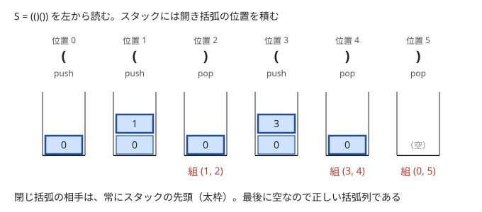

!!! abstract "要点"
    - **何ができるか**：スタックで括弧の対応・直前との打ち消し・操作の取り消しを、deque で両端への追加を処理する。どれも「今の末尾（両端）だけを見れば次の手が決まる」形で、列を 1 回読むだけで済む。ランレングスを積む、円を切り開いて弦の交差判定に帰着する、などの型がある。
    - **いつ使うか**：
        - 括弧の対応を取る・対応する括弧ごと消す。
        - 特定の並びが現れたら取り除く操作を繰り返した結果を求める。
        - 直前の操作を取り消す（Undo）。
        - 円周上の弦どうしが交差するかを判定する。
    - **計算量**：末尾への追加は `vector`・`string` ならならし $O(1)$、`deque` なら両端とも $O(1)$。削除・参照は $O(1)$。各要素は 1 回積まれ、高々 1 回降ろされるので、列を 1 回読む処理は全体で $O(N)$ になる。
    - **前提**：[STL コンテナの使い分け](../ds/stl-containers.md)

<!-- textlint-disable -->
別名：stack・queue・括弧の対応・打ち消し・操作の取り消し
<!-- textlint-enable -->

スタックは最後に入れたものを最初に取り出す入れ物で、キューは最初に入れたものを最初に取り出す入れ物である。deque は両端のどちらからでも出し入れできる。どれも操作自体は易しい。問題を「今の末尾だけを見れば決まる」形に言い換えられるかが本体であり、このページはその型を集めたものである。添字は 0-indexed で書く。

## 括弧の対応（開き括弧の位置を積む）と括弧列の残高（→ 題材別の括弧列） {#brackets}

括弧の対応をスタックで取るときは、開き括弧の文字ではなく位置を積む。閉じ括弧を読んだら先頭の位置を取り出し、その 2 つを組にする。位置を持っていれば、対応する組だけでなく、その組の内側の範囲（取り出した位置 + 1 から閉じ括弧の手前まで）も分かる。



閉じ括弧の相手が常にスタックの先頭になるのは、[正しい括弧列](../guide/glossary.md#balanced-parentheses)では内側の組が外側の組より先に閉じるからである。先頭より下に積まれた開き括弧は、先頭の組を内側に含むので、先頭より後に閉じる。読み終えたときに次の 2 つが成り立てば正しい括弧列である。

- 閉じ括弧を読んだとき、スタックが空でない（空なら相手の開き括弧がない）
- 最後にスタックが空である（残った開き括弧は閉じていない）

スタックの高さは「開き括弧の数 − 閉じ括弧の数」すなわち残高に等しい。括弧が 1 種類だけで組の位置も要らないなら、スタックを持たずに残高の整数 1 つと、その途中の最小値で判定できる（[括弧列の判定](../patterns/bracket-sequence.md#check)）。括弧が複数種類あるときや、組の位置を使うときはスタックが要る（[複数種類の括弧](../patterns/bracket-sequence.md#stack)）。

括弧と文字が混ざった列から「中に括弧を含まない組」を消し続ける問題も同じ走査でできる。結果の文字列そのものをスタックにし、閉じ括弧を読んだときに未対応の開き括弧が 1 つ以上あれば、末尾から開き括弧までを取り除く。取り除く文字は 1 回ずつしか降ろされないので、全体で $O(N)$ である。

??? question "確認問題：括弧列が正しい条件"
    1 種類の括弧からなる列が正しい括弧列であることを、スタックの言葉で言うとどうなるか。

    ??? success "答え"
        左から読み、開き括弧で積み、閉じ括弧で 1 つ降ろす。途中で空のスタックから降ろそうとすることが一度もなく、最後にスタックが空になること。スタックの高さを残高と読み替えると、「どの接頭辞でも残高が 0 以上で、全体の残高が 0」という条件と同じになる。

## 直前と打ち消し合うものを消す（末尾を見て pop） {#cancel}

「文字列から ABC を見つけたら取り除く、を繰り返す」「隣り合う同じ文字を消す、を繰り返す」のような操作は、結果の文字列をスタックとして左から作れば $O(N)$ でできる。毎回文字列全体から探し直すと、1 回の探索と削除に $O(N)$ かかり、全体で $O(N^2)$ になる。

保つ性質は「スタックの中身（ここまでの結果）は、消すべき並びを含まない」である。この性質のもとで 1 文字を積むと、新しくできうる並びは、積んだ文字で終わるもの、すなわち末尾にあるものだけである。だから末尾だけを照合し、一致したらその場で取り除けばよい。取り除いた後の中身は、その文字を積む前のある時点の中身と同じなので、性質は保たれる。

```cpp
--8<-- "stack-techniques/cancel.cpp:core"
```

1 文字ごとの照合は消す並びの長さ $\lvert T \rvert$ に比例するので、全体は $O(N \lvert T \rvert)$ である。「ABC」「fox」のように $\lvert T \rvert$ が定数なら $O(N)$ になる。

スタックに積むのは文字に限らない。完全二分木の上で「子へ進む（L・R）」と「親へ戻る（U）」を繰り返す移動では、L か R の直後の U は打ち消し合う。移動の列をスタックで簡約し、U を読んだときに先頭が L か R ならそれを降ろす。スタックが空のときの U は、それより前の移動と打ち消し合わないので、その場で頂点の番号を親に移す。残った L・R だけを最後に適用すれば、途中で番号が巨大になることを避けられる（[完全二分木](../tree/complete-binary-tree.md)）。

??? question "確認問題：一度の置換では足りない"
    $S = $ `AABCBC` から ABC を取り除き続ける。$S$ の中の ABC をすべて 1 回だけ置換して消す方法では、なぜ答えを間違えるか。

    ??? success "答え"
        `AABCBC` の中の ABC を消すと `ABC` が新しくでき、これも消せるので答えは空文字列である。1 回の置換では、消した後につながってできた並びが残る。スタックで左から処理すれば、`AABC` まで積んだ時点で末尾の ABC を消し、残った `A` に続く `BC` で再び ABC ができて消える。

## ランレングスを積む（(値, 個数) の組） {#run-length}

「値 $k$ の玉が $k$ 個続くと消える」のように、消えるかどうかが末尾の連続した個数で決まるときは、値を 1 つずつ積まない。(値, 末尾の連続した個数) の組を積む。[ランレングス圧縮](../basics/run-length-encoding.md)した列をスタックとして持つ形である。

値を 1 つずつ積むと、消えるかどうかを確かめるのに末尾から $k$ 個さかのぼる必要があり、1 回に $O(k)$ かかる。組を積めば、連続している個数は先頭の組を見るだけで分かるので、判定は $O(1)$ になる。

```cpp
--8<-- "stack-techniques/run-length.cpp:core"
```

スタックの隣り合う組は、常に値が違う。新しい値は先頭と同じなら個数を増やし、違うときだけ新しい組を積むからである。消えるのは常に先頭の組だけなので、消した後の先頭とその下の組も値が違う。また、どの組も個数は値より少ない。消した後の新しい先頭は、積まれたときから個数が変わっておらず値より少ないので、続けて消えることはない。次に入れる玉が新しい先頭と同じ値なら、ふつうどおり個数を増やす。

??? question "確認問題：なぜ O(1) か"
    値を 1 つずつ積むと消去の判定に $O(k)$ かかるのに、組を積むとなぜ $O(1)$ になるか。全体の計算量はどうなるか。

    ??? success "答え"
        同じ値の連続が 1 つの組にまとまっているので、「末尾に同じ値が何個続いているか」が先頭の組の個数そのものになるからである。組の更新・追加・削除はどれも $O(1)$ で、玉 1 個ごとに定数回の操作なので全体は $O(N)$ になる。

## 直前の操作を取り消す（変更前の値を積んで戻す。任意の版へ戻るなら永続データ構造） {#undo}

「最後の操作を取り消す」が混ざる問題では、操作をするたびに元へ戻すための情報を積み、取り消しで 1 つ降ろして戻す。積み方は 2 通りある。

- **変更前の値を積む**：配列の $a_i$ を書き換える前に $(i, a_i)$ を積み、取り消しでは降ろした組で $a_i$ を戻す。1 回の操作で書き換える場所が定数個なら、取り消しも $O(1)$ である
- **状態そのものを積む**：今の状態が数個の値で表せるなら、操作のたびに新しい状態を丸ごと積む。取り消しは降ろすだけで、1 つ前の状態が先頭に現れる

次のコードは後者の例である。括弧の文字を末尾に足す・末尾を消すクエリのたびに、正しい括弧列かを答える。状態は（残高, 途中の残高の最小値）の 2 つの値で、空文字列の状態を[番兵](../guide/glossary.md#sentinel)として最初に積んでおく。

```cpp
--8<-- "stack-techniques/undo.cpp:core"
```

取り消しのスタックで戻れるのは、直前から順にさかのぼることだけである。やり直し（取り消しの取り消し）だけなら、取り消しで降ろした状態を 2 本目のスタックに積んでおき、新しい操作をしたらそれを空にすればよい。$k$ 回さかのぼってから別の操作をするのも、$k$ 回降ろしてから積めば済む。保存しておいた任意の版を読み込むなど、一度捨てた版へ戻る操作が混ざるなら、版を木にして持つ（[永続データ構造](../ds/persistent-data-structures.md#version-tree)）。

## deque（両端への追加・真ん中への挿入は deque 2 本） {#deque}

`deque` は先頭と末尾への追加・削除と、添字での参照がどれも $O(1)$ である。`vector` は先頭への追加が $O(N)$ なので、先頭にも足す列は `deque` で持つ。キューとして使うときは末尾に入れて先頭から出す（[幅優先探索](../graph/bfs.md)）。先頭と末尾のどちらに足すかが状況で変わるときに、`deque` の使いどころがある。

- **反転の代わりに足す側を変える**：「列を反転してから末尾に足す」は、反転のフラグを持って先頭に足すのと同じである。反転そのものはせず、最後に 1 回だけ向きを直す（[全体への操作を変数で持つ](../ds/global-offset.md)）
- **逆順に処理して両端に足す**：「要素 $i$ を、1 つ前に入れた要素 $i - 1$ の左か右に挿入する」を順に処理すると、挿入位置が列の途中になる。要素 $i$ より後に入れた要素は、どれも 1 つ前の要素の隣に入るので、$i + 1$ 以降はひと続きの塊になり、その塊は $i$ の左か右（$i + 1$ を入れた側）に接する。そのため最後に入れた要素から逆にたどると、要素 $i$ はすでに並べた部分の左端か右端にしか来ず、両端への追加だけになる
- **真ん中への挿入**：「列の真ん中に入れる」「真ん中から取り出す」があるなら、列を前半と後半の 2 本の `deque` に分け、長さを「前半 = 後半」か「前半 = 後半 + 1」に保つ。真ん中は前半の末尾か後半の先頭なので、どの操作も端への操作 1 回と、長さを直すための 1 要素の移動（前半の末尾と後半の先頭の間）で済む

途中の任意の位置への挿入・削除は、`deque` でも $O(N)$ かかる。挿入先が位置ではなく「値 $x$ の直後」のような要素で決まるなら、[配列で作る連結リスト](../ds/linked-list.md)を使えば $O(1)$ で済む。

## 円を切り開いて弦の交差判定に帰着する {#chords}

円周上に点 $1, 2, \dots, 2N$ が並び、$N$ 本の弦が端点を共有せずに結んでいるとき、交差する弦の組があるかは括弧の対応で判定できる。

円を点 $2N$ と点 $1$ の間で切り開き、直線に伸ばす。弦 $(a, b)$（$a < b$）は区間 $[a, b]$ になる。2 本の弦 $(a, b)$ と $(c, d)$（$a < c$）が交差するのは、$a < c < b < d$ のときだけである。$c$ は区間 $[a, b]$ の内側、$d$ は外側にある。$a < c < d < b$ なら入れ子、$a < b < c < d$ なら離れていて、どちらも交差しない。

すると「どの 2 本も交差しない」は「どの 2 つの区間も入れ子か離れている」と同じになり、これは各弦の先に現れる端点を開き括弧、後に現れる端点を閉じ括弧とした列が、組の対応まで含めて正しい括弧列であることにほかならない。判定は次のとおりである。点を番号順に読み、相手の端点がスタックの先頭なら降ろし、そうでなければ積む。最後にスタックが空なら交差はない。コードでは点を 0-indexed に直し、点 $i$ を `p = i - 1` として持つ。`partner[p]` は相手の端点である。

```cpp
--8<-- "stack-techniques/chords.cpp:core"
```

??? note "なぜスタックが空で終わることと交差しないことが同じか"
    交差がなければ、どの閉じる端点を読むときも、その弦の内側で開いた弦はすべて閉じている（入れ子なので先に閉じる）。だから相手の端点は常に先頭にあり、すべて降ろされて空で終わる。

    逆に、交差する 2 本 $(a, b)$・$(c, d)$（$a < c < b < d$）があるとする。$b$ を読む時点で $c$ はまだ降ろされていない（$c$ を降ろせるのは $d$ を読むときだけ）ので、$a$ の上に $c$ が残っていて、$a$ は先頭にない。だから $b$ は降ろされずに積まれる。$b$ の相手 $a$ はもう読んだので、以後 $b$ を降ろす点は来ず、$b$ より下の要素も降ろせない。よってスタックは空で終わらない。

切り開く場所はどこでもよい。弦が交差するかどうかは、円周上の端点の並び順（巡回的な順序）だけで決まり、どこから読み始めても同じ判定になるからである。同じ考え方は、長方形の周のように円と同じ形をした閉じた境界にも使える。境界の上の点を、ある点から一周する向きの位置に直して並べれば、円周上の点と同じに扱える。

## 上位の手法へのつながり {#next-steps}

- **[単調スタック](../ds/monotonic-stack.md)**：「この先、答えになりえない要素」を末尾から降ろし、中身を単調な並びに保つスタックである。降ろす理由が打ち消しから「支配される」に変わるだけである。各要素が 1 回積まれ高々 1 回降ろされるので全体が $O(N)$ という数え方は変わらない。窓の最小値を求めるスライド最小値は、その `deque` 版である
- **[永続データ構造](../ds/persistent-data-structures.md)**：取り消しのスタックを、任意の版に戻れるように木へ広げたものである。追加は子を作り、取り消しは親へ戻る
- **[ロールバックできる Union-Find](../ds/rollback-union-find.md)**：Union-Find の変更前の値を積んで戻す。経路圧縮は使わない。取り消しと組み合わせると重い操作を何度でもやり直させられ、[ならし計算量](../guide/glossary.md#amortized-complexity)の保証が崩れるからである
- **[01-BFS](../graph/zero-one-bfs.md)**：コスト 0 の辺で進んだ頂点を `deque` の先頭に、コスト 1 の辺で進んだ頂点を末尾に入れる
- **構文解析**：数式のように括弧が入れ子になった文字列の評価は、括弧の対応を再帰やスタックで取る（[構文解析](../misc/parsing.md#bnf)）

## 落とし穴 {#pitfalls}

**空のスタックの先頭を見る**。`st.back()` や `st.top()` を空のスタックに対して呼ぶと未定義動作で、エラーにならず変な値を返すことがある。先頭を見る前に `!st.empty()` を確かめる。条件を `!st.empty() && st.back() == x` の順に書けば、空のときは後半が評価されない。取り消しのように空になってはいけないスタックは、番兵を 1 つ積んでおくと確かめを減らせる。

**照合のたびに全体を見直す**。打ち消しの処理で文字列の途中に `find` や `erase` を使うと、1 回ごとに $O(N)$ かかり、全体は $O(N^2)$ になる。照合と削除は末尾だけで行う。値を 1 つずつ積んで末尾から $k$ 個さかのぼる書き方も遅くなるので、個数で消えるなら組を積む。

**`std::stack` では中身を走査できない**。`std::stack` は先頭しか見られないので、最後にスタックの中身を出力する問題では書き直しが要る。初めから `vector`（文字なら `string`）をスタックとして使い、`push_back`・`pop_back`・`back` で操作すれば、最後に先頭から出力できる。

**`deque` を大量に作る**。g++ の標準ライブラリの `deque` は、空でも内部の領域を確保する。手元の g++-15 で確かめると、空の `deque<int>` を $10^6$ 個作っただけで約 660MB を使った。同じ数の空の `vector<int>` は約 27MB だった。頂点ごとに列を持つときは、`vector` で済まないかを先に考える。

**切り開いた後の端点の向き**。弦の端点は大きい方が先に与えられることもある。相手の端点を表で持てば、入力の向きと関係なく同じ判定になる。区間 $[a, b]$ として比べる書き方なら、先に $a < b$ とそろえる。

## 例題 {#examples}

### ABC328 D. Take ABC {#abc328_d}

<div class="kp-problems" data-role="example" markdown>

- [ABC328 D. Take ABC](https://atcoder.jp/contests/abc328/tasks/abc328_d)（diff 555）：文字列から ABC を左から取り除き続けた後の文字列を求める。

</div>

結果の文字列をスタックとして左から 1 文字ずつ積み、末尾の 3 文字が ABC になったらその 3 文字を取り除く。積む前の中身は ABC を含まないので、新しくできる ABC は末尾にしかなく、末尾の照合だけで足りる（[打ち消しの節](#cancel)）。

??? note "解法の詳細"
    - 空の `string` を用意し、$S$ の文字を順に `push_back` する。
    - 長さが 3 以上で末尾の 3 文字が ABC なら、`resize` で長さを 3 減らす。
    - 最後に残った文字列を出力する。各文字は 1 回積まれ高々 1 回取り除かれるので $O(N)$。コードは[打ち消しの節](#cancel)のものに $T = $ ABC を与えた形である。

## 練習問題 {#practice}

<div class="kp-problems" data-role="practice" markdown>

- [ABC240 D. Strange Balls](https://atcoder.jp/contests/abc240/tasks/abc240_d)（diff 570）：同じ数 k のボールが k 個続くと消える筒に順にボールを入れ、毎回のボールの数を答える。
- [ABC307 D. Mismatched Parentheses](https://atcoder.jp/contests/abc307/tasks/abc307_d)（diff 666）：中に括弧を含まない (…) を消せるだけ消した後の文字列を求める。
- [ARC108 B. Abbreviate Fox](https://atcoder.jp/contests/arc108/tasks/arc108_b)（diff 681）：文字列から fox を消せるだけ消した後の長さを求める。
- [ABC243 D. Moves on Binary Tree](https://atcoder.jp/contests/abc243/tasks/abc243_d)（diff 758）：完全二分木の上下の移動を繰り返した後の頂点の番号を求める（途中の番号は巨大になりうる）。
- [ABC338 E. Chords](https://atcoder.jp/contests/abc338/tasks/abc338_e)（diff 1220）：円周上の弦どうしに交差があるかを判定する。

</div>

??? note "練習の方針"
    - **ABC240 D**：(値, 末尾に続いている個数) の組を積み、個数が値に等しくなったら組を降ろして玉の数から引く（[ランレングスを積む](#run-length)）
    - **ABC307 D**：結果の文字列をスタックにし、未対応の開き括弧の数を数えておく。閉じ括弧で未対応の開き括弧があれば、末尾から開き括弧までを取り除く。なければ閉じ括弧もそのまま積む（[括弧の対応](#brackets)）
    - **ARC108 B**：文字を積み、末尾の 3 文字が fox になったら取り除く。最後の長さを出力する（[打ち消し](#cancel)）
    - **ABC243 D**：L・R を積み、U で先頭が L・R なら降ろし、空なら頂点の番号を親に移す。最後に残った L・R を順に適用する（[打ち消し](#cancel)）
    - **ABC338 E**：点を番号順に読み、相手の端点がスタックの先頭なら降ろし、そうでなければ積む。最後に空でなければ交差がある（[弦の交差判定](#chords)）

## 力試し {#challenge}

<div class="kp-problems" data-role="challenge" markdown>

- [ARC076 E. Connected?](https://atcoder.jp/contests/arc076/tasks/arc076_c)（diff 2180）：長方形の周上にある点の組を、交差しないように結べるかを判定する。

</div>

??? note "力試しの方針"
    - **ARC076 E**：片方でも長方形の内部にある組は、周上の組を結んだ後でも避けて結べるので無視してよい。両端が周上にある組だけを、周を一周する向きの位置に直してソートし、弦の交差判定と同じくスタックで対応を確かめる。ソートが $O(N \log N)$

## 参考 {#references}

- [drken「AtCoder ABC 328 D - Take ABC (3Q, 茶色, 425 点)」](https://drken1215.hatenablog.com/entry/2023/11/12/191354)：例題の方針（結果の文字列をスタックにして末尾を照合する）
- [drken「AtCoder ABC 240 D - Strange Balls (3Q, 茶色, 400 点)」](https://drken1215.hatenablog.com/entry/2024/07/05/035530)：(値, 連続個数) の組を積む方法
- [drken「AtCoder ABC 307 D - Mismatched Parentheses (3Q, 茶色, 400 点)」](https://drken1215.hatenablog.com/entry/2024/06/10/020153)：練習の方針（括弧と文字が混ざった列の削除）
- [drken「AtCoder ARC 108 B - Abbreviate Fox (3Q, 茶色, 400 点)」](https://drken1215.hatenablog.com/entry/2020/11/26/145207)：練習の方針（末尾の fox の削除）
- [drken「AtCoder ABC 243 D - Moves on Binary Tree (2Q, 茶色, 400 点)」](https://drken1215.hatenablog.com/entry/2024/09/24/123142)：移動の打ち消しと、空のときの U の扱い
- [drken「AtCoder ABC 338 E - Chords (1Q, 緑色, 500 点)」](https://drken1215.hatenablog.com/entry/2024/11/02/202502)：弦の交差判定を括弧列に帰着する方法
- [drken「AtCoder ARC 076 E - Connected? (2D, 黄色, 700 点)」](https://drken1215.hatenablog.com/entry/2024/11/05/012734)：力試しの方針（周上の組だけを一列に並べる）
- [masa2796「ABC428:C - Brackets Stack Queryの解法メモ」](https://qiita.com/masa2796/items/486bd7caa8fa49e0442e)：状態（残高と最小値）を積んで取り消す方法
- [Kazun「AtCoder Beginner Contest 237 D 問題 LR insertion」](https://kazun-kyopro.hatenablog.com/entry/ABC/237/D)：逆順に処理して deque の両端に足す方法
