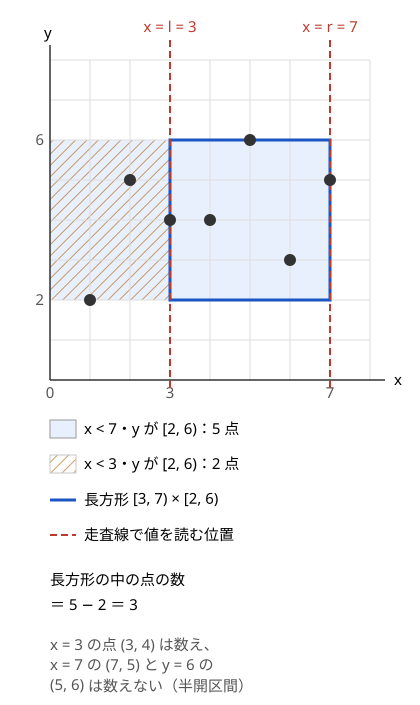
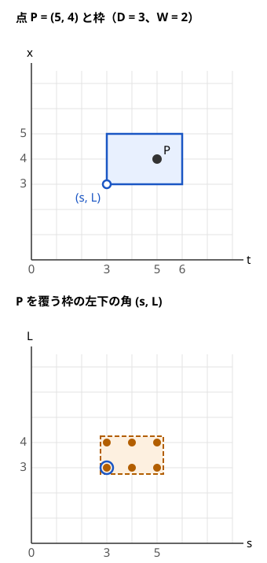

!!! abstract "要点"
    - **何ができるか**：2 次元の点・長方形の問題を、一方の座標の順にイベント（点・区間の端・クエリ）を並べて走査し、もう一方の座標を BIT・セグメント木で持つ形にする。長方形の中の点の数・重みの和、固定の大きさの枠に入る点の最大数、長方形の和集合の面積を、どれも $O(K \log K)$ で求める。
    - **いつ使うか**：
        - 長方形の中にある点の数・和を多数のクエリで答える
        - 区間 $[p, q]$ に完全に含まれる区間の数
        - 幅 $W$・高さ $D$ の枠に入る点の最大数
        - 座標が $10^9$ まで・点とクエリが $2 \times 10^5$ 個（2 次元累積和の表は作れない）
    - **計算量**：点・区間・クエリが合わせて $K$ 個なら $O(K \log K)$（イベントのソートと、BIT・セグメント木の操作が 1 個あたり $O(\log K)$）。クエリをすべて先に読む[オフライン](../guide/glossary.md#offline)の手法である
    - **前提**：[イベントソートと平面走査の基本](../basics/event-sort.md)、[クエリの先読み](../ds/offline-queries.md)、[遅延セグメント木](../ds/lazy-segment-tree.md)

<!-- textlint-disable -->
別名：sweep line・plane sweep・走査線・スイープライン・2 次元クエリ・矩形内の点の数・長方形クエリ
<!-- textlint-enable -->

平面走査は、平面の上の問題を「縦の直線（走査線）を左から右へ動かしながら、線より左にあるものをデータ構造に入れていく」形に直す手法である。走査線の位置を固定すれば、残る条件は縦方向の 1 次元の範囲だけになる。1 次元の範囲の個数・和・最大は [BIT](../ds/fenwick-tree.md) や[セグメント木](../ds/segment-tree.md)が $O(\log N)$ で答えるので、2 次元の問題が 1 次元のデータ構造で解ける。

## 考え方（一方の座標で並べ、もう一方をデータ構造で持つ） {#idea}

平面走査が必要になるのは、2 つの座標の条件を同時に満たすものを、何度も数える場面である。代表は「$N$ 個の点のうち、長方形 $[l, r) \times [d, u)$ の中にあるものの数」を $Q$ 回答える問題である。1 回ごとに全部の点を調べると $O(NQ)$ で、$N = Q = 2 \times 10^5$ なら $4 \times 10^{10}$ 回になる。[2 次元累積和](../basics/prefix-sum-2d.md)は座標が $10^9$ だと表が作れない。座標圧縮しても表は $N \times N$ の $4 \times 10^{10}$ マスで、やはり作れない。

平面走査では、x 座標を「時刻」と見て、x の小さい順に点を 1 つずつデータ構造へ入れる。データ構造の添字は y 座標である。走査線が $x = X$ にあるとき、次の性質を保つ。

> データ構造には、$x < X$ を満たす点だけが、y 座標の位置に入っている。

この性質があれば、「$x < X$ かつ $y \in [d, u)$ の点の数」は、データ構造の区間 $[d, u)$ の和を 1 回読むだけで求まる。x の条件は「いつ読むか」で、y の条件は「どこを読むか」で満たしている。

処理の流れは次のとおりである。

```text
イベントを作る：点 (x, y) → 「x で y に加える」、クエリ → 「X で [d, u) を読む」
イベントを x の小さい順に並べる（同じ x での順は境界の約束から決める）
for イベント in 並べた順:
    点なら    データ構造の y の位置に加える
    クエリなら データ構造の [d, u) を読み、クエリの番号の位置に答えを書く
答えを入力の順に出力する
```

「データ構造に何を持つか」を変えると、同じ枠組みでいくつもの型が解ける。

| 走査で入れるもの | データ構造で読むもの | 道具 | 節 |
| --- | --- | --- | --- |
| 点 | y の範囲の個数・和 | BIT | [長方形内の点の数](#rectangle-count) |
| 区間を点に直したもの | 左端の範囲の個数 | BIT | [区間を点と見る](#intervals-as-points) |
| 点が覆う範囲（区間加算） | 全体の最大値 | 遅延セグメント木 | [固定幅の窓](#window-max) |
| 長方形の辺（区間加算） | 0 でない長さ | 遅延セグメント木 | [和集合の面積](#union-area) |

計算量は、イベントが $K$ 個ならソートに $O(K \log K)$ で、BIT・セグメント木の操作がイベント 1 個につき $O(\log K)$ である。合わせて $O(K \log K)$ になる。クエリの順を並べ替えるので、すべてのクエリを先に読めることが前提である（[クエリの先読み](../ds/offline-queries.md)）。

## 支配点の数え上げと長方形内の点の数 {#rectangle-count}

平面走査のいちばん基本の型は、支配点の数え上げである。点 $j$ が点 $i$ に支配されるとは、$x_j \le x_i$ かつ $y_j \le y_i$ であることをいう（不等号が狭義かどうかは問題による）。各点 $i$ について支配される点の数を数えるには、y を座標圧縮し、点を x の小さい順に処理して BIT の $[0, y_i + 1)$ の和を読めばよい。ただし x が同じ点どうしは 1 点ずつ処理すると、先に処理した点だけを数えてしまう。同じ x の点はまとめて扱い、$x_j \le x_i$ なら同じ x の点をすべて入れてから読んで自分の分の 1 を引き、$x_j < x_i$ なら同じ x の点をすべて読んでから入れる（[同じ座標での処理順](#boundaries)）。[転倒数](../ds/inversion-number.md)は、点を（添字, 値）と見たときの、この数え上げの特別な場合である。

長方形の中の点の数は、原点を角とする 4 つの長方形の足し引きに分けられる。$C(X, Y)$ を「$x < X$ かつ $y < Y$ の点の数」とすると、[2 次元累積和](../basics/prefix-sum-2d.md)と同じ包除で次のようになる。

$$
\#\bigl([l, r) \times [d, u)\bigr) = C(r, u) - C(l, u) - C(r, d) + C(l, d)
$$

平面走査では、y の側の 2 項は BIT の区間の和でまとめて読める。すると x の側の 2 つの値だけが残る。

$$
\#\bigl([l, r) \times [d, u)\bigr) = \bigl(x < r \text{ の点の、} y \in [d, u) \text{ の数}\bigr) - \bigl(x < l \text{ の点の、} y \in [d, u) \text{ の数}\bigr)
$$

1 つのクエリを、走査線が $x = r$ へ来たときに読む「$+$」の項と、$x = l$ へ来たときに読む「$-$」の項の 2 つのイベントに分ける。次の図は、長方形 $[3, 7) \times [2, 6)$ の点の数を、この 2 回の読み取りの差として求める様子である。



図の点は $(1, 2)$・$(2, 5)$・$(3, 4)$・$(4, 4)$・$(5, 6)$・$(6, 3)$・$(7, 5)$ の 7 個である。走査線が $x = 3$ に来たとき、BIT には $(1, 2)$ と $(2, 5)$ だけが入っていて、y が $[2, 6)$ のものは 2 個ある。$x = 7$ に来たときは $(7, 5)$ を除く 6 個が入っていて、y が $[2, 6)$ のものは 5 個ある。答えは $5 - 2 = 3$ で、長方形の中の $(3, 4)$・$(4, 4)$・$(6, 3)$ と一致する。

重み付きの点の長方形の和（Library Checker の rectangle_sum と同じ形）は次のように書ける。y 座標は点の y だけで座標圧縮し、クエリの $d$・$u$ は `lower_bound` で圧縮後の添字に直す。

```cpp
--8<-- "sweep-line-2d/rectangle-sum.cpp:core"
```

完全なプログラム：[`rectangle-sum.cpp`](https://github.com/yuukougun/kyopro-atlas/blob/main/snippets/sweep-line-2d/rectangle-sum.cpp)（GitHub）
{ .kp-code-src }

!!! info "ACL では"
    `atcoder::fenwick_tree<long long> bit(n);`。`bit.add(p, x)` で $a_p$ に $x$ を加え、`bit.sum(l, r)` で $[l, r)$ の和を返す。どちらも $O(\log N)$ で、添字は 0-indexed、`l == r` なら 0 を返す。

応用の型：

- **4 象限の点の数**：各点について「左下・左上・右下・右上にある点の数」が要るときは、x の順に走査しながら、すでに見た点（左側）を BIT で数え、右側は全体から引く。部分集合の数え上げで、点ごとの寄与を求めるときに使う（[ABC136 F](#challenge)）
- **答えを 2 時点の差に分ける**：「上端での値 − 下端の 1 つ前での値」という分け方は、値が走査とともに変わる場合にも使える。走査線の位置 $y$ での各列の累計が $y$ の 1 次式なら、1 次式の係数を BIT に持てばよい（[例題 ABC477 F](#abc477_f)）
- **区間の種類数**：位置 $i$ と、同じ値が直前に現れた位置 $\mathrm{prev}_i$ の組を点と見ると、区間 $[l, r)$ の種類数は「$i \in [l, r)$ かつ $\mathrm{prev}_i < l$」の点の数になる（[右端でソートして BIT](../ds/offline-queries.md#distinct-count)）

## 区間を 2 次元の点と見る（区間に含まれる区間の数） {#intervals-as-points}

区間についての条件は、区間 $[L, R]$ を平面の点 $(L, R)$ と見ると、2 次元の点の条件になることが多い。たとえば区間 $[L, R]$ が区間 $[p, q]$ に完全に含まれる条件は、次のとおりである。

$$
[L, R] \subseteq [p, q] \iff p \le L \text{ かつ } R \le q
$$

これは「$R \le q$ の点のうち、$L \ge p$ のものの数」で、走査の向きは R である。区間とクエリを右端の小さい順に並べ、区間が来たら BIT の位置 $L$ に $1$ を加え、クエリ $[p, q]$ が来たら BIT の $[p, \infty)$ の和を読む。同じ右端では、条件が $R \le q$（等号を含む）なので区間を先に入れる。

端点が $N \le 500$ 程度と小さければ、点 $(L, R)$ の表の [2 次元累積和](../basics/prefix-sum-2d.md#intervals-as-points)で足りる（[ABC106 D](#practice)）。端点が $10^9$ まで、区間とクエリが $2 \times 10^5$ 個なら、平面走査と BIT にする。

ほかの条件も同じように点の言葉に直せる。

| 区間 $[L, R]$ と $[p, q]$ の関係 | 点 $(L, R)$ の条件 | 次元 |
| --- | --- | --- |
| 含まれる | $p \le L$ かつ $R \le q$ | 2 次元 |
| 含む | $L \le p$ かつ $q \le R$ | 2 次元 |
| 交わる（共通部分がある） | $L \le q$ かつ $p \le R$ | 余事象で 1 次元ずつ |
| 交差する（一部だけ重なる） | $L < p \le R < q$ か $p < L \le q < R$ | 2 次元が 2 つ |

「交差する」の行は、端点が 1 点だけ重なる $R = p$ も交差に入れている。端点の一致を交差に入れるかは問題による。ABC360 F の交差は端点の一致を含まない狭義の $L < p < R < q$ で、その場合は $\le$ を $<$ に直す。

「交わる」は、余事象の「$R < p$」と「$L > q$」が同時には起きないので、全体からそれぞれの個数を引けばよい。1 次元のソートと二分探索で足り、平面走査は要らない。

応用の型：

- **点ごとに長方形が決まる**：数える対象が区間 $[l, r]$ そのもので、各要素について「その要素が条件を満たす $(l, r)$」が長方形をなすことがある。このときは長方形の和集合の面積を求める（[和集合の面積](#union-area)、[ABC346 G](#practice)）
- **最もよく交差する区間を探す**：与えた区間と交差する $(l, r)$ の集合は長方形 2 つになる。$l$ で走査して $r$ の軸に区間加算し、最大値とその位置を持つ（[ABC360 F](#challenge)。[固定幅の窓](#window-max)と同じ形）

## 固定幅の窓を動かして区間加算・区間最大（遅延セグメント木） {#window-max}

「時刻の幅 $D$・位置の幅 $W$ の枠を 1 つ置き、中に入る点の数を最大にする」型は、枠の置き方を平面の点と見ると、長方形の重なりの最大を求める問題になる。枠を時刻 $[s, s + D)$・位置 $[L, L + W)$ とし、左下の角 $(s, L)$ で表す。点 $(t, x)$ が枠に入る条件は次のとおりである。

$$
s \le t < s + D \text{ かつ } L \le x < L + W \iff s \in [t - D + 1, t] \text{ かつ } L \in [x - W + 1, x]
$$

つまり点 1 つごとに、その点を覆う枠の角 $(s, L)$ は $D \times W$ の長方形をなす。次の図は $D = 3$・$W = 2$ のときの例である。



求めるのは、最も多くの長方形に覆われる角 $(s, L)$ である。$s$ で走査すると、各 $s$ では「位置の軸の区間 $[x - W + 1, x]$ に $+1$」が、今の時刻の窓に入る点の数だけ重なった配列ができる。その全体の最大値が、その $s$ での最善である。区間加算と全体の最大値は、区間加算・区間最大の[遅延セグメント木](../ds/lazy-segment-tree.md)で $O(\log M)$ ずつ処理できる（$M$ は位置の座標の範囲）。

$s$ をすべての整数で試す必要はない。最適な枠を、いちばん早い時刻の点が枠の下端に来るまで時刻の向きに動かしても、枠から出る点はない。逆に、いちばん遅い点が上端に来るまで戻しても同じである。後者を使うと、点を時刻の順に見て、点 $i$ を上端に置いた窓 $(t_i - D, t_i]$ だけを調べればよい。窓に入る点は尺取り法のように増減する。

```cpp
--8<-- "sweep-line-2d/window-max.cpp:core"
```

完全なプログラム：[`window-max.cpp`](https://github.com/yuukougun/kyopro-atlas/blob/main/snippets/sweep-line-2d/window-max.cpp)（GitHub）
{ .kp-code-src }

!!! info "ACL では"
    `atcoder::lazy_segtree<int, op, e, int, mapping, composition, id> seg(v);`。`seg.apply(l, r, f)` で $[l, r)$ に $f$ を加え、`seg.all_prod()` で全体の最大値を $O(1)$ で返す。区間加算・区間最大の 7 つの関数の書き方は[遅延セグメント木](../ds/lazy-segment-tree.md#acl-standard)にある。

位置の座標が $10^9$ のように大きいときは、枠の左端 $L$ の候補を点の位置 $x_j$ だけに絞って座標圧縮する（いちばん小さい位置の点が左端に来るまで枠を動かせるので）。点 $(t, x)$ が加える範囲は「$x - W + 1 \le x_j \le x$ を満たす候補の添字」で、`lower_bound` で求まる。

## 同じ座標での処理順・閉区間と半開区間・座標圧縮 {#boundaries}

平面走査の誤答は、ほとんどが境界で起きる。走査の向きの境界（同じ座標での処理順）と、データ構造の向きの境界（添字の端）を、問題の不等号から機械的に決める。

**同じ座標での処理順**。走査線を $x = X$ に置いたとき、データ構造に何が入っているべきかを不等号から決める。

| 読みたい条件 | 同じ $x$ での順 | 書き方の例 |
| --- | --- | --- |
| $x < X$（半開区間の右端） | クエリを先、点を後 | 「`ps[j].x < e.x` の点だけを入れてから読む」 |
| $x \le X$（閉区間の右端） | 点を先、クエリを後 | 「`ps[j].x <= e.x` の点を入れてから読む」 |

イベントを `pair` や `tuple` でソートするなら、種類を表す数を処理したい順に付ける。迷ったら、閉区間 $[a, b]$ を半開区間 $[a, b + 1)$ に直してから、すべて「$x < X$」の形で扱うとよい。「下端の 1 つ前での値」は、半開区間で書けば「下端での値」そのものになる。

**データ構造の向きの境界**。BIT は y 座標を座標圧縮した添字で持つ。圧縮に使うのは点の y だけでよく、クエリの $[d, u)$ は `lower_bound(d)` と `lower_bound(u)` の添字の間を読めば、圧縮した値にない端でも正しく数えられる。閉区間 $[d, u]$ なら右端を `upper_bound(u)` にする。[区間を点と見る](#intervals-as-points)型では BIT の添字は区間の左端 $L$ なので、$L$ を圧縮し、クエリの $[p, \infty)$ は `lower_bound(p)` の添字から末尾までを読む（[座標圧縮](../basics/coordinate-compression.md)）。

**値が走査の位置について連続なら、順は問わない**。[例題 ABC477 F](#abc477_f) のように、各列の値を走査の位置 $y$ の 1 次式で持つ場合は、切り替わりの位置で前後の式が同じ値をとる。このときは同じ $y$ のイベントをどの順で処理しても答えは変わらない。

## 長方形の和集合の面積（区間加算・最小値とその個数） {#union-area}

この節は、遅延セグメント木の値を自分で設計できること（[区間の長さを S に持たせる](../ds/lazy-segment-tree.md#size-in-node)）を前提にする。

$N$ 個の長方形 $[l_i, r_i) \times [d_i, u_i)$ の和集合の面積は、x で走査して求める。走査線上の各 y が、いくつの長方形に覆われているかを $c(y)$ とする。長方形の左辺で $[d_i, u_i)$ に $+1$、右辺で $-1$ を加えると、隣り合うイベントの間では $c$ が変わらない。その間の面積は「$c(y) > 0$ の部分の長さ × x の幅」である。

難しいのは「$c(y) > 0$ の部分の長さ」を区間加算のもとで保つことである。正の部分の長さを値に持つと、$-1$ を加えたときに、どこが 0 に戻るかが値だけからは分からない。そこで $c(y) \ge 0$ がいつも成り立つことを使い、各ノードに次の 2 つを持たせる。

- 区間の $c$ の最小値 $\mathrm{mn}$
- $c$ が最小値をとる部分の長さ $\mathrm{len}$

区間に $f$ を加えても、最小値は $f$ だけずれ、最小値をとる場所は変わらない。だから作用は $(\mathrm{mn}, \mathrm{len}) \to (\mathrm{mn} + f, \mathrm{len})$ と書け、遅延セグメント木に載る。全体の最小値が 0 なら覆われていない長さは $\mathrm{len}$ で、0 より大きければ 0 である。覆われている長さは「全体の長さ − 覆われていない長さ」になる。

y は長方形の上下の辺で座標圧縮し、葉 $i$ を帯 $[y_i, y_{i+1})$ とする。葉の $\mathrm{len}$ は 1 ではなく帯の幅 $y_{i+1} - y_i$ にする。

```cpp
--8<-- "sweep-line-2d/union-area.cpp:core"
```

完全なプログラム：[`union-area.cpp`](https://github.com/yuukougun/kyopro-atlas/blob/main/snippets/sweep-line-2d/union-area.cpp)（GitHub）
{ .kp-code-src }

イベントは $2N$ 個で、各イベントの区間加算が $O(\log N)$、全体の取得が $O(1)$ なので、全体で $O(N \log N)$ である。座標が $10^9$ なら面積は $10^{18}$ に届くので、`long long` で持つ。

各要素について「その要素が条件を満たす区間 $(l, r)$ の集合」が長方形になり、「どれかの要素が条件を満たす区間の数」を問われる型も、この和集合の面積である（[ABC346 G](#practice)）。

!!! tip "加算と減算が対になっているなら、遅延伝搬なしでも書ける"
    和集合の面積では、$-1$ はいつも、前に $+1$ した同じ区間へ来る。この性質を使うと、ノードに「このノードの区間全体を覆う長方形の数」と「覆われている長さ」を持ち、子へ降ろさずに下から作り直すだけの書き方もできる。区間加算・最小値とその個数の形は、対になっていない加算にも使えるので、こちらを基本にする。

## 落とし穴 {#pitfalls}

**同じ座標で点とクエリの順を決めていない**。「x が $r$ より小さい点」を数えるのに、同じ x の点をクエリより先に入れると、長方形の右の辺の上の点を余分に数える。不等号から順を決める（[境界](#boundaries)）。

**クエリを 2 つに分けた符号と答えの位置**。$x = l$ の側は引き、$x = r$ の側は足す。ソートで順番が入れ替わるので、イベントにクエリの番号と符号を持たせ、答えは番号の位置に足し込む。

**座標をそのまま BIT の添字にする**。座標が $10^9$ なら、そのまま添字にすると配列が作れない。走査しない側の座標は座標圧縮する。走査する側の座標は並べるだけなので圧縮は要らない。

**閉区間の右端を `lower_bound` で求める**。閉区間 $[d, u]$ の点を数えるなら右端は `upper_bound(u)` で、`lower_bound(u)` にすると $y = u$ の点を落とす。

**和集合の面積で「覆われている数 > 0 の長さ」を直接持つ**。区間に $-1$ を加えたとき、どこが 0 になるかが分からないので、遅延セグメント木の作用にならない。最小値と最小値をとる長さを持つ。

**オーバーフロー**。重みの和や面積は $10^{18}$ 近くになる。BIT と答えは `long long` で持つ。

**オンライン強制の問題に使う**。前の答えで次のクエリが決まる問題では、クエリを並べ替えられない。この場合はマージソート木や永続セグメント木などのオンラインの構造を使う（[オンライン強制の見分け方](../ds/offline-queries.md#online)）。

## 例題 {#examples}

### ABC327 F. Apples {#abc327_f}

<div class="kp-problems" data-role="example" markdown>

- [ABC327 F. Apples](https://atcoder.jp/contests/abc327/tasks/abc327_f)（diff 1624）：時刻と位置が決まったリンゴのうち、時間幅 D・位置幅 W の枠で拾えるものの最大数を求める。

</div>

[固定幅の窓](#window-max)の型そのものである。リンゴを点 $(T_i, X_i)$ と見ると、拾える枠の角 $(S, L)$ はリンゴごとに $D \times W$ の長方形になる。時刻の順に走査し、位置の軸に区間加算・全体の最大値の遅延セグメント木を持つ。座標はどれも $2 \times 10^5$ までなので、座標圧縮は要らない。

??? note "解法の詳細"
    リンゴを時刻の順に並べる。リンゴ $i$ を枠の時刻の上端に置いた窓 $(T_i - D, T_i]$ を考え、窓に入るリンゴの集合を尺取り法で保つ。リンゴ $(T, X)$ が窓に入ったら、位置の軸の $[\max(0, X - W + 1), X]$ に $+1$ を加え、窓から出たら $-1$ を加える。各 $i$ で全体の最大値を読み、その最大が答えである。

    最適な枠は、いちばん遅いリンゴが時刻の上端に来るまで時刻を戻しても、リンゴを失わない。だから上端をリンゴの時刻にそろえた窓だけを調べれば足りる。位置の左端を負にした枠は、左端を 0 にした枠に含まれるので、左端は 0 以上に切り詰めてよい。

    区間加算と全体の取得はリンゴ 1 個につき 2 回ずつなので、全体で $O(N \log M)$ である（$M$ は位置の範囲）。

### ABC477 F. Count Cells in a Window {#abc477_f}

<div class="kp-problems" data-role="example" markdown>

- [ABC477 F. Count Cells in a Window](https://atcoder.jp/contests/abc477/tasks/abc477_f)（diff 1629）：各列で黒いマスが縦にひと続きの区間になっているマス目について、長方形の中の黒いマスの数を多数のクエリで答える。

</div>

長方形の中の黒いマスの数を「上端での値 − 下端での値」に分け、行の向きに走査する（[答えを 2 時点の差に分ける](#rectangle-count)）。走査の位置 $y$ で列 $i$ の「行が $y$ より前の黒いマスの数」を $g_i(y)$ とすると、$g_i(y)$ は $y$ の 1 次式を区切った形をとる。各列の 1 次式の係数を BIT 2 本に持てば、列の範囲の和が $O(\log N)$ で読める。

??? note "解法の詳細"
    行・列とも 0-indexed の半開区間で書く。列 $i$ の黒いマスを行 $[L_i, R_i)$ とすると、次のようになる。

    $$
    g_i(y) = \begin{cases} 0 & (y \le L_i) \\ y - L_i & (L_i \le y \le R_i) \\ R_i - L_i & (R_i \le y) \end{cases}
    $$

    $g_i(y) = a_i + b_i y$ と書き、走査の位置が $L_i$ に来たら $(a_i, b_i) = (-L_i, 1)$、$R_i$ に来たら $(R_i - L_i, 0)$ に置き換える。最初はすべて $(0, 0)$ である。$a$ と $b$ を別々の BIT に持ち、置き換えは差分を加える一点加算にする。列の範囲 $[A, B)$ の和は $\sum a_i + y \sum b_i$ で読める。

    クエリの行の範囲が $[C, D)$ なら、答えは「走査が $D$ に来たときの和」から「$C$ に来たときの和」を引いたものである。各クエリを 2 つのイベントに分け、符号を付けて答えに足し込む。$g_i$ は切り替わりの位置で前後の式が同じ値をとるので、同じ位置での更新と読み取りの順は答えに影響しない。

    イベントは列の数の 2 倍とクエリの数の 2 倍で、1 つにつき $O(\log N)$ なので、ソートを合わせて全体で $O((N + Q) \log (N + Q))$ である。

## 練習問題 {#practice}

<div class="kp-problems" data-role="practice" markdown>

- [ABC106 D. AtCoder Express 2](https://atcoder.jp/contests/abc106/tasks/abc106_d)（diff 1319）：区間 [p, q] に完全に含まれる列車の区間の数を、多数のクエリで答える。
- [ABC186 F. Rook on Grid](https://atcoder.jp/contests/abc186/tasks/abc186_f)（diff 1833）：障害物のある盤面で、飛車が 2 手以内に行けるマスの数を求める。
- [ABC346 G. Alone](https://atcoder.jp/contests/abc346/tasks/abc346_g)（diff 2166）：ちょうど 1 回だけ現れる値を含む連続部分列の個数を求める。

</div>

??? note "方針"
    - **ABC106 D**：列車の区間を点 $(L, R)$ と見て、「$R \le q$ かつ $L \ge p$」の点の数を数える。端点が小さいので 2 次元累積和でも解けるが、右端の順に走査して左端を BIT に入れる書き方でも同じ答えになる
    - **ABC186 F**：「縦に動いてから横」で行けるマスを数え、「横に動いてから縦」でしか行けないマスを足す。後者は、行を上から順に走査しながら、その行までに障害物で遮られた列を BIT で持って数える
    - **ABC346 G**：左端 $l$ を固定すると、値ごとに「ちょうど 1 回だけ現れる右端 $r$ の範囲」が区間になる。$l$ で走査しながらその区間を付け替え、区間の和集合の長さを[最小値とその個数](#union-area)の遅延セグメント木で持つ

## 力試し {#challenge}

<div class="kp-problems" data-role="challenge" markdown>

- [ABC136 F. Enclosed Points](https://atcoder.jp/contests/abc136/tasks/abc136_f)（diff 2334）：平面上の点の全部分集合について、外接長方形に含まれる点の数の総和を求める。
- [ABC360 F. InterSections](https://atcoder.jp/contests/abc360/tasks/abc360_f)（diff 2563）：与えた区間たちと交差する数が最大になる区間 [l, r] を、辞書順最小で求める。

</div>

??? note "方針"
    - **ABC136 F**：点ごとに「その点を外接長方形に含む部分集合の数」を足す（[寄与](../thinking/contribution.md)）。その点を選ばないときに含まれる条件は、左上と右下の両方から選ぶか、右上と左下の両方から選ぶことで、包除で 4 象限の点の数の式になる。4 象限の点の数は、x の順に走査して y を BIT に入れれば求まる
    - **ABC360 F**：与えた区間ごとに、それと交差する $(l, r)$ の集合は長方形 2 つになる。$l$ を座標圧縮した候補の順に走査し、$r$ の軸に区間加算する。ノードに最大値とその最も左の位置を持たせ、辞書順最小の答えを取る

## 確認問題 {#quiz}

??? question "確認問題：長方形 [l, r) × [d, u) の点の数を求めるとき、同じ x = r にある点とクエリのどちらを先に処理するか"
    クエリを先に処理する。$x = r$ の点は半開区間 $[l, r)$ の外にあるので、読む時点で BIT に入っていてはいけない。$x = l$ の側も同じ順で、$x = l$ の点は引く項に入らないので、長方形の左の辺の上の点が正しく数えられる。閉区間 $[l, r]$ なら、点を先に入れる。

??? question "確認問題：長方形の中の点の数を、原点を角とする 4 つの長方形で表すと"
    $C(X, Y)$ を「$x < X$ かつ $y < Y$ の点の数」とすると、$C(r, u) - C(l, u) - C(r, d) + C(l, d)$ である。平面走査では、y の側の 2 項を BIT の区間の和でまとめて読むので、走査線で値を読むのは $x = l$ と $x = r$ の 2 回で済む。

??? question "確認問題：固定幅の窓の型で、枠の時刻の上端を点の時刻にそろえてよいのはなぜか"
    最適な枠を時刻の向きに少しずつ戻すと、枠の上端が中の点を通り過ぎるまでは、どの点も枠から出ない。いちばん遅い点が上端に来たところで止めれば、点の数は変わらず、上端はその点の時刻になる。だから点の時刻ごとに 1 回ずつ調べれば最適を逃さない。

??? question "確認問題：和集合の面積で、覆われている数の最小値とその長さを持つのはなぜか"
    覆われている数 $c(y)$ は 0 以上なので、全体の最小値が 0 のときに限り覆われていない部分があり、その長さは最小値をとる部分の長さである。区間に $f$ を加えても最小値をとる場所は変わらないので、作用は「最小値に $f$ を足す」だけで書ける。「正の部分の長さ」を直接持つと、$-1$ でどこが 0 になるかが分からない。

## 使い分け {#comparison}

2 次元の範囲の数え上げは、値が変わるか、クエリを先読みできるかで道具が変わる。

| 状況 | 使う手法 |
| --- | --- |
| 値が変わらず、座標が $10^3$ 程度まで | [2 次元累積和](../basics/prefix-sum-2d.md) |
| 一点の追加と長方形の和が交互に来て、座標が小さい | 2 次元の [BIT](../ds/fenwick-tree.md#variants) |
| クエリを先読みでき、座標が大きい | 平面走査と BIT |
| オンライン強制で、点が変わらない | [マージソート木](../ds/merge-sort-tree.md)・[永続データ構造](../ds/persistent-data-structures.md) |
| 点の追加と長方形のクエリが混ざり、先読みはできる | [CDQ 分割統治](../ds/cdq-divide-and-conquer.md) |

もう一方の座標について最小・最大や「最も近いもの」だけを問うなら、BIT でなく set で足りる（[イベントソート](../basics/event-sort.md)）。

## 参考 {#references}

- [AtCoder Library「Fenwick Tree」（document_ja）](https://github.com/atcoder/ac-library/blob/master/document_ja/fenwicktree.md)：`add`・`sum` の約束と計算量（v1.6 の手元の版で確かめた）
- [AtCoder Library「Lazy Segtree」（document_ja）](https://github.com/atcoder/ac-library/blob/master/document_ja/lazysegtree.md)：`apply`・`all_prod` の計算量
- [Library Checker「Rectangle Sum」](https://judge.yosupo.jp/problem/rectangle_sum)：重み付きの点の長方形の和の入出力の形
- [Library Checker「Area of Union of Rectangles」](https://judge.yosupo.jp/problem/area_of_union_of_rectangles)：長方形の和集合の面積の入出力の形
- [drken「AtCoder ABC 327 F - Apples (2D, 青色, 550 点)」](https://drken1215.hatenablog.com/entry/2023/11/11/010900)：例題 abc327_f の、時刻の窓の走査と区間加算・最大値の遅延セグメント木、境界の扱い
- [inamori「AtCoder Beginner Contest 477 F」](https://inamori.hateblo.jp/entry/2026/10/01/182341)：例題 abc477_f の、各列の累計を 1 次式で持つ走査と、2 時点の差に分ける答え方
- [drken「AtCoder ABC 106 D - AtCoder Express 2 (1Q, 水色, 400 点)」](https://drken1215.hatenablog.com/entry/2018/09/06/020200)：練習 abc106_d の、区間を点と見る言い換え
- [drken「AtCoder ABC 186 F - Rook on Grid (2D, 青色, 600 点)」](https://drken1215.hatenablog.com/entry/2020/12/20/111600)：練習 abc186_f の、2 通りの動き方の重なりを BIT で数える方針
- [kmjp「AtCoder ABC #346 (ユニークビジョンプログラミングコンテスト2024 春) : G - Alone」](https://kmjp.hatenablog.jp/entry/2024/03/23/1000)：練習 abc346_g の、左端の走査と区間の和集合の長さ
- [betrue12「AtCoder Beginner Contest 136 F - Enclosed Points」](https://betrue12.hateblo.jp/entry/2019/08/05/212635)：力試し abc136_f の、点ごとの寄与と 4 象限の数え上げ
- [drken「AtCoder ABC 360 F - InterSections (3D, 橙色, 550 点)」](https://drken1215.hatenablog.com/entry/2024/07/06/172000)：力試し abc360_f の、交差の条件の長方形への言い換えと、最大値とその位置を持つ遅延セグメント木
