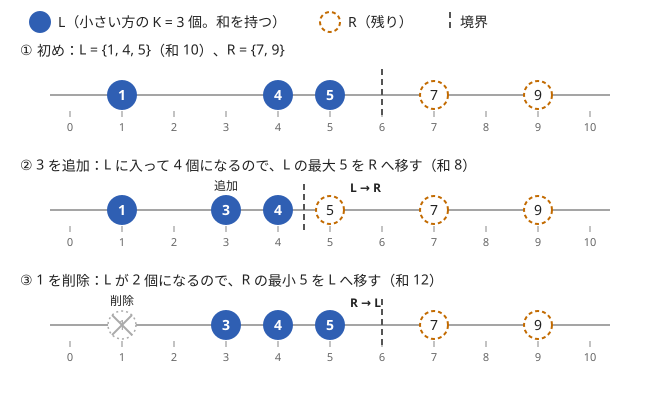

!!! abstract "要点"
    - **何ができるか**：要素の追加・削除のたびに、小さい方（大きい方）から K 個の和や中央値を $O(\log N)$ で答える。小さい方の K 個と残りを 2 つの multiset（削除がなければヒープ）に分けて持ち、操作のたびに境界の 1 個を移して分け方を保つ。
    - **いつ使うか**：
        - 1 点を更新するたびに、大きい方から K 個の和を答える
        - 幅 M の窓をずらしながら、小さい方から K 個の和を答える
        - 数を追加しながら中央値（$\lvert x - a_i \rvert$ の和を最小にする $x$）を答える
        - $Q \le 2 \times 10^5$ で、更新のたびに上位 K 個の和や中央値を答える
    - **計算量**：追加・削除は 1 回 $O(\log N)$（ならしではなく 1 回ごとの上限）、K 個の和と中央値は持っている値を読むだけなので $O(1)$。$N$ は集合の要素数
    - **前提**：[set・multiset・map の応用](../ds/ordered-set.md)、[優先度付きキュー](../ds/priority-queue.md)

<!-- textlint-disable -->
別名：2 つの multiset・2 つのヒープ・two heaps・下位 K 個の和・動的な中央値・running median・Priority Sum Structure
<!-- textlint-enable -->

上位 K 個の和と中央値の管理は、多重集合を「小さい方の K 個」と「残り」の 2 つの multiset に分けて持ち、小さい方の和を差分で更新し続ける方法である。分け方を崩す操作が来ても、崩れるのは境界の 1 個だけなので、それを隣へ移せば $O(\log N)$ で元に戻る。K を要素数の半分にすれば、同じ形で中央値が求まる。

## 2 つに分けて持つ（L＝小さい K 個、R＝残り。L の和を持つ） {#two-sets}

数列の 1 点を書き換えるたびに「小さい方から $K$ 個の和」を答える問題を考える。素朴には毎回ソートして先頭 $K$ 個を足すので 1 回 $O(N \log N)$ かかり、$N, Q \le 2 \times 10^5$ では間に合わない。1 回の更新で変わる要素は 1 個だけなので、和も前の答えからの差分で求めたい。

そこで多重集合を次の 2 つの multiset に分けて持つ。

- $L$：小さい方の $K$ 個（要素数が $K$ 未満なら全部）
- $R$：残りの要素

あわせて $L$ の和 $S_L$ を持つ。答えは $S_L$ そのものである。$L$ の中身が変わるたびに $S_L$ を足し引きしておけば、答えを読むのは $O(1)$ で済む。

次の図は、$K = 3$ で $\{1, 4, 5, 7, 9\}$ に 3 を追加し、続けて 1 を削除する様子である。塗りつぶした丸が $L$、破線の丸が $R$、縦の破線が $L$ と $R$ の境界を表す。



図の流れを文章で追うと次のとおりである。

- 初めは $L = \{1, 4, 5\}$・$R = \{7, 9\}$ で、$S_L = 10$ である
- 3 は $L$ の最大 5 以下なので $L$ に入る。$L$ が 4 個になったので、$L$ の最大 5 を $R$ へ移す。$S_L = 10 + 3 - 5 = 8$ になる
- 1 は $L$ にあるので $L$ から消す。$L$ が 2 個になったので、$R$ の最小 5 を $L$ へ移す。$S_L = 8 - 1 + 5 = 12$ になる

どの操作でも、動いた要素は追加・削除した 1 個と、境界をまたいで移した 1 個だけである。

大きい方から $K$ 個の和を求めるときは、向きを逆にする。$L$ を「大きい方の $K$ 個」にして最小を $R$ へ、$R$ の最大を $L$ へ移すか、値の符号を反転して小さい方の $K$ 個として扱う（答えは $-S_L$）。全体の和を別に持ち、「全体の和 − 小さい方から $N - K$ 個の和」としてもよい。

## 保つ性質（L の個数が K・L の最大 ≤ R の最小）と、境界の 1 個を移して回復する手順 {#invariants}

$L$ が本当に「小さい方の $K$ 個」であるためには、次の 2 つの性質を各操作の後に保てばよい。

1. $L$ の個数は $\min(K, \text{全体の個数})$
2. $L$ の最大 $\le$ $R$ の最小（どちらかが空なら成り立つとみなす）

2 つが成り立てば、$L$ の要素はどれも $R$ の要素以下なので、$L$ は小さい方から $K$ 個そのものになる。同じ値がいくつあっても、$L$ と $R$ のどちらに入っているかは和に影響しない。

追加と削除の手順は次のとおりである。性質 2 を崩さないよう、入れる先・消す先は $L$ の最大と比べて決める。

```text
insert(x):
    L が空、または x ≤ max(L) なら L に入れて S_L += x、そうでなければ R に入れる
    fix()
erase(x):            # x は集合に 1 個以上ある
    L が空でなく x ≤ max(L) なら L から 1 個消して S_L -= x、そうでなければ R から 1 個消す
    fix()
fix():
    |L| > K なら、max(L) を R へ移して S_L から引く
    |L| < K かつ R が空でないなら、min(R) を L へ移して S_L に足す
```

**なぜ正しいか**：追加・削除の直後は、入れる先・消す先を $L$ の最大と比べて選んだので性質 2 が成り立っている（$K = 0$ のときだけは $L$ が空なので入れた値が性質 2 を崩しうるが、fix がその値をすぐ $R$ へ移す）。崩れうるのは性質 1 だけで、1 回の操作で $L$ の個数は 1 しか変わらないから、ずれは $\pm 1$ である。$L$ の最大を $R$ へ移しても、それは残りの $L$ 以上で元の $R$ 以下なので性質 2 は保たれる。$R$ の最小を $L$ へ移すときも同じである。よって 1 個移せば両方の性質が戻る。

実装は次のようになる。multiset の最大は `*prev(L.end())`、最小は `*R.begin()` で読む。

```cpp
--8<-- "top-k-multiset/bottom-k.cpp:core"
```

完全なプログラム：[`bottom-k.cpp`](https://github.com/yuukougun/kyopro-atlas/blob/main/snippets/top-k-multiset/bottom-k.cpp)（GitHub）
{ .kp-code-src }

**計算量**：1 回の操作で multiset への挿入・削除・端の参照を定数回行うだけなので、$O(\log N)$ である。ならし計算量ではなく 1 回ごとの上限である。領域は要素数の $O(N)$ で済む。

$K$ が途中で変わる問題では、`fix` の `if` を `while` にする。$K$ が 1 ずつ変わるなら移すのは 1 個で済み、$d$ 変われば $d$ 個移すので $O(d \log N)$ かかる。$K$ がクエリごとに大きく飛ぶなら、[値を添字にした BIT・セグメント木](#by-index)の方が向く。

??? question "確認問題：移すのは本当に 1 個でよいか"
    fix で $L$ の個数を直した後、$L$ の最大と $R$ の最小を比べて入れ替える処理を足す実装を見かける。上の手順ではこの処理が要らないのはなぜか。逆に、この処理が要るのはどんな実装か。

    ??? success "答え"
        上の手順では、追加する値を $L$ の最大と比べて正しい側に入れ、削除する値も実際にある側から消す。だから操作の直後に性質 2 が崩れることはなく、fix で移すのは端の要素なので性質 2 は保たれ続ける。入れ替えが要るのは、「とりあえず $R$ に入れてから直す」のように、入れる先を比べずに決める実装である。そのときは個数を直した後に、$L$ の最大 $>$ $R$ の最小なら 2 つを交換する（和の差分も直す）。

## 削除・更新（どちらにあるかを見て消してから回復する） {#erase-update}

削除では、値 $x$ が $L$ と $R$ のどちらにあるかを $L$ の最大と比べて決める。$x \le \max(L)$ なら $L$ にある。$x < \max(L)$ なら性質 2 から $R$ にはありえず、$x = \max(L)$ なら少なくとも 1 個は $L$ にあるからである。同じ値 $x$ が $L$ と $R$ の両方にあっても、どちらの $x$ を消しても多重集合としては同じ結果になる。$L$ から消した場合は fix が $R$ の $x$ を $L$ へ移すので、性質も保たれる。

1 点の更新「$a_i$ を $y$ にする」は、古い値 $a_i$ の削除と新しい値 $y$ の追加に分ける。削除には古い値が要るので、配列 $a$ の現在の値を別に持っておく。初期の列があるなら、最初に全部を追加しておく（全要素が 0 から始まるなら 0 を $N$ 回追加する）。

窓をずらす問題（長さ $M$ の各区間で小さい方から $K$ 個の和）も同じ形である。窓を 1 つ右へずらすたびに、出ていく $a_i$ を削除し、入ってくる $a_{i+M}$ を追加すれば、窓ごとに $O(\log M)$ で答えが更新される。

削除がなく追加だけの問題では、$L$ を最大ヒープ・$R$ を最小ヒープにした 2 つの[優先度付きキュー](../ds/priority-queue.md)で同じことができる。さらに $K$ も変わらないなら、$L$ が一度 $K$ 個になった後は $R$ から戻すことがないので、$R$ は持たなくてよい。小さい方から $K$ 個なら大きさ $K$ の最大ヒープ 1 本で、値を追加して $K + 1$ 個になったら最大を捨てる（大きい方から $K$ 個なら最小ヒープで最小を捨てる）。$R$ が要るのは、中央値のように $K$ が増える場合である。削除のある問題でヒープを使うなら、遅延削除が要り、個数を別に数える手間が増えるので、multiset の方が書きやすい。

??? question "確認問題：大きい方から K 個の和"
    上の `BottomK` をそのまま使って、1 点の更新のたびに「大きい方から $K$ 個の和」を答えるにはどうすればよいか。2 通り答えよ。

    ??? success "答え"
        1 つ目は符号を反転する方法で、値 $v$ の代わりに $-v$ を追加・削除し、答えを $-S_L$ とする。大きい方から $K$ 個は、符号を反転した値の小さい方から $K$ 個に当たる。2 つ目は補集合を使う方法で、全体の和 $T$ を別に持ち、`BottomK(N - K)` の和を引いて $T - S_L$ とする。要素数が $N$ で一定のときに使える。

## 中央値を保つ（個数の差を 1 以内に。削除がなければヒープ 2 本）と Σ|x − a_i| の更新 {#median}

[中央値](../guide/glossary.md#median)は、$L$ の個数を「全体の半分（切り上げ）」に保てば $L$ の最大として読める。$K$ が要素数とともに変わるだけで、手順は前の節と同じである。保つ性質は次の 2 つになる。

1. $\lvert L \rvert = \lvert R \rvert$ または $\lvert L \rvert = \lvert R \rvert + 1$
2. $L$ の最大 $\le$ $R$ の最小

このとき $L$ の最大が中央値（偶数個なら小さい方の中央値）で、$R$ の最小が大きい方の中央値である。問題が偶数個のときに大きい方や平均を求めているなら、読む値をそれに合わせる。

追加だけなら、$L$ を最大ヒープ、$R$ を最小ヒープにしてよい。追加の後に $L$ が 2 個多ければ $L$ の最大を $R$ へ、$R$ の方が多ければ $R$ の最小を $L$ へ 1 個移す。

$\sum_i \lvert x - a_i \rvert$ を最小にする $x$ は中央値 $m$ である（理由は[絶対値の和の最小化と中央値](../basics/median-absolute.md#why-median)）。最小値も、$L$ と $R$ それぞれの和 $S_L$・$S_R$ を持てば $O(1)$ で求まる。$L$ の要素はどれも $m$ 以下、$R$ の要素はどれも $m$ 以上なので、絶対値が外れて次の式になる。

$$
\sum_i \lvert m - a_i \rvert = \left( m \lvert L \rvert - S_L \right) + \left( S_R - m \lvert R \rvert \right)
$$

```cpp
--8<-- "top-k-multiset/running-median.cpp:core"
```

完全なプログラム：[`running-median.cpp`](https://github.com/yuukougun/kyopro-atlas/blob/main/snippets/top-k-multiset/running-median.cpp)（GitHub）
{ .kp-code-src }

削除もあるときは、2 つの multiset で同じ性質を保つ。削除の後に個数の差が崩れたら、上と同じく 1 個移せばよい。

??? question "確認問題：偶数個のときの最小点"
    要素が偶数個のとき、$\sum_i \lvert x - a_i \rvert$ を最小にする $x$ が 1 つとは限らない。最小にする $x$ のうち最も小さいものは何か。

    ??? success "答え"
        $L$ の最大（小さい方の中央値）である。偶数個なら $\lvert L \rvert = \lvert R \rvert$ で、$x$ が $L$ の最大と $R$ の最小の間にあるとき、$x$ を動かしても $L$ 側の距離の増減と $R$ 側の距離の増減が打ち消し合うので値は変わらない。$L$ の最大より左へ出ると、$x$ より右の要素が左の要素より多くなり、値が増える。

## 値を添字にした BIT・セグメント木で書く方法（→ 値を添字にする BIT・セグメント木） {#by-index}

値の候補が前もって分かるなら、2 つの multiset の代わりに、値を添字にした [BIT](../ds/fenwick-tree.md#count-by-value) やセグメント木でも同じことができる。値を[座標圧縮](../basics/coordinate-compression.md)して添字にし、各添字に「その値の個数」と「その値の和」を載せる。小さい方から $K$ 個の和は次のように求まる。

1. 個数の累積が $K$ 以上になる最小の添字 $t$ を、[BIT 上の二分探索](../ds/fenwick-tree.md#binary-search)（セグメント木なら `max_right`）で $O(\log N)$ で探す
2. 添字 $t$ 未満の和に、足りない個数ぶん（$K$ − $t$ 未満の個数）の「$t$ の値」を足す

境界の値 $t$ が何個もあるとき、その一部だけを数えるのが 2 の足し算である。追加・削除は 1 点の個数と和の更新になる。

| 観点 | 2 つの multiset | 値を添字にした BIT・セグメント木 |
| --- | --- | --- |
| 値の事前の把握 | 要らない（オンライン） | 値の範囲が狭ければそのまま、広ければ座標圧縮のため全クエリを先読みする（[オフライン](../guide/glossary.md#offline)） |
| $K$ がクエリごとに変わる | 移す個数ぶん遅い | どの $K$ でも $O(\log N)$ |
| 定数倍・書く量 | multiset は重め、書く量は少ない | 軽い。BIT 上の二分探索を書く |

$K$ が固定か 1 ずつ動くだけなら 2 つの multiset が手軽である。毎回違う $K$ を問われる・$K$ 番目の値そのものも要るといった場合は、[値を添字にする BIT・セグメント木](../ds/segment-tree-on-values.md)と [K 番目の値を求めるデータ構造](../ds/kth-element.md)の方法を使う。

## |x − a| + b を足していく関数の最小値（中央値の更新の応用。Slope Trick の入口） {#absolute-sum-function}

この節は[絶対値の和の最小化と中央値](../basics/median-absolute.md)の「傾き」の見方を前提にする。

関数 $f(x)$（初めは $f(x) = 0$）に $\lvert x - a \rvert + b$ を足す更新と、「$f$ の最小値と、最小にする $x$ のうち最も小さいもの」の質問が交互に来る問題を考える。$b$ はどの $x$ にも同じだけ足されるので、合計 $B$ を別に持てば最小点に影響しない。残りは $\sum_i \lvert x - a_i \rvert$ で、最小点は $a_i$ たちの中央値である。

よって[中央値を保つ](#median)の 2 つのヒープがそのまま使える。更新では $a$ を追加して $B$ に $b$ を足し、質問では次を答える。

- 最小にする $x$ のうち最も小さいもの：$L$ の最大（偶数個のとき、$L$ の最大から $R$ の最小までが最小点になる）
- 最小値：$\left( m \lvert L \rvert - S_L \right) + \left( S_R - m \lvert R \rvert \right) + B$（$m$ は $L$ の最大）

どちらも 1 回 $O(\log Q)$ で更新でき、質問は $O(1)$ である。

この見方を広げたものが [Slope Trick](../dp/slope-trick.md#two-heaps) である。$f$ は傾きが整数ずつ変わる折れ線で、$L$ は最小点より左で傾きが変わる点、$R$ は右で変わる点を持っていると読める。$\lvert x - a \rvert$ の代わりに片側だけの $\max(0, x - a)$ や $\max(0, a - x)$ を足すと、$L$ と $R$ の個数の釣り合いが崩れる。そのときは「中央値」ではなく傾き 0 の区間の両端を 2 つのヒープの先頭として持ち、最小値の変化量を先頭との比較で足し込む。DP の値を $x$ の関数として持ち、関数ごと更新する問題でこの形が使われる。

## 落とし穴 {#pitfalls}

**`L.erase(x)` で同じ値をすべて消す**。multiset の `erase` に値を渡すと、その値の要素が全部消える。1 個だけ消すには `L.erase(L.find(x))` と書く（[multiset から 1 個だけ消す](../cpp/cpp-container-idioms.md#multiset-erase-one)）。同じ値が多い入力でだけ答えが合わなくなるので、小さい例では気づきにくい。

**ない側から消そうとする**。`find` が `end()` を返したまま `erase` すると[未定義動作](../guide/glossary.md#undefined-behavior)になる。消す側を「$L$ の最大以下なら $L$」と決めれば、必ずある側を選べる。等号の向きを誤って「$L$ の最大未満なら $L$、そうでなければ $R$」とすると、$x$ が $L$ の最大と等しく $R$ にない場合、ない側の $R$ を選んでしまう。

**空の multiset の端を読む**。$K = 0$ のときや、全部を消した直後は $L$ が空で、`*prev(L.end())` は未定義動作になる。比べる前に空かどうかを確かめる。

**和の更新漏れ**。$S_L$ は、追加・削除のときだけでなく、fix で 1 個移すときにも直す。移す処理を関数にまとめ、和の更新をその中だけに書くと漏れにくい。$R$ の和も要るなら、$S_R$ も同じ場所で直すか、全体の和から $S_L$ を引いて求める。

**ヒープで削除するときの個数**。遅延削除のヒープでは、`size()` に削除待ちの要素も数えられる。個数の比較には、別に数えた「生きている要素の数」を使う。

**値の和のオーバーフロー**。値が $10^9$ で $K$ が $2 \times 10^5$ なら和は $2 \times 10^{14}$ になる。和と `m * L.size()` は `long long` で計算する。`L.size()` は符号なしなので、負の値と掛ける前に `long long` へ直す。

## 例題 {#examples}

### ABC306 E. Best Performances {#abc306_e}

<div class="kp-problems" data-role="example" markdown>

- [ABC306 E. Best Performances](https://atcoder.jp/contests/abc306/tasks/abc306_e)（diff 1268）：数列の 1 点更新のたびに、大きい方から K 個の和を答える。

</div>

全要素が 0 の長さ $N$ の列で、1 点を書き換えるたびに大きい方から $K$ 個の和を答える。1 回の更新で列の要素は 1 個しか変わらないので、[削除・更新](#erase-update)のとおり「古い値の削除＋新しい値の追加」として、上位 $K$ 個の和を差分で保つ。大きい方の $K$ 個なので、符号を反転して `BottomK` を使うか、$L$ を大きい側にする。

??? note "解法の詳細"
    - 初めに 0 を $N$ 個追加する。$L$ に $K$ 個、$R$ に $N - K$ 個の 0 が入り、和は 0 である。
    - 配列 $a$（0-indexed）で現在の値を持つ。更新「$X$ 番目を $Y$ にする」では $i = X - 1$ とする。$a_i$ を 1 個削除して $Y$ を追加し、$a_i \leftarrow Y$ とする。
    - 符号を反転する書き方では、追加・削除する値を $-a_i$ と $-Y$ にする。答えは $-S_L$ である。
    - 0 が何個も入るので、削除を `erase(find(…))` にしないと 0 が全部消えて答えが崩れる。
    - 1 回の更新は $O(\log N)$ で、全体は $O((N + Q) \log N)$ である。$K$ 個の和は `int` に収まらないので `long long` で持つ。

## 練習問題 {#practice}

<div class="kp-problems" data-role="practice" markdown>

- [ABC458 D. Chalkboard Median](https://atcoder.jp/contests/abc458/tasks/abc458_d)（diff 450）：最初に 1 つの整数を書き、続けて 2 つずつ整数を書き足すたびに、書かれている整数の中央値を答える。
- [ABC281 E. Least Elements](https://atcoder.jp/contests/abc281/tasks/abc281_e)（diff 1334）：長さ M の各窓で、小さい方から K 個の和を答える。
- [ARC074 D. 3N Numbers](https://atcoder.jp/contests/arc074/tasks/arc074_b)（diff 1730）：長さ 3N の数列から N 個を除き、残りの前半 N 個の和 − 後半 N 個の和を最大にする。

</div>

??? note "練習の方針"
    - **ABC458 D**：追加だけなので、[中央値を保つ](#median)のヒープ 2 本を使う。書かれている個数は常に奇数なので、中央値は $L$ の最大 1 つに決まる
    - **ABC281 E**：最初の $M$ 個を追加し、窓をずらすたびに出ていく値を削除して入ってくる値を追加する。$L$ の個数を $K$ に保ち、$S_L$ を出力する
    - **ARC074 D**：残す前半と後半の境目の位置 $k$（$N \le k \le 2N$）を全探索する。前の $k$ 個から大きい方の $N$ 個の和を、$k$ を増やしながら大きさ $N$ の最小ヒープで求め、後ろ側の小さい方の $N$ 個の和も逆向きに同じように求める。削除がないので、ヒープ 1 本ずつで足りる

## 力試し {#challenge}

<div class="kp-problems" data-role="challenge" markdown>

- [ABC127 F. Absolute Minima](https://atcoder.jp/contests/abc127/tasks/abc127_f)（diff 2003）：関数に |x − a| + b を足す更新と、関数の最小値と最小点の質問を処理する。

</div>

??? note "力試しの方針"
    - **ABC127 F**：[|x − a| + b を足していく関数の最小値](#absolute-sum-function)のとおり、$a$ を 2 つのヒープに追加し、$b$ の合計を別に持つ。最小点は $L$ の最大、最小値は 2 つのヒープの和と個数から求める

## 使い分け {#comparison}

- 削除がなく、上位 $K$ 個のうち最小（$K$ 番目）だけが要るなら、大きさ $K$ のヒープ 1 本で足りる（[優先度付きキュー](../ds/priority-queue.md)）
- 削除がなく、中央値だけが要るなら、ヒープ 2 本（[中央値を保つ](#median)）。削除があれば multiset 2 本
- $K$ がクエリごとに変わり、かつ値の範囲が狭いかクエリを先読みできるなら、[値を添字にする BIT・セグメント木](../ds/segment-tree-on-values.md)
- 集合が変わらず、中央値や $\sum \lvert x - a_i \rvert$ の最小を 1 回求めるだけなら、ソートして真ん中を取る（[絶対値の和の最小化と中央値](../basics/median-absolute.md)）

## 参考 {#references}

- [hibit「配列をソートしたときに先頭からK番目までの和を求めるやつ」](https://qiita.com/hibit/items/fff6c11e9f17fb435c69)：2 つの multiset の持ち方と、更新を削除と追加に分ける書き方（例題の方針）
- [comet725「ABC458Dを解いた【優先度付きキュー】」](https://qiita.com/comet725/items/4e3a310ec19ed32e12f6)：練習の方針（ヒープ 2 本で中央値を保つ）
- [drken「AtCoder ABC 281 E - Least Elements (1D, 水色, 500 点)」](https://drken1215.hatenablog.com/entry/2022/12/14/185200)：窓をずらす問題での 2 つの multiset と、値を添字にする BIT・セグメント木による解き方の比較
- [drken「AtCoder ABC 062 D - 3N Numbers (ARC 074 D) (1Q, 青色, 500 点)」](https://drken1215.hatenablog.com/entry/2019/04/28/114800)：練習の方針（境目の全探索と、ヒープによる接頭辞の上位 N 個の和）
- [drken「AtCoder ABC 127 F - Absolute Minima (2D, 黄色, 600 点)」](https://drken1215.hatenablog.com/entry/2019/06/15/114700)：力試しの方針（定数 b を分けて持ち、ヒープ 2 本の和から最小値を求める式）
- [maspy「slope trick (1) 解説編」](https://maspypy.com/slope-trick-1-%e8%a7%a3%e8%aa%ac%e7%b7%a8)：Slope Trick の仕組み（2 つのヒープで傾きの変わる点を持つ。[|x − a| + b を足していく関数の最小値](#absolute-sum-function)の最後の段落）
