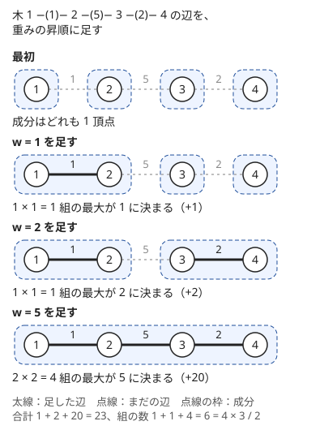
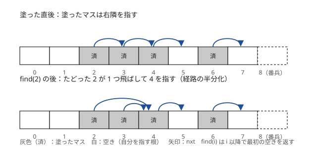

!!! abstract "要点"
    - **何ができるか**：Union-Find の根に成分の情報（サイズ・辺数・上位 K 個・値ごとの個数）を持たせ、併合のときに 2 つの根の情報を合成して保つ。辺を重みの順に足して組の数を数える型、区間の和を辺に言い換える型、次の空きへ飛ぶ型がある。
    - **いつ使うか**：
        - 全頂点対について、パス上の最大の辺の重みの総和を求める。
        - いくつかの区間の和が分かっているとき、全体の和が決まるかを判定する。
        - 成分の中で K 番目に大きい番号・成分の中のクラス c の人数を答える。
        - 右にある最初の空き位置に書き込む。
    - **計算量**：併合・判定はならし $O(\alpha(N))$ に、根の情報を合成する手間を足したもの。上位 $K$ 個なら併合 1 回 $O(K)$、値ごとの map を小さい方から大きい方へ移すなら全体 $O(N \log^2 N)$。次の空きへ飛ぶ型は全体 $O((N + Q) \log N)$
    - **前提**：[Union-Find](../ds/union-find.md)

<!-- textlint-disable -->
別名：UF に情報を持たせる・併合時の寄与・成分ごとの集約・次の空きへ飛ぶ Union-Find・次の要素へのポインタ・区間を塗る UF
<!-- textlint-enable -->

Union-Find の応用は、併合と「同じ成分か」の判定だけでなく、成分ごとの集計や、併合の順序そのものを答えに使う型の集まりである。どの型も「成分は併合されるだけで分かれない」という Union-Find の性質に乗っている。分割や削除が要るときは、操作を逆順にするなどしてこの形に直す（[グラフの章との分担](#vs-graph)）。

## 根に成分の情報を持たせる {#data-on-root}

成分のサイズは Union-Find の基本で数えられる（[Union-Find](../ds/union-find.md)）。同じやり方で、成分の辺数・黒い頂点の数・最大値・上位 $K$ 個・値ごとの個数も持てる。情報は根にだけ置き、2 つの成分を併合するときに合成する。

**保つ性質**。$\mathrm{info}[r]$ は、$r$ が根のときだけ「$r$ の成分全体の情報」として正しい。根でない頂点の $\mathrm{info}$ は古い値のまま放っておき、読まない。

**各操作の手順**。

- 併合 $\mathrm{unite}(a, b)$：先に $r_a = \mathrm{find}(a)$、$r_b = \mathrm{find}(b)$ を求める。$r_a = r_b$ なら成分は変わらないので、頂点の集合で決まる情報（サイズ・上位 $K$ 個）は何もしない。辺数のように辺ごとに増える情報だけは、ここでも 1 増やす（[Union-Find](../ds/union-find.md#size-and-edges)）。$r_a \ne r_b$ なら併合し、新しい根 $r$ に 2 つの情報を合成して入れる
- 取得：頂点 $v$ の成分の情報は $\mathrm{info}[\mathrm{find}(v)]$ を読む
- 一点の値の変更：頂点 $v$ の色を反転するなら、$v$ の値を変えたうえで $\mathrm{info}[\mathrm{find}(v)]$ を差分だけ増減する

**境界**。最初は各頂点が 1 頂点の成分なので、$\mathrm{info}[v]$ を「$v$ だけの成分の情報」で初期化する（サイズ 1、辺数 0、上位 $K$ 個は $\{v\}$）。合成は 2 つの成分の情報から併合後の情報が決まるものに限る。和・個数・最大値・上位 $K$ 個はこの形である。中央値や、質問ごとに変わる値 $x$ の個数のように、どの値を聞かれるか前もって決まらない量は、値ごとの個数（map）を丸ごと持てば合成できる。

合成の手間は情報の大きさで変わる。

| 根に持つもの | 合成のしかた | 併合 1 回の手間 |
| --- | --- | --- |
| サイズ・辺数・黒い頂点の数・和 | 足す | $O(1)$ |
| 最大値・最小値 | 大きい方・小さい方を採る | $O(1)$ |
| 上位 $K$ 個（大きい順の列） | 2 列をマージして先頭 $K$ 個を残す | $O(K)$ |
| 値ごとの個数（map） | 小さい方の要素を大きい方へ 1 つずつ移す | 移す要素数 × $O(\log N)$ |

上位 $K$ 個は、併合後の上位 $K$ 個が「2 つの成分それぞれの上位 $K$ 個」の中に必ずあることを使う。片方の成分で $K + 1$ 位以下の要素は、同じ成分の中だけでもすでに $K$ 個に負けているからである。次のコードは ACL の `dsu` で上位 $K$ 個を持つ例である。`merge` は新しい根を返すので、根でなくなった方の情報を新しい根へ合成する。

```cpp
--8<-- "union-find-applications/top-k.cpp:core"
```

完全なプログラム：[`top-k.cpp`](https://github.com/yuukougun/kyopro-atlas/blob/main/snippets/union-find-applications/top-k.cpp)（GitHub）
{ .kp-code-src }

値ごとの個数のように大きな情報は、要素の少ない方の map を多い方へ移す。ある要素が移るたびに、その要素の属する成分のサイズは 2 倍以上になるので、1 つの要素が移るのは $\log_2 N$ 回以下である。全体で移す回数は $O(N \log N)$ で、map の操作が 1 回 $O(\log N)$ なので $O(N \log^2 N)$ になる（[マージテク](../tree/small-to-large.md)）。ACL の v1.6 の実装はサイズの大きい方を根に残すが、ドキュメントはどちらが根になるかを約束していない。併合の前に map の大きさを比べ、小さい方を大きい方へ移してから、大きい方の map を新しい根の情報にする。

!!! info "ACL では"
    `dsu d(n);`。`d.merge(a, b)` は併合して新しい根を返し、`d.leader(a)` は根を、`d.size(a)` は成分のサイズを返す。どれもならし $O(\alpha(N))$。根に持たせる情報は自分の配列で持ち、`merge` の前に両方の `leader` を取っておく。`d.groups()` は全成分の頂点の一覧を $O(N)$ で返す。

??? question "確認問題：map を移す向き"
    値ごとの個数の map を、要素の多い方から少ない方へ移すと、全体の手間はどこまで悪くなりうるか。どんな併合の順で悪くなるか。

    ??? success "答え"
        $O(N^2)$ 回の移動になりうる。たとえば 1 頂点の成分を、大きく育った 1 つの成分へ順に併合していく（鎖状の併合）と、毎回大きい方の要素を全部移すので、$k$ 回目の併合で約 $k$ 個を移し、合計は $1 + 2 + \dots + (N - 1) = O(N^2)$ になる。小さい方を移せば、1 つの要素が移るたびに属する成分のサイズが 2 倍以上になるので、各要素は $\log_2 N$ 回以下しか移らない。

## 併合の瞬間に寄与を数える {#count-on-merge}

「全頂点対について、パス上の最大の辺の重みの総和」は、組ごとにパスをたどると $O(N^2)$ 組を調べることになり、$N = 10^5$ では間に合わない。そこで、組ごとに答えを求めるのをやめ、辺ごとに「この辺が最大になる組の数」を数える（[寄与](../thinking/contribution.md)）。

辺を重みの昇順に 1 本ずつ足していく。重み $w$ の辺 $(u, v)$ を足す直前、$u$ の成分と $v$ の成分は重み $w$ 以下の辺だけでできている。だから $u$ 側の頂点 $x$ と $v$ 側の頂点 $y$ の組は、この辺で初めてつながり、パス上の最大は $w$ に決まる。その組の数は 2 つの成分のサイズの積である。



図の木では、6 組のどれもがちょうど 1 回ずつ数えられている。組が数えられるのは最初につながった瞬間だけで、その後は同じ成分の中にいるので二度と数えられない。だから数え漏れも重複もない。

```cpp
--8<-- "union-find-applications/pair-max.cpp:core"
```

完全なプログラム：[`pair-max.cpp`](https://github.com/yuukougun/kyopro-atlas/blob/main/snippets/union-find-applications/pair-max.cpp)（GitHub）
{ .kp-code-src }

計算量はソートの $O(N \log N)$ と、併合 $N - 1$ 回のならし $O(N \alpha(N))$ である。

- **最小の総和なら降順に足す**：パス上の最小の辺の重みの総和なら、辺を重みの降順に足せばよい
- **一般のグラフでも使える**：木でなくても、辺を重みの昇順に足すと、同じ成分どうしを結ぶ辺は寄与 0 で、併合した辺だけが数えられる。このとき求まるのは「2 頂点を結ぶ道のうち、最大の辺の重みが最小のもの」の総和で、[最小全域木](../graph/minimum-spanning-tree.md)の上のパスの最大と同じである
- **逆順の追加と組む**：「橋が順に崩落するたびに、行き来できない組の数を答える」は、逆順に橋を足して、併合のたびにサイズの積だけ組の数を減らす（[Union-Find で連結性を扱う](../graph/union-find-connectivity.md)）

??? question "確認問題：足す順序"
    `pair-max.cpp` で `d.merge(u, v)` を `d.size` の前に呼ぶと、答えはどうなるか。

    ??? success "答え"
        併合後は `d.size(u)` と `d.size(v)` がどちらも併合後の成分のサイズ $s_u + s_v$ になるので、$w (s_u + s_v)^2$ を足してしまい、答えが大きくなる。サイズは必ず併合の前に読む。

## 何を頂点にするかの言い換え {#modeling}

問題文にグラフが出てこなくても、「等しい・差が分かる・同じ組になる」という関係を辺と見ると Union-Find で扱えることがある。何を頂点にするかが本体で、代表的なものが 3 つある。

**累積和の添字を頂点にする**。区間の和の情報は、累積和 $S_0 = 0$、$S_i = A_1 + \dots + A_i$ の 2 項の差である。閉区間 $[l, r]$（1-indexed）の和が分かることは、$S_r - S_{l-1}$ が分かることと同じなので、頂点 $l - 1$ と $r$ を辺で結ぶ。頂点は $0, 1, \dots, N$ の $N + 1$ 個である。辺で結ばれた 2 頂点は、片方の値が分かればもう片方も決まる。$S_0 = 0$ は分かっているので、頂点 0 と同じ成分の $S$ はすべて決まる。全体の和 $S_N$ が決まるのは、頂点 0 と $N$ が連結なときである。

逆に、0 と $N$ が連結でなければ全体の和は決まらない。$N$ の成分のすべての $S_i$ に同じ数 $t$ を足しても、成分の中の差は変わらないので、与えられた情報とは矛盾しない。$S_N$ だけが $t$ ずれるので、一意には決まらない。

**x 座標と y 座標を頂点にする**。平面上の点 $(x, y)$ を「x 座標 $x$ の頂点と y 座標 $y$ の頂点を結ぶ辺」と見る（頂点は x 座標と y 座標を別々に用意した二部グラフ）。同じ x 座標または同じ y 座標でつながる点の集まりが、1 つの成分になる。長方形の 3 頂点から 4 頂点目を補う操作をくり返すと、成分の中の x 座標と y 座標のすべての組に点が置かれる。だから操作後の点の数は、成分ごとの（x 座標の数）×（y 座標の数）の和で、根に x 座標の数と y 座標の数を持たせれば求まる。

**値を頂点にする**。「列の中の値 $a$ をすべて $b$ に書き換える操作を何回して、条件を満たす形にするか」では、一致させたい値の組 $(a, b)$ を辺で結ぶ。同じ成分の値はすべて 1 つの値にそろえる必要があり、サイズ $s$ の成分をそろえるには $s - 1$ 回かかる（1 回の書き換えで値の種類は 1 つしか減らない）。$s - 1$ 回で足りることは、成分の全域木の辺に沿って書き換えれば分かる。最小回数は、併合に成功した回数の合計になる。回文にそろえる問題が [Union-Find](../ds/union-find.md) の練習にある。

??? question "確認問題：区間の和の頂点数"
    区間の和の言い換えで、頂点を $1, \dots, N$ の $N$ 個にして $l$ と $r$ を結ぶと、何がまずいか。

    ??? success "答え"
        区間 $[l, r]$ の和は $S_r - S_{l-1}$ なので、結ぶべきは $l - 1$ と $r$ である。$l$ と $r$ を結ぶと、たとえば長さ 1 の区間 $[i, i]$ が自己ループになり、何の情報も持たなくなる。累積和の添字 $0, \dots, N$ の $N + 1$ 個を頂点にする。

## 次の空きへ飛ぶ Union-Find {#next-pointer}

「区間 $[l, r)$ のまだ塗っていないマスだけを塗る」「位置 $h$ から右へ最初の空きに書き込む」を素朴に書くと、塗り済みのマスを 1 つずつ飛ばすので 1 回 $O(N)$ かかる。ここで、各マスが「自分以降で最初の空きのマス」を指すように持つ。塗ったマスは右隣と併合し、根が常に右側の空きのマスになるようにする。

**保つ性質**。$\mathrm{nxt}[i]$ をたどって行き着く根が、$i$ 以降で最初の空きのマスである。空きのマスは自分を指す根で、末尾に常に空きの番兵 $N$ を置く。

**各操作の手順**。$\mathrm{find}(i)$ で $i$ 以降の最初の空きを求める。区間 $[l, r)$ を塗るときは、$i = \mathrm{find}(l)$ から始め、$i < r$ の間、マス $i$ を塗って $\mathrm{nxt}[i] = i + 1$ とし、$i = \mathrm{find}(i)$ で次の空きへ飛ぶ。



各マスは一度しか塗られず、塗るたびに併合は 1 回だけ起きる。だからループは全体で $N + Q$ 回ほどしか回らない。併合の向きは「右隣の下につなぐ」と決まっていて union by size は使えないが、経路圧縮（ここでは経路を半分ずつ縮める方法）だけでも、find は 1 回ならし $O(\log N)$ に収まる。union by size を使わない場合の上限として知られている（[Union-Find](../ds/union-find.md#complexity)）。全体で $O((N + Q) \log N)$ になり、実際にはほぼ線形に近い速さで動く。

```cpp
--8<-- "union-find-applications/next-pointer.cpp:core"
```

完全なプログラム：[`next-pointer.cpp`](https://github.com/yuukougun/kyopro-atlas/blob/main/snippets/union-find-applications/next-pointer.cpp)（GitHub）
{ .kp-code-src }

- **環状の配列**：位置 $h$ から右へ探して、末尾の番兵 $N$ に着いたら、$\mathrm{find}(0)$ で先頭から探し直す。配列がすべて埋まることがない制約かを確かめておく
- **区間の頂点をつなぐ**：「区間 $[l, r)$ の頂点をすべてつなぐ」操作をくり返す。すでにつながった境目を飛ばせば、隣どうしの併合は全体で $N - 1$ 回しか起きない。境目 $i$（頂点 $i$ と $i + 1$ の間）を併合したら、境目 $i$ を塗り済みにする
- **set で代用できる**：空きの位置を `std::set` に入れ、`lower_bound(l)` で次の空きを探して、塗ったら消す。1 回 $O(\log N)$ で、同じことができる（[set・map の応用](../ds/ordered-set.md)）。範囲が $10^9$ のように大きいときは、空きを全部は入れられないので、塗った区間の側を set で持つ（[区間を set で管理する](../ds/interval-set.md)）か、$\mathrm{nxt}$ を map で持って触れた位置だけ作る

??? question "確認問題：なぜ全体が速いか"
    区間を塗る操作が $Q$ 回あり、毎回の区間が広くても、ループが全体で $N + Q$ 回ほどしか回らないのはなぜか。

    ??? success "答え"
        ループの 1 周は「空きのマスを 1 つ塗る」か「$r$ 以上に着いて抜ける」かのどちらかである。塗られたマスは二度と空きに戻らないので、塗る周は全体で $N$ 回以下、抜ける周は操作 1 回につき 1 回で $Q$ 回である。塗り済みのマスは find がまとめて飛ばすので、1 つずつは見ない。

## グラフの章との分担 {#vs-graph}

Union-Find を使う型は、このページとグラフの章に分けて置いている。どちらを引くかは、何が問題の本体かで決める。

- **このページ**：根に何を持たせ、併合でどう合成するか。併合の瞬間に数える型、何を頂点にするかの言い換え、次の空きへ飛ぶ型
- **[Union-Find で連結性を扱う](../graph/union-find-connectivity.md)**：辺や頂点の削除を時間の逆順の追加にする型、重さ・年などのしきい値の順に辺を足してクエリに答える型、超頂点と組む型
- **[最小全域木](../graph/minimum-spanning-tree.md)**：クラスカル法（辺を重みの昇順に見て、閉路を作らない辺だけを採る）と、その正しさの理由
- **差を持つ型**：「$x_v - x_u = w$」の情報の矛盾判定は[重み付き Union-Find](../ds/weighted-union-find.md)で扱う

型は組み合わさって出る。たとえば「頂点を順に削除し、各時点の黒い頂点を含む成分の数」なら、逆順の追加（グラフの章）にしたうえで、根に黒い頂点の数を持たせる（このページ）。

## しきい値ごと・関係ごとに Union-Find を持つ {#multiple-uf}

この節は[最小全域木](../graph/minimum-spanning-tree.md)を前提にする。Union-Find を 1 つではなく複数持つと、1 つでは表せない関係を扱える。

**しきい値ごとに持つ**。辺の重みが 1〜10 のように数種類しかないとき、重み $c$ ごとに「重み $c$ 以下の辺だけを足した Union-Find」$U_c$ を持つ。$U_c$ の連結成分の数を $k_c$ とすると、最小全域木（グラフが連結でなければ最小全域森）のうち重み $c$ 以下の辺の本数は $N - k_c$ である。クラスカル法は重み $c$ 以下の辺を見終えた時点で、それらだけで作れる森を張っているからである。重みがちょうど $c$ の辺は $(N - k_c) - (N - k_{c-1})$ 本なので、最小全域木の重みは次の式になる（$k_0 = N$、$C$ は重みの最大値）。

$$
\sum_{c=1}^{C} c \left( k_{c-1} - k_c \right)
$$

重み $w$ の辺を足すクエリでは、$c \ge w$ のすべての $U_c$ でその辺を併合し、$k_c$ を更新する。1 回 $O(C \alpha(N))$ で答えが更新できる。

**関係ごとに持ち、根の組で分類する**。「道路でも鉄道でも連結」のように 2 種類の辺の両方で連結な頂点を数えたいとき、道路用の Union-Find $U_1$ と鉄道用の $U_2$ を別々に作る。2 頂点が両方で連結なことは、$(\mathrm{find}_1(v), \mathrm{find}_2(v))$ の組が等しいことと同じである。だから各頂点をこの組で分類し、組ごとの頂点数を map で数えれば答えになる。道路と鉄道の辺を 1 つの Union-Find に入れると「道路と鉄道を乗り継いで連結」になり、別の問いになる。

## 落とし穴 {#pitfalls}

**根でない頂点の情報を読む**。`info[v]` と書くと、$v$ が根でないとき古い値が返る。読むときも足すときも必ず `info[d.leader(v)]` を使う。併合の後に、併合前に取った根の片方の情報を読むのも同じ誤りである。

**同じ成分どうしの併合で二重に足す**。$r_a = r_b$ のときに `info[r] += info[r]` のように合成すると、サイズや黒い頂点の数が 2 倍になる。合成の前に根が同じかを確かめる。辺数だけは同じ成分でも 1 増やす（[Union-Find](../ds/union-find.md#size-and-edges)）。

**サイズの積のあふれ**。$N = 2 \times 10^5$ ならサイズの積は $10^{10}$ 程度になり、`int` ではあふれる。重みを掛けるとさらに大きくなるので、`long long` に入れてから掛ける。全組の合計が `long long` に収まるかも、組の数 $N(N-1)/2$ と重みの上限の積で見積もる（[整数のオーバーフロー](../cpp/cpp-integer-overflow.md)）。

**上位 K 個を切り詰めない・大きい方を小さい方へ移す**。上位 $K$ 個の列を切り詰めずに連結すると、鎖状に併合したとき列の長さが $N$ まで伸び、全体で $O(N^2)$ になる。map を移す向きを逆にする（大きい方の要素を小さい方へ移す）のも同じく $O(N^2)$ になりうる。移したら古い根の列や map は `clear` してメモリも返す。

**次の空きへ飛ぶ Union-Find を再帰の find で書く**。この型は union by size を使わないので、経路圧縮が効く前は $\mathrm{nxt}$ が長さ $N$ の鎖になりうる。再帰で find を書くと再帰の深さが $N$ になり、$N = 10^6$ では手元の既定のスタック（Linux で 8MB 程度）からあふれうる。`next-pointer.cpp` のように while ループで書く。番兵 $N$ のために配列を $N + 1$ 個取ることも忘れない。

## 例題 {#examples}

### ABC372 E. K-th Largest Connected Components {#abc372_e}

<div class="kp-problems" data-role="example" markdown>

- [ABC372 E. K-th Largest Connected Components](https://atcoder.jp/contests/abc372/tasks/abc372_e)（diff 1042）：辺の追加と、ある頂点の連結成分で K 番目（K ≤ 10）に大きい頂点番号の質問を処理する。

</div>

$k \le 10$ なので、各成分の頂点番号の上位 10 個だけを根に持てば、どの質問にも答えられる。併合後の上位 10 個は 2 つの成分の上位 10 個の中にあるので、2 つの列をマージして 10 個に切り詰めればよい。

??? note "解法の詳細"
    - 初期化：各頂点 $v$ の列を $\{v\}$ にする。
    - 辺 $(u, v)$ の追加：両方の根を求め、同じなら何もしない。違えば併合し、新しい根の列を「2 つの列をマージして大きい順に先頭 10 個」にする。根でなくなった方の列は空にする。
    - 質問 $(v, k)$：根の列の長さが $k$ 以上なら $k$ 番目の要素、そうでなければ $-1$ を出力する。
    - 併合 1 回 $O(K)$（$K = 10$）、全体で $O(N + Q (\alpha(N) + K))$。コードは[根に成分の情報を持たせる](#data-on-root)のものと同じ形である（入力は 1-indexed なので変換する）。

### ABC214 D. Sum of Maximum Weights {#abc214_d}

<div class="kp-problems" data-role="example" markdown>

- [ABC214 D. Sum of Maximum Weights](https://atcoder.jp/contests/abc214/tasks/abc214_d)（diff 1341）：重み付きの木の全頂点対について、パス上の最大の辺の重みの総和を求める。

</div>

組ごとに最大を求める代わりに、辺ごとに「その辺がパス上の最大になる組の数」を数える。辺を重みの昇順に足すと、併合した瞬間に 2 つの成分のサイズの積だけの組の最大が、その辺の重みに決まる。

??? note "解法の詳細"
    - 辺を重みの昇順にソートする。同じ重みの辺どうしの順序は答えに影響しない（どちらを先にしても、その組の最大は同じ重みになる）。
    - 各辺 $(u, v, w)$ について、併合の前に $w \times \mathrm{size}(u) \times \mathrm{size}(v)$ を答えに足し、それから併合する。
    - 積は `long long` で計算する。全体で $O(N \log N)$。コードは[併合の瞬間に寄与を数える](#count-on-merge)のものと同じ形である。

### ABC238 E. Range Sums {#abc238_e}

<div class="kp-problems" data-role="example" markdown>

- [ABC238 E. Range Sums](https://atcoder.jp/contests/abc238/tasks/abc238_e)（diff 1577）：いくつかの区間の和が分かっているとき、全体の和が一意に決まるかを判定する。

</div>

区間の和を累積和の 2 項の差に直すと、「差が分かる 2 項を辺で結んだグラフで、$S_0$ と $S_N$ が連結か」という問いになる。

??? note "解法の詳細"
    - 頂点 $0, 1, \dots, N$ の Union-Find を作る。
    - 閉区間 $[l, r]$（1-indexed）の情報ごとに、頂点 $l - 1$ と $r$ を併合する。
    - 頂点 0 と $N$ が同じ成分なら Yes、そうでなければ No。全体で $O(N + Q \alpha(N))$。
    - 連結なら和が決まり、連結でなければ決まらない理由は[何を頂点にするかの言い換え](#modeling)に書いた。

## 練習問題 {#practice}

<div class="kp-problems" data-role="practice" markdown>

- [ABC420 E. Reachability Query](https://atcoder.jp/contests/abc420/tasks/abc420_e)（diff 790）：辺の追加と頂点の白黒の反転をしながら、ある頂点から黒い頂点に行けるかを答える。
- [ABC206 D. KAIBUNsyo](https://atcoder.jp/contests/abc206/tasks/abc206_d)（diff 879）：値を別の値に一括で置き換える操作を繰り返し、数列を回文にするための最小の回数を求める。
- [ABC228 D. Linear Probing](https://atcoder.jp/contests/abc228/tasks/abc228_d)（diff 1035）：環状の配列で、位置 h から右へ最初の空きに値を書き込むクエリと、値を読み出すクエリを処理する。
- [ABC409 F. Connecting Points](https://atcoder.jp/contests/abc409/tasks/abc409_f)（diff 1580）：平面上の頂点の追加・最も近い成分どうしの一括併合・連結判定のクエリを処理する。
- [ABC183 F. Confluence](https://atcoder.jp/contests/abc183/tasks/abc183_f)（diff 1586）：生徒のグループの合流と、グループ内のクラス c の人数の質問を処理する。

</div>

??? note "練習の方針"
    - **ABC420 E**：根に成分の黒い頂点の数を持つ。併合で足し、色の反転では根の値を ±1 する。質問は根の値が 1 以上か
    - **ABC206 D**：値を頂点にし、対称な位置の 2 つの値をつなぐ。置き換えの最小の回数は、併合に成功した回数（成分ごとの「頂点数 − 1」の和）である（[何を頂点にするかの言い換え](#modeling)）
    - **ABC228 D**：次の空きへ飛ぶ Union-Find で、書き込んだ位置を右隣とつなぐ。末尾の番兵に着いたら先頭から探し直す。空きの位置の `set` と `lower_bound` でもよい
    - **ABC409 F**：頂点数が少ないので、全頂点対の距離をヒープに入れる。取り出した組がすでに同じ成分なら捨て、最初に見つかった別の成分の組の距離 $k$ で、距離が $k$ の組をまとめて併合する。頂点の追加では、新しい頂点と既存の全頂点の距離をヒープに足す
    - **ABC183 F**：根ごとに（クラス → 人数）の map を持ち、小さい方の map を大きい方へ移す。質問は根の map を引く

## 力試し {#challenge}

<div class="kp-problems" data-role="challenge" markdown>

- [ABC364 F. Range Connect MST](https://atcoder.jp/contests/abc364/tasks/abc364_f)（diff 1878）：区間内の全頂点と新しい頂点を結ぶ操作をすべて行った後の、最小全域木のコストを求める。
- [ABC355 F. MST Query](https://atcoder.jp/contests/abc355/tasks/abc355_f)（diff 1924）：木に辺を 1 本ずつ足すたびに、最小全域木の重みを答える（辺の重みは 10 以下）。
- [ABC131 F. Must Be Rectangular!](https://atcoder.jp/contests/abc131/tasks/abc131_f)（diff 1937）：平面の点の集合に「長方形の 3 隅があれば残りの 1 隅を足す」操作をくり返すとき、できる操作の最大回数を求める。
- [ARC065 D. Connectivity](https://atcoder.jp/contests/arc065/tasks/arc065_b)（diff 1996）：各都市について、道路でも鉄道でも連結な都市の数を求める。

</div>

??? note "力試しの方針"
    - **ABC364 F**：操作をコストの小さい順に、クラスカル法のように処理する。区間の中の隣り合う頂点のうち、まだつながっていない境目だけを併合し、併合した回数を $m$ として新しい頂点の辺のコスト $C \times (m + 1)$ を足す。つながった境目は次の空きへ飛ぶ Union-Find で飛ばす。最後に元の頂点がすべて連結かを確かめる
    - **ABC355 F**：重み $c = 1, \dots, 10$ ごとに、重み $c$ 以下の辺だけの Union-Find を持つ。連結成分の数から重みごとの辺の本数を求めて、最小全域木の重みを出す（[しきい値ごと・関係ごとに Union-Find を持つ](#multiple-uf)）
    - **ABC131 F**：$x$ 座標と $y$ 座標をそれぞれ頂点にし、点 $(x, y)$ を 2 つをつなぐ辺にする（[何を頂点にするかの言い換え](#modeling)）。操作を続けると、成分の中の $x$ と $y$ の組がすべて点になるので、成分ごとに（$x$ の数）×（$y$ の数）を足し、元の点の数を引けば答えになる。根に $x$ と $y$ の数を別々に持てばよい
    - **ARC065 D**：道路用と鉄道用の Union-Find を作り、各都市を（道路の根, 鉄道の根）の組で分類して、組ごとの都市数を数える

## 使い分け {#comparison}

- グラフが最初から固定で、成分ごとの集計を一度するだけなら、[連結成分](../graph/connected-components.md)を BFS・DFS で求めて数えれば足りる。辺の追加と質問が交互に来るときに Union-Find が要る
- 値ごとの個数の質問がオフラインで、map のマージテクが重いときは、[併合過程を表す木](../tree/merge-process-tree.md#group-as-interval)で各時点の成分を DFS 順の区間にする方法もある
- 次の空きを探すだけなら、次の空きへ飛ぶ Union-Find でも `std::set` の `lower_bound` でもよい。区間ごとに色や値を持ち、塗り替えもするなら[区間を set で管理する](../ds/interval-set.md)方法を使う
- 削除を含むなら、逆順の追加にするか（[Union-Find で連結性を扱う](../graph/union-find-connectivity.md)）、オフラインの発展的な方法に頼る（[ロールバックできる Union-Find](../ds/rollback-union-find.md#offline-dynamic-connectivity)）

## 参考 {#references}

- [AtCoder Library「DSU」（document_ja）](https://github.com/atcoder/ac-library/blob/master/document_ja/dsu.md)：`merge` の返り値・`leader`・`size`・`groups` と計算量
- Tarjan, van Leeuwen「Worst-case Analysis of Set Union Algorithms」（Journal of the ACM 31(2), 1984, pp. 245–281, doi:10.1145/62.2160）：union by size を使わず経路の圧縮・半分化だけを使うときの計算量の上限
- [drken「AtCoder ABC 372 E - K-th Largest Connected Components (1Q, 緑色, 475 点)」](https://drken1215.hatenablog.com/entry/2024/09/22/022522)：例題の方針（根に上位 10 個を持ち、併合で切り詰める）
- [hamayan「Sum of Maximum Weights [AtCoder Beginner Contest 214 D]」](https://blog.hamayanhamayan.com/entry/2021/08/15/034729)：例題の方針（重みの昇順に併合し、併合の前にサイズの積を数える）
- [Kazun「AtCoder Beginner Contest 238 E問題 Range Sums」](https://kazun-kyopro.hatenablog.com/entry/ABC/238/E)：例題の方針（累積和の添字を頂点にし、0 と N の連結で判定する）
- [testcampus「【ABC420】AtCoder Beginner Contest 420【C++】」](https://zenn.dev/testcampus/articles/253cc82eb7f980)：練習の方針（根に黒い頂点の数を持つ）
- [Kazun「AtCoder Beginner Contest 228 D 問題 Linear Probing」](https://kazun-kyopro.hatenablog.com/entry/ABC/228/D)：練習の方針（空きの集合と、Union-Find による別解）
- [ikatakos「AtCoder Beginner Contest 409 F,G問題メモ」](https://ikatakos.com/pot/programming_algorithm/contest_history/atcoder/2025/0607_abc409)：練習の方針（ヒープと同じ距離の組の一括併合。解説の部分だけを参照）
- [drken「AtCoder ABC 206 D - KAIBUNsyo (2Q, 緑色, 400 点)」](https://drken1215.hatenablog.com/entry/2021/06/26/165800)：練習の方針（対称な位置の値をつなぎ、併合の回数を数える）
- [drken「AtCoder ABC 183 F - Confluence (水色, 600 点)」](https://drken1215.hatenablog.com/entry/2020/12/20/192100)：練習の方針（根ごとの map を小さい方から移す）と計算量
- [Lanly「AtCoder Beginner Contest 364」](https://www.cnblogs.com/Lanly/p/18327726)：力試しの方針（コスト順に処理し、つながった境目を飛ばす）
- [Lanly「AtCoder Beginner Contest 355」](https://www.cnblogs.com/Lanly/p/18213969)：力試しの方針（重みごとの Union-Find と、連結成分の数から最小全域木の重みを求める式）
- [drken「AtCoder ABC 131 F - Must Be Rectangular! (青色, 600 点)」](https://drken1215.hatenablog.com/entry/2019/06/23/004700)：力試しの方針（$x$ 座標と $y$ 座標を頂点にした二部グラフの成分ごとの積）
- [drken「AtCoder ABC 049 D - 連結 (ARC 065 D) (1Q, 青色, 400 点)」](https://drken1215.hatenablog.com/entry/2021/07/28/014400)：力試しの方針（2 つの Union-Find の根の組で分類する）
