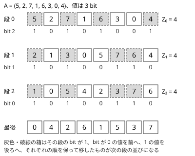

!!! abstract "要点"
    - **何ができるか**：区間の K 番目の値・x 未満の個数・和を、オンラインで $O(\log \sigma)$ で答える静的な構造。値を上位ビットから順に安定に 0/1 で振り分けた段を重ね、各段で 0 の個数の累積を持つ。
    - **いつ使うか**：
        - 区間の K 番目に小さい値をオンラインで答える
        - 長方形（添字の範囲 × 値の範囲）の中の点の数
    - **計算量**：$\sigma$ を値の種類の数（値が $\sigma$ 未満の非負整数）として、構築 $O(N \log \sigma)$、1 回のクエリ $O(\log \sigma)$、メモリ $O(N \log \sigma)$。座標圧縮すれば $\sigma \le N$ で、値の圧縮の二分探索に $O(\log N)$ が足される
    - **前提**：[マージソート木](../ds/merge-sort-tree.md)、[bit 演算の基本と XOR の性質](../basics/bit-operations.md)

<!-- textlint-disable -->
別名：ウェーブレット行列・Wavelet Tree・区間の K 番目
<!-- textlint-enable -->

Wavelet Matrix は、更新のない列 $A$ について「添字が $[l, r)$、値が $[x, y)$ の要素」を数えたり、その中の $K$ 番目を取り出したりする構造である。マージソート木と同じ問いに答え、値の bit を上から 1 つずつ決めながら降りるので、1 回の問いは $O(\log \sigma)$ で済む。ABC で必須になることはまれで、まずは[マージソート木](../ds/merge-sort-tree.md)で足りるかを考える。

## 何ができるか（区間の K 番目・x 未満の個数・和） {#what-it-does}

長さ $N$ の列 $A$（0-indexed、値は $0$ 以上 $2^{L}$ 未満）を前処理すると、次の問いにどれも $O(L)$ で答えられる。区間は[半開区間](../guide/glossary.md#half-open-interval) $[l, r)$ である。

- **K 番目**：$A_l, \dots, A_{r-1}$ のうち $K$ 番目（0 始まり）に小さい値。
- **x 未満の個数と和**：$A_l, \dots, A_{r-1}$ のうち $x$ 未満の要素の個数と、その和。
- **長方形の中の個数**：添字が $[l, r)$、値が $[x, y)$ の要素の個数。「$y$ 未満の個数 − $x$ 未満の個数」で求まる。
- そのほか、$x$ 未満で最大の値（$x$ 未満の個数を $c$ として $c - 1$ 番目）、区間の中の値 $x$ の個数、$A_i$ の復元。

要素 $i$ を点 $(i, A_i)$ と見れば、どれも「添字の範囲 × 値の範囲」の長方形についての問いである。座標が大きい点の集合でも、$x$ 座標でソートして添字にし、$y$ 座標を値にすれば同じ形になる。$L$ は値の bit 数で、座標圧縮すれば $L = \lceil \log_2 N \rceil$ にできる。

使う場面のサインは次の 2 つである。

- 区間の $K$ 番目や $x$ 未満（$x$ 以下なら $x + 1$ 未満）の個数・和を、前の答えで次の問いが決まる形（[オンライン強制](../guide/glossary.md#forced-online)）で多数聞かれる。
- 長方形の中の点を数えたうえで、「$x$ 個目の点はどこか」のように長方形の中を二分探索したい。

先読みできるなら、値の順に BIT へ足していく[オフライン](../guide/glossary.md#offline)の方法（[クエリの先読み](../ds/offline-queries.md)・[平面走査](../ds/sweep-line-2d.md)）の方が軽い。列に更新があると Wavelet Matrix は作り直しになるので使えない。

## 段の作り方（上位ビットから安定に振り分ける） {#build}

Wavelet Matrix は、値の bit 数 $L$ と同じ数の段からなる。段 $0$ の並びは $A$ そのものである。段 $d$ では上から $d$ 番目の bit（bit $L - 1 - d$）を見て、その bit が 0 の要素を前へ、1 の要素を後ろへ、それぞれの順を保って移す（安定な振り分け）。移した後の並びが段 $d + 1$ の並びになる。



各段で持つのは、並びの各位置の bit から作る 2 つの量だけである。

- $\mathrm{zero}_d(i)$：段 $d$ の並びの先頭 $i$ 個のうち、bit が 0 の個数（$\mathrm{zero}_d(0) = 0$）
- $Z_d = \mathrm{zero}_d(N)$：段 $d$ で bit が 0 の個数

これで段をまたいで区間を追える。段 $d$ の区間 $[l, r)$ にある要素のうち、bit が 0 のものは段 $d + 1$ で $[\mathrm{zero}_d(l), \mathrm{zero}_d(r))$ に、1 のものは $[Z_d + l - \mathrm{zero}_d(l),\ Z_d + r - \mathrm{zero}_d(r))$ に並ぶ。振り分けが安定なので、区間の要素は振り分けた後も前後に連続して並ぶからである。

段 $0$ の区間 $[l, r)$ から始めて、この写し方で段を下ると、区間の要素の中で「ここまで見た上位の bit が決めた値と一致するもの」が 1 つの区間として残る。2 分木を値の上位 bit で降りるのと同じだが（この 2 分木の形のものが Wavelet Tree である）、Wavelet Matrix は木の各ノードを段ごとの 1 本の並びにまとめて配列だけで書けるようにしたもので、子の位置を二分探索で探さずに $\mathrm{zero}_d$ の引き算で求められる。マージソート木の 1 回 $O(\log^2 N)$ が $O(\log \sigma)$ になるのはこのためである。

**K 番目**は、各段で区間の中の 0 の個数 $c = \mathrm{zero}_d(r) - \mathrm{zero}_d(l)$ を見て降りる。$K < c$ なら答えのこの bit は 0 で、0 の側へ進む。そうでなければ答えのこの bit は 1 で、$K$ から $c$ を引いて 1 の側へ進む。図の $A$ で $[1, 6)$（値 2, 7, 1, 6, 3）の $K = 2$ 番目を求めると、次のようになる。

- 段 0：区間 $[1, 6)$ の 0 は 3 個（2, 1, 3）。$2 < 3$ なので bit 2 は 0、段 1 の $[0, 3)$ へ。
- 段 1：区間 $[0, 3)$（2, 1, 3）の 0 は 1 個。$2 \ge 1$ なので bit 1 は 1、$K = 1$ として段 2 の $[4 + 0, 4 + 2) = [4, 6)$ へ。
- 段 2：区間 $[4, 6)$（2, 3）の 0 は 1 個。$1 \ge 1$ なので bit 0 は 1。答えは $011_{(2)} = 3$ で、ソートした $(1, 2, 3, 6, 7)$ の 2 番目と一致する。

**x 未満の個数**は、$x$ の bit に沿って降りる。$x$ の bit が 1 の段では、区間の中で bit が 0 の要素はすべて $x$ 未満なので個数 $c$ を足し、1 の側へ進む。bit が 0 の段では 0 の側へ進むだけである。最後に残る区間の要素は $x$ と等しいので数えない。**和**も同じ道で求まる。各段の並び（振り分けた後の並び）について値の累積和を持っておき、個数を足す段で、0 の側の区間 $[\mathrm{zero}_d(l), \mathrm{zero}_d(r))$ の値の和を段 $d + 1$ の累積和から足す。

自作するときの要点は次のとおりである。

- **値の範囲**：値は $0$ 以上 $2^L$ 未満にする。負の値や $10^9$ 程度の値は座標圧縮してから載せ、答えの添字を元の値に戻す。圧縮すると $L$ が 30 から 18 ほどに減り、速さとメモリの両方に効く。
- **境界**：$x \le 0$ なら個数は 0、$x \ge 2^L$ なら区間の全体である。降りる途中の区間は空になってもよく、そのまま進めて正しい（$\mathrm{zero}_d(l) = \mathrm{zero}_d(r)$ が続くだけ）。
- **メモリ**：$\mathrm{zero}_d$ を `int` の配列で持つと $4 N L$ バイトほどで、$N = 2 \times 10^5$、$L = 18$ なら 15 MB ほどである。和の累積は `long long` で段が $L + 1$ 本要る。bit 列を 64 bit ごとにまとめ、ブロックごとの累積と popcount で $\mathrm{zero}_d$ を求めれば、64 bit ごとに 32 bit の累積を持っても 1 要素あたり 1.5 bit で、メモリは 1/20 ほどになる（簡潔ビットベクトル）。
- **点の値の変更**：値が変わる更新はできない。値を変えずに重みだけを変えるなら、累積和の代わりに各段へ BIT を置けば $O(\log \sigma \log N)$ で対応できる（[マージソート木の各段の BIT](../ds/merge-sort-tree.md#bit-per-level) と同じ考え）。

K 番目と x 未満の個数・和を答える部分は次のようになる。`zero[d][i]` が $\mathrm{zero}_d(i)$、`nz[d]` が $Z_d$、`sum[d][i]` が段 $d$ の並びの先頭 $i$ 個の値の和である（段を作る部分を含めた完全なプログラムは `snippets/wavelet-matrix/wm.cpp`。累積を `int` の配列で持つ素朴な版）。

```cpp
--8<-- "wavelet-matrix/wm.cpp:core"
```

## ライブラリでの使い方と、マージソート木・永続セグメント木との比較 {#usage}

ACL には Wavelet Matrix がない。自作するなら、上のコード片か、公開されているライブラリ（ei1333 氏の Luzhiled's Library など）を参考にする。持たせる操作は「K 番目（小さい方・大きい方）」「長方形の中の個数」「$x$ 未満で最大の値・$x$ 以上で最小の値」の 3 種類を、まず持たせるとよい。座標圧縮を中に含めた版を作っておけば、値の大きさを気にせず使える。

検証には Library Checker の次の問題が使える（[練習問題](#practice)にも載せた）。

- Range Kth Smallest：区間の $k + 1$ 番目に小さい値。
- Static Range Frequency：区間の中の値 $x$ の個数。
- Static Range Sum with Upper Bound：区間の $x$ 以下の要素の個数と和。
- Rectangle Sum：重み付きの点の長方形の中の重みの和。$x$ でソートして添字にし、$y$ を値、重みを和の対象にする。

同じ問いに答える構造との違いは次のとおりである。

| 構造 | 1 回の問い | メモリ | 向いている場面 |
| --- | --- | --- | --- |
| [マージソート木](../ds/merge-sort-tree.md) | 個数・和 $O(\log^2 N)$、K 番目 $O(\log^3 N)$ | $O(N \log N)$ | 実装を軽くしたい |
| Wavelet Matrix | どれも $O(\log \sigma)$ | $O(N \log \sigma)$ | K 番目や長方形の中の二分探索が多い |
| [永続セグメント木](../ds/persistent-data-structures.md#prefix-versions) | どれも $O(\log N)$ | $O(N \log N)$ のノード | 版を持つ構造をほかにも使う |

永続セグメント木は、接頭辞ごとに「値の個数のセグメント木」の版を作り、版 $r$ と版 $l$ の差で区間の分布を見る。Wavelet Matrix とできることはほぼ同じで、ポインタを持つぶん定数倍とメモリが重い。Wavelet Matrix は配列だけで書けるので速い。

学ぶための資料は次の 3 つがよい。

- convexineq 氏の Qiita の記事：マージソート木・Fractional Cascading・Wavelet Tree・Wavelet Matrix を 1 つの流れで説明しており、Wavelet Matrix が「段ごとの並びにまとめたマージソート木」であることが分かる。
- miti-7 氏のブログの記事：K 番目・範囲の個数・前後の値・頻度の上位など、Wavelet Matrix でできる操作を図付きで一覧にしている。
- ei1333 氏の Luzhiled's Library：座標圧縮を含めた版の実装と、各操作の計算量。

## 例題 {#examples}

### ABC324 G. Generate Arrays {#abc324_g}

<div class="kp-problems" data-role="example" markdown>

- [ABC324 G. Generate Arrays](https://atcoder.jp/contests/abc324/tasks/abc324_g)（diff 2501）：順列から始め、「先頭 x 個」「値が x 未満」で列を分割するクエリごとに、新しい列の長さを答える。

</div>

分割で生まれる列は、どれも元の順列の「添字が $[l, r)$、値が $[lo, hi)$ の要素を元の順に並べたもの」になる。列を 4 つの数で表せば、列の長さは長方形の中の個数になり、Wavelet Matrix なら $O(\log N)$ で求まる。

??? note "解法の詳細"
    - 各列 $s$ を $(l_s, r_s, lo_s, hi_s)$ で持つ。初めの列は $(0, N, 0, N)$ である（値を 0 始まりにした順列）。
    - 値で分ける分割は、値の範囲を切るだけで済む。問題の $x$ を値の境界 $t$（$t$ 未満が元の列に残る）に直し、$t$ を $[lo_s, hi_s]$ に収めてから、元の列を $(l_s, r_s, lo_s, t)$、新しい列を $(l_s, r_s, t, hi_s)$ にする。値を 0 始まりにした順列では、問題の「値が $x$ 以下（1 始まり）のものを残す」は「0 始まりの値が $x$ 未満」なので $t = x$ である。
    - 「先頭 $x$ 個を残す」の分割は、添字の範囲を切る位置 $m$ を探す。$m$ は「長方形 $[l_s, m) \times [lo_s, hi_s)$ の中の個数が $x$ 以上」になる最小の $m$（なければ $r_s$）で、個数は $m$ について単調なので[答えで二分探索](../basics/binary-search-answer.md)できる。元の列を $(l_s, m, lo_s, hi_s)$、新しい列を $(m, r_s, lo_s, hi_s)$ にする。
    - 答えは新しい列の長方形の中の個数である。二分探索の 1 歩が $O(\log N)$ なので、全体は $O(N \log N + Q \log^2 N)$ になる。
    - 長方形の中の個数を数えられればよいので、点の追加のない 2 次元の構造ならほかでも解ける（動的な 2 次元 BIT を使う解き方もある）。

## 練習問題 {#practice}

<div class="kp-problems" data-role="practice" markdown>

- [ABC339 G. Smaller Sum](https://atcoder.jp/contests/abc339/tasks/abc339_g)（diff 1792）：区間内で X 以下の要素の和を、前の答えで次の質問が決まる形で多数答える。

</div>

??? note "方針"
    - **Smaller Sum**：前の答えで次の質問が決まるので先読みできない。Wavelet Matrix に和の累積を持たせ、$X + 1$ 未満の和を答える。値は $10^9$ 程度なので、座標圧縮するか $L = 30$ で載せる。[マージソート木](../ds/merge-sort-tree.md)の例題でもあり、そちらの 1 回 $O(\log^2 N)$ でも間に合う。

### Library Checker

- [Range Kth Smallest](https://judge.yosupo.jp/problem/range_kth_smallest)：区間の $k + 1$ 番目に小さい値を答える。K 番目の操作をそのまま使う。
- [Static Range Frequency](https://judge.yosupo.jp/problem/static_range_frequency)：区間の中の値 $x$ の個数を答える。「$x + 1$ 未満の個数 − $x$ 未満の個数」で求まる。
- [Static Range Sum with Upper Bound](https://judge.yosupo.jp/problem/static_range_sum_with_upper_bound)：区間の $x$ 以下の要素の個数と和を答える。
- [Rectangle Sum](https://judge.yosupo.jp/problem/rectangle_sum)：重み付きの点の長方形の中の重みの和を答える。点を $x$ でソートし、$y$ を座標圧縮して値にし、和の累積には重みを載せる。

## 確認問題 {#quiz}

??? question "確認問題：段ごとの振り分けを安定にしないと、何が壊れるか"
    段 $d$ の区間 $[l, r)$ の要素が、段 $d + 1$ で連続した区間に並ぶことが保証されなくなる。安定なら、区間の中の bit 0 の要素は「区間より前にある bit 0 の要素 $\mathrm{zero}_d(l)$ 個」のすぐ後ろに続けて並ぶ。順が入れ替わると、区間の外の要素が間に入り、$[\mathrm{zero}_d(l), \mathrm{zero}_d(r))$ が区間の要素を表さなくなる。

??? question "確認問題：x 未満の個数を数えるとき、最後に残った区間を数えないのはなぜか"
    最後まで降りると、残った区間の要素はすべての bit が $x$ と一致している。すなわち値が $x$ に等しく、$x$ 未満ではない。$x$ 以下の個数が欲しいなら、$x + 1$ 未満の個数を数えるか、最後の区間の長さを足せばよい。

## 参考 {#references}

- [convexineq「Merge sort tree, fractional cascading, 領域木、wavelet tree, wavelet matrix をまとめて理解するお得な記事」](https://qiita.com/convexineq/items/70f36585ae76f70e3abf)：段の作り方、段をまたぐ区間の写し方、和を段ごとの累積で持つ方法
- [miti-7「ウェーブレット行列(wavelet matrix)」](https://miti-7.hatenablog.com/entry/2018/04/28/152259)：Wavelet Matrix で答えられる操作の一覧と計算量
- [ei1333「Wavelet Matrix (ウェーブレット行列)」](https://ei1333.github.io/library/structure/wavelet/wavelet-matrix.hpp)：ライブラリの操作と、座標圧縮を含めた版の計算量
- [drken「AtCoder ABC 324 G - Generate Arrays (4D, 橙色, 600 点)」](https://drken1215.hatenablog.com/entry/2023/10/15/020209)：例題の列を 4 つの数で表す方法と、長方形の中の個数による二分探索
- [kmjp「AtCoder ABC #339 (日本レジストリサービス（JPRS）プログラミングコンテスト2024) : G - Smaller Sum」](https://kmjp.hatenablog.jp/entry/2024/02/03/0900)：練習の問いがオンライン強制であることの確認
- [yosupo06「library-checker-problems」](https://github.com/yosupo06/library-checker-problems)：Library Checker の 4 問（data_structure の range_kth_smallest・static_range_frequency・static_range_sum_with_upper_bound・rectangle_sum）の問いの確認
