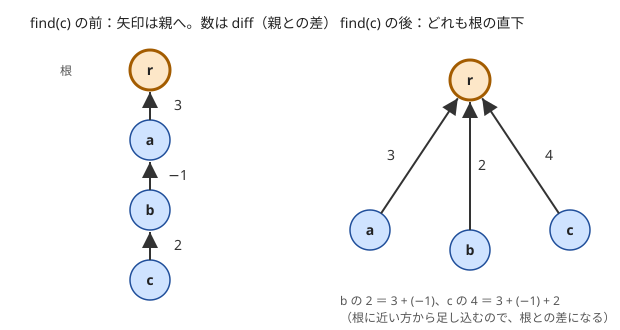
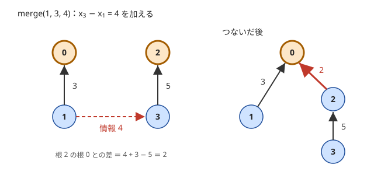

!!! abstract "要点"
    - **何ができるか**：$x_v - x_u = w$ の形の情報を順に受け取りながら、それまでの情報と矛盾しないかを判定し、同じ成分の 2 要素の差を答える。各要素に親との差を持たせた Union-Find で、差を XOR にすると 2 色の塗り分けになる。
    - **いつ使うか**：
        - $x_R - x_L = D$ の形の情報が順に与えられ、矛盾しないかを判定する
        - 相対的な位置・差だけが分かっている
        - 正直者と嘘つき・2 色に塗り分けられるか
        - 情報と質問が交互に $Q \le 2 \times 10^5$ 回来る
    - **計算量**：併合・矛盾の判定・差の取得はどれもならし $O(\alpha(N))$（union by size と経路圧縮を併用したとき。Union-Find と同じ）
    - **前提**：[Union-Find](../ds/union-find.md)

<!-- textlint-disable -->
別名：weighted union-find・ポテンシャル付き Union-Find・重み付き UF・偶奇の Union-Find・二部グラフの Union-Find・頂点倍化の Union-Find・差分の矛盾判定
<!-- textlint-enable -->

重み付き Union-Find は、[Union-Find](../ds/union-find.md) の各要素に「親との値の差」を持たせ、同じグループの 2 要素の差をいつでも答えられるようにしたデータ構造である。グループは「互いの差がすべて分かっている要素の集まり」を表す。差の情報が来るたびに、グループを併合するか、既知の差と照合する。

## 必要になる場面とアイデア {#idea}

$N$ 個の未知の値 $x_0, \dots, x_{N-1}$ について、「$x_v - x_u = w$」という情報が 1 つずつ届く場面を考える。知りたいのは、新しい情報がそれまでの情報と矛盾しないか、また 2 つの値の差が決まっているならいくつか、である。

差の情報は、$u$ から $v$ へ重み $w$、$v$ から $u$ へ重み $-w$ の辺と見られる。差が決まっている 2 要素は、この辺でつながった同じ連結成分にある。情報が全部そろってから一度だけ判定するなら、[DFS](../graph/dfs.md) で成分ごとに値を決めて辺を照合すればよい。しかし情報が来るたびに判定するなら、毎回 DFS をやり直すと 1 回 $O(N + M)$ かかり、$Q = 2 \times 10^5$ では間に合わない。

そこで連結性を Union-Find で持ち、各成分の根を基準（$x_{\text{根}} = 0$ と見る）にして、各要素に「根との差」を持たせる。同じ成分の $u, v$ なら、$x_v - x_u = (x_v - x_{\text{根}}) - (x_u - x_{\text{根}})$ で差が分かる。この根との差を、要素の[ポテンシャル](../guide/glossary.md#potential)と呼ぶ。

ただし、成分をつなぐたびに片方の成分の全要素の「根との差」を直すと遅い。そこで各要素は親との差だけを持ち、根との差は親をたどって足し合わせて求める。Union-Find の木の形はそのままに、辺に差のラベルが付いたものと考えればよい。

## 保つ性質（diff[v] は親との差） {#invariants}

各要素 $v$ に親 $\mathrm{par}[v]$ と、親との差 $\mathrm{diff}[v]$ を持たせ、次の性質を常に保つ。

- $\mathrm{diff}[v] = x_v - x_{\mathrm{par}[v]}$。根では $\mathrm{diff}[\text{根}] = 0$ とする
- よって $v$ から根までの経路の $\mathrm{diff}$ の和は $x_v - x_{\text{根}}$ になる
- 経路圧縮で $v$ を根の直下に付け替えた後は、$\mathrm{diff}[v]$ そのものが根との差 $x_v - x_{\text{根}}$ になる

木の形（親と大きさの持ち方）はふつうの Union-Find と同じでよい。根の $\mathrm{par}$ に「$-$（成分の大きさ）」を入れる書き方なら、配列を 1 本足すだけで済む。

## 各操作の手順（find・merge・差の取得） {#operations}

重み付き Union-Find の操作は、根を求める find、情報を加える merge、差を答える取得の 3 つである。添字は 0-indexed で書く。

### find：親を先に圧縮してから差を足す

$\mathrm{find}(v)$ は根を返し、ついでに $v$ を根の直下へ付け替える（経路圧縮）。付け替えると親が変わるので、$\mathrm{diff}[v]$ も「旧い親との差」から「根との差」に直す必要がある。

```text
find(v):
    v が根なら v を返す
    r ← find(par[v])           # 先に親を根まで圧縮する。これで diff[par[v]] = x_親 − x_根
    diff[v] ← diff[v] + diff[par[v]]   # (x_v − x_親) + (x_親 − x_根) = x_v − x_根
    par[v] ← r
    r を返す
```

再帰で親を先に処理するのが要点である。親の $\mathrm{diff}$ が根との差に直った後でなければ、足しても根との差にならない。次の図は、根 $r$ から $a$・$b$・$c$ と一直線につながった木で $\mathrm{find}(c)$ を呼んだ前後を表す。



再帰は根に近い $a$ から戻ってくる。根の直下にある $a$ の差は $3$ のまま変わらない。続いて $b$ が $-1 + 3 = 2$、$c$ が $2 + 2 = 4$ になる。どの要素も、根との差を 1 回の足し算で得ている。

### merge：根どうしの差に直してつなぐ

$\mathrm{merge}(u, v, w)$ は「$x_v - x_u = w$」を加える。$u$ と $v$ の根を $r_u, r_v$ とし、find の後の根との差を $p_u = x_u - x_{r_u}$、$p_v = x_v - x_{r_v}$ とする。

- $r_u = r_v$ なら、つながず照合だけをする（[矛盾の判定と差の取得](#consistency)）
- 違えば、つなぐのは $u$ と $v$ ではなく根どうしである。根どうしの差は次のようになる

$$
x_{r_v} - x_{r_u} = (x_v - p_v) - (x_u - p_u) = w + p_u - p_v
$$

この値を $W$ とし、$r_v$ を $r_u$ の下につないで $\mathrm{diff}[r_v] = W$ とする。union by size で向きを入れ替えて $r_u$ を $r_v$ の下につなぐときは、差の向きも逆になるので $\mathrm{diff}[r_u] = -W$ とする。

次の図は、根 $0$ の成分 $\{0, 1\}$（$x_1 - x_0 = 3$）と、根 $2$ の成分 $\{2, 3\}$（$x_3 - x_2 = 5$）に、情報 $x_3 - x_1 = 4$ を加える例である。



$W = 4 + 3 - 5 = 2$ なので、$\mathrm{diff}[2] = 2$ として $2$ を $0$ の下につなぐ。確かめると、$x_0 = 0$ とすれば $x_1 = 3$、$x_2 = 2$、$x_3 = 7$ で、$x_3 - x_1 = 4$ を満たす。成分 $\{2, 3\}$ の中の差（$x_3 - x_2 = 5$）は、根の下にまとめてずれるだけなので変わらない。

### 差の取得

同じ成分の $u, v$ について、$x_v - x_u = p_v - p_u$ を返す。$p_u$ と $p_v$ はそれぞれ find を呼んだ後の $\mathrm{diff}$ である。違う成分なら差は決まらない。

C++ では次のように書ける（完全なプログラムは乱数の試験つきで snippets に置く）。

```cpp
--8<-- "weighted-union-find/weighted-union-find.cpp:core"
```

!!! info "ACL では"
    ACL の `dsu` は差を持てないので、重み付き Union-Find は自作する。偶奇だけなら、`dsu d(2 * n);` で頂点を 2 倍にする書き方（[頂点を 2 倍にする Union-Find](#generalization)）が使える。`d.merge(a, b)`・`d.same(a, b)` はどれもならし $O(\alpha(N))$ である。

## 境界（根の差は 0・同じ成分の merge・値の範囲） {#boundaries}

重み付き Union-Find で気を付ける境界は次のとおりである。

- **根の差は 0**：根の $\mathrm{diff}$ を 0 にしておくと、find の後の $\mathrm{diff}[v]$ がそのまま根との差になり、根自身にも同じ式が使える。根でなくなるとき（merge で下につながれるとき）だけ書き換える
- **同じ成分の merge**：$r_u = r_v$ のときもつなごうとすると、根が自分自身を親に持つ形になり、木が壊れる。必ず照合だけにして戻る
- **$u = v$ の情報**：$x_u - x_u = w$ は $w = 0$ なら何も起きず、$w \ne 0$ なら矛盾である。同じ成分の照合に含まれるので、特別扱いは要らない
- **値の範囲**：根との差は経路の $\mathrm{diff}$ の和で、最大で全情報の $\lvert w \rvert$ の和になる。$\lvert w \rvert \le 10^9$ で情報が $2 \times 10^5$ 個なら $2 \times 10^{14}$ に届くので、`long long` で持つ

## 矛盾の判定と差の取得 {#consistency}

新しい情報 $x_v - x_u = w$ が矛盾するのは、$u$ と $v$ がすでに同じ成分にあり、既知の差 $p_v - p_u$ が $w$ と違うときだけである。違う成分なら、どんな $w$ でもつないで矛盾なく値を決められる。

**なぜ正しいか**：成分の中の差は、根との差を通して 1 通りに決まっている。そこへ同じ 2 要素の差を別の値で言う情報が来れば、どの値の割り当てでも両方は満たせない。逆に、違う成分どうしの情報は、片方の成分全体を一律にずらせば必ず満たせる。ずらしても成分の中の差は変わらないので、それまでの情報も壊れない。

この性質から、merge は次の 3 通りの結果を返す関数として使うと書きやすい。

- 違う成分：つないで「矛盾なし」を返す
- 同じ成分で $p_v - p_u = w$：何もせず「矛盾なし」を返す（すでに分かっていた情報）
- 同じ成分で $p_v - p_u \ne w$：何もせず「矛盾」を返す

差を答える質問では、先に同じ成分かを確かめる。違う成分の $p_v - p_u$ は、根が違うので意味のない数である。問題が「決まらなければ Ambiguous」のように答えさせるのは、この場合である。

??? question "確認問題：成分 $\{0, 1, 2\}$ に $x_1 - x_0 = 2$、$x_2 - x_1 = 3$ が入っているとき、$x_2 - x_0 = 6$ は矛盾か"
    矛盾である。既知の差は $x_2 - x_0 = (x_2 - x_1) + (x_1 - x_0) = 5$ で、$6$ と違う。重み付き Union-Find では、$0$ と $2$ の根が同じであることを確かめ、根との差の引き算 $p_2 - p_0 = 5$ を $6$ と比べて判定する。

## 計算量とその根拠 {#complexity}

find の手間は、ふつうの Union-Find の find に、要素ごとの足し算 1 回を加えただけである。経路圧縮で付け替える要素ごとに足し算を 1 回するので、木をたどる手間の定数倍しか増えない。merge と差の取得は、find を 2 回呼んだ後に $O(1)$ の計算をする。

よって、union by size（または union by rank）と経路圧縮を併用すれば、どの操作もならし $O(\alpha(N))$ で、Union-Find と同じである。$\alpha$ はアッカーマン関数の逆関数で、実用上は 4 以下と考えてよい。経路圧縮だけ、または union by size だけでも、ならし $O(\log N)$ になる。

再帰の深さは木の高さで、union by size をしていれば $O(\log N)$ に収まる。union by size をせずに一直線の木ができると、find の再帰が $N$ 段になりうる。

## 一般化（XOR で偶奇・二部グラフ、頂点を 2 倍にする） {#generalization}

重み付き Union-Find に載せる「差」は、加算に限らない。手順で使ったのは次の 3 つだけである。

- 経路の差をまとめる演算が[結合法則](../guide/glossary.md#associativity)を満たす（find で足し合わせる順を気にしなくてよい）
- 根の差を表す[単位元](../guide/glossary.md#identity-element)がある（加算なら $0$）
- 向きを入れ替えたときに差を逆にできる（加算なら $-W$）

この 3 つを満たせば、差を XOR・mod の加算・置換の合成などに替えても同じ手順で動く。演算の順序を入れ替えると結果が変わる場合（置換の合成など）は、find で「親との差」と「親の根との差」を結ぶ順と、merge での根どうしの差の式を、どちらも向きに気を付けて書く。Library Checker の Unionfind with Potential（Non-Commutative Group）はこの形である。

### XOR にすると偶奇・2 色の塗り分けになる

値を $0$ と $1$ の 2 色にし、差を XOR $\oplus$ にする。「$u$ と $v$ は違う色」は $x_u \oplus x_v = 1$、「同じ色」は $x_u \oplus x_v = 0$ である。XOR は自分自身が逆なので、向きを入れ替えても符号の反転は要らない。

辺 $(u, v)$ ごとに「違う色」の情報を加えていき、矛盾が出なければ、グラフは[二部グラフ](../graph/bipartite-graph.md)である。矛盾が出るのは、同じ色の 2 頂点を辺で結んだとき、すなわち長さが奇数の閉路ができたときである。

```cpp
--8<-- "weighted-union-find/parity.cpp:core"
```

正直者と嘘つきの問題も、「$A$ が $B$ を正直者と言う」が「$A$ と $B$ は同じ種類」になる（正直者の証言なら $B$ は正直者、嘘つきの証言なら $B$ は嘘つき）ので、同じく XOR の情報になる。

### 頂点を 2 倍にする Union-Find

偶奇だけなら、ふつうの Union-Find でも書ける。各要素 $v$ に「$v$ が色 0」の頂点 $v$ と「$v$ が色 1」の頂点 $v + N$ を用意し、「同時に成り立つ」ものを同じグループにする。

- 「$u$ と $v$ は違う色」：$u$ と $v + N$、$u + N$ と $v$ をそれぞれ併合する
- 「$u$ と $v$ は同じ色」：$u$ と $v$、$u + N$ と $v + N$ をそれぞれ併合する
- 矛盾は、ある $v$ で $v$ と $v + N$ が同じグループになったときである

ACL の `dsu` をそのまま使えるのが利点で、要素数は $2N$ になる。成分ごとの色の数を数えるには、各グループの中で番号が $N$ 未満の頂点を数える必要があり、差を持つ書き方より手間がかかる。

## 応用の型 {#applications}

重み付き Union-Find がそのままの形で出ることは少なく、次のように言い換えてから使うことが多い。

- **和の情報を差に直す**（サイン：隣り合う 2 項の和が分かる）：$y_i = (-1)^i A_i$ とおくと、$A_i + A_{i+1} = V$ は $y_{i+1} - y_i = (-1)^{i+1} V$ になる。差の情報として持ち、答えるときに符号を戻す
- **矛盾した成分に印を付ける**（サイン：矛盾があっても処理を続け、その成分だけ答えが変わる）：根に「矛盾あり」の印を持たせる。merge で 2 つの成分をつなぐときは、新しい根の印を 2 つの印の OR にする。逆向きに通ると符号が反転する辺のグラフで、正の閉路がある成分の最長路を inf と答える問題がこの形である
- **根に成分の集計を持たせる**（サイン：成分ごとに色を選び、全体の最小・最大を答える）：根に「根と同じ色の要素数」と「違う色の要素数」を持たせ、merge で足し合わせる。根との差の値ごとに数を持てば、成分ごとに少ない方の色を選ぶ、のような集計ができる
- **3 変数の関係を 2 変数に直す**（サイン：各人の属性が 2 つあり、証言が両方に関わる）：同じ人の証言 2 つを XOR すると、その人だけの変数が消えて 2 変数の XOR の情報になる。2 変数の関係に直せれば、偶奇の Union-Find に載る

??? question "確認問題：隣り合う 2 項の和 $A_0 + A_1 = 5$、$A_1 + A_2 = 7$ から、$A_0 = 1$ のときの $A_2$ を差の形で求めよ"
    $y_i = (-1)^i A_i$ とおくと、$y_1 - y_0 = (-1)^1 \cdot 5 = -5$、$y_2 - y_1 = (-1)^2 \cdot 7 = 7$ である。よって $y_2 - y_0 = 2$ で、$y_0 = A_0 = 1$ から $y_2 = 3$、$A_2 = (-1)^2 y_2 = 3$ になる。確かめると $A_1 = 4$ で、$1 + 4 = 5$、$4 + 3 = 7$ を満たす。

## 落とし穴 {#pitfalls}

重み付き Union-Find のバグは、次のものがほとんどである。

- **圧縮の順序**：find で $\mathrm{diff}[v]$ に $\mathrm{diff}[\mathrm{par}[v]]$ を足すのを、親の find より先にすると、親の「旧い親との差」しか足されない。木の高さが 2 以下の小さな例では正しく動くので見落としやすい。必ず `int r = find(par[v]);` を先に書く
- **find の前の diff を使う**：merge の $W = w + p_u - p_v$ の $p_u, p_v$ は、find を呼んだ後の $\mathrm{diff}$ である。find の前の $\mathrm{diff}[u]$ は親との差で、根との差ではない
- **向きを入れ替えたときの符号**：union by size で $r_u$ と $r_v$ を入れ替えたら、$W$ を $-W$ にする。入れ替えた後に同じ式で $\mathrm{diff}$ を書くと、成分の大きさの順によって答えがずれる
- **情報の向き**：「$x_a - x_b = d$」と「$x_v - x_u = w$」は引く向きが逆である。自分のライブラリの merge が「第 2 引数 − 第 1 引数」なのか、その逆なのかを決めておき、問題の式に合わせて引数を並べる
- **矛盾の印の引き継ぎ**：成分に「矛盾あり」の印を持たせるとき、印は根に持たせる。merge で根でなくなる側の印を新しい根へ OR で移し忘れると、矛盾が消える。同じ成分の矛盾では、つながないので印を立てるだけにする
- **違う成分の差を答える**：差の取得の前に同じ成分かを確かめる。根が違う 2 要素の $p_v - p_u$ も何かの数になるので、確かめないと誤答に気づけない
- **問題文の 1-indexed**：$N$ 要素で作って 1-indexed の番号を渡すと、配列の外を触る。読むときに 1 を引くか、$N + 1$ 要素で作る

## 例題 {#examples}

### ARC090 D. People on a Line {#arc090_b}

<div class="kp-problems" data-role="example" markdown>

- [ARC090 D. People on a Line](https://atcoder.jp/contests/arc090/tasks/arc090_b)（diff 1452）：「x_R − x_L = D」の形の情報の集まりが矛盾しないかを判定する。

</div>

人の位置を $x_i$ とすると、各情報は $x_R - x_L = D$ で、重み付き Union-Find の merge の形そのものである。情報を順に merge し、1 回でも矛盾が返れば No、最後まで矛盾がなければ Yes と答える。情報はすべて最初に与えられるので、DFS で成分ごとに位置を決めてから照合する方法でも解ける。

??? note "解法の詳細"
    1-indexed の $L, R$ から 1 を引き、$\mathrm{merge}(L - 1, R - 1, D)$ を順に呼ぶ（$x_R - x_L = D$ なので、第 1 引数が $L$ 側）。merge は、違う成分ならつなぎ、同じ成分なら既知の差 $p_{R} - p_{L}$ と $D$ を比べる。$N \le 10^5$、$M \le 2 \times 10^5$ で、全体でならし $O(N + M \alpha(N))$ である。

    DFS で解くときは、情報ごとに $L \to R$ へ重み $D$、$R \to L$ へ重み $-D$ の辺を張る。成分ごとに始点を $0$ として位置を決め、すでに位置が決まった頂点へ着いたら辺と照合する。こちらは $O(N + M)$ である。

### ABC328 F. Good Set Query {#abc328_f}

<div class="kp-problems" data-role="example" markdown>

- [ABC328 F. Good Set Query](https://atcoder.jp/contests/abc328/tasks/abc328_f)（diff 1477）：差の条件を順に見て、それまでに採用した条件と矛盾しないものだけを採用し、採用した番号を答える。

</div>

条件を見るたびに「それまでに採用した条件と矛盾するか」を判定するので、判定の対象が 1 つ前までの結果で変わる。全体を見てから一度だけ DFS で判定するわけにはいかず、重み付き Union-Find でその場で判定するのが自然である。矛盾しない条件だけを merge すれば、採用した条件だけが構造に残る。

??? note "解法の詳細"
    条件 $i$ は $x_a - x_b = d$ の形である。merge の約束（$x_v - x_u = w$ を加える）に合わせて、$\mathrm{merge}(b - 1, a - 1, d)$ を呼ぶ。矛盾しなければ（違う成分をつないだか、同じ成分で既知の差と一致したか）$i$ を出力し、矛盾すればその条件は捨てる。

    merge は矛盾するとき何も書き換えないので、捨てた条件は後の判定に影響しない。$N, Q \le 2 \times 10^5$ で、全体でならし $O((N + Q) \alpha(N))$ である。

    別解として、各成分の要素を列挙できるようにしておき、つなぐときに小さい方の成分の全要素の値を一律にずらす方法もある（[マージテク](../tree/small-to-large.md)の考え方で $O(N \log N + Q)$）。

## 練習問題 {#practice}

<div class="kp-problems" data-role="practice" markdown>

- [ABC327 D. Good Tuple Problem](https://atcoder.jp/contests/abc327/tasks/abc327_d)（diff 709）：条件を満たす 0/1 の列が存在するかを判定する。
- [ABC373 D. Hidden Weights](https://atcoder.jp/contests/abc373/tasks/abc373_d)（diff 765）：各辺 u → v について x_v − x_u = w となる頂点の値を 1 つ求める。
- [ABC451 F. Make Bipartite 3](https://atcoder.jp/contests/abc451/tasks/abc451_f)（diff 1540）：辺を 1 本ずつ足すたびに、どの辺の両端も違う色になるように頂点を白と黒に塗るときの黒の頂点の数の最小を答える（塗れなくなったら以降は −1）。
- [典型90 068. Paired Information（★5）](https://atcoder.jp/contests/typical90/tasks/typical90_bp)（diff —）：隣り合う 2 項の和の情報を受け取りながら、A_X = V のときの A_Y を答える（決まらなければ Ambiguous）。
- [ABC280 F. Pay or Receive](https://atcoder.jp/contests/abc280/tasks/abc280_f)（diff 1819）：逆向きに通ると重みの符号が反転するグラフで、2 点間の最長路を答える（いくらでも大きくできるなら inf）。

</div>

??? note "方針"
    - **ABC327 D**：$S_i$ と $T_i$ を「違う値」の情報として、偶奇の Union-Find か、頂点を 2 倍にする Union-Find で矛盾を判定する。情報は最初にすべてそろうので、BFS・DFS の 2 色塗りでもよい
    - **ABC373 D**：解の存在が保証されているので、矛盾の判定は要らない。各辺を merge した後、各頂点の根との差をそのまま値として出力すればよい。DFS で逆辺を $-w$ で張って値を決めてもよい
    - **ABC451 F**：偶奇の Union-Find の根に、根と同じ色の数と違う色の数を持たせる。成分ごとに少ない方を黒にすればよく、違う成分をつなぐときに足し直す。同じ成分で同じ色の 2 頂点を結んだら、以降はずっと −1 である
    - **典型90 068**：$(-1)^i$ を掛けて和の情報を差の情報に直し（[応用の型](#applications)）、質問のときに符号を戻す。$X$ と $Y$ が違う成分なら Ambiguous である
    - **ABC280 F**：各辺を merge し、矛盾した成分の根に印を付ける（つなぐときは印を OR で引き継ぐ）。質問では、違う成分なら nan、印があれば inf、それ以外は差を答える。差が 1 通りに決まる成分では、どの経路を通っても長さは差に等しい

## 力試し {#challenge}

<div class="kp-problems" data-role="challenge" markdown>

- [ARC188 C. Honest or Liar or Confused](https://atcoder.jp/contests/arc188/tasks/arc188_c)（diff 2377）：正直者・嘘つき・混乱の有無について、すべての証言と整合する割り当てを求める。

</div>

??? note "方針"
    - **ARC188 C**：各人の「正直者か」と「混乱しているか」を 0/1 の変数にすると、証言は 3 変数の XOR の式になる。同じ人の証言 2 つを XOR すると、その人の 2 つの変数が消えて、証言された 2 人の変数の XOR の情報になる。これを偶奇の Union-Find に載せ、矛盾がなければ値を決めてから各人の「混乱しているか」を復元する

## 確認問題 {#quiz}

??? question "確認問題：find で、親を先に圧縮してから差を足すのはなぜか"
    差を足す時点で $\mathrm{diff}[\mathrm{par}[v]]$ が「親と根との差」になっていなければならないからである。親の find を先に呼べば、親は根の直下に付け替えられ、$\mathrm{diff}[\mathrm{par}[v]] = x_{\text{親}} - x_{\text{根}}$ になる。順序を逆にすると、親の「旧い親との差」だけを足すことになり、根との差にならない。

??? question "確認問題：merge(u, v, w) で根どうしをつなぐとき、diff[r_v] に入れる値は何か"
    $w + p_u - p_v$ である。$p_u = x_u - x_{r_u}$、$p_v = x_v - x_{r_v}$ とすると、$x_{r_v} - x_{r_u} = (x_v - p_v) - (x_u - p_u) = w + p_u - p_v$ になる。向きを入れ替えて $r_u$ を $r_v$ の下につなぐなら、$\mathrm{diff}[r_u] = -(w + p_u - p_v)$ である。

??? question "確認問題：差を XOR にしたとき、向きを入れ替えても符号の反転が要らないのはなぜか"
    XOR では $a \oplus a = 0$ なので、各値が自分自身の逆になるからである。$x_{r_v} \oplus x_{r_u}$ と $x_{r_u} \oplus x_{r_v}$ は同じ値で、どちらを下につないでも $\mathrm{diff}$ に入れる値は変わらない。

## 使い分け {#choosing}

重み付き Union-Find が要るのは、差の情報が順に来て、途中で矛盾の判定や差の質問に答える場合である。

| 状況 | 使う手法 |
| --- | --- |
| 情報が最初にすべてそろい、一度だけ判定・値を決める | [DFS](../graph/dfs.md) で成分ごとに値を伝える |
| 情報が順に来て、そのたびに矛盾の判定や差の質問に答える | 重み付き Union-Find |
| 2 色に塗れるかを一度だけ判定する | [二部グラフ](../graph/bipartite-graph.md)の 2 色塗り（BFS・DFS） |
| $x_v - x_u \le w$ の不等式の制約 | [差分制約](../graph/difference-constraints.md)の最短路 |
| 差ではなく、成分の大きさ・辺の数などを持つ | [Union-Find の応用](../ds/union-find-applications.md) |

不等式の制約は、等式と違って成分の中で値が 1 通りに決まらないので、根との差では表せない。最短路の問題に直す。

## 参考 {#references}

- [drken「重み付き Union-Find とそれが使える問題のまとめ、および、牛ゲーについて」](https://qiita.com/drken/items/cce6fc5c579051e64fab)：find で親を先に圧縮する順序、merge で根どうしの差に直す式、向きを入れ替えたときの符号
- [drken「AtCoder ABC 087 D - People on a Line (ARC 090 D)」](https://drken1215.hatenablog.com/entry/2022/12/08/152700)：例題 arc090_b の制約と、重み付き Union-Find・DFS の 2 つの解法
- [drken「AtCoder ABC 328 F - Good Set Query」](https://drken1215.hatenablog.com/entry/2023/11/12/040700)：例題 abc328_f の条件の向きと、オンラインに判定する理由・マージテクの別解
- [drken「AtCoder ABC 373 D - Hidden Weights」](https://drken1215.hatenablog.com/entry/2024/09/29/022852)：練習 abc373_d の方針
- [drken「AtCoder ABC 327 D - Good Tuple Problem」](https://drken1215.hatenablog.com/entry/2023/11/05/161745)：練習 abc327_d の言い換え
- [ikatakos「AtCoder Beginner Contest 451」](https://ikatakos.com/pot/programming_algorithm/contest_history/atcoder/2026/0328_abc451)：練習 abc451_f の根に色ごとの数を持たせる方針（解法の部分だけ）
- [enakai00「068 - Paired Information（★5）の解説」](https://enakai00.hatenablog.com/entry/2021/09/06/103720)：練習 typical90_bp の和を差に直す変換
- [drken「AtCoder ABC 280 F - Pay or Receive」](https://drken1215.hatenablog.com/entry/2022/12/07/231851)：練習 abc280_f の矛盾した成分に印を付ける方針
- [drken「AtCoder ARC 188 C - Honest or Liar or Confused」](https://drken1215.hatenablog.com/entry/2025/01/22/023720)：力試し arc188_c の XOR の式と変数の消し方
