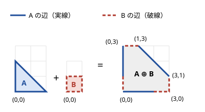

!!! abstract "要点"
    - **何ができるか**：動的な凸包・回転キャリパー（最遠点対）・最近点対・半平面交差・ミンコフスキー和で、点集合と凸図形の最大・最小・共通部分を $O(N \log N)$ 前後で求める。ABC での出題はまれで、Library Checker で確かめられる。
    - **いつ使うか**：
        - 最も遠い 2 点（凸包上の対蹠点）
        - 最も近い 2 点（$N \le 2 \times 10^5$）
        - 点の追加と $ax+by$ の最大のクエリ
        - 2 つの凸な点集合の和の凸包
        - 半平面の共通部分
    - **計算量**：凸包を作れば回転キャリパー $O(N)$・ミンコフスキー和 $O(N + M)$。最近点対・最遠点対・半平面交差・ドロネー三角形分割は $O(N \log N)$。動的な凸包は点の追加がならし $O(\log N)$、最大のクエリ $O(\log N)$。線分の交点の列挙は $O((N + K) \log N)$（$K$ は交点の数）
    - **前提**：[凸包と凸多角形](../geometry/convex-hull.md)

<!-- textlint-disable -->
別名：回転キャリパー・rotating calipers・最遠点対・最近点対・closest pair・半平面交差・動的凸包・ミンコフスキー和・Minkowski sum・ボロノイ図・ドロネー三角形分割・円の反転
<!-- textlint-enable -->

発展の幾何は、[凸包](../geometry/convex-hull.md)の上に組み立てる計算幾何の道具の集まりである。どれも「凸な図形の上では、調べる候補が辺の順に単調に動く」ことを使って、全組の $O(N^2)$ を $O(N \log N)$ 前後に落とす。

ABC で必要になった例は、調べた範囲では [ABC478 G](#abc478_g)（ミンコフスキー和）と ABC244 Ex（[練習問題](#practice)）だけである。黄を目指す段階では、名前と「何が何の計算量でできるか」を知っておき、出会ったら資料と Library Checker で自作のライブラリを確かめればよい。座標は整数のまま[外積](../guide/glossary.md#cross-product)（反時計回りが正）で判定するのが基本で、誤差の扱いは[幾何の誤差](../geometry/geometry-precision.md)にまとまっている。

## 動的な凸包（点の追加と ax+by の最大） {#dynamic-hull}

点の集合に対する $\max (a x + b y)$ は、点とベクトル $(a, b)$ の[内積](../guide/glossary.md#dot-product)の最大である。内積を最大にする点は、向き $(a, b)$ に最も突き出た点なので、凸包の頂点にある。$b > 0$ なら上側凸包、$b < 0$ なら下側凸包だけを見ればよく、$b = 0$ なら $x$ の最大か最小で済む。これは[凸包と CHT の双対](../geometry/convex-hull.md#cht-duality)そのもので、上側凸包の辺の傾きは単調に減るので、傾きが $-a/b$ をまたぐ辺を二分探索すれば最大の頂点が $O(\log N)$ で見つかる。

点が後から追加されるときは、凸包を作り直すと 1 回 $O(N)$ かかる。上側凸包の頂点を $x$ の順に `std::set` で持ち、追加した点の左右の隣を外積で調べて、凸でなくなった頂点を取り除けばよい。各点は 1 回入り、高々 1 回取り除かれるので、追加はならし $O(\log N)$ である。クエリで傾きを二分探索するには、各頂点に「次の頂点への辺の傾き」を持たせる。辺の傾きは $x$ の順に単調に減るので、比較関数を「頂点どうしは $x$ で、クエリは辺の傾きで」比べる形（`is_transparent` を使った異種の比較）にすれば、同じ `std::set` の `lower_bound` で引ける（直線の側で言えば、[CHT のページ](../dp/cht.md)で交点を持たせる作り方と同じ）。傾きは分数になるので、比べるときは掛け算の形にする。この比較関数と追加の処理を自作するのは重いので、クエリを先読みできるなら次の 2 つを優先する。

クエリを先読みするときの 2 つの方法は次のとおりである。

- **時刻のセグメント木**：追加の順番を添字にしたセグメント木の各ノードに、その範囲の点の凸包を持たせる。$i$ 番目までの点は $O(\log N)$ 個のノードに分かれるので、各ノードで二分探索して最大を取る。全体で $O(N \log^2 N)$ である。
- **Li Chao Tree**：$b > 0$ なら $\max (a x + b y) = b \cdot \max (x \cdot \frac{a}{b} + y)$ なので、点 $(x, y)$ を直線 $t \mapsto x t + y$ とみなし、$t = a/b$ での最大を問う。$t$ の候補（分数）を先にすべて集めてソートしておけば、[Li Chao Tree](../dp/cht.md#li-chao-tree) が使える。評価は $x a + y b$ の整数で行えばよい。$b < 0$ なら $a x + b y = \lvert b \rvert \cdot (x \cdot \frac{a}{\lvert b \rvert} - y)$ なので、直線 $t \mapsto x t - y$ の木をもう 1 つ持ち、$b = 0$ は $x$ の最大と最小を別に持つ。

## 回転キャリパー（凸包上の最遠点対） {#rotating-calipers}

点の集合で最も遠い 2 点（最遠点対）は、どちらも凸包の頂点である。さらに、その 2 点は「平行な 2 本の直線で凸包を挟んだとき、それぞれの直線に触れる頂点」の組（対蹠点の組）になっている。凸包を挟む平行な 2 本の直線を、凸包に沿って 1 周回すと、触れる頂点の組は辺の順に単調に進む。この挟む直線の動きが名前の由来である。

実装では、反時計回りの凸包の各辺 $(h_i, h_{i+1})$ について、その辺から最も遠い頂点 $h_j$ を求める。辺からの距離は三角形 $h_i h_{i+1} h_j$ の面積に比例するので、外積で比べられる。$i$ を進めると $j$ は戻らないので、$j$ は全体で 1 周しか進まず、凸包を作った後は $O(N)$ である。全体は凸包を作る $O(N \log N)$ で決まる。

```cpp
--8<-- "advanced-geometry/calipers.cpp:core"
```

完全なプログラムは `snippets/advanced-geometry/calipers.cpp` で、小さい乱数の入力で全組の比較と照らし合わせている。一直線上の点の扱いなど、自作するときの注意は[自作するときの要点](#library)にまとめた。

## 最近点対（分割統治・平面走査で O(N log N)） {#closest-pair}

最も近い 2 点（最近点対）は凸包と関係がなく、[分割統治](../basics/divide-and-conquer.md)か[平面走査](../ds/sweep-line-2d.md)で求める。全組を調べると $O(N^2)$ である。

**分割統治**：点を $x$ でソートし、真ん中で左右に分けて、それぞれの最近点対の距離を再帰で求める。小さい方を $d$ とすると、左右をまたぐ組で $d$ より近いものは、境界の $x$ から距離 $d$ 未満の帯に入る点どうしに限られる。帯の点を $y$ の順に並べれば、各点の比べる相手は $y$ の差が $d$ 未満の点だけである。比べる相手の候補は帯の中の $d \times 2d$ の長方形に入る。これを境界で左右の $d \times d$ の正方形に分けると、同じ側の点どうしは距離が $d$ 以上なので、各正方形に入る点は 4 個までである。よって比べる相手は定数個である。$y$ の順をマージソートで作りながら戻れば、$T(N) = 2T(N/2) + O(N)$ で $O(N \log N)$ になる（[またぐものの数え方](../basics/divide-and-conquer.md#crossing)と同じ形）。

**平面走査**：点を $x$ の順に見ながら、$x$ の差が $d$ 未満の点だけを $y$ で並べた `std::set` に持つ。鍵は $(y, x)$ の組にする（$y$ だけだと、同じ $y$ の別の点が消える）。新しい点 $(x_0, y_0)$ については、`lower_bound` で $y_0$ の位置を求め、そこから上下に $(\Delta y)^2 < d^2$ の間だけ進めて比べる。範囲に入る点は同じ理由で定数個なので、全体で $O(N \log N)$ である。

どちらも、$d$ を距離の 2 乗 $d^2$ で持ち、「$x$ の差が $d$ 未満」を $(\Delta x)^2 < d^2$ の形で比べれば、平方根と浮動小数点は要らない。格子で区切って乱択で点を入れる期待 $O(N)$ の方法もある（cp-algorithms の資料）。

## 半平面交差 {#half-plane-intersection}

半平面 $a_i x + b_i y \le c_i$ の共通部分（凸多角形か、空か、有界でない領域）を求めるのが半平面交差である。2 変数の線形計画法や、多角形の内側のうち全部の辺を見渡せる領域（核）を求めるのに使う。

よく使われる方法は、半平面を境界の向きの偏角でソートし、deque に入れながら、両端の不要になった半平面を取り除くものである（Sort-and-Incremental 法、$O(N \log N)$）。共通部分の辺は偏角の順に並ぶので、新しい半平面は deque の両端だけと比べれば足りる。ソートは[偏角ソート](../geometry/argument-sort.md)で行う。

有界にする工夫や交点の精度など、自作するときの注意は[自作するときの要点](#library)にまとめた。

Library Checker に半平面交差の問題はなく、自作したら小さい入力で全探索と照らし合わせて確かめる。

## ミンコフスキー和（凸包の和） {#minkowski-sum}

点の集合 $A$・$B$ のミンコフスキー和は、$A \oplus B = \{ a + b \mid a \in A, b \in B \}$ である。凸包について $\mathrm{conv}(A \oplus B) = \mathrm{conv}(A) \oplus \mathrm{conv}(B)$ が成り立つので、全組の和 $\lvert A \rvert \lvert B \rvert$ 個の凸包が、2 つの凸包だけから求まる。

凸多角形どうしの和は、両方の辺のベクトルを偏角の順に合わせて並べた列を、辺の列とする凸多角形になる。最も下（同じ高さなら最も左）の頂点どうしの和から始め、2 つの辺の列をマージソートのように偏角の小さい方から取って進めばよい。頂点数は高々 $N + M$ で、計算量は $O(N + M)$ である。



上の例で辺のベクトルを偏角の順に並べると、A の $(2, 0)$ と B の $(1, 0)$、B の $(0, 1)$、A の $(-2, 2)$、B の $(-1, 0)$、A の $(0, -2)$ と B の $(0, -1)$ になる。$(0, 0) + (0, 0)$ から順に足すと、和の頂点が得られる。向きが同じ辺は 1 本につながる。

```cpp
--8<-- "advanced-geometry/minkowski.cpp:core"
```

辺の比べ方は外積の符号である。どちらの列も最も下の頂点から始めると、辺の偏角は $0$ 以上 $2\pi$ 未満の範囲で単調に増える。マージの途中で片方の列が先に進んでいるとき、その列で直前に取った辺は、もう片方の今の辺より偏角が小さい。凸多角形の隣り合う辺の向きは $180$ 度未満しか変わらないので、比べる 2 本の辺の向きの差は $180$ 度未満に収まり、外積の符号で大小が決まる。完全なプログラム（`snippets/advanced-geometry/minkowski.cpp`）では、小さい乱数の凸多角形で全組の和の凸包と照らし合わせている。

使いどころは次の 2 つである。

- **全組の和・内分点の凸包**：$i$ と $j$ を 1 つずつ選んだ $p P_i + q P_j$ の凸包は、それぞれを定数倍した凸包の和である（[例題](#abc478_g)）。
- **2 つの凸多角形の距離・衝突**：$A$ と $B$ の最短距離は、原点と $A \oplus (-B)$ の距離に等しい。$A$ と $B$ が交わるのは、$A \oplus (-B)$ が原点を含むときである。

## ボロノイ図・ドロネー三角形分割 {#voronoi}

点の集合のボロノイ図は、平面を「どの点に最も近いか」で分けた図である。各領域は凸な領域（有界とは限らない）になる。ドロネー三角形分割は、ボロノイ図で領域が隣り合う 2 点を辺で結んだもので、ボロノイ図と互いに双対の関係にある。どの三角形の外接円も、内部にほかの点を含まない。Guibas-Stolfi の分割統治を使えば $O(N \log N)$ で作れる。

ドロネー三角形分割の辺は $O(N)$ 本で、ユークリッド距離の最小全域木はその辺だけで作れる。Library Checker の Euclidean MST はこの性質で解ける。ただし退化（3 点が一直線上・4 点が同じ円の上）の扱いは難しく、実装は重い。ABC の範囲では作る必要はまずない。

「十分遠くの一様な点が、どの点に最も近いか」のように、ボロノイ図の考え方だけを使う問題はある。遠くの点では、凸包の頂点だけが正の確率を持ち、その確率は頂点の外角で決まる。

## 線分の交点の列挙（Bentley-Ottmann） {#segment-intersections}

$N$ 本の線分の交点をすべて列挙する Bentley-Ottmann の方法は、線分を $x$ の順に走査しながら、走査線と交わる線分を $y$ の順に平衡二分探索木で持ち、隣り合う線分の交点だけを予定に入れる。交点の数を $K$ として $O((N + K) \log N)$ である。交わる組があるかだけを判定するなら、同じ走査で最初の交点を見つけた時点で止められ、$O(N \log N)$ になる（Shamos-Hoey の方法）。

どちらも、端点の重なり・垂直な線分・3 本以上が 1 点で交わる場合などの退化の扱いが細かく、交点の座標は有理数になる。軸に平行な線分なら、交点の数は[平面走査](../ds/sweep-line-2d.md)と BIT で数えられる。水平な線分の左端で $y$ に 1 を足し、右端で 1 を引くイベントにし、$x$ の順に走査しながら垂直な線分の $y$ の区間の和を BIT で取る。2 本の線分が交わるかの判定は[外積による線分の交差判定](../geometry/geometry-vectors.md#segment-intersection)にある。

## 自作するときの要点と Library Checker {#library}

ACL に幾何の部品はなく、どの手法も自作する。手法ごとの注意と、確かめに使える問題は次のとおりである。

### 動的な凸包

比較関数と追加の処理を自作するのは重いので、クエリを先読みできるなら時刻のセグメント木か Li Chao Tree を使う。Library Checker の Line Add Get Min（直線の側の問題）で、双対にした Li Chao Tree を確かめられる。

### 回転キャリパー

- 凸包は一直線上の点を除いて作る。辺上の点を残すと、外積の等しい頂点が続いて $j$ の進め方が崩れる。凸包が 1 点か 2 点になる場合（全部が同じ点・一直線上）は先に返す。
- 距離は 2 乗のまま整数で比べる。Library Checker の座標は $\lvert x \rvert, \lvert y \rvert \le 10^9$ なので、距離の 2 乗は最大 $8 \times 10^{18}$ で `long long` にぎりぎり収まる。外積も同じ大きさになる。
- 同じ「挟む 2 本の直線」の考え方で、凸包の幅（挟む直線の間隔の最小）・凸包を囲む面積が最小の長方形・2 つの凸多角形の間の最大距離も $O(N)$ で求められる。囲む長方形は、どれか 1 辺が凸包の辺に重なるものを調べれば足りる。

Library Checker の Furthest Pair で確かめる。同じ点や一直線上の点も入る。

### 最近点対

距離を 2 乗の整数のまま持てば、平方根と浮動小数点は要らない。平面走査の `std::set` の鍵は $(y, x)$ の組にする。Library Checker の Closest Pair of Points で確かめる。

### 半平面交差

- 共通部分が有界でないと、両端の交点が求まらない。十分大きい正方形の 4 つの半平面を足して、いつも有界か空にしておく。
- 向きが同じ（平行で同じ側）半平面は、内側にあるものだけを残す。向きが逆の半平面が deque で隣り合ったら、共通部分は空である。
- 交点の座標は有理数になる。整数のまま「交点が半平面の内側か」を判定すると係数の 3 次の積になり、座標が $10^9$ 程度なら `long long` に収まらない。`__int128` を使うか、浮動小数点で許容誤差を決めて使う（[幾何の誤差](../geometry/geometry-precision.md#eps)）。座標が $10^9$ 以下の 2 点で各半平面を与えるなら、判定の式は $1.3 \times 10^{38}$ 以下で `__int128`（最大約 $1.7 \times 10^{38}$）に収まる。余裕は小さいので、式の形を変えるときは見積もり直す。

Library Checker に半平面交差の問題はなく、自作したら小さい入力で全探索と照らし合わせて確かめる。

### ボロノイ図・ドロネー三角形分割

退化（3 点が一直線上・4 点が同じ円の上）の扱いが難しく、実装は重い。Library Checker の Euclidean MST は、ドロネー三角形分割の辺から最小全域木を作って解ける。

## 学ぶための資料 {#resources}

- cp-algorithms（英語）：ミンコフスキー和・最近点対・半平面交差・ドロネー三角形分割とボロノイ図・交わる線分の組の探索の各記事が、手順と計算量をまとめている。半平面交差の記事は有界にするための正方形と、平行な半平面の扱いに詳しい
- OI Wiki の「旋转卡壳」（中国語）：回転キャリパーで凸包の直径を求める手順と、囲む長方形の面積の最小への応用

## 例題 {#examples}

### ABC478 G. Division Point Hull {#abc478_g}

<div class="kp-problems" data-role="example" markdown>

- [ABC478 G. Division Point Hull](https://atcoder.jp/contests/abc478/tasks/abc478_g)（diff 2582）：N 個の点から番号の小さい点と大きい点を選んで p:q に内分した点をすべて考え、それらの凸包の面積を求める。

</div>

内分点は $\frac{q P_i + p P_j}{p + q}$（$i < j$）なので、座標を $p + q$ 倍しておけば $q P_i + p P_j$ の凸包を求めればよい。組は $O(N^2)$ 個あるが、「$i$ が左の集合、$j$ が右の集合」の組の凸包は、左の点を $q$ 倍した凸包と、右の点を $p$ 倍した凸包のミンコフスキー和になる。番号の条件 $i < j$ は、番号で分割統治すれば満たせる。

??? note "解法の詳細"
    番号の区間 $[l, r)$ を真ん中 $m$ で分けると、組 $(i, j)$（$i < j$）は、両方が左・両方が右・$i$ が左で $j$ が右、の 3 種類に分かれる。3 つ目の組の点 $q P_i + p P_j$ の凸包は、$\{ q P_i \mid l \le i < m \}$ の凸包と $\{ p P_j \mid m \le j < r \}$ の凸包のミンコフスキー和で、$O(r - l)$ 個の頂点を持つ。

    どの組も、$i$ と $j$ が初めて別の半分に分かれる段でちょうど 1 回現れる。そこで、各段のミンコフスキー和の頂点をすべて集め、最後にまとめて凸包を 1 回作る。各段の頂点の数の合計は $O(N)$ なので、集まる点は $O(N \log N)$ 個で、ソートを含めて全体は $O(N \log^2 N)$ である。

    答えの面積は、最後の凸包の面積の 2 倍（外積の和）を整数で求め、$2 (p + q)^2$ で割った分数を約分して出す。座標を $p + q$ 倍しているので、面積は $(p + q)^2$ 倍になっている。

## 練習問題 {#practice}

<div class="kp-problems" data-role="practice" markdown>

- [ABC244 Ex. Linear Maximization](https://atcoder.jp/contests/abc244/tasks/abc244_h)（diff 2878）：点の追加と、ax+by の最大のクエリに答える。

</div>

??? note "練習の方針"
    - ABC244 Ex：$b$ の符号で上側凸包と下側凸包を使い分け、[動的な凸包](#dynamic-hull)を `std::set` で保って傾きを二分探索する。クエリを先読みして、時刻のセグメント木の各ノードに凸包を持たせてもよい。

### Library Checker

- [Closest Pair of Points](https://judge.yosupo.jp/problem/closest_pair)：最近点対（このページの検証問題）。複数のテストケースがあり、$N$ の総和は $5 \times 10^5$ まで
- [Furthest Pair](https://judge.yosupo.jp/problem/furthest_pair)：最遠点対（このページの検証問題）。同じ点や一直線上の点も入る
- [Euclidean MST](https://judge.yosupo.jp/problem/euclidean_mst)：ユークリッド距離の最小全域木。ドロネー三角形分割の辺から作る
- [Line Add Get Min](https://judge.yosupo.jp/problem/line_add_get_min)：直線の追加と最小値。動的な凸包の双対で、[CHT のページ](../dp/cht.md#library)の検証問題

## 参考 {#references}

- [cp-algorithms「Minkowski sum of convex polygons」](https://cp-algorithms.com/geometry/minkowski.html)：学ぶための資料。最も下の頂点から辺を偏角の順に合わせる手順と $O(N + M)$、凸多角形の距離への応用（英語。文章・図・コードは使っていない）
- [cp-algorithms「Finding the nearest pair of points」](https://cp-algorithms.com/geometry/nearest_points.html)：学ぶための資料。分割統治で帯の点を定数個と比べる理由と、乱択の期待 $O(N)$ の方法（英語）
- [cp-algorithms「Half-plane intersection - S&I Algorithm in O(N log N)」](https://cp-algorithms.com/geometry/halfplane-intersection.html)：学ぶための資料。偏角でソートして deque で処理する手順、有界にする正方形、平行な半平面の扱い（英語）
- [cp-algorithms「Delaunay triangulation and Voronoi diagram」](https://cp-algorithms.com/geometry/delaunay.html)：学ぶための資料。双対の関係、Guibas-Stolfi の分割統治で $O(N \log N)$、最小全域木がドロネー三角形分割の辺に含まれること（英語）
- [cp-algorithms「Search for a pair of intersecting segments」](https://cp-algorithms.com/geometry/intersecting_segments.html)：学ぶための資料。交わる組があるかを走査で $O(N \log N)$ で判定する方法（英語）
- [Wikipedia「Bentley–Ottmann algorithm」](https://en.wikipedia.org/wiki/Bentley%E2%80%93Ottmann_algorithm)：交点の列挙の $O((N + K) \log N)$ と、退化の扱い
- [OI Wiki「旋转卡壳」](https://oi-wiki.org/geometry/rotating-calipers/)：学ぶための資料。辺から最も遠い頂点を面積で比べて進める手順と、囲む長方形への応用（中国語。文章・図・コードは使っていない）
- [yosupo「Library Checker の問題（closest_pair・furthest_pair・euclidean_mst）」](https://github.com/yosupo06/library-checker-problems/tree/master/geo)：検証に使う問題の内容と制約（座標の絶対値 $10^9$ 以下、$N$ の総和 $5 \times 10^5$ 以下）
- [kmjp「AtCoder Beginner Contest 478 : G - Division Point Hull」](https://kmjp.hatenablog.jp/entry/2026/10/08/0900)：例題 ABC478 G の問いと、番号の分割統治とミンコフスキー和で合成する方針、面積を $2 (p + q)^2$ で割ること
- [kmjp「AtCoder ABC #244 : Ex - Linear Maximization」](https://kmjp.hatenablog.jp/entry/2022/03/22/0930)：練習 ABC244 Ex の、時刻のセグメント木の各ノードに凸包を持たせる方法
- [ikatakos「AtCoder Beginner Contest 244 G,Ex問題メモ」](https://ikatakos.com/pot/programming_algorithm/contest_history/atcoder/2022/0320_abc244)：練習 ABC244 Ex の、$b$ の符号で上側・下側の凸包を使い分け、点の追加で凸包を保って傾きを二分探索する方法
