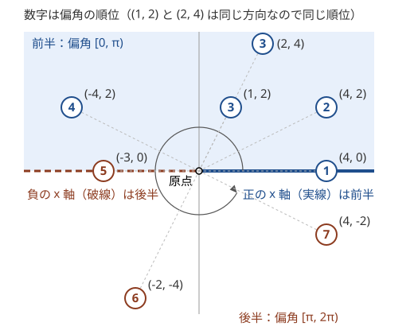

!!! abstract "要点"
    - **何ができるか**：点を原点から見た角度の順に並べる。整数座標なら上下の半平面に分け、同じ半平面の中は外積の符号で比べることで、atan2 を使わず誤差なく $O(N \log N)$ で並べられる。
    - **いつ使うか**：
        - 原点から見た方向の順に並べる
        - 回転する光線（レーザー）に当たる点の数
        - ∠ABC の最大
        - ベクトルをいくつか選んで和の長さを最大にする
        - 座標が $10^9$ 規模の整数で、角度の大小や一致を正確に比べる
    - **計算量**：並べ替え $O(N \log N)$（比較 1 回は $O(1)$ の整数の計算で、誤差がない）。並べた後は、角度の範囲に入る点の数や重みの和を、前計算 $O(N)$・クエリごとに $O(\log N)$ で答えられる
    - **前提**：[ベクトルと外積](../geometry/geometry-vectors.md)、[ソートで考える](../basics/sorting-techniques.md)

<!-- textlint-disable -->
別名：偏角・角度でソート・argument sort・atan2・方向の順に並べる・回転する光線
<!-- textlint-enable -->

偏角ソートは、点（原点からのベクトル）を、正の $x$ 軸から反時計回りに測った角度の順に並べる方法である。この角度を偏角と呼ぶ。偏角を `atan2` で実数にして並べると手軽だが、座標が大きいと別の方向を同じ角度とみなしてしまう。整数座標なら、平面を上下の半分に分けて[外積](../geometry/geometry-vectors.md)の符号で比べれば、整数の計算だけで正しく並べられる。

このページでは偏角を $[0, 2\pi)$ で測り、正の $x$ 軸（偏角 0）から反時計回りに並べる。外積は $\mathrm{cross}(a, b) = a_x b_y - a_y b_x$ で、$b$ が $a$ から見て左側（反時計回りの側）にあるとき正になる。

## 半平面に分けて外積で比べる（全周を外積だけで比べると推移律が壊れる理由） {#half-plane-compare}

偏角ソートの比較は、まず点を「前半」と「後半」の 2 つの半平面に分け、同じ半平面の中だけ外積の符号で比べる。外積だけで全周を比べると、ソートの比較関数として成り立たないからである。

外積の符号が教えるのは「$a$ から反時計回りに測った $b$ までの角度が、$0$ より大きく $\pi$ より小さいか」である。$a$ から反時計回りに測った $b$ までの角度を $\theta$（$0 \le \theta < 2\pi$）とすると $\mathrm{cross}(a, b) = \lvert a \rvert \lvert b \rvert \sin \theta$ なので、符号は $\sin \theta$ で決まる。$\theta$ が $(0, \pi)$ なら正、$(\pi, 2\pi)$ なら負になる。180 度を超えて回ると符号が逆転するので、「偏角が小さい」の代わりにはならない。

実際、$a = (1, 0)$、$b = (-1, 1)$、$c = (-1, -1)$ の 3 つ（偏角 0 度・135 度・225 度）で比べると、次のようにすべて正になる。

$$
\mathrm{cross}(a, b) = 1, \quad \mathrm{cross}(b, c) = 2, \quad \mathrm{cross}(c, a) = 1
$$

「外積が正なら前」と決めると、$a$ が $b$ より前、$b$ が $c$ より前、$c$ が $a$ より前となって一周してしまう。推移律が成り立たないので、`sort` に渡すと結果は保証されない（[比較関数の約束](../cpp/cpp-comparators.md#strict-weak-ordering)）。

そこで、偏角が $[0, \pi)$ の点を前半、$[\pi, 2\pi)$ の点を後半とする。座標で書くと、前半は「$y > 0$、または $y = 0$ かつ $x > 0$」、後半はそれ以外（原点を除く）である。



比較は次の 2 段で行う。

1. 前半と後半で違えば、前半の点が先
2. 同じ半平面なら、$\mathrm{cross}(a, b) > 0$ のとき $a$ が先

同じ半平面の中では、2 点の偏角の差は $\pi$ 未満に収まる。差が $(-\pi, \pi)$ の範囲なら、$\sin$ の符号と差の符号が一致する。だから外積の符号がそのまま偏角の大小を表し、推移律も成り立つ。半平面の間は「前半が先」と決めたので、全体で正しい順序になる。

```cpp
--8<-- "argument-sort/sort-points.cpp:core"
```

比較関数 `arg_less` は、偏角が等しい 2 点に対して false を返す。`sort(p.begin(), p.end(), arg_less)` で並べ、同じ方向の点の並びも入力の順に保ちたいなら `stable_sort` を使う。

??? question "確認問題：4 方向の順"
    $(1, 0)$、$(-1, 0)$、$(0, 1)$、$(0, -1)$ を、前半・後半に分けて外積で比べる比較関数を使うと、どの順に並ぶか。

    ??? success "答え"
        $(1, 0)$、$(0, 1)$、$(-1, 0)$、$(0, -1)$ の順になる。$(1, 0)$ と $(0, 1)$ が前半、$(-1, 0)$ と $(0, -1)$ が後半である。前半の中は $\mathrm{cross}((1, 0), (0, 1)) = 1 > 0$ で $(1, 0)$ が先、後半の中は $\mathrm{cross}((-1, 0), (0, -1)) = 1 > 0$ で $(-1, 0)$ が先になる。

## atan2 の手軽さと限界 {#atan2}

`atan2(y, x)` は点 $(x, y)$ の偏角を $(-\pi, \pi]$ の `double` で返す。キーにして並べるだけなので短く書け、原点は 0 を返す。座標が小さければこれで足りるが、座標が $10^9$ 規模だと別の方向を区別できない。

例として $a = (10^9, 10^9 - 1)$ と $b = (10^9 - 1, 10^9 - 2)$ を比べる。外積は次のとおり $-1$ で、$b$ は $a$ よりわずかに時計回りの側にある。

$$
\mathrm{cross}(a, b) = 10^9 (10^9 - 2) - (10^9 - 1)^2 = -1
$$

2 つの偏角の差は約 $\lvert \mathrm{cross}(a, b) \rvert / (\lvert a \rvert \lvert b \rvert) \approx 1 / (2 \times 10^{18}) = 5 \times 10^{-19}$ ラジアンである。一方、`double` の相対精度は約 $2.2 \times 10^{-16}$ なので、$\pi / 4$ 付近の隣り合う `double` は約 $10^{-16}$ 離れている。差がこれよりずっと小さいので、2 つの `atan2` は同じ値になる。

```cpp
--8<-- "argument-sort/atan2-limit.cpp:core"
```

一般に、座標の絶対値が $C$ 以下の整数なら、異なる 2 方向の偏角の差は $1 / (2C^2)$ 程度以上ある（外積は 0 でなければ絶対値 1 以上で、長さは $\sqrt{2} C$ 以下だから）。これは下限で、実際にこの程度まで近い 2 方向も作れる。座標が $10^6$ 程度までなら、この差は `double` の間隔（約 $10^{-16}$）の 1000 倍以上あり、`atan2` で並べても順序は崩れにくい。座標が $10^8$ を超えると差が間隔と並び、順序が崩れる組が出てくる。それでも「同じ方向か」を `==` で判定するのは避け、整数の外積で判定する（[誤差の扱い](../geometry/geometry-precision.md)）。

`atan2` が向くのは、角度そのものを実数で出力する場面である。2 つのベクトルのなす角 $[0, \pi]$ は `atan2(abs(cross(a, b)), dot(a, b))` で求めると、`acos` に内積を渡すより安全である。`acos` は引数が誤差で $1$ をわずかに超えると NaN を返す。

## 原点・同じ方向の点・半平面の境界（x 軸の正と負）の扱い {#edge-cases}

偏角ソートのバグの多くは、外積が 0 になる 3 つの場合から来る。

**原点**。原点との外積は何と比べても 0 なので、そのままでは「どの点とも同じ偏角」になり、推移律が壊れる。原点に偏角はないので、問題に合わせて除くか、専用の組（上のコードでは `half` が 0）を作って先頭か末尾に置く。Library Checker の Sort Points by Argument は順が $(-\pi, \pi]$ で、原点の偏角を 0 とする。このページの既定（$[0, 2\pi)$、原点は先頭）のままでは通らないので、下の表の $(-\pi, \pi]$ の分け方にし、原点の組を前半と後半の間に置く。

**同じ方向の点**。同じ半平面にあって外積が 0 なら、2 点は同じ方向にある。反対向きの 2 点は必ず別の半平面に入るからである。`arg_less` はこの 2 点を「等しい」として扱うので、`lower_bound`・`upper_bound` で同じ方向の点をまとめて数えられる。方向を `map` のキーにしたいときは、$(x, y)$ を $\gcd(\lvert x \rvert, \lvert y \rvert)$ で割って正規化する。割った後も符号は残す。$(2, 4)$ は $(1, 2)$ になり、$(-2, -4)$ は $(-1, -2)$ になるので、反対向きと区別できる。

**半平面の境界**。前半を「$y \ge 0$」としてしまうと、$(1, 0)$ と $(-1, 0)$ が同じ前半に入る。外積は 0 なので「同じ方向」と判定され、反対向きの点がまとめられてしまう。境界の 2 本の半直線は、正の $x$ 軸を前半、負の $x$ 軸を後半のように、必ず別の組に入れる。

並べる向きと始まりは問題によって違う。

| 求める順 | 変え方 |
| --- | --- |
| $(-\pi, \pi]$（`atan2` と同じ） | 前半を「$y < 0$、または $y = 0$ かつ $x > 0$」、後半を残りにする |
| 時計回り | 並べた列を逆にする。範囲を問うなら「$u$ から時計回りに $v$ まで」は「$v$ から反時計回りに $u$ まで」と同じ |
| 好きな方向 $d$ から始める | 全点を回転させずに、$d$ 以上の位置で列を 2 つに切って入れ替える |

??? question "確認問題：境界を間違えた比較"
    前半を「$y \ge 0$（原点を除く）」とした比較関数で、$(1, 0)$・$(0, 1)$・$(-1, 0)$ を並べると何が起きるか。

    ??? success "答え"
        3 点とも前半に入る。$(1, 0)$ と $(-1, 0)$ は外積が 0 なので等しいとみなされる。一方で $(1, 0)$ は $(0, 1)$ より前、$(0, 1)$ は $(-1, 0)$ より前になる。等しいはずの 2 つの間に別の点が入るので、狭義の弱順序にならず、`sort` の結果は保証されない。

## 並べた後に：角度の範囲の点の数（累積和） {#range-count}

偏角の順に並べると、「方向 $u$ から反時計回りに方向 $v$ まで」の範囲に入る点は、列の連続した部分（または末尾と先頭をつないだ部分）になる。並べた順に重みの[累積和](../basics/prefix-sum.md)を取っておけば、範囲の重みの和は引き算で求まる。

クエリ 1 回の手順は次のとおりである。比較はすべて `arg_less` で行う。

1. $l$ ＝ 偏角が $u$ 以上の最初の位置（`lower_bound`）
2. $r$ ＝ 偏角が $v$ より大きい最初の位置（`upper_bound`）
3. $u$ の偏角が $v$ 以下なら、答えは $[l, r)$ の和
4. そうでなければ一周をまたぐので、$[l, N)$ と $[0, r)$ の和を足す

```cpp
--8<-- "argument-sort/range-sum.cpp:core"
```

同じ方向の点は `arg_less` で等しいので、$u$ や $v$ と同じ方向の点は両端として含まれる。$u$ と $v$ が同じ方向なら、3 の場合になり、その方向の点だけが数えられる。一周すべてを数えたい問題なら、この場合を別に扱う。

累積和を 2 周分（長さ $2N$）作り、一周をまたぐときは $r$ に $N$ を足す書き方もある（[円環は 2 周分に伸ばす](../basics/prefix-sum.md#circular)）。どちらでも計算量は前計算 $O(N)$（ソートを除く）、クエリごとに $O(\log N)$ である。

## 一周を扱う：配列を 2 周分にして尺取り {#wrap-around}

この節は[尺取り法](../basics/two-pointers.md)を前提にする。各点 $i$ について「$i$ から反時計回りに $\pi$ 未満の範囲にある点」をまとめて求めたいとき、偏角の列を 2 周分につなげて尺取りする。

まず同じ方向の点をまとめ、異なる方向を偏角の順に $d_0, \dots, d_{m-1}$、その点の数を $c_0, \dots, c_{m-1}$ とする。2 周分の添字 $j$（$0 \le j < 2m$）で $d_{j \bmod m}$ を指すと、$d_i$ から見た偏角の差は $j = i + 1, \dots, i + m - 1$ の順に $(0, 2\pi)$ の中で増えていく。だから「差が $(0, \pi)$」すなわち $\mathrm{cross}(d_i, d_j) > 0$ となる $j$ は、$i + 1$ から始まる連続した範囲になる。

その範囲の右端（入らない最初の位置）を $e(i)$ とすると、$i$ を 1 つ進めても $e(i)$ は戻らない。$d_{i+1}$ から $\pi$ 未満の範囲は、$d_i$ から $\pi$ 未満の範囲より反時計回りにずれるだけだからである。$e$ は合計 $2m$ 回しか進まないので、並べた後は $O(N)$ で済む。

```cpp
--8<-- "argument-sort/half-window.cpp:core"
```

この数は、原点を含む三角形の数え上げなどに使える。どの 2 点も原点と一直線上にないとする。3 点の三角形が原点を含まないのは、3 点のうちの 1 点 $i$ から見て、残りの 2 点がどちらも左側の $\pi$ 未満の範囲に入るときである。このような $i$ は 1 つに決まる。そこで、各点 $i$ について左側の点の数 $k_i$ を求め、$\binom{k_i}{2}$ の和を全体の $\binom{N}{3}$ から引く。ただし、同じ方向の点や原点を通る直線上の点があると「内部」の定義が変わるので、境界は問題に合わせて決める。

## 反対方向に最も近い点の二分探索 {#opposite-direction}

この節は[lower_bound と個数の数え方](../basics/binary-search.md#lower-bound)を前提にする。原点から見た 2 点 $a$・$c$ のなす角を最大にしたいとき、$a$ を固定すると、最もよい $c$ は「$a$ と反対の方向 $-a$ に最も近い点」である。

なす角は $\min(\lvert \theta_c - \theta_a \rvert, 2\pi - \lvert \theta_c - \theta_a \rvert)$ で、$\theta_c$ が $\theta_a + \pi$ に近いほど大きい。偏角の順に並べた列で $-a$ を `lower_bound` すると、$-a$ 以上の最初の点と、その 1 つ前の点が、$-a$ を両側から挟む最も近い点になる。列の端を越えたら反対の端へ回る（添字を $\bmod$ 列の長さで取る）。

```text
並べた列 d（長さ m）について、各 a = d[i] で：
    j = lower_bound(d, -a)          // 比較は arg_less。-a は整数のまま作れる
    候補は d[j mod m] と d[(j - 1 + m) mod m]
    それぞれ a とのなす角を atan2(|cross|, dot) で求め、最大を更新
```

点 $a$ ごとに $O(\log N)$ なので、全体は並べ替えを含めて $O(N \log N)$ である。比較は最後まで整数で行い、実数は答えの角度を計算するときだけ使う。中心の点 $B$ を全探索して「$B$ から見た角 ∠ABC の最大」を求めるなら、$B$ ごとに他の点を $B$ からの差のベクトルにして並べ直すので $O(N^2 \log N)$ になる（[例題 典型90 009](#typical90_i)）。

## 角度の区間のスケジューリング・連続する範囲だけを試す最適化 {#angular-intervals}

この節は[区間スケジューリング](../basics/interval-scheduling.md)を前提にする。偏角の順序が決まると、図形やベクトルの集合を「角度の区間」や「列の連続した範囲」として扱える。

**角度の区間のスケジューリング**。原点から見た図形が覆う方向の範囲は、両端の点の方向で決まる角度の区間になる。どの区間も $\pi$ 未満で同じ半平面に収まるなら（たとえば第 1 象限の図形だけなら）、区間の両端を外積で比べれば、数直線上の区間と同じように扱える。重ならないように最も多く選ぶには、右端（反時計回りの側の端）の順に並べて貪欲に取る（[右端の順に選ぶ理由](../basics/interval-scheduling.md#why-right-end)）。端どうしがちょうど接する場合を重なりとするかは、問題の定義に合わせて外積が 0 の扱いで決める。

**連続する範囲だけを試す**。ベクトルをいくつか選んで和の長さを最大にする問題では、最適な選び方が偏角の列の連続した範囲になる。長さ 0 のベクトルは和を変えないので、先に除いておく。最適な和を $s$ とする。選んでいないベクトル $v$ が $s \cdot v \ge 0$ を満たすなら、$\lvert s + v \rvert^2 = \lvert s \rvert^2 + 2 s \cdot v + \lvert v \rvert^2$ は $\lvert s \rvert^2$ より大きい。選んだ $v$ が $s \cdot v < 0$ なら、除くと $\lvert s - v \rvert^2 = \lvert s \rvert^2 - 2 s \cdot v + \lvert v \rvert^2$ でやはり大きくなる。だから最適な選び方は「$s$ との内積が 0 以上のもの」すべてで、これは $s$ に垂直な直線で分けた片側の半平面（境界を含む）に入るベクトルである。半平面に入る方向は偏角の列で連続しているので、2 周分の列の連続した範囲（長さ $N$ 以下）をすべて試せば最適な選び方が含まれる。

素直に試すと範囲は $O(N^2)$ 個あり、和を累積和で $O(1)$ で求めれば $O(N^2)$ で済む。

## 落とし穴 {#pitfalls}

**外積のオーバーフロー**。座標が $\lvert x \rvert, \lvert y \rvert \le 10^9$ なら、外積の各項は $10^{18}$ 以下で、差は $2 \times 10^{18}$ 以下なので `long long`（約 $9.2 \times 10^{18}$ まで）に収まる。2 点の差のベクトルを使うと成分は $2 \times 10^9$ まで大きくなり、外積は $8 \times 10^{18}$ まで達する。まだ収まるがぎりぎりなので、さらに足し算をするなら `__int128` を使う（[整数のオーバーフロー](../cpp/cpp-integer-overflow.md)）。

**比較関数に `>=` を書く**。同じ半平面で `cross(a, b) >= 0` と書くと、同じ方向の 2 点で両方向とも true になり、狭義の弱順序が壊れる。同じ方向の点が多いと `sort` が配列の外を読んで落ちることもある（[比較関数に <= を書くと sort が壊れる](../cpp/cpp-comparators.md#less-equal-pitfall)）。

**原点や境界を確かめずに並べる**。入力に原点がありうるか、$x$ 軸上の点がどちらの組に入るかは、コードを書く前に決める。小さな座標で全方向（8 方向と原点）を入れた入力を作り、並びを目で確かめるとよい。

**`atan2` の値で同じ方向かを判定する**。座標が大きいと、[atan2 の手軽さと限界](#atan2)の例のように別の方向でも `atan2` の値が一致し、`==` で「同じ方向」と誤る。EPS を付けて比べても、差が $10^{-18}$ 程度の方向は区別できない。同じ方向かどうかは外積と半平面で判定する。

## 例題 {#examples}

### ABC442 E. Laser Takahashi {#abc442_e}

<div class="kp-problems" data-role="example" markdown>

- [ABC442 E. Laser Takahashi](https://atcoder.jp/contests/abc442/tasks/abc442_e)（diff 1355）：原点から見た方向が 2 つの方向の間にあるモンスターの数を、多数のクエリについて答える。

</div>

方向の範囲に入る点の数を何度も答えるので、偏角の順に並べて範囲の数を引き算で求める。座標が $10^9$ 規模なので、`atan2` では近い方向を区別できない。半平面に分けて外積で比べる。範囲が時計回りで与えられるなら、両端を入れ替えて反時計回りの範囲にする。

??? note "解法の詳細"
    - 比較関数 `arg_less` で全点を並べる。同じ方向の点は比較で等しいので、まとめる処理は要らない（方向を $\gcd$ で正規化して個数を数えてもよい）
    - クエリの範囲が「方向 $A$ から時計回りに方向 $B$ まで」なら、「$B$ から反時計回りに $A$ まで」と読み替える
    - [並べた後に：角度の範囲の点の数](#range-count)の手順で、$l$ を `lower_bound`、$r$ を `upper_bound` で求める。一周をまたぐなら $[l, N)$ と $[0, r)$ を足す。両端の方向の点も含まれる
    - 並べ替えが $O(N \log N)$、クエリごとに $O(\log N)$ で、全体は $O((N + Q) \log N)$

### 典型90 009. Three Point Angle（★6） {#typical90_i}

<div class="kp-problems" data-role="example" markdown>

- [典型90 009. Three Point Angle（★6）](https://atcoder.jp/contests/typical90/tasks/typical90_i)（diff —）：N 点から 3 点 A, B, C を選ぶときの ∠ABC の最大を求める。

</div>

中心の $B$ を全探索し、$B$ から見た他の点の方向を偏角の順に並べる。$A$ を固定すると、∠ABC を最大にする $C$ は $A$ と反対の方向に最も近い点なので、二分探索で 2 つの候補に絞れる。

??? note "解法の詳細"
    - 各 $B$ について、他の点 $P$ を差のベクトル $P - B$ にして `arg_less` で並べる
    - 各 $A$ について、$-(A - B)$ を `lower_bound` し、見つかった位置とその 1 つ前（端は反対側へ回る）を $C$ の候補にする（[反対方向に最も近い点の二分探索](#opposite-direction)）
    - なす角は `atan2(abs(cross), dot)` で求め、度に直して最大を取る
    - $B$ ごとに $O(N \log N)$ で、全体は $O(N^2 \log N)$

## 練習問題 {#practice}

<div class="kp-problems" data-role="practice" markdown>

- [ABC225 E. 7](https://atcoder.jp/contests/abc225/tasks/abc225_e)（diff 1678）：原点から見える「7」の形の図形の数の最大を求める。
- [ABC139 F. Engines](https://atcoder.jp/contests/abc139/tasks/abc139_f)（diff 2034）：ベクトルをいくつか選んで、和の長さを最大にする。

</div>

??? note "練習の方針"
    - **ABC225 E**：各図形を、原点から見て覆う方向の区間（両端の点の方向）に直す。区間の端は外積で比べ、右端の順に並べて区間スケジューリングの貪欲で選ぶ（[角度の区間のスケジューリング](#angular-intervals)）
    - **ABC139 F**：最適な選び方は偏角の列の連続した範囲になる。偏角の順に並べて 2 周分にし、連続する範囲をすべて試す。長さ 0 のベクトルは除いてよい

## 力試し {#challenge}

<div class="kp-problems" data-role="challenge" markdown>

- [ABC207 D. Congruence Points](https://atcoder.jp/contests/abc207/tasks/abc207_d)（diff 2074）：2 つの点集合が、回転と平行移動で一致するかを判定する。
- [ABC479 G. Tuning](https://atcoder.jp/contests/abc479/tasks/abc479_g)（diff 2386）：整数の組 (A_i, B_i) に有理数 (C_i, D_i) を足して、どの i でも比 (A_i + C_i) : (B_i + D_i) が等しくなるようにするとき、|C_i| + |D_i| の総和の最小値を求める。

</div>

??? note "力試しの方針"
    - **ABC207 D**：座標を $N$ 倍してから重心を原点に移すと、重心も整数になる。残るのは原点まわりの回転で一致するかである。各点集合を偏角の順に並べ（同じ方向なら原点に近い順）、隣り合う点の組から（長さの 2 乗・内積・外積）の列を作ると、回転で一致することは列が巡回シフトで一致することになる。重心と同じ位置の点は除いて別に照らし合わせる
    - **ABC479 G**：条件は、点 $(A_i, B_i)$ を動かして原点を通る 1 本の直線に乗せることと同じで、費用は移動量の $L_1$ ノルムである。直線を決めると、直線への $L_1$ の距離は軸に平行な移動で達成され、どちらの成分を動かすかは直線だけで決まる。だからどの点も同じ側の成分だけを動かせばよい。$B_i$ だけを動かす場合は、傾き $B_i / A_i$ の順に並べ（$A_i$ を正にそろえて外積で比べる）、重み $\lvert A_i \rvert$ の重み付き中央値を累積和で探す。$A_i = 0$ の点は傾きを持たないので並べず、費用 $\lvert B_i \rvert$ をそのまま足す。もう一方の成分だけを動かす場合も同様に求め、小さい方を答える。答えは分数のまま整数で扱う

## 確認問題 {#quiz}

??? question "確認問題：推移律の壊れ方"
    比較関数を「$\mathrm{cross}(a, b) > 0$ なら $a$ が先」だけにした。$a = (1, 0)$、$b = (0, 1)$、$c = (-1, 0)$ の 3 点で、何が起きるか。

    ??? success "答え"
        $\mathrm{cross}(a, b) = 1 > 0$ で $a$ が $b$ より先、$\mathrm{cross}(b, c) = 1 > 0$ で $b$ が $c$ より先になる。一方 $\mathrm{cross}(a, c) = 0$ なので、$a$ と $c$ は等しいとみなされる。等しい 2 点の間に $b$ が入るので、狭義の弱順序にならない。半平面に分ければ、$c$ は後半に入り、$a$・$b$ より後ろに来る。

??? question "確認問題：同じ方向の判定"
    $(2, -4)$ と $(-1, 2)$ は、`arg_less` で等しいとみなされるか。

    ??? success "答え"
        みなされない。外積は $2 \cdot 2 - (-4)(-1) = 0$ だが、$(2, -4)$ は後半、$(-1, 2)$ は前半なので、半平面の比較だけで $(-1, 2)$ が先になる。2 点は反対向きである。外積だけで「同じ方向」と判定すると、この 2 点を取り違える。

??? question "確認問題：atan2 で足りるか"
    座標の絶対値が $1000$ 以下の整数で、偏角の順に並べたい。`atan2` で並べてよいか。

    ??? success "答え"
        順に並べるだけならおおむねよい。異なる 2 方向の偏角の差は $1 / (2 \times 1000^2) = 5 \times 10^{-7}$ 程度より大きく、`double` の間隔（約 $10^{-16}$）よりずっと大きいからである。ただし同じ方向かどうかを `==` で判定するのは避け、整数の外積で判定する。

## 使い分け {#comparison}

- 座標が小さく、角度を実数で出力するだけなら `atan2` で並べてよい。座標が大きいか、同じ方向の判定が要るなら、半平面と外積で比べる
- 偏角の範囲ではなく、傾き $y / x$ の大小だけを比べればよい（どの点も $x > 0$ の側にあるなど）なら、半平面に分けず、外積だけで比べてよい。分数の比較を掛け算に直したものと同じである
- 凸包を作るときに偏角ソートを使う方法（Graham scan）もあるが、座標でソートする Andrew の方法の方が境界の扱いが易しい（[凸包](../geometry/convex-hull.md#andrew)）
- 点を回転させる・合同かを判定するなど、角度で動かす操作は[回転・平行移動](../geometry/rotation-transform.md)のページで扱う

## 参考 {#references}

- [drken「Yosupo Library Checker - Sort Points by Argument」](https://drken1215.hatenablog.com/entry/2023/08/27/223208)：半平面に分けて外積で比べる比較関数、原点の扱い、atan2 の精度の懸念
- [maspypy「library geo/angle_sort.hpp」](https://github.com/maspypy/library/blob/main/geo/angle_sort.hpp)：偏角の範囲を $(-\pi, \pi]$ と決めた比較の流儀
- [ikatakos「JPRSプログラミングコンテスト2026#1（AtCoder Beginner Contest 442）E,F,G問題メモ」](https://ikatakos.com/pot/programming_algorithm/contest_history/atcoder/2026/0124_abc442)：例題 ABC442 E の方針（整数の偏角ソート・時計回りへの読み替え・累積和。解説の部分だけを参照）
- [E869120「kyopro_educational_90 sol/009.cpp」](https://github.com/E869120/kyopro_educational_90/blob/main/sol/009.cpp)：例題 典型90 009 の方針（反対方向の二分探索と候補 2 つ）
- [merom686「ABC225」](https://merom686.hatenablog.com/entry/2021/10/30/235859)：練習 ABC225 E の方針（角度の区間を外積で比べて区間スケジューリング）
- [ikatakos「AtCoder Beginner Contest 139 D～F問題メモ」](https://ikatakos.com/pot/programming_algorithm/contest_history/atcoder/2019/0901_abc139)：練習 ABC139 F の方針（半平面に入るベクトルが偏角の列で連続すること・2 周分の列。解説の部分だけを参照）
- [drken「AtCoder ABC 207 D - Congruence Points (2D, 黄色, 400 点)」](https://drken1215.hatenablog.com/entry/2023/07/25/143000)：力試し ABC207 D の方針（重心を整数でそろえる・偏角の順に並べて巡回シフトで照合）
- [kmjp「AtCoder ABC #479 (オムロンプログラミングコンテスト2026) : G - Tuning」](https://kmjp.hatenablog.jp/entry/2026/10/14/0900)：力試し ABC479 G の問いと方針（原点を通る直線への言い換え・傾きの順と重み付き中央値）
- [ikatakos「オムロンプログラミングコンテスト2026 （AtCoder Beginner Contest 479）F,G問題メモ」](https://ikatakos.com/pot/programming_algorithm/contest_history/atcoder/2026/1011_abc479)：力試し ABC479 G の方針の確認（解説の部分だけを参照）
