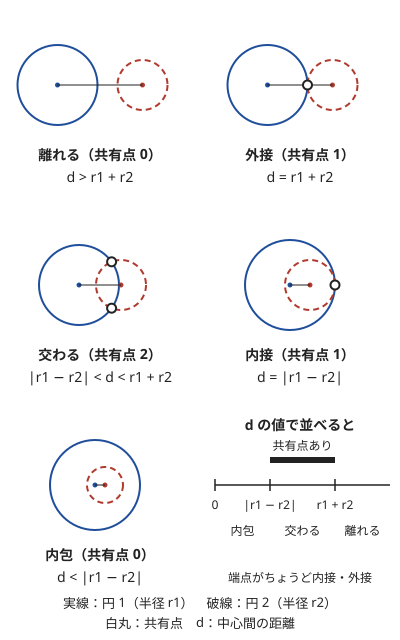
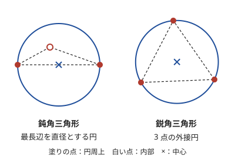

!!! abstract "要点"
    - **何ができるか**：2 円の位置関係（離れる・外接・交わる・内接・内包）を、中心間の距離の 2 乗と半径の和・差の 2 乗の比較で、整数のまま判定する。実数の位置・半径・時刻の最適化は、最適解が少数の点で決まるなら候補を列挙し、判定が単調なら答えで二分探索し、凸なら三分探索する。
    - **いつ使うか**：
        - 円周を伝って移動できるか・円どうしが交わるかを問われる。
        - すべての点を含む最小の円を求める。
        - 障害物を避けて通れる円の最大の半径を求める。
        - 円の内部にある格子点の数を求める。
        - $N \le 50$ 程度の点で、実数の位置や半径を最適化する。
    - **計算量**：2 円の判定は $O(1)$。$N$ 個の円のつながりは全組を調べて $O(N^2 \alpha(N))$。円内の格子点は行ごとに数えて $O(R)$（$R$ は元の座標での半径）。最小包含円は候補の全列挙で $O(N^4)$、Welzl の乱択で期待 $O(N)$。
    - **前提**：[誤差の扱いと整数での処理](../geometry/geometry-precision.md)、[答えで二分探索](../basics/binary-search-answer.md)

<!-- textlint-disable -->
別名：円の交差判定・2 円の位置関係・外接円・円と格子点・最小包含円・smallest enclosing circle・Welzl・半径の二分探索・三分探索で幾何・候補点の列挙
<!-- textlint-enable -->

円と幾何の最適化は、円が絡む判定を整数で行う方法と、実数の答えを持つ幾何の最適化を「候補の列挙・答えの二分探索・三分探索」のどれかに落とす考え方をまとめたものである。円の判定は平方根を使わずに 2 乗で比べれば誤差なく行える。最適化は、最適解の形を絞り込むか、判定や凸性に言い換えてから解く。

## 2 円の位置関係（離れる・外接・交わる・内接・内包）を 2 乗した整数で判定 {#two-circles}

中心 $(x_1, y_1)$・半径 $r_1$ の円と、中心 $(x_2, y_2)$・半径 $r_2$ の円の位置関係は、中心間の距離 $d$ と、半径の和 $r_1 + r_2$・差 $\lvert r_1 - r_2 \rvert$ の大小だけで決まる。$d$ を数直線に置くと、$\lvert r_1 - r_2 \rvert$ と $r_1 + r_2$ の 2 つの点で 5 通りに分かれる。



| $d$ の範囲 | 位置関係 | 共有点の数 |
| --- | --- | --- |
| $d > r_1 + r_2$ | 離れる | 0 |
| $d = r_1 + r_2$ | 外接 | 1 |
| $\lvert r_1 - r_2 \rvert < d < r_1 + r_2$ | 交わる | 2 |
| $d = \lvert r_1 - r_2 \rvert$（$d > 0$） | 内接 | 1 |
| $d < \lvert r_1 - r_2 \rvert$ | 内包 | 0 |

$d = 0$ かつ $r_1 = r_2$ なら 2 つの円は一致し、共有点は無数にある。まとめると、共有点を持つ条件は次の 1 行である。

$$
\lvert r_1 - r_2 \rvert \le d \le r_1 + r_2
$$

$d = \sqrt{(x_1 - x_2)^2 + (y_1 - y_2)^2}$ は無理数になりうるので、`sqrt` で計算すると等号の場合（外接・内接）を誤差で取り違える。3 つの量はどれも 0 以上なので、2 乗しても大小は変わらない。$D = (x_1 - x_2)^2 + (y_1 - y_2)^2$ とおき、$(r_1 - r_2)^2 \le D \le (r_1 + r_2)^2$ を整数で比べればよい（[距離の 2 乗で比べる](../geometry/geometry-precision.md#integer-comparison)）。

```cpp
--8<-- "circle-geometry/relation.cpp:core"
```

値の大きさを見積もっておく。座標と半径の絶対値が $10^9$ 以下なら、座標の差は $2 \times 10^9$ 以下で、$D$ は最大 $8 \times 10^{18}$ になる。`long long` の上限（約 $9.2 \times 10^{18}$）にぎりぎり収まる。座標がもう少し大きい問題や、$D$ にさらに足し算をするときは `__int128` を使う。

**点が円周上にあるか**も同じ判定で書ける。点を半径 0 の円とみなすと、$\lvert r - 0 \rvert \le d \le r + 0$ は $d = r$ すなわち $D = r^2$ になる。点と円を同じ関数で扱えるので、点を始点とする探索で場合分けが減る（[円のつながり](#connectivity)）。

!!! warning "関数名の衝突"
    `using namespace std;` の下で `relation` という名前の関数を作ると、C++20 の `std::relation`（概念）とぶつかってコンパイルエラーになる。上のコードで `circle_relation` と名付けたのはこのためである。

## 円と格子点：y ごとに x の範囲を整数で求める {#lattice-points-in-circle}

円の内部と周上にある格子点（座標が整数の点）を数えるには、$y$ を 1 つずつ固定し、その行で条件を満たす $x$ の範囲を求めて個数を足す。中心 $(c_x, c_y)$・半径 $r$ の円で、行 $y$ の条件は次のとおりである。

$$
(x - c_x)^2 \le r^2 - (y - c_y)^2
$$

右辺を $m$ とすると、$\lvert x - c_x \rvert \le \lfloor \sqrt{m} \rfloor$ が条件で、$x$ は区間 $[c_x - w, c_x + w]$（$w = \lfloor \sqrt m \rfloor$）に入る整数である。行の数は $2r + 1$ 程度なので、全体で $O(r)$ になる。全部の点を調べる $O(r^2)$ と比べ、$r = 10^5$ なら $4 \times 10^{10}$ 回が $2 \times 10^5$ 回に減る。

中心や半径が小数第 4 位までの小数で与えられたら、すべてを $10^4$ 倍して整数にする（[小数の入力を整数にする](../geometry/geometry-precision.md#scale-to-integer)）。拡大した座標では、元の格子点は $10^4$ の倍数の点になる。そこで、行は $10^4$ の倍数の $y$ だけを回し、区間 $[c_x - w, c_x + w]$ に入る $10^4$ の倍数の個数を数える。

$$
\left\lfloor \frac{c_x + w}{10^4} \right\rfloor - \left\lceil \frac{c_x - w}{10^4} \right\rceil + 1
$$

```cpp
--8<-- "circle-geometry/lattice.cpp:core"
```

書くときの要点は 3 つある。

- **整数の平方根**：$m$ は $10^{18}$ 規模になり、`sqrt` の結果は前後に 1 ずれうる。`sqrtl` で見当を付けてから、$w^2 \le m < (w + 1)^2$ になるまで補正する（[sqrt の誤差と補正](../math/integer-root.md#sqrt-correction)）
- **負の数の切り捨て**：C++ の `/` は 0 の方向へ丸めるので、$c_x - w$ が負だと $\lceil \cdot \rceil$ を取り違える。床と天井の関数を別に書く
- **小数の読み込み**：`double` で読んで $10^4$ 倍し `(long long)` で切り捨てると 1 ずれることがある。文字列で読むか `llround` を使う

## 円のつながりを Union-Find で {#connectivity}

「円周の上だけを動いて、点 $s$ から点 $t$ へ行けるか」は、円を頂点とし、共有点を持つ 2 円を辺で結んだグラフの連結判定になる。2 つの円周に共有点があれば、そこで乗り換えられるからである。辺の判定は[2 円の位置関係](#two-circles)の $(r_1 - r_2)^2 \le D \le (r_1 + r_2)^2$ を使う。内包する 2 円は面としては重なっていても、円周どうしは交わらないので乗り換えられない。

$s$ と $t$ を半径 0 の円として頂点に足すと、「$s$ がどの円の周上にあるか」も同じ判定で済む。すべての組を調べて [Union-Find](../ds/union-find.md) で併合し、最後に $s$ と $t$ が同じグループかを見る。組は $O(N^2)$ 個なので、$N$ が数千までなら間に合う。

```cpp
--8<-- "circle-geometry/connect.cpp:core"
```

!!! info "ACL では"
    `atcoder::dsu d(n);`（ヘッダは `<atcoder/dsu>`）。`d.merge(a, b)`・`d.same(a, b)`・`d.size(a)` はどれもならし $O(\alpha(N))$。

円を頂点にする言い換えは、ほかの判定にも使える。「円の内部（面）を通って移動できるか」なら辺の条件は $D \le (r_1 + r_2)^2$ だけになり、内包も辺になる。「半径 $r$ の円が障害物の間を通れるか」では、障害物どうしの距離で辺を張る（[幾何の最適化の選び方](#geometry-optimization)）。

## 最小包含円：候補は 2 点を直径とする円か 3 点の外接円（Welzl の乱択も） {#min-enclosing-circle}

$N$ 個の点をすべて含む（周上も含む）最小の円を最小包含円という。中心は平面のどこでもよいので、そのままでは候補が無限にある。しかし、最小包含円は必ず次のどちらかである。

- 2 点を直径とする円（中心は 2 点の中点）
- 3 点を通る円（外接円。中心は外心）

ただし、点が 1 つか、すべて同じ位置なら、答えは半径 0 の円である。



3 点だけのときを見ると、使い分けが分かる。鈍角三角形では、最長辺を直径とする円の内部に残りの 1 点が入る。この円は外接円より小さいので答えになる。鋭角三角形では、どの辺を直径にしても残りの 1 点がはみ出すので、外接円が答えになる。直角三角形では、斜辺を直径とする円と外接円が一致する。

??? note "証明：最小包含円の周上には、直径の両端の 2 点か、中心を囲む 3 点がある"
    最小包含円を中心 $o$・半径 $r$ とし、周上にある入力の点の集合を $T$ とする。半径が 0 になるのはすべての点が同じ位置のときだけなので、$r > 0$ とする。
    
    $T$ が、$o$ を通るある直線の片側（直線上を含まない開いた半平面）にすべて入るとする。その側へ中心を少しだけ動かすと、$T$ の点への距離はどれも $r$ より小さくなる。$T$ 以外の点は、もともと距離が $r$ より小さいので、動かす量が十分小さければ $r$ より小さいままである。すると半径を $r$ より小さくでき、最小に反する。
    
    したがって $T$ はどの開いた半平面にも収まらない。$T$ の 2 点が $o$ をはさんで正反対にあれば、その 2 点を直径とする円が答えである。そうでなければ、$T$ から $o$ を内部に囲む 3 点を選べる。$o$ はその 3 点から等距離なので外心であり、答えはその外接円である。

**候補の全列挙**。この性質から、中心の候補は「2 点の中点」$\binom{N}{2}$ 個と「3 点の外心」$\binom{N}{3}$ 個に限られる。候補ごとに最も遠い点までの距離を $O(N)$ で求め、最小を取る。全体で $O(N^4)$ なので、$N = 50$ なら約 $50^4 / 6 \approx 10^6$ 回で間に合う。

```cpp
--8<-- "circle-geometry/enclose.cpp:core"
```

**Welzl の乱択**。$N$ が大きいときは、点をランダムな順に並べて 1 つずつ足していく方法で、期待 $O(N)$ になる。今の円の外にある点 $p_i$ が来たら、$p_i$ は「最初の $i + 1$ 点の最小包含円」の周上にあるので、$p_i$ を周上に持つ円を作り直す。作り直しの中でも同じことを 2 段目（$p_i$ と $p_j$ が周上）・3 段目（3 点が周上）とくり返す。

```cpp
--8<-- "circle-geometry/enclose.cpp:welzl"
```

速い理由は、作り直しが起きる確率が小さいことにある。最初の $i + 1$ 点の最小包含円を決める点は高々 3 個である。ランダムな順なら、最後の点 $p_i$ がそのどれかである確率は $3 / (i + 1)$ 以下になる。作り直しは $O(i)$ かかるが、確率をかけた期待値は $O(1)$ になり、内側の段も同じ評価ができるので全体で期待 $O(N)$ である。並べ替えを省くと、入力の順によっては $O(N^3)$ かかる。乱数の扱いは[乱択アルゴリズム](../misc/randomized.md)を見る。

!!! info "Library Checker"
    自作した最小包含円は Library Checker の minimum_enclosing_circle で確かめられる。この問題は各点が円周上にあるかを答えさせるので、実数の EPS の決め方が結果を左右する。周上かの判定は、外心を分数のまま持つなど整数で行える形にしておくと確かである。

## 外心の計算と退化（3 点が一直線上） {#circumcenter}

3 点 $A, B, C$ の外心は、$A$ を原点に移して $b = B - A$、$c = C - A$ とおくと、次の式で求まる。

$$
u_x = \frac{c_y \lvert b \rvert^2 - b_y \lvert c \rvert^2}{2 (b \times c)}, \qquad
u_y = \frac{b_x \lvert c \rvert^2 - c_x \lvert b \rvert^2}{2 (b \times c)}
$$

ここで $b \times c = b_x c_y - b_y c_x$ は[外積](../guide/glossary.md#cross-product)、$\lvert b \rvert^2 = b_x^2 + b_y^2$ である。外心は $A + (u_x, u_y)$ になる。この式は「外心から $A$・$B$ への距離が等しい」「$A$・$C$ への距離が等しい」の 2 本の 1 次方程式（2 本の垂直二等分線）を連立して解いたものである。

分母の外積が 0 になるのは、3 点が一直線上にあるときである。このとき垂直二等分線が平行になり、外接円はない。

- **判定は整数で**：外積は整数の座標から整数で計算できるので、`cross == 0` を整数のまま判定してから実数の割り算に進む。実数にしてから `abs(d) < EPS` で判定すると、EPS の決め方に答えが左右される
- **一直線上の 3 点は飛ばしてよい**：一直線上の 3 点を含む最小の円は、両端の 2 点を直径とする円である。それは中点の候補に入っているので、外心の候補からは外してよい
- **同じ点が重なっている**：2 点が同じ位置なら外積は 0 になり、上と同じく飛ばされる。すべての点が同じ位置なら、答えは半径 0 である（$N = 1$ でも出るよう、最初の答えを点 1 つを中心とする円にしておく）
- **値の大きさ**：$\lvert b \rvert^2 c_y$ は座標の 3 乗の大きさになる。座標が $10^9$ なら $10^{27}$ 規模で `long long` を超えるので、分子は `long double` で計算する

```cpp
--8<-- "circle-geometry/enclose.cpp:circumcenter"
```

## 幾何の最適化の選び方：候補の列挙・答えの二分探索（半径・時刻）・三分探索 {#geometry-optimization}

実数の位置・半径・時刻を最適化する幾何の問題は、そのままでは連続な無限個の候補から選ぶことになる。ABC で出るものは、次の 3 つのどれかに落とせることが多い。上から順に、使えるかを確かめる。

| 型 | 使える条件 | 例 |
| --- | --- | --- |
| 候補の列挙 | 最適解が少数の点（入力の点・中点・外心・交点・式の変わり目）で決まると示せる | 最小包含円、外接長方形の面積の最小 |
| 答えで二分探索 | 「答えを $x$ にできるか」の判定が $x$ について単調で、判定が作れる | 通れる円の最大の半径、条件を満たす最小の時刻 |
| 三分探索 | 最適化する量が変数について凸（谷が 1 つ） | 最も遠い点までの距離の最小化 |

**候補の列挙**は、「最適解を少し動かしてもよくならない」ことから最適解の形を絞る。最小包含円の証明がその典型で、周上の点が少なければ中心を動かして改善できるので、最適解は 2 点か 3 点で決まる。区分的に 1 次式で動く量なら、式が変わる時刻（変わり目）と区間の端を候補にする（[三分探索の注意](#ternary-search-caveats)）。

**答えで二分探索**は、最適化を判定問題に変える（[答えで二分探索](../basics/binary-search-answer.md)）。幾何では次の 2 つの判定がよく出る。

- **半径を決めると連結判定になる**：「半径 $r$ の円が障害物の間を通れるか」は、通れない組（距離が $2r$ 未満の障害物どうし、壁との距離が $2r$ 未満の障害物）を辺でつなぎ、両側の壁が連結になるかで判定する（[二分探索と連結判定の組合せ](../graph/union-find-connectivity.md#binary-search)、[例題 ABC181 F](#abc181_f)）
- **時刻を決めると円の共通部分の判定になる**：ある位置から点 $i$ までは、距離に係数 $c_i$ を掛けた時間がかかるとする。「時刻 $T$ までに $K$ 個の点に届く位置があるか」は「各点 $i$ を中心とする半径 $T / c_i$ の円のうち、$K$ 個以上の重なる点があるか」に言い換えられる。重なる領域があれば、その中の点を動かして 2 円の交点か円の中心にたどり着けるので、それらを候補に数える（[力試し ABC157 F](#challenge)）

2 円の交点は次の式で求める。$d$ は中心間の距離、$e$ は中心 $P_1$ から $P_2$ への単位ベクトル、$e^\perp$ は $e$ を 90 度回したものである。交点があるのは $\lvert r_1 - r_2 \rvert \le d \le r_1 + r_2$ のときだけで、$h^2$ が誤差で負になったら 0 にする。

$$
a = \frac{d^2 + r_1^2 - r_2^2}{2d}, \quad h = \sqrt{r_1^2 - a^2}, \quad \text{交点} = P_1 + a e \pm h e^\perp
$$

**三分探索**は、関数が凸だと確かめられたときに使う（[三分探索](../basics/ternary-search.md)）。点 $(p, q)$ からの距離 $\sqrt{(x - p)^2 + (y - q)^2}$ は $(x, y)$ について凸で、凸関数の最大も凸なので、「最も遠い点までの距離」は凸である（[凸性の確かめ方](../basics/ternary-search.md#convexity)）。最小包含円も、中心の $x$ と $y$ の入れ子の三分探索で解ける。

実数の二分探索・三分探索はどちらも、幅ではなく回数で打ち切る（[実数の二分探索](../basics/binary-search-answer.md#real-number)）。候補の列挙は誤差の出所が候補の計算だけなので、使えるならいちばん安全である。

## 三分探索の注意：凸性の確認・入れ子の三分探索・式の変わり目の時刻を列挙する方法 {#ternary-search-caveats}

この節は[三分探索](../basics/ternary-search.md)を前提にする。凸性の規則と、平らな部分での失敗はそちらの[凸性の確かめ方](../basics/ternary-search.md#convexity)と[平らな部分がある関数での失敗](../basics/ternary-search.md#flat-pitfall)にまとめてある。ここでは幾何で起きやすい 3 つの点を扱う。

**凸に見えて凸でない量**。幾何の量には、凸な量の積や最小が混ざりやすい。外接長方形の面積は「横幅 × 縦幅」で、横幅と縦幅がそれぞれ凸でも、積は凸とは限らない。複数の点のうち「最も近い点までの距離」は凸関数の最小なので、谷がいくつもできる。式を書いて規則で確かめられないものは、三分探索に頼らない。

**入れ子の三分探索**。2 変数の凸関数 $F(x, y)$ は、外側で $x$ を、内側で $y$ を三分探索して最小化できる。$F$ が $(x, y)$ について凸なら、$g(x) = \min_y F(x, y)$ も $x$ について凸になるからである。ただし評価の回数は外側と内側の積になる。反復 100 回ずつなら外側で $g$ を 200 回、その中で $F$ を 200 回ずつ評価し、$F$ の評価は約 $4 \times 10^4$ 回である。$F$ の 1 回が $O(N)$ なら、$N$ が数千までが目安である。2 つの変数それぞれについて凸なだけでは足りず、組 $(x, y)$ について凸であることを確かめる。

**式の変わり目の時刻を列挙する**。点が一定の速さで動くとき、横幅 $W(t)$ と縦幅 $H(t)$ は、端を与える点が入れ替わる時刻ごとに傾きの変わる区分的に 1 次の関数になる。変わり目の時刻を全部集めると、その間の各区間では $W$ と $H$ がどちらも 1 次式である。

- $W$ と $H$ の傾きが同じ符号なら、2 つとも増えるか 2 つとも減るので、積は区間の上で単調である
- 傾きの符号が違えば、積は $t$ の 2 次式で $t^2$ の係数が負になり、上に凸である

どちらでも区間の最小は端で達成されるので、変わり目の時刻（と区間の端）だけで面積を計算すれば最小が求まる。三分探索と違って凸性に頼らず、候補の時刻は点を動きの向きで分けると定数個に収まる（[力試し ABC130 F](#challenge)）。

## 山登り・焼きなましに頼らない（ABC の幾何の最適化は凸性や候補の列挙で解ける） {#no-heuristics}

最小包含円のような問題は、「中心を少しずつ動かして、よくなる方へ進む」山登り法でも、それらしい答えが出ることがある。たとえば、中心を最も遠い点の方へ少し動かし、動かす量を徐々に小さくしていく方法である。

しかし、ABC の幾何の最適化で山登りや焼きなましに頼る必要はない。

- **正しさが保証されない**：凸でない関数では局所的な谷で止まる。凸な関数でも、動かす量の減らし方しだいでは、許された誤差（$10^{-6}$ など）に届く前に止まる。どれだけ回せば足りるかを見積もれない
- **同じ問題がもっと確かな方法で解ける**：最小包含円は候補の列挙か入れ子の三分探索で、凸な関数の最小化は三分探索で解ける。山登りで解かれがちな問題は、凸性や候補の列挙で正しさを示せる形をしている

山登り・焼きなましは、厳密な最適解を求めず点数の高さを競う AtCoder Heuristic Contest（AHC）の道具である。ABC で「山登りで通りそう」と感じたら、最適化する量が凸か、最適解が少数の点で決まらないかを先に考える。

## 落とし穴 {#pitfalls}

**内包を忘れる**。「2 円が交わる」を $D \le (r_1 + r_2)^2$ だけで判定すると、一方が他方の内部にある（円周は交わらない）場合を交わると誤る。円周の共有点を問うなら $(r_1 - r_2)^2 \le D$ も必ず確かめる。逆に、面としての重なりを問うなら内包も重なりに入る。どちらを問われているかを問題文で確かめる。

**接する場合を実数で判定する**。$d = r_1 + r_2$ を `sqrt` で計算した $d$ と比べると、誤差で外接が「離れる」や「交わる」になる。整数の入力なら、2 乗した整数で比べる。

**2 乗のオーバーフロー**。座標が $10^9$ 規模なら、距離の 2 乗は $8 \times 10^{18}$ に達する。`int` で計算すればあふれ、`long long` でもさらに足したり 2 倍したりすると超える。最初に上限を見積もる。

**外心の分母が 0**。3 点が一直線上にあるか、同じ点が重なっていると、外心の式は 0 で割る。外積を整数で計算して 0 なら飛ばす（[外心の計算と退化](#circumcenter)）。

**凸でない関数に三分探索**。外接長方形の面積・最も近い点までの距離・切り捨てを含む量は、凸とは限らない。三分探索の前に凸性を規則で確かめ、確かめられなければ候補の列挙を考える。

**実数の二分探索を幅で打ち切る**。値が大きいと幅が `double` の間隔より小さくならず、止まらなくなる。反復の回数を固定する。

## 例題 {#examples}

### ABC259 D. Circumferences {#abc259_d}

<div class="kp-problems" data-role="example" markdown>

- [ABC259 D. Circumferences](https://atcoder.jp/contests/abc259/tasks/abc259_d)（diff 947）：円周上だけを移動して、2 点の間を行き来できるかを判定する。

</div>

円周の共有点で別の円へ乗り換えられるので、共有点を持つ 2 円を辺で結んだグラフの連結判定になる。始点と終点を半径 0 の円として足せば、「点がどの円の周上にあるか」も同じ判定で済む（[円のつながり](#connectivity)）。

??? note "解法の詳細"
    - 頂点：$N$ 個の円と、始点・終点を表す半径 0 の 2 つの円。
    - 辺：すべての組について、中心間の距離の 2 乗 $D$ が $(r_1 - r_2)^2 \le D \le (r_1 + r_2)^2$ を満たせば併合する。内包する 2 円は円周が交わらないので辺にしない。
    - 答え：始点と終点が同じグループなら Yes。組は $O(N^2)$ 個で、$N$ が 3000 程度なら約 $4.5 \times 10^6$ 組である。
    - 座標と半径は $10^9$ 規模なので、2 乗は `long long` で計算する（`int` ではあふれる）。

### ABC151 F. Enclose All {#abc151_f}

<div class="kp-problems" data-role="example" markdown>

- [ABC151 F. Enclose All](https://atcoder.jp/contests/abc151/tasks/abc151_f)（diff 1671）：N ≤ 50 点をすべて含む最小の円の半径を求める。

</div>

最小包含円は、2 点を直径とする円か 3 点の外接円のどちらかである（[最小包含円](#min-enclosing-circle)）。$N \le 50$ なので、中点と外心をすべて中心の候補にし、最も遠い点までの距離の最小を取る。

??? note "解法の詳細"
    - 候補：$\binom{N}{2}$ 個の中点と、一直線上でない 3 点の組の外心（一直線上かは外積を整数で判定する）。
    - 各候補で、最も遠い点までの距離を $O(N)$ で求める。全体で $O(N^4)$。
    - 出力は `fixed` と `setprecision` で十分な桁数にする。
    - 別解：最も遠い点までの距離は中心について凸なので、中心の $x$ と $y$ を入れ子の三分探索で決めてもよい（[三分探索](../basics/ternary-search.md)の練習問題）。Welzl の乱択なら期待 $O(N)$ である。

### ABC181 F. Silver Woods {#abc181_f}

<div class="kp-problems" data-role="example" markdown>

- [ABC181 F. Silver Woods](https://atcoder.jp/contests/abc181/tasks/abc181_f)（diff 2009）：壁と点を避けて通れる円の最大の半径を求める。

</div>

半径 $r$ を決めると、「円が通れない隙間」を辺にしたグラフで、上の壁と下の壁がつながるかの判定になる。つながっていれば、壁から壁まで障害物の鎖が道をふさぐので通れない。$r$ を大きくすると辺は増えるだけなので判定は単調で、答えで二分探索できる（[幾何の最適化の選び方](#geometry-optimization)）。

??? note "解法の詳細"
    - 頂点：$N$ 個の釘と、上の壁・下の壁の 2 つの超頂点。
    - 辺（半径 $r$ のとき）：釘どうしは距離が $2r$ 未満なら結ぶ（距離の 2 乗と $4r^2$ で比べる）。釘と上の壁は、壁までの距離 $100 - y_i$ が $2r$ 未満なら結ぶ。下の壁も同じく $y_i + 100$ で判定する。
    - 判定：上の壁と下の壁が別のグループなら通れる。半径の範囲 $[0, 100]$ で実数の二分探索を 100 回ほど回し、1 回は $O(N^2 \alpha(N))$ である。
    - 別解：辺の長さ（釘どうしの距離・壁までの距離と、壁どうしの 200）を短い順に並べて Union-Find で足していき、上と下が初めてつながった辺の長さの半分が答えである。二分探索の打ち切りの誤差が出ない（[最小ボトルネック路](../graph/bottleneck-path.md)の考え方）。
    - 等号を辺に入れるかどうかで答えは変わらない。答えは実数の上限で、境目の 1 点の扱いは誤差の範囲に収まる。

## 練習問題 {#practice}

<div class="kp-problems" data-role="practice" markdown>

- [ABC292 F. Regular Triangle Inside a Rectangle](https://atcoder.jp/contests/abc292/tasks/abc292_f)（diff 1522）：長方形に入る正三角形の一辺の最大を求める。
- [ABC191 D. Circle Lattice Points](https://atcoder.jp/contests/abc191/tasks/abc191_d)（diff 1953）：小数第 4 位までで与えられた円の内部（周上を含む）にある格子点の数を求める。

</div>

??? note "練習の方針"
    - **ABC292 F**：長い方の辺を横（幅 $W$）、短い方を縦（高さ $H$）に置く。三角形が入るかは、その外接長方形（辺が軸に平行な最小の長方形）が入るかで決まる。外接長方形の 4 辺にはどれも頂点が触れ、頂点は 3 つしかないので、1 頂点は外接長方形の角にある。そこで正三角形の 1 頂点を左下の角に置き、底辺の傾きを $\theta$（$0^\circ \le \theta \le 30^\circ$）とすると、一辺 $s$ の上限は、横の制約 $W / \cos \theta$ と縦の制約 $H / \sin(\theta + 60^\circ)$ の小さい方である。前者は $\theta$ について増加、後者は減少なので、2 つが等しくなる $\theta$ を二分探索する。$\theta = 0$ で縦の制約の方が小さければ、$\theta = 0$ が最適で答えは $2H / \sqrt 3$ である。答えは三角関数を含むので、実数で計算して誤差の範囲で出力する
    - **ABC191 D**：中心と半径を $10^4$ 倍して整数にし、$10^4$ の倍数の各行 $y$ で $x$ の範囲を整数の平方根で求め、その中の $10^4$ の倍数を数える（[円と格子点](#lattice-points-in-circle)）。座標と半径は $10^5$ 以下なので、拡大後の 2 乗は $10^{18}$ 規模で `long long` に入る

## 力試し {#challenge}

<div class="kp-problems" data-role="challenge" markdown>

- [ABC130 F. Minimum Bounding Box](https://atcoder.jp/contests/abc130/tasks/abc130_f)（diff 2240）：一定の速さで動く点たちの外接長方形の面積の最小を求める。
- [ABC157 F. Yakiniku Optimization Problem](https://atcoder.jp/contests/abc157/tasks/abc157_f)（diff 2525）：K 枚の肉が焼ける最小の時刻を求める。

</div>

??? note "力試しの方針"
    - **ABC130 F**：横幅と縦幅は、端を与える点が入れ替わる時刻で傾きの変わる区分的に 1 次の関数で、面積はその積なので凸とは限らない。点を動きの向き（左・右・横に動かない）で分けると、$x$ 座標の最大・最小はそれぞれ 3 本の直線の最大・最小になり、変わり目は定数個である。$y$ も同じである。変わり目の時刻と時刻 0 で面積を計算し、最小を取る（[式の変わり目の時刻を列挙する](#ternary-search-caveats)）
    - **ABC157 F**：時刻 $T$ を二分探索する。$T$ を決めると、肉 $i$ が焼けるのは熱源が中心 $(x_i, y_i)$・半径 $T / c_i$ の円の中にあるときである。$K$ 個以上の円の重なる点があるかは、各円の中心とすべての 2 円の交点を候補として調べる。候補は $O(N^2)$ 個で、各候補で $O(N)$ 個の円を調べる。内外の判定には小さな EPS を足す。交点の計算で $h^2$ が誤差で負になったら 0 にする。$K = 1$ なら答えは 0 で、中心の候補で出る

## 確認問題 {#quiz}

??? question "確認問題：平方根を使わない交差判定"
    中心 $(0, 0)$・半径 3 の円と、中心 $(1, 0)$・半径 1 の円がある。円周どうしは共有点を持つか。$D$ と $(r_1 \pm r_2)^2$ で判定せよ。

    ??? success "答え"
        $D = 1$、$(r_1 - r_2)^2 = 4$、$(r_1 + r_2)^2 = 16$ である。$D < (r_1 - r_2)^2$ なので内包で、共有点はない。小さい円は大きい円の内部にある（小さい円の右端 $(2, 0)$ も大きい円の内部）。

??? question "確認問題：最小包含円が 2 点で決まるとき"
    3 点の最小包含円が、ある 2 点を直径とする円になるのは、3 点がどんな三角形をなすときか。

    ??? success "答え"
        直角三角形か鈍角三角形のとき（最長辺を直径とする円）。最長辺の対角が $90^\circ$ 以上なら、その頂点は最長辺を直径とする円の内部か周上にある（円周角の定理）。鋭角三角形なら、どの辺を直径にしても残りの頂点がはみ出すので、外接円が答えになる。3 点が一直線上なら、両端の 2 点を直径とする円である。

??? question "確認問題：外接長方形の面積に三分探索を使えない理由"
    横幅 $W(t)$ と縦幅 $H(t)$ がどちらも $t$ について凸なら、面積 $W(t) H(t)$ も凸と言えるか。

    ??? success "答え"
        言えない。凸関数の積は凸とは限らない。たとえば $W(t) = \lvert t \rvert + 1$ と $H(t) = \lvert t - 4 \rvert + 1$ はどちらも凸だが、積は $t = 0$ で 5、$t = 2$ で 9、$t = 4$ で 5 となり、谷が 2 つある。三分探索ではなく、式の変わり目の時刻を候補に列挙する。

??? question "確認問題：通れる円の判定で壁を頂点にする理由"
    障害物の点と上下の壁があり、半径 $r$ の円が左から右へ通れるかを判定する。上の壁と下の壁を頂点としてグラフに入れるのはなぜか。

    ??? success "答え"
        円が通れないのは、上の壁から下の壁まで「円が通れない隙間」の鎖がつながって道をふさぐときだからである。壁を頂点にすれば、「上の壁と下の壁が同じ連結成分か」の 1 回の判定で済む。壁に近い点と壁の隙間も、円がそこを通れるかの辺として同じ形で扱える。

## 使い分け {#comparison}

- 円の判定（交わるか・点が内部か）は、まず距離の 2 乗で整数のまま比べる。実数が避けられないのは、交点や外心の座標そのものが要るときだけである（[誤差の扱いと整数での処理](../geometry/geometry-precision.md)）
- 最適解が少数の点で決まるなら候補の列挙、判定が単調なら[答えで二分探索](../basics/binary-search-answer.md)、量が凸なら[三分探索](../basics/ternary-search.md)を選ぶ。候補の列挙が使えるならいちばん誤差に強い
- 半径を決めて連結を判定する問題で、辺を全部並べられるなら、二分探索の代わりに辺を短い順に足していく（[最小ボトルネック路](../graph/bottleneck-path.md)）
- 最小包含円は、$N$ が数十なら候補の全列挙、大きければ Welzl の乱択（[乱択アルゴリズム](../misc/randomized.md)）を使う

## 参考 {#references}

- [kyo-pro「ABC259D - Circumferences」](https://kyo-pro.hatenablog.com/entry/ABC259D)：例題 ABC259 D の、2 乗による共有点の判定とグラフの探索
- [merom686「ABC259」](https://merom686.hatenablog.com/entry/2022/07/10/002150)：例題 ABC259 D の、始点と終点を半径 0 の円とみなす書き方と Union-Find
- [hamayan「Circumferences [AtCoder Beginner Contest 259 D]」](https://blog.hamayanhamayan.com/entry/2022/07/09/224142)：例題 ABC259 D の、`int` のあふれと整数での判定
- [drken「AtCoder ABC 151 F - Enclose All (2D, 青色, 600 点)」](https://drken1215.hatenablog.com/entry/2020/01/12/224200)：例題 ABC151 F の候補の列挙・入れ子の三分探索・乱択の方法
- [drken「AtCoder ABC 181 F - Silver Woods (黄色, 600 点)」](https://drken1215.hatenablog.com/entry/2020/11/02/013900)：例題 ABC181 F の半径の二分探索と、辺を短い順に足す別解
- [sen-comp「ABC191 - D - Circle Lattice Points」](https://sen-comp.hatenablog.com/entry/2021/02/18/164536)：練習 ABC191 D の整数化と、`double` で起きる誤差
- [merom686「ABC292」](https://merom686.hatenablog.com/entry/2023/03/04/234139)：練習 ABC292 F の、1 頂点を角に置いて角度で考える方針
- [drken「AtCoder ABC 130 F - Minimum Bounding Box (黄色, 600 点)」](https://drken1215.hatenablog.com/entry/2019/06/22/022600)：力試し ABC130 F の変わり目の時刻の列挙と、区間の端で最小になる理由
- [drken「AtCoder ABC 157 F - Yakiniku Optimization Problem (2D, 橙色, 600 点)」](https://drken1215.hatenablog.com/entry/2020/03/03/015300)：力試し ABC157 F の時刻の二分探索と、中心と 2 円の交点を候補にする理由
- [Library Checker「minimum_enclosing_circle」](https://judge.yosupo.jp/problem/minimum_enclosing_circle)：最小包含円の自作ライブラリの確認
