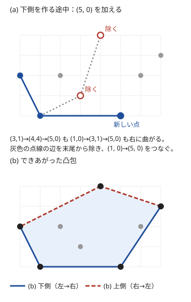
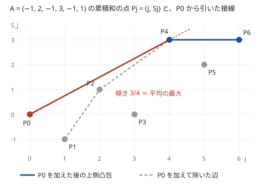
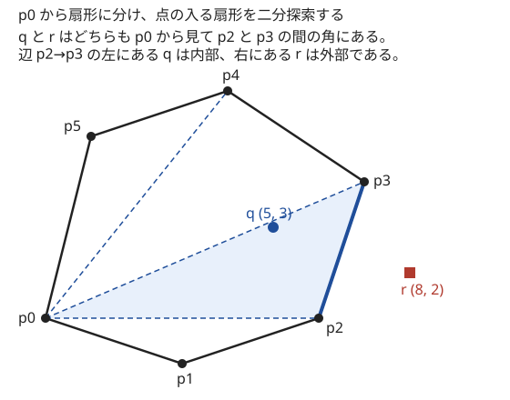

!!! abstract "要点"
    - **何ができるか**：点を $x$ 座標でソートし、スタックの末尾が凹む間は取り除くことで、全点を囲む最小の凸多角形（凸包）を $O(N \log N)$ で作る。凸多角形への多数の点の内外判定（1 点 $O(\log N)$）や、格子点の数（Pick の定理）にも使う。
    - **いつ使うか**：
        - すべての点を囲む最小の凸多角形。
        - 外側にある点だけが効く。
        - 区間の平均・傾き・比の最大。
        - 多数の点が凸多角形の内部・境界・外部のどこにあるか。
        - 多角形の内部にある格子点の数。
        - $(S_j - S_i)/(j - i)$ の最大（2 点を結ぶ傾きの最大）。
    - **計算量**：凸包の構成は $O(N \log N)$（ソート済みならスタックの操作だけで $O(N)$）。凸多角形の内外判定は 1 点 $O(\log N)$、一般の多角形は 1 点 $O(N)$。Pick の定理で格子点を数えるのは、頂点数 $N$・座標の幅 $C$ として $O(N \log C)$
    - **前提**：[ベクトルと外積](../geometry/geometry-vectors.md)、[二分探索](../basics/binary-search.md)、[GCD・LCM とユークリッドの互除法](../math/gcd-lcm.md)

<!-- textlint-disable -->
別名：凸包・convex hull・Andrew のアルゴリズム・monotone chain・Graham scan・上側凸包・下側凸包・点の内外判定・凸多角形の内外判定・交差数判定・Pick の定理・多角形の格子点・線分上の格子点
<!-- textlint-enable -->

凸包は、平面上の点をすべて含む最小の凸多角形である。輪ゴムを全部の点の外側にかけて縮めたときの形と思えばよく、頂点になるのは「外側にある」点だけである。凸包を作ると、最大・最小を問う問題の候補が外側の点に絞られ、内外判定や格子点の数え上げも凸多角形の性質を使って速く書ける。どの判定も[外積](../geometry/geometry-vectors.md#cross-and-dot)の符号だけで行い、座標が整数なら誤差は入らない。

このページの点の座標は整数とし、外積 $\mathrm{cross}(a, b) = a_x b_y - a_y b_x$ は $b$ が $a$ の左（反時計回りの側）にあるとき正とする。凸多角形の頂点は反時計回りに並べる。

## Andrew 法（monotone chain）：下側と上側を作る {#andrew}

凸包を素朴に求めるなら、2 点の組ごとに「ほかの全点がこの線分の左側にあるか」を調べて辺を見つける方法がある。これは $O(N^3)$ で、$N = 2 \times 10^5$ では間に合わない。Andrew 法は、点を左から順に見ながらスタックを 1 本保つだけで、ソートの後は $O(N)$ で凸包を作る。

凸包の周を、$x$ 座標が最小の点から最大の点まで、下を通る部分と上を通る部分に分ける。下を通る部分を下側凸包、上を通る部分を上側凸包と呼ぶ。下側凸包を左から右へたどると、どの頂点でも左に曲がる。これが凸であることの言い換えになる。

Andrew 法は、下側凸包を次の手順で作る。

1. 点を $x$ の小さい順（$x$ が等しければ $y$ の小さい順）に並べ、同じ座標の点を除く
2. 点 $p$ を順に見て、スタックの末尾の 2 点 $s, t$（$t$ が末尾）と $p$ が左に曲がらない間、すなわち $\mathrm{cross}(t - s, p - t) \le 0$ の間は末尾 $t$ を取り除く
3. $p$ をスタックに積む

上側凸包は、同じ手順を右から左へ行えば作れる。上側を右から左へたどる向きは、周を反時計回りに回る向きと同じで、どの頂点でも左へ曲がるからである。2 つをつなぐと、$x$ が最小の点から反時計回りの順の凸包ができる。

次の図の (a) は、下側を作る途中で点 $(5, 0)$ を加える場面である。スタックは $(0, 2), (1, 0), (3, 1), (4, 4)$ で、$(3, 1) \to (4, 4) \to (5, 0)$ は右に曲がるので $(4, 4)$ を除く。続けて $(1, 0) \to (3, 1) \to (5, 0)$ も右に曲がるので $(3, 1)$ も除き、$(1, 0) \to (5, 0)$ をつなぐ。(b) はすべての点を処理した後の凸包である。



**なぜ正しいか**：次の[不変条件](../guide/glossary.md#invariant)を保つ。

> スタックは、ここまでに見た点の下側凸包の頂点を左から並べたものである。

新しい点 $p$ は、ここまでの点の中で $x$ が最大（等しければ $y$ が最大）である。よって $p$ は必ず下側凸包の右端の頂点になる。末尾の $t$ について $s \to t \to p$ が左に曲がらないなら、$t$ は線分 $sp$ の上か上側にある。$t$ より下を線分 $sp$ が通るので、$t$ は下側凸包の頂点ではない。$s$ と $p$ はこの後も集合に残るので、点が増えても $t$ が頂点に戻ることはない。左に曲がった時点で止めてよいのは、スタックの残りがすでに左に曲がる列になっていて、$p$ を積んでもどの頂点でも左に曲がるからである。

**計算量**：各点はスタックに 1 回積まれ、取り除かれるのは高々 1 回なので、ソートの後のスタックの操作は合わせて $O(N)$ である（[ならし計算量](../guide/glossary.md#amortized-complexity)の議論）。全体はソートの $O(N \log N)$ で決まる。点が初めから $x$ の順に並んでいるなら $O(N)$ で済む。この性質は[比・平均の最大](#max-slope)で使う。

```cpp
--8<-- "convex-hull/hull.cpp:core"
```

完全なプログラム：[`hull.cpp`](https://github.com/yuukougun/kyopro-atlas/blob/main/snippets/convex-hull/hull.cpp)（GitHub）
{ .kp-code-src }

上側の繰り返しで「スタックの大きさが下側の終わりの大きさより大きい間だけ取り除く」としているのは、下側の点を消さないためである。最後に戻ってくる左端の点は先頭と同じなので取り除く。外積の値は、座標が $\lvert x \rvert, \lvert y \rvert \le 10^9$ なら `long long` に収まる（[オーバーフローの見積もり](../geometry/geometry-vectors.md#overflow)）。

!!! note "Graham scan との違い"
    Graham scan は、最も下の点を基準に他の点を偏角の順に並べてから、同じスタックの操作で凸包を作る。並べ方に[偏角ソート](../geometry/argument-sort.md)が要り、同じ偏角の点の扱いも難しい。Andrew 法は座標の辞書順で並べるだけなので、競技プログラミングではこちらを使うのが手軽である。

**応用の型**：「外側にある点だけが効く」と気づけば、凸包の頂点だけを調べればよい。非常に大きな円の内部から一様に選んだ点に最も近い点を問う問題では、凸包の頂点だけが正の確率を持つ（[練習問題](#practice)の AGC021 B）。

## 一直線上の点・重複点・全点が一直線上のときの扱い（外積の不等号の向き） {#degenerate}

凸包のバグの多くは、辺の上にある点と、点が少ないときに起きる。取り除く条件の不等号の向きで、辺の上の点を頂点に含めるかが決まる。

| 取り除く条件 | 辺の上の点 | 使いどころ |
| --- | --- | --- |
| $\mathrm{cross} \le 0$ | 除く（頂点は角だけ） | 面積・格子点・内外判定。ふつうはこちら |
| $\mathrm{cross} < 0$ | 残す | 凸包の周の上にある入力の点をすべて挙げる |

`<= 0` の版では次の境界を確かめておく。

- **重複点**：同じ座標の点が残ると、$t - s$ が零ベクトルになって曲がる向きが決まらない。ソートの後に `unique` で除く。すべての点が同じなら 1 点だけが残る
- **点が 2 個以下**：そのまま返す。凸包は点か線分で、面積は 0 である
- **全点が一直線上**：下側は両端の 2 点になり、上側の途中の点もすべて除かれる。返るのは両端の 2 点で、正しく線分になる

辺の上の点を残す `< 0` の版では、そのままでは同じ点を 2 回拾う場面が 2 つある。1 つは全点が一直線上のときで、下側が全点を拾い、上側が同じ点を逆向きにもう一度拾う。この場合は並べた点をそのまま返す。もう 1 つは右端に $x$ が同じ点が縦に並ぶときで、下側がそれらを拾った後、上側の始めにまた拾う。上側では $x$ が右端と同じ点を飛ばす。

```cpp
--8<-- "convex-hull/hull.cpp:collinear"
```

完全なプログラム：[`hull.cpp`](https://github.com/yuukougun/kyopro-atlas/blob/main/snippets/convex-hull/hull.cpp)（GitHub）
{ .kp-code-src }

??? question "確認問題：不等号の向き"
    点 $(0, 0), (1, 0), (2, 0), (1, 1)$ の凸包を、取り除く条件を `<= 0` と `< 0` にしてそれぞれ作ると、頂点はどうなるか。

    ??? success "答え"
        `<= 0` では $(0, 0), (2, 0), (1, 1)$ の 3 頂点になる。下側を作るとき $(0, 0) \to (1, 0) \to (2, 0)$ は一直線で外積が 0 なので、$(1, 0)$ が除かれる。`< 0` では外積が 0 のときは除かないので、$(0, 0), (1, 0), (2, 0), (1, 1)$ の 4 点が残る。

## 比・平均の最大は上側凸包の接線（累積和の点） {#max-slope}

数列 $A = (a_0, \dots, a_{N-1})$（0-indexed）で、各 $i$ について「$i$ から始まる区間の平均の最大」を求めたいとする。[累積和](../basics/prefix-sum.md) $S_0 = 0$、$S_{j+1} = S_j + a_j$ を使うと、区間 $[i, r)$ の平均は次のように書ける。

$$
\frac{a_i + \dots + a_{r-1}}{r - i} = \frac{S_r - S_i}{r - i}
$$

右辺は、点 $P_j = (j, S_j)$ を置いたときの、$P_i$ と $P_r$ を結ぶ線分の傾きである。平均の最大は「$P_i$ から右の点へ引いた線分の傾きの最大」に言い換わる。$r$ をすべて試すと全体で $O(N^2)$ かかる。

傾きを最大にする点は、$P_i$ を加えた点の集合 $\{P_i, \dots, P_N\}$ の上側凸包で、$P_i$ の隣にある頂点 $q$ である。$P_i q$ は凸包の辺なので、ほかの点はすべてその直線の上（線上）か、それより下にあり、直線より上にある点はない。下にある点への傾きは $P_i q$ の傾きより小さい。

点 $P_j$ は初めから $x$ の順に並んでいるので、$i$ を $N - 1$ から $0$ へ動かしながら、Andrew 法と同じスタックで上側凸包を保てる。$P_i$ を左端に加えるとき、末尾 $t$ の 1 つ奥の頂点 $u$ への傾きが $t$ への傾き以上なら $t$ を除く。除き終えた後の末尾が $P_i$ の隣の頂点で、そこへの傾きが答えになる。



図の例では、$P_1, \dots, P_6$ の上側凸包が $P_1, P_2, P_4, P_6$ で、そこへ $P_0 = (0, 0)$ を加える。$P_0$ から見ると、$P_2$ への傾き $1/2$ は $P_1$ への傾き $-1$ 以上なので $P_1$ を除く。$P_4$ への傾き $3/4$ は $P_2$ への $1/2$ 以上なので $P_2$ も除く。$P_6$ への傾き $1/2$ は $3/4$ より小さいので止まる。答えは区間 $[0, 4)$ の平均 $3/4$ である。

```cpp
--8<-- "convex-hull/max-slope.cpp:core"
```

完全なプログラム：[`max-slope.cpp`](https://github.com/yuukougun/kyopro-atlas/blob/main/snippets/convex-hull/max-slope.cpp)（GitHub）
{ .kp-code-src }

傾きの比較は割り算をせず、外積の符号で行う（$P_t$ と $P_u$ はどちらも $P_i$ の右にあるので、$\mathrm{cross}(P_t - P_i, P_u - P_i) \ge 0$ なら $P_u$ への傾きの方が大きいか等しい）。各点は 1 回積まれて高々 1 回除かれるので、全体は $O(N)$ である。$\lvert a_i \rvert \le 10^6$、$N \le 2 \times 10^5$ なら $S_j$ は $2 \times 10^{11}$ 以下で、外積は $10^{17}$ 程度に収まる。

**応用の型**：

- 「区間の平均の最大」「$(S_j - S_i)/(j - i)$ の最大」「2 点を結ぶ傾きの最大」は、すべて点の傾きの問題である。比の分母と分子を座標にした点を置けば、比の最大も同じ形になる
- 答えを 1 つだけ求めるなら（全区間の中での平均の最大など）、[平均を答えで二分探索する](../basics/fractional-binary-search.md#average)方法でもよい。各 $i$ の答えをまとめて求めるときは、凸包の方が $O(N)$ で済む
- スタックの末尾を条件が成り立つ間だけ除く形は、[単調スタック](../ds/monotonic-stack.md)と同じである。単調スタックが値の大小で除くのに対し、ここでは曲がる向き（傾きの大小）で除く

## 凸包と CHT の双対（点 (a, b) と直線 y = ax+b） {#cht-duality}

この節は [Convex Hull Trick](../dp/cht.md#lower-envelope) と比べて読むとよい。CHT は、直線 $y = a_i x + b_i$ の集まりについて、与えられた $x$ での最大値 $\max_i (a_i x + b_i)$ を速く求める手法である。これは点 $(a_i, b_i)$ の凸包の問題と同じものである。

$a_i x + b_i$ は、点 $(a_i, b_i)$ とベクトル $(x, 1)$ の内積である。内積を最大にする点は、向き $(x, 1)$ に最も突き出た点で、この向きは上を向いているので上側凸包の頂点にある。よって次の対応がある。

| 直線の側（CHT） | 点の側（凸包） |
| --- | --- |
| 直線 $y = a_i x + b_i$ | 点 $(a_i, b_i)$ |
| 最大値の包絡線に現れる直線 | 上側凸包の頂点 |
| 最小値なら | 下側凸包の頂点 |
| 包絡線で隣り合う 2 本の交点の $x$ | 上側凸包の辺の傾きの $-1$ 倍 |

上側凸包を $a$ の小さい順にたどると、$f_j = a_j x + b_j$ は増えてから減る。隣の頂点との差 $f_{j+1} - f_j = (a_{j+1} - a_j) x + (b_{j+1} - b_j)$ が正になるのは、辺の傾き $\frac{b_{j+1} - b_j}{a_{j+1} - a_j}$ が $-x$ より大きいときである。辺の傾きは上側凸包の上で単調に減るので、最大の頂点は二分探索で $O(\log N)$ で見つかる。$x$ が単調に来るなら、指す頂点を一方向に動かすだけでよい。これが CHT の実装そのものである。

傾き $a$ が同じ直線は、$b$ が最大のものだけが効く。点の側でも、$a$ が同じ点は $b$ の最大だけを残してから上側凸包を作る。Andrew 法の上側の繰り返しは辞書順で最小の点（$a$ が最小で $b$ も最小）まで戻る。そのため $a$ が最小の点が複数あると、$b$ が最大でない点が上側凸包に残る。$a$ ごとに $b$ の最大だけを残してから作れば起きない。

直線の追加とクエリが混ざる問題（点の追加と最大の質問）は、動的な凸包か Li Chao Tree が要る。これは[発展の幾何](../geometry/advanced-geometry.md#dynamic-hull)で扱う（ABC244 Ex など）。

## 凸多角形の内外判定：扇形に分けて二分探索（O(log N)） {#point-in-convex-polygon}

凸多角形の内部にある点は、どの辺についても左側にある。だから $N$ 本の辺の外積を全部調べれば 1 点 $O(N)$ で判定できる。点が $Q$ 個あると $O(NQ)$ で、$N, Q$ が $10^5$ 規模なら間に合わない。

頂点 $p_0$ から他の頂点へ対角線を引くと、凸多角形は $p_0$ を共有する $N - 2$ 個の三角形（扇形）に分かれる。凸なので、$p_0$ から見た $p_1, \dots, p_{N-1}$ の向きは反時計回りに並び、その角の幅は 180 度未満である。点 $q$ がどの扇形の角に入るかは、$\mathrm{cross}(p_i - p_0, q - p_0) \ge 0$ が $i$ について単調（小さい $i$ で成り立ち、大きい $i$ で成り立たない）なので、[二分探索](../basics/binary-search.md#meguru)で求まる。



手順は次のとおりである。結果は「内部・境界・外部」の 3 通りで返す。

1. $c_1 = \mathrm{cross}(p_1 - p_0, q - p_0)$、$c_2 = \mathrm{cross}(p_{N-1} - p_0, q - p_0)$ を求める。$c_1 < 0$ または $c_2 > 0$ なら、$q$ は $p_0$ から見た角の外にあるので外部である
2. $c_1 = 0$ なら $q$ は半直線 $p_0 p_1$ の上にある。線分 $p_0 p_1$ の長さ以内なら境界、先なら外部である。$c_2 = 0$ も同じように線分 $p_0 p_{N-1}$ で決める（長さの比較は 2 乗のまま行う）
3. $\mathrm{ok} = 1$、$\mathrm{ng} = N - 1$ から二分探索し、$\mathrm{cross}(p_\mathrm{ok} - p_0, q - p_0) \ge 0$ を満たす最大の $\mathrm{ok}$ を求める。$q$ は三角形 $p_0 p_\mathrm{ok} p_{\mathrm{ok}+1}$ の角の中にある
4. 外側の辺について $c = \mathrm{cross}(p_{\mathrm{ok}+1} - p_\mathrm{ok}, q - p_\mathrm{ok})$ を求め、正なら内部、0 なら境界、負なら外部とする

```cpp
--8<-- "convex-hull/inside.cpp:convex"
```

完全なプログラム：[`inside.cpp`](https://github.com/yuukougun/kyopro-atlas/blob/main/snippets/convex-hull/inside.cpp)（GitHub）
{ .kp-code-src }

境界を正しく分けるには、角度を `atan2` で求めず、すべて外積の符号で判定する。実数の偏角で扇形を探すと、境界の近くで探す扇形を誤ることがある（[誤差の扱い](../geometry/geometry-precision.md)）。座標が $\lvert x \rvert, \lvert y \rvert \le 10^9$ なら、外積も長さの 2 乗も `long long` に収まる。

この関数は、頂点が反時計回りで、一直線に並ぶ 3 頂点がない凸多角形を前提にする。入力が時計回りなら逆順にし、一直線に並ぶ頂点があるなら `<= 0` の凸包を作り直して除く。$p_0, p_1, p_2$ が一直線に並んでいると、手順 2 で $p_1$ より先の辺の上の点を外部と判定してしまう。

**応用の型**：多角形が平行移動した $M$ 個のコピーの共通部分のように、各辺の条件を前計算でまとめられる場合は、1 点 $O(N)$ の判定のまま間に合うこともある（[練習問題](#practice)の ABC251 G）。凸多角形の点が上側と下側に分かれることを使い、$x$ 座標で二分探索して上下の辺と比べる方法もある。

## 一般の多角形の内外判定（交差数の偶奇） {#point-in-polygon}

凹んだ多角形では、すべての辺の左側にあるという条件が使えない。凹んだ部分の内側の点は、凹みの辺に対して右側にあるからである。一般の多角形（辺が交差しないもの）では、点 $q$ から右へ半直線を伸ばし、多角形の辺と交わる回数を数える。奇数なら内部、偶数なら外部である。多角形の外へ出るたびに境界を 1 回またぐので、遠くの外部から見て何回またいだかで内外が決まる。

半直線がちょうど頂点を通ると、2 本の辺と交わって 2 回数えてしまう。各辺を「下の端点を含み、上の端点を含まない」半開の区間として扱えば、頂点で上下に抜ける場合は 1 回、頂点で折り返す場合は 0 回か 2 回になって、偶奇が正しくなる。水平な辺は、この約束で数えられない。

```cpp
--8<-- "convex-hull/inside.cpp:general"
```

完全なプログラム：[`inside.cpp`](https://github.com/yuukougun/kyopro-atlas/blob/main/snippets/convex-hull/inside.cpp)（GitHub）
{ .kp-code-src }

境界の上の点は、交差を数える前に「外積が 0 で、内積が 0 以下」（辺の上にある）で判定して返す。交点の $x$ 座標は割り算で求めず、辺の向きと外積の符号で「交点が $q$ より右か」を判定する。1 点 $O(N)$ である。

## 格子点：線分上は gcd(|dx|, |dy|)+1、多角形は Pick の定理 {#lattice-points}

この節は [GCD](../math/gcd-lcm.md) と多角形の[面積の公式](../geometry/geometry-vectors.md#polygon-area)を前提にする。格子点を端点とする線分の上の格子点は、端点を含めて $\gcd(\lvert dx \rvert, \lvert dy \rvert) + 1$ 個である（理由は[線分上の格子点](../math/gcd-properties.md#lattice-on-segment)）。

頂点がすべて格子点で、辺が交差せず穴もない多角形について、面積 $S$、辺の上の格子点の数 $b$、内部の格子点の数 $i$ の間に次の関係がある（Pick の定理）。

$$
S = i + \frac{b}{2} - 1
$$

$b$ は各辺の $\gcd(\lvert dx \rvert, \lvert dy \rvert)$ の和で求まる（各辺の端点を片側だけ数えれば、頂点を 2 回数えない）。$S$ は整数とは限らないので、面積の 2 倍 $2S$ を外積の和で整数のまま求め、式も 2 倍して変形する。

$$
2S = 2i + b - 2 \quad\Longrightarrow\quad i = \frac{2S - b + 2}{2}
$$

右辺の分子は必ず偶数で、割り算に誤差はない。たとえば三角形 $(0, 0), (4, 0), (0, 4)$ では、$2S = 16$、$b = 4 + 4 + 4 = 12$ なので $i = (16 - 12 + 2)/2 = 3$ になる。実際、内部の格子点は $(1, 1), (1, 2), (2, 1)$ の 3 個である。

```cpp
--8<-- "convex-hull/hull.cpp:lattice"
```

完全なプログラム：[`hull.cpp`](https://github.com/yuukougun/kyopro-atlas/blob/main/snippets/convex-hull/hull.cpp)（GitHub）
{ .kp-code-src }

凸多角形の $2S$ は、$p_0$ からの扇形の外積 $\mathrm{cross}(p_j - p_0, p_{j+1} - p_0)$ の和で求めると、各項が正で途中の和が単調に増える。原点を基準にした公式では途中の和が `long long` を超えうるが、この形なら $2S$ 自身が収まれば途中もあふれない（座標の幅が $2 \times 10^9$ なら $2S \le 8 \times 10^{18}$）。

**応用の型**：

- 「全点を囲む最小の凸多角形の上と内部の格子点」は、凸包を作ってから $i + b$ を求める（[例題](#examples)の典型90 041）
- 直線の下にある格子点の数（$\sum \lfloor (ai + b)/m \rfloor$ の形）は、多角形にせず [floor sum](../math/floor-sum.md#swap-axes) で数える
- 凸包が退化して線分や点になったときは Pick の定理が使えない。線分なら $\gcd + 1$、点なら 1 を別に返す

## 落とし穴 {#pitfalls}

**重複点を除かない**。同じ座標の点が残ると、スタックの末尾 2 点の差が零ベクトルになり、外積が 0 のまま曲がる向きが決まらない。ソートの後に `unique` で除く（[一直線上の点・重複点](#degenerate)）。

**外積の不等号の向きを取り違える**。`<= 0` と `< 0` で、辺の上の点を残すかが変わる。`< 0` の版で全点が一直線上の入力を処理すると、途中の点が 2 回ずつ並んだ「凸包」が返る。面積や内外判定には `<= 0` の版を使う。

**上側の始めで下側の点を消す**。上側の繰り返しでスタックの大きさの下限を付けないと、下側の右端の点まで取り除いてしまう。下限は「下側を作り終えたときの大きさ」である。

**角度を実数で求めて扇形を探す**。`atan2` の偏角で二分探索すると、境界の上の点を内部や外部と誤ることがある。扇形の探索も最後の判定も外積の符号で行う。

**面積を 2 で割ってから Pick の定理に入れる**。$S$ を整数の割り算で求めると、$2S$ が奇数のときに 0.5 が切り捨てられて $i$ がずれる。$2S$ のまま $i = (2S - b + 2)/2$ にする。

**頂点を $b$ に 2 回数える**。辺ごとに $\gcd + 1$ を足すと、各頂点を 2 回数える。辺ごとに足すのは $\gcd$ だけにする。

**平均の最大で割り算をする**。傾きを `double` の割り算で比べると、差が小さいときに比較を誤る。外積の符号で比べ、答えを出力するときだけ割る。

## 例題 {#examples}

### 典型90 041. Piles in AtCoder Farm（★7） {#typical90_ao}

<div class="kp-problems" data-role="example" markdown>

- [典型90 041. Piles in AtCoder Farm（★7）](https://atcoder.jp/contests/typical90/tasks/typical90_ao)（diff なし）：格子点にある N 本の杭をすべて囲む周の最も短い塀を作り、塀の上と内側にある格子点のうち、まだ杭のない点の数を求める。

</div>

周が最も短い塀は、杭の凸包である。凸包の上と内側の格子点の数は、凸包の辺の上の格子点 $b$ と内部の格子点 $i$ の和で、元の $N$ 本の杭はどれもその中にあるので、答えは $i + b - N$ になる。$b$ は各辺の $\gcd$ の和、$i$ は Pick の定理で求める（[格子点](#lattice-points)）。

??? note "解法の詳細"
    Andrew 法で、一直線上の点を除いた凸包を作る。凸包が 3 頂点以上なら、$b = \sum \gcd(\lvert dx \rvert, \lvert dy \rvert)$、面積の 2 倍 $2S$ を外積の和で求め、$i = (2S - b + 2)/2$ とする。全点が一直線上なら、両端を結ぶ線分の上の格子点 $\gcd + 1$ 個が凸包の上と内側の格子点のすべてである。

    座標は $0$ 以上 $10^9$ 以下なので、$2S$ は $2 \times 10^{18}$ 以下で `long long` に収まる。ソートが $O(N \log N)$、それ以外は $O(N \log C)$ である。

### ABC341 G. Highest Ratio {#abc341_g}

<div class="kp-problems" data-role="example" markdown>

- [ABC341 G. Highest Ratio](https://atcoder.jp/contests/abc341/tasks/abc341_g)（diff 2208）：各 i について、i から始まる区間の平均の最大を求める。

</div>

累積和の点 $P_j = (j, S_j)$ を置くと、$i$ から始まる区間の平均は $P_i$ から右の点への傾きになる。$i$ を右から左へ動かし、上側凸包をスタックで保てば、除き終えた後の末尾が傾きを最大にする点である（[比・平均の最大](#max-slope)）。

??? note "解法の詳細"
    $i = N - 1, \dots, 0$ の順に、スタックの末尾 $t$ と 1 つ奥の $u$ について $\mathrm{cross}(P_t - P_i, P_u - P_i) \ge 0$ の間は $t$ を除く。残った末尾 $t$ で $(S_t - S_i)/(t - i)$ を出力し、$P_i$ を積む。各点は高々 1 回除かれるので $O(N)$ である。

    1-indexed の問題文の $i$ は、0-indexed の $i - 1$ から始まる区間 $[i - 1, r)$ にあたる。比較は整数の外積で行い、出力するときだけ実数に直す。

### ABC296 G. Polygon and Points {#abc296_g}

<div class="kp-problems" data-role="example" markdown>

- [ABC296 G. Polygon and Points](https://atcoder.jp/contests/abc296/tasks/abc296_g)（diff 2241）：凸多角形と多数の点について、各点が内部・境界・外部のどこにあるかを答える。

</div>

凸多角形を 1 つの頂点から扇形に分け、点の入る扇形を二分探索で見つけてから、扇形の外側の辺との外積の符号で 3 通りに分ける（[凸多角形の内外判定](#point-in-convex-polygon)）。多角形はすでに凸なので、凸包を作る必要はない。

??? note "解法の詳細"
    頂点は反時計回りで与えられ、一直線に並ぶ 3 頂点もないので、[凸多角形の内外判定](#point-in-convex-polygon)の関数をそのまま使える。$p_0$ から見て $p_1$ の右か $p_{N-1}$ の左にある点は外部とする。$p_0 p_1$ や $p_0 p_{N-1}$ の直線の上にある点は、線分の長さの 2 乗と比べて境界か外部かを決める。残りは二分探索で扇形 $(\mathrm{ok}, \mathrm{ok} + 1)$ を求め、辺 $p_\mathrm{ok} \to p_{\mathrm{ok}+1}$ との外積が正なら内部、0 なら境界、負なら外部である。1 点 $O(\log N)$ で、全体は $O(N + Q \log N)$ になる。

    実数の偏角や、上下の辺の $y$ 座標を実数で補間して比べる方法では、境界の判定が誤差で崩れやすい。整数の外積だけで書けば誤差はない。

## 練習問題 {#practice}

<div class="kp-problems" data-role="practice" markdown>

- [AGC021 B. Holes](https://atcoder.jp/contests/agc021/tasks/agc021_b)（diff 2130）：平面上の N 個の点について、非常に大きな円の内部から一様に選んだ点に最も近い点が i である確率を、各 i について求める。
- [ABC251 G. Intersection of Polygons](https://atcoder.jp/contests/abc251/tasks/abc251_g)（diff 2468）：M 通りに平行移動した凸多角形のすべての内部にあるかを、多数の点について判定する。

</div>

??? note "方針"
    - **AGC021 B**：選んだ点がほぼ無限に遠いので、効くのは向きだけである。凸包の内側の点は確率 0 である。凸包の頂点 $v$ が最も近くなる向きは、$v$ の両隣の辺の外向きの法線の間の角（外角）で、確率は外角を $2\pi$ で割ったものになる。出力は実数なので `atan2` を使ってよい。全点が一直線上なら、両端の点が $1/2$ ずつになる
    - **ABC251 G**：点 $q$ が $v$ だけ平行移動した多角形の内部にあるのは、すべての辺 $i$ について $\mathrm{cross}(p_{i+1} - p_i, q - p_i) \ge \mathrm{cross}(p_{i+1} - p_i, v)$ のときである。右辺の $M$ 個の平行移動についての最大を辺ごとに前計算すれば、各点は $N$ 本の辺の判定だけで済み、全体は $O(N(M + Q))$ になる

## 力試し {#challenge}

<div class="kp-problems" data-role="challenge" markdown>

- [ABC202 F. Integer Convex Hull](https://atcoder.jp/contests/abc202/tasks/abc202_f)（diff 2905）：点の部分集合のうち、それらを囲む最小の凸多角形の面積の 2 倍が偶数になるものの数を求める。

</div>

??? note "方針"
    - **ABC202 F**：面積の 2 倍の偶奇だけを状態に持ち、凸包の頂点を左端から順に選ぶ DP にする。凸包の頂点を固定すると、内側の点は入れるか否かによらず凸包を変えない。そこで扇形の三角形ごとに「内部の点の数」を前計算して 2 の冪を掛ける

## 確認問題 {#quiz}

??? question "確認問題：区間の平均の最大がなぜ上側凸包で求まるか"
    $P_j = (j, S_j)$ として、$P_i$ からの傾きの最大が、$\{P_i, \dots, P_N\}$ の上側凸包で $P_i$ の隣の頂点で取られるのはなぜか。

    ??? success "答え"
        $P_i$ は集合の中で $x$ が最小なので、上側凸包の左端の頂点である。その隣の頂点 $q$ との辺 $P_i q$ は凸包の辺なので、ほかの点はすべて直線 $P_i q$ の上（線上）か、それより下にあり、直線より上にある点はない。直線より下の点 $P_r$（$r > i$）への傾きは、$P_i q$ の傾き以下である。よって傾きの最大は $q$ で取られる。

??? question "確認問題：すべての辺の左側にあれば内部と言えるか"
    凸多角形で、点がすべての辺の左側（反時計回りの向きで）にあれば内部と言えるのはなぜか。凹んだ多角形ではなぜ言えないか。

    ??? success "答え"
        凸多角形は、各辺の左側の半平面の共通部分そのものだからである。凹んだ多角形では、凹みの辺の右側にも内部の点がある。凹みの辺の左側という条件は内部の点を除いてしまうので、交差数の偶奇で判定する。

??? question "確認問題：線分上と内部の格子点"
    $(0, 0)$ と $(4, 6)$ を結ぶ線分の上の格子点は何個か。また、面積の 2 倍が $2S$、辺の上の格子点が $b$ 個の多角形の内部の格子点の数を、整数のまま求める式は何か。

    ??? success "答え"
        $\gcd(4, 6) + 1 = 3$ 個で、$(0, 0), (2, 3), (4, 6)$ である。内部の格子点の数は $i = (2S - b + 2)/2$ で、分子は必ず偶数になる。

??? question "確認問題：直線の最大と凸包"
    直線 $y = x$、$y = 3$、$y = -x$ の 3 本について、$\max$ の包絡線に現れる直線はどれか。点 $(1, 0)$、$(0, 3)$、$(-1, 0)$ の上側凸包と比べよ。

    ??? success "答え"
        $x \le -3$ では $y = -x$、$-3 \le x \le 3$ では $y = 3$、$x \ge 3$ では $y = x$ が最大で、3 本とも現れる。点の側でも、$(0, 3)$ は 2 点 $(\pm 1, 0)$ を結ぶ線分より上にあるので、上側凸包は 3 点すべてを頂点に持つ。辺の傾きは $3$ と $-3$ で、$-1$ 倍すると包絡線の切り替わる $x = -3, 3$ に一致する。

## 使い分け {#comparison}

| やりたいこと | 使う手法 |
| --- | --- |
| 全点を囲む凸多角形・外側の点だけを残す | 凸包（Andrew 法） |
| 直線の集まりの最大・最小を多数の $x$ で | [Convex Hull Trick](../dp/cht.md)（点の側では上側・下側凸包） |
| 凸多角形と多数の点の内外判定 | 扇形に分けて二分探索 |
| 凹んだ多角形の内外判定 | 交差数の偶奇 |
| 多角形の格子点の数 | Pick の定理（直線の下なら [floor sum](../math/floor-sum.md)） |
| 点の追加と最大の質問、最遠点対など | [発展の幾何](../geometry/advanced-geometry.md) |

## 参考 {#references}

- [Wikipedia「Convex hull algorithms」](https://en.wikipedia.org/wiki/Convex_hull_algorithms)：Andrew の monotone chain（1979 年、座標の辞書順で並べる Graham scan の変形、ソート済みなら $O(N)$）
- [Wikipedia「Point in polygon」](https://en.wikipedia.org/wiki/Point_in_polygon)：交差数の偶奇による判定と、頂点を通るときの数え方の約束
- [Wikipedia「ピックの定理」](https://ja.wikipedia.org/wiki/%E3%83%94%E3%83%83%E3%82%AF%E3%81%AE%E5%AE%9A%E7%90%86)：定理の式と、頂点が格子点で穴のない多角形という条件
- [E869120「kyopro_educational_90」](https://github.com/E869120/kyopro_educational_90)：例題 typical90_ao の問いと制約（problem-txt/041.txt）と、凸包・gcd・Pick の定理による解答（sol/041-03.cpp）
- [kmjp「AtCoder ABC #341 (トヨタ自動車プログラミングコンテスト2024#2) : G - Highest Ratio」](https://kmjp.hatenablog.jp/entry/2024/02/17/0900)：例題 abc341_g の累積和の点と、右から凸包をたどる方針
- [merom686「ABC296」](https://merom686.hatenablog.com/entry/2023/04/01/235440)：例題 abc296_g の扇形と二分探索による方針と、実数で判定したときの誤り
- [kmjp「AtCoder ABC #296 : G - Polygon and Points」](https://kmjp.hatenablog.jp/entry/2023/04/01/0900)：例題 abc296_g の上下の鎖に分ける別の方針
- [drken「AtCoder AGC 021 B - Holes (黄色, 600 点)」](https://drken1215.hatenablog.com/entry/2019/04/02/225600)：練習 agc021_b の凸包の頂点と外角による方針
- [kmjp「AtCoder ABC #251 (パナソニックグループプログラミングコンテスト2022) : G - Intersection of Polygons」](https://kmjp.hatenablog.jp/entry/2022/05/14/0900)：練習 abc251_g の辺ごとの前計算
- [kmjp「AtCoder ABC #202 (エイシングプログラミングコンテスト2021) : F - Integer Convex Hull」](https://kmjp.hatenablog.jp/entry/2021/05/24/0900)：力試し abc202_f の凸包の構成に沿った DP
