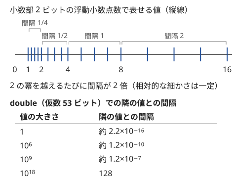

!!! abstract "要点"
    - **何ができるか**：幾何の判定を整数だけで行い、浮動小数点数の誤差で答えを誤るのを防ぐ。小数の入力は $10^k$ 倍して整数にし、比較は外積・内積・距離の 2 乗で行う。傾きや直線は gcd で約分して符号をそろえた整数の組で表す。実数は避けられないときだけ使い、誤差の大きさを見積もってから EPS を決める。
    - **いつ使うか**：
        - 座標や値が小数第 $k$ 位まで与えられる
        - ちょうど境界上か・整数になるかを判定する
        - $K$ 点以上を通る直線の数・平行な辺の組（台形）の数を求める
        - 絶対誤差または相対誤差 $10^{-6}$〜$10^{-9}$ まで許される
        - 座標が $10^9$ 規模の整数で、傾きや角度を比べる
    - **計算量**：整数での比較は 1 回 $O(1)$。方向・直線の正規化は gcd の分の $O(\log V)$（$V$ は座標の絶対値の上限）
    - **前提**：[ベクトルと外積](../geometry/geometry-vectors.md)、[GCD・LCM とユークリッドの互除法](../math/gcd-lcm.md)

<!-- textlint-disable -->
別名：浮動小数点の誤差・floating-point error・EPS・整数化・桁落ち・直線の正規化・方向ベクトルの約分・ax+by+c=0
<!-- textlint-enable -->

誤差の扱いと整数での処理は、幾何や小数を含む問題で「どこまで整数で計算できるか」を先に考え、判定の誤りを根本からなくす考え方である。整数の入力から外積・内積・距離の 2 乗で作った値は整数なので、`==` や符号の判定が正確に行える。`double` は値の大きさに比例した誤差を持つので、ちょうど 0 か・ちょうど等しいかの判定には向かない。

## double の精度の目安（仮数 53 ビット・値 10^9 で絶対誤差 10^-7 程度）と桁落ち {#double-precision}

`double` は、2 進で 53 ビットの仮数と指数の組で数を表す。表せる値どうしの間隔は値の大きさに比例し、相対的な細かさは $2^{-52} \approx 2.2 \times 10^{-16}$ で一定である。値が $10^9$ なら隣の値との間隔は約 $1.2 \times 10^{-7}$ で、四則演算 1 回ごとにその半分程度の誤差が入りうる。整数を正確に表せるのは $2^{53} \approx 9.0 \times 10^{15}$ までである（型の詳細は[浮動小数点数の型](../cpp/cpp-types-literals.md#floating-point)）。



この性質から、誤差が問題になるのは次の 2 つの場面である。

- **大きな値どうしの引き算（桁落ち）**：$10^9$ 規模の 2 つの値はそれぞれ $10^{-7}$ 程度の誤差を持つ。引き算の結果が 1 程度に小さくなっても誤差は $10^{-7}$ のまま残るので、相対誤差は $10^{-7}$ に跳ね上がる。許容誤差が $10^{-9}$ なら足りない
- **ちょうどの判定**：外積が 0 か・2 つの傾きが等しいかなど、真の値が 0 のときに計算結果が $\pm 10^{-7}$ になれば、符号の判定が逆になる

たとえば $x_1 = 999999999$、$y_1 = 999999998$、$x_2 = 10^9$、$y_2 = 999999999$ について、$y_1 x_2 - x_1 y_2$ の真の値は $-1$ である。各積は約 $10^{18}$ で、そこでの `double` の間隔は 128 なので、2 つの積は同じ `double` に丸められ、差は 0 になる。

```cpp
--8<-- "geometry-precision/cancellation.cpp:core"
```

各積は $10^{18}$ 以下なので `long long`（約 $9.2 \times 10^{18}$ まで）で正確に計算できる。整数の入力からできる値を整数のまま持てば、桁落ちは起きない。

## 小数の入力を 10^k 倍して整数にする（文字列で読んで整数にする） {#scale-to-integer}

入力の小数が小数第 $k$ 位までと決まっているなら、すべてを $10^k$ 倍して整数として扱う。距離や面積の比較は、両辺を同じだけ拡大しても大小が変わらないので、そのまま整数で判定できる。元の格子点（座標が整数の点）は、拡大した座標が $10^k$ の倍数の点になる。

問題は、小数を `double` で読んでから整数にする段階である。2.51 は 2 進で正確に表せず、`double` では 2.50999… に丸められる。100 倍すると 250.99999999999997 になり、`(long long)` の切り捨てで 250 になる。

```cpp
--8<-- "geometry-precision/truncation.cpp:core"
```

`llround`（最も近い整数に丸める）なら正しい値になる。読み込みの誤差は相対 $10^{-16}$ 程度なので、$10^k$ 倍した値が $10^{15}$ より十分小さければ、真の整数から 0.5 以上ずれることはないからである。`long double` に変えても 2.51 は正確に表せないので、切り捨てる限り同じ問題は残る。

最も確実なのは、文字列で読んで数字を拾い、整数を組み立てる方法である。符号を最後に全体へ付けること（`-0.05` は $-5$ で、$0 - 0.05$ を桁ごとに分けない）と、小数点以下の桁が $k$ より少ない入力（`3` や `-12.5`）を 0 で埋めることに注意する。

```cpp
--8<-- "geometry-precision/scale.cpp:core"
```

拡大すると値も大きくなる。座標が $10^5$ で小数第 4 位までなら、拡大後は $10^9$ になり、その 2 乗は $10^{18}$ で `long long` にぎりぎり入る。2 乗の和や外積を作る前に、上限を見積もる。

## 比較は外積・内積・距離の 2 乗で（sqrt・atan2・除算を避ける） {#integer-comparison}

整数の座標から整数の値で比べられる量は多い。実数の関数を使う前に、次の言い換えを試す。

| 比べたいもの | 実数での素朴な計算 | 整数での言い換え |
| --- | --- | --- |
| 距離の大小・円の内外 | `sqrt(dx*dx + dy*dy)` | 距離の 2 乗 $dx^2 + dy^2$ で比べる |
| 3 点が一直線上か・左右 | 傾きを割り算で求める | 外積の符号（0 なら一直線上） |
| 角が鋭角・直角・鈍角か | `acos` で角度を求める | 内積の符号 |
| 2 つの傾きの大小 | $dy_1 / dx_1$ と $dy_2 / dx_2$ | 分母を正にして $dy_1 dx_2$ と $dy_2 dx_1$ |
| 方向の並び順 | `atan2` | 半平面に分けて外積（[偏角ソート](../geometry/argument-sort.md)） |

分数の比較 $a / b < c / d$ は、$b > 0$ かつ $d > 0$ なら $a d < c b$ と同じである。分母が負になりうるときは、先に分子と分母の符号を反転して分母を正にする。分子が $10^{18}$ 規模で分母が $10^9$ 規模なら積は $10^{27}$ になるので、`__int128`（[__int128](../cpp/cpp-integer-overflow.md#int128)）で計算する。

```cpp
--8<-- "geometry-precision/compare.cpp:core"
```

`atan2` が使えない理由は、角度の差が小さすぎることにある。座標が $10^9$ 規模なら、$(10^9, 10^9 - 1)$ と $(10^9 - 1, 10^9 - 2)$ のように外積が $\pm 1$ の 2 方向は、角度の差が約 $5 \times 10^{-19}$ ラジアンしかない。`double` の `atan2` ではこの 2 つが同じ値になる（g++-15 で確かめた）。外積なら符号で区別できる。

$\sqrt{a} + \sqrt{b}$ と $\sqrt{c}$ の比較のように平方根が残る式も、両辺を 2 乗して整理すれば整数で比べられることが多い（[整数の平方根](../math/integer-root.md)）。

## 方向・直線の正規化：gcd で約分し、(1, −1) と (−1, 1) を同じにする符号の決め方 {#line-normalization}

「平行な線分の組を数える」「同じ直線上の点を数える」には、方向や直線を `map` のキーにして同じものをまとめる。そのためには、同じ方向（直線）が必ず同じ整数の組になる表し方、すなわち正規化が要る。傾きを `double` にすると、同じ傾きが誤差で別のキーになる。

**方向の正規化**。2 点の差 $(dx, dy) \ne (0, 0)$ を次の手順で 1 つの代表に直す。

1. $g = \gcd(\lvert dx \rvert, \lvert dy \rvert)$ で両方を割り、既約にする（$(2, -4)$ は $(1, -2)$）
2. $dx < 0$、または $dx = 0$ かつ $dy < 0$ なら、両方の符号を反転する（$(-1, 2)$ は $(1, -2)$）

手順 2 で、逆向きの $(1, -1)$ と $(-1, 1)$ が同じ代表になる。$dx = 0$ の場合を忘れると、垂直な方向 $(0, 1)$ と $(0, -1)$ が別のキーになる。向きも区別したい（ベクトルとして数える）ときは手順 2 を行わない。

**直線の正規化**。異なる 2 点 $(x_1, y_1)$・$(x_2, y_2)$ を通る直線は、$a = y_2 - y_1$、$b = x_1 - x_2$、$c = -(a x_1 + b y_1)$ とすると $a x + b y + c = 0$ と書ける。$(a, b)$ を方向と同じ手順で正規化してから $c$ を計算すれば、同じ直線は同じ $(a, b, c)$ になる。$(a, b)$ が決まれば、直線上の 1 点から $c$ は 1 通りに決まるからである。

この手順は、直線が格子点を通ることを前提にしている。垂直二等分線のように係数 $(a, b, c)$ が先に式で決まる直線は、格子点を通るとは限らない。$(a, b)$ だけを $\gcd(\lvert a \rvert, \lvert b \rvert)$ で割ると、$c$ が整数にならないことがある。このときは $\gcd(\lvert a \rvert, \lvert b \rvert, \lvert c \rvert)$ で 3 つとも割る。そのうえで $a < 0$、または $a = 0$ かつ $b < 0$ なら 3 つの符号を反転する。

```cpp
--8<-- "geometry-precision/normalize.cpp:core"
```

$y = m x + n$ の形は垂直な直線を表せず、$m$ と $n$ が分数になるので使わない。C++ の `std::gcd` は負の引数でも絶対値で計算し、0 以上を返す（[gcd・lcm](../cpp/cpp-math-functions.md#gcd-lcm)）。2 点が同じだと $\gcd(0, 0) = 0$ で割ることになるので、同じ点を含みうる入力では先に除く。

正規化したキーの使い方は、何を数えるかで変わる。

- **平行な組（台形）**：方向ごとに線分の数 $c$ を数え、$\binom{c}{2}$ を足す
- **同じ直線上の点**：直線ごとに、通る点の組の数を数える。$m$ 点を通る直線は $\binom{m}{2}$ 回数えられる
- **長さも同じ組（平行四辺形）**：約分の前の $g$ も合わせて $(dx, dy, g)$ をキーにする

??? question "確認問題：符号のそろえ方"
    $(2, -4)$ と $(-1, 2)$ を同じ方向として扱うには、どう正規化すればよいか。また、$(0, -3)$ はどの組になるか。

    ??? success "答え"
        $(2, -4)$ は gcd の 2 で割って $(1, -2)$。$(-1, 2)$ は既約で、$dx < 0$ なので符号を反転して $(1, -2)$。どちらも $(1, -2)$ になる。$(0, -3)$ は 3 で割って $(0, -1)$、$dx = 0$ かつ $dy < 0$ なので反転して $(0, 1)$ になる。

## 中点を整数にするために座標を 2 倍する {#double-coordinates}

2 点の中点 $\left(\frac{x_1 + x_2}{2}, \frac{y_1 + y_2}{2}\right)$ は、整数の座標でも半整数になりうる。中点を比べたりキーにしたりするなら、すべての座標を 2 倍しておくか、2 で割らずに和 $(x_1 + x_2, y_1 + y_2)$ を中点の代わりに使う。全体を同じだけ拡大しても、平行・垂直・一直線上・距離の大小は変わらない。

- **平行四辺形**：2 本の対角線の中点が一致する。点の組を和 $(x_1 + x_2, y_1 + y_2)$ でまとめれば、同じ和を持つ 2 組が平行四辺形を作る
- **垂直二等分線**：2 点から等距離な点の集まりは、$(x - x_1)^2 + (y - y_1)^2 = (x - x_2)^2 + (y - y_2)^2$ を展開して

    $$
    2(x_2 - x_1) x + 2(y_2 - y_1) y + (x_1^2 + y_1^2 - x_2^2 - y_2^2) = 0
    $$

    という整数の係数の直線になる。中点を経由せずに直接書ける。ただし格子点を通るとは限らないので、$c$ を点から計算し直す手順は使えない。[直線の正規化](#line-normalization)の末尾のとおり、3 つの係数の gcd で割って符号をそろえる。座標が $10^9$ なら $c$ は $2 \times 10^{18}$ 規模になる
- **等脚台形**：平行な 2 辺が同じ垂直二等分線を持つ。線分を「垂直二等分線」でまとめ、その中で中点の違う 2 本を組にする

2 倍した座標で外積を作ると値は 4 倍になる。座標が $10^9$ なら外積は最大 $3.2 \times 10^{19}$ で `long long` を超えるので、`__int128` を使うか、和のまま扱って 2 倍を避ける。

## 実数が避けられないとき：long double と、値の大きさに合わせた EPS {#eps}

円と円の交点・任意の角度の回転・距離の和の最小化などは、答えが無理数になり、整数だけでは計算できない。このときは誤差を見積もったうえで実数を使う。

**long double**。x86-64 の GCC（AtCoder の C++ も同じ）では `long double` は仮数 64 ビットで、相対的な細かさは約 $1.1 \times 10^{-19}$、値 $10^9$ での間隔は約 $5.8 \times 10^{-11}$ になる。`double` より 3 桁ほど余裕があるが、計算は遅くなる。精度が足りないと分かったときの手段で、整数化の代わりにはならない。

**EPS の決め方**。誤差を許して比べるときは、小さな正の数 $\varepsilon$（EPS）を使って次のように判定する。

$$
\mathrm{sgn}(x) = \begin{cases} -1 & (x < -\varepsilon) \\ 0 & (-\varepsilon \le x \le \varepsilon) \\ 1 & (x > \varepsilon) \end{cases}
$$

$\varepsilon$ は次の 2 つの間に取る。

- **下限：計算の誤差**。途中に現れる値の大きさを $M$ とすると、演算 1 回の誤差は $M \times 2.2 \times 10^{-16}$ 程度で、演算を重ねると積み上がる。座標が $10^4$ で距離の 2 乗（$10^8$ 規模）を扱うなら、誤差は $10^{-8}$ 前後になりうる
- **上限：真の値の差**。真の値が等しくないときに、差がどれだけ小さくなりうるか。入力が整数なら、外積などの差は 1 以上ある

値が $10^9$ 規模なのに $\varepsilon = 10^{-9}$ と固定すると、間隔 $10^{-7}$ より小さいので、誤差で等しいものを「違う」と判定する。値の大きさが場所によって大きく変わるなら、$\lvert a - b \rvert \le \varepsilon \max(1, \lvert a \rvert, \lvert b \rvert)$ のように相対誤差で比べる。

EPS 付きの「等しい」は推移律を満たさない（$a \approx b$ かつ $b \approx c$ でも $a \approx c$ とは限らない）。EPS 付きの比較関数で `sort` したり、`double` を `map` のキーにしたりすると、同じものが別々にまとまったり、並びが壊れたりする。まとめるのが目的なら、整数のキーに直す方法を先に探す。

## 出力の桁数と、実数の二分探索の打ち切り {#output-and-binary-search}

**出力の桁数**。`cout` の既定は有効数字 6 桁なので、実数の答えは `fixed` と `setprecision(15)` か `printf("%.15f")` で出す（[小数の出力](../cpp/cpp-io.md#float-output)）。「絶対誤差または相対誤差が $10^{-9}$ 以下」は、どちらか一方を満たせば正解という意味である。答えが $10^{12}$ のように大きいと絶対誤差 $10^{-9}$ は `double` では表せないが、相対誤差なら満たせる。

**整数の答えは整数で出す**。答えが整数と分かっているのに `double` で計算して出すと、$10^{15}$ を超えたあたりから下の桁が丸められ、`1e+18` のような指数表記で出ることもある。整数で計算し、最後に割り算が 1 回だけ残るなら、その直前まで整数で持つ。

**実数の二分探索**。幅 $W$ の区間を $t$ 回半分にすると幅は $W / 2^t$ になる。$W = 10^9$ を $10^{-9}$ まで縮めるには $t \ge \log_2 10^{18} \approx 60$ 回で足りる。「幅が $\varepsilon$ 以下になるまで」とループすると、値が大きいときに幅が `double` の間隔より小さくならず止まらない。反復回数を 100 回などに固定する（[実数の二分探索](../basics/binary-search-answer.md#real-number)、三分探索は[実数版と整数版](../basics/ternary-search.md#real-and-integer)）。入力が小数第 $k$ 位までなら、$10^k$ 倍して整数で二分探索できないかも考える。

## 落とし穴 {#pitfalls}

**小数を `double` で読んで切り捨てる**。`(long long)(b * 100)` は 2.51 で 250 になる。文字列で読んで整数を組み立てるか、`llround` で最も近い整数に丸める（[小数の入力を整数にする](#scale-to-integer)）。

**大きな積の差を `double` で作る**。外積や分数の分子 $y_1 x_2 - x_1 y_2$ を `double` で計算すると、積が $10^{18}$ 規模なら誤差は 100 を超え、0 か負かの判定が狂う。整数のまま `long long` か `__int128` で計算する。

**EPS を値の大きさと無関係に決める**。値が $10^9$ で $\varepsilon = 10^{-9}$ は、`double` の間隔より小さく、意味がない。値の大きさと演算の回数から誤差を見積もる。

**正規化で $dx = 0$ を忘れる**。$dx > 0$ にそろえるだけだと、垂直な方向の $(0, 1)$ と $(0, -1)$ が別のキーになる。$dx = 0$ のときは $dy > 0$ にそろえる。

**2 倍した座標や `__int128` が要る場面を見落とす**。座標 $10^9$ の外積は最大 $8 \times 10^{18}$ で `long long` にぎりぎり入るが、座標を 2 倍したり外積を足し合わせたりすると超える。式ごとに上限を見積もる。

**`sqrt` で整数の平方根を求める**。$10^{18}$ 規模の `long long` を `sqrt` に渡すと、`double` への変換で丸められ、1 ずれることがある。$r^2 \le N < (r + 1)^2$ を整数で確かめて補正する（[整数の平方根](../math/integer-root.md)）。

## 例題 {#examples}

### ABC169 C. Multiplication 3 {#abc169_c}

<div class="kp-problems" data-role="example" markdown>

- [ABC169 C. Multiplication 3](https://atcoder.jp/contests/abc169/tasks/abc169_c)（diff 597）：整数と小数第 2 位までの数の積を、小数点以下を切り捨てて求める。

</div>

$B$ を `double` で読んで $A \times B$ を切り捨てると、2.51 のように 2 進で表せない値のとき 1 小さくなる。$B$ を 100 倍した整数 $B'$ として読み、$\lfloor A B' / 100 \rfloor$ を整数で計算する。

??? note "解法の詳細"
    - $B$ は「1 桁の整数部・小数点・2 桁の小数部」の形なので、文字列で読んで $B' = 100 \times (\text{整数部}) + (\text{小数部})$ を作る。$B' \le 999$ である。
    - $A \le 10^{15}$ なので $A B' < 10^{18}$ で `long long` に入る。$A B' / 100$ を整数の割り算で求める（どちらも 0 以上なので切り捨てになる）。
    - `double` のまま 100 倍するなら、`llround(b * 100)` で丸めてから使う。

### ABC418 E. Trapezium {#abc418_e}

<div class="kp-problems" data-role="example" markdown>

- [ABC418 E. Trapezium](https://atcoder.jp/contests/abc418/tasks/abc418_e)（diff 1282）：N 点のうち 4 点を頂点とする台形の数を求める。

</div>

台形は平行な 2 辺を持つので、2 点の組 $\binom{N}{2}$ 本の線分を方向で分類し、同じ方向の線分の組を数える。どの 3 点も一直線上にないので、同じ方向の 2 本の線分は 4 つの異なる点からなり、台形を 1 つ作る。方向は[正規化](#line-normalization)して整数の組のキーにする。平行四辺形は平行な辺の組を 2 つ持ち、2 回数えられるので、その分を引く。

??? note "解法の詳細"
    - $N \le 2000$ なので線分は約 $2 \times 10^6$ 本。各線分の差 $(dx, dy)$ を gcd で割って符号をそろえ、方向ごとの本数 $c$ から $\binom{c}{2}$ を足す。
    - 平行四辺形は向かい合う辺の長さも等しいので、約分の前の $g$ も含めた $(dx, dy, g)$ ごとの本数 $k$ について $\binom{k}{2}$ を合計する。ここでは平行四辺形がそれぞれ 2 回数えられるので、この合計の半分を答えから引く。
    - 平行四辺形は、2 点の座標の和 $(x_1 + x_2, y_1 + y_2)$ が同じ組（対角線の中点が一致する組）として数えてもよい（[中点を整数にする](#double-coordinates)）。
    - キーは `map` か、ソートして同じものを数える。計算量は $O(N^2 \log N)$。

### ABC385 F. Visible Buildings {#abc385_f}

<div class="kp-problems" data-role="example" markdown>

- [ABC385 F. Visible Buildings](https://atcoder.jp/contests/abc385/tasks/abc385_f)（diff 1905）：数直線上に並ぶビルについて、座標 0 から見てすべてのビルを見渡せない高さの最大値を求める。

</div>

答えは、隣り合う 2 つのビルの頂点を結ぶ直線が $x = 0$ で取る高さ（$y$ 切片）の最大値になる。切片は $\dfrac{y_1 x_2 - x_1 y_2}{x_2 - x_1}$ と書け、分子は $10^{18}$ 規模の積の差である。`double` で計算すると[桁落ち](#double-precision)で許容誤差を超えたり、負か 0 以上かの判定を誤ったりする。分子と分母を整数で持って比べ、割り算は出力の直前に 1 回だけ行う。

??? note "解法の詳細"
    - 3 つのビル $i < j < k$ について、直線 $ik$ の切片は、直線 $ij$ の切片か直線 $jk$ の切片のどちらか以下になる。だから隣り合う組だけを調べればよく、$O(N)$ 個の候補の最大を取る。
    - 候補を分数 $p / q$（$q = x_2 - x_1 > 0$）のまま持ち、大小は $p_1 q_2$ と $p_2 q_1$ を `__int128` で比べる（分子 $10^{18}$ × 分母 $10^9$）。
    - 最大値の分子が負なら $-1$ を出力する。この判定は分子の符号だけで正確に行える。そうでなければ `long double` で $p / q$ を計算し、15 桁ほどで出力する。
    - 座標と高さは $10^9$ 以下なので $y_1 x_2$ と $x_1 y_2$ は $10^{18}$ 以下で、分子は `long long` で正確に計算できる。

## 練習問題 {#practice}

<div class="kp-problems" data-role="practice" markdown>

- [ABC467 D. Concentric Circles](https://atcoder.jp/contests/abc467/tasks/abc467_d)（diff 928）：2 点 P・Q から等距離で、2 点 R・S からも等距離な点があるかを判定する（テストケースが複数ある）。
- [ABC248 E. K-colinear Line](https://atcoder.jp/contests/abc248/tasks/abc248_e)（diff 1292）：N 点のうち K 点以上を通る直線の数を求める。
- [ABC191 D. Circle Lattice Points](https://atcoder.jp/contests/abc191/tasks/abc191_d)（diff 1953）：小数第 4 位までで与えられた円の内部にある格子点の数を求める。

</div>

??? note "練習の方針"
    - **ABC467 D**：条件を満たす点は、PQ の垂直二等分線と RS の垂直二等分線の共有点である。2 直線を整数の係数で書き（[中点を整数にする](#double-coordinates)の式）、平行（$a_1 b_2 = a_2 b_1$）でなければ交わる。平行なら同じ直線のときだけ共有点がある。同じ直線かは、3 つの係数の gcd で[正規化](#line-normalization)した $(a, b, c)$ の一致で判定する（$a_1 c_2 = a_2 c_1$ かつ $b_1 c_2 = b_2 c_1$ を比べてもよい）。座標が $10^9$ 規模なら $a, b$ が $4 \times 10^9$、$c$ が $2 \times 10^{18}$ 規模になるので、積の比較は `__int128` で行う。P と Q、R と S が異なる点だと保証されているかは問題文で確かめる（同じ点だと係数がすべて 0 になる）
    - **ABC248 E**：$K = 1$ なら直線は無数にある。$K \ge 2$ なら、すべての 2 点の組について通る直線を $(a, b, c)$ に正規化し、直線ごとに点の組の数を数える。組の数が $\binom{K}{2}$ 以上の直線を数える
    - **ABC191 D**：座標と半径を $10^4$ 倍して整数にする。元の座標で整数の各 $y$ について、拡大した座標で $(x - X)^2 \le R^2 - (y - Y)^2$ を満たす $x$（$10^4$ の倍数）の範囲を求める。実数の平方根で見当を付け、前後を整数の不等式で確かめて補正する。2 乗は $10^{18}$ 規模で `long long` に入る

## 力試し {#challenge}

<div class="kp-problems" data-role="challenge" markdown>

- [ABC296 G. Polygon and Points](https://atcoder.jp/contests/abc296/tasks/abc296_g)（diff 2241）：凸多角形と多数の点について、各点が内部・境界・外部のどこにあるかを答える。
- [ABC220 G. Isosceles Trapezium](https://atcoder.jp/contests/abc220/tasks/abc220_g)（diff 2439）：重みの付いた点から 4 点を選んで等脚台形を作るときの、重みの和の最大を求める。

</div>

??? note "力試しの方針"
    - **ABC296 G**：境界上かどうかは外積が 0 かで決まるので、実数の偏角で辺を探すと境界の判定を誤りやすい。1 つの頂点から多角形を扇形に分け、どの扇形に入るかを外積の符号で二分探索し、その扇形の辺との外積の符号で内部・境界・外部を決める（[凸包](../geometry/convex-hull.md)）
    - **ABC220 G**：等脚台形の平行な 2 辺は垂直二等分線が同じで、中点が違う。座標を 2 倍して中点を整数にし、すべての 2 点の組を「垂直二等分線（3 つの係数の gcd で正規化した直線）」でまとめる。各直線の中では中点ごとに重みの和の最大を取り、上位 2 つの中点の和で答えを更新する。中点が同じ 2 組は同じ直線上に重なるので組にしない

## 確認問題 {#quiz}

??? question "確認問題：切り捨てで 1 ずれる理由"
    1.15 を `double` で読み、100 倍して `(long long)` にすると 114 になる。なぜか。正しく 115 を得る方法を 2 つ挙げよ。

    ??? success "答え"
        1.15 は 2 進で正確に表せず、`double` では 1.15 よりわずかに小さい値になる。100 倍すると 114.99999999999999 程度になり、切り捨てで 114 になる。文字列で読んで「1」と「15」から 115 を組み立てる方法と、`llround(b * 100)` で最も近い整数に丸める方法がある。

??? question "確認問題：割り算を使わない傾きの比較"
    点 $(x_1, y_1)$ と $(x_2, y_2)$ について、原点から見た傾き $y_1 / x_1$ と $y_2 / x_2$ の大小を、割り算を使わずに比べる式を書け（$x_1, x_2 > 0$ とする）。

    ??? success "答え"
        $x_1 > 0$ かつ $x_2 > 0$ なので、両辺に $x_1 x_2$ を掛けても不等号の向きは変わらない。$y_1 / x_1 < y_2 / x_2 \iff y_1 x_2 < y_2 x_1$ である。これは外積 $x_1 y_2 - y_1 x_2 > 0$ と同じ式である。

## 使い分け {#comparison}

- まず整数で書けるかを考える。小数の入力は $10^k$ 倍、距離は 2 乗、傾きと角度は外積、同じ方向・直線は正規化したキーで扱う
- 答えそのものが無理数になる（円の交点・回転・最適化）ときだけ実数を使い、`double` で足りなければ `long double` にし、EPS は値の大きさから決める
- 方向を角度の順に並べるなら[偏角ソート](../geometry/argument-sort.md)、円の判定は[円](../geometry/circle-geometry.md)を見る

## 参考 {#references}

- [drken「AtCoder ABC 169 C - Multiplication 3 (緑色, 300 点)」](https://drken1215.hatenablog.com/entry/2020/05/31/224300)：小数を `double` で読んで切り捨てると誤る例と、文字列で読んで 100 倍の整数にする方法
- [merom686「ABC385 参加記」](https://merom686.hatenablog.com/entry/2024/12/22/165012)：桁落ちで許容誤差を超える原因の分析と、隣り合うビルの傾きを比べる方針
- [ikatakos「AtCoder Beginner Contest 385 F 問題メモ」](https://ikatakos.com/pot/programming_algorithm/contest_history/atcoder/2024/1221_abc385)：切片を隣り合う組だけで求めてよい理由と、分数のまま扱う方法（解説の部分だけを参照）
- [ikatakos「AtCoder Beginner Contest 418 E 問題メモ」](https://ikatakos.com/pot/programming_algorithm/contest_history/atcoder/2025/0809_abc418)：方向の正規化と、平行四辺形の重複の引き方（解説の部分だけを参照）
- [hyouri「ABC467 の解説」](https://qiita.com/hyouri/items/c2d2344566d215b6cae0)：垂直二等分線を整数の係数で持ち、平行と同一直線を判定する方針
- [comet725「ABC467 D を解いた【垂直二等分線】」](https://qiita.com/comet725/items/6d1da8aae01548d3ebba)：垂直二等分線の係数を gcd と符号で正規化する方法
- [ikatakos「AtCoder Beginner Contest 248 E 問題メモ」](https://ikatakos.com/pot/programming_algorithm/contest_history/atcoder/2022/0416_abc248)：直線を $ax + by + c = 0$ の既約な形で表して数える方法（解説の部分だけを参照）
- [ikatakos「AtCoder Beginner Contest 191 D 問題メモ」](https://ikatakos.com/pot/programming_algorithm/contest_history/atcoder/2021/0206_abc191)：$10^4$ 倍して整数にし、近似の後に整数で補正する方法（解説の部分だけを参照）
- [merom686「ABC296 参加記」](https://merom686.hatenablog.com/entry/2023/04/01/235440)：実数の偏角で内外判定をして境界で誤った記録
- [merom686「ABC220 参加記」](https://merom686.hatenablog.com/entry/2021/09/27/012056)：座標を 2 倍して中点を整数にし、方向と中点でまとめる方針
