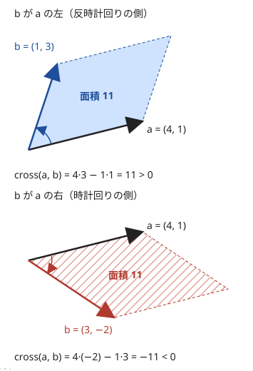
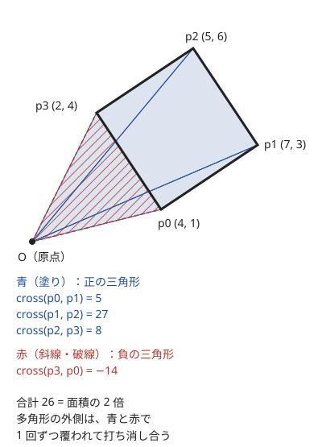

!!! abstract "要点"
    - **何ができるか**：外積 $a_x b_y - a_y b_x$ の符号で向き（左・右・一直線上）が、絶対値で平行四辺形の面積が分かる。3 点の一直線判定・凸性・多角形の面積・線分の交差を、整数のまま誤差なく判定できる。
    - **いつ使うか**：
        - 3 点が一直線上にあるか・三角形ができるか。
        - 左に曲がるか右に曲がるか・四角形が凸か。
        - 頂点が順に与えられた多角形の面積。
        - 2 本の線分が交わるか・多角形を線分で切って分かれる個数。
        - 直方体どうしの共通部分の体積。
        - 座標が整数で $\lvert x \rvert, \lvert y \rvert \le 10^9$（外積は `long long` にぎりぎり収まる）。
        - $(x_2 - x_1)(y_3 - y_1) - (y_2 - y_1)(x_3 - x_1)$ の符号で場合を分ける。
    - **計算量**：外積・内積・3 点の回り方・線分の交差判定は $O(1)$、$N$ 角形の面積は $O(N)$
    - **前提**：なし

<!-- textlint-disable -->
別名：外積・内積・cross product・ccw・向き判定・符号付き面積・多角形の面積・靴紐公式・shoelace formula・線分の交差判定・点と直線の距離・3 次元の基本・直方体の共通部分
<!-- textlint-enable -->

ベクトルと外積は、幾何の問題を整数の掛け算と引き算だけで解くための道具である。角度や傾きを実数で求める代わりに、外積の符号で「どちら側にあるか」を、内積の符号で「角が鋭いか鈍いか」を判定する。座標が整数なら結果も整数なので、誤差がまったく入らない。以降の幾何の手法（[偏角ソート](../geometry/argument-sort.md)・[凸包](../geometry/convex-hull.md)など）は、どれもこの判定の上に組み立てる。

## 外積と内積の意味（符号と大きさ） {#cross-and-dot}

2 次元のベクトル $a = (a_x, a_y)$ と $b = (b_x, b_y)$ について、外積と内積を次で定める。$\theta$ は $a$ から $b$ へ反時計回りに測った角である。

$$
\mathrm{cross}(a, b) = a_x b_y - a_y b_x = \lvert a \rvert \lvert b \rvert \sin\theta, \qquad
\mathrm{dot}(a, b) = a_x b_x + a_y b_y = \lvert a \rvert \lvert b \rvert \cos\theta
$$

符号の読み方は次のとおりである。座標軸は $x$ が右、$y$ が上で、反時計回りを正とする。

| 値 | 正 | 0 | 負 |
| --- | --- | --- | --- |
| 外積 $\mathrm{cross}(a, b)$ | $b$ は $a$ の左（反時計回りの側） | 同じ直線上（同じ向きか逆向き） | $b$ は $a$ の右（時計回りの側） |
| 内積 $\mathrm{dot}(a, b)$ | なす角が鋭角 | 直角 | 鈍角 |

外積の絶対値 $\lvert a \rvert \lvert b \rvert \lvert \sin\theta \rvert$ は、$a$ と $b$ を 2 辺とする平行四辺形の面積である。底辺 $\lvert a \rvert$ に高さ $\lvert b \rvert \lvert \sin\theta \rvert$ を掛けたものだからである。



外積は引数の順を入れ替えると符号が変わる（$\mathrm{cross}(b, a) = -\mathrm{cross}(a, b)$）。内積は入れ替えても変わらない。実装では点とベクトルを同じ構造体で表し、外積と内積を関数にしておく。

```cpp
--8<-- "geometry-vectors/ccw.cpp:point"
```

??? question "確認問題：符号の確かめ"
    $a = (1, 0)$ から見て $b = (0, 1)$ は左か右か。外積と内積の値はいくつか。

    ??? success "答え"
        $\mathrm{cross}(a, b) = 1 \cdot 1 - 0 \cdot 0 = 1 > 0$ なので左にある（$x$ 軸の正の向きから反時計回りに 90 度）。内積は $1 \cdot 0 + 0 \cdot 1 = 0$ で、直角である。符号の向きを忘れたら、この組で確かめるとよい。

## ccw：3 点の回り方・一直線上の判定・凸性の判定 {#ccw}

3 点 $p, q, r$ の位置関係は、$p$ を基準にした 2 本のベクトルの外積 $\mathrm{cross}(q - p, r - p)$ の符号で決まる。正なら $p \to q \to r$ と進むと左に曲がり（反時計回り）、負なら右に曲がり（時計回り）、0 なら 3 点は一直線上にある。この符号を返す関数を ccw（counter-clockwise）と呼ぶ。

```cpp
--8<-- "geometry-vectors/ccw.cpp:ccw"
```

ccw から次の判定がすぐに作れる。

- **一直線上の判定**：$\mathrm{ccw}(p, q, r) = 0$。傾き $\frac{y_2 - y_1}{x_2 - x_1}$ を比べる方法は、割り算の誤差と $x_2 = x_1$（縦の直線）の場合分けが要るが、外積なら両方とも起きない。$\mathrm{cross}(q - p, r - p) = 0$ は、傾きの等式の分母を払った形 $(x_2 - x_1)(y_3 - y_1) = (y_2 - y_1)(x_3 - x_1)$ にあたる
- **三角形ができるか**：3 点が一直線上にないこと、すなわち $\mathrm{ccw} \ne 0$。2 点が同じ座標でも外積は 0 になるので、この場合も三角形はできないと正しく判定される
- **点が線分の上にあるか**：点 $r$ が線分 $pq$ の上にあるのは、$\mathrm{cross}(q - p, r - p) = 0$ かつ $\mathrm{dot}(p - r, q - r) \le 0$ のときである。内積が 0 以下なのは、$r$ から見て $p$ と $q$ が逆の向き（または $r$ が端点）にあることを表す
- **凸性の判定**：頂点を順に並べた多角形で、どの頂点でも $\mathrm{ccw}(p_{i-1}, p_i, p_{i+1})$ が同じ符号なら、どこでも同じ向きに曲がっている

凸性の判定には注意がある。四角形のように頂点が少なければ「すべての頂点で同じ向きに曲がる」で十分だが、5 角形以上では足りない。星形の 5 角形（五芒星の頂点を 1 つおきに結んだもの）は、すべての頂点で同じ向きに曲がるのに、辺が交差していて凸ではない。辺が交差しないこと（単純な多角形であること）が問題で保証されているかを確かめる。

??? question "確認問題：符号の取り違え"
    頂点が時計回りに並んだ凸多角形で、各頂点の ccw はどうなるか。「すべて正なら凸」と判定すると何が起きるか。

    ??? success "答え"
        時計回りなら、どの頂点でも右に曲がるので ccw はすべて $-1$ になる。「すべて正なら凸」と書くと、凸なのに凸でないと判定してしまう。向きが決まっていない入力では、「すべて正またはすべて負」で判定する。

## オーバーフローの見積もり（座標 10^9 で外積は 8×10^18、さらに足すなら __int128） {#overflow}

外積は 2 つの積の差なので、座標の大きさの 2 乗の規模になる。座標が $\lvert x \rvert, \lvert y \rvert \le 10^9$ なら、差 $q - p$ の各成分は $2 \times 10^9$ 以下、1 つの積は $4 \times 10^{18}$ 以下である。外積はその差なので、絶対値は $8 \times 10^{18}$ 以下と見積もれる。`long long` の上限は約 $9.22 \times 10^{18}$ なので、外積 1 つはぎりぎり収まる。

| 計算 | 値の上限（$\lvert x \rvert, \lvert y \rvert \le 10^9$） | 型 |
| --- | --- | --- |
| $\mathrm{cross}(q - p, r - p)$ | $8 \times 10^{18}$ | `long long` で足りる |
| 座標が $2 \times 10^9$ のときの外積 | $1.6 \times 10^{19}$ | `__int128` が要る |
| 外積どうしの積 | $6.4 \times 10^{37}$ | `__int128`（上限は約 $1.7 \times 10^{38}$） |
| 多角形の面積の和の途中 | 項ごとに $2 \times 10^{18}$、$N$ 項 | 途中を `__int128` で足す |

あふれやすいのは、外積を「さらに使う」ところである。

- **外積どうしを掛ける**：線分の交差判定で $\mathrm{cross}_1 \times \mathrm{cross}_2 \le 0$ と書くと、積は $10^{37}$ 規模になってあふれる。ccw のように符号（$-1, 0, 1$）にしてから掛ける
- **外積を足し合わせる**：多角形の面積の公式は外積を $N$ 個足すので、途中の和が `long long` を超えうる。和は `__int128` で取る（[__int128](../cpp/cpp-integer-overflow.md#int128)）
- **座標を変換してから外積を取る**：[45 度回転](../geometry/manhattan-chebyshev.md)の $(x + y, x - y)$ などで座標が 2 倍になると、外積は 4 倍になって収まらない

`int` で座標を読み、`int` どうしの積で外積を作ると、座標が $10^5$ 程度でもあふれる。構造体の座標を最初から `long long` にしておけば、この誤りは起きない。

## 三角形・多角形の面積：座標の公式（面積の 2 倍を整数のまま扱う） {#polygon-area}

この節は、ここまでの外積の意味だけを前提にする。三角形 $abc$ の面積は、2 辺のベクトルが作る平行四辺形の半分なので $\frac{1}{2} \lvert \mathrm{cross}(b - a, c - a) \rvert$ である。頂点を順に $p_0, p_1, \dots, p_{N-1}$ と並べた多角形の面積 $S$ は、次の式で求まる（座標の公式、靴紐公式）。添字は $p_N = p_0$ と読む。

$$
2S = \sum_{i=0}^{N-1} \mathrm{cross}(p_i, p_{i+1})
$$

右辺は、頂点が反時計回りなら正、時計回りなら負になる。面積が欲しいときは最後に絶対値を取る。

**なぜ成り立つか**。$\mathrm{cross}(p_i, p_{i+1})$ は、原点 $O$ と辺 $p_i p_{i+1}$ が作る三角形の面積の 2 倍に、向きの符号を付けたものである。多角形を反時計回りにたどると、原点から見て遠い側の辺は正、近い側の辺は負の三角形を作る。多角形の内側の点は正の三角形に 1 回だけ多く覆われ、外側の点は正と負に同じ回数ずつ覆われて打ち消し合う。



**面積の 2 倍のまま扱う**。座標が整数なら $2S$ は整数だが、$S$ は整数とは限らない（$2S$ が奇数なら $S$ は「整数 $+ 0.5$」）。比較や差の計算は $2S$ のまま行い、出力するときだけ 2 で割る。`double` に直すと、$10^{18}$ 規模の値では有効数字が足りず、1 の位から狂う。

```cpp
--8<-- "geometry-vectors/polygon.cpp:area"
```

- **凹多角形でも使える**：辺が交差しない多角形なら、凹んでいても公式は正しい。打ち消し合いの議論に凸性は使っていない
- **自己交差する多角形では使えない**：辺が交差すると、向きが逆の部分が引かれてしまう
- **部分の面積**：頂点 $p_l, \dots, p_r$ を順に結んで閉じた多角形の $2S$ は、$\mathrm{cross}(p_i, p_{i+1})$ の $l \le i < r$ の和に閉じる辺 $\mathrm{cross}(p_r, p_l)$ を足したものである。和を[累積和](../basics/prefix-sum.md)にしておけば、対角線で切った片側の面積が $O(1)$ で求まる

??? question "確認問題：2 倍の偶奇"
    格子点を頂点とする三角形 $(0, 0)$・$(1, 0)$・$(0, 1)$ の面積の 2 倍はいくつか。面積が整数にならない三角形を比べるとき、なぜ `double` ではなく $2S$ を使うのか。

    ??? success "答え"
        $\mathrm{cross}((1, 0), (0, 1)) = 1$ なので $2S = 1$、面積は $0.5$ である。$2S$ は整数なので、そのまま比べれば誤差なく大小と等しさが分かる。`double` は約 16 桁しか持たないので、$2S$ が $10^{18}$ 規模になると、0.5 の違いはもちろん 1 の違いも区別できない。

## 線分の交差判定（端点で接する・同一直線上の場合）と点と直線の距離 {#segment-intersection}

この節は [ccw](#ccw) を前提にする。線分 $AB$ と $CD$ が交わるのは、「$C$ と $D$ が直線 $AB$ の両側にあり、かつ $A$ と $B$ が直線 $CD$ の両側にある」ときである。片方の条件だけでは足りない。直線 $AB$ をまたいでいても、線分 $AB$ の延長の上で交わっているだけかもしれないからである。

$$
\mathrm{ccw}(A, B, C) \cdot \mathrm{ccw}(A, B, D) \le 0 \quad\text{かつ}\quad \mathrm{ccw}(C, D, A) \cdot \mathrm{ccw}(C, D, B) \le 0
$$

不等号を $\le$ にすると、端点が相手の線分の上にある「接する」場合も交わるとみなす。接する場合を除きたいなら $<$ にする。問題がどちらを「交わる」と言っているかを先に確かめる。

**4 点が一直線上の場合**。4 つの ccw がすべて 0 のとき、上の式は常に真になってしまう。一直線上で離れている 2 本の線分も「交わる」と判定されるので、この場合だけは別に扱う。直線に沿った順（$x$ 座標、等しければ $y$ 座標の順）で各線分の端点を小さい順に並べ、2 つの区間が重なるかを見る。

```cpp
--8<-- "geometry-vectors/polygon.cpp:intersect"
```

交わるかどうかだけなら交点の座標は要らない。交点の座標は一般に分数になるので、求めると誤差の扱いが要る。判定だけで済むなら、外積の符号だけで整数のまま終わらせる。

**点と直線の距離**。点 $P$ と直線 $AB$ の距離は、平行四辺形の面積 $\lvert \mathrm{cross}(B - A, P - A) \rvert$ を底辺 $\lvert B - A \rvert$ で割った高さである。

$$
d = \frac{\lvert \mathrm{cross}(B - A, P - A) \rvert}{\lvert B - A \rvert}
$$

線分 $AB$ との距離なら、$P$ から下ろした垂線の足が線分の外に出る場合を内積で分ける。$\mathrm{dot}(B - A, P - A) < 0$ なら $A$ が最も近く、$\mathrm{dot}(A - B, P - B) < 0$ なら $B$ が最も近い。どちらでもなければ直線との距離と同じである。距離を $r$ と比べるだけなら、両辺を 2 乗した $\mathrm{cross}^2 \le r^2 \lvert B - A \rvert^2$ で比べれば平方根も割り算も要らない（積は `__int128` で取る）。

??? question "確認問題：同一直線上の 2 本"
    $A = (0, 0)$、$B = (1, 1)$、$C = (2, 2)$、$D = (3, 3)$ のとき、4 つの ccw の積の条件だけで判定すると結果はどうなるか。正しい答えは何か。

    ??? success "答え"
        4 点が一直線上なので ccw はすべて 0 で、積はどちらも 0 になり「交わる」と判定される。実際には線分 $AB$ は $x \le 1$、線分 $CD$ は $x \ge 2$ の範囲にあって重ならないので、交わらない。区間の重なりを別に調べる必要がある。

## 3 次元の基本：軸に平行な直方体の共通部分は軸ごとの区間の積 {#3d-geometry}

各面が座標平面に平行な直方体は、$x$・$y$・$z$ の 3 つの区間の組で表せる。2 つの直方体の共通部分も、軸ごとの区間の共通部分を組にした直方体になる。区間の共通部分は「左端の最大」と「右端の最小」で求まる。

$$
\text{長さ}_x = \max\bigl(0,\ \min(r_1, r_2) - \max(l_1, l_2)\bigr), \qquad \text{体積} = \text{長さ}_x \cdot \text{長さ}_y \cdot \text{長さ}_z
$$

共通部分の体積が正かどうかは、3 軸すべてで $\max(l_1, l_2) < \min(r_1, r_2)$ が成り立つかで判定できる。面や辺で接するだけなら、どこかの軸の長さが 0 なので体積は 0 である。$<$ と $\le$ のどちらにするかは、「接する」を重なりに含めるかで決める。2 次元の長方形でも同じで、[いもす法](../basics/imos.md)で多数の長方形の重なりを数えるときの土台になる。

3 次元のベクトルでも内積は $a_x b_x + a_y b_y + a_z b_z$ で、なす角の判定に使える。3 次元の外積はベクトルになり（2 つのベクトルに垂直な向き）、ABC では軸に平行な箱の扱いがほとんどなので、このページでは立ち入らない。

## 点の表し方：整数の構造体と std::complex {#point-representation}

点は、座標を `long long` で持つ構造体で表すのを基本にする。足し算・引き算を演算子にし、外積と内積を関数にしておけば、判定の式がそのまま書ける（[外積と内積の意味](#cross-and-dot)のコード）。一直線上の点を並べるために大小比較が要るときは、`tie(x, y)` で辞書順の比較を足す。

`std::complex<double>` で点を表す流儀もある。$a$ を $\theta$ だけ回すのが `a * polar(1.0, theta)` と 1 回の掛け算で書け、長さは `abs(a)`、偏角は `arg(a)` で得られるので、回転や角度を実数で扱う問題では短く書ける（[回転・平行移動](../geometry/rotation-transform.md)）。複素数の積 $\overline{a} \cdot b$ の実部は内積、虚部は外積になる。

ただし、整数の判定には `complex` を使わない方がよい。

- 規格が `complex` の要素の型として定めているのは浮動小数点数だけで、`complex<long long>` の動作は未規定である。GCC では足し算・掛け算は動くが、`abs` などは整数で正しく計算されない
- `complex<double>` で座標を持つと、外積が $10^{18}$ 規模になったときに下の桁が失われ、0 かどうかの判定を誤る（[誤差の扱い](../geometry/geometry-precision.md)）

## 落とし穴 {#pitfalls}

**外積の引数の順を取り違える**。$\mathrm{cross}(a, b)$ と $\mathrm{cross}(b, a)$ は符号が逆である。ccw も $\mathrm{cross}(q - p, r - p)$ の順で定め、「正が左（反時計回り）」と 1 つに決めて使い回す。迷ったら $(1, 0)$ と $(0, 1)$ で確かめる。

**外積どうしを掛けてあふれる**。交差判定で外積の値どうしを掛けると、座標 $10^9$ では $10^{37}$ 規模になる。ccw で符号に直してから掛ける（[オーバーフローの見積もり](#overflow)）。

**同一直線上の場合を忘れる**。線分の交差判定で 4 点が一直線上だと、ccw の積の判定だけでは離れた線分も交わると判定される。区間の重なりを別に調べる（[線分の交差判定](#segment-intersection)）。

**重複した点**。3 点のうち 2 点が同じ座標だと、外積は 0 になる。「一直線上か」と聞かれていれば正しく 0 だが、凸性の判定や凸包では、重なった頂点で曲がる向きが決まらない。入力に同じ点がありうるかを確かめ、必要なら先に取り除く。

**傾きや角度を実数で比べる**。`atan2` や割り算で傾きを求めると、$10^9$ 規模の座標では隣り合う方向を区別できないことがある。向きの判定は外積、角の鋭さは内積で、整数のまま行う。どうしても実数が要るときの注意は[誤差の扱い](../geometry/geometry-precision.md)にまとめてある。

**面積を 2 で割ってから比べる**。$2S$ が奇数なら、整数の割り算で切り捨てられて等しくない面積が等しく見える。比較は $2S$ のまま行う。

## 偏角ソート・凸包・累積和へのつながり {#next-steps}

外積の符号は、上位の幾何の手法でそのまま比較や判定の部品になる。

- **偏角ソート**：同じ半平面にある 2 つのベクトルは、$\mathrm{cross}(a, b) > 0$ なら $a$ が先（反時計回りで手前）である。これを比較関数にして、角度を求めずに並べる（[偏角ソート](../geometry/argument-sort.md)）
- **凸包**：点を順に見て、末尾の 2 点と新しい点が左に曲がらない間は末尾を取り除く。この「曲がる向き」が ccw である（[凸包](../geometry/convex-hull.md)）
- **多角形の部分の面積や重心**：座標の公式は辺ごとの値の和なので、[累積和](../basics/prefix-sum.md)で区間ごとに取り出せる。対角線で切った片側の面積を[尺取り法](../basics/two-pointers.md)で動かす問題もある（[力試し](#challenge)）
- **誤差の扱い**：整数に直せない入力（小数の座標・円）では、外積を実数で計算する。そのときの比較の仕方は[誤差の扱い](../geometry/geometry-precision.md)で扱う

## 例題 {#examples}

### ABC181 C. Collinearity {#abc181_c}

<div class="kp-problems" data-role="example" markdown>

- [ABC181 C. Collinearity](https://atcoder.jp/contests/abc181/tasks/abc181_c)（diff 274）：N 点の中に一直線上にある 3 点があるかを判定する。

</div>

点の数が少ないので、3 点の組をすべて試し、[ccw](#ccw) が 0 になる組があるかを調べる。傾きを割り算で求めると縦の直線の場合分けと誤差が要るが、外積なら整数の比較 1 回で済む。

??? note "解法の詳細"
    - 3 重ループで $i < j < k$ の組を列挙し、$\mathrm{cross}(p_j - p_i, p_k - p_i) = 0$ なら Yes を出力して終える。
    - すべての組で 0 でなければ No を出力する。
    - 組の数は $\binom{N}{3}$ で、全体は $O(N^3)$。座標は `long long` で読んでおくと、制約の大きさを気にせずに済む。

## 練習問題 {#practice}

<div class="kp-problems" data-role="practice" markdown>

- [ABC361 B. Intersection of Cuboids](https://atcoder.jp/contests/abc361/tasks/abc361_b)（diff 299）：2 つの直方体の共通部分の体積が正かを判定する。
- [ABC224 C. Triangle?](https://atcoder.jp/contests/abc224/tasks/abc224_c)（diff 301）：N 点から三角形ができる 3 点の選び方の数を求める。
- [ABC266 C. Convex Quadrilateral](https://atcoder.jp/contests/abc266/tasks/abc266_c)（diff 516）：4 点を順に結んだ四角形が凸かを判定する。
- [ABC016 D. 一刀両断](https://atcoder.jp/contests/abc016/tasks/abc016_4)（diff 1305）：多角形を 1 本の線分で切ったとき、いくつに分かれるかを求める。

</div>

??? note "練習の方針"
    - **ABC361 B**：$x$・$y$・$z$ の各軸で、左端の最大が右端の最小より小さいかを調べ、3 軸とも成り立てば体積は正である。接するだけなら体積は 0 なので不等号は $<$ にする
    - **ABC224 C**：3 点の組をすべて試し、外積が 0 でない組を数える。三角形ができないのは 3 点が一直線上にあるときだけである
    - **ABC266 C**：各頂点で、前後の頂点へのベクトルの外積を計算し、4 つの符号がすべて同じなら凸である。符号の向き（反時計回りの入力なら正）を小さな例で確かめてから書く
    - **ABC016 D**：切る線分と多角形の各辺との交差を数える。線分が多角形の外から入って出るたびに交差は 2 つ増え、ピースは 1 つ増えるので、答えは交差数 $/ 2 + 1$ である。線分が頂点を通らないことが保証されているので、端点で接する場合を考えなくてよい

## 力試し {#challenge}

<div class="kp-problems" data-role="challenge" markdown>

- [ABC472 F. Centroid of a Slice](https://atcoder.jp/contests/abc472/tasks/abc472_f)（diff 1707）：凸多角形を 2 頂点を結ぶ線分で切ったときの一方の部分の重心を、多数のクエリについて求める。
- [ABC250 F. One Fourth](https://atcoder.jp/contests/abc250/tasks/abc250_f)（diff 2044）：凸多角形を対角線で切り、片側の面積を全体の 1/4 にできるだけ近づける。
- [ABC373 G. No Cross Matching](https://atcoder.jp/contests/abc373/tasks/abc373_g)（diff 2377）：2 つの点集合の点を 1 対 1 に線分で結び、どの 2 本も交わらない結び方を求める。

</div>

??? note "力試しの方針"
    - **ABC472 F**：多角形の重心は、各辺の $(p_i + p_{i+1}) \cdot \mathrm{cross}(p_i, p_{i+1})$ の和を $3 \sum \mathrm{cross}(p_i, p_{i+1})$（面積の 2 倍の 3 倍）で割って求まる。分子の $x$・$y$ 成分と分母はどれも辺ごとの値の和なので、頂点の列を 2 周分に伸ばして 3 種類の累積和を作り、切り口の辺の分を足せば各クエリが $O(1)$ になる
    - **ABC250 F**：出力する値は $8 \lvert b - S/4 \rvert = \lvert 4 \cdot 2b - 2S \rvert$ と、面積の 2 倍だけで書ける。始点の頂点を 1 つずつ進めながら、終点を面積が $S/4$ を超えるまで進める尺取りにし、面積の 2 倍を三角形 1 つ分ずつ足し引きして整数のまま更新する。座標は $4 \times 10^8$ 以下なので、和は `long long` に収まる
    - **ABC373 G**：交差する 2 本の線分をつなぎ替えると、三角不等式により長さの和が真に減る（3 点が一直線上にないので等号にならない）。したがって長さの和が最小の結び方には交差がなく、最小重みの完全マッチング（最小費用流など）で求まる。交差を見つけてはつなぎ替える方法も同じ考えで、交差の判定に線分の交差判定を使う

## 参考 {#references}

- [drken「AtCoder ABC 181 C - Collinearity (4Q, 灰色, 300 点)」](https://drken1215.hatenablog.com/entry/2020/11/02/030500)：例題の方針（3 点の全探索と外積による一直線の判定）
- [drken「AtCoder ABC 361 B - Intersection of Cuboids (4Q, 灰色, 250 点)」](https://drken1215.hatenablog.com/entry/2024/07/07/035814)：練習の方針（軸ごとの区間の共通部分）
- [merom686「ABC224」](https://merom686.hatenablog.com/entry/2021/10/24/000901)：練習の方針（三角形ができる条件を外積で判定）
- [merom686「ABC266」](https://merom686.hatenablog.com/entry/2022/08/28/011604)：練習の方針（各頂点の外積の符号による凸性の判定）
- [drken「AtCoder ABC 016 D - 一刀両断 (2Q, 試験管水色)」](https://drken1215.hatenablog.com/entry/2023/06/08/041900)：練習の方針（線分の交差判定と、答えが交差数 / 2 + 1 になる理由）
- [ikatakos「AtCoder Talent Quest 〜 今から28卒には脱出してもらいます〜予選（AtCoder Beginner Contest 472）F,G問題メモ」](https://ikatakos.com/pot/programming_algorithm/contest_history/atcoder/2026/0822_abc472)：力試しの方針（多角形の重心の公式と累積和。解法の部分だけを参照）
- [drken「AtCoder ABC 250 F - One Fourth (2D, 黄色, 600 点)」](https://drken1215.hatenablog.com/entry/2023/06/06/010500)：力試しの方針（面積の 2 倍による尺取り）
- [drken「AtCoder ABC 373 G - No Cross Matching (3D, 黄色, 600 点)」](https://drken1215.hatenablog.com/entry/2024/09/29/034410)：力試しの方針（つなぎ替えで長さの和が減ることと最小重みマッチング）
- [cppreference「std::complex」](https://en.cppreference.com/w/cpp/numeric/complex)：要素の型が浮動小数点数でないときの動作が未規定であること
