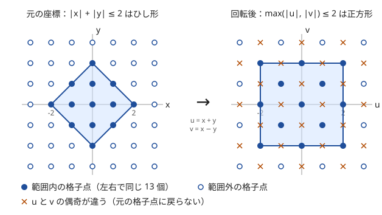
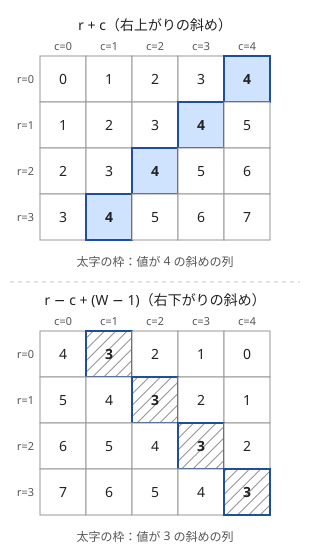

!!! abstract "要点"
    - **何ができるか**：$u = x + y$、$v = x - y$ と座標を変える（45 度回転）と、マンハッタン距離 $\lvert \Delta x \rvert + \lvert \Delta y \rvert$ はチェビシェフ距離 $\max(\lvert \Delta u \rvert, \lvert \Delta v \rvert)$ になる。ひし形の範囲が軸に平行な正方形に変わり、最遠点対・距離の和・斜め移動を、軸ごとの最大・最小・ソートで解ける。
    - **いつ使うか**：
        - マンハッタン距離が最大の 2 点・ある点から最も遠い点
        - マンハッタン距離の和の最小・全ペアの距離の総和
        - 斜め移動（キングの移動）だけでの距離・斜めにしか動けない駒
        - ひし形の範囲（$\lvert x \rvert + \lvert y \rvert \le D$）にある点の数
        - $N \le 2 \times 10^5$ 点の全ペアのマンハッタン距離の和や最大を問い、全組 $O(N^2)$ が間に合わない
        - $\lvert x_i - x_j \rvert + \lvert y_i - y_j \rvert$ や $\max(\lvert x_i - x_j \rvert, \lvert y_i - y_j \rvert)$ の最大・和が式に出る
    - **計算量**：座標の変換は 1 点 $O(1)$。最遠点対は $O(N)$、全ペアの距離の和はソートで $O(N \log N)$、点の更新つきの最遠点はセグメント木で 1 回 $O(\log N)$。$H \times W$ の盤面でひし形の範囲の点の数は、前計算 $O((H + W)^2)$・1 回 $O(1)$
    - **前提**：[ソートで考える](../basics/sorting-techniques.md)、[累積和](../basics/prefix-sum.md)

<!-- textlint-disable -->
別名：45 度回転・マンハッタン距離・Manhattan distance・チェビシェフ距離・Chebyshev distance・L1 距離・L∞ 距離・u=x+y, v=x−y・絶対値を外す・斜めの番号
<!-- textlint-enable -->

マンハッタン距離と 45 度回転は、絶対値の和 $\lvert \Delta x \rvert + \lvert \Delta y \rvert$ を、座標の変換 $(u, v) = (x + y, x - y)$ で $\max(\lvert \Delta u \rvert, \lvert \Delta v \rvert)$ に直す技法である。和の形と最大の形のうち、問題に合う方へ移って解く。あわせて、マンハッタン距離の和を $x$ と $y$ に分ける考え方と、盤面の斜めの線に $r + c$・$r - c$ で番号を付ける考え方をこのページにまとめる。

## 必要になる場面 {#motivation}

$N$ 点のうちマンハッタン距離が最大の 2 点を求めたいとする。全組を調べると $O(N^2)$ で、$N = 2 \times 10^5$ では $2 \times 10^{10}$ 組になり間に合わない。マンハッタン距離の最大が難しいのは、$\lvert \Delta x \rvert + \lvert \Delta y \rvert$ の 2 つの絶対値が、点の組ごとに別々の向きで外れるからである。

45 度回転すると距離が $\max(\lvert \Delta u \rvert, \lvert \Delta v \rvert)$ になり、「$u$ の差の最大」と「$v$ の差の最大」を別々に求めて大きい方を取れば済む。1 つの軸の差の最大は、最大値から最小値を引くだけである。逆に、チェビシェフ距離の和のように最大の形が扱いにくいときは、同じ変換で和の形に移すと軸ごとに計算できる。

## 45 度回転：|Δx|+|Δy| = max(|Δu|, |Δv|) になる理由 {#rotate-45}

2 点の座標の差を $a = \Delta x$、$b = \Delta y$ とする。絶対値は「符号を選んだときの最大」なので、次が成り立つ。

$$
\lvert a \rvert + \lvert b \rvert = \max(a + b,\ a - b,\ -a + b,\ -a - b) = \max(\lvert a + b \rvert, \lvert a - b \rvert)
$$

$u = x + y$、$v = x - y$ とおくと $\Delta u = a + b$、$\Delta v = a - b$ なので、マンハッタン距離は $\max(\lvert \Delta u \rvert, \lvert \Delta v \rvert)$、すなわち $(u, v)$ でのチェビシェフ距離に等しい。

逆向きも同じ変換で書ける。$\lvert a + b \rvert + \lvert a - b \rvert$ は、$\lvert a \rvert \ge \lvert b \rvert$ なら $2 \lvert a \rvert$、そうでなければ $2 \lvert b \rvert$ になる。したがって次が成り立つ。

$$
\max(\lvert a \rvert, \lvert b \rvert) = \frac{\lvert a + b \rvert + \lvert a - b \rvert}{2}
$$

チェビシェフ距離は、$(u, v) = (x + y, x - y)$ でのマンハッタン距離の半分である。どちらの向きでも使う変換は $(x + y, x - y)$ の 1 つで、チェビシェフからマンハッタンへ移るときだけ最後に 2 で割る。$((x + y) / 2, (x - y) / 2)$ と書く資料もあるが、整数のまま計算するには、2 で割らずに変換して答えを最後に 2 で割る方がよい。



図のように、原点からのマンハッタン距離が $D$ 以下の範囲はひし形で、変換すると辺が軸に平行な正方形 $\lvert u \rvert \le D$、$\lvert v \rvert \le D$ になる。正方形なら $u$ の条件と $v$ の条件の「かつ」に分かれるので、軸ごとに独立に扱える。これがこの技法の要点である。

変換 $(x, y) \mapsto (x + y, x - y)$ は、正確には 45 度回転して $\sqrt{2}$ 倍し、さらに裏返したものである。距離の比較では裏返しも倍率も影響しないので、裏返しを含まない $(x + y, y - x)$ を使ってもよい。一般の角度の回転は[回転とアフィン変換](../geometry/rotation-transform.md)で扱う。

??? question "確認問題：回転後の座標で距離を求める"
    2 点 $(1, 0)$ と $(3, 3)$ のマンハッタン距離を、$(u, v) = (x + y, x - y)$ に移してから求めよ。

    ??? success "答え"
        $(1, 0)$ は $(u, v) = (1, 1)$、$(3, 3)$ は $(6, 0)$ に移る。$\max(\lvert 6 - 1 \rvert, \lvert 0 - 1 \rvert) = \max(5, 1) = 5$ である。元の座標で $\lvert 3 - 1 \rvert + \lvert 3 - 0 \rvert = 5$ と一致する。

## 最遠点対：x+y と x−y の最大・最小（点の更新はセグ木） {#farthest-pair}

$N$ 点のマンハッタン距離の最大は、45 度回転すると $\max_{i, j} \max(\lvert u_i - u_j \rvert, \lvert v_i - v_j \rvert)$ になる。2 つの $\max$ は順序を入れ替えてよいので、次のように求まる。

$$
\max_{i, j} d(i, j) = \max\bigl(\max_i u_i - \min_i u_i,\ \max_i v_i - \min_i v_i\bigr)
$$

$u$ と $v$ の最大・最小の 4 つを 1 回の走査で求めれば $O(N)$ である。座標が $10^9$ までなら $u$ は $\pm 2 \times 10^9$ で、`int` の上限（約 $2.1 \times 10^9$）にほとんど余裕がない。差 $\max u - \min u$ は $4 \times 10^9$ まで動いて `int` に収まらない。変換した値から `long long` で持つ。

```cpp
--8<-- "manhattan-chebyshev/farthest-pair.cpp:core"
```

完全なプログラム：[`farthest-pair.cpp`](https://github.com/yuukougun/kyopro-atlas/blob/main/snippets/manhattan-chebyshev/farthest-pair.cpp)（GitHub）
{ .kp-code-src }

**ある点から最も遠い点**も同じ形である。点 $(x, y)$ を $(u_0, v_0)$ に移すと、最も遠い点までの距離は次の 4 つの最大になる。

$$
\max(u_0 - \min u,\ \max u - u_0,\ v_0 - \min v,\ \max v - v_0)
$$

$u$ の差だけ、または片側の差だけを見ると、正しい距離より小さい値を答えてしまう。4 つすべてを並べる。

**点の更新や区間の指定がある場合**は、$u$ の最大・最小と $v$ の最大・最小の 4 つを、[セグメント木](../ds/segment-tree.md)で区間ごとに持つ。4 つの値はどれも区間の最大（最小は符号を反転して最大）なので、1 つのノードにまとめて持てる。点の更新と区間の取得はどちらも $O(\log N)$ である。

!!! info "ACL では"
    最遠点の問いで点の更新や区間の指定があるときは `segtree<S, op, e> seg(n);` を使う。`seg.set(p, x)` で一点を更新し、`seg.prod(l, r)` で $[l, r)$ の集約値を返す。どちらも $O(\log N)$ で、`l == r` の `prod` は `e()` を返す。

$S$ に $x + y$・$-(x + y)$・$x - y$・$-(x - y)$ の 4 つを持たせ、`op` は成分ごとの最大、`e()` はすべて十分小さい値にする。取得した 4 つの最大から、問い合わせの点との 4 つの差の最大を取る。

```cpp
--8<-- "manhattan-chebyshev/segtree-farthest.cpp:core"
```

完全なプログラム：[`segtree-farthest.cpp`](https://github.com/yuukougun/kyopro-atlas/blob/main/snippets/manhattan-chebyshev/segtree-farthest.cpp)（GitHub）
{ .kp-code-src }

`e()` に `LLONG_MIN` そのものを使うと、空の区間で `m.a[1] + (x + y)` などがあふれる。`LLONG_MIN / 4` のように余裕を持たせるか、空の区間を問い合わせないことを確かめる。

距離の最大を求めるときは、「$\Delta u$ と $\Delta v$ のどちらが大きいか」を点の組ごとに決める必要がない。4 つの式はどれも、ある組の実際の距離以下で、最大の組ではどれかが距離に一致する。このため、すべての式の最大を取るだけで正しい答えになる。距離の最小（最近点対）にはこの論法が使えない。

## x と y を独立に扱う：距離の和は軸ごと・中央値・寄与 {#axis-independence}

マンハッタン距離の和は、$x$ の差の和と $y$ の差の和に分かれる。最大と違って和は足し算の順序を入れ替えられるので、2 つの軸を別々の 1 次元の問題として解ける。

$$
\sum_{i < j} \bigl(\lvert x_i - x_j \rvert + \lvert y_i - y_j \rvert\bigr) = \sum_{i < j} \lvert x_i - x_j \rvert + \sum_{i < j} \lvert y_i - y_j \rvert
$$

1 次元の全ペアの差の和は、ソートして各要素を「左にある要素との差」として数えると $O(N \log N)$ で求まる。ソートした列 $a_0 \le a_1 \le \dots \le a_{N-1}$ で、$a_i$ が左の $i$ 個との差に寄与する量は $i \cdot a_i - (a_0 + \dots + a_{i-1})$ で、括弧の中は[累積和](../basics/prefix-sum.md)で持てる。各要素の寄与を足す考え方は[寄与](../thinking/contribution.md)の典型である。

**チェビシェフ距離の和**は、そのままでは軸に分かれない。[45 度回転の節](#rotate-45)の逆向きの式で $(u, v) = (x + y, x - y)$ でのマンハッタン距離の半分に直してから、$u$ と $v$ のそれぞれで全ペアの差の和を求める。

```cpp
--8<-- "manhattan-chebyshev/chebyshev-sum.cpp:core"
```

完全なプログラム：[`chebyshev-sum.cpp`](https://github.com/yuukougun/kyopro-atlas/blob/main/snippets/manhattan-chebyshev/chebyshev-sum.cpp)（GitHub）
{ .kp-code-src }

軸に分ける考え方は、和の最小や個数の数え上げにも使える。

- **距離の和を最小にする点**：$\sum_i (\lvert X - x_i \rvert + \lvert Y - y_i \rvert)$ は $X$ だけの式と $Y$ だけの式の和なので、それぞれを最小にする。1 次元の距離の和は中央値で最小になる（[中央値と絶対値の和](../basics/median-absolute.md#separate-axes)）
- **距離の和が $D$ 以下の格子点の数**：$f(X) = \sum_i \lvert X - x_i \rvert$、$g(Y) = \sum_i \lvert Y - y_i \rvert$ を候補のすべての値で求め、$f(X) + g(Y) \le D$ となる組を数える。$g$ の値をソートしておけば、各 $X$ について二分探索で数えられる（[例題 ABC366 E](#abc366_e)）
- **点を動かす回数の合計**：「すべての点を一辺 $d$ の正方形に入れる」は「$x$ を長さ $d$ の区間に入れる」かつ「$y$ を長さ $d$ の区間に入れる」なので、必要な移動の回数は軸ごとの最小の和になる

軸に分けられるのは、条件や目的が $x$ の部分と $y$ の部分の和か「かつ」で書けるときだけである。ユークリッド距離や、$x$ と $y$ をまたぐ条件（$x + y \le K$ など）があると分けられない。$x + y$ の形の条件が出たら、45 度回転して $u$ の条件に直せないかを考える。

## 絶対値の外し方：向きを固定して場合分けし、盤面を反転してもう一度 {#remove-abs}

グリッドで 2 マス $(r_1, c_1)$・$(r_2, c_2)$ を選び、「各マスのコスト ＋ $C \times$ マンハッタン距離」の最小を求める問題を考える。全組は $(HW)^2$ 通りで、$H = W = 1000$ なら $10^{12}$ になり間に合わない。

2 つ目のマスが右下側（$r_1 \le r_2$ かつ $c_1 \le c_2$）にあると決めると、絶対値が外れて距離が 2 マスの式の差に分かれる。

$$
\lvert r_2 - r_1 \rvert + \lvert c_2 - c_1 \rvert = (r_2 + c_2) - (r_1 + c_1)
$$

コストの和は $\bigl(A_{r_1, c_1} - C(r_1 + c_1)\bigr) + \bigl(A_{r_2, c_2} + C(r_2 + c_2)\bigr)$ になり、1 つ目のマスの式と 2 つ目のマスの式の和である。各マスで「右下側にあるマスの $A + C(r + c)$ の最小」を、右下から左上へ累積の最小として持てば、全体を $O(HW)$ で求められる（[グリッドの DP](../dp/dp-grid.md#flip-direction)）。

右下側でない組、つまり左下側（$r_1 \le r_2$ かつ $c_1 > c_2$）の組は、盤面を左右に反転して同じ処理をもう一度行えば拾える。上側の組は 2 つのマスの役割を入れ替えれば右下か左下に入る。だから 2 回の処理ですべての組を調べたことになる。境界（$r_1 = r_2$ や $c_1 = c_2$）は両方の処理に含まれるが、最小を取るだけなら重なっても困らない。

この型の要点は、絶対値の中身の符号を場合分けで固定し、各場合で「点 $i$ だけの式」と「点 $j$ だけの式」に分けることである。最遠点対の 4 つの式も、同じ場合分けを最大の形でまとめたものと見られる。

## 盤面の斜め：r+c・r−c で斜めの線に番号を付ける（色の偶奇は parity） {#diagonal-coordinates}

$H \times W$ の盤面（0-indexed、$r$ が行、$c$ が列）で、右上がりの斜めの線の上ではマスの $r + c$ が一定であり、右下がりの斜めの線の上では $r - c$ が一定である。この値を斜めの線の番号にすると、ビショップやクイーンの斜めの利きを、行や列と同じく「同じ番号の線」として扱える。



- **番号の範囲**：$r + c$ は $0$ 〜 $H + W - 2$ の $H + W - 1$ 通りある。$r - c$ は $-(W - 1)$ 〜 $H - 1$ で負になるので、配列の添字にするときは $W - 1$ を足して $0$ 〜 $H + W - 2$ にずらす
- **線の長さ**：斜めの線に乗るマスの数は線ごとに違う。番号 $s = r + c$ の線は、$\max(0, s - (W - 1)) \le r \le \min(H - 1, s)$ の範囲のマスを通る
- **2 本の斜めの交点**：$r + c = s$ と $r - c = t$ の交点は $r = (s + t) / 2$、$c = (s - t) / 2$ である。$s$ と $t$ の偶奇が違うと交点はマスの中心にない。これは [45 度回転後の偶奇](#parity-after-rotation)と同じ現象である

ビショップは斜めにしか動けないので、$r + c$ の偶奇（市松模様の色）が変わらない。$H, W \ge 2$ の盤面では、色が同じマスへは何手かで必ず行け、色が違うマスへは行けない（[市松模様の偶奇](../thinking/parity.md#checkerboard)）。斜めの番号は 45 度回転の $u = r + c$、$v = r - c$ そのものなので、斜めの移動は回転後の座標では縦か横の移動になる。

## 回転後の偶奇：u と v の偶奇がそろう点だけが元の格子点（チェビシェフ → マンハッタンで 1/2 が出る） {#parity-after-rotation}

$(u, v) = (x + y, x - y)$ は $u - v = 2y$ なので、$u$ と $v$ の偶奇は必ずそろう。逆に、$u$ と $v$ の偶奇がそろう整数の組だけが、$x = (u + v) / 2$、$y = (u - v) / 2$ で元の格子点に戻る。回転後の平面の格子点のうち半分は、元の平面に対応しない。

この性質が効くのは、チェビシェフ距離をマンハッタン距離に直すときである。斜め 4 方向（$(x \pm 1, y \pm 1)$）にだけ動ける駒を考える。1 手で $(u, v)$ は $(u \pm 2, v)$ か $(u, v \pm 2)$ に動く。$u$ と $v$ のどちらか一方だけが 2 ずつ動くので、駒は「$u$ の偶奇」が同じ点にしか行けない。行ける場合の最小の手数は次のとおりである。

$$
\frac{\lvert \Delta u \rvert + \lvert \Delta v \rvert}{2} = \max(\lvert \Delta x \rvert, \lvert \Delta y \rvert)
$$

ここで 1/2 が出るのは、1 手で $u$ か $v$ が 2 動くからである。全ペアの手数の和を求めるなら、点を $x + y$ の偶奇で 2 組に分け、組ごとに $u$ と $v$ の全ペアの差の和を軸ごとに求めて 2 で割る。組をまたぐ組は行けないので数えない（[例題 ABC351 E](#abc351_e)）。

盤面の上で回転後の配列を作るときも偶奇に注意する。$H \times W$ の盤面を $(u, v)$ に移すと、配列は $(H + W - 1) \times (H + W - 1)$ と縦横がおよそ 2 倍になり、その半分以上のマスは空のままになる（偶奇の違うマスと、元の盤面の像の外の隅。$H = W$ なら約 3/4）。回転後の正方形の中のマスの数を「面積」として数えると、元の盤面にないマスまで数えてしまう。点の個数を数えるときは、元の点を置いたマスだけに 1 を入れておけば、空のマスは 0 のままなので問題にならない。

時刻と位置で決まる点を回る問題も、同じ回転で見通しがよくなる。速さ 1 以下で直線上を動くとき、時刻 $t_1$・位置 $p_1$ から時刻 $t_2$・位置 $p_2$ へ行ける条件 $\lvert p_2 - p_1 \rvert \le t_2 - t_1$ は、$(t - p, t + p)$ に移すと「両方の座標が減らない」に変わる。行ける順に並ぶ点の列は両方の座標が減らない列になり、必要な列の数は[Dilworth の定理](../dp/lis.md#dilworth)で減少列の最長に帰着する（[力試し ABC457 G](#challenge)）。

## ひし形の範囲を正方形にして 2 次元累積和 {#diamond-range}

この節は[2 次元累積和](../basics/prefix-sum-2d.md#formula)を前提にする。盤面の上の点について「マス $(r_0, c_0)$ からマンハッタン距離 $D$ 以下のマスにある点の数」を何度も答える問題を考える。ひし形の範囲は長方形ではないので、そのままでは 2 次元累積和が使えない。

45 度回転すると、ひし形 $\lvert r - r_0 \rvert + \lvert c - c_0 \rvert \le D$ は、正方形 $\lvert u - u_0 \rvert \le D$、$\lvert v - v_0 \rvert \le D$ になる。処理の流れは次のとおりである。

1. マス $(r, c)$ を $(u, v) = (r + c,\ r - c + W - 1)$ に移す。$u$ と $v$ はどちらも $0$ 〜 $S - 1$（$S = H + W - 1$）に入る
2. $S \times S$ の配列の、点があるマスにだけ 1 を置き、2 次元累積和を作る。前計算は $O(S^2) = O((H + W)^2)$
3. 問い合わせでは、正方形 $[u_0 - D, u_0 + D] \times [v_0 - D, v_0 + D]$ を $[0, S)$ に切り詰めてから、4 項の包除で和を取る。1 回 $O(1)$

```cpp
--8<-- "manhattan-chebyshev/diamond-count.cpp:core"
```

完全なプログラム：[`diamond-count.cpp`](https://github.com/yuukougun/kyopro-atlas/blob/main/snippets/manhattan-chebyshev/diamond-count.cpp)（GitHub）
{ .kp-code-src }

切り詰めを忘れると、$D$ が大きいときに配列の外を読む。回転後の配列の空のマス（$u$ と $v$ の偶奇が違うマス）は 0 のままなので、正方形が空のマスを含んでも個数は正しい。

斜めの線に沿った和だけが要る場合は、2 次元の累積和でなくてよい。[斜めの番号](#diagonal-coordinates)の線ごとに 1 次元の累積和を持てば、斜めの線分の和が $O(1)$ で取れる。DP の遷移が斜めの線分の和になるときは、この形で遷移をまとめる（[方向ごとの累積和](../dp/dp-prefix-sum.md#directional)、[力試し ABC265 F](#challenge)）。

## 落とし穴 {#pitfalls}

**変換の向きを取り違える**。マンハッタン距離をチェビシェフ距離に直すときも、逆に直すときも、使う変換は $(x + y, x - y)$ である。違いは、チェビシェフ距離をマンハッタン距離に直したときに最後に 2 で割ることだけである。迷ったら、小さな 2 点（$(0, 0)$ と $(1, 0)$ など）で両方の距離を手で計算して確かめる。

**オーバーフロー**。座標が $10^9$ までなら $x + y$ は $\pm 2 \times 10^9$、その差は $4 \times 10^9$ まで動き、`int` に収まらない。全ペアの距離の和は、組の数 $N(N-1)/2$ と距離の最大の積まで大きくなり、$N = 2 \times 10^5$・座標 $10^9$ では `long long` の上限（約 $9.2 \times 10^{18}$）を超えうる。変換の時点から `long long` で持ち、問題の制約で和の上限を見積もって、足りなければ `__int128` を使う（[整数のオーバーフロー](../cpp/cpp-integer-overflow.md)）。

**負の添字と配列の大きさ**。$r - c$ や $x - y$ は負になる。配列の添字にするときは $W - 1$ などを足してずらす。回転後の範囲は縦横とも元のおよそ 2 倍になるので、配列も $(H + W - 1) \times (H + W - 1)$ を取る。

**回転後の偶奇を忘れる**。回転後の平面の格子点は、半分しか元の格子点に対応しない。正方形の中の格子点の数を面積で数えたり、回転後の点を元に戻して $(u + v)$ が奇数の点を作ったりすると、答えが合わない。斜めにしか動けない駒では、偶奇の違う点の組を「行けない」として外す。

**最遠点の式を一部だけ使う**。ある点から最も遠い点の距離は、$u$ と $v$ のそれぞれについて最大側と最小側の 4 つの差の最大である。$\max u - u_0$ だけを見るなど、一部を落とすと距離を小さく答える。

**絶対値を外した後の場合分けの漏れ**。向きを固定して絶対値を外したら、残りの向きを反転でもう一度調べる。相異なる 2 マスを選ぶなら、累積の最小を取るときに自分自身を含めない（隣のマスから参照する）。

## 例題 {#examples}

### ABC178 E. Dist Max {#abc178_e}

<div class="kp-problems" data-role="example" markdown>

- [ABC178 E. Dist Max](https://atcoder.jp/contests/abc178/tasks/abc178_e)（diff 1054）：N 点のうち 2 点間のマンハッタン距離の最大を求める。

</div>

最遠点対そのものである。各点を $(u, v) = (x + y, x - y)$ に移すと、距離の最大は $u$ の幅と $v$ の幅の大きい方になる。$N$ が $2 \times 10^5$ なので、全組を調べる $O(N^2)$ は間に合わない。

??? note "解法の詳細"
    - 各点で $u = x + y$、$v = x - y$ を計算し、$u$ と $v$ の最大・最小を更新する。
    - 答えは $\max(\max u - \min u,\ \max v - \min v)$ である。$N = 1$ のときは 0 になる。
    - 全体で $O(N)$。コードは[最遠点対の節](#farthest-pair)のものと同じ形である。

### ABC366 E. Manhattan Multifocal Ellipse {#abc366_e}

<div class="kp-problems" data-role="example" markdown>

- [ABC366 E. Manhattan Multifocal Ellipse](https://atcoder.jp/contests/abc366/tasks/abc366_e)（diff 1515）：N 点へのマンハッタン距離の和が D 以下になる格子点の数を求める。

</div>

距離の和は $f(X) = \sum_i \lvert X - x_i \rvert$ と $g(Y) = \sum_i \lvert Y - y_i \rvert$ の和に分かれる。$f(X) + g(Y) \le D$ を満たす $(X, Y)$ の組を数える問題になるので、$f$ と $g$ を候補のすべての値で求め、$g$ の値をソートして、各 $X$ について $g(Y) \le D - f(X)$ を満たす $Y$ の数を二分探索で数える。

??? note "解法の詳細"
    - 候補の範囲：$X < \min x_i - D$ なら、どの点からも $D$ より離れるので $f(X) > D$ である。$X$ の候補は $[\min x_i - D,\ \max x_i + D]$ に限られる。$Y$ も同じ。
    - $f$ の計算：候補の数 $R$ は座標の範囲の幅に $2D$ を足した程度である。$x$ をソートしておき、$X$ を 1 増やすたびに「$x_i \le X$ の点の数」だけ増え、「$x_i > X$ の点の数」だけ減る。差分で更新すれば、候補の数を $R$ として $O(N \log N + R)$ で全部求まる。
    - 数え上げ：$g$ の値を並べてソートし、各 $X$ で `upper_bound` を使って $g(Y) \le D - f(X)$ の個数を足す。$D - f(X) < 0$ の $X$ は飛ばす。全体で $O(N \log N + R \log R)$。
    - 個数の合計は `int` に収まらないことがあるので `long long` で数える。

### ABC351 E. Jump Distance Sum {#abc351_e}

<div class="kp-problems" data-role="example" markdown>

- [ABC351 E. Jump Distance Sum](https://atcoder.jp/contests/abc351/tasks/abc351_e)（diff 1627）：斜め移動だけで行き来するときの、全ペアの距離の和を求める。

</div>

斜め 4 方向の移動だけなので、行けるのは $x + y$ の偶奇が同じ点どうしで、手数は $\max(\lvert \Delta x \rvert, \lvert \Delta y \rvert)$ である。$(u, v) = (x + y, x - y)$ に移すと手数は $(\lvert \Delta u \rvert + \lvert \Delta v \rvert) / 2$ になり、軸ごとの全ペアの差の和で求まる（[回転後の偶奇](#parity-after-rotation)）。

??? note "解法の詳細"
    - 点を $x + y$ の偶奇で 2 組に分ける。組をまたぐ組は行けないので、距離は 0 として数えない。
    - 各組で $u$ の列と $v$ の列をそれぞれソートし、各要素が左の要素との差に寄与する量 $i \cdot a_i - (a_0 + \dots + a_{i-1})$ を足す。
    - 2 組の $u$ と $v$ の合計を 2 で割ったものが答えである。組の中では $\lvert \Delta u \rvert$ と $\lvert \Delta v \rvert$ がどちらも偶数なので、割り切れる。全体で $O(N \log N)$。
    - 掛け算 $i \cdot a_i$ と合計は `long long` で行う。`int` のままだとあふれる。

## 練習問題 {#practice}

<div class="kp-problems" data-role="practice" markdown>

- [ABC184 C. Super Ryuma](https://atcoder.jp/contests/abc184/tasks/abc184_c)（diff 782）：特殊な駒で (r1, c1) から (r2, c2) へ移動する最小の手数を求める。
- [ABC437 F. Manhattan Christmas Tree 2](https://atcoder.jp/contests/abc437/tasks/abc437_f)（diff 1332）：点の更新と、ある点から最も遠い点までのマンハッタン距離のクエリに答える。
- [ABC210 D. National Railway](https://atcoder.jp/contests/abc210/tasks/abc210_d)（diff 1507）：グリッドの 2 マスに駅を建て、2 つの建設費と駅間のマンハッタン距離×C の和を最小にする。
- [ABC330 F. Minimize Bounding  Square](https://atcoder.jp/contests/abc330/tasks/abc330_f)（diff 1718）：点を合計 K 回以下動かして、すべてを辺の長さ d の正方形に収められる最小の d を求める。
- [ABC476 F. Chebyshev Cafe](https://atcoder.jp/contests/abc476/tasks/abc476_f)（diff 1728）：N×N のグリッドの各マスについて、全住民をそのマスに集めるときのチェビシェフ距離の総和を求める。

</div>

??? note "練習の方針"
    - **ABC184 C**：答えは 0〜3 手である。1 手で行けるかは移動の条件をそのまま調べ、2 手は「斜め 2 回（$r + c$ の偶奇が同じ）」「近い移動 2 回」「近い移動と斜め 1 回ずつ（$\lvert \Delta r + \Delta c \rvert$ か $\lvert \Delta r - \Delta c \rvert$ が小さい）」で判定する。斜めの判定は[斜めの番号](#diagonal-coordinates)で書ける
    - **ABC437 F**：番号の区間の点の中で最も遠い点を問うので、$u$ と $v$ の最大・最小の 4 つをセグメント木で持つ（[最遠点対](#farthest-pair)）
    - **ABC210 D**：2 つ目のマスを右下側に固定して絶対値を外し、$A + C(r + c)$ の右下側の累積の最小を持つ。盤面を左右反転してもう一度行う（[絶対値の外し方](#remove-abs)）
    - **ABC330 F**：一辺 $d$ を二分探索する。$x$ と $y$ は独立なので、各軸で「長さ $d$ の区間にすべての点を入れる移動の合計の最小」を求めて足し、$K$ 以下かで判定する
    - **ABC476 F**：全マスについてチェビシェフ距離の和を求める。距離を縦の差・横の差の成分に分け、行ごとの前計算と四隅からの累積和を組み合わせて、全体を $O(N^2)$ にする

## 力試し {#challenge}

<div class="kp-problems" data-role="challenge" markdown>

- [ABC457 G. Catch All Apples](https://atcoder.jp/contests/abc457/tasks/abc457_g)（diff 1928）：時刻と位置で決まる N 個のリンゴを、速さ 1 以下で直線上を動くロボットで全部回収するのに要る最少の台数を求める。
- [ABC377 F. Avoid Queen Attack](https://atcoder.jp/contests/abc377/tasks/abc377_f)（diff 2232）：N×N の盤面で、M 個のクイーンのどれにも取られないマスの数を求める。
- [ABC265 F. Manhattan Cafe](https://atcoder.jp/contests/abc265/tasks/abc265_f)（diff 2290）：N 次元の格子点で、与えられた 2 点からのマンハッタン距離がともに D 以下の点の個数を求める。

</div>

??? note "力試しの方針"
    - **ABC457 G**：1 台で続けて取れる条件 $\lvert \Delta X \rvert \le \Delta T$ は、$(T - X, T + X)$ に移すと「両方の座標が減らない」になる。$(T - X, T + X)$ の組で昇順にソートすると、1 台が取る列はもう一方の座標の広義増加列になり、広義増加列への最小分割数は最長の狭義減少部分列の長さに等しい（[Dilworth の定理](../dp/lis.md#dilworth)）
    - **ABC377 F**：利きを行・列・$r + c$・$r - c$ の 4 種類の線に分け、同じ線をまとめる。線が覆うマスの数の合計から、2 本以上が交わるマスで数えすぎた分を戻す。斜めの線どうしの交点は、番号の偶奇がそろうときだけマスになる（[斜めの番号](#diagonal-coordinates)）
    - **ABC265 F**：「1 点目からの距離の和が $j$、2 点目からの距離の和が $k$」を状態にして次元ごとに DP する。1 つの次元の遷移元は $(j, k)$ の平面の斜めの線分に並ぶので、斜め方向の累積和で遷移を $O(1)$ にし、全体を $O(ND^2)$ にする

## 確認問題 {#quiz}

??? question "確認問題：チェビシェフ距離の和"
    $N$ 点の全ペアのチェビシェフ距離 $\max(\lvert \Delta x \rvert, \lvert \Delta y \rvert)$ の和を $O(N \log N)$ で求めたい。どの変換をして、何を計算すればよいか。

    ??? success "答え"
        $(u, v) = (x + y, x - y)$ に移す。チェビシェフ距離は $(\lvert \Delta u \rvert + \lvert \Delta v \rvert) / 2$ なので、$u$ と $v$ のそれぞれで全ペアの差の和をソートと累積和で求め、足して 2 で割る。$\lvert \Delta u \rvert$ と $\lvert \Delta v \rvert$ の偶奇はそろうので、合計は必ず 2 で割り切れる。

??? question "確認問題：斜めにしか動けない駒"
    無限に広い盤面で、斜め 4 方向に 1 マスずつしか動けない駒が、$(x_1, y_1)$ から $(x_2, y_2)$ へ行ける条件と、行けるときの最小の手数を答えよ。

    ??? success "答え"
        $x_1 + y_1$ と $x_2 + y_2$ の偶奇が等しいことが必要十分である。1 手で $x + y$ は $0$ か $\pm 2$ 変わるので偶奇は変わらず、偶奇が等しければ回転後の座標で $u$ と $v$ を 2 ずつ動かして届く。最小の手数は $\max(\lvert x_2 - x_1 \rvert, \lvert y_2 - y_1 \rvert)$ で、回転後の座標では $(\lvert \Delta u \rvert + \lvert \Delta v \rvert) / 2$ である。

## 使い分け {#comparison}

- 最大を求めるならマンハッタン距離をチェビシェフ距離に直し（最遠点対）、和を求めるならチェビシェフ距離をマンハッタン距離に直す（軸ごとの和）。目的が「最大」か「和」かで向きを選ぶ
- 距離の和を最小にする 1 点を探すだけなら、回転せずに軸ごとの中央値で済む（[中央値と絶対値の和](../basics/median-absolute.md)）
- ユークリッド距離の最遠点対は軸に分けられない。[凸包](../geometry/convex-hull.md)の上で探す
- 一般の角度の回転や、グリッドの 90 度回転は[回転とアフィン変換](../geometry/rotation-transform.md)を使う
- マンハッタン距離を辺の重みにした最小全域木は、辺の候補を $O(N)$ 本に絞る別の技法が要る（[特殊な最小全域木](../graph/spanning-tree-advanced.md#manhattan)）

## 参考 {#references}

- [drken「AtCoder ABC 178 E - Dist Max (1Q, 緑色, 500 点)」](https://drken1215.hatenablog.com/entry/2020/10/31/192400)：例題の方針（絶対値を外して $x + y$ と $x - y$ の最大・最小に分ける）
- [testcampus「【ABC366】AtCoder Beginner Contest 366【C++】」](https://zenn.dev/testcampus/articles/27ae3c0e7917bc)：例題の方針（$x$ と $y$ に分け、片方をソートして二分探索で数える）
- [merom686「ABC366」](https://merom686.hatenablog.com/entry/2024/08/11/012818)：例題の方針（$x$ と $y$ の独立と、候補の範囲）
- [merom686「ABC351」](https://merom686.hatenablog.com/entry/2024/04/28/004200)：例題の方針（偶奇で分けて半分の和と差に変換し、ソートして寄与を足す）
- [ikatakos「AtCoder Beginner Contest 184 C,D,E,F問題メモ」](https://ikatakos.com/pot/programming_algorithm/contest_history/atcoder/2020/1122_abc184)：練習の方針（答えが 3 手以下になる理由と斜めの偶奇。解説の部分だけを参照）
- [ikatakos「ユニークビジョンプログラミングコンテスト2025 クリスマス（AtCoder Beginner Contest 437）C,E,F,G問題メモ」](https://ikatakos.com/pot/programming_algorithm/contest_history/atcoder/2025/1220_abc437)：練習の方針（4 つの値をセグメント木で持つ。解説の部分だけを参照）
- [ikatakos「AtCoder Beginner Contest 210 D,F問題メモ」](https://ikatakos.com/pot/programming_algorithm/contest_history/atcoder/2021/0717_abc210)：絶対値の外し方と盤面の反転（解説の部分だけを参照）
- [drken「AtCoder ABC 330 F - Minimize Bounding Square (2D, 青色, 525 点)」](https://drken1215.hatenablog.com/entry/2023/11/27/154100)：練習の方針（二分探索と軸ごとの判定）
- [ikatakos「JIJプログラミングコンテスト 2026（AtCoder Beginner Contest 476）F,G問題メモ」](https://ikatakos.com/pot/programming_algorithm/contest_history/atcoder/2026/0919_abc476)：練習の方針（チェビシェフ距離の和の分解と四隅からの累積和。解説の部分だけを参照）
- [ikatakos「Polaris.AI プログラミングコンテスト 2026（AtCoder Beginner Contest 457）E,F問題メモ」](https://ikatakos.com/pot/programming_algorithm/contest_history/atcoder/2026/0509_abc457)：時刻と位置の回転と、最長減少部分列への帰着（解説の部分だけを参照）
- [ikatakos「トヨタシステムズプログラミングコンテスト2024（AtCoder Beginner Contest 377) E,F,G問題メモ」](https://ikatakos.com/pot/programming_algorithm/contest_history/atcoder/2024/1026_abc377)：力試しの方針（4 種類の線と交点の数え方。解説の部分だけを参照）
- [drken「AtCoder ABC 265 F - Manhattan Cafe (黄色, 500 点)」](https://drken1215.hatenablog.com/entry/2023/07/15/021500)：力試しの方針（斜め方向の累積和で遷移をまとめる）
- [AtCoder Library「Segtree」（document_ja）](https://github.com/atcoder/ac-library/blob/master/document_ja/segtree.md)：`segtree` の宣言と計算量
