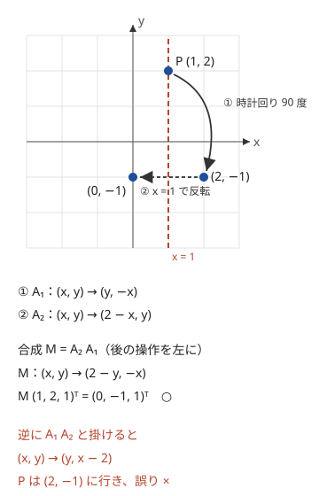
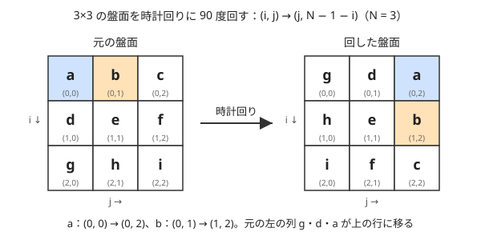

!!! abstract "要点"
    - **何ができるか**：点の回転・反転・平行移動を式で計算し、操作列を何回か行った後の位置を求める。90 度回転は $(x, y) \to (-y, x)$ で整数のまま書ける。操作を $(x, y, 1)$ に掛ける 3×3 行列にすると、積の累積で何回目までの合成も持てる。
    - **いつ使うか**：
        - 点を θ 度回転した位置を求める。
        - 回転・反転・平行移動の操作を順に行った後の位置を、多数のクエリで問われる。
        - 回転と平行移動で 2 つの点集合が重なるかを判定する。
        - 盤面を 90 度回転して一致させる。
        - 操作が $M \le 2 \times 10^5$ 回あり、各クエリは途中の時点での点の位置を問う。
    - **計算量**：1 点の変換は $O(1)$。操作 $M$ 個の合成を前計算すると $O(M)$（3×3 行列の積 1 回は定数）で、以後は途中の時点の位置を 1 クエリ $O(1)$ で答えられる。
    - **前提**：[ベクトルと外積](../geometry/geometry-vectors.md)

<!-- textlint-disable -->
別名：回転行列・rotation matrix・座標の回転・affine transformation・合同変換・複素数で回転・グリッドの回転・90 度回転・転置・三角関数・ラジアン・余弦定理
<!-- textlint-enable -->

回転・平行移動・アフィン変換は、点を動かす操作を式や行列で表し、計算で位置を求める方法である。1 回の回転なら式に代入するだけだが、操作が $M = 2 \times 10^5$ 個並び、「$k$ 回目の後の点 $i$ の位置」を $Q$ 回問われると、毎回すべての操作をたどる $O(MQ)$ では間に合わない。操作を 3×3 行列で表すと合成が行列の積になり、前から順に積を作っておけば、どの時点もまとめて 1 つの行列で表せる。座標の向きは $x$ が右、$y$ が上で、回転の角度は反時計回りを正とする（[外積](../geometry/geometry-vectors.md)の符号と同じ向き）。

## 回転の式と、中心まわりの回転（中心を原点に移す・回す・戻す） {#rotation-formula}

原点のまわりに角度 $\theta$（ラジアン、反時計回りが正）回すと、点 $(x, y)$ は次の位置に移る。

$$
\begin{pmatrix} x' \\ y' \end{pmatrix}
=
\begin{pmatrix} \cos\theta & -\sin\theta \\ \sin\theta & \cos\theta \end{pmatrix}
\begin{pmatrix} x \\ y \end{pmatrix}
=
\begin{pmatrix} x\cos\theta - y\sin\theta \\ x\sin\theta + y\cos\theta \end{pmatrix}
$$

**なぜこの式か**。回転は、2 点の和を回したものと、それぞれを回してから足したものが一致する（平行四辺形が平行四辺形のまま回る）。また、$k$ 倍してから回しても、回してから $k$ 倍しても同じである。だから $(x, y) = x(1, 0) + y(0, 1)$ と分ければ、2 つの単位ベクトルの行き先だけで決まる。$(1, 0)$ は角度 $\theta$ の方向の $(\cos\theta, \sin\theta)$ に、$(0, 1)$ はそこからさらに 90 度進んだ $(-\sin\theta, \cos\theta)$ に移る。これを $x$ 倍・$y$ 倍して足したものが上の式で、行列の 1 列目・2 列目がそれぞれの行き先になっている。

**複素数で見る**。点を複素数 $z = x + yi$ と見ると、回転は $\cos\theta + i\sin\theta$ を掛けることである。展開すると実部が $x\cos\theta - y\sin\theta$、虚部が $x\sin\theta + y\cos\theta$ で、上の式と一致する。C++ では `std::complex<double>` と `std::polar(1.0, theta)` で短く書けるが、中身は `double` の計算なので、整数で判定したい場面には向かない（[誤差と整数での比較](../geometry/geometry-precision.md)）。

**中心 $c$ のまわりの回転**。式は原点まわりの回転なので、中心が原点でなければ 3 段に分ける。

1. 中心を原点に移す：$p - c$
2. 原点のまわりに回す：$R_\theta (p - c)$
3. 元に戻す：$R_\theta (p - c) + c$

たとえば正多角形の向かい合う 2 頂点が分かれば、その中点が中心で、隣の頂点は中心のまわりに $360/N$ 度回した位置にある。2 と 3 を省いて $R_\theta p$ と書くのが典型的な誤りで、原点まわりに回してしまう。

??? question "確認問題：中心まわりの回転"
    点 $(3, 1)$ を、点 $(1, 1)$ を中心に反時計回りに 90 度回した位置はどこか。

    ??? success "答え"
        中心を原点に移すと $(2, 0)$。反時計回りに 90 度回すと $(0, 2)$。中心を戻すと $(1, 3)$ である。

## 90 度回転・反転を整数のまま書く {#rotate-90}

角度が 90 度の倍数なら、$\cos$ と $\sin$ は $0$ か $\pm 1$ なので、式は座標の入れ替えと符号だけになる。整数座標なら結果も整数のままで、誤差が出ない。

| 操作 | $(x, y)$ の行き先 |
| --- | --- |
| 反時計回りに 90 度 | $(-y, x)$ |
| 時計回りに 90 度 | $(y, -x)$ |
| 180 度 | $(-x, -y)$ |
| 直線 $x = p$ で反転 | $(2p - x, y)$ |
| 直線 $y = p$ で反転 | $(x, 2p - y)$ |
| 直線 $y = x$ で反転 | $(y, x)$ |

反転の式は、$x = p$ からの差 $x - p$ の符号を変えて $p - (x - p) = 2p - x$ と求める。90 度の倍数の回転を `cos(acos(-1.0) / 2)` で計算すると、0 ではなく $6 \times 10^{-17}$ ほどの値になり、整数への丸めや等号の比較で誤る。90 度の倍数は必ず表の式で書く。

**向きの確かめ方**。$(1, 0)$ を反時計回りに 90 度回すと $(0, 1)$ になるはずである。$(-y, x)$ に $(1, 0)$ を入れると $(0, 1)$ なので正しい。符号を迷ったら、この 1 点で確かめる。

中心 $(a, b)$ のまわりの 90 度回転も、3 段に分ければ整数のまま書ける。反時計回りなら $(a - (y - b),\ b + (x - a))$ である。中心が半整数（2 点の中点など）になるときは、座標をすべて 2 倍してから計算すると整数のまま扱える。

## アフィン変換：(x, y, 1) と 3×3 行列・掛ける順序（後の操作を左から掛ける） {#affine}

回転と反転は 2×2 行列で書けるが、平行移動は書けない。2×2 行列を掛けても原点 $(0, 0)$ は原点のままなので、原点を動かす平行移動は表せないからである。そこで点を $(x, y, 1)$ と 3 次の列ベクトルにし、3 番目の成分 1 に掛かる列に移動量を置く。

$$
\begin{pmatrix} a & b & e \\ c & d & f \\ 0 & 0 & 1 \end{pmatrix}
\begin{pmatrix} x \\ y \\ 1 \end{pmatrix}
=
\begin{pmatrix} ax + by + e \\ cx + dy + f \\ 1 \end{pmatrix}
$$

左上の 2×2 が回転・反転の部分、右の列 $(e, f)$ が平行移動である。3 行目はいつも $(0, 0, 1)$ で、掛けた後も 3 番目の成分は 1 のまま保たれる。この形で書ける変換をアフィン変換と呼ぶ。たとえば直線 $x = p$ での反転は $a = -1, d = 1, e = 2p$ で、残りは 0 である。

**掛ける順序**。点に操作 $A_1$ を施してから $A_2$ を施すと、点は $A_2 (A_1 v)$ に移る。行列の積は結合法則を満たすので、これは $(A_2 A_1) v$ と同じで、合成は $A_2 A_1$ である。**後の操作が左に来る**。回転と反転は入れ替えると結果が変わるので、$A_1 A_2$ と書くと誤る。



図の例では、時計回りの 90 度 $A_1 : (x, y) \to (y, -x)$ の後に、直線 $x = 1$ での反転 $A_2 : (x, y) \to (2 - x, y)$ を施す。式に代入して合成すると $(x, y) \to (2 - y, -x)$ で、これが $A_2 A_1$ である。

$$
A_2 A_1 =
\begin{pmatrix} -1 & 0 & 2 \\ 0 & 1 & 0 \\ 0 & 0 & 1 \end{pmatrix}
\begin{pmatrix} 0 & 1 & 0 \\ -1 & 0 & 0 \\ 0 & 0 & 1 \end{pmatrix}
=
\begin{pmatrix} 0 & -1 & 2 \\ -1 & 0 & 0 \\ 0 & 0 & 1 \end{pmatrix}
$$

3 行目は常に $(0, 0, 1)$ なので、行列の代わりに 6 個の係数 $(a, b, c, d, e, f)$ を持ち、操作ごとに係数を書き換えてもよい。新しい操作を「今の $(X, Y)$ に施す」と考えて、$X = ax + by + e$ と $Y = cx + dy + f$ の式に代入すれば書き換えの規則が出る。行列で書くと向きの誤りに気づきやすく、係数で書くと短い。

??? question "確認問題：反転してから回す"
    $x$ 軸に関する反転 $(x, y) \to (x, -y)$ の後に、原点まわりの反時計回りの 90 度回転を施す。この合成を 1 つの行列（2×2 でよい）で書け。また、順序を逆にするとどうなるか。

    ??? success "答え"
        反転の行列を $F = \begin{pmatrix} 1 & 0 \\ 0 & -1 \end{pmatrix}$、回転を $R = \begin{pmatrix} 0 & -1 \\ 1 & 0 \end{pmatrix}$ とすると、合成は後の $R$ を左に置いた $RF = \begin{pmatrix} 0 & 1 \\ 1 & 0 \end{pmatrix}$ で、$(x, y) \to (y, x)$（直線 $y = x$ での反転）になる。逆の順序は $FR = \begin{pmatrix} 0 & -1 \\ -1 & 0 \end{pmatrix}$ で、$(x, y) \to (-y, -x)$（直線 $y = -x$ での反転）になり、結果が違う。

## 操作列の累積とクエリ {#prefix-composition}

操作 $A_1, \dots, A_M$ を順に施し、「$k$ 回目の操作の後の点 $i$ の位置」を $Q$ 回問われるとする。1 クエリごとに $k$ 個の操作を点に施すと $O(MQ)$ で、$M = Q = 2 \times 10^5$ では間に合わない。

$k$ 回目までの合成を $P_k$ とすると、$P_0$ は単位行列で、$P_k = A_k P_{k-1}$ である（後の操作を左から掛ける）。$P_0, \dots, P_M$ を前計算しておけば、答えは $P_k (x_i, y_i, 1)^{\top}$ で $O(1)$ である。どの点にも同じ操作列が施されるので、点ごとに動かす代わりに「操作の合成」を 1 本だけ持てばよい、というのが速くなる理由である。前計算は 3×3 行列の積を $M$ 回で、全体は $O(M + Q)$ になる（1 回の積は 27 回の掛け算）。

```cpp
--8<-- "rotation-transform/affine-compose.cpp:core"
```

実装では次の点に気をつける。

- **$k = 0$ のクエリ**：操作をしていない時点は単位行列 $P_0$ で答える。配列を $M + 1$ 個取り、$P_k$ を「$k$ 回目の後」と決めておくと添字がずれない
- **値の範囲**：90 度回転と反転だけなら、左上の 2×2 の成分は $0$ か $\pm 1$ のままである。一方、平行移動の列は反転のたびに $2p - e$ と増え、$\lvert p \rvert \le 10^9$、$M = 2 \times 10^5$ なら最大で約 $4 \times 10^{14}$ になる。`int` ではあふれるので `long long` を使う
- **メモリ**：3×3 の `long long` を $2 \times 10^5 + 1$ 個持つと約 14 MB である。クエリを先に読んで $k$ の順に並べれば、合成を 1 つだけ持って前から進めながら答えられる（オフライン）

行列の累乗との違いは、毎回違う行列を順に掛けることである。同じ操作を $K$ 回繰り返すなら[行列累乗](../math/matrix-power.md#composition)の繰り返し二乗法で $O(\log K)$ にでき、操作の区間 $[l, r)$ の合成を何度も問われるなら行列を[セグメント木](../ds/segment-tree-monoids.md)に載せる。

## グリッドの回転・転置・反転の添字（(i, j) → (j, N−1−i)） {#grid-rotation}

盤面（2 次元配列）を回すときは、点の回転の式をそのまま使うのではなく、添字の対応で書く。$N \times N$ の盤面を時計回りに 90 度回すと、マス $(i, j)$（$i$ 行 $j$ 列、0-indexed）の値は $(j, N - 1 - i)$ に移る。



**なぜこの式か**。盤面の行番号 $i$ は下向きに増えるので、$x = j$、$y = -i$ と置くと、ふつうの座標（$y$ が上）になる。時計回りの 90 度 $(x, y) \to (y, -x)$ を施すと $(j, -i) \to (-i, -j)$ なので、回した後は列 $-i$・行 $j$ である。列が負にならないよう $N - 1$ 足すと $(j, N - 1 - i)$ になる。行の向きが逆なので、点の回転の表とは見かけの符号が違う。迷ったら $(0, 0)$ が $(0, N - 1)$（右上の角）に行くかで確かめる。

| 操作（$H$ 行 $W$ 列） | $(i, j)$ の行き先 | 結果の大きさ |
| --- | --- | --- |
| 時計回りに 90 度 | $(j, H - 1 - i)$ | $W$ 行 $H$ 列 |
| 反時計回りに 90 度 | $(W - 1 - j, i)$ | $W$ 行 $H$ 列 |
| 180 度 | $(H - 1 - i, W - 1 - j)$ | $H$ 行 $W$ 列 |
| 転置 | $(j, i)$ | $W$ 行 $H$ 列 |
| 左右の反転 | $(i, W - 1 - j)$ | $H$ 行 $W$ 列 |

時計回りの 90 度は「転置してから左右の反転」と同じである。長方形の盤面では行と列の数が入れ替わるので、結果の配列を $W$ 行 $H$ 列で作り直す。

```cpp
--8<-- "rotation-transform/grid-rotate.cpp:core"
```

- **元の配列を上書きしない**：同じ配列の中で入れ替えると、まだ読んでいないマスを先に書き換えてしまう。新しい配列に書いてから差し替える
- **4 回回すと元に戻る**：「回す」関数を 4 回呼んで元の盤面に戻るかを `assert` で確かめると、添字の誤りがすぐに見つかる
- **4 通り試す**：「回して一致させられるか」は 0・1・2・3 回の 4 通りを全部試せば足りる。回転と平行移動の組合せを全部試す問題は[全探索の盤面の節](../basics/brute-force.md#move-board)を参照する

## 三角関数と角度の基本（度とラジアン・π は acos(−1)・余弦定理） {#trig-angle}

C++ の `sin`・`cos`・`tan` はラジアンを受け取る。問題が度で与えるなら $\theta_{\text{rad}} = \theta_{\text{deg}} \times \pi / 180$ と直し、度で答えるなら $180 / \pi$ を掛けて戻す。

- **$\pi$ の値**：`acos(-1.0)` で得られる。C++20 なら `std::numbers::pi`（`<numbers>`）も使える。`M_PI` は標準ではなく、環境によっては使えない
- **逆三角関数の範囲**：`acos` は $[0, \pi]$、`asin` と `atan` は $[-\pi/2, \pi/2]$ を返す。`atan2(y, x)` は点 $(x, y)$ の偏角を $-\pi$ から $\pi$ の範囲で返し、$x = 0$ でも割り算をしないので安全である
- **余弦定理**：2 辺の長さ $a, b$ と間の角 $\theta$ から、残りの辺は $c = \sqrt{a^2 + b^2 - 2ab\cos\theta}$ である。2 つの針の先端の距離のように、原点から伸びる 2 本の線分の先の距離はこれで求まる。$\cos$ は偶関数で周期が $2\pi$ なので、角度の差の符号や 180 度を超えるかを場合分けしなくてよい

誤差で定義域から外れることに気をつける。$a^2 + b^2 - 2ab\cos\theta$ は、2 点が重なると $0$ のはずが $-10^{-16}$ のような負になり、`sqrt` が NaN を返す。`acos` に内積を長さで割った値を渡すときも、$1$ を少し超えて NaN になる。`sqrt(max(0.0, v))`、`acos(clamp(v, -1.0, 1.0))` のように範囲に収めてから呼ぶ。出力は `cout << fixed << setprecision(15)` のように桁を指定する（既定は有効数字 6 桁）。

角度を使うのは、答えそのものが実数のときだけにする。角度の大小や一致を判定するだけなら、外積・内積で整数のまま比べる（[偏角ソート](../geometry/argument-sort.md)）。

## 点集合の合同判定：重心をそろえて照合する {#congruence}

この節は[偏角ソート](../geometry/argument-sort.md)と、回転の式（[回転の式の節](#rotation-formula)）を前提にする。2 つの $N$ 点の集合 $S, T$ が、回転と平行移動（反転は含まない）で重なるかを判定する。

**平行移動を決める**。回転と平行移動で重なるなら、重心も重心に移る。だから $S$ と $T$ をそれぞれ重心が原点に来るよう平行移動すれば、残りは原点まわりの回転だけになる。重心は座標の平均で割り算が要るが、座標をすべて $N$ 倍してから重心の $N$ 倍 $(\sum x, \sum y)$ を引けば整数のまま扱える。

**回転を決める**。重心に移した後、原点にない $S$ の点 $a$ を 1 つ選ぶ。重なるなら $a$ はどれかの $T$ の点 $b$ に移り、$\lvert a \rvert = \lvert b \rvert$ である。$b$ を決めると、$a$ を $b$ に重ねる回転は 1 つに決まる。$a$ と $b$ のなす角を $\theta$ とすると、内積 $d = a \cdot b$ と外積 $c = a \times b$ は $\lvert a \rvert^2 \cos\theta$ と $\lvert a \rvert^2 \sin\theta$ になる（長さが等しいので）。よって回転の式に $\cos\theta = d / r^2$、$\sin\theta = c / r^2$（$r^2 = \lvert a \rvert^2$）を入れればよい。

**整数のまま照合する**。割り算を避けるため、$S$ の各点 $p$ を回した位置の $r^2$ 倍

$$
r^2 R_\theta\, p = (d\,p_x - c\,p_y,\ c\,p_x + d\,p_y)
$$

を作り、$T$ の各点を $r^2$ 倍したものと、ソートして全体が一致するかを比べる。$b$ の候補は $T$ の $N$ 個なので、ソートを含めて $O(N^2 \log N)$ である。座標の絶対値が $10$、$N = 100$ 程度なら値は $10^{11}$ に収まる。

```cpp
--8<-- "rotation-transform/congruence.cpp:core"
```

- **重心に重なる点**：重心にある点は回転で動かないので、$a$ に選んではいけない（どの回転でも重なり、回転が決まらない）。照合には含めたままでよい
- **反転を区別する**：外積の符号が回転の向きを決めるので、鏡に映した形は一致しない。反転も許す問題なら、$S$ を $x$ 軸で反転したものでももう一度判定する
- **浮動小数点で回す場合**：`double` で回して比べるなら、許容誤差を付けて比べ、ソートの順も誤差でずれることに注意する。整数で比べられるなら整数にする

$N$ が大きいときは、巡回シフトの照合に直す方法を使う。重心に移した後、原点にない点を偏角の順（同じ偏角なら長さの順）に並べ、各点について（長さの 2 乗、偏角の順で次の点との内積、外積）の組を作る。回転で重なることは、$S$ と $T$ のこの組の列が巡回シフトで一致することと同じになり、$S$ の列を 2 つつなげた中に $T$ の列が現れるかを [Z algorithm](../string/z-algorithm.md) などで $O(N)$ で調べられる。全体は偏角ソートの $O(N \log N)$ である。原点にある点は個数が等しいかだけを比べる。

## 落とし穴 {#pitfalls}

**回転の向き**。数学の式は反時計回りが正である。問題が「時計回りに $d$ 度」なら $\theta = -d$ にする。盤面（行が下向き）では見かけの向きが逆になるので、[グリッドの節](#grid-rotation)の添字の式を使い、$(0, 0)$ の行き先で確かめる。

**合成の順序**。$A_1$ の後に $A_2$ なら合成は $A_2 A_1$ である。累積を `pre[k] = pre[k - 1] * A[k]` と書くと順序が逆になる。回転と反転を 1 つずつ含む小さな例（[アフィン変換の節](#affine)の図）で、点を 1 つずつ動かした結果と比べて確かめる。

**中心を戻し忘れる**。中心 $c$ のまわりの回転は $R_\theta (p - c) + c$ である。$+c$ を忘れると、原点のまわりに回した点との差が残る。

**平行移動を 2×2 行列で書こうとする**。2×2 では原点が動かないので書けない。$(x, y, 1)$ の 3×3 にする。

**度とラジアン**。`cos(90)` は 90 ラジアンの余弦である。度で与えられたら $\pi / 180$ を掛ける。90 度の倍数なら三角関数を使わず整数の式で書く。

**`int` のあふれ**。反転を繰り返すと平行移動の成分が $10^{14}$ 規模になる。[操作列の累積の節](#prefix-composition)のとおり `long long` で持つ。

## 例題 {#examples}

### ABC259 B. Counterclockwise Rotation {#abc259_b}

<div class="kp-problems" data-role="example" markdown>

- [ABC259 B. Counterclockwise Rotation](https://atcoder.jp/contests/abc259/tasks/abc259_b)（diff 180）：点を原点を中心に d 度回転した位置を求める。

</div>

回転の式をそのまま使う問題である。角度が度で与えられるので、ラジアンに直してから `cos` と `sin` に渡す。

??? note "解法の詳細"
    - $\theta = d \times \pi / 180$（$\pi$ は `acos(-1.0)`）とし、$(a\cos\theta - b\sin\theta,\ a\sin\theta + b\cos\theta)$ を出力する。
    - 答えは実数なので、`fixed` と `setprecision` で十分な桁を出す。

### ABC189 E. Rotate and Flip {#abc189_e}

<div class="kp-problems" data-role="example" markdown>

- [ABC189 E. Rotate and Flip](https://atcoder.jp/contests/abc189/tasks/abc189_e)（diff 1526）：回転・反転の操作列を途中まで適用したときの点の位置を、多数のクエリについて答える。

</div>

操作は原点まわりの時計回り・反時計回りの 90 度回転と、直線 $x = p$・$y = p$ での反転の 4 種類である。どれも整数のままのアフィン変換なので、3×3 行列にして $k$ 回目までの合成を前計算する。クエリは「$k$ 回目の後の点 $i$」なので、$P_k$ を点 $i$ に掛ければよい。

??? note "解法の詳細"
    - 4 種類の操作の行列は、回転が $(x, y) \to (y, -x)$ と $(-y, x)$、反転が $(2p - x, y)$ と $(x, 2p - y)$ に対応する（[90 度回転の節](#rotate-90)の表）。
    - $P_0$ を単位行列、$P_k = A_k P_{k-1}$ とし、$P_0, \dots, P_M$ を持つ。クエリ「$k$ 回目の後の点 $i$」には $P_k (x_i, y_i, 1)^{\top}$ を答える。$k = 0$ も同じ式で扱える。
    - 平行移動の成分は反転のたびに増えるので `long long` で持つ。全体は $O(N + M + Q)$。
    - コードは[操作列の累積の節](#prefix-composition)のものと同じ形である（入力の形は問題に合わせる）。クエリを $k$ の順に並べ、合成を 1 つだけ持って進めてもよい。

## 練習問題 {#practice}

<div class="kp-problems" data-role="practice" markdown>

- [ABC298 B. Coloring Matrix](https://atcoder.jp/contests/abc298/tasks/abc298_b)（diff —）：行列 A を 90 度ずつ回転させて、条件を満たすようにできるかを判定する。
- [ABC168 C. : (Colon)](https://atcoder.jp/contests/abc168/tasks/abc168_c)（diff 230）：時計の長針と短針の先端の距離を求める。
- [ABC144 D. Water Bottle](https://atcoder.jp/contests/abc144/tasks/abc144_d)（diff 714）：直方体の水筒を傾けて、水がこぼれない最大の角度を求める。
- [ABC197 D. Opposite](https://atcoder.jp/contests/abc197/tasks/abc197_d)（diff 831）：正 N 角形の向かい合う 2 頂点の座標から、隣の頂点の座標を求める。
- [ABC292 F. Regular Triangle Inside a Rectangle](https://atcoder.jp/contests/abc292/tasks/abc292_f)（diff 1522）：長方形に入る正三角形の一辺の最大を求める。

</div>

??? note "練習の方針"
    - **ABC298 B**：回転を 0〜3 回施した盤面のそれぞれで条件を調べる。回転は[グリッドの節](#grid-rotation)の添字の式で新しい配列に書く
    - **ABC168 C**：短針の角度は分による進みも含めて $(60H + M) / 720 \times 2\pi$、長針は $M / 60 \times 2\pi$。差の角から余弦定理で距離を求め、`sqrt` の引数が負にならないよう気をつける
    - **ABC144 D**：水筒を断面の長方形で考え、水面が底に届くか（水の量が半分より多いか少ないか）で 2 つに分ける。それぞれ空いた部分か水の部分の直角三角形から $\tan$ の式を立て、`atan` で角度を出して度に直す
    - **ABC197 D**：向かい合う 2 頂点の中点が中心である。中心を原点に移し、反時計回りに $360/N$ 度回して戻す（[回転の式の節](#rotation-formula)）
    - **ABC292 F**：短い辺を $A$、長い辺を $B$ とする。一辺 $s$ の正三角形の頂点を長方形の左下の角に置き、底辺の傾きを $\theta$（$0$〜$30$ 度）とすると、右の壁から $s \cos\theta \le B$、天井から $s \sin(\theta + 60^\circ) \le A$ が条件になる。前者の上限は $\theta$ について増え、後者は減るので、両者が等しくなる $\theta$ を二分探索で求める。$\theta = 0$ ですでに前者の上限の方が大きければ、後者の上限 $2A/\sqrt{3}$ が答えである

## 力試し {#challenge}

<div class="kp-problems" data-role="challenge" markdown>

- [ABC207 D. Congruence Points](https://atcoder.jp/contests/abc207/tasks/abc207_d)（diff 2074）：2 つの点集合が、回転と平行移動で一致するかを判定する。

</div>

??? note "力試しの方針"
    - **ABC207 D**：重心を原点に移して平行移動を決め、$S$ の原点にない点を $T$ のどの点に重ねるかで回転の候補を絞り、全体が一致するかを整数で照合する（[合同判定の節](#congruence)）。$N \le 100$ なので候補 $N$ 通り × 照合 $O(N \log N)$ で間に合う

## 確認問題 {#quiz}

??? question "確認問題：90 度回転の式"
    整数座標の点 $(x, y)$ を原点のまわりに反時計回りに 90 度回した点を、三角関数を使わずに書け。また、`cos(acos(-1.0) / 2)` を使ってはいけない理由は何か。

    ??? success "答え"
        $(-y, x)$ である。`cos(acos(-1.0) / 2)` は浮動小数点の計算で 0 にならず、$6 \times 10^{-17}$ ほどの値になる。整数に丸めたり等号で比べたりすると誤ることがある。

??? question "確認問題：合成の向き"
    操作 $A_1, A_2, A_3$ をこの順に施した後の位置を、1 つの行列で求めたい。どの順に掛けるか。

    ??? success "答え"
        $A_3 A_2 A_1$ である。点 $v$ には最初に $A_1$ が掛かり、最後に $A_3$ が掛かるので、$A_3 (A_2 (A_1 v))$ を結合法則でまとめた形になる。

??? question "確認問題：長方形の盤面の回転"
    3 行 5 列の盤面を時計回りに 90 度回す。元の $(2, 0)$（左下の角）は、回した盤面のどこに行くか。回した盤面の大きさも答えよ。

    ??? success "答え"
        回した盤面は 5 行 3 列で、$(i, j) \to (j, H - 1 - i)$ に $H = 3$ を入れると $(2, 0) \to (0, 0)$（左上の角）である。元の左の列が上の行になるので、左下の角は左上に来る。

## 使い分け {#comparison}

- マンハッタン距離を扱うための 45 度回転（$u = x + y$、$v = x - y$）は、長さが $\sqrt{2}$ 倍になる座標の付け替えで、目的が違う。[マンハッタン距離と 45 度回転](../geometry/manhattan-chebyshev.md)を参照する
- 同じ変換を $K$ 回繰り返すなら、合成を前から積むのではなく[行列累乗](../math/matrix-power.md#composition)で $O(\log K)$ にする
- 角度の大小や向きの判定だけなら、角度を計算せずに外積・内積で整数のまま比べる（[ベクトルと外積](../geometry/geometry-vectors.md)、[偏角ソート](../geometry/argument-sort.md)）

## 参考 {#references}

- [merom686「ABC259」](https://merom686.hatenablog.com/entry/2022/07/10/002150)：例題 abc259_b の方針（度をラジアンに直す・π を acos(−1) で得る）
- [oraclesqlpuzzle「ABC189-E Rotate and Flip」](https://oraclesqlpuzzle.ninja-web.net/kyoupro/05-atcoder-02-abc/kyoupro-abc189-e.html)：例題 abc189_e の操作の行列と合成の向き
- [merom686「ABC298」](https://merom686.hatenablog.com/entry/2023/04/16/020333)：練習 abc298_b の方針（4 通りの回転を試す）
- [drken「AtCoder ABC 168 C - : (Colon) (4Q, 灰色, 300 点)」](https://drken1215.hatenablog.com/entry/2020/05/20/083600)：練習 abc168_c の角度の計算と余弦定理
- [drken「AtCoder ABC 144 D - Water Bottle (2Q, 茶色, 400 点)」](https://drken1215.hatenablog.com/entry/2020/04/26/193500)：練習 abc144_d の場合分けと tan
- [ikatakos「AtCoder Beginner Contest 197（Sponsored by Panasonic）D,E,F問題メモ」](https://ikatakos.com/pot/programming_algorithm/contest_history/atcoder/2021/0327_abc197)：練習 abc197_d の中心まわりの回転（解説の部分だけを参照）
- [merom686「ABC292」](https://merom686.hatenablog.com/entry/2023/03/04/234139)：練習 abc292_f の三角形の置き方（頂点を角に置いて回す）
- [drken「AtCoder ABC 207 D - Congruence Points (2D, 黄色, 400 点)」](https://drken1215.hatenablog.com/entry/2023/07/25/143000)：力試し abc207_d の重心をそろえる方法と回転の候補の絞り方
