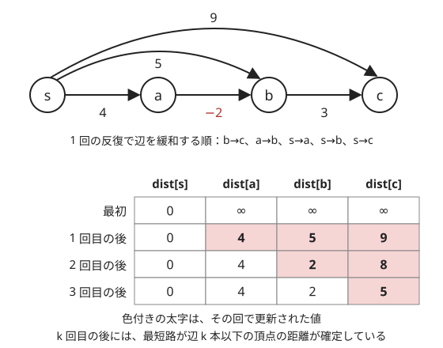
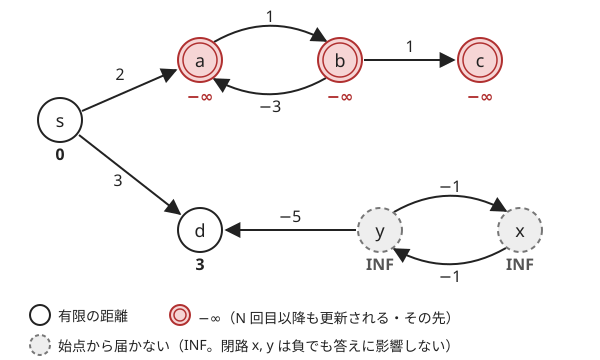

!!! abstract "要点"
    - **何ができるか**：負の辺があっても、全辺の緩和を $N-1$ 回くり返して単一始点の最短距離を $O(NM)$ で求める。答えに影響するのは、始点から届き終点へ行ける負閉路だけである。
    - **いつ使うか**：
        - 負の重みの辺がある・得点を最大化する（符号を反転すると負辺になる）。
        - いくらでも大きくできるなら inf と出力する。
        - $N, M \le$ 数千（$O(NM)$ が間に合う）。
    - **計算量**：$O(NM)$。負閉路の影響を受ける頂点の判定を足しても $O(NM)$ のままである。
    - **前提**：[ダイクストラ法](../graph/dijkstra.md)

<!-- textlint-disable -->
別名：ベルマンフォード・Bellman-Ford・負閉路検出・SPFA・負辺のある最短路
<!-- textlint-enable -->

ベルマンフォード法は、すべての辺の[緩和](../guide/glossary.md#relaxation)を「何も変わらなくなるまで」くり返す最短路のアルゴリズムである。[ダイクストラ法](../graph/dijkstra.md)のように「確定した頂点」を作らないので、負の辺があっても正しい。その代わり $O(NM)$ かかり、使えるのは $N, M$ が数千程度までである。競プロでの本題は距離そのものより、[負閉路](../guide/glossary.md#negative-cycle)があるときに「答えがいくらでも小さく（大きく）なるか」を正しく判定することである。このページでは頂点を 0-indexed で書き、始点を $s$、始点からの暫定距離を $\mathrm{dist}[v]$ と書く。

## N−1 回で十分な理由 {#why-n-minus-1}

ダイクストラ法は「暫定距離が最小の頂点は、もう短くならない」ことを使って頂点を 1 つずつ確定させる。負の辺があるとこれが崩れ、確定した頂点の距離が後から縮む（[負辺で壊れる例](../graph/dijkstra.md#negative-edges)）。ベルマンフォード法は確定をあきらめ、すべての辺を同じように何度も緩和する。

```text
dist[s] = 0、ほかは INF
N-1 回くり返す：
    すべての辺 u → v（重み w）について：
        dist[u] が INF でなく、dist[u] + w < dist[v] なら dist[v] = dist[u] + w
    この回に 1 度も更新がなければ打ち切る
```

次の図は 4 頂点のグラフで、辺をわざと始点から遠い順（b→c、a→b、s→a、s→b、s→c）に緩和したときの $\mathrm{dist}$ の変化である。1 回目の後は直通の辺の値しか入っていないが、2 回目で $s \to a \to b$ の 2 が入り、3 回目でそれを使った $c$ の 5 が入る。



この図のとおり、$k$ 回目が終わると「辺 $k$ 本以下で行ける最短路」はすべて反映されている。理由は帰納法で分かる。辺 $k$ 本以下の最短のウォーク $s \to \dots \to u \to v$ を考える。$u$ までの部分は辺 $k - 1$ 本以下なので、$k - 1$ 回目の後に $\mathrm{dist}[u]$ はその長さ以下になっている。$k$ 回目に辺 $u \to v$ を緩和するので、$\mathrm{dist}[v]$ はウォーク全体の長さ以下になる。逆に $\mathrm{dist}[v]$ は常に実在するウォークの長さなので、本当の最短距離より小さくはならない。

あとは、最短路が辺何本で済むかである。負閉路がなければ、ウォークから閉路を取り除いても長さは増えない。だから最短のものは同じ頂点を 2 回通らない[パス](../guide/glossary.md#path-walk)に取れ、パスの辺は高々 $N - 1$ 本である。よって $N - 1$ 回で全頂点の距離が正しくなる。辺の並べ方を工夫すれば早く終わることもあるが、回数の上限は並べ方によらない。

1 回の反復で全 $M$ 本の辺を見るので、全体は $O(NM)$ である。辺は隣接リストではなく、(始点, 終点, 重み) の組の列で持つのが書きやすい。次のコードは、後の節の負閉路の判定（2. の部分）まで含めたものである。

```cpp
--8<-- "bellman-ford/bellman-ford.cpp:core"
```

途中で更新がなくなったら打ち切るのは、次の回も同じ $\mathrm{dist}$ から同じ辺を見るだけで、何も変わらないからである。負閉路がない入力の多くはこれで早く終わる。

## 答えに影響する負閉路だけを判定する（到達可能性で絞る・−∞ を伝える） {#relevant-cycles}

負閉路があると、そこを何周もすれば距離がいくらでも小さくなる。ただし影響を受けるのは、**始点から負閉路へ行けて、負閉路から先へ行ける頂点だけ**である。次の図の 7 頂点のグラフでは、負閉路が 2 つあるのに、頂点 $d$ の距離は 3 と有限に決まる。



- $a \leftrightarrow b$ の閉路（合計 $-2$）は始点から届くので、$a$・$b$ と、その先の $c$ は $-\infty$ である
- $x \leftrightarrow y$ の閉路（合計 $-2$）は始点から届かない。$y \to d$ の辺があっても、$d$ への道として使えないので無関係である
- $d$ へは $s \to d$ の 3 しかなく、どちらの閉路も経由できない

だから「どこかに負閉路があるか」ではなく「答えを聞かれた頂点が負閉路の影響を受けるか」を判定する。負閉路の有無だけで判定すると、上の図で $d$ を聞かれたとき誤る。方法は 2 つある。

**方法 1：−∞ の印を伝える**。$N - 1$ 回の後にさらに $N$ 回くり返し、更新された頂点に印を付け、印を辺の先へ伝える（コード片の 2. の部分）。印の付いた頂点は、ちょうど $-\infty$ の頂点である。全頂点について一度に分かるので、「各頂点の距離を出力し、いくらでも小さくできるなら -inf」という問題にも使える。

**方法 2：先に頂点を絞る**。始点から届く頂点の集合と、終点 $t$ へ届く頂点の集合（辺を逆向きにしたグラフで $t$ から [BFS](../graph/bfs.md)）を求め、両方に入る頂点の間の辺だけを残す。残ったグラフでベルマンフォード法を行い、$N$ 回目にも更新が起きれば、$t$ は $-\infty$ である。残った頂点はどれも「始点から来て $t$ へ行ける」ので、そこにある負閉路はすべて答えに効く。

方法 1 では、届かない頂点（$\mathrm{dist}[u] = \mathrm{INF}$）からは緩和しないことが前提である（方法 2 は届かない頂点を先に除くので、自然に満たされる）。これを怠ると図の $x$・$y$ が $\mathrm{INF} - 1$ のような値を持ち、負閉路で更新され続けて誤った印が付く。

??? note "証明：方法 1 で印が付くのは −∞ の頂点だけで、−∞ の頂点にはすべて印が付く"
    **印が付けば −∞**：$v$ が負閉路の影響を受けないとする。$v$ へのウォークはどれも負閉路を経由しないので、最短距離 $d^*(v)$ は有限で、辺 $N - 1$ 本以下のパスで実現される。$N - 1$ 回の後に $\mathrm{dist}[v] = d^*(v)$ となり、$\mathrm{dist}[v]$ は実在するウォークの長さなので、それより下がらない。よって $v$ は更新されない。印の伝わり方も、印のある頂点から辺でたどれる頂点にしか伝わらないので、$-\infty$ の頂点の先はやはり $-\infty$ である。

    **−∞ ならいずれ印が付く**：始点から届く負閉路 $C$ を考える。$N - 1$ 回の後、$C$ の頂点の $\mathrm{dist}$ はすべて有限である。もし $C$ のどの辺 $u \to v$ でも $\mathrm{dist}[v] \le \mathrm{dist}[u] + w$ なら、$C$ を 1 周分足し合わせると左右の $\mathrm{dist}$ が打ち消し合って $0 \le w(C)$ となり、$C$ が負閉路であることに反する。だから追加の 1 回の間に $C$ のどの頂点も更新されないことはありえず（更新されなければ $C$ の $\mathrm{dist}$ はその回の間ずっと変わらず、上の矛盾が起きる）、1 回目で $C$ のどこかに印が付く。$-\infty$ の頂点はその印のある頂点から辺 $N - 1$ 本以下のパスで行けて、印は 1 回に少なくとも辺 1 本ずつ進むので、残りの $N - 1$ 回で届く。

## 最長路は符号を反転する {#longest-path}

「得点を最大化する」「いくらでも大きくできるなら inf」という問題は、すべての辺の重みの符号を反転して最短路にする。最大化した値は、反転したグラフでの最短距離 $\mathrm{dist}[t]$ を使って $-\mathrm{dist}[t]$ で戻す。得点の正閉路は、反転すると負閉路になる。

- **通るたびに得点と費用が両方かかる**：辺の得点 $C$ と 1 歩ごとの費用 $P$ があるなら、辺の重みを $C - P$ にまとめてから反転し、$P - C$ にする（[ABC137 E](#abc137_e)）
- **inf の判定**：反転したグラフで $t$ が $-\infty$ かを[前の節](#relevant-cycles)の方法で調べる
- **出力で戻し忘れない**：反転したまま出力すると符号が逆になる

この方法が成り立つのは、同じ頂点や辺を何度通ってもよい（ウォーク）問題だからである。「同じ頂点を 2 度通らない最長のパス」は別の問題で、一般のグラフでは効率よく解けない。[DAG](../guide/glossary.md#dag) なら閉路がないので、負の辺も正の辺もそのまま、トポロジカル順の DP で最長路を $O(N + M)$ で求められる（[DAG 上の DP](../dp/dp-dag.md#dp-as-dag)）。

## SPFA の注意（最悪の計算量は同じ） {#spfa}

SPFA（Shortest Path Faster Algorithm）は、ベルマンフォード法で「前の回に $\mathrm{dist}$ が変わった頂点から出る辺」だけを見直すように変えたものである。$\mathrm{dist}$ が変わらなかった頂点から出る辺を緩和しても何も起きないので、答えは同じになる。

```text
dist[s] = 0、ほかは INF。キューに s を入れ、inq[s] = true
キューが空でない間：
    先頭の u を取り出し、inq[u] = false
    u から出る辺 u → v（重み w）について：
        dist[u] + w < dist[v] なら：
            dist[v] = dist[u] + w、cnt[v] = cnt[u] + 1
            cnt[v] >= N なら負閉路がある
            inq[v] が false なら v をキューに入れ、inq[v] = true
```

$\mathrm{cnt}[v]$ は今の $\mathrm{dist}[v]$ を作ったウォークの辺の本数である。負閉路がなければ最短路は辺 $N - 1$ 本以下なので、$N$ 本に達したら負閉路がある。

ランダムなグラフでは速く終わることが多いが、**最悪の計算量はベルマンフォード法と同じ $O(NM)$** で、更新が何度も起きるように作った入力では遅くなる。辺が非負なら、SPFA ではなくダイクストラ法を使う。負の辺があるときも、$O(NM)$ が間に合う制約でなければ SPFA に頼らず、次の節の見分けを先に考える。

## 負辺があってもダイクストラで済む場合との見分け（ポテンシャル） {#vs-potential}

負の辺があっても、$N, M$ が $2 \times 10^5$ 程度なら $O(NM)$ は間に合わない。その場合は問題に構造があるはずなので、次の順に疑う。

| グラフの形 | 方法 | 計算量 |
| --- | --- | --- |
| 閉路がない（DAG） | トポロジカル順の DP | $O(N + M)$ |
| 重みが「高さの差」で決まる | ポテンシャルで非負にしてダイクストラ法 | $O((N + M) \log N)$ |
| 構造がなく $N, M$ が数千 | ベルマンフォード法 | $O(NM)$ |
| 全点対で $N \le$ 400〜500 | ワーシャルフロイド法 | $O(N^3)$ |

[ポテンシャル](../guide/glossary.md#potential)は、各頂点に値 $p(v)$ を決めて $w'(u, v) = w(u, v) + p(u) - p(v)$ と付け替える方法である。どの $s$-$t$ のウォークの長さも一律に $p(s) - p(t)$ だけずれるので、順位は変わらない。すべての辺で $w' \ge 0$ になる $p$ が見つかれば、ダイクストラ法で求めてから元に戻せる。標高の差で得をしたり損をしたりする移動では、標高そのものが $p$ になる（詳しくは[ダイクストラ法のポテンシャルの節](../graph/dijkstra.md#potential)）。

ベルマンフォード法は、この $p$ を作る側にも使われる。全頂点へ重み 0 の辺を張った仮想の頂点からベルマンフォード法を 1 回行い、その距離を $p$ にする。[三角不等式](../guide/glossary.md#triangle-inequality) $\mathrm{dist}[v] \le \mathrm{dist}[u] + w(u, v)$ から、すべての辺で $w' \ge 0$ になる。その後は各頂点からダイクストラ法を回せるので、負の辺のある疎なグラフの全点対の距離が $O(NM + N(N + M) \log N)$ で求まる（Johnson のアルゴリズム）。[最小費用流](../graph/min-cost-flow.md)が負のコストの残余辺をダイクストラ法で扱えるのも、同じポテンシャルの考え方による。

## 落とし穴 {#pitfalls}

- **INF の頂点から緩和する**：$\mathrm{dist}[u] = \mathrm{INF}$ のまま $\mathrm{dist}[u] + w$（$w < 0$）を計算すると INF より小さくなり、届かない頂点に距離が付く。届かない負閉路で更新が続き、負閉路の判定まで誤る。`if (dist[u] == INF) continue;` を必ず書く
- **N 回目に更新があれば即「inf」と出す**：答えを聞かれた頂点に届かない負閉路でも更新は起きる。[答えに影響する負閉路だけ](#relevant-cycles)を判定する
- **2N 回まわして dist[t] が変わるかだけを見る**：閉路 1 周の効果が小さく、$t$ への別の道がずっと短いと、$2N$ 回では $\mathrm{dist}[t]$ が変わらない。たとえば $s \to t$ が重み $-5 \times 10^8$、$s \to a$ が 0、$b \to t$ が $5 \times 10^8$ とする。$a \to b$ が $-2$、$b \to a$ が $1$ で、1 周 $-1$ の閉路になる。$t$ は $-\infty$ なのに、閉路を約 $10^9$ 周するまで $\mathrm{dist}[t]$ は $-5 \times 10^8$ のままである。印を伝える方法か、頂点を絞る方法を使う
- **無向グラフの負の辺**：無向の辺 $u - v$（重み $w < 0$）を両向きの有向辺にすると、$u \to v \to u$ がそれだけで重み $2w$ の負閉路になる。無向グラフで負の辺を往復できるなら最短路は定まらない
- **反復の回数**：最短距離を求めるのは $N - 1$ 回、負閉路の判定は $N$ 回目以降である。頂点を追加した（仮想の始点を足した）ときは、増えた頂点数で数える
- **符号を反転したまま出力する**：最大化を最短路に直したら、出力の前に符号を戻す。inf のときの出力（-1 や inf など）も問題ごとに確かめる

## 確認問題 {#quiz}

??? question "確認問題：負閉路があるのに答えが有限"
    グラフに負閉路があるのに、始点 $s$ から終点 $t$ への最短距離が有限に決まるのはどんなときか。

    ??? success "答え"
        どの負閉路についても「$s$ から負閉路へ行ける」と「負閉路から $t$ へ行ける」の少なくとも一方が成り立たないときである。$s$ から $t$ へのウォークは、その負閉路を経由できないので、何周もして短くすることができない。

??? question "確認問題：なぜ N−1 回か"
    負閉路のないグラフで、全辺の緩和を $N - 1$ 回くり返せば十分な理由を説明せよ。$N - 2$ 回では足りない例も作れ。

    ??? success "答え"
        $k$ 回の後には辺 $k$ 本以下の最短のウォークがすべて反映されている。負閉路がなければ最短のものは閉路を含まないパスに取れ、パスの辺は高々 $N - 1$ 本なので $N - 1$ 回で足りる。足りない例は、一直線のパス $0 \to 1 \to \dots \to N - 1$ を、終点側の辺から順に並べたものである。1 回に 1 頂点ずつしか距離が入らないので、頂点 $N - 1$ には $N - 1$ 回目で初めて距離が入る。

??? question "確認問題：INF からの緩和"
    `if (dist[u] == INF) continue;` を書かずに、図の $x \leftrightarrow y$ のような「始点から届かない負閉路」があるグラフで方法 1 を行うと、何が起きるか。

    ??? success "答え"
        $\mathrm{dist}[x] = \mathrm{INF}$ から $\mathrm{INF} - 1$ が $y$ に入り、閉路を回るたびに値が下がり続ける。$N$ 回目以降も更新されるので $x$・$y$ に印が付き、その先の $d$ にも印が伝わって、有限の 3 であるはずの $d$ が $-\infty$ と判定される。

## 使い分け {#comparison}

- 辺の重みが非負なら[ダイクストラ法](../graph/dijkstra.md)。負の辺が「高さの差」の形なら[ポテンシャル](#vs-potential)で非負にしてダイクストラ法
- グラフが DAG なら、負の辺があってもトポロジカル順の DP（[DAG 上の DP](../dp/dp-dag.md)）
- 全点対の距離が要り $N$ が 400〜500 程度までなら[ワーシャルフロイド法](../graph/warshall-floyd.md)。負閉路は $d[i][i] < 0$ で分かる（[初期化と負閉路の判定](../graph/warshall-floyd.md#init)）
- 「$x_v - x_u \le c$」の形の条件がたくさんあるなら、条件を辺にしてから最短路を求める（[差分制約](../graph/difference-constraints.md)）

## 例題 {#examples}

### ABC137 E. Coins Respawn {#abc137_e}

<div class="kp-problems" data-role="example" markdown>

- [ABC137 E. Coins Respawn](https://atcoder.jp/contests/abc137/tasks/abc137_e)（diff 1740）：辺を通るたびにコインを拾い、終了時に経過時間 × P 枚を払うゲームで、頂点 N で終えるときに残るコインの最大値（いくらでも増やせるなら −1）を求める。

</div>

1 辺を通るのに 1 単位の時間がかかるので、支払いの $P$ を辺ごとに割り振ると、辺の得点は $C - P$ になる。得点の最大化なので符号を反転して重み $P - C$ の最短路にする。得点の正閉路は負閉路になるが、答えに効くのは頂点 1 から届き、頂点 $N$ へ行けるものだけである。頂点 $N$ に届かない閉路でコインを増やしても、頂点 $N$ で終えられないので意味がない。

??? note "解法の詳細"
    - 辺 $A \to B$（コイン $C$）を、重み $P - C$ の有向辺にする。頂点を 0-indexed にして、始点は 0、終点は $N - 1$ である。
    - [ベルマンフォード法](#why-n-minus-1)を行い、[印を伝える方法](#relevant-cycles)で頂点 $N - 1$ が $-\infty$ か調べる。$-\infty$ なら −1 を出力する。
    - 有限なら、得点の最大値は $-\mathrm{dist}[N - 1]$ である。コインが足りないときは持っている分だけ払う指定なので、出力は $\max(0, -\mathrm{dist}[N - 1])$ になる。
    - 辺を逆向きにしたグラフで頂点 $N - 1$ から届く頂点を求め、その頂点と頂点 0 から届く頂点だけを残す方法（[方法 2](#relevant-cycles)）でもよい。

### ABC061 D. Score Attack {#abc061_d}

<div class="kp-problems" data-role="example" markdown>

- [ABC061 D. Score Attack](https://atcoder.jp/contests/abc061/tasks/abc061_d)（diff 1838）：有向グラフで頂点 1 から頂点 N へ進むときのスコアの最大値（いくらでも大きくできるなら inf）を求める。

</div>

辺のスコアの符号を反転して最短路にし、頂点 $N$ に影響する負閉路があるかを判定する。この問題でよくある誤りは、[落とし穴](#pitfalls)の「2N 回まわして dist[t] が変わるかだけを見る」である。正閉路を 1 周しても少ししか増えず、頂点 $N$ への別の道がずっと長いと、$2N$ 回では最大値が変わらない。

??? note "解法の詳細"
    - 辺 $a \to b$（スコア $c$）を重み $-c$ の有向辺にして、頂点 0 からベルマンフォード法を行う。
    - さらに $N$ 回くり返して、更新された頂点とその先に印を付ける。頂点 $N - 1$ に印があれば inf を出力する。
    - 印がなければ $-\mathrm{dist}[N - 1]$ を出力する。コード片の `bellman_ford` をそのまま使え、全体で $O(NM)$ である。

## 練習問題 {#practice}

<div class="kp-problems" data-role="practice" markdown>

- [ABC237 E. Skiing](https://atcoder.jp/contests/abc237/tasks/abc237_e)（diff 1208）：標高の差で楽しさが増えたり減ったりする無向グラフの移動で、広場 1 から出発したときの楽しさの最大値を求める。
- [ABC280 F. Pay or Receive](https://atcoder.jp/contests/abc280/tasks/abc280_f)（diff 1819）：辺 A→B を長さ C で通ると逆向きは長さ −C になるグラフで、クエリごとに 2 点間の最長路の長さを答え、届かなければ nan、いくらでも大きくできるなら inf と出す。
- [ABC404 G. Specified Range Sums](https://atcoder.jp/contests/abc404/tasks/abc404_g)（diff 1894）：数列の区間の和がいくつか指定されているとき、各項が正で条件を満たす数列のうち総和の最小値を求める（なければ −1）。

</div>

??? note "練習の方針"
    - **ABC237 E**：符号を反転すると負の辺が出るが、ベルマンフォード法では間に合わない。標高をポテンシャルにして辺の重みを非負に付け替え、ダイクストラ法で求めてから標高の差で戻す
    - **ABC280 F**：クエリごとにベルマンフォード法を回すと間に合わない。逆向きで符号が反転する構造から、正の閉路がないことと各頂点に $x_B - x_A = C$ を満たす値（ポテンシャル）が置けることが同じになる。重み付き Union-Find で矛盾を見つけた連結成分を inf にする
    - **ABC404 G**：累積和 $B_0 = 0$、$B_i = A_1 + \dots + A_i$ を変数にする。区間の和の条件は $B_R - B_{L-1} = S$、各項が正の条件は $B_i - B_{i-1} \ge 1$ になる。等式を不等式 2 本に分け、$x_v \le x_u + c$ を辺 $u \to v$（重み $c$）にする。負の辺が出るので、ベルマンフォード法で解く（[差分制約](../graph/difference-constraints.md)）。頂点 $N$ を始点にすると、$\mathrm{dist}[0]$ は $B_0 - B_N$ の最大値なので、総和の最小値は $-\mathrm{dist}[0]$ である。辺 $i \to i - 1$ があるので全頂点が始点から届き、どこかに負閉路があれば条件が矛盾して −1 になる

## 参考 {#references}

- [kmjp「AtCoder ABC #137 : E - Coins Respawn」](https://kmjp.hatenablog.jp/entry/2019/08/10/0900)：例題の方針（辺の重みを $C - P$ にまとめること、頂点 $N$ に届く閉路だけが効くこと、0 との最大）
- [drken「AtCoder ABC 061 D - Score Attack (1Q, 青色, 400 点)」](https://drken1215.hatenablog.com/entry/2019/02/16/075900)：例題の方針（符号の反転、終点に影響しない負閉路の除外、$-\infty$ の印の伝え方、2N 回で終点の変化を見る方法の反例）
- [kmjp「AtCoder ABC #404 : G - Specified Range Sums」](https://kmjp.hatenablog.jp/entry/2025/05/04/0930)：練習の方針（累積和の差分制約にして頂点 N を始点にすること、負閉路なら −1）
- [kyo-pro「ABC237E - Skiing」](https://kyo-pro.hatenablog.com/entry/ABC237E)：練習 ABC237 E のポテンシャルによる付け替え
- [akiku「ABC237解説：本番でACできた問題＋2問（Python）」](https://zenn.dev/akiku/articles/akiku-abc237)：練習 ABC237 E でベルマンフォード法が間に合わないこと
- [drken「AtCoder ABC 280 F - Pay or Receive (青色, 500 点)」](https://drken1215.hatenablog.com/entry/2022/12/07/231851)：練習 ABC280 F のポテンシャルと閉路の条件
